# claude-ue5

An Unreal Engine 5.8 project built almost entirely from scripts. The scripts drive the running editor over Python remote execution, Blender + numpy prepare the source art, and a C++ module holds the games that generate themselves in play. The project has twenty levels (and three menu levels): a photo studio and five character showcases, three hand-built worlds with walk-in buildings, three procedural worlds (a town, a dungeon, an isometric village), the dungeon again with melee combat, blood, sound and music, four magic levels built on it (a caster, a dark caster with a sword, a rogue, a choice of four heroes), the full dungeon game with four heroes to choose, the same game as a castle (Mistward Castle: themed tiers, rooms of other shapes, traps, prisoners, shields, teleporters, bosses), and a space fighter. Most have a recorded demo route or a scripted test, and a Movie Render Queue showcase video.

The most complete game, `random_dungeonmagic_level5`, is described for players in [the game now](#random_dungeonmagic_level5-the-game-now), specified requirement by requirement in **[docs/spec.md](docs/spec.md)** (with its configured values, its tests and its known issues) and its architecture in **[docs/design.md](docs/design.md)**. Its castle version, `mistward_castle`, is described in [mistward_castle: the castle](#mistward_castle-the-castle).

This repository is **source only**: the pipeline scripts, the C++ source, project config and small data files. Unreal assets (`Content/`), source art binaries, sounds, renders and the third-party packs they come from stay local. See [What's not in the repo](#whats-not-in-the-repo).

## Capabilities

What the project does today. Everything here is built by the scripts in this repository and can be rebuilt from the local packs; the [Levels](#levels) table has the detail.

**Characters and animation**
- A MetaHuman conformed to a 3D scan (`fig4`): face and body fitted to the scan, a strand hair groom, the scanned outfit refitted to her, studio lighting.
- Characters from six kinds of source on the same third-person controls: the MetaHuman, a Meshy AI biped with 18 moves of its own, a Unity-format Fab soldier, a static Tripo GLB rigged in Blender, animated Tripo GLBs playing their own clips, and Meshy JRPG characters (one of them an unrigged mesh whose skeleton is worked out from its shape).
- IK rigs and retargeters built from Python: UE5 mannequin and soldier animation onto the other characters, three Fab weapon animation packs onto the player of the dungeon.
- Feet that stay put: walk and run speeds measured from the stance foot, clips grounded on the sole contacts, root locking, foot IK on uneven ground.
- Clips made in Blender for characters that lack them: an idle, spell casts and sword cuts posed on the character's own rig by where each bone points, which way the palm faces and which way the blade points, eased into each other (`blender_numpy/caster_clips.py`, `darkcaster_clips.py`); the moment a blow lands or a bolt leaves is measured on the imported clip.

**Worlds**
- Hand-built from pack maps: a meadow (procedural Nanite terrain, rocks, grass), a photo studio, a medieval village and a castle with a lake village whose houses were opened up and furnished by purpose, a sci-fi city joined to a megastructure with furnished rooms behind automatic doors.
- Procedural, in C++ (`ARTTownGenerator`, `ARDDungeonGenerator`, `AIVVillageGenerator`): a start area built from a fixed seed and saved; walking toward its edge generates the next area ahead of her, spread over several frames, with a reveal effect (a scan wave and a glowing border). Rooms and houses have a purpose and are furnished and lit for it; every door and container can be reached and opened.
- Things to do in them: doors, chests, wardrobes, barrels and crates that open; a minimap and a full map of what has been generated and discovered; monsters that wander the dungeon; villagers who walk the village streets and give way.
- Views: third person; a fixed isometric camera that turns in 45° steps and zooms, with roofs and camera-side walls cut away indoors and her silhouette shown through what hides her; a chase camera behind a fighter.

**Combat** (`random_dungeoncombat_level`)
- Three melee weapons with their own attack, flinch and death clips; monsters that notice her, give chase, attack, flinch and die; hit points and damage set by tier so the first area is easier than what is generated in play; regeneration, death and return.
- Blood: bursts of drops and spray from where a blow lands, marks where the drops fall, a pool under a body.
- Wounds: each blow leaves a wound on that one monster, on its skin where the weapon met it.
- Sound placed in the world and fading with distance: her footsteps and voice, each monster kind's steps, growl, roar, cry and death, fires, doors, chests, the rumble of a new section.
- Music: a wandering track over a room tone; a battle track over a tenser atmosphere when a monster comes at her, another one each fight; the wandering track resumes where it left off.

**Magic, the rogue, the choice of hero and a face that moves** (`random_dungeonmagic_level`, `random_dungeonmagic_level2`, `random_dungeonmagic_level3`, `random_dungeonmagic_level4`, `random_dungeonmagic_level5`)
- A fire spell at medium range: a charge of sparks on her hand while she winds up, a bolt of fire that leaves her hand at the release, follows the monster she turned to (one in reach that she can see) and bursts on the first monster or wall it meets: an explosion and a flare of flame, a light that goes with the bolt and flashes where it bursts, the spell's damage on that monster and half of it on the others nearby. The effects are the fire effects `docs/magic.md` lists (DarkHalls, Starter Content), the slow-starting ones in copies that start warm.
- `random_dungeonmagic_level`: a caster (girl-caster-tripo) with three casts made for her; WASD move, R switches between walking and running, left mouse or E cast; the same on an Xbox controller, and the HUD shows the controls of whichever is in use.
- `random_dungeonmagic_level2`: a dark caster (girl-darkcaster-tripo) with a sword in her right hand and fire from her left: three sword cuts and two left-hand casts made for her; left mouse (RB) cuts, right mouse or E (LB) casts while the sword stays in her hand.
- `random_dungeonmagic_level3`: a rogue (Rogue.glb) with a dagger in each hand and a crossbow: three dagger strikes, a crossbow shot and a roll made for her; 1 / 2 or the mouse wheel switch, left mouse (RB) strikes or shoots, B rolls out of a blow. The crossbow bolt is a mesh with a trail that flies straight at the monster she turned to and sticks in the wall where it misses; the weapon not in her hands is carried on her (the crossbow on her back, the daggers on her thighs).
- `random_dungeonmagic_level4`: the hero is chosen before the dungeon loads. A menu level shows each of the four Tripo characters turning on a turntable with her weapons in her hands, beside a card of what she can do: the Warrior wields all weapons, wears all armour, does 30 % more melee damage and has the most hit points; the Mage casts and learns all spells (fire and dark fire) and has the fewest; the Warlock wields all weapons, wears only light and medium armour, casts a limited set of spells (fire) and has balanced hit points; the Rogue wields daggers and ranged weapons, does 30 % more ranged damage, dodges with B and wears only light armour. In the dungeon spells take mana, which comes back slowly; hit points come back only from potions and food; an inventory (I, Tab or Start: the game pauses) holds her weapons, which she wields from there, and what she finds. Each container of the first section holds one of 33 potions and foods (healing, mana, speed, and food that heals over ten seconds), as rare as the item table says. Armour is on the cards only in this level: the armour to find is level 5's.
- `random_dungeonmagic_level5` (the most recent level: [the game now](#random_dungeonmagic_level5-the-game-now), [spec](docs/spec.md), [design](docs/design.md)): first the Summoner (Summoner.glb, a Tripo model with a rig of generic bone names and no clips) with the Mage's fire spell and the Mage's clips retargeted onto her, and a face that shows what happens to her: six shapes made in Blender (a smile, a frown, the brows down and up, a squint, the jaw) and six patches painted on her texture (eyes shut, happy, screwed up in pain, narrowed in anger; sad brows; an open mouth), mixed into eight expressions. That face has since been replaced by a MetaHuman face for realistic expressions: Epic's preset Aera in her colouring (blond brows, amber eyes), rigged by Epic's cloud service and set on her body under her own anime hair, her painted face cut away by her material; RigLogic moves its 858 blend shapes and its joints from control curves, and sixteen expressions are written from FACS action units (joy, surprise, focus, anger, pain, a shout, disgust, fear, sadness, effort, death, a blink, the eyes looking about). In play she winces when hit, sets her face when she casts, smiles when she finds something, glares while a monster is after her, looks afraid when her hit points run low, shuts her eyes when she dies, and blinks at random. (The face system is still in the C++, but the level as rebuilt from level 4 has no face data: no hero's face moves on it now.)
  - **Now it is level 4's game with a fifth hero and armour to find**: the menu of heroes (the Warrior, the Mage, the Warlock, the Rogue and the **Summoner**, Summoner3.glb, a Tripo model in a bikini with her own walk and run and the Mage's spells cast with her own clips), and 27 sets of armour from Fab warriors, knights, dwarves and orcs (full plate, heavy, medium, light, partial, orc), light, medium or heavy, each refitted in Blender bone by bone to the body of every hero who wears its weight (the Warrior and the Summoner all 27, the Warlock the 17 light and medium ones, the Rogue the 7 light ones, the Mage none) and put on in play from the inventory: the set's mesh follows her skeleton, one set at a time, each blow on her loses the set's share and wears it down; a set of a weight her hero does not wear is refused, and the message says why. A container now holds up to six things (FOUND: the first "and N more"); the inventory scrolls.
  - **And a weapons table and five tiers of rooms**: 29 weapons from the library (short swords, one- and two-handed swords, curved and eastern swords, short blades, bows and crossbows), each with a speed and a damage rating, a durability and a rarity, found in the containers of their tiers: the damage 8 + 3 × the rating, one attack every 1.6 to 0.55 s by the speed, 1 off the durability for every attack that hits, broken and gone at 0. The heroes wield what their cards say (the Warrior and the Warlock all, the Rogue blades and ranged weapons, the Mage and the Summoner none): a found weapon is held where its handle was measured on its model, swung with her own clips or with clips made for it in Blender (a bow shot, a crossbow shot; a two-handed sword is swung as her one-handed sword, with nothing in the other hand: the user's choice). The dungeon's sections are sets of rooms in rings round the start, tiers 1 to 5 (1, 8, 16, 24, 32 sets); a tier past 2 opens only once every set of the tier before is cleared (every room entered, every chest and trunk looted, every monster killed: the dead stay dead), the hallways into a shut tier are barred by gratings, out of tier 5 walled, and a panel under the minimap counts what is left.
  - **And the armour table, the loot table and crafting**: each set has the user's ratings, damage reduction (1-10: a blow takes 5 % less a point) and speed (1-10: 3 % slower a point below 10), a durability (1 off for each blow that reaches her; worn out, it takes off half its share) and the tier of rooms it is found in. Potions and food are found by tier too; 15 crafting materials (ingots, wood, hides and leather, glues, rope, oils) and 5 repair items anywhere. Enter on a repair item lists what it can mend (her armour, the weapons she found) and gives back its share of the full durability. Repair items are made at anvils (one in every forge, at least one in every set of rooms, one in the great hall) from materials, by five recipes; the maps draw the anvils as a small anvil and write each room's tier. The fires' crackle is 8 dB quieter.
  - **And spells, rings, monsters by tier, corpses, allies and an Escape menu**: 30 spells from the user's table (bolts that pierce, slow, burn and jump; wards, armour and a veil; clouds, rifts, a pillar of fire and a meteor storm; curses; a cheat-death pact; the raised dead and a summoned Abyssal Knight fighting at her side), learned from tomes found by tier by the heroes whose card learns their type (the Mage and the Summoner all, the Warlock offense and curses), cast with mana and cooldowns from a bar of ten slots (keys 1 to 0, the wheel). 30 rings (more mana, more hit points, more ranged damage), one of each kind worn. Found weapons broken down into materials at an anvil. One container in three holds anything, then one to six things. The monster gallery's 55 usable monsters in the rooms of their tier, with the tier's hit points, damage, speed and, from tier 3, poison, weakening or slowing; the dead stay where they fell, for good. An Escape menu with four volumes (overall, action, environment, music: kept in the game's settings), another hero, quit.
  - Before that its hero was **Summoner2** (Summoner2.glb, a realistic Tripo model made from two photos, in a red bikini with gold chains): a whole MetaHuman fitted to her model, face and body together (MetaHuman's conform with face landmarks tracked on a portrait of it), its look matched to the photos (pale skin with a pink undertone, dark brown eyes, rosy cheeks, a coral lip tint; long straight hair with a fringe as strands, near-black roots going magenta), the skin of face and body one synthesis so nothing jars between them; her bikini cut from her model and skinned to the MetaHuman's body; the mannequin's motion-captured walk and jog and the Summoner's casts, flinch and death retargeted onto it; the sixteen FACS expressions on its own rig.
- Everything else of the combat level: monsters, tiers, blood, wounds, sound (with spell, crossbow, dagger and roll sounds of its own) and music.

**Mistward Castle** (`mistward_castle`, the newest level: [mistward_castle: the castle](#mistward_castle-the-castle))
- Level 5's game as a castle in five themed tiers (the stone dungeon, a castle keep and its cells, dwarven deep halls, then all three), with its name on the menu and the maps.
- Rooms of other shapes and heights: round, octagonal, hexagonal, triangular, a diamond, L, T and U rooms, domes, pyramids, stepped ceilings and high halls, drawn in their shapes on the maps.
- Furniture that never overlaps and never blocks a container; containers that stay open.
- A tier opens at 75 % of the tier before (rooms, monsters, chests); then a boss and its band wait in a room she has seen, and a potency ring she never found lies guarded there, both marked on the maps.
- The Warrior's 22 shields (the user's table: damage reduction, speed, durability), carried several of a kind, put on and off, broken down at the anvil; armour carried set by set and broken down too.
- A torch made at the anvil, carried in the left hand by every hero, its flame and light with her.
- Twelve kinds of traps (mechanical, magical, complex, transport) that the Rogue sees and disarms.
- Teleporters between each tier's first set and the great hall, by rings found on their pads.
- Prison cells with prisoners to free (they thank her with a thing and walk off) or monsters that break out.
- Her things dropped where she falls, shown as their pictures with a loot effect, taken up again with F.
- The frame rate on screen; a held key walks the inventory; the anvil's lists in alphabetical order; pictures for the found weapons, shields and the torch; every monster kind standing on the floor (Half Creature 05 was drawn under it).

**Space flight** (`starship_level`)
- A fighter kitbashed from pack meshes in a 5 km combat area round a station: cannons, homing missiles with lock-on, destructible asteroids, containers and drones, collisions with hull damage, a gate course, engine flames and contrails, a full HUD.
- A standalone Windows package of it that needs nothing installed.

**Input:** keyboard and mouse everywhere; an Xbox controller in the village, the fighter, the dungeon fight and the magic levels (on levels 4 and 5 the whole game: the hero menu, moving, fighting, the inventory, the anvil and the map; only the Escape menu has no button to open it).

**Tests**
- A scripted play-in-editor test for the sci-fi city, the three procedural worlds, the dungeon fight and the fighter, driven from PowerShell by a plan string and written out as JSON: walk tests (routes, doors, containers and where their lids and doors are, generation across each edge, falls, clipping, stuck legs), the combat test (15 steps, from each weapon's blow to the music changing and the flames burning), the magic test (the keys pressed as on the keyboard, the bolt measured in flight, kills by fire and by sword), the hero test (the menu's keys and turntable and the dungeon it opens, each hero's weapons, hit points, mana and damage bonus measured on a monster, the inventory pausing the game, every container of the first section and the rarity shares over 20 000 of them, every potion and food, the speed potion measured from where she runs), level 5's test (`853`, 23 steps: the five-hero menu; loot by tier and the container chance over 6000 draws; every armour set on every hero who wears it, following her skeleton, its share of a blow and its wear; the weapons table, each weapon's grip in her palm, its damage, attack time, wear and breaking; repairs, crafting and breaking down at anvils; the tiers opening and their seals blocking her; corpses laid again; each tier's monsters and their abilities; all 30 spells cast and measured; rings; the maps' tier labels and anvils; the Escape menu and its volume measured in the game's output; see [docs/spec.md](docs/spec.md#262-the-test)), Mistward Castle's test (`868`, 13 steps: the title, the frame rate, the themes, the alphabetical anvil; shields (their share of a blow and of her speed, measured), the torch on each hero, armour by the set, the inventory walked by a held key, containers staying open through a rebuild, every monster kind on the floor, the 75 % rule kill by kill, the boss and the guarded ring and their marks, shaped rooms and tidy furniture measured on the meshes, all 12 traps set off on her and one disarmed by the Rogue, the teleporters, the prison cells, her things dropped and taken up), the flight test (every control, kills, collisions, a lap through the gates).
- A sound self test that records what the audio device puts out while sounds play at known places, and measures it: is the sound there, on the correct side, quieter with distance.
- A packaged game's own self test, run without a window: a report and a picture.

**Demo reels**
- 1080p Movie Render Queue renders. Recorded routes on `*_Cine` copies run on the sequence clock, so a preview and the final render match; for the dungeon fight and the fighter a pilot script plays the game itself through its inputs while the queue renders the player's view, and two renders log the same events.
- The HUD, maps, captions and key presses are drawn over the frames from the recording of the render itself; the sound track is the game's own mix.
- Each reel is encoded twice: full size, and a two-pass copy of 20 MB or less.
- `mistward_castle`'s reel: `MistwardCastle_Heroes_Showcase` (4:38): the menu's four passages, each followed by her run: the Warrior's found shield, the open chest, the anvil's alphabetical lists, a shield broken down, a fight on the shield, tier 2 opening at 75 % and the boss; the Mage's held-key inventory, the torch made and lit, a prisoner set free and a caged monster breaking out; the Warlock's domed, stepped and round rooms, the teleporters both ways, her fall and her things taken up; the Rogue's trap seen and disarmed, a dart trap, the guarded ring.
- `random_dungeonmagic_level5`'s reels (in `renders/`, `RandomDungeonMagic5_<name>_Showcase.mp4`): Summoner_Faces (0:30) and Summoner_MetaHuman_Faces (0:30), the earlier level's faces; Summoner_Armour (1:42); Weapons_Tiers (2:07); and four of the heroes, each a menu passage and a run per hero: Heroes_Weapons (4:02), Heroes_Armour (4:36), Heroes_Crafting (5:40), Heroes_Spells (5:40).

**Tooling**
- `ue_exec.py` runs a script or a snippet in the running editor; an MCP server exposes the editor's own toolsets.
- `build_cpp.ps1` builds the C++ module without a .NET Framework SDK installed; `package_starship.ps1` packages a level as a game.
- Shared builders: `interior_lib.py` (rooms, furniture, openables, lights for any building), `mat_lib.py` (textures and Substrate materials from Python), `capture.py` (a picture of the editor world from any camera).
- A survey of the local Fab library: what is usable in UE5 and which animations drive which models (`asset_survey/`, `local-packs.md`); and of the asset directories that hold no Unreal content (2D and pixel-art packs, sound and music, fonts: `asset_dirs_survey.py`, `asset_survey/asset_dirs.json`, listed in `docs/assets.md`).
- A hero gallery, [docs/heroes.md](docs/heroes.md): the library's 100 possible heroes and player characters in ten categories, each with a suggested role and three pictures (full body, upper body and head, an action pose copied from another pack's attack clip onto its own skeleton, with a sword, axe, spear, rifle or bare fists).
- An enemy gallery, [docs/humanoid_enemies.md](docs/humanoid_enemies.md): the library's humanoid enemies (undead and crawlers, orcs and trolls, demons, mutants, beast-men, thugs, soldiers, aliens) in nine categories, pictured the same way; models made of several meshes are posed together, and a pack's own attack clip is used where it has one. Both galleries say for each character which rig it has and which animations it can play (`902` surveys every clip in the project by skeleton and bone names).
- A vehicle gallery, [docs/vehicles.md](docs/vehicles.md): the library's mounts, beast- and hand-drawn carts, siege engines, boats and ships, road vehicles and mine carts, military vehicles and drones, and sci-fi craft, each with its size, a suggested use, its animations and three pictures (three-quarter, side, and a frame of its own clip or a view from above); models from a 60 cm drone to a 115 m cargo ship are staged in one row and shot one at a time with a show-only list.
- A weapons and items gallery, [docs/objects.md](docs/objects.md): the library's fantasy, modern and futuristic weapons, its armour and shields (armour sets: all of a character's armour pieces shown together as an empty suit; shields of every era; helmets and masks) and its non-weapon items (food and drink, medicine, tools and devices, treasure and books), each with its size, a suggested use, three pictures (views chosen from the object's own axes, and a frame of its own clip where it has one: a reload, a shot, a lid) and its animations: its own clips, the first-person arm clips made for it, and the third-person sets in the project that hold that kind of weapon.
- A monster gallery, [docs/monsters.md](docs/monsters.md): the library's 107 monsters ranked by looks from easiest to toughest, each pictured in its own colours and in three recoloured versions (infernal, venom, frost) made by one material that recolours the model's own texture and adds a pattern that follows the body. Packs that exist only in Unity format are unpacked and imported for it.

## random_dungeonmagic_level5: the game now

The most recent level, and the most complete game in the project. Everything below is built by `824`-`859` (see [Levels](#levels) and the rebuild notes) and checked by its tests (`853` through `828_rdm4.ps1 ... -lv 5`, and level 4's `827`).

**The heroes.** Play opens a menu first: four heroes on a turntable (since 2026-10-26 the Warrior is Warrior3, `ai models/Warrior3.glb`, and the Summoner is left off the menu: she stays in the game's data, its default when it is played from the editor without the menu), each with a card of what she can do (A / D, the arrows, the wheel, the D-pad or a click change the hero; Enter, Space, A or START opens the dungeon with her). The tables below are written from the game's own data by `pipeline/blender_numpy/rdm5_tables_doc.py`.

The stills on this page are frames of the spells reel (`RandomDungeonMagic5_Heroes_Spells_Showcase.mp4`), with the HUD and captions the reel draws over them.

| Choosing a hero: the Mage's card |
|---|
| 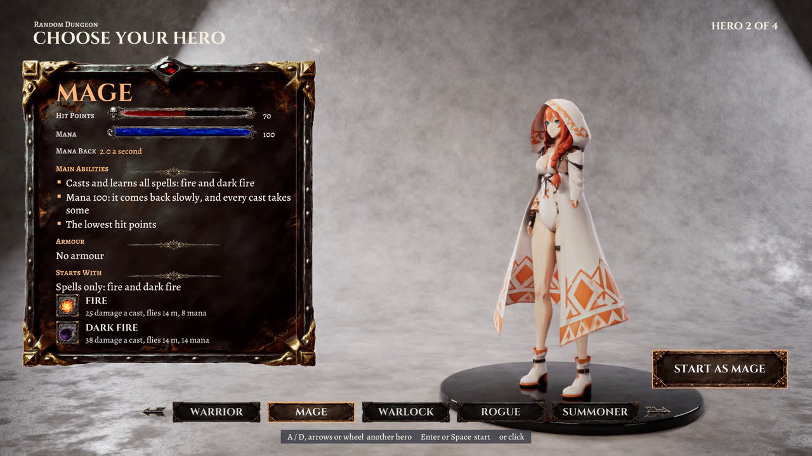 |

<!-- rdm5:heroes -->
| Hero | Her card (what she can do) | Hit points | Mana (back a second) | Starts with | Wears armour | Wields from the weapons table |
|---|---|---|---|---|---|---|
| Warrior | Wields all weapons; Wears all armour; High melee damage: +30% to her melee weapons' damage; The highest hit points | 140 | none | Sword and shield | all: light, medium, heavy | all |
| Mage | Casts and learns all spells: fire and dark fire; Mana 100: it comes back slowly, and every cast takes some; The lowest hit points | 70 | 100 (2.0) | Spells only: fire and dark fire | none | none |
| Warlock | Wields all weapons; Wears only light and medium armour; Casts and learns a limited set of spells: fire; Mana 60: it comes back slowly, and every cast takes some; Balanced hit points | 100 | 60 (1.2) | Arming sword and the fire spell | light, medium | all |
| Rogue | Wields daggers and ranged weapons; Ranged damage: +30% to her ranged weapons' damage; Wears only light armour; Uncanny dodge (B): she rolls out of a blow; Balanced hit points | 100 | none | Two daggers and a crossbow | light | short blades, ranged |
| Summoner (level 5 only) | Casts fire and dark fire, as the Mage does; Wears all the armour she finds: every set was made for her; Worn armour takes a share off every blow | 85 | 90 (1.6) | Spells only: fire and dark fire; no armour | all: light, medium, heavy | none |
<!-- /rdm5:heroes -->

Learning spells (the cards' "learns"): a spell tome found in a container teaches its spell to a hero who learns spells of its type: the Mage and the Summoner every type, the Warlock offense and curses; the Warrior and the Rogue none (they carry the tome). The spells below.

**In the dungeon.**
- **Moving:** W A S D, the mouse looks, R switches walking / running (Shift held runs), Space jumps; the same on an Xbox controller, and the HUD's controls panel shows whichever device was used last.
- **Fighting:** the left mouse (RB) strikes, shoots or casts with what she holds; the Warlock casts fire with the right mouse or E (LB) while her sword stays drawn; 1 to 0 or the wheel draw her weapons and spells (a bar of them along the bottom of the view: the drawn one lit, a spell's cooldown shading its slot, its mana in red when she has too little); the Rogue rolls out of a blow with B. Monsters notice her, chase, attack, flinch and die; blows draw blood and leave wounds; when she falls she comes back at the middle of the dungeon.
- **Monsters by tier:** each tier's rooms hold the monster gallery's monsters of that tier ([docs/monsters.md](docs/monsters.md): 55 of its 107, those whose own clips walk, attack, flinch and die; the elephant, the dragon and three crawlers whose parts would not follow their clips left out), in their own colours, an orc's weapon in its hand. Their hit points and damage are the tier's (against the 100 hit point, 25-damage reference: 50 / 11 in tier 1 to 340 / 55 in tier 5, each kind 0.8 to 1.2 of that by its rank in the gallery), they move faster and strike more often tier by tier, and from tier 3 their blows carry an ability: poison (hit points lost over a few seconds), weakening (her blows and spells do less) or slowing, stronger tier by tier. Their bars over them show the gallery's name and what holds them (CURSED, SLOWED, BURNING).
- **The dead stay:** a monster she kills lies where it fell for good, also when its set of rooms is dropped and generated again; Raise Dead and Corpse Explosion use the corpses.

| The Warrior's two-handed sword against two tier-1 Medics | A tier-3 Tank's blow slows her (SLOWED -20%) | A tier-3 Insect poisons the Rogue (POISON 3.8/s) |
|---|---|---|
| 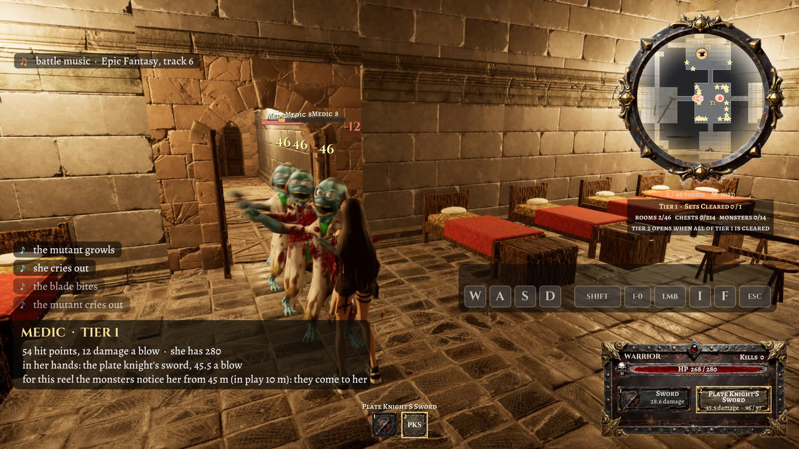 | 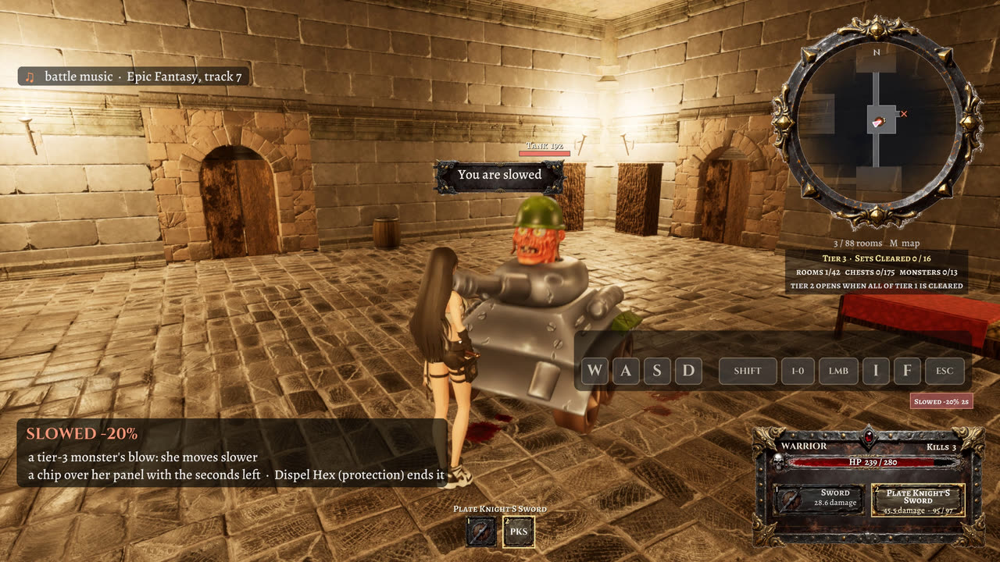 | 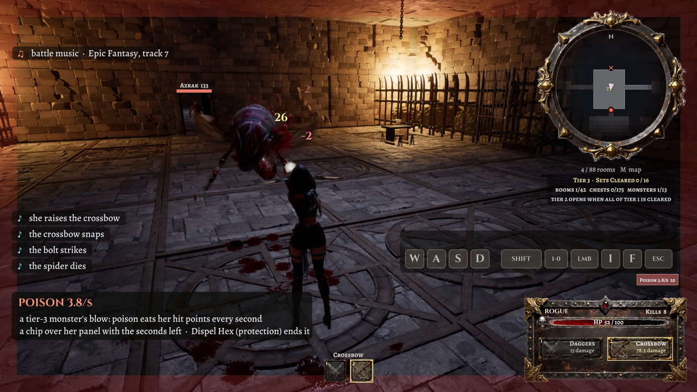 |

- **Allies** (the raised dead, the Abyssal Knight) fight beside her: her camera passes through them, one the camera is in is hidden, and one left far behind comes back at her side (measured in the spells reel's record: the camera at least 66 cm from her, about 3 m most of the time, where it was 8 cm with allies behind her).
- **Hit points and mana:** hit points never come back by themselves, only from potions and food; spells take mana, which comes back slowly.
- **Containers:** every chest, trunk, wardrobe, barrel and crate opens (F, or X on the gamepad); one in three holds anything at all (measured: 32.7 % and 33.1 % of 6000 in the last two runs; one that holds nothing says "Empty: nothing inside"), and then one to six things, given the first time it is opened and never again, each picked by its rarity among the items of the container's tier: potions and food, crafting materials (1 to 3 at a time), repair items, rings, spell tomes, the 27 armour sets and the 29 weapons (the great hall's containers hold five of tier 1's sets whatever the draw, one each in turn). "FOUND" shows what she took. A set of armour she already carries is not kept twice: the one found mends hers to full.
- **The inventory** (I, Tab or Start; the game pauses): her weapons and spells, potions and food, repair items, armour (each set's durability: "WORN  158 / 210", "WORN OUT"), rings (WORN), tomes her hero cannot learn, materials, and the weapons she found but cannot wield; Enter wields a weapon, uses a potion or food, puts a set of armour or a ring on or takes it off, or opens a repair item's list; the right side says what the item does for her (a spell: its line in the table, its cooldown, how long it lasts).

| The inventory: the Warrior's found two-handed sword, a ring she wears, a tome she cannot learn, materials |
|---|
| 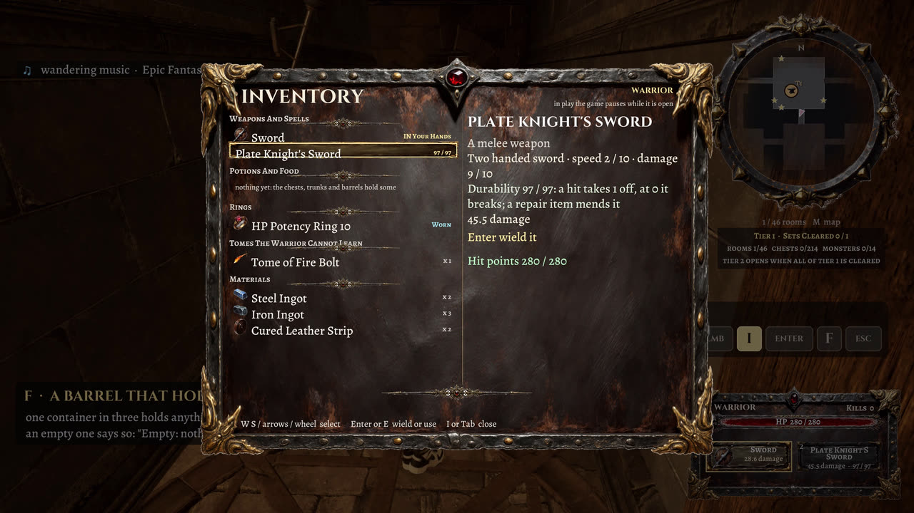 |

- **The Escape menu** (the game pauses): the overall volume, the action sounds (her, the monsters, the fighting and the spells), the environment sounds (fires, doors, containers, the dungeon's own sounds and the room tone) and the music, as sliders (W / S choose, A / D or the mouse set them; kept in the game's user settings), then RESUME, CHOOSE ANOTHER HERO (the menu level) and QUIT (ends play in the editor, quits the game). In the editor the key that stops play is Shift+Escape for this project (`858`), so that Escape reaches the game. Measured from the game's output: the environment volume at half took a fire's level 2.5 m away down 6.1 dB (half the amplitude is 6.0).

**Spells** (`858`, `SourceArt/random_dungeon_magic5/spells.json`: the user's table). A tome is one more thing a container may hold (rarity 25, every tier); which spell it teaches follows the table's drop chances among the spells of the room's tier, the tier set by the spell's mana. A learned spell joins her weapons and is cast with her own cast clips; its damage, which the table does not give, is 25 × (mana / 8)^0.75 (the Mage's fire bolt the step). The Mage's and the Summoner's fire and dark fire are the table's Fire Bolt and Dark Fire (their own mana and damage). The effects are from MagicProjectilesVol4 / Vol5, ToonExplosionVol1 / ToonExplosionsVol2 and StylizedShieldsVol1 (the shields on her and on the zones), coloured with the packs' own parameters. Spells dearer than her mana are refused and say so (the Mage has 100, 200 with the best magic ring: Null Sanctum and Apocalypse are beyond any hero yet).

<!-- rdm5:spells -->
| # | Spell | Type | The table's effect | Drop chance | Mana | Cooldown | Duration | Tier of its tome | In the game | Learned by |
|---|---|---|---|---|---|---|---|---|---|---|
| 1 | Fire Bolt | Offense | Fast single fire projectile | 12.50 % | 7 | none | instant | 1 | a bolt: 23 damage | Mage, Summoner, Warlock |
| 2 | Dark Fire | Offense | Black flames that burn and drain life over time | 11.50 % | 12 | none | 4 s | 1 | a bolt: 34 damage, then 60 % more over 4 s, 30 % of it back to her | Mage, Summoner, Warlock |
| 3 | Ash Ward | Protection | Small barrier that absorbs a few hits | 11.00 % | 15 | 10 s | 8 s | 1 | a shield on her: takes 3 blows whole | Mage, Summoner |
| 4 | Frost Shard | Offense | Piercing ice projectile that slows | 10.00 % | 14 | none | 2 s | 1 | a bolt: 31 damage, passes through, slows 40 % | Mage, Summoner, Warlock |
| 5 | Shadow Lash | Offense | Whip of darkness that strikes an arc and knocks back | 6.00 % | 18 | 2 s | instant | 2 | an arc before her: 46 damage, pushes 6 m | Mage, Summoner, Warlock |
| 6 | Iron Skin | Protection | Hardens flesh for a large armor bonus | 5.75 % | 22 | 15 s | 12 s | 2 | armour on her: armour +40 % | Mage, Summoner |
| 7 | Bone Spear | Offense | Bone spear that pierces a line of enemies | 5.25 % | 20 | none | instant | 2 | a bolt: 50 damage, passes through | Mage, Summoner, Warlock |
| 8 | Dispel Hex | Protection | Cleanses curses, poisons and other debuffs | 5.00 % | 25 | 12 s | 3 s | 2 | cleanses her:  | Mage, Summoner |
| 9 | Life Drain | Offense | Channeled beam that steals health | 5.00 % | 24 | 3 s | 3 s | 2 | a channel: 19 a second damage, 60 % back to her | Mage, Summoner, Warlock |
| 10 | Chain Lightning | Offense | Lightning that jumps between enemies | 3.00 % | 30 | none | instant | 2 | a bolt: 68 damage, jumps 4 times within 7 m | Mage, Summoner, Warlock |
| 11 | Bone Armor | Protection | Orbiting bones that each absorb one hit | 2.75 % | 35 | 20 s | 15 s | 3 | a shield on her: takes 5 blows whole | Mage, Summoner |
| 12 | Plague Cloud | Offense | Lingering toxic mist that poisons an area | 2.75 % | 38 | 6 s | 6 s | 3 | an area that lingers: 13.5 a second damage, 3.5 m round | Mage, Summoner, Warlock |
| 13 | Shadow Veil | Protection | Brief invisibility and high evasion | 2.50 % | 40 | 25 s | 4 s | 3 | on her: monsters lose her; 75 % of blows miss | Mage, Summoner |
| 14 | Curse of Frailty | Curse | Enemies in an area take more damage and hit weaker | 2.50 % | 42 | 10 s | 8 s | 3 | an area: they take 35 % more, deal 35 % less, 5 m round | Mage, Summoner, Warlock |
| 15 | Fireball | Offense | Exploding sphere of heavy area fire damage | 2.50 % | 45 | 4 s | instant | 3 | a bolt: 91 damage, all of it within 3.5 m | Mage, Summoner, Warlock |
| 16 | Raise Dead | Summon | Reanimates fallen enemies as temporary minions | 1.60 % | 55 | 20 s | 30 s | 3 | corpses rise: up to 3, 60 % of their hit points | Mage, Summoner |
| 17 | Rune of Warding | Protection | Glyph on the ground that cuts damage taken by allies inside it | 1.40 % | 60 | 30 s | 10 s | 3 | a zone at her feet: blows on her 50 % less inside, 4 m round | Mage, Summoner |
| 18 | Blood Nova | Offense | Spends your health to release a ring of blood magic | 1.30 % | 28 | 8 s | instant | 2 | a ring round her: 64 damage, costs 15 % of her hit points, 5 m round | Mage, Summoner, Warlock |
| 19 | Mirror of Retribution | Protection | Reflects projectiles and spells back at attackers | 1.30 % | 70 | 35 s | 5 s | 4 | on her: blows turned back on the attacker | Mage, Summoner |
| 20 | Soul Rend | Offense | Spirit damage that ignores armor | 1.20 % | 65 | 6 s | instant | 4 | a bolt: 121 damage | Mage, Summoner, Warlock |
| 21 | Blizzard | Offense | Sustained ice storm over a wide area | 1.20 % | 80 | 12 s | 8 s | 4 | an area that lingers: 17.6 a second damage, slows 50 %, 5 m round | Mage, Summoner, Warlock |
| 22 | Corpse Explosion | Offense | Detonates corpses for massive area damage | 0.60 % | 75 | 3 s | instant | 4 | corpses burst: 134 damage each, 4 m round | Mage, Summoner, Warlock |
| 23 | Spectral Bulwark | Protection | Huge shield that absorbs damage for the whole party | 0.65 % | 100 | 60 s | 10 s | 4 | a shield on her: takes 60 % of her hit points | Mage, Summoner |
| 24 | Hellfire Pillar | Offense | Column of infernal flame that leaves burning ground | 0.65 % | 110 | 15 s | 6 s | 4 | a column, burning ground: 179 damage, then 15 % more over 6 s, 0 % of it back to her, 3.5 m round | Mage, Summoner, Warlock |
| 25 | Void Rift | Offense | Tear in reality that pulls enemies in and crushes them | 0.60 % | 120 | 20 s | 4 s | 5 | a rift that pulls: 47.5 a second damage, 6 m round | Mage, Summoner, Warlock |
| 26 | Undying Pact | Protection | Cheats death once, reviving you at partial health | 0.50 % | 150 | 180 s | 60 s | 5 | on her: a killing blow leaves her 40 % of her hit points, once | Mage, Summoner |
| 27 | Summon Abyssal Knight | Summon | Permanent demonic or undead champion | 0.50 % | 160 | 90 s | instant | 5 | a champion: the Daemon on her side (60 % of a tier-5 monster) | Mage, Summoner |
| 28 | Meteor Storm | Offense | Burning meteors rain across the battlefield | 0.25 % | 200 | 45 s | 5 s | 5 | a storm of strikes: 98 damage each, 12 strikes within 6 m | Mage, Summoner, Warlock |
| 29 | Null Sanctum | Protection | Zone where allies are briefly immune to all damage | 0.15 % | 220 | 120 s | 4 s | 5 | a zone at her feet: no blow hurts her inside, 4 m round | Mage, Summoner |
| 30 | Apocalypse | Offense | Ultimate that devastates every enemy on screen (Eclipse of Ruin) | 0.10 % | 300 | 300 s | instant | 5 | every monster in sight: 380 damage | Mage, Summoner, Warlock |
<!-- /rdm5:spells -->

| Ash Ward: a shield of fire on the Mage | Raise Dead: three corpses rise as her allies (green bars) |
|---|---|
| 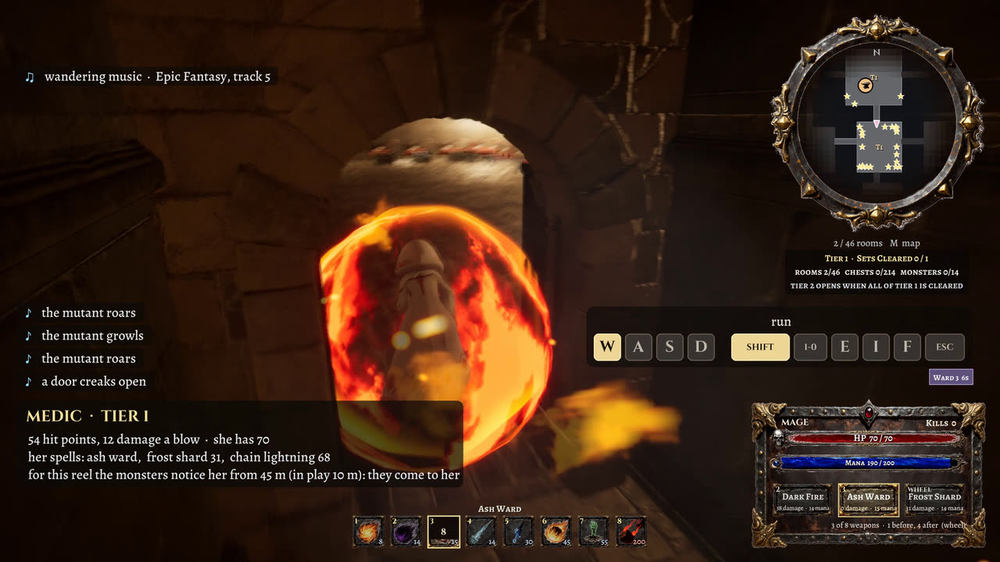 | 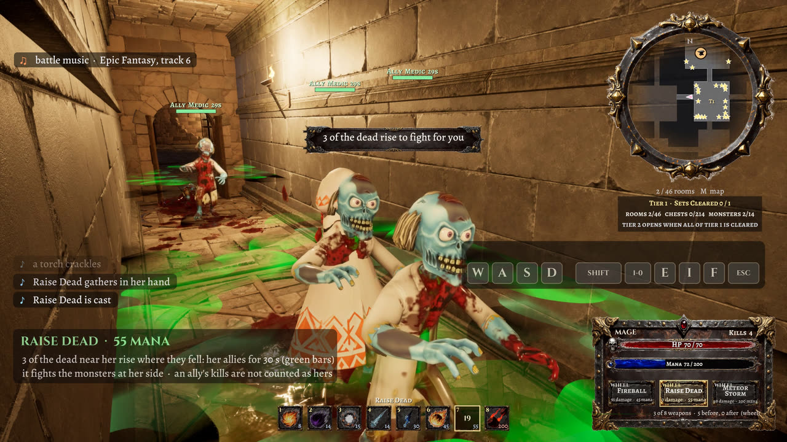 |
| **Meteor Storm in a tier-3 room, a raised ally beside her** | **Shadow Lash: the Warlock's whip of darkness** |
| 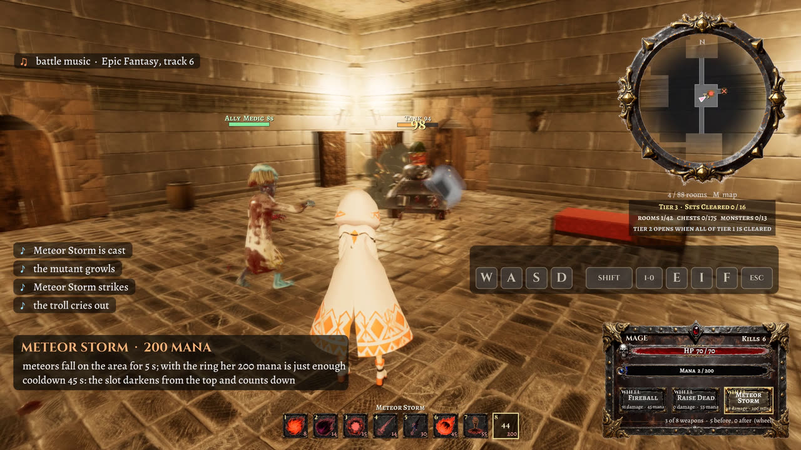 | 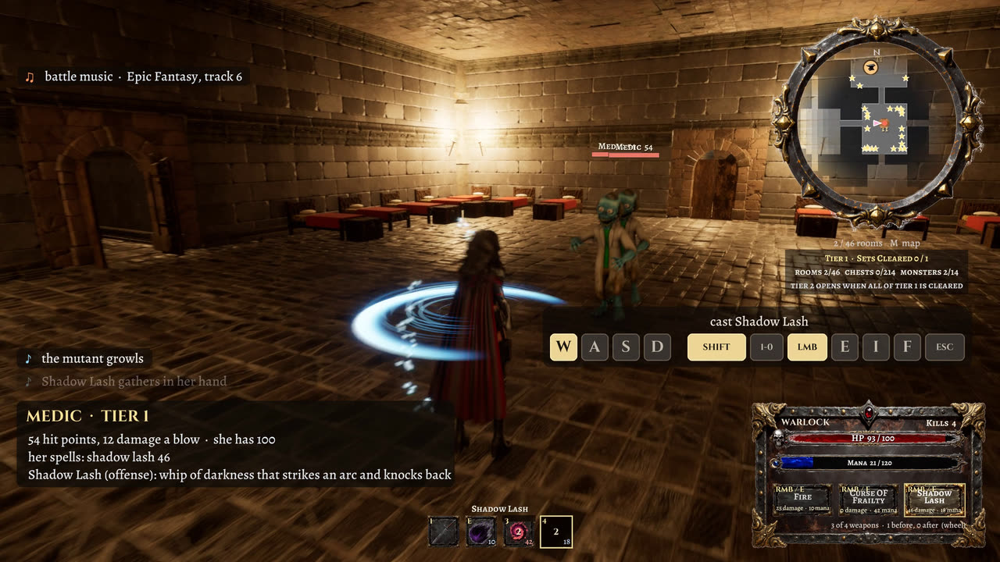 |

**Rings** (the user's table): three kinds of ten, one of each kind worn at a time (another of the kind replaces it; they do not add up), the rest carried.

<!-- rdm5:rings -->
| Ring | Kind | While worn | Tiers | Rarity | Worn by |
|---|---|---|---|---|---|
| Magic Potency Ring 1 | magic | +10 % mana | 1 | 25 | Mage, Warlock, Summoner |
| Magic Potency Ring 2 | magic | +20 % mana | 1 | 25 | Mage, Warlock, Summoner |
| Magic Potency Ring 3 | magic | +30 % mana | 2 | 25 | Mage, Warlock, Summoner |
| Magic Potency Ring 4 | magic | +40 % mana | 2 | 25 | Mage, Warlock, Summoner |
| Magic Potency Ring 5 | magic | +50 % mana | 3 | 25 | Mage, Warlock, Summoner |
| Magic Potency Ring 6 | magic | +60 % mana | 3 | 25 | Mage, Warlock, Summoner |
| Magic Potency Ring 7 | magic | +70 % mana | 4 | 25 | Mage, Warlock, Summoner |
| Magic Potency Ring 8 | magic | +80 % mana | 4 | 25 | Mage, Warlock, Summoner |
| Magic Potency Ring 9 | magic | +90 % mana | 5 | 25 | Mage, Warlock, Summoner |
| Magic Potency Ring 10 | magic | +100 % mana | 5 | 25 | Mage, Warlock, Summoner |
| HP Potency Ring 1 | health | +10 % hit points | 1 | 25 | Warrior, Warlock |
| HP Potency Ring 2 | health | +20 % hit points | 1 | 25 | Warrior, Warlock |
| HP Potency Ring 3 | health | +30 % hit points | 2 | 25 | Warrior, Warlock |
| HP Potency Ring 4 | health | +40 % hit points | 2 | 25 | Warrior, Warlock |
| HP Potency Ring 5 | health | +50 % hit points | 3 | 25 | Warrior, Warlock |
| HP Potency Ring 6 | health | +60 % hit points | 3 | 25 | Warrior, Warlock |
| HP Potency Ring 7 | health | +70 % hit points | 4 | 25 | Warrior, Warlock |
| HP Potency Ring 8 | health | +80 % hit points | 4 | 25 | Warrior, Warlock |
| HP Potency Ring 9 | health | +90 % hit points | 5 | 25 | Warrior, Warlock |
| HP Potency Ring 10 | health | +100 % hit points | 5 | 25 | Warrior, Warlock |
| Dexterity Ring 1 | dexterity | +10 % ranged weapons' damage | 1 | 25 | Rogue |
| Dexterity Ring 2 | dexterity | +20 % ranged weapons' damage | 1 | 25 | Rogue |
| Dexterity Ring 3 | dexterity | +30 % ranged weapons' damage | 2 | 25 | Rogue |
| Dexterity Ring 4 | dexterity | +40 % ranged weapons' damage | 2 | 25 | Rogue |
| Dexterity Ring 5 | dexterity | +50 % ranged weapons' damage | 3 | 25 | Rogue |
| Dexterity Ring 6 | dexterity | +60 % ranged weapons' damage | 3 | 25 | Rogue |
| Dexterity Ring 7 | dexterity | +70 % ranged weapons' damage | 4 | 25 | Rogue |
| Dexterity Ring 8 | dexterity | +80 % ranged weapons' damage | 4 | 25 | Rogue |
| Dexterity Ring 9 | dexterity | +90 % ranged weapons' damage | 5 | 25 | Rogue |
| Dexterity Ring 10 | dexterity | +100 % ranged weapons' damage | 5 | 25 | Rogue |
<!-- /rdm5:rings -->

**Monsters by tier** (`859`, `SourceArt/random_dungeon_magic5/monster_tiers.json`; each measured: its walking speed from its feet, when its blows land from its fastest bone; its capsule is measured from its mesh too, but `859` does not apply it: every kind keeps the default capsule, see [docs/spec.md §27](docs/spec.md#27-known-deviations-and-open-issues)):

<!-- rdm5:monsters -->
| Tier | Hit points / damage (x her reference: 100 / 25) | Speed | A blow every | Abilities' strength | Monsters (gallery rank; ability) |
|---|---|---|---|---|---|
| 1 | 50 / 11.2 | x 1 | x 1.15 | none | Rat (1), Half Creature 04 (2), Parasite Slider (3), Half Creature 05 (5), Drinker (6), Medic (7), Chicken (9), Soldier (10) |
| 2 | 100 / 25 | x 1.05 | x 1 | none | Sufferer (14), Fat (15), Mask (16), Monster (17), Gunner (18), Fat (19), Parasit (20), Orc 03 (25) |
| 3 | 160 / 33.8 | x 1.1 | x 0.92 | x 1 | Magur (26; weaken), Azrak (27; weaken), Warrior 02 (the leopard) (29; weaken), Kanit (30; weaken), Gnur (31; weaken), Dardan (32; weaken), Costalmed (33; weaken), Orc 05 (34; weaken), Orc 06 (35; weaken), Alien (37; poison), Devourer (38; poison), Insect (39; poison), Pangolin (41; slow), Tank (49; slow) |
| 4 | 240 / 43.8 | x 1.15 | x 0.85 | x 1.4 | Orc 01 (60; weaken), Orc 02 (61; weaken), Ursag (62; weaken), Orc 04 (63; weaken), Bear Warrior (64; slow), Bull Warrior (65; slow), Crocodile Warrior (66; weaken), Elephant Warrior (67; slow), Alien Warrior 05 (68; poison), Exterminator (82; weaken), Shell (83; poison), Bug (84; poison), Horned (85; slow), Mutant (86; slow), Ripper dog (87; weaken), Daemon (88; weaken), Troll (89; slow), Parasite Spider (93; poison), Fantasy Animal (raptor mount) (94; weaken) |
| 5 | 340 / 55 | x 1.2 | x 0.78 | x 1.8 | Alfa (95; weaken), Spider (100; poison), Rock (101; slow), Titan (102; slow), Hunter (103; weaken), Nasty (104; weaken) |
<!-- /rdm5:monsters -->
- **Armour:** one set worn at a time, its mesh fitted to her body and moving with her. Each blow that reaches her takes the set's share off it (its damage reduction rating × 5 %) and 1 off its durability; worn out (0), it takes off half its share until it is mended. While she wears it she moves (10 − its speed rating) × 3 % slower. A hero wears only the weights her card names (full plate and heavy armour are heavy, medium and partial medium, light light, orc armour by its speed rating: 7-10 light, 4-6 medium, 1-3 heavy); anything else is refused, and the message says why ("The plate armour is heavy: the rogue wears only light armour", "The mage wears no armour").

<!-- rdm5:armour -->
| Set | Type | Damage reduction (1-10) | Speed (1-10) | Durability | Tier | Weight | A blow takes off | She moves | Worn by |
|---|---|---|---|---|---|---|---|---|---|
| Epic Plate (Male) | full plate | 10 | 1 | 600 | 5 | heavy | 50 % (25 % worn out) | 27 % slower | Warrior, Summoner |
| Epic Plate (Female) | full plate | 10 | 1 | 600 | 5 | heavy | 50 % (25 % worn out) | 27 % slower | Warrior, Summoner |
| Dark Knight’s Armour | full plate | 9 | 2 | 550 | 4 | heavy | 45 % (22.5 % worn out) | 24 % slower | Warrior, Summoner |
| Broddi’s Dwarf Armour | full plate | 9 | 2 | 575 | 4 | heavy | 45 % (22.5 % worn out) | 24 % slower | Warrior, Summoner |
| Plate Armour | full plate | 8 | 3 | 510 | 4 | heavy | 40 % (20 % worn out) | 21 % slower | Warrior, Summoner |
| Lady Knight’s Armour | full plate | 8 | 3 | 525 | 4 | heavy | 40 % (20 % worn out) | 21 % slower | Warrior, Summoner |
| Paladin’s Armour | full plate | 8 | 3 | 525 | 4 | heavy | 40 % (20 % worn out) | 21 % slower | Warrior, Summoner |
| Bear Warrior’s Armour | heavy | 7 | 6 | 475 | 3 | heavy | 35 % (17.5 % worn out) | 12 % slower | Warrior, Summoner |
| Elephant Warrior’s Armour | heavy | 7 | 7 | 500 | 3 | heavy | 35 % (17.5 % worn out) | 9 % slower | Warrior, Summoner |
| Crocodile Warrior’s Armour | medium | 6 | 5 | 400 | 2 | medium | 30 % (15 % worn out) | 15 % slower | Warrior, Warlock, Summoner |
| Split Armour | medium | 5 | 6 | 375 | 2 | medium | 25 % (12.5 % worn out) | 12 % slower | Warrior, Warlock, Summoner |
| Desert Hero’s Armour | light | 4 | 6 | 200 | 1 | light | 20 % (10 % worn out) | 12 % slower | Warrior, Warlock, Rogue, Summoner |
| Tiefling’s Armour | light | 3 | 7 | 175 | 1 | light | 15 % (7.5 % worn out) | 9 % slower | Warrior, Warlock, Rogue, Summoner |
| Orme’s Armour | light | 2 | 8 | 150 | 1 | light | 10 % (5 % worn out) | 6 % slower | Warrior, Warlock, Rogue, Summoner |
| Executioner’s Armour | partial | 6 | 4 | 300 | 3 | medium | 30 % (15 % worn out) | 18 % slower | Warrior, Warlock, Summoner |
| Demonic Armour | partial | 5 | 5 | 250 | 2 | medium | 25 % (12.5 % worn out) | 15 % slower | Warrior, Warlock, Summoner |
| Bedvar’s Armour | partial | 5 | 5 | 275 | 2 | medium | 25 % (12.5 % worn out) | 15 % slower | Warrior, Warlock, Summoner |
| Templar’s Armour | partial | 4 | 6 | 210 | 1 | medium | 20 % (10 % worn out) | 12 % slower | Warrior, Warlock, Summoner |
| Eastern Knight’s Armour | partial | 4 | 6 | 225 | 1 | medium | 20 % (10 % worn out) | 12 % slower | Warrior, Warlock, Summoner |
| Costalmed’s Armour | orc | 8 | 3 | 510 | 5 | heavy | 40 % (20 % worn out) | 21 % slower | Warrior, Summoner |
| Dardan’s Armour | orc | 7 | 4 | 475 | 4 | medium | 35 % (17.5 % worn out) | 18 % slower | Warrior, Warlock, Summoner |
| Gnur’s Armour | orc | 6 | 5 | 400 | 3 | medium | 30 % (15 % worn out) | 15 % slower | Warrior, Warlock, Summoner |
| Orc Raider’s Armour | orc | 5 | 6 | 375 | 2 | medium | 25 % (12.5 % worn out) | 12 % slower | Warrior, Warlock, Summoner |
| Orc Bruiser’s Armour | orc | 4 | 7 | 200 | 2 | light | 20 % (10 % worn out) | 9 % slower | Warrior, Warlock, Rogue, Summoner |
| Orc Skirmisher’s Armour | orc | 3 | 8 | 175 | 1 | light | 15 % (7.5 % worn out) | 6 % slower | Warrior, Warlock, Rogue, Summoner |
| Orc Veteran’s Armour | orc | 2 | 9 | 150 | 1 | light | 10 % (5 % worn out) | 3 % slower | Warrior, Warlock, Rogue, Summoner |
| Orc Warrior’s Armour | orc | 1 | 10 | 125 | 1 | light | 5 % (2.5 % worn out) | as fast | Warrior, Warlock, Rogue, Summoner |
<!-- /rdm5:armour -->

- **Loot by tier:** the potions and foods are level 4's with tiers and rarities from the user's loot table; the materials and the repair items are found in every tier. Rarity is how likely a container holds an item against the others of its tier (the armour table gives none: every set 20).

<!-- rdm5:loot -->
| Item | Kind | What it does | Tiers | Rarity |
|---|---|---|---|---|
| Small Healing Potion | healing | 10 % of her hit points | 1 | 80 |
| Medium Healing Potion | healing | 20 % of her hit points | 1 | 70 |
| Large Healing Potion | healing | 30 % of her hit points | 2 | 60 |
| Uncommon Healing Potion | healing | 40 % of her hit points | 2 | 50 |
| Wondrous Healing Potion | healing | 50 % of her hit points | 3 | 40 |
| Rare Healing Potion | healing | 60 % of her hit points | 3 | 30 |
| Very Rare Healing Potion | healing | 70 % of her hit points | 4 | 20 |
| Legendary Healing Potion | healing | 80 % of her hit points | 5 | 10 |
| Small Mana Potion | mana | 10 % of her mana | 1 | 80 |
| Medium Mana Potion | mana | 20 % of her mana | 1 | 70 |
| Large Mana Potion | mana | 30 % of her mana | 2 | 60 |
| Uncommon Mana Potion | mana | 40 % of her mana | 2 | 50 |
| Wondrous Mana Potion | mana | 50 % of her mana | 3 | 40 |
| Rare Mana Potion | mana | 60 % of her mana | 3 | 30 |
| Very Rare Mana Potion | mana | 70 % of her mana | 4 | 20 |
| Legendary Mana Potion | mana | 80 % of her mana | 5 | 10 |
| Small Speed Potion | speed | 10 % faster for 30 s | 1 | 80 |
| Medium Speed Potion | speed | 20 % faster for 30 s | 1 | 70 |
| Large Speed Potion | speed | 30 % faster for 30 s | 2 | 60 |
| Uncommon Speed Potion | speed | 40 % faster for 30 s | 2 | 50 |
| Wondrous Speed Potion | speed | 50 % faster for 30 s | 3 | 40 |
| Rare Speed Potion | speed | 60 % faster for 30 s | 3 | 30 |
| Very Rare Speed Potion | speed | 70 % faster for 30 s | 4 | 20 |
| Legendary Speed Potion | speed | 80 % faster for 30 s | 5 | 10 |
| Bread | food | 1 % of her hit points a second for 10 s | 1 | 80 |
| Fish | food | 2 % of her hit points a second for 10 s | 1 | 70 |
| Fruit | food | 3 % of her hit points a second for 10 s | 2 | 60 |
| Nuts and Seeds | food | 4 % of her hit points a second for 10 s | 2 | 50 |
| Jerky | food | 5 % of her hit points a second for 10 s | 3 | 40 |
| Hardtack | food | 6 % of her hit points a second for 10 s | 3 | 30 |
| Travel Cake | food | 7 % of her hit points a second for 10 s | 4 | 20 |
| Sweet Roll | food | 8 % of her hit points a second for 10 s | 5 | 10 |
| Well Done Steak | food | 9 % of her hit points a second for 10 s | 5 | 5 |
| Repair Kit | repair | mends 100 % of a set's or a found weapon's full durability | any | 10 |
| Patch Kit | repair | mends 75 % of a set's or a found weapon's full durability | any | 20 |
| Whetstone | repair | mends 50 % of a set's or a found weapon's full durability | any | 30 |
| Slickstone | repair | mends 40 % of a set's or a found weapon's full durability | any | 40 |
| Leather Strips | repair | mends 30 % of a set's or a found weapon's full durability | any | 50 |
| Iron Ingot, Copper Ingot, Bronze Ingot, Steel Ingot, Hardwood, Timber, Wood Log, Coarse Hide, Light Leather, Cured Leather Strip, Epoxy, Glue, Wood Glue, Straw Rope, Oils | material | made into repair items at an anvil; 1 to 3 at a time | any | 25 each |
<!-- /rdm5:loot -->

- **Repairs and crafting:** Enter on a repair item in the inventory lists what it can mend, her armour sets and the weapons she found, each with its durability now and after; Enter on one gives back the item's share of its full durability (up to full) and uses the item; Backspace (B) goes back. Repair items are made at an anvil: F (X) by one opens the crafting panel (the game pauses), the five recipes with each part's count against what she carries ("wood (any)" is hardwood, timber and wood logs together); Enter makes one and uses the parts up. Every forge has an anvil (the armories one too), every set of rooms at least one, and the great hall one; the maps draw them as a small anvil.

<!-- rdm5:recipes -->
| Repair item (mends) | straw rope | glue | cured leather strip | wood (any) | oils | coarse hide | light leather | epoxy | iron | bronze | copper | steel |
|---|---|---|---|---|---|---|---|---|---|---|---|---|
| Leather Strips (30 %) | 5 | 5 | 5 | 5 |  |  |  |  |  |  |  |  |
| Slickstone (40 %) | 10 | 10 | 10 | 10 | 5 | 5 |  |  |  |  |  |  |
| Whetstone (50 %) | 15 | 15 | 15 | 15 | 10 | 10 | 5 | 5 | 5 |  |  |  |
| Patch Kit (75 %) | 25 | 25 | 25 | 25 | 15 | 15 | 10 | 10 | 10 | 5 | 5 | 5 |
| Repair Kit (100 %) | 45 | 45 | 45 | 45 | 25 | 25 | 20 | 20 | 20 | 10 | 10 | 10 |
<!-- /rdm5:recipes -->

| The anvil: a whetstone's parts against what she carries | Breaking down a found sword into materials |
|---|---|
| 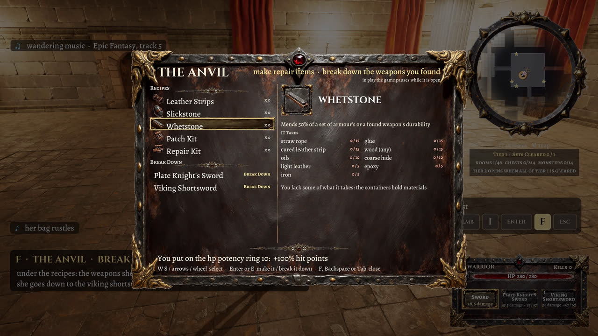 | 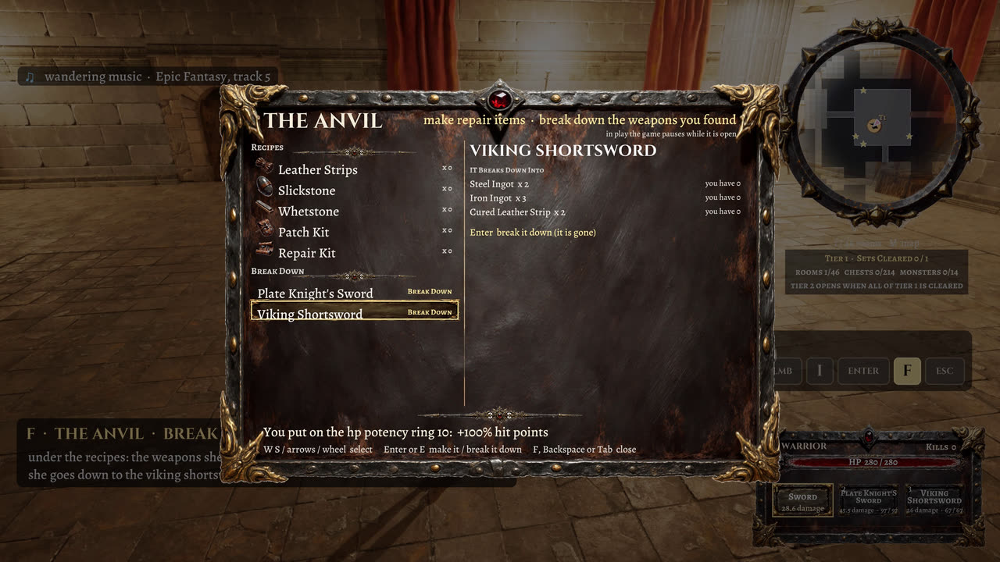 |

- **Weapons:** the 29 weapons of the table below, found in the containers of their tiers. A hero wields what her card allows (the Warrior and the Warlock all, the Rogue short blades and ranged weapons, the Mage and the Summoner none: she carries them in her bag); the damage is 8 + 3 × the damage rating (with her melee or ranged bonus), an attack every 1.6 − (speed − 1) × 1.05 / 9 s, and every hit takes 1 off the durability: at 0 the weapon breaks and is gone. The heroes' own starting weapons never break. A found weapon is held where its handle was measured on its model and swung with her own clips or clips made for it in Blender (two-handed cuts, a bow shot, a crossbow shot). The two-handed cuts keep her arms out of her body (the user saw them inside it: measured, every frame had a forearm or hand 4 to 10 cm inside her torso): each key and frame is measured against her torso as the pose deforms it and the hilt is moved (lower, further out, her shoulders brought forward, the elbows turned) until her forearms and hands clear it by 4.5 and 3.5 cm; at worst, for a few frames as a cut comes back to the guard, a forearm or hand touches her side or belly (up to 1.5 cm in). Her wrists were also bent up to 76° past their limits between the keys: the blade's turn in her hands is now chosen over the whole cut (at worst 69°, most frames under 30°).
- **Breaking weapons down:** at an anvil the panel lists the weapons she found under BREAK DOWN; Enter breaks one into crafting materials by its type, times its tier (not the one in her hands; one her hero cannot wield too):

<!-- rdm5:breakdown -->
| Weapon types | An anvil breaks one into (a tier-1 weapon; x its tier) |
|---|---|
| short blades, short sword, one handed sword, curved and eastern sword, two handed sword | 2 Steel Ingot, 3 Iron Ingot, 2 Cured Leather Strip |
| bow | 3 Timber, 2 Glue, 3 Straw Rope |
| crossbow | 3 Hardwood, 2 Steel Ingot, 2 Epoxy |
<!-- /rdm5:breakdown -->

<!-- rdm5:weapons -->
| Weapon | Type | Speed (1-10) | Damage (1-10) | Damage a hit | An attack every | Durability | Rarity | Tiers | Wielded by |
|---|---|---|---|---|---|---|---|---|---|
| Eastern Sabre | curved and eastern sword | 7 | 4 | 20 | 0.90 s | 78 | 33 | 1 | Warrior, Warlock |
| Arming Sword | one handed sword | 5 | 6 | 26 | 1.13 s | 86 | 33 | 1 | Warrior, Warlock |
| Longsword | one handed sword | 4 | 7 | 29 | 1.25 s | 87 | 33 | 1 | Warrior, Warlock |
| Viking Sword | one handed sword | 4 | 7 | 29 | 1.25 s | 88 | 33 | 1 | Warrior, Warlock |
| Longbow | ranged | 7 | 4 | 20 | 0.90 s | 72 | 33 | 1 | Warrior, Warlock, Rogue |
| Dagger | short blades | 10 | 1 | 11 | 0.55 s | 52 | 33 | 1 | Warrior, Warlock, Rogue |
| Leaf-Blade Knife | short blades | 10 | 1 | 11 | 0.55 s | 53 | 33 | 1 | Warrior, Warlock, Rogue |
| Sherwood Sword | short sword | 7 | 4 | 20 | 0.90 s | 68 | 33 | 1 | Warrior, Warlock |
| Viking Shortsword | short sword | 7 | 4 | 20 | 0.90 s | 67 | 33 | 1 | Warrior, Warlock |
| Plate Knight's Sword | two handed sword | 2 | 9 | 35 | 1.48 s | 97 | 33 | 1 | Warrior, Warlock |
| Katana | curved and eastern sword | 6 | 5 | 23 | 1.02 s | 79 | 33 | 2 | Warrior, Warlock |
| Templar Sword | one handed sword | 3 | 8 | 32 | 1.37 s | 90 | 33 | 2 | Warrior, Warlock |
| Veteran's Sword | one handed sword | 3 | 8 | 32 | 1.37 s | 89 | 33 | 2 | Warrior, Warlock |
| Viking Bow | ranged | 7 | 4 | 20 | 0.90 s | 73 | 33 | 2 | Warrior, Warlock, Rogue |
| Bone Blade | short blades | 9 | 2 | 14 | 0.67 s | 55 | 33 | 2 | Warrior, Warlock, Rogue |
| Obsidian Knife | short blades | 10 | 1 | 11 | 0.55 s | 54 | 33 | 2 | Warrior, Warlock, Rogue |
| Orc Cleaver | short sword | 6 | 5 | 23 | 1.02 s | 69 | 33 | 2 | Warrior, Warlock |
| Toothed Bone Sword | short sword | 5 | 6 | 26 | 1.13 s | 70 | 33 | 2 | Warrior, Warlock |
| Paladin's Sword | two handed sword | 2 | 9 | 35 | 1.48 s | 98 | 33 | 2 | Warrior, Warlock |
| Wakizashi | curved and eastern sword | 5 | 6 | 26 | 1.13 s | 80 | 33 | 3 | Warrior, Warlock |
| Crossbow | ranged | 6 | 5 | 23 | 1.02 s | 74 | 33 | 3 | Warrior, Warlock, Rogue |
| Combat Knife | short blades | 9 | 2 | 14 | 0.67 s | 56 | 33 | 3 | Warrior, Warlock, Rogue |
| Survival Knife | short blades | 9 | 2 | 14 | 0.67 s | 57 | 33 | 3 | Warrior, Warlock, Rogue |
| Dark Knight's Sword | two handed sword | 1 | 10 | 38 | 1.60 s | 99 | 33 | 3 | Warrior, Warlock |
| Dwarf Crossbow | ranged | 5 | 6 | 26 | 1.13 s | 75 | 33 | 4, 5 | Warrior, Warlock, Rogue |
| Kukri | short blades | 8 | 3 | 17 | 0.78 s | 58 | 33 | 4 | Warrior, Warlock, Rogue |
| Sniper's Knife | short blades | 8 | 3 | 17 | 0.78 s | 59 | 33 | 4 | Warrior, Warlock, Rogue |
| Ursag's Horn Blade | two handed sword | 1 | 10 | 38 | 1.60 s | 100 | 33 | 4, 5 | Warrior, Warlock |
| Wrist Blade | short blades | 8 | 3 | 17 | 0.78 s | 60 | 33 | 5 | Warrior, Warlock, Rogue |
<!-- /rdm5:weapons -->

- **Tiers of rooms:** the dungeon is sets of rooms in rings round the start, tiers 1 to 5 (1, 8, 16, 24 and 32 sets). Only tier 1 (the start section) is open at the start; each tier after it opens only when every set of the tier before is cleared (every room entered, every chest and trunk looted, every monster killed; the dead stay dead when a set is generated again). Hallways into a shut tier are barred by gratings, out of tier 5 walled; a panel under the minimap counts what is left ("SET CLEARED", "TIER 3 IS OPEN").
- **Maps:** a minimap in a painted ring and a big map (M, or Back) on a painted board, both drawing the dungeon she has seen: monsters as red dots (elites as orange triangles: more than 1.25 × their section's average hit points, which no level-5 monster reaches), gold stars on the chests and trunks she has not looted yet, cyan diamonds on hallways toward rooms she has not seen, red crosses on sealed passages, a small anvil where repair items are made, the rooms she has found named with their tier (the minimap "T2" in the room, the big map "TIER 2" under its name); the big map scrolls with the arrow keys (the D-pad) and C (R3) centres it again; the game goes on under it.

| The big map (M) on its painted board: the room she is in named with its tier (CRYPT, TIER 3), the key, the compass |
|---|
| 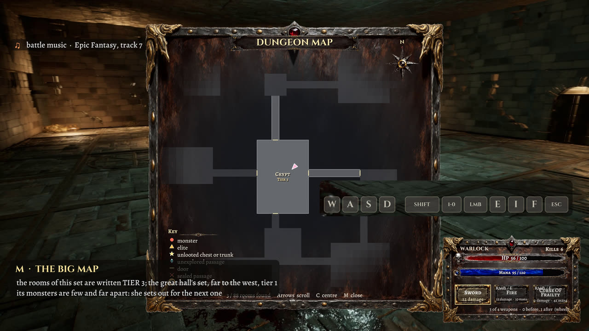 |

The minimap in its painted ring, with the tier panel under it, is in the top right of every dungeon still above.

- **Sound and music:** footsteps, voices, each monster's steps, growl, roar, cry and death, the weapons and spells, fires, doors and containers, all placed and fading with distance; a wandering track over a room tone, a battle track when a monster comes at her. The fires' crackle was lowered 8 dB (the torches', braziers' and hearths' volumes × 0.4 on every dungeon level): recorded from the game's output 2.5 m from a torch (each fire set held to one of its loop files, so only the volume differs) it fell 8.6 to 9.1 dB in three runs and is still 6 to 8 dB above the room's other sounds.
- **Interface:** a dark-fantasy HUD painted on an image server from the project's own prompts (boards, framed bars, slots, plaques, a picture for every weapon, item and armour set), lettered in Cinzel, Alegreya and Alegreya SC.
- **Faces:** the moving face (a MetaHuman face that winced, set itself for a cast, smiled, glared, looked afraid, shut its eyes and blinked) belonged to the earlier versions of this level; the C++ still has it, but the level as rebuilt from level 4 has no face data, so no hero's face moves now.
- **Known issues** found while writing the [spec](docs/spec.md#27-known-deviations-and-open-issues): among them the Rogue's roll does not dodge on this level (its dodge window was saved as (1, 1)), the monsters keep the default capsule, a restart adds the start section's monsters again, and a few spells' effects differ from the table's wording (Hellfire Pillar, Shadow Lash, the party-wide shields).

## mistward_castle: the castle

`mistward_castle` (stages `863`-`868`, the user's list of 2026-10-26 in `docs/improvements.txt`) is level 5's game (a Save As copy of `random_dungeonmagic_level5`: its four heroes, menu, armour, weapons, spells, rings, crafting and tiers) rebuilt as a castle, with these rules on top. Each is a switch of its own on the generator (`ARDDungeonGenerator`, "Mistward" category), off on every other level. Its test is `868_mistward_test.ps1` (`868_mistward_test.py`, 13 steps, results in `SourceArt/mistward/test_<tag>.json`; `test_t2.json`: all 13 passed). Its reel is `MistwardCastle_Heroes_Showcase` (4:38, the four heroes).

**The castle.** Its name, "Mistward Castle", is on the menu over CHOOSE YOUR HERO, over the minimap and on the big map's plaque. It has five tiers (1, 8, 16, 24 and 32 sets of rooms round the great hall), each with a look of its own (`864`, the user's choice):
- tier 1: the stone dungeon and crypt (the dungeon's own pieces);
- tier 2: a castle keep and its cells (Castle of Eternal Mist's blind arched walls, Medieval Castle's stone floors and wooden ceilings);
- tier 3: dwarven deep halls (Dwarven Citadel's brick and hall walls, floors and ceilings);
- tiers 4 and 5: the three mixed, a look for each set of rooms.

A theme's pieces are the generator's `Pieces` named `<Theme>.<Name>`; a piece a theme does not have falls back to the plain one.

**Rooms of other shapes.** About 60 % of the rooms (`ShapedRoomShare`; never the prison or the great hall) are round, octagonal, hexagonal, triangular, a diamond, an L, a T or a U, or have a dome, a pyramid, a stepped pyramid or a high ceiling. Their tiles are cut from the rectangle, keeping the way to every door; walls follow the shape; the ceilings stand at each tile's height with risers between the steps. The maps draw the shapes (`FRDMapRect::Mask`). Measured in 7 generated sets (`868`'s layout step): 116 shaped rooms, of every kind (15 octagons, 11 stepped pyramids, 10 each of circles, hexagons, diamonds, triangles, U's and high halls, 9 domes, 8 pyramids, 7 L's, 6 T's), each one's tiles fewer than its rectangle's and the domes' and pyramids' ceiling heights varying.

**Furniture that never gets in the way** (`bTidyFurniture`):
- Each piece's footprint is its mesh's box as built (or its nominal size where that is bigger, centred where the box is).
- A piece is placed only where its footprint meets no other: two beds or two chests never overlap.
- A container also needs 95 cm in front of it, clear and on its room's floor, so it is never boxed in between beds or behind a table.
- Measured on the meshes as built in 7 sets (2579 pieces of furniture, 2239 containers): no two overlap by more than 7 cm (the generator sets pieces side by side 3 cm under their sizes), every container's way in is clear and on its room's floor, and no container stands between two beds.

**Containers stay open** (`bContainersStayOpen`): F opens a chest once; F again does nothing and no longer offers it; its set of rooms built again builds it open.

**The 75 % rule** (`TierOpenShare` 0.75; the user's choice): a tier opens when the tier before has 75 % of its rooms explored, 75 % of its monsters killed and 75 % of its chests and trunks looted, each counted over all of its sets. A set she has not reached yet is counted by a census: planned and furnished in a count-only mode, a few milliseconds a set, two a frame. Tier 2's eight sets hold about 340 rooms, 100 monsters and 800 chests and trunks, so 600 of those must be looted before tier 3 opens.

**When a tier opens** (2 to 5):
- **A boss.** The strongest kind of the new tier waits in a room of the tier before that she has explored (not the one she is in), with 3 to 6 monsters of the new tier round it. It is 1.35 times bigger, has three times the hit points and hits 1.6 times as hard. The notice says where ("TIER 2 IS OPEN - A BOSS WAITS IN THE TREASURY (SEE YOUR MAP)"); the maps mark it with a crowned red ring, and a far one is pinned to the map's edge, the way to it.
- **A guarded ring.** If she has found neither potency ring of the tier before (her kind: magic for the Mage and the Warlock, hit points for the Warrior, dexterity for the Rogue), the first is put into a container of a room she has explored, guarded by 4 monsters of the new tier. If every container there is already open, it lies on the floor instead (F takes it). The maps mark it with a gold ring until she has it.
- Both are put back if their set of rooms is dropped and generated again.

**Shields** (the Warrior; `SourceArt/mistward/shields.json`, the user's table of the 22 fantasy shields of `docs/objects.md`):
- Each shield has a damage rating, a speed rating and a durability. A blow takes damage × 4 % less (after her armour), and she moves (10 − speed) × 3 % slower (the user's choices).
- The shield loses what it takes and breaks at 0; a spare of the same kind takes its place.
- Shields are found in the containers by rank: the best five in tier 5, down to the plainest in tier 1.
- She starts with the Heater Shield on her arm. It is held only with a one-handed weapon: not with a spell, a bow or a two-handed sword.
- In the inventory's SHIELDS section Enter puts one on or takes it off. Several are carried, each with its own durability.
- At the anvil a shield breaks down into iron and steel or timber and iron, × its tier.
- Each shield's grip on her forearm is measured from its mesh: its face, which way is up, which end is wider. Six faced the wrong way in play and are turned in `shields.json`.

**Armour by the set** (`bArmourStacks`): two of one set are two sets, each with its own durability, and the anvil breaks a set down by its type (`shields.json`'s `armour_breakdown`). The worn one, if it is the last, is refused.

**The torch.** An anvil makes it from 2 wood (any kind), 2 straw rope and 1 oils. Any of the four heroes carries it in her left hand: the Medieval Castle pack's torch in her fist, its head turned 20° up, the dungeon's torch flame on it and an 80 cd light. It takes her left hand: the Warrior's shield is slung while it burns.

**Her things where she falls** (`bDropOnDeath`):
- Everything she found (found weapons, armour, shields, rings, potions, materials, the torch, teleport rings) drops in a pile where she fell. Her hero's own weapons and starting shield stay hers.
- Each thing is shown over the pile as its picture, with Loot Drops Vol. 2's effect and a light.
- She comes back in the great hall. F at the pile takes everything back, each as worn as it was; the maps mark the pile with a sack.

**Traps** (`RDTraps.cpp`, 12 kinds, from streams of their own so the layout does not change; about 30 % of rooms and 12 % of hallway stretches):
- **Mechanical**: a pit (it drops and holds her), darts from the walls, a deadfall of stones, a crusher's block, a snare (it holds her).
- **Magical** (the spells' own effects): a glyph that bursts, a ward that throws her back (it sets itself again), a poison emanation (it slows and hurts while she is in it), a cursed rune stone (it weakens her blows).
- **Complex**: a chain (a snare, then stones, then a rune), and a lingering trap that does worse every moment she stays.
- **Transport**: a teleport trap carries her to another room of the tier, either into three monsters or into a ring of glyphs going off one after another.

The Rogue alone sees them, within 8 m (a message and a red X on the maps). F by one disarms it: a moment's stillness, a bar, and a fumble sets it off (15 %). For everyone else they go off as they step on them.

**Teleporters** (`bTeleporters`):
- A pad (MysticDungeon's mosaic ring with a portal effect) stands in the great hall, and one in each tier's first set of rooms, that tier's ring lying on it.
- F takes the ring. The ring used from the inventory carries her to the great hall's pad.
- F on the great hall's pad takes her to any tier whose ring she holds (G picks which); F on a tier's pad takes her back.

**Prison cells** (`PrisonerDefs`; the NPC Prisoners pack's ten prisoners with their own idle and walk):
- 60 % of the cells hold someone.
- A prisoner: F at the door unlocks the cell, and the prisoner thanks her, gives her a thing of the tier, walks out and is gone.
- 35 % hold a monster instead. It unlocks its own cell as she comes within 5.2 m, walks out through the door's gap and comes for her (the test follows it 2.7 m out of its cell to strike her).
- A cell at the end of a row whose door would open against the room's wall is barred all across (the wall left too narrow a way out); the straw lies on the barred half.

**Smaller things**:
- The frame rate and frame time are shown in the upper left, over the controls.
- Holding a key in the inventory walks the list: after 0.35 s, a line every 0.08 s.
- The anvil's lists are in alphabetical order: the recipes, then what she can break down.
- The Plate Knight's Sword is found in tier 2, not tier 1.
- The 29 found weapons, the 22 shields and the torch have pictures (`867`: rendered from their meshes with alpha; the found weapons had none before).

**Monsters on the floor.** "Half Creature 05 is invisible": it had its model, but was drawn 6 to 54 cm under the floor. `859` had set each kind's height from its mesh in the reference pose, and the crawlers' clips hold the body far lower (others higher: the Rat 49 cm in the air). `866` measures each kind in play instead: the lowest 1 % of its body's skinned vertices against its capsule's bottom. It moved 38 of the 55 kinds on `mistward_castle` and on `random_dungeonmagic_level5`. The Insect, a winged flier whose walk holds it 25 cm lower than its idle, was raised to walk on the floor and hover when it stands. Measured by `868` over 6 s as each kind idles and wanders: every kind's lowest point comes to the floor (within 3.2 cm) and never sinks further; Half Creature 05 stays between −0.4 and +0.1 cm.

## Early results

Stills from the showcase videos: 1080p Movie Render Queue renders of each level's `*_Cine` copy, with the demo character running its recorded route.

**FF — Tripo anime female** (`ff_level`). A static GLB rigged onto a UE4-mannequin skeleton, with locomotion retargeted from the template.

| Idle | Run | Close-up |
|---|---|---|
|  |  |  |

**FF2 — animated Tripo anime female** (`ff2_level`). Her own clips, grounded on the sole contacts so she doesn't float or slide.

| Jump | Boxing | Casting |
|---|---|---|
|  |  |  |

**Dystopia Soldier 02** (`soldier_level`). Converted from a Unity-format Fab pack, with per-part PBR materials and retargeted locomotion.

| Idle | Flamethrower | Close-up |
|---|---|---|
|  |  |  |

## Levels

| Level | Character | What's in it |
|---|---|---|
| `L_Fig4_Studio` | `fig4`, a MetaHuman conformed to a 3D scan | Photo-studio cyclorama, plinth, studio and MegaLights lighting, strand hair groom, refitted scanned outfit |
| `L_Fig4_Meadow` | fig4 (`BP_Fig4Character`) | Outdoor meadow: procedural Nanite terrain, rocks and grass. Heel-stance locomotion retargeted from the UE mannequin |
| `L_Meshy_Meadow` | Meshy AI biped (`BP_MeshyCharacter`); the JRPG characters (`BP_JRPGFem1Character` … `BP_JRPGFem5Character`) | Same meadow; 18 moves on input actions plus a sprint. Also the stage of the JRPG characters, whose scripts set the meadow's game mode to the one built last: Fem1 (a Meshy rig playing the soldier's retargeted set, or the FF showcase set), Fem3 and Fem4 (Meshy meshes; one that comes unrigged, such as Fem3, is given a skeleton by `jrpg_autorig.py`), Fem5 (`jrpg-fem5-tripo`, an animated Tripo GLB playing her own idle / walk / run: the player of every later level) |
| `soldier_level` | Dystopia Soldier 02 (`BP_SoldierCharacter`) | Same meadow; Unity-sourced soldier with retargeted locomotion |
| `ff_level` | Tripo anime female (`BP_FFCharacter`) | Same meadow; static GLB rigged onto a UE4-mannequin skeleton |
| `ff2_level` | Animated Tripo anime female (`BP_FF2Character`) | Same meadow; clips fixed on the sole contacts so she doesn't float or slide |
| `castle_level` | FF2 | The Medieval Fantasy Village pack's map with walk-in houses: doors, chests, trunks, wardrobes and barrels open with **F**. Interiors are furnished by building purpose (tavern, manor, homes, bakery, stable, barn, storehouse, smithy) with lofts, attics and lighting. Water splashes in the river |
| `fantasy_castle_level` | FF2 (`BP_FF2Character`, with a higher step and a steeper walkable slope for the pack's rock) | The Fantasy Castle Environment's map with the Medieval Lake Village streamed into its lake. The pack meshes collide with their real triangles instead of one convex hull each, so doorways, arches and the bridge can be walked. A stone stair links the castle's east terrace to the island bridge, and a road runs from the bridge down the island, over a wooden causeway and into the walled village. Three castle buildings had a doorway cut into their shell and got interiors (great hall, armory, barracks); the village's hollow houses were measured by flood fill and furnished by purpose (tavern, fisherman's house, farmhouse, weaver's cottage, smithy, barn, storehouse). Doors and chests open with **F**. No showcase video |
| `sf-city-level` | jrpg-fem5-tripo (`BP_SFC_Fem5Character`: her own idle/walk/run, foot IK) | The Open World Science fiction City with the Monolith Megastructure streamed in beside it, joined by a 200 m bridge road. Four structures with furnished rooms behind automatic sci-fi blast doors: Port Authority (office + armory), neon noodle bar, hab apartment (living room + bedroom), excavation lab (relic lab + server room). Invisible barrier walls along every drop into the void, a fall guard, and a scripted walk test (`709`/`710`) |
| `random_level` | jrpg-fem5-tripo (`BP_SFC_Fem5Character`) | Procedural medieval town (C++ `ARTTownGenerator`). Starts as a 500 m x 500 m square built with a fixed seed; whenever she nears the edge of town heading outward, the next 250 m of terrain, cobbled streets, furnished buildings, props and foliage is generated ahead of her (fresh seed each play, never saved). Each new cell is marked as it appears: a glowing curtain rises on its border and a scan wave sweeps across it, the cell drawn as a cyan ghost until the wave passes. Buildings: the Modular Medieval Town packs' furnished docks houses, tavern (fireplace, dining tables, chairs, bar), stores and Sherwood cabins, streamed in as level instances and turned to face the street. Doors swing open as she approaches; bedroom chests, wardrobes and crates open with **F** |
| `random_dungeon_level` | jrpg-fem5-tripo (`BP_SFC_Fem5Character`) | Procedural dungeon (C++ `ARDDungeonGenerator`). A 252 m x 252 m start section of 49 interconnected rooms (fixed seed, saved), with hallways leaving every edge; walking toward the edge generates the next section (fresh seed each play, never saved) with random_level's reveal effect. Rooms have a purpose with matching furniture and lighting: great hall, barracks, prison cells, torture chamber, storeroom, armory, kitchen, library, chapel, crypt, treasury, guard room, forge; hallways are guard passages, supply passages or catacomb tunnels. Doors (crypt double doors, cell doors) and every container (chests, trunks, wardrobes, barrels, crates) open with **F**. Tactical maps (all dungeon levels): the minimap is dark monochrome terrain with a feathered rim and no frame, under bright markers (monsters red dots, the strongest of their tier, trolls, orange triangles, unopened chests and trunks gold stars, hallway exits toward sections not yet explored cyan diamonds); **M** opens the big map as a see-through overlay centred on her, north up, that moves as she runs: neon lines for the walls and passage borders where a floor meets no floor, bright bars for the doorways, the same markers and a key, while the game goes on under it (she walks and fights). Monsters from Creatures_Pack (troll, daemon, horned demon, ripper dog, spider, mutant) in 40% of the rooms wander from room to room |
| `random_dungeoncombat_level` | jrpg-fem5-tripo (`BP_SFC_Fem5Character`) with three melee weapons | `random_dungeon_level` with fighting (the generator's `bCombat`). She has 100 hit points and a sword (22 damage a blow), a spear (17, long reach) and an axe (36, slower, wide arc) from the Medieval_Weapons pack, the first two with a shield; she wields each with attack, flinch and death clips of a Fab animation pack made for it, retargeted to her. Monsters in 30% of the rooms notice her, give chase over the tile grid, attack with their own attack clips, flinch when hit and die. In the start section (the first 252 m square) the average monster has 50 hit points and does 11 a blow; in every section generated in play it is on a par with her (100 hit points, 25 a blow: her average). Out of a fight her hit points come back; at 0 she falls and stands up again in the middle of the start section. HUD: a status panel in the bottom right corner (hit points, the three weapons with their damage, kills), a bar over each monster in the fight, damage numbers; the minimap (top right) and the **M** map are a miniature of the dungeon (stone floors coloured by room, walls, doors, chests, torches), with every room named on the M map. She starts in the middle of the start section; generated sections are never saved. **Blood:** a blow throws a burst of drops and spray from where it landed (from her too when she is hit); the drops fall, and leave marks on the floor, walls and furniture; a pool spreads under a body. **Wounds:** every blow leaves a wound on that monster alone, on its skin where the weapon met it (stain, torn flesh, a dark open middle, blood running down), and the worse off it is the more of it is bloodied. **Sound** (from a local sound library): her footsteps (walking and running: nothing else of her moving) and her voice when she is hurt or falls, the swing and the weapon landing; each monster kind's footsteps, growl, roar when it notices her, cry when hurt and death; torches, braziers and hearths as she comes near, doors and chests opening and closing, the rumble of a section being generated. Everything that is not her own is heard from where it is and fades with its distance to her. **Music:** while she wanders, an atmospheric track over a quiet room tone; when a monster comes at her the music turns to a battle track (another one each fight) over a tenser atmosphere, and a few seconds after the fight the wandering track comes back where it left off |
| `random_dungeonmagic_level` | girl-caster-tripo (`BP_RDM_CasterCharacter`: her own walk and run; an idle and three casts made for her in Blender) with a fire spell | `random_dungeoncombat_level` with a caster instead of the swordswoman. The spell reaches 14 m: sparks gather on her hand while she winds up, then a bolt of fire leaves it, follows the monster she turned to (the nearest she can see within reach) at 17 m/s and bursts on the first monster or wall it meets, with an explosion, a flare of flame and a flash of light; 25 damage on the monster it meets, half of that on every other one within 1.7 m. Its sounds come from a spell sound library (the charge, the bolt's roar, the burst). WASD move, R switches between walking and running (Shift held runs), left mouse or E cast, F open, M map. Gamepad: left stick move, right stick look, A jump, LT switch walk / run, LB or RB cast, X open, Back map. The HUD shows her name and the spell, and in the upper left the controls of the device in use (keyboard and mouse, or gamepad) and whether she walks or runs. Everything else is the combat level's: the dungeon generating ahead of her, doors and containers, monsters by tier, blood, wounds, sound and music |
| `random_dungeonmagic_level2` | girl-darkcaster-tripo (`BP_RDM2_DarkCasterCharacter`: her own idle, walk and run with the right hand closed on the hilt; two left-hand casts and three sword cuts made for her) with a sword and the fire spell | `random_dungeonmagic_level` with a dark caster who fights with both: the Medieval Weapons sword in her right hand (22 damage, a horizontal cut, an overhead chop and a thrust) and the fire spell from her left, cast while the sword stays in her hand. Left mouse (RB) cuts, right mouse or E (LB) casts; the rest as random_dungeonmagic_level. Her long wavy hair swings as she runs, stops, turns and jumps (six bone chains through it, simulated after her animation). The HUD shows the sword drawn and the spell's tile lit while she casts |
| `random_dungeonmagic_level3` | the Rogue (`ai models/Rogue.glb`, `BP_RDM3_RogueCharacter`: her own walk and run with both hands closed on a grip; an idle, three dagger strikes, a crossbow shot and a roll made for her in Blender) with two daggers and a crossbow | `random_dungeonmagic_level2` with a rogue. A Dark Fantasy Weapons dagger in each hand (15 damage a strike, 1.5 m: a thrust with the right, a backhand cut with the left, both at once) and the same pack's crossbow (34 damage, 26 m): she raises it to her shoulder and a bolt (the pack's arrow cut down to 37 cm) flies straight at the monster she turned to at 45 m/s with a pale trail, and stays stuck in a wall where it misses for 8 s; the next bolt lies on the rail until she has loaded again. The weapon not in her hands is carried on her: the crossbow across her back, the daggers along the outside of her thighs. B (the gamepad's B) rolls her 4.2 m the way she is moving, or backward when she stands; blows miss her through most of a roll. WASD move, R switches walking / running (Shift held runs), 1 / 2 or the mouse wheel draw the daggers / the crossbow, left mouse strikes or shoots, F open, M map; gamepad: left stick move, right stick look, A jump, LT walk / run, Y switch weapon, RB strike or shoot, B roll, X open, Back map. Her sounds: the daggers biting, the crossbow raised and loosed, the bolt striking, the roll. Everything else is the magic levels' (and the tactical maps) |
| `random_dungeonmagic_level4` (Play opens its menu, `random_dungeonmagic_level4_select`, first) | the hero chosen in the menu: the Warrior (`BP_RDM4_WarriorCharacter`), the Mage (`BP_RDM_CasterCharacter`), the Warlock (`BP_RDM2_DarkCasterCharacter`) or the Rogue (`BP_RDM3_RogueCharacter`) | `random_dungeonmagic_level3` with a choice of hero. **The menu** (`random_dungeonmagic_level4_select`; the dungeon played without a hero chosen, as from the editor's Play, opens it first): a studio with a turntable on which the hero shown turns with her starting weapons in her hands (the others where she carries them), her card on the left (hit points and mana as bars against the others', her other numbers: the mana that comes back, her melee or ranged bonus, the roll; her main abilities, the armour she can wear, what she starts with: each weapon and spell in a slot with its picture, the damage a blow or cast does with her bonus, its reach and its mana), the four names along the bottom; A / D, the arrows, the wheel, the D-pad, the left stick or a click change the hero, Enter, Space, A or a click on START opens the dungeon with her. **The heroes:** the Warrior, 140 hit points, sword and shield (22 damage a blow + 30 %: 28.6); the Mage, 70 hit points and 100 mana, fire (25 damage, 8 mana) and dark fire (her casts with the Warlock's fire, 38 damage, 14 mana), 2 mana a second back; the Warlock, 100 hit points and 60 mana, the sword in her right hand and fire from her left (10 mana), 1.2 a second back; the Rogue, 100 hit points, daggers (15) and crossbow (34 + 30 %: 44.2), B rolls out of a blow. A cast with too little mana is refused (the mana bar flashes). The monsters are the same for all four (as strong as for a 100 hit point hero with a 25-point blow). **Hit points** do not come back by themselves. **Items:** every container of the start section holds one item when it is first opened ("FOUND" under the middle of the view): healing potions (10 % to 80 % of her hit points at once), mana potions (the same of her mana), speed potions (10 % to 80 % faster for 30 s), food (1 % to 9 % of her hit points a second for 10 s): 33 kinds, each as likely as its rarity in the item table; the sections generated in play hold none yet. **Inventory** (I or Tab, the gamepad's Start; the game pauses): her weapons and spells, then her potions and food with how many; W / S, the arrows, the wheel or the D-pad choose, Enter, E, the left mouse or A wield the weapon or use the item, and the right side says what it does for her. The HUD's status panel shows her mana under her hit points and a chip over it for each potion or food working on her. **The big map** (M) is drawn in the minimap's painted style: a framed board in the middle of the view, its leather darkened toward the middle, the minimap's dark tiles and lit walls fading out toward the frame, the doorways, the name of each room she has found in the labels' small capitals (on two lines or smaller where a room is narrow), the same markers and her arrow, a plaque, a compass and a key (the game goes on under it); the arrow keys (the D-pad) scroll it, C (the right stick pressed) brings it back over her. A chest's star means it has not been looted yet, open or shut; a container gives what it holds once, also after its section was dropped and generated again. **Lettering** (the menu and every panel): Cinzel for titles, names, keys and numbers standing alone, Alegreya for the text, Alegreya SC for labels (Google Fonts, SIL Open Font License). Sounds of their own: a bottle picked up, drinking, eating, the bag, a refused cast |
| `random_dungeonmagic_level5` | Now: level 4's five-hero menu (`random_dungeonmagic_level5_select`) with the Summoner (`BP_RDM5_Summoner3Character`, Summoner3.glb: her own walk and run, the Mage's casts, flinch and death retargeted; the default hero) as the fifth; before that Summoner2 (`BP_RDM5_Summoner2Character`: a whole MetaHuman, `MHC_Summoner2`, fitted to `ai models/Summoner2.glb`; the mannequin's idle, walk and jog and the Summoner's three casts, flinch and death retargeted onto it), before her the Summoner (`BP_RDM5_SummonerCharacter`: the Mage's walk, run, idle, three casts, flinch and death, retargeted onto her) | **Now** (`849`-`853`) a Save As copy of `random_dungeonmagic_level4` (its heroes, mana, potions and food, inventory, painted interface, menu first) with the Summoner and **armour**: five sets (`SK_S3_<set>`, fitted to her) in the great hall's containers, up to six items in any container, Enter in the inventory puts a set on (`URDCombatComponent::WearArmour`: its mesh on her body as leader pose) or takes it off, and each blow on her loses the worn set's share. Since `856` each set has a weight (`ERDArmourWeight`: light, medium, heavy) and each hero wears only some (`FRDHeroDef::Wears`: the Warrior and the Summoner all, the Warlock light and medium, the Rogue light, the Mage none), each set fitted to every hero who wears it (`/Game/JRPG/HeroArmour/<mesh>/SK_<mesh>_<set>`); anything else is refused with the reason (`ARDDungeonGenerator::ArmourRefusal`). Then (`854`, `855`) **a weapons table and five tiers of rooms** (`SourceArt/random_dungeon_magic5/weapons_table.json`): 29 weapons as items of kind Weapon, each with each hero's way of wielding it (`FRDWeaponFit`), in the containers of their tiers of rooms (the containers of every section hold items now); damage 8 + 3 × the damage rating, an attack every 1.6 − (speed − 1) × 1.05 / 9 s, durability (1 off for each attack that lands; at 0 it breaks); the Warrior and the Warlock wield all, the Rogue short blades and ranged weapons, the Mage and the Summoner carry them unwielded; the generator's `MaxTier` 5: a section's tier is its ring plus one, tier 3 and beyond open when the tier before is cleared (`Progress`: rooms explored, chests and trunks looted, monsters killed, kept when a section is dropped), gratings on the hallways into a shut tier and walls out of tier 5, a tier panel under the minimap, "SET CLEARED" and "TIER 3 IS OPEN" notices, a red cross for a sealed passage on the maps. Then (`857`) **the armour table, the loot table and crafting** (`SourceArt/summoner3/armour.json`, `SourceArt/random_dungeon_magic5/loot_table.json`): 27 sets (`FRDItemDef`'s `Durability`, `Slower`, `DamageRating`, `SpeedRating`, `ArmourType`, `Tiers`), each fitted to every hero who wears its weight (65 fits more: `summoner3_armour.py`'s `--legs 60` for the bulky trousers), worn down by blows that reach her (`URDCombatComponent::WearDownArmour`; half its share at 0) and slowing her (`UpdateWalkSpeed`); potions and food by tier; `ERDItemKind::Component` (15 materials, 1 to 3 a container: `FoundMax`, `LootCountOf`) and `ERDItemKind::Repair` (5 items: `BeginRepair`, `GetRepairLines`, `RepairEntry`); the generator's `Recipes` (`FRDRecipe`) made at anvils (`ARDSection::GetAnvilPoints`, `EnsureAnvil` with `bAnvilEverySection`; F there: `SetCraftingOpen`, `Craft`), drawn by `ARDHUD::DrawCrafting`; the anvils and each room's tier on both maps; the fires' volume × 0.4 on every dungeon level. Then (`858`, `859`) **the spell table, rings, monsters by tier, corpses and the Escape menu**: 30 spells (`FRDSpellDef`, 21 of `ERDSpellKind`'s 22 kinds of what a spell does: bolts that pierce, slow, burn and jump, shields, zones, clouds, rifts, curses, raised dead and a summoned champion as allies, meteor storms, a cheat-death pact...) learned from tomes by the heroes whose card learns their type, cast with cooldowns and keys 1 to 0, effects from four effect packs; 30 rings (mana, hit points, ranged damage); found weapons broken down at anvils; one container in three holds anything; tier 2 opens like the others, once tier 1 is cleared; the monster gallery's monsters in the rooms of their tier with the tier's strength, speed and abilities (poison, weakening, slowing); corpses that stay; an Escape menu with four volumes, another hero, quit. Before that it was `random_dungeonmagic_level` with the Summoner in the Mage's place and her face moving. **Summoner2** (`842`-`848`, game mode `BP_RDM5S2_GameMode`): a MetaHuman fitted to her realistic model, face and body together, with her look from her two photos (skin, eyes, makeup, the hair's dark roots and magenta lengths as strands), her bikini and chains skinned to its body (`FaceMeta.Outfits`), MetaHuman's baked underwear painted out of the body's textures; she walks briskly (2.6 m/s) and jogs (5.2 m/s) at the clips' own pace; the same sixteen expressions and occasions as below, on her own face rig. **Her face** (`URDFaceComponent`, given to her pawn by the generator: its `FaceChannels` / `FaceCues` / `FaceMeta`) is a **MetaHuman face** (`837`-`840`): `MHC_Summoner` (Epic's preset Aera, her colouring; rigged with joints and blend shapes by Epic's cloud service, built) whose face mesh the component sets on her body (`FaceMeta`: placed with its eyes on hers at 0.93 of its size; its neck and head bones following hers, `URDMetaFaceAnimInstance`; its brows and lashes as grooms; her body given `M_JRPG_Summoner_MH`, which cuts her own face away and pushes the hair painted on her skull over the MetaHuman's scalp). Its sixteen expression channels are MetaHuman control curves (`CTRL_expressions_*`, from FACS action units: `SourceArt/summoner/face_mh.json`); RigLogic, the face mesh's post-process (`ABP_RDM5_FacePostProcess`), turns them into joints, blend shapes and wrinkle maps. Before it she had her own face: eight expression channels (Blink, Joy, Anger, Pain, Fear, Shout, Focus, Dead), each a mix of her six morph targets (Smile, Frown, BrowsDown, BrowsUp, Squint, JawOpen: shapes made in Blender) and her six painted patches (EyesClosed, EyesHappy, EyesPain, EyesAngry, BrowsSad, MouthOpen: blended into her colour by the face material's parameters). Shown by what happens to her: hurt (Pain), a cast (Focus), something found (Joy), a monster after her (Anger, held), low hit points (Fear, held), death (Dead: eyes shut); blinks at random times from a stream of its own. Everything else is the Mage's level's |
| `mistward_castle` (Play opens its menu, `mistward_castle_select`, first) | the four heroes of `random_dungeonmagic_level5` (the Warrior Warrior3) | `random_dungeonmagic_level5` as a castle (`863`-`868`; C++ `RD/RDMistward`, `RDTraps.cpp`, `RDGear.cpp`; see [mistward_castle: the castle](#mistward_castle-the-castle)): "Mistward Castle", five tiers each with a look of its own (the stone dungeon; a castle keep: Castle of Eternal Mist's blind arches, Medieval Castle's floors and ceilings; dwarven deep halls: Dwarven Citadel; then mixed), rooms of other shapes and heights, tidy furniture, containers that stay open, tiers opening at 75 %, a boss and a guarded ring at each opening, the Warrior's 22 shields, a torch for every hero, armour carried by the set, twelve kinds of traps the Rogue sees and disarms, teleporters with their rings, prisoners and caged monsters in the cells, her things dropped where she falls, the frame rate on screen, the inventory walked by a held key, the anvil's lists alphabetical, the monsters' heights measured in play |
| `random_isometric_village_level` | jrpg-fem5-tripo (`BP_SFC_Fem5Character`) | Procedural nucleated village seen from a fixed isometric camera (C++ `AIVVillageGenerator`). One village around one hub: a cobbled market square (fountain, well, stalls) with the church, tavern, smithy, bakery, store and elder's hall facing it, ring streets closing around it and short lanes staggered between the rings, three main roads winding out. Houses stand along the streets with gardens, orchards and fields behind, thinning into farmsteads away from the square. The 250 m x 250 m start section is built with a fixed seed and saved; walking toward the edge generates the next 250 m section (fresh seed each play, never saved) on the same rings and lanes, with random_level's reveal effect. Houses are assembled from the House Forge kit (thatch / timber / stone) and furnished by purpose (cottage, farmhouse, tavern, smithy, bakery, store, carpenter, barn, storehouse, church, elder's hall); indoors the roof and the camera-side walls are cut away, and her silhouette shows through anything that hides her. Doors and every container open with **F**. Unarmed villagers (townsfolk, peasants, youths, a servant pair, the elder, a physician, a lady: three for every ten buildings of each 250 m section, in play only) wander the streets and the square, give way to her and step aside. **Q** / **E** turn the view in 45° steps (the cutaway and the maps turn with it) and the view zooms in to a close view of her. A stylised miniature of the village is the minimap; **M** opens the big map with every building labelled |
| `starship_level` | A space fighter (C++ `ASSFighter`) | Outer space: a 5 km x 5 km x 5 km combat area round a space station, seen from a chase camera behind the fighter. The fighter is a kitbash of pack meshes in the style of a Colonial Viper (a white-and-red delta hull with two engines, stub wings, a third engine with a tail fin, wing-tip cannons, four missiles under the wings; engine flames that follow the throttle and a ribbon contrail from each engine). Two weapons: cannons (fast bolts) and homing missiles that lock on to the target nearest the nose; both destroy asteroids (big ones break up), drifting cargo containers and target drones that fly patrol circles and are replaced in waves. The station is built from Mega_City and Red_Echo modules (hub drums, landing decks, tower clusters, spokes, pylons, docking pads, hologram signs) with parked ships, a cargo ship, a gate course of six ring tunnels to fly through, a jump gate, relay satellites, a wreck field and five asteroid belts around it. The fighter bounces off what it hits (hull damage; destroyed at 0 and launched again) and is turned back at the edge of the area. HUD: nose crosshair and mouse aim point, target brackets with range, lead mark, scope, speed / throttle / hull / missiles, score |

Most levels have a `*_Cine` copy (`MoviePipelineGameMode` with an AI demo character) for their `LS_*_Showcase` sequence; the JRPG characters use the meadow's. `starship_level`, `random_dungeoncombat_level` and the magic levels have none: their reels are rendered on the level itself, a pilot script playing the game through its own inputs while the Movie Render Queue renders the player's view. `L_Fig4_Studio` (stills) and `fantasy_castle_level` have no reel.

**Controls:**
- WASD and mouse: move and look (`random_isometric_village_level`: WASD or the arrow keys move in 8 screen directions and never turn the view; Q / E turn it left / right in 45° steps; the mouse wheel zooms, down to a close view of her)
- Space: jump
- Shift: run
- Ctrl: sprint (Meshy)
- F: open/close in `castle_level` and `fantasy_castle_level`; open/close chests, wardrobes and crates in `random_level` (doors open by themselves); open/close doors and containers in `random_dungeon_level` and `random_isometric_village_level`
- Left mouse button (X or RT on a controller): attack in `random_dungeoncombat_level`; 1 / 2 / 3 (D-pad left / up / right): sword / spear / axe
- `random_dungeonmagic_level`: left mouse or E casts the fire spell. `random_dungeonmagic_level2`: left mouse swings the sword, right mouse or E casts the fire spell. `random_dungeonmagic_level3`: 1 / 2 or the mouse wheel draw the daggers / the crossbow, left mouse strikes or shoots with the one in her hands, B rolls (the gamepad: Y switches, RB strikes or shoots, B rolls). All three: R switches between walking and running (Shift held runs). Xbox controller: left stick move, right stick look, A jump, LT switch walk / run, RB attack with the weapon in hand (level 1: the spell), LB cast the spell, X open/close, Back (View) the big map, D-pad left / up / right weapon 1 / 2 / 3 (each level has one weapon to draw). The HUD's upper left shows the controls of whichever device was used last
- `random_dungeonmagic_level4`: the hero's own keys as in her level (the Warrior: left mouse or RB strikes; the Mage: 1 / 2 or the wheel choose fire or dark fire, left mouse or E casts; the Warlock: left mouse cuts, right mouse or E casts; the Rogue: as level 3), and I or Tab (the gamepad's Start) opens the inventory. The menu before it: A / D or the arrows another hero, Enter or Space start (the gamepad: D-pad or LB / RB, A)
- `random_dungeonmagic_level5`: level 4's keys and four heroes to choose (the Summoner off the menu since 2026-10-26), and: 1 to 0 draw her weapons and spells (the first ten; the wheel or Y all of them), the right mouse or E (LB) casts the Warlock's fire alongside her sword or the spell drawn; in the inventory Enter (A) puts armour and rings on or off, and on a repair item lists what it mends (Backspace or B back); F (X) at an anvil opens the crafting panel (F, Backspace or B closes it); on the big map the arrows (D-pad) scroll and C (R3) centres; Escape opens the menu of volumes, another hero and quit (in the editor Shift+Escape stops play). The full table: [docs/spec.md §4](docs/spec.md#4-controls)
- `mistward_castle`: level 5's keys, and: F also opens prison cells, takes a teleporter's ring or teleports from a pad (G picks the tier on the great hall's pad), disarms a trap the Rogue has seen and takes up her dropped things; in the inventory Enter puts a shield on or off, lights or puts out the torch, uses a teleport ring; a held W / S walks the list
- M: full dungeon map (in the dungeon levels a see-through overlay you keep playing under) in `random_dungeon_level`, `random_dungeoncombat_level` and the magic levels (Back on a controller in the magic levels); village map in `random_isometric_village_level`
- Xbox controller (`random_isometric_village_level`): left stick or D-pad move (snapped to 8 directions; half deflection walks), A or X open/close, Y or View map, B closes the map, LB / RB turn the view, right stick up / down zooms, LT walk
- `starship_level`: W / S throttle, A / D roll, the mouse points the nose (it moves an aim point that the nose follows at up to 240° a second, against 95° on the stick; `[` / `]` change the mouse sensitivity), left button or Space cannons, right button or Ctrl missile, Shift afterburner, Tab next target, mouse wheel camera distance, I invert pitch, R restart, H help, Esc quit. Xbox controller: left stick throttle and roll, right stick points the nose, RT cannons, LT or RB missile, A or left stick click afterburner, Y next target, D-pad up / down camera distance, View restart, Menu help
- Extra move/action inputs on Meshy, FF and FF2: see their input scripts (`110`, `150`, `214`, `260`)

## Requirements

- **Unreal Engine 5.8**, expected at `E:\Program Files\Epic Games\UE_5.8`. Enabled plugins: PythonScriptPlugin (with `bRemoteExecution=True`), EditorScriptingUtilities, EditorToolset, ConfigSettingsToolset, ModelContextProtocol, ModelingToolsEditorMode, MetaHuman (with MetaHumanCharacter and MetaHumanGenerator), HairStrands, AlembicHairImporter, MovieRenderPipeline, CascadeToNiagaraConverter (the dungeon pack's torch flame was converted with it and needs its scripts: without the plugin the flame does not compile and torches, braziers and hearths give light without fire), HDRIBackdrop (the sci-fi city's sky), ProceduralMeshComponent. The project renders with Substrate (`r.Substrate=True`): pack materials written for the old shading models may not compile.
- **C++ toolchain** for the `claude_ue5` module (`claude_ue5/Source`: the town, dungeon and village generators, the combat, blood and sound of the dungeon, the space fighter): Visual Studio 2022/2026 C++ build tools (MSVC 14.38+) and a Windows 10/11 SDK. Build with the editor closed: `pipeline\build_cpp.ps1`. UE 5.8's build rules also want a .NET Framework SDK (4.6+); without one the script points UnrealBuildTool at a stand-in for that build only (installing the .NET Framework 4.8.x Developer Pack removes the need). The module depends on ProceduralMeshComponent, Niagara, EnhancedInput, RenderCore, AudioMixer, SlateCore (the HUD's runtime fonts), Slate (the editor's stop-play key) and HairStrandsCore (grooms on the MetaHuman face).
- **Blender 5.1**, run headless: `blender -b -P script.py -- args`.
- **Python 3.11+** with `numpy`, `scipy`, `imageio-ffmpeg` and `Pillow`, for the numpy tools, the remote-exec client, the reel overlays, the sound conversion and check, and video encoding. The PowerShell test drivers call `python`, or the interpreter named by the `UE_PY` environment variable.
- The local asset packs listed below, and for `random_dungeoncombat_level`'s sound a local sound-effect and music library (`sounds.json` names its root and files).

## Layout

```
claude_ue5/              UE project (claude_ue5.uproject, Config/; Content/ is local only)
  Source/claude_ue5/RT/  C++ procedural town for random_level: ARTTownGenerator, ARTCell, ARTBuilding
  Source/claude_ue5/RD/  C++ procedural dungeon for random_dungeon_level, random_dungeoncombat_level and the five magic levels: ARDDungeonGenerator, ARDSection, ARDMonster, URDCombatComponent (RDCombat, RDSpells, RDGear), URDBloodComponent, the castle's ARDLootPile, ARDTeleporter, ARDPrisoner and traps (RDMistward, RDTraps), URDFaceComponent, ARDHUD, FRDUIDraw, ARDHeroSelect, ARDHeroGameMode (see docs/design.md)
  Source/claude_ue5/IV/  C++ procedural village for random_isometric_village_level: AIVVillageGenerator, AIVSection, AIVVillager, AIVPlayerController, AIVHUD
  Source/claude_ue5/SS/  C++ space fighter for starship_level: ASSFighter, ASSMissile, ASSArena, ASSTarget, ASSPlayerController, ASSHUD, ASSGameMode, USSFXLibrary
  SourceArt/             exported/converted source art (only small JSON data is committed)
pipeline/
  unreal/                numbered editor scripts (NNN_name.py), run inside the editor
  blender_numpy/         Blender scripts (-b -P), numpy/scipy tools, ue_exec.py, encode_video.py, rl_reel_overlay.py, rd_reel_overlay.py, iv_reel_overlay.py, ss_reel_overlay.py, rdc_reel_overlay.py, rdc_sound_prep.py, rdc_sound_check.py, unity_extract.py, monster_doc.py, hero_doc.py, enemy_doc.py, vehicle_doc.py, object_doc.py, anim_text.py
  build_cpp.ps1          builds the C++ module (editor closed)
  package_starship.ps1   packages starship_level as a standalone Windows game
asset_survey/            survey of the local Fab library: UE5 usability, animation compatibility; the other asset directories (asset_dirs.json)
docs/                    spec.md and design.md (random_dungeonmagic_level5's specification and design); monsters.md, heroes.md, humanoid_enemies.md, vehicles.md, objects.md (the galleries); assets.md (attribution, the asset libraries); levels.md (every level and who can play it); dungeon_types.md, outdoors.md, magic.md, emotional-content.md (what the libraries hold for future work); images/: the README's stills and the galleries' pictures
local-packs.md           rig/animation summary of the local Fab packs
.mcp.json                MCP server config (UE ModelContextProtocol plugin on 127.0.0.1:8765)
CLAUDE.md                working rules and pitfalls for Claude Code in this repository
renders/, builds/        showcase videos and packaged games (local only)
```

## Running the pipeline

With the editor open on `claude_ue5.uproject`:

```powershell
python pipeline\blender_numpy\ue_exec.py pipeline\unreal\290_castle_level.py -2450 -1250 45   # script + args (sys.argv in the editor)
python pipeline\blender_numpy\ue_exec.py -c "import unreal; print(unreal.SystemLibrary.get_engine_version())"
python pipeline\blender_numpy\ue_exec.py --ping
```

The Blender stages write UE-ready FBX into `claude_ue5/SourceArt/...`:

```powershell
& "C:\Program Files\Blender Foundation\Blender 5.1\blender.exe" -b -P pipeline\blender_numpy\ff2_build.py -- <args>
```

Scripts are numbered roughly in build order. Each one's docstring states its purpose and arguments.

| Range | Stage |
|---|---|
| `01`–`25` | fig4: scan import, MetaHuman conform/look/build, studio level, groom, outfit, render setup |
| `31`–`95` | fig4 locomotion: retargeting, heel stance, character BP, meadow world (`50`, `51_level_outdoor.py level_path [cine] pawn=… gm=…`), demo, cinematic, render (`75`) |
| `100`–`154` | Meshy biped: import, Substrate material, retarget, moves, sprint, demo, sequence |
| `160`–`189` | Dystopia soldier |
| `200`–`230` | FF (Tripo, static) |
| `240`–`289` | FF2 (Tripo, animated): import, AnimBP, character, grounding and foot-contact fixes |
| `290`–`383` | castle_level: village copy, interactive pieces (`blender_numpy/mfv_interactive_build.py`; `mfv_lid_caps.py <dir>` then `320_castle_import.py _lid` gives the lids' cut underside its wood face), door/container/wardrobe BPs, splashes, populate, furniture kit, furnishing, grass mask, cinematic |
| `400`–`421` | fantasy_castle_level: map copies, Lake Village strip / stream, triangle collision, road and causeway, PlayerStart, terrace-to-bridge link, FF2's movement on rugged ground, castle survey / doorway cuts / interiors, world-aligned materials, door leaves, village survey / interiors |
| `500`–`540` | JRPG characters (Meshy): import, soldier retarget, character + game mode, the FF showcase animation set |
| `600`–`650` | Animated Tripo characters (`jrpg-fem5-tripo`), generalised from FF2: import, AnimBP on her own clips, grounding, character, demo routine, sequence |
| `660`–`663` | The Tripo trio showcase (jrpg-fem5-tripo, girl-caster-tripo, girl-darkcaster-tripo): the stage level, its 60 s sequence and the fire plan (`660`), the pilot that puts the fire in while the queue renders (`661`), the Movie Render Queue job (`662`). The quartet showcase (the three and the Rogue): its stage level, 78 s sequence and plan (`663`); `661` and `662` take `quartet` |
| `700`–`714` | sf-city-level: map copies, Monolith strip/stream, bridge road, world-aligned materials, sci-fi door BP, structures + interiors, player/fall guard, barrier walls, walk-test planner and PIE walk test, foot IK, cinematic (demo paths, Simulate recorder, sequence) |
| `750`–`761` | random_level: building templates (docks level instances, Sherwood cabins), ground material, level + generator setup, generation indicator, cinematic (demo path, Simulate recorder, one-camera sequence), PIE walk test |
| `770`–`775` | random_dungeon_level: level + piece catalogue + monsters + game mode/HUD + start section (`770`), PIE walk test (`771` driven by `772_rd_walk.ps1`), cinematic (demo run, Simulate recorder, one-camera sequence) |
| `780`–`787` | random_isometric_village_level: piece catalogue + materials + level + game mode + start section (`780`), PIE walk test (`781` driven by `782_iv_walk.ps1`), cinematic (demo route, Simulate recorder, isometric one-camera sequence with the view turns), villager models (`786`, run by `780` and `783`), render recorder for the reel's maps (`787`) |
| `790`–`799` | random_dungeoncombat_level: her weapons, grips and retargeted clips (`790`), the level copy and its combat set-up (`791`), PIE combat test (`792` driven by `793_rdc_combat.ps1`), demo reel: its sequence (`794`), the pilot that plays and records it (`795`), its Movie Render Queue job (`796`); sound: import and the generator's sound table (`797`); blood, wound and decal materials (`798`); the sound self test (`799_rdc_sound_test.ps1`). `790_rdc_weapons.py grips` computes only the grips again (then `791`). The range is full: further stages for this level start at `810` |
| `800`–`806` | starship_level: materials + effects + level + arena + fighter kitbash (`800`), station + clutter + targets (`801`), PIE flight test (`802` driven by `803_ss_flight.ps1`), demo reel: its sequence (`804`), the pilot that flies and records it (`805`), its Movie Render Queue job (`806`) |
| `810`–`820` | random_dungeonmagic_level: the caster's flinch / death clips, the fire spell's data and its warm effect copies, her character and game mode (`810`), the level copy and its set-up (`811`), PIE test of both magic levels (`812` driven by `813_rdm_magic.ps1`), demo reel of either: sequence (`814`), pilot and recorder (`815`), Movie Render Queue job (`816`). random_dungeonmagic_level2: the dark caster's clips, sword grip and spell from her left hand, her character and game mode (`817`), the level copy and its set-up (`818`). Both: the walk / run switch on the casters' characters (`819`). The Warlock's hair: her mesh with hair chains imported again and the post-process AnimBP that swings them (`820`) |
| `821` | All six dungeon levels: the tactical maps on (the generator's `bTacticalMaps`; `821_rd_maps.py off` turns them off) |
| `822`–`823` | random_dungeonmagic_level3: the Rogue's flinch / death clips, the blow times of her strikes and the release of her shot, the dagger and crossbow grips and the holsters on her body (from her reference pose), the crossbow's bolt mesh and its trail (a tuned copy of the pack's arrow trail), her character and game mode (`822`; `819` gives her the walk / run switch); the level copy and its set-up: weapons, roll, controls (`823`). The magic levels' test (`812`) and reel (`814`–`816`, `rdm_reel_overlay.py`) take level 3 too |
| `824`–`828` | random_dungeonmagic_level4: the Warrior's dungeon character and the level's game mode (`824`; `819` gives her the walk / run switch); the level copy and its heroes, items and sounds (`825`); the menu level with the turntable (`826`); PIE test (`827` driven by `828_rdm4.ps1`); the demo reel's menu pilot (`829`; the runs use `814`–`816` with level 4, then `rdm4_reel_assemble.py`) |
| `830` | random_dungeonmagic_level4's painted interface: imports `rdm4_ui_cut.py --export`'s pieces into the generator's and the menu's `UIArt`, the items' and weapons' `Icon`; the fonts `rdm4_fonts.py` fetched into their `UIFonts` |
| `831` | random_dungeonmagic_level4's menu first: the generator's `MenuLevel` (the level played without `?Hero=` opens its menu; `rd.HeroMenu 0` skips it). |
| `832`–`836` | random_dungeonmagic_level5 (the Summoner): the Mage's flinch and death exported for her clip maker (`832`), her spell from her own casts, her face material with the painted patches, her character and game mode (`833`), the level copy with her face's channels and the face camera for the test (`834`), the face reel's studio and sequence (`835`) and its Movie Render Queue job (`836`, both reels) |
| `837`–`841` | random_dungeonmagic_level5's MetaHuman face: `MHC_Summoner` from Epic's preset Aera in her colouring (`837`), Epic's cloud textures and rig, the build, and the face's post-process AnimBP without Epic's body copy (`838`), her body's cut-away material (`839`), the face on the level's generator (`840`), the second face reel's studio and sequence (`841`). `rdm5_mh_face.py` (shared) reads `face_mh.json` |
| `842`–`848` | random_dungeonmagic_level5's Summoner2: `MHC_Summoner2` fitted to her model (`842`, after `blender_numpy/summoner2_prep.py`), her look (`843`, `SourceArt/summoner2/look.json`), Epic's cloud textures and rig, the build, the face's post-process AnimBP, the grooms' colours and the underwear painted out (`844`, `blender_numpy/s2_underwear.py`), her bikini (`845`, with `blender_numpy/summoner2_outfit.py`), her animations and spell (`846`), her characters and game mode (`847`), the level (`848`, `SourceArt/summoner2/face_s2.json`). The level has since been rebuilt from level 4 for Summoner3 (`849`–`853`) |
| `849`–`853` | random_dungeonmagic_level5 rebuilt (Summoner3 and the armour): every armour set's pieces exported as FBX with their materials, and her mesh (`849`; `SourceArt/summoner3/armour.json` names the sets); the sets fitted to her in Blender (`blender_numpy/summoner3_armour.py`) imported onto her skeleton (`851`, `SK_S3_<set>`); the level, a Save As copy of level 4: her dungeon character, the Summoner as a fifth hero, the five sets as items, up to six items a container, the sets in the great hall (`852`); its PIE test (`853`, driven by `828_rdm4.ps1 ... -lv 5`). The menu level is `826` with `5`, the reel `814`–`816` / `829` with level 5 |
| `854`–`855` | random_dungeonmagic_level5's weapons table and tiers: the weapons' meshes (static copies of the two skeletal ones) and their frames measured on their vertices (`854`: the handle, the guard, the blade's way and edge; a bow's grip and front; a crossbow's hand, muzzle and ready bolt; `weapon_frames.json`); the clips made for them (`blender_numpy/weapon5_clips.py` through `tripo_build.py`: two-handed cuts, a bow shot, a crossbow shot) imported, each hero's way of wielding each weapon, the items, `MaxTier` 5 and loot in every section, the test camera (`855`) |
| `856` | random_dungeonmagic_level5's armour by weight: each set's weight and the fits made for every hero who wears it (`849 heroes`, `blender_numpy/summoner3_armour.py --hero`, `851 <mesh>`), every hero's `Wears` and card on levels 4 and 5 and their menus |
| `857` | random_dungeonmagic_level5's armour table, loot table and crafting: the 27 sets as items (ratings, durability, slowing, tiers, rarity, the fits for each hero who wears the weight), the potions' and foods' tiers, the 15 materials and 5 repair items, the anvil's recipes, an anvil in every set of rooms and the great hall (the start section built again); the fires' volume on every dungeon level |
| `858` | random_dungeonmagic_level5's spell table, rings, spell tomes, weapons broken down at anvils, the containers' 33 % chance, corpses that stay and the Escape menu (`spells.json`, `loot_table.json`): the generator's `Spells` (each spell's kind, numbers and effects), 30 rings and a tome for each spell as items, `Breakdowns`, `ContainerLootChance`, `bKeepCorpses`, `bEscapeMenu`, the Knight's monster; each hero's `Learns` and `RingKinds`; the heroes' fire and dark fire made the table's; the editor's stop-play key moved to Shift+Escape |
| `859` | random_dungeonmagic_level5's monsters by the gallery's tiers (`monster_tiers.json`): the 55 monsters measured (capsule, walking speed from the lowest bones, blow times from the fastest bone), their tier, ability, parts and the warriors' weapons; the tiers' hit points, damage, speed, blows' pace and abilities. Further dungeon stages start at `860` |
| `860` | The Warrior's and the Warlock's arms lengthened and shoulders widened (every level they appear in): `blender_numpy/tripo_proportions.py` in `tripo_build.py` (upper arm and forearm x1.5 / x1.4, the collarbones x1.35 / x1.4, the skin moved with its bones); `860_hero_arm_lengths.py`: each mesh imported again onto its skeleton with the reference pose updated, and every clip on the two skeletons given the new arm bones' lengths (an AnimSequence keeps each bone's translation: an old clip pulled the arms back) |
| `861` | random_dungeonmagic_level5's chop test of `ai models/Warrior2.glb` (the user's: Warrior2 alone; the heroes and their clips untouched): Warrior2 built as a character of her own (`tripo_build.py ... SK_JRPG_Warrior2 Warrior2 165 blender_numpy/warrior2_clips.py`, `600_tripo_import.py Warrior2`: her own skeleton and proportions, her own clips; Tripo's chop, slash and sweep turn `root` and dragged her hips to the floor, so their pelvis is fitted to its children's heads, nothing else changed), placed in the level hidden (`RDM5_Warrior2`, the Plate Knight's Sword `RDM5_Warrior2Sword` in her right hand, its grip point where the clip's left palm comes along the hilt: `chop.json`'s `left_on` 18.6 cm from the right palm; the left palm 7 cm off the hilt line in the median frame, 16 at most, as Tripo made it); `815 render 20 5 Warrior chop2 13420` + `816 <work>/final final grip 5` + `rdm5_grip_overlay.py <frames> <out> Warrior2`: the whole chop at its own speed, then its swing at a third, the game's whoosh before each blow. Video: `RandomDungeonMagic5_Warrior2_Chop_Showcase` |
| `862` | random_dungeonmagic_level5's Warrior is Warrior3 (`ai models/Warrior3.glb`, the user's of 2026-10-26; the other levels keep the old Warrior): built as a character of her own (`tripo_build.py "ai models/Warrior3.glb" <abs>/jrpg_warrior3 SK_JRPG_Warrior3 Warrior3 165 blender_numpy/warrior3_clips.py`, and again into `w5_clips/Warrior3` for `855`; `600` / `610` / `615` / `620 Warrior3 82.5 keepmeadow`): her own proportions and Tripo's clips (idle, walk, run (its pelvis held 56 % of her height in front of her: moved back), slash, hit reactions and more), her bow and crossbow shots solved on her rig; `862`: the old Warrior's sword-and-shield attacks, flinch and death retargeted from the pack onto her, her sword and shield held as `790` holds them from her own hands, her dungeon character `BP_RDM5_Warrior3Character`, the level's hero "Warrior" pointed at her (the same card); `819` her walk / run switch; `855` her two-handed swords swung with her own slash (its swing, the blow where her right hand is fastest, the grip point where her left palm comes along the hilt; the left hand where the clip puts it); her armour: `849 heroes Warrior3`, `summoner3_armour.py --hero Warrior3` with the old Warrior's settings (95 for the plate, tiefling, demonic and orc sets, 85 for the rest, `--legs 60` for six), `851 Warrior3 <27 sets>`, `856` / `857` with the Warrior's mesh Warrior3; `826 5` leaves the Summoner off the menu. Tested: `853`'s new step `warrior3` and all the others (`828 ... w3full`, 23 steps), the menu (`w3c`). Videos: `RandomDungeonMagic5_Warrior3_Slash_Grip_Showcase` (`815 render 26 5 Warrior grip 13420`), `RandomDungeonMagic5_Heroes_Capabilities_Showcase` (the four heroes, `815 render 78 5 <hero> caps 13420` each, the menu `829 7 5 caps`, `rdm_reel_overlay.py ... 5x`, `rdm4_reel_assemble.py ... 5x`) |
| `863`–`868` | mistward_castle (the user's list of 2026-10-26, `docs/improvements.txt`): the level, a Save As copy of random_dungeonmagic_level5, its title, menu level and five tiers (`863`; `826_rdm4_select.py mistward` makes `mistward_castle_select`); the tiers' themes, each piece normalised to the dungeon frame as `<Theme>.<Name>` (`864`); the shields, the torch, the teleport rings and pads, armour by the set, the Plate Knight's Sword in tier 2, the traps, the prisoners, the loot pile's effect and picture material, and the rules' switches (`865`, `SourceArt/mistward/shields.json`); the monsters' heights measured in play and applied to this level and level 5 (`866 measure`, `866 apply <map>`); the pictures of the shields, the torch and the found weapons (`867 shoot`, `blender_numpy/mw_icons.py`, `867 import`); the test (`868_mistward_test.ps1`, `868_mistward_test.py`). Further dungeon stages start at `869` |
| `900` | Monster gallery for `docs/monsters.md`: `unity` (imports the Unity-only monster packs after `blender_numpy/unity_extract.py` has unpacked them into `SourceArt/fab_unity`), `materials` (`M_MON_Variant`), `stage`, `warm`, `shoot <dir>`, `clear`, all in the scratch level `rl_scratch`; then `blender_numpy/monster_doc.py <dir>` writes the strips and the page from `SourceArt/monster_gallery/monsters.json` |
| `901` | Hero gallery for `docs/heroes.md`: `stage <start> <count>` or `stage ids <id,...>` (pose animations on each hero's skeleton, weapons in hand), `shoot <dir>` during play-in-editor (the editor world does not evaluate animations), `clear`; then `blender_numpy/hero_doc.py <dir>` writes the pictures and the page from `SourceArt/hero_gallery/heroes.json`. With `enemies` first (`901 enemies stage ids ...`) it shoots `docs/humanoid_enemies.md` from `SourceArt/enemy_gallery/enemies.json` (enemies that are also heroes keep the hero's pictures); then `blender_numpy/enemy_doc.py <dir>` |
| `902` | Animation survey for both galleries: every clip in the project grouped by skeleton, each character's rig (UE4-mannequin bone names, UE5, or a rig of its own) and its own clips -> `SourceArt/character_animations/animations.json`, which `hero_doc.py` and `enemy_doc.py` (through `anim_text.py`) turn into each entry's animation note and the Animations section; also each vehicle's and object's size and skeleton for `vehicle_doc.py` and `object_doc.py` |
| `903` | Vehicle gallery for `docs/vehicles.md`: `stage <start> <count>` or `stage ids <id,...>` (each model on a floor of its own, a second copy on its clip where it has one), `shoot <dir>` during play-in-editor (three-quarter, side, and in motion or from above), `clear`; then `blender_numpy/vehicle_doc.py <dir>` writes the pictures and the page from `SourceArt/vehicle_gallery/vehicles.json` |
| `904` | Weapons and items gallery for `docs/objects.md`: as `903`, with the views taken from each object's own box (its broad face, then 35 degrees about its length; from above if it lies flat), a plain floor and a 0.5 cm near clipping plane for coins and keys; then `blender_numpy/object_doc.py <dir>` writes the pictures and the page from `SourceArt/object_gallery/objects.json` |
| no number | Shared modules and probes: `interior_lib.py` (rooms, furniture, openables and lights for any building), `container_check.py` (measures in play where every container's lid or doors are against its body, for the tests), `wall_check.py` (what is seen through the dungeon's broken walls, whether she can get into their holes, the fall safety net: for the tests), `mat_lib.py` (textures and Substrate materials), `capture.py` (a `SceneCapture2D` picture of the editor world), `state.py`, `save_all.py`, and the fig4 probes (`probe_*`, `inspect_*`, `body_*`) |

**JRPG and Tripo characters** (`500`–`540`, `600`–`650`; they play in `L_Meshy_Meadow`):
- A rigged Meshy character (Fem1): `blender_numpy/jrpg_build.py model.glb out_dir name` (a real `root` bone, centimetre rig, textures), `500_jrpg_import.py Fem1`, `510_jrpg_retarget.py` (the soldier's whole set retargeted onto her, speeds measured from her stance foot), `520_jrpg_character.py soldier|ff Fem1` (`540_jrpg_ff_anims.py` first for the `ff` set).
- An unrigged Meshy mesh (Fem3): `blender_numpy/jrpg_autorig.py model.glb out_dir name [height_cm]` finds the joints in the mesh (arm line, armpits, crotch, slice centroids) and skins it to a mannequin-named skeleton; then as above.
- Clips a Tripo GLB lacks are made by a clip maker given to `tripo_build.py` (its last argument): `summoner_clips.py` (the Summoner: the Mage's clips retargeted onto her rig, bone by bone as the Mage's bones point, her flinch and death from FBX exports of the Mage's), `caster_clips.py` (girl-caster-tripo: an idle and three casts; preview of its key poses with `blender -b -P caster_clips.py -- model.glb out_prefix`) and `darkcaster_clips.py` (girl-darkcaster-tripo: the right hand closed on a hilt in all her clips, two left-hand casts, three sword cuts; its preview prints where the blade points against where it was meant to). They are imported as `Caster` and `DarkCaster` through `600`–`620` (`620_tripo_character.py <CH> 85 keepmeadow`: the meadow keeps its game mode).
- An animated Tripo character (Fem5): `blender_numpy/tripo_build.py model.glb out_dir name tag [height_cm]` (the models are in `ai models/`, under CC BY 4.0: Fem5 is `Warrior.glb`, formerly jrpg-fem5-tripo.glb) (the mesh and its clips as two FBX files), `600_tripo_import.py Fem5`, `610_tripo_anim.py Fem5` (the template's state machine with her own idle / walk / run), `615_tripo_ground.py Fem5` (Tripo pins the hips: each clip is lowered until the planted foot is on the ground), `620_tripo_character.py Fem5` (her arms are lengthened in the build, `blender_numpy/tripo_proportions.py`; after a build of the Warrior or the Warlock, `860_hero_arm_lengths.py` brings the mesh into Unreal without remaking her clips and Blueprints); showcase with `640_tripo_demo.py Fem5` and `650_tripo_sequence.py Fem5`.

**Tripo trio showcase** (`660`–`662`; after the three characters, `790`, `810` and `817`): `660_tripo_trio_stage.py` builds `L_Tripo_Trio_Showcase` (the photo studio's cyclorama and lacquer plinth, a light rig, fixed exposure) and `LS_Tripo_Trio_Showcase` (60 s: the three together, then for each a turntable on the plinth and a fight: Fem5's sword, spear and axe on a troll; the caster's six casts at a mutant; the dark caster's two casts at a daemon that walks up to her and falls to her sword; the three again). Characters and monsters are skeletal mesh actors on the sequence's animation tracks (sections blended over 0.12 s), the weapons static mesh actors on their hands with the grips of `790` / `817`; the blow and release times are the measured ones. The fire is spawned by `661_tripo_trio_pilot.py` at the times of `SourceArt/tripo_trio/plan.json` while `662_tripo_trio_render.py <out_dir> preview|final` renders. Titles, captions and the music with `pipeline/blender_numpy/trio_showcase_overlay.py <frames> <out_dir> [music.wav track.wav]`, then `encode_video.py`.

**Tripo quartet showcase** (`663`, with `661` / `662`; after the trio's and `822`): `663_tripo_quartet_stage.py` builds `L_Tripo_Quartet_Showcase` and `LS_Tripo_Quartet_Showcase` (78 s): the trio's three segments as before, then the Rogue's: a turntable with the daggers in her hands and the crossbow on her back, then a horned beast swings at her, she rolls back out of the blow (her roll clip while the sequence carries her `RollDistance` over 0.82 of it, as the game does), draws the crossbow and puts two bolts in it, draws the daggers as it comes on and kills it with three strikes; the four again at the end. The weapons she does not hold hang where the game carries them (`822`'s holsters); the next bolt lies on the crossbow until the release and again after the reload. Two bolt actors placed by `663` are flown by the pilot from the crossbow's muzzle to the beast at the crossbow's speed, with the level's bolt trail, and the pack's impact where they land. Render: `661_tripo_trio_pilot.py render quartet`, then `662_tripo_trio_render.py <out_dir> preview|final quartet quartet`; overlay: `trio_showcase_overlay.py quartet <frames> <out_dir> [music.wav track.wav]`. The Warlock's and the Rogue's close shots look from the left of the pair, into the backdrop (the trio's saw past its left edge).

**fantasy_castle_level** (`400`–`421`; packs: Fantasy Castle Environment, Medieval Lake Village, castle_level's furniture kit and door / container Blueprints):
1. `400_fcl_maps.py castle`, restart the editor, `400_fcl_maps.py lake`, restart.
2. `401_fcl_lake_strip.py` (the village copy loses its own sky, lights, backdrop and water), `402_fcl_assemble.py` (streams it into the castle's lake; game mode FF2), `403_fcl_collision.py` (triangle collision on the terrain and architecture meshes), `407_ff2_rugged_movement.py`.
3. `404_fcl_road.py` (A* over traced heights from the bridge to the village, the pack's road spline, a two-span causeway), `406_fcl_castle_link.py` (ramp, slab and stair from the terrace to the bridge), `405_fcl_player.py`.
4. Castle interiors: `410_fcl_castle_survey.py`, then `blender_numpy/fcl_castle_rooms.py` and `fcl_castle_open.py` (room frames and the doorway cut into each shell), `411_fcl_castle_open.py`, `412_fcl_materials.py`, `blender_numpy/fcl_leaf_pivot.py` and `414_fcl_door_leaves.py` (door leaves hinged at the origin), `415_fcl_castle_interiors.py`.
5. Village interiors: `420_fcl_village_survey.py`, `421_fcl_village_interiors.py` (rooms by flood fill, the static doors replaced by ones that open, furniture by purpose through `interior_lib.py`).

**sf-city-level rebuild order** (needs the HDRIBackdrop plugin, enabled in the .uproject):
1. `700_sfc_maps.py city`, restart the editor, `700_sfc_maps.py monolith`, restart
2. `701_sfc_monolith_strip.py`, `702_sfc_assemble.py`, `703_sfc_road.py`
3. `704_sfc_materials.py`, `705_sfc_door_bp.py`, `706_sfc_structures.py`
4. `707_sfc_player.py`, `711_sfc_foot_ik.py`, `708_sfc_safety.py` (flood fill + barrier walls; re-run after any layout change)
5. Walk test: `709_sfc_walk_plan.py`, then during PIE `710_sfc_walk_test.py route|probes <from> <to> <tag>` (results in `SourceArt/sf_city/walk_<tag>.json`)
6. Showcase: `700_sfc_maps.py cine`, restart, open `sf-city-level_Cine`; `712_sfc_cine_setup.py`; `713_sfc_cine_record.py` (Simulate; stop it after "SFCPATH saved"); `714_sfc_sequence.py`; render `LS_SFC_Showcase` with `75` (no warm-up frames to drop: encode from 0)

**random_level** (`750`–`761`, C++ in `claude_ue5/Source/claude_ue5/RT`; packs: Modular Medieval Town "Sherwood" `Hive_Sherwood`, Modular Medieval Town Docks `Hivemind/Medieval_Docks`, Village Collection, the castle furniture kit):
1. Build the C++ module (`pipeline\build_cpp.ps1`, editor closed), relaunch.
2. `750_rl_templates.py` (opens a scratch level first: random_level holds these maps as level instances) (docks buildings: footprint, entry floor, doors + closed orientation, crate lids, added bedroom chests / wardrobes / washstands, interior walk paths; run it twice right after an editor restart: collision cooks asynchronously), `750b_rl_cabin_templates.py` (Sherwood houses) -> `SourceArt/random_level/templates.json`.
3. `751_rl_ground_material.py`, then `752_rl_level.py` (level, lighting, far ground, generator config, start square, PlayerStart, game mode; saved), then `753_rl_reveal.py` (generation indicator: post-process scan wave + border curtain materials, assigned to the generator).
4. Walk test: `761_rl_walk.ps1 "<plan>" <tag>` (PIE + `760_rl_walk_test.py`), e.g. `"expand:+x:400,visit:new:6,expand:-y:400,visit:new:4,visit:start:8,home"`; results in `SourceArt/random_level/walk_<tag>.json`.
5. Showcase: Save As `random_level_Cine` (`EditorLoadingAndSavingUtils.save_map`), restart, open it; `754_rl_cine_setup.py` (demo character + path, generator follows her with a fixed seed); `755_rl_cine_record.py` (Simulate; stop it after "RLPATH saved"); `756_rl_sequence.py` (one continuous camera: MRQ warms up at every camera cut, which would stall her); render `LS_RL_Showcase` with `75`; HUD with `pipeline/blender_numpy/rl_reel_overlay.py <frames> <out_dir> claude_ue5/Saved/Logs/claude_ue5.log` (reads the render's generation events from the log, so run it before the next PIE session), then encode from 0.

**random_dungeon_level** (`770`–`775`, C++ in `claude_ue5/Source/claude_ue5/RD`; packs: Dungeon Builder top-down kit `MysticDungeon`, Modular Dungeon kits `HallowedDepths` / `DarkHalls`, `Gothic_Props`, `Medieval_Weapons`, `Creatures_Pack`, castle_level's furniture kit and openable barrels / crates; reveal materials from random_level's `753`):
1. Build the C++ module (`pipeline\build_cpp.ps1`, editor closed), relaunch.
2. `770_rd_level.py` (pieces normalised to the dungeon frame, monsters with measured walk speeds, `BP_RD_GameMode` + `RDHUD`, level, start section, PlayerStart in the great hall; saved). Re-run after changing the generator's layout or furnishing code. `770_rd_level.py pieces` only rewrites the piece table in the generator of whichever dungeon level is open, builds its start section again from it (same seed: the same rooms) and saves: run it on the Cine copy and on random_dungeoncombat_level, which each carry a piece table and a start section of their own and whose generators have settings `770` knows nothing of. The broken walls of the prison, torture chamber and crypt come in five pieces (`Wall_Rough`, `Wall_Rough_2` … `_5`): a section gives each wall segment one of them, never the one beside or under it. Their holes go right through: each broken segment has a stone plate inside the wall's thickness behind it (`Wall_Rough_Back`: a hole shows the back of a cavity, not the void and the backs of the rooms beyond) and an invisible box over its face (`Wall_Rough_Seal`: she cannot climb into a hole). If she still drops below the floor, the generator puts her back where she last stood (`FallResetDepth`, 4 m). A prison cell has bars on every side its room's wall does not close (one set between two cells), its door closes the half of the front the half grating leaves open, and its hay pile blocks.
3. Walk test: `772_rd_walk.ps1 "<plan>" <tag>` (PIE + `771_rd_walk_test.py`; on any dungeon level that is open: on a level that fights the monsters leave her alone for the walk, and `rd.HeroMenu` is 0 so that level 4 plays its dungeon), e.g. `"rooms:3,expand:+x,rooms:2,map:a,expand:-y,home"`; results in `SourceArt/random_dungeon/walk_<tag>.json`. At the end it measures every container of every section (`container_check.py`): a closed lid lies on its body, a closed wardrobe's doors stand on its front, an opened lid stands up at the back, opened doors out in front; and every broken wall segment of every section (`wall_check.py`): rays from its room on a grid over its face end on the wall or, through a hole, on the plate behind it, never beyond the wall; and every prison cell: a 15 cm ball sent from its middle in every direction meets bars, its door or a wall (cells whose door was opened are left out), a capsule dropped on its hay pile lands on it. `Config/DefaultEditorSettings.ini` keeps the editor at full speed in the background (otherwise PIE runs at ~3 fps while a script drives it).
4. Showcase: Save As `random_dungeon_level_Cine`, restart, open it; `773_rd_cine_setup.py` (demo character running east along a lane through the chapel and prison into the next section; generator follows her with a fixed seed, opens doors in front of her, 12 m trigger); `774_rd_cine_record.py` (Simulate; stop it after "RDPATH saved"; also records the map data); `775_rd_sequence.py` (one camera, doorway / ceiling clearance checks); render `LS_RD_Showcase` with `75`; HUD with `pipeline/blender_numpy/rd_reel_overlay.py <frames> <out_dir> claude_ue5/Saved/Logs/claude_ue5.log` (run it before the next PIE session), then encode from 0.

**random_dungeoncombat_level** (`790`–`799`, C++ in `claude_ue5/Source/claude_ue5/RD`: `URDCombatComponent`, `URDBloodComponent`, the fighting, wounds and voice of `ARDMonster`, the sound part of `ARDDungeonGenerator`, the stylised maps and combat panel of `ARDHUD`; a local sound library for the sounds (`SourceArt/random_dungeon_combat/sounds.json` names the files; they are not in the repository); packs: random_dungeon_level's, plus the mask textures of `HallowedDepths/RealisticBlood` (blood decals and spray), plus `Medieval_Weapons` (sword, spear, axe, shield), `Weapon_Shield_Animations`, `Spear_And_Shield_Animations`, `Animations_Warrior` (her clips) and the attack / hit / death clips of `Creatures_Pack`):
1. Build the C++ module, relaunch; random_dungeon_level must exist (`770`).
2. `790_rdc_weapons.py` (an IK rig for each animation pack's mannequin, a retargeter onto her rig, the clips retargeted to `/Game/RandomDungeon/Combat/Anims` and root locked; the blow time of every attack clip, where her weapon hand moves fastest; the grips, computed from her reference pose since her skeleton has no fingers, and checked against the mesh: where her hand closes the weapon must be a round, thin handle, and its business end is the longer part from there (the sword's mesh origin is the tip of its blade); writes `SourceArt/random_dungeon_combat/weapons.json`).
3. `791_rdc_level.py`: the first run saves random_dungeon_level as `random_dungeoncombat_level` (Save As) and stops: restart the editor, run it again. The second run opens the copy and sets up its generator: `bCombat`, the weapons, the monsters' attack / flinch / death clips with their blow times and factors, 30% coverage, the two tiers, `bStylizedMap`, the PlayerStart in the middle of the start section; it prints every kind's hit points and damage in both tiers. Re-run it after `790` or after changing the numbers.
4. Combat test: `793_rdc_combat.ps1 "<plan>" <tag>` (PIE + `792_rdc_combat_test.py`), e.g. `"setup,weapons,monsters,kill:3,hurt,tier,death,regen,map"`: where she starts, each weapon in her hand and its attack, the coverage and the start tier against her, kills blow by blow, a monster hurting her, the tier of a generated section, death and return, regeneration, the map data; `blood` (a burst on a blow, drops in the air, marks where they land, a burst from her when she is hit), `wounds` (a wound a blow on that monster's skin in an overlay material of its own, nothing on any other monster, a pool when it dies) and `sounds` (her steps, a door, the fire voices by a torch, the falloff of the placed sets, a monster's roar / cry / death, the rumble of a generated section: counted by occasion) and `music` (the wandering track and atmosphere, the battle pair from the track's start when a monster comes at her, the wandering track resumed after the fight, another battle track in the next fight) and `containers` (all 984 containers of the start section measured closed, four of each kind opened and measured, closed again) and `look` (flame particles alive at a torch and a brazier, the broken walls' pieces in every section, the wood face under each container lid) and `walls` (`wall_check.py`: what is seen of each broken segment of the start section, with and without the plates behind them; she pushes and jumps into holes low on the wall and stays out; dropped 15 m below the floor she is put back where she stood; every prison cell closed all round and its hay pile blocking); `weapons` also measures that her hand is on each weapon's handle and that the shield's top is up; results in `SourceArt/random_dungeon_combat/test_<tag>.json`.
5. Blood and wounds: `798_rdc_gore.py` (materials in `/Game/RandomDungeon/Combat/Materials`: the drops, the spray sprites, the decals with one instance per mask of the RealisticBlood pack, and `M_RDC_Wounds`, the overlay material whose `Wound0`..`Wound9` parameters are spheres in the mesh's reference pose; sets the generator's gore properties). The pack's own decal material is not used: it does not compile with Substrate.
6. Sound: edit `SourceArt/random_dungeon_combat/sounds.json` (the library's root, which files are played for which occasion, each set's level, volume, pitch and falloff, the master volume; the music: `Music.Explore` / `Music.Combat` tracks and the `Atmos.Explore` / `Atmos.Combat` beds, flat stereo loops, a battle track's start past its lead-in, `music_volume`); `pipeline/blender_numpy/rdc_sound_prep.py` (a Python with numpy and imageio-ffmpeg) converts them into `SourceArt/random_dungeon_combat/audio` (mono 44.1 kHz, silence trimmed, levelled); `797_rdc_sounds.py` imports them into `/Game/RandomDungeon/Audio` and fills the generator's `Sounds` and the monsters' `SoundSet` / `StepLength` (`797_rdc_sounds.py noimport` after changing only numbers). `799_rdc_sound_test.ps1 [out_dir] [python]` starts the level as a game of its own with `-RDSoundTest`: the generator records the audio device's output while it plays one flat sound and the same placed sound 2 m ahead, 4 m right, 4 m left, 12 m and 25 m ahead, and `rdc_sound_check.py` reads the recording (is the placed sound there, louder on its side, quieter with distance?).
7. Showcase (on the level itself, no Cine copy; with sound: start the editor with `-deterministicaudio`, or the job's `.wav` is missing): `794_rdc_reel_sequence.py` (`LS_RDC_Showcase`: 45 s, no tracks); `795_rdc_reel_pilot.py` right before `796_rdc_reel_render.py <out_dir> preview|final` (the pilot waits for the render's world, restarts the dungeon with a fixed session seed on the first frame, plays her with movement input and the combat component's functions, turns her camera and records the play; wait for "RDCREEL saved"; `795_rdc_reel_pilot.py rehearse` plays the same in a running PIE session). The record also holds every sound the game played and every blood burst. HUD (minimap, status panel, monster bars, damage numbers, captions, what is heard written out, the music playing) with `pipeline/blender_numpy/rdc_reel_overlay.py <frames> <out_dir>`, then `encode_video.py <out_dir> out.mp4 0 30 <frames>\rdc.MasterSubmixDefault.wav [video_kbps]` (the queue's `.wav` is the game's own mix; in a render the placed sounds are centred: the engine's non-realtime audio device loses spatialised sources, so the generator plays them without direction there).

**random_dungeonmagic_level** (`810`–`816`; C++: the spells of `URDCombatComponent` (bolts, charge, bursts, the light, the target she can see, `SimulateKey` for tests) and `FRDWeaponDef`'s spell fields; packs: random_dungeoncombat_level's, plus DarkHalls `NS_FirePool` / `NS_FireWings` and the Starter Content `P_Sparks` / `P_Explosion` of the Feather pack; `ai models/Mage.glb`, formerly girl-caster-tripo.glb):
1. `blender_numpy/tripo_build.py "ai models/Mage.glb" claude_ue5/SourceArt/jrpg_caster SK_JRPG_Caster Caster 170 pipeline/blender_numpy/caster_clips.py`, then `600_tripo_import.py Caster`, `610_tripo_anim.py Caster`, `615_tripo_ground.py Caster`, `620_tripo_character.py Caster 85 keepmeadow`.
2. `810_rdm_caster.py` (flinch and death retargeted from Animations_Warrior, the casts' release times, the warm copies of the DarkHalls fires, `BP_RDM_CasterCharacter` / `BP_RDM_GameMode`; writes `SourceArt/random_dungeon_magic/spell.json`).
3. `819_rdm_controls.py` (both casters' characters get `RunMode`, which the combat component sets when R or LT is pressed, and a `MoveScale` that runs while it is on), then `811_rdm_level.py`: the first run saves random_dungeoncombat_level as `random_dungeonmagic_level` and stops: restart the editor, run it again (the spell as her one weapon, her name on the HUD, the controls (`bCasterControls`, the lines of the HUD's controls panel for the keyboard and for the gamepad), the game mode). Then the spell's sounds: add the `Player.Charge.Fire` / `Player.Cast.Fire` / `Player.Hit.Fire` sets (in `sounds.json` already), `rdc_sound_prep.py`, and `797_rdc_sounds.py` with this level open.
4. Test: `813_rdm_magic.ps1 all <tag>` with the level open (PIE + `812_rdm_magic_test.py`): `setup,keys,pad,walls,cast,nothing,far,kill:3,tier`: the keys pressed through her player controller (W walks, Shift + W runs at her measured speeds, A / S / D, E and the left mouse cast), the broken walls (`walls`, as the combat test's), the gamepad (`pad`: the left stick walks her, LT switches to running and back, R too; the right stick turns the camera, A jumps, RB and LB cast, RT and Y do nothing, X opens a chest, Back opens the map and closes it; the device in use follows the last key or button), a cast measured from the charge on her hand to the burst on the monster (bolt speed, particles round the bolt and where it burst, the damage, the three sounds), no target when nothing is within reach or the monster is 18 m away, kills; results in `SourceArt/random_dungeon_magic/test_<tag>.json`.
5. Showcase (with sound: start the editor with `-deterministicaudio`): `814_rdm_reel_sequence.py`; `815_rdm_reel_pilot.py` right before `816_rdm_reel_render.py <out_dir> preview|final` (she opens a chest, burns a monster down from range, crosses the line where the next section generates, fights there; `815_rdm_reel_pilot.py rehearse` in a running PIE session); HUD with `pipeline/blender_numpy/rdm_reel_overlay.py <frames> <out_dir>` (also the keys that do what she does), then `encode_video.py <out_dir> out.mp4 0 30 <frames>\rdm.MasterSubmixDefault.wav [video_kbps]`.

**random_dungeonmagic_level2** (`817`–`818` and the magic level's test and reel scripts; C++: `FRDWeaponDef::bAlongside`, a spell cast with its own keys while the drawn weapon stays in her hand; `ai models/Warlock.glb`, formerly girl-darkcaster-tripo.glb):
1. `blender_numpy/tripo_build.py "ai models/Warlock.glb" claude_ue5/SourceArt/jrpg_darkcaster SK_JRPG_DarkCaster DarkCaster 170 pipeline/blender_numpy/darkcaster_clips.py claude_ue5/SourceArt/jrpg_darkcaster/hair.json`, then `600`–`620` for `DarkCaster` as above. The last argument adds her hair chains (`blender_numpy/tripo_hair.py`: the hair found by where it is and by the texture under it, six chains through it, four down her back and a lock either side in front, and the hair skinned to them; `blender -b -P tripo_hair.py -- <built mesh.fbx> hair.json <texture.png> <out_prefix>` renders the chains and their weights).
2. `817_rdm2_darkcaster.py` (flinch and death, the cuts' blow times (right hand) and the casts' release times (left hand), the sword's grip from her reference pose as `790` computes it, the spell from `spell.json` on her left hand; `BP_RDM2_DarkCasterCharacter` / `BP_RDM2_GameMode`; writes `SourceArt/random_dungeon_magic2/weapons.json`).
3. `818_rdm2_level.py`: Save As of random_dungeonmagic_level, restart, run again (the sword drawn and the spell alongside, HUD, game mode).
3b. Her hair: `820_rdm2_hair.py` (the mesh imported again onto her own skeleton, which gains the hair bones; `ABP_DarkCaster_Hair`, the mesh's post-process AnimBP: one AnimDynamics node per chain, simulated in her component's space with a share of her acceleration, velocity and turning, swing limits, a spring back to the animated shape, spheres round her head, face and chest and a plane on her back that the hair stays out of; the numbers in `SourceArt/jrpg_darkcaster/hair_dynamics.json`; `820_rdm2_hair.py noimport` after changing only them). The post-process AnimBP runs after whatever animates her, so her hair swings in play, in montages and on a sequencer track alike.
4. Test: `813_rdm_magic.ps1 all <tag>` with this level open: `setup,keys,pad,hair,walls,cast,dual,nothing,far,kill:2,sword:2,tier` (`hair`: she stands, runs, stops, jumps and is teleported; the tips swing 20 to 30 cm and settle, the hair bones keep their length standing and stretch at most about 40 % for a moment as she runs or lands, the back strands keep together, the hair stays out of the spheres and above the plane; `keys`: E and the right mouse cast, the left mouse cuts and casts nothing; `pad`: as level 1's, RB cuts and LB casts; `dual`: the sword stays in her right hand through a cast, the charge burns at her left hand and the bolt leaves from it; `sword`: kills blow by blow); results in `SourceArt/random_dungeon_magic2/test_<tag>.json`.
5. Showcase: as the magic level's with the level argument `2`: `814_rdm_reel_sequence.py 45 2`, `815_rdm_reel_pilot.py render 45 2`, `816_rdm_reel_render.py <out_dir> final rdm2 2`, `rdm_reel_overlay.py <frames> <out_dir> 1 2` (a fight is two bolts from range, then the sword).

**random_dungeonmagic_level3** (`822`–`823` and the magic levels' test and reel scripts; C++: `FRDWeaponDef`'s bolt mesh, muzzle, loaded bolt, stuck bolts and holsters, the generator's `bRogueControls` and roll (`RollClip`, `RollBackClip`, `RollDistance`, `RollCooldown`, `RollDodge`), `URDCombatComponent::StartRoll` (a root motion source carries her while the clip plays in place), `USSFXLibrary::SetSpawnPerUnit`; packs: random_dungeonmagic_level2's, plus Dark Fantasy Weapons' dagger, crossbow and arrow (cut down to a bolt) and its arrow trail (a tuned copy) and impact sparks `P_Impact` where a bolt strikes; `ai models/Rogue.glb`):
1. `blender_numpy/tripo_build.py "E:\code\claude-ue5\ai models\Rogue.glb" E:\code\claude-ue5\claude_ue5\SourceArt\jrpg_rogue SK_JRPG_Rogue Rogue 170 E:\code\claude-ue5\pipeline\blender_numpy\rogue_clips.py` (absolute paths: with relative ones Blender did not write the texture), then `600`–`620` for `Rogue` (`620_tripo_character.py Rogue 85 keepmeadow`). `rogue_clips.py` also writes `SourceArt/jrpg_rogue/times.json` (the shot's release, each strike's wind-up and the grips' slant across the palm). It solves her arms: the elbows bend as hinges, the wrists stay inside their limits, half the twist goes to the forearm's twist bone, and the upper arms turn no more than 40 degrees about themselves (her cape hangs from them). It prints how far past a limit the worst wrist went. `blender -b -P rogue_clips.py -- model.glb out_prefix <weapons_dir>` renders the key poses with the real weapons (OBJs exported from the editor into a scratch folder).
2. `822_rdm3_rogue.py` (flinch and death; the strikes' blow times, measured after their wind-up; the dagger and crossbow grips from her reference pose, the blade or the crossbow's front the way her own thumb points; the daggers' place on her thighs and the crossbow's on her back; the bolt mesh, where it leaves the crossbow and lies on it; the trail `P_RDM3_BoltTrail`; `BP_RDM3_RogueCharacter` / `BP_RDM3_GameMode`; writes `SourceArt/random_dungeon_magic3/weapons.json`), then `819_rdm_controls.py` (her walk / run switch).
3. `823_rdm3_level.py`: the first run saves random_dungeonmagic_level2 as `random_dungeonmagic_level3` and stops: restart the editor, run it again (the weapons, the roll, the controls `bCasterControls` + `bRogueControls`, the HUD, the game mode). Then the sounds: the `Player.Hit.Daggers`, `Player.Charge.Crossbow` / `Player.Cast.Crossbow` / `Player.Hit.Crossbow` and `Player.Roll` sets (in `sounds.json` already), `rdc_sound_prep.py`, and `797_rdc_sounds.py` with this level open.
4. Test: `813_rdm_magic.ps1 all <tag>` with this level open: `setup,weapons,keys,pad,walls,cast,nothing,far,kill:2,daggers:2,roll,dodge,tier` (`weapons`: each dagger's handle by her hand and its point away from it, the crossbow on her back behind her spine, 2 draws the crossbow with its stock in her right hand, the daggers then on the outside of her thighs, the bolt on the rail, the wheel, Y and 1 switch; `keys`: the left mouse stabs with the daggers and shoots with the crossbow, E and the right mouse do nothing; `pad`: RB strikes, LB and RT do nothing, Y switches, B rolls; `cast`: the shot measured from the crossbow's front, the bolt mesh in flight with the trail round it, the loaded bolt gone from the shot and back after it; `nothing`: the bolt sticks in the wall; `far`: 30 m, beyond the crossbow's 26; `roll`: standing she rolls back about 4.2 m facing the way she did, walking forward the way she walks, her middle 85 cm lower in the roll, a second B in a roll does nothing, the gamepad's B rolls; `dodge`: a blow in the middle of a roll misses her, after it it lands); results in `SourceArt/random_dungeon_magic3/test_<tag>.json`.
5. Showcase (with sound: start the editor with `-deterministicaudio`): `814_rdm_reel_sequence.py 45 3`, `815_rdm_reel_pilot.py render 45 3` right before `816_rdm_reel_render.py <out_dir> final rdm3 3`, then `rdm_reel_overlay.py <frames> <out_dir> 1 3` (the HUD with the tactical minimap) and `encode_video.py`. A fight is up to two bolts from range, then the daggers, and a roll back out of its blow; on the way she opens a chest and a barrel and crosses into the section generated as she nears it.

**random_dungeonmagic_level4** (`824`–`828`; C++: `FRDHeroDef`, `FRDItemDef` and `FRDWeaponDef::ManaCost`; the generator's `Heroes`, `DefaultHero`, `ApplyHero` (the chosen hero's weapons, hit points, mana, bonuses, controls and roll become the generator's own when play begins), `SwitchHero` (tests), `Items` and `bStartLoot` (`LootOf`: one item a container of the start section, picked by weight from a stream of its own), `MonsterReferenceHealth` / `MonsterReferenceBlow`; `URDCombatComponent`'s mana, bonuses, items, effects and inventory (it pauses the game; the generator ticks while paused and works only the inventory then); the HUD's mana bar, effect chips, "FOUND" and the inventory panel; `ARDHeroGameMode` (the pawn of `?Hero=`), the generator's `MenuLevel` (played without `?Hero=` it opens the menu first unless `rd.HeroMenu` is 0), `ARDHeroSelect` (the turntable and the choice), `ARDHeroSelectGameMode`, `ARDHeroSelectHUD` (the card, the names, START); data in `SourceArt/random_dungeon_magic4/heroes.json` and `items.json`; packs: the four levels' before it):
1. Build the C++ module, relaunch; random_dungeonmagic_level3 and the three levels the heroes come from must exist.
2. `824_rdm4_heroes.py` (`BP_RDM4_WarriorCharacter`, a child of `BP_SFC_Fem5Character`, and `BP_RDM4_GameMode`, a child of `ARDHeroGameMode`), then `819_rdm_controls.py` (her walk / run switch: `819` looks for the `MoveScale` up the whole parent chain).
3. `825_rdm4_level.py`: the first run saves random_dungeonmagic_level3 as `random_dungeonmagic_level4` and stops: restart the editor, run it again. It opens each hero's level and reads her weapons from its generator as they are there (as text), opens the copy and fills its generator from the two JSON files: the heroes (the Mage's dark fire is her fire with the Warlock's look, flight and damage, then its own damage), the items, `bStartLoot`, `RegenPerSecond` 0, the monster reference, the dark fire's sounds (the fire's), the game mode. The sounds of the items (`Player.Loot`, `Player.Drink`, `Player.Eat`, `Player.Inventory`, `Player.NoMana`, in `sounds.json`): `rdc_sound_prep.py`, `797_rdc_sounds.py` with this level open, then `825` again (`797` rewrites the whole table).
4. `826_rdm4_select.py`: the menu level (the trio showcase's studio and turntable, each hero's skeletal mesh with her character's animation Blueprint and her weapons on her bones, the camera, `ARDHeroSelect` with the heroes of `825`). Then `831_rdm4_menu_first.py`: the dungeon's `MenuLevel` is this menu, so Play on `random_dungeonmagic_level4` opens the menu first and the menu opens the dungeon with the hero chosen. With `rd.HeroMenu 0` (the console variable; `828` sets it for the tests, `815` for the reel's renders, and both set it back to 1) the dungeon plays its `DefaultHero` (the Warrior).
5. Test: `828_rdm4.ps1 "<plan>" <tag>` (it opens the level the plan needs and sets `rd.HeroMenu`; PIE + `827_rdm4_test.py`): `menufirst,menuui,select,heroes,inventory,mana,bonus,loot,potions,food,speed,noregen,ui,stars,map` (`menufirst`: play started on the dungeon itself, which opened the menu: the world play began in and the generator's line, from the log; `select` runs in the menu and goes on in the dungeon it opens: the turntable's rate, the keys round the four heroes and only the shown one seen, Enter on the Rogue opens the dungeon with her pawn; `heroes`: each hero's pawn, weapons in her hands, hit points, mana, the damage of each weapon with her bonus, B rolling only for the Rogue; `inventory`: I pauses the game (no game time passes), S and Enter wield the crossbow and drink a potion, Tab, Start and B; `mana`: the costs of fire, dark fire and the Warlock's fire, a refused cast, the rate it comes back; `bonus`: what a blow or bolt took off a monster; `loot`: every container of the start section once (F by one of them), nothing a second time, nothing in a generated section, the shares over 20 000 picks against the rarity; `potions`, `food`, `speed` (her run along a line a capsule sweep found clear, with the monsters not noticing her), `noregen`; `stars`: a chest's star goes when it is opened and stays gone when it is shut, opened again it gives nothing, a container of a section dropped and generated again is looted still; `map`: M opens the painted big map (board, plaque, compass, key, the great hall named; the minimap's ring gone), the arrow keys scroll it by `MapPanSpeed` while she stands still and C centres it again, she runs along a clear line under it, M closes it; `menuui`, `ui` and `map` also check that the menu, the status panel, the plaque, the inventory and the map were written in all three faces and that `UIFonts` holds Cinzel, Alegreya and Alegreya SC); results in `SourceArt/random_dungeon_magic4/test_<tag>.json`.
6. Showcase (3 min: each hero chosen in the menu, then her run; with sound: start the editor with `-deterministicaudio`). A render cannot follow the menu into another level, so the menu and the four runs are rendered on their own and put together. Sequences: `814_rdm_reel_sequence.py 38 4` and `814_rdm_reel_sequence.py 30 4select`. Each run: `815_rdm_reel_pilot.py render 38 4 <hero> <east|north|west|south>` right before `816_rdm_reel_render.py <out_dir> final rdm4 4` (the pilot puts her hero in the level's place while the render warms up, takes her own way out of the start section with a session seed of her own, fights as in her level, opens the containers she passes and, after her first fight, opens the inventory and uses what helps her, then opens the big map for 4 s as she walks on; the inventory does not pause the game in the reel, `bInventoryPausesGame`; the pilot sets `rd.HeroMenu 0` for the render; record `SourceArt/random_dungeon_magic4/cine_<hero>.json`), then `rdm_reel_overlay.py <frames> <hud_dir> 1 4 <hero>` (her HUD: mana, potion chips, FOUND, the inventory panel). The menu: `829_rdm4_reel_menu.py 7` right before `816_rdm_reel_render.py <out_dir> final menu 4select` (four passages of 7 s pressed with the menu's own keys; START stays in the menu, `bStayOnConfirm`; record `cine_menu.json`). Then `rdm4_reel_assemble.py <work_dir> <frames_out> <menu music.wav> <track.wav>` (the menu's HUD drawn over its passages, each passage followed by its hero's run; the music pack's menu track under the menu, each run's own sound under it) and `encode_video.py` (full size, and `video_kbps` for the 20 MB copy).
7. The painted interface (42 pieces: the boards of the status panel, the controls, the inventory, the big map and the menu's card, the framed hit point and mana bars with their liquid fills, slots, name plates and START, the FOUND and map plaque, dividers, the menu's arrows, the minimap's ring, the big map's compass, a picture for each weapon, item and effect; none of it was in the Fab vault cache, which has no dark-fantasy HUD art). Generated on an InvokeAI server (FLUX.1 Krea dev) from `SourceArt/random_dungeon_magic4/ui_art.json` (each element's prompt, size, seeds and options; which picture each item and each hero's weapon shows; the chosen seed of each, `picks`):
   - `python pipeline/blender_numpy/rdm4_ui_gen.py <ui_art.json> <out_dir>` queues the batch and downloads it (`--only a,b`, `--model`, `--seeds`, `--tag`; a new element goes into the same `<out_dir>`: the export takes every pick from that folder's manifest);
   - `rdm4_ui_cut.py <ui_art.json> <out_dir> --export claude_ue5/SourceArt/random_dungeon_magic4/ui_art` cuts each picture out of its ground (compared with the ground around it: FLUX's white is not flat), measures it (a painted backdrop, cut off by the frame, an icon filling the picture, a frame's inside not open, a lopsided panel, ground left inside a frame, a fill uneven along its length), lays the candidates out on contact sheets for the eye (a symbol, a signature, a plate; `--only a,b --sheet name.jpg` for a few elements) and exports the picks at the sizes the game draws them with `layout.json` (each piece's stretch border, a frame's measured open inside, the icons);
   - `rdm4_fonts.py` fetches the lettering from the Google Fonts API as static TrueType files with their licences (Cinzel 400 / 600 / 700, Alegreya 400 / 500 / 700, Alegreya SC 500 / 700; SIL Open Font License) into `SourceArt/random_dungeon_magic4/fonts` (ignored by git, like every font file).
   - `830_rdm4_ui.py <export_dir> [fonts_dir]` imports them (`/Game/RandomDungeon/UI/T_RDM4_*`, UI textures) into the generator's and the menu's `UIArt` and sets each item's and weapon's `Icon`; and the fonts (`/Game/RandomDungeon/UI/Fonts/FF_RDM4_*`, font faces) into their `UIFonts` by role: `title` Cinzel 700, `text` Alegreya 500, `label` Alegreya SC 700, each with its size and lift against the engine's Roboto (measured: the same x-height, its capitals where Roboto's start). The HUDs (`FRDUIDraw`, `RDUIArt.cpp`: a piece stretched with its corners kept, fitted, or a frame with its fill inside; `Text` in a role's face) draw a piece where `UIArt` has it and their plain boxes where it has not (the other dungeon levels), and write in the engine's font where `UIFonts` has no face.

   The pictures are not in git (`ui_art/*.png` are ignored; the JSON makes them again). Test: `828_rdm4.ps1 "menuui,select,...,ui" <tag>` (`menuui` in the menu: every hero's card drawn with the pieces; `ui` in the dungeon: each hero's panel, bars (mana only for those who have it), weapon pictures, the ring, the effect chips, FOUND with the item's picture, the inventory; the HUD's `GetArtDrawn`, and a HighResShot of each).
8. Showcase with the painted interface (`RandomDungeonMagic4_UI_Showcase`): the menu and the runs rendered again as in step 6 (the card's weapons and numbers are drawn from `829`'s record, the big map from `815`'s), the HUD drawn with the pieces: `rdm_reel_overlay.py <frames> <hud_dir> 1 4 <hero> <export_dir>` for each run (`rdm4_ui_draw.py`: the HUD's stretch rules in Pillow; the big map as `DrawPaintedMap`), then `rdm4_reel_assemble.py <work_dir> <frames_out> <menu music.wav> <track.wav> <export_dir> <hud_prefix>` and `encode_video.py`. With the fonts there both write in the game's lettering (`RandomDungeonMagic4_Lettering_Showcase`: the same renders, whose frames hold no HUD, with the HUD, the card and the captions drawn again in Cinzel, Alegreya and Alegreya SC).

**random_dungeonmagic_level5** (`832`–`853`; C++: `URDFaceComponent`, `ARDFacePuppet`, `FRDMetaFace` and `URDMetaFaceAnimInstance` (`RD/RDFace`), the generator's `FaceChannels` / `FaceCues` / `FaceMeta`; `ai models/Summoner.glb`, a Tripo model with a smart rig of generic bone names and no clips):
1. `832_rdm5_mage_clips.py` (the Mage's flinch and death, from 810, exported as FBX to `SourceArt/summoner/mage_clips`).
2. `blender_numpy/summoner_rig.py "ai models/Summoner.glb" claude_ue5/SourceArt/summoner/Summoner_rig.glb claude_ue5/SourceArt/summoner/face.json`: her bones renamed to the mannequin's (read from the hierarchy; which finger is which measured on the hand: the thumb off the line of the other four, the index on the side where the thumb ends), a root bone at the floor, and her face's shapes (`summoner_face.py`'s pushes from `face.json`, on the face's skin and eye pieces only: the welded mesh's pieces under the nose and the eyes, the lashes and brows; the bangs stay).
3. `blender_numpy/tripo_build.py <Summoner_rig.glb> claude_ue5/SourceArt/jrpg_summoner SK_JRPG_Summoner Summoner 170 pipeline/blender_numpy/summoner_clips.py` (absolute paths): the Mage's Walk, Run, Idle, three casts, Flinch and Death retargeted onto her: each bone points where the Mage's points, turned about that direction as hers turns (their rest poses differ: her arms are level, her spine has four bones); her feet turn as the Mage's do from their rest (she stands in heels). `blender -b -P summoner_clips.py -- <Summoner_rig.glb> <out_prefix>` renders key poses beside the Mage's.
4. `blender_numpy/summoner_face.py "ai models/Summoner.glb" claude_ue5/SourceArt/summoner/face.json claude_ue5/SourceArt/summoner/face`: the painted patches: her face rendered from the front, each expression painted over it (the eyes covered with the skin round them blurred in, then drawn shut, happy, in pain or narrowed; the brows; the mouth open), baked back into her texture through that projection on the face's pieces only (one eye is split across two islands of the texture: painted in the front view it stays whole).
5. `600`–`620` for `Summoner` (`620_tripo_character.py Summoner 85 keepmeadow`; `600` imports the shape keys as morph targets), `833_rdm5_summoner.py` (her casts' release times, the Mage's spell with them, `M_JRPG_Summoner_Face`: the patches over her colour by parameters of their names; `BP_RDM5_SummonerCharacter` / `BP_RDM5_GameMode`), `819_rdm_controls.py`, then `834_rdm5_level.py`: the first run saves random_dungeonmagic_level as `random_dungeonmagic_level5` and stops: restart the editor, run it again (her spell, flinch and death, name, controls, game mode, `face.json`'s channels and cues on the generator, the face camera `RDM5_FaceCam`).
6. Test: `813_rdm_magic.ps1 all <tag>` with the level open: the Mage's level's steps and `face`: her face pictured by the face camera with her idle stopped and the colour unlit (two pictures at rest then match exactly): each channel sets its morphs and patches to its numbers and changes the picture, each morph target alone changes it, and the occasions show theirs (hurt, a cast, low hit points held and gone, a monster after her and gone, death, blinks over 12 quiet seconds); results in `SourceArt/random_dungeon_magic5/test_<tag>.json`, the pictures in `Saved/FaceTest/<tag>`.
7. Her MetaHuman face (what the level uses now; MetaHuman Creator in the editor, Epic's cloud service signed in):
   - `blender -b -P blender_numpy/summoner_mh_prep.py -- claude_ue5/SourceArt/summoner/Summoner_rig.glb claude_ue5/SourceArt/summoner/mh`: the mask of what of her own head goes (her face, ears and neck skin by colour, the face's small pieces, the eye zone, the bangs' tips below the brows; red) and what is pushed over the MetaHuman's scalp and neck (the hair painted on her skull, the collar; green), with check renders.
   - `837_rdm5_mh_character.py` (`MHC_Summoner`: the preset Aera, brows, lashes, amber eyes), `838_rdm5_mh_build.py` (textures, rig: Epic's cloud; the build into `/Game/JRPG/MetaHuman/Summoner`; `postprocess`: `ABP_RDM5_FacePostProcess` on the face mesh), `839_rdm5_mh_material.py claude_ue5/SourceArt/summoner/mh` (`M_JRPG_Summoner_MH`), `840_rdm5_mh_level.py` (the face on the generator, `face_mh.json`'s channels). `834` run again puts her own face back.
   - Test as in 6: with the MetaHuman face the `face` step reads each expression's curves after RigLogic and measures the pictures, single controls (the jaw open turns the jaw bone 20.8 degrees; blinks, a brow, a mouth corner, the nose each change the picture), the face kept on her head while she walks, and the occasions with the blink curve for the eyes (`test_s3`: 10 of 10).
8. Showcase (`RandomDungeonMagic5_Summoner_Faces_Showcase`, 30 s, her own face): `835_rdm5_face_stage.py [exposure]` (`L_RDM5_FaceStudio`, the quartet's studio, a fixed exposure of -3.5 chosen from test renders at -2.5 / -3.5 / -4.5; the Summoner as an `ARDFacePuppet` whose channels are keyed in `LS_RDM5_Faces`: at rest blinking, joy, focus over two casts, anger, pain with her flinch, a shout on a third cast, fear, death; close shots of her face, medium shots of the casts and the fall), `836_rdm5_face_render.py <out_dir> preview|final`, then `blender_numpy/rdm5_face_reel.py <frames> <out_dir> <music.wav> <track.wav>` (the captions of `reel_plan.json` in the level 4 lettering; the music "Emotional Main Theme" of the library, levelled) and `encode_video.py`.
9. Showcase with her MetaHuman face (`RandomDungeonMagic5_Summoner_MetaHuman_Faces_Showcase`, 30 s): `841_rdm5_mh_face_stage.py [exposure]` (`L_RDM5_MHFaceStudio`, the same studio and exposure; `LS_RDM5_MHFaces`: at rest looking about, joy, surprise, focus over a cast, anger, pain with her flinch, a shout on a cast, disgust, fear, sadness, death; each caption names the expression's FACS action units), `836_rdm5_face_render.py <out_dir> final all mh`, `blender_numpy/rdm5_face_reel.py <frames> <out_dir> <music.wav> <track.wav> claude_ue5/SourceArt/summoner/reel_plan_mh.json`, `encode_video.py` (the 20 MB file at 4900 kbps).
10. Summoner2, the level's hero now (`ai models/Summoner2.glb` and the two photos `Summoner2-sample1.jpg` / `-sample2.jpg` beside it; MetaHuman Creator, Epic's cloud service signed in):
   - `blender -b -P blender_numpy/summoner2_prep.py -- "ai models/Summoner2.glb" claude_ue5/SourceArt/summoner2 163 skull 3.5`: her model at 1.63 m, its faces sorted by colour (skin, hair, bikini, chains); the conform target `s2_target.glb` (her skin and the bikini's cups and bottom; the hair, the fringe modelled onto her forehead and the side locks lying on her cheeks cut away; the skull under the hair an ellipsoid fitted to the hair shell pulled in 1.2 cm at the sides and 3.5 cm on the crown), the portrait `s2_portrait.png` from a known camera, the bikini `s2_bikini.glb`.
   - `842_rdm5_s2_conform.py` (`MHC_Summoner2`: head and body together, COMBINED, joints estimated from her T-pose, landmarks tracked on the portrait; the face's contours match the portrait's to 7 px once the head's place is taken out: set upright in MetaHuman's A-pose the head sits 2.7 cm higher than her bowed one), `843_rdm5_s2_look.py` (`look.json`: skin u 0 v 0.65, face texture set 7 (young, clear), no foundation or concealer so face and body are one tone, dark brown eyes, a coral lip tint, apple blush, thin liner; `WI_Hair_L_StraightBangs`, brows, lashes; the grooms' colours as material instances, MetaHuman's wardrobe parameters being out of reach from Python), `844_rdm5_s2_build.py` (textures, rig, build into `/Game/JRPG/MetaHuman/Summoner2`, the face's post-process without Epic's body copy, the grooms' materials, `underwear`: the grey briefs MetaHuman bakes into the body painted out of its base colour, normal and roughness maps by `blender_numpy/s2_underwear.py`, about 25 minutes for the 8K maps).
   - `845_rdm5_s2_outfit.py export`, `blender -b -P blender_numpy/summoner2_outfit.py -- claude_ue5/SourceArt/summoner2` (each bikini vertex as far off the MetaHuman's body, face mesh included for the halter straps, as it was off her skin; the hanging chains moved with the point they hang from; the body's weights), `845_rdm5_s2_outfit.py import` (`s2_bikini_skinned`, `M_S2_Bikini` from her model's textures).
   - `846_rdm5_s2_anims.py` (IK retargeter: the template's `ABP_Unarmed` with its idle, walk, jog and jump from Quinn; the Summoner's casts, flinch and death; `RemapSpeed` puts her clips' own speeds, 2.6 and 5.2 m/s, on the blendspace's 300 / 600; `spell_s2.json`), `847_rdm5_s2_character.py`, `819_rdm_controls.py`, `848_rdm5_s2_level.py`. `834` and `840` run again put the first Summoner back.
   - Test as in 6 (812 takes her entry when her pawn plays): `test_s4`, 10 of 10; her walk 260.9 and run 522.2 cm/s measured from her travel, the face step with the pictures showing the face and body meshes only (the hair's strands shimmer 1.8 % from one picture to the next, more than a blink).
11. The level now: **Summoner3 and the armour, with level 4's menu of heroes** (`ai models/Summoner3.glb`: a Tripo model with a mannequin-named rig and its own walk and run; C++: `ERDItemKind::Armour`, `FRDArmourFit`, the combat component's `WearArmour` / `TakeOffArmour` / `GetArmour` / `MeasureArmourFollow` / `ClearItems`, the generator's `MaxItemsPerContainer`, `StartRoomItems`, `LootListOf`, `GetStartRoomContainers`, `LastFoundList`). The Summoner2 level was set aside (its `.umap` moved out of `Content/`); its assets stay.
   - `blender -b -P blender_numpy/summoner3_prep.py -- "ai models/Summoner3.glb" claude_ue5/SourceArt/summoner3/Summoner3_rig.glb` (turned to face -Y, measured from her feet), `tripo_build.py claude_ue5/SourceArt/summoner3/Summoner3_rig.glb claude_ue5/SourceArt/jrpg_summoner3 SK_JRPG_Summoner3 Summoner3 165 summoner3_clips.py` (her own walk and run; the Mage's casts, flinch and death retargeted by direction, `summoner_clips.py`), `600`, `610`, `615` for `Summoner3`, `620_tripo_character.py Summoner3 82.5 keepmeadow` (walk 106.0, run 342.7 cm/s).
   - The armour: `849_rdm5_armour_export.py`, `blender -b -P blender_numpy/summoner3_armour.py -- claude_ue5/SourceArt/summoner3` (each piece moved from the mannequin's bones to hers, bone by bone with the bone's stretch; spread round her body by quarter so its inner layer lies 6 mm off her skin, measured in 24 directions every 3 cm; what still went inside pushed out to 3 mm; the pieces joined into one mesh per set on her armature; check renders front, side and back), `851_rdm5_armour_import.py` (`/Game/JRPG/Summoner3Armour/SK_S3_<set>`, the pack materials by name). Plate armour (Knights pack: helm, arms, plate skirt, legs; the pack has no breastplate), Bear Warrior's (black leather leg armour, iron arm guards; one piece of twelve did not import), Tiefling's, Demonic and Orc Veteran's (Warriors pack).
   - The level: move the old `random_dungeonmagic_level5.umap` out of `Content/`, Save As `random_dungeonmagic_level4` to `random_dungeonmagic_level5` and restart the editor; `852_rdm5_heroes_level.py` (`BP_RDM5_Summoner3Character`; the Summoner from `SourceArt/random_dungeon_magic5/summoner_hero.json`, the Mage's fire and dark fire released where her own casts' hand is fastest; the five sets as items of kind Armour, each taking its share off every blow, fitted to the Summoner only; `MaxItemsPerContainer` 6; `StartRoomItems`: the sets go into the great hall's containers one each in turn (four containers: the first holds two)); `819_rdm_controls.py`; `826_rdm4_select.py 5` (`random_dungeonmagic_level5_select`, the five heroes); the armour's pictures (`ui_art.json`'s `armour_*` elements: `rdm4_ui_gen.py ... --only armour_...` into a folder of their own, `rdm4_ui_cut.py ... --export ... --merge`, which keeps the pieces exported before) and `830_rdm4_ui.py <export_dir> --level 5`.
   - Armour by weight (`856`, after `852`, `826 5` and `855`): each set's weight in `SourceArt/summoner3/armour.json` (light: the tiefling's; medium: the bear warrior's, the demonic; heavy: the orc veteran's, the plate) and what each hero wears in `heroes.json` / `summoner_hero.json`; the fits for the heroes other than the Summoner: `849_rdm5_armour_export.py heroes Fem5 DarkCaster Rogue`, then `blender -b -P blender_numpy/summoner3_armour.py -- claude_ue5/SourceArt/summoner3 --hero Fem5 PlateArmour TieflingArmour DemonicArmour OrcArmour`, `... --hero Fem5 --pct 85 BearArmour`, `... --hero DarkCaster TieflingArmour DemonicArmour`, `... --hero DarkCaster --pct 85 BearArmour`, `... --hero Rogue --pct 70 TieflingArmour` (`--pct`: how far out her skin is taken round each bone; the default 95 caught the straps and holsters on a thigh and ballooned the bear warrior's trousers), `851_rdm5_armour_import.py Fem5 <set> ...` (and `DarkCaster`, `Rogue`: `/Game/JRPG/HeroArmour/<mesh>/SK_<mesh>_<set>`), then `856_rdm5_armour_heroes.py` (the items' weights and fits, every hero's `Wears` and card on levels 4 and 5 and their menus) and `blender_numpy/rdm5_tables_doc.py` (README's tables). Test: `828_rdm4.ps1 "wear,heroarmour" <tag> 1200 -lv 5` (`heroarmour`: each of the four heroes tries all five sets: the weights she wears go on with her own fit and stay on her bones as she runs, the others are refused with the reason; a picture of each).
   - In play: a container holds 1 to 6 things (the count from its own stream, a sixth of the time each); FOUND names the first "and N more"; the inventory has an ARMOUR section (Enter puts a set on, or takes off the one WORN; one at a time; it scrolls when the list is longer than the screen); worn, the set's mesh is put on her with her body as its leader pose and each blow on her loses the set's share (plate 40 %, bear 30 %, orc 30 %, demonic 25 %, tiefling 15 %). `RestartPlay` now also empties her inventory and takes her armour off.
   - Test: `828_rdm4.ps1 "select" m1 300 -lv 5` and `828_rdm4.ps1 "loot,wear,follow,damage,ui" a2 900 -lv 5` (`853_rdm5_test.py`: the menu's five heroes and the Summoner started; the great hall's containers hold the five sets between them and no other container any, every container 1 to 6 items, the counts a sixth each over 6000 more, F and the FOUND list, what she carries; each set put on with I, S / W and Enter, one set's mesh at a time on her body as leader, Enter again takes it off, the Mage cannot wear it; skinned on the CPU as drawn, the armour's vertices bound to one bone stay within 0.48 cm of where her bone puts them while she runs and casts (1.3 m if the set did not follow her); a monster's blow of 9 reached her as 9, 5.4, 6.3, 7.65, 6.75 and 6.3 without armour and in each set; the FOUND plaque, the inventory scrolled to the top and to the bottom with each set's picture); results in `SourceArt/random_dungeon_magic5/test_<tag>.json`.
   - Showcase (`RandomDungeonMagic5_Summoner_Armour_Showcase`: the menu, then her run; with sound: start the editor with `-deterministicaudio`, and without it again afterwards): `814_rdm_reel_sequence.py 95 5` and `814_rdm_reel_sequence.py 7 5select`; `815_rdm_reel_pilot.py render 95 5` right before `816_rdm_reel_render.py <work>/final_summoner final summoner 5` (the pilot's level 5 plan: the great hall's four chests by the shortest way, FOUND with each one's count; an open spot of the hall with 4.2 m clear all round, so the camera going round her meets no wall or banner; I, down the list, Enter for each set in turn and back to the plate, the camera round her after each; the first monster after her while she wears a set lands two blows before she burns it; record `SourceArt/random_dungeon_magic5/cine_summoner.json`), `829_rdm4_reel_menu.py 7 5` right before `816_rdm_reel_render.py <work>/final_menu final menu 5select` (the five heroes looked through, START on the Summoner), `rdm_reel_overlay.py <work>/final_summoner <work>/hud_summoner 1 5 Summoner claude_ue5/SourceArt/random_dungeon_magic4/ui_art`, `rdm4_reel_assemble.py <work> <frames_out> <the music pack's Track_1_Menu.wav> <track.wav> claude_ue5/SourceArt/random_dungeon_magic4/ui_art hud_ 5`, `encode_video.py` (full, and 1350 kbps for the 20 MB file).
12. **The weapons table and the five tiers of rooms** (the table: `SourceArt/random_dungeon_magic5/weapons_table.json`, 29 weapons with speed, damage, durability, rarity and the tiers they are found in; C++: `ERDItemKind::Weapon`, `FRDWeaponFit`, `FRDSectionProgress`, the generator's `MaxTier` / `IsTierOpen` / `GetSectionProgress` / `DebugClearSection` / `SetSessionSeed` and its seals, the combat component's wear (`TakeWeapon`, `BreakWeapon`, `ResetWeapons`, `GetWeaponWear`), the HUD's tier panel and sealed passages; `build_cpp.ps1` leaves out Marketplace plugins without source, which UnrealBuildTool cannot build):
    - `854_rdm5_weapons_meshes.py`: static copies of the two skeletal weapons; every weapon's frame measured on its own vertices (slices along its long axis: the handle, the guard, the edge; a bow's limbs and back; a crossbow's prod and muzzle) into `weapon_frames.json`.
    - The clips: `tripo_build.py` with `weapon5_clips.py` as its clip maker, into `SourceArt/random_dungeon_magic5/w5_clips/<CH>` (the Warrior and the Warlock: three two-handed cuts, a bow shot, a crossbow shot; the Rogue: the bow shot). Two-handed cuts are solved frame by frame (both arms, the left hand kept on the hilt).
    - `855_rdm5_weapons_level.py`: the clips imported; for each weapon and each hero whose card lets her wield it (the Warrior and the Warlock all, the Rogue short blades and ranged weapons, the Mage and the Summoner none: they carry them) a fitted weapon (grip, clips, damage 8 + 3 x the damage rating, an attack every 1.6 - (speed - 1) x 1.05 / 9 s, durability); 29 weapon items among 67 (71 fits); `MaxTier` 5; every section's containers hold items.
    - In play: tier n is the ring of sets n - 1 from the start square (1, 8, 16, 24, 32 sets). A set is cleared when every room in it was walked into, every chest and trunk opened and every monster killed (kills are kept when a set is dropped and generated again). The ways from tier n into tier n + 1 are gratings until all of tier n is cleared; past tier 5 there are walls. A weapon loses 1 durability for each blow that lands; at 0 it is gone; the weapons a hero starts with never break.
    - Test: `828_rdm4.ps1 "weapons,tierloot" w3 2400 -lv 5` and `828_rdm4.ps1 "tiers" w6 1200 -lv 5` (`853`'s steps): every weapon in the hands of every hero that may wield it, held by its handle (the grip 5.3 cm or less from her palm; a two-handed hilt's left palm within 1.4 cm of it at the blow and her fists' span below the right: the Warrior 11.2 to 12.4 cm of her 12, the Warlock 13.2 to 14.5 of her 14.2, `828_rdm4.ps1 "weapons,heroarmour,breakdown" g5 2400 -lv 5`), damage and attack time as the table says, one hit taking 1 off and the last breaking it (the Mage and the Summoner carry all 29); 2500 containers per tier hold exactly that tier's weapons, their share within 1.8 standard deviations of the rarities'; a tier-2 set cleared room by room, chest by chest and kill by kill, its grating stopping a body before the border, tier 3 opening only when the eighth set is cleared, tiers 4 and 5 after it, walls past tier 5.
13. **The armour table, the loot table and crafting** (the user's tables: `SourceArt/summoner3/armour.json`, 27 sets with type, ratings, durability and tier, and the weight each gives; `SourceArt/random_dungeon_magic5/loot_table.json`, the potions' and foods' tiers, the materials, the repair items, the recipes; C++: see the level table):
    - The 22 new sets' pieces: `849_rdm5_armour_export.py sets <key> ...` (materials.json keeps the others). The MysticDungeon sets' pieces carry only the bones each uses (the arm piece no feet, the torso no calves): `summoner3_armour.py` builds each set's source rig from all its pieces, and faces it by the clavicles when it has no feet.
    - The fits (four runs side by side, a few minutes each): `blender -b -P blender_numpy/summoner3_armour.py -- claude_ue5/SourceArt/summoner3 <22 keys>` (the Summoner), `... --hero Fem5 --pct 85 <22 keys>`, `... --hero DarkCaster --pct 85 <the 15 new light and medium keys>`, `... --hero Rogue --pct 70 <the 6 new light keys>`; then again with `--legs 60` for the sets whose trousers ballooned (`OrcRaiderArmour EpicPlateMale EpicPlateFemale CrocodileArmour SplitArmour DarkKnightArmour`; the Warlock's three of them): 90 % of a bone's armour vertices outside her skin was held up by inner straps and belts near the bone; on the legs 60 %, the rest pushed out to her skin (60 on the torso let her chest through a breastplate). Look at each `armour_fit/<mesh>/<set>_front.png`.
    - `851_rdm5_armour_import.py <mesh> <keys>` for Summoner3, Fem5, DarkCaster and Rogue; `857_rdm5_loot_crafting.py`; the icons (`ui_art.json`: `armour_<key>`, `comp_<material>`, `rep_<item>`, `map_anvil`; `rdm4_ui_gen.py` into a folder of their own, `rdm4_ui_cut.py ... --export claude_ue5/SourceArt/random_dungeon_magic4/ui_art --merge`), `830_rdm4_ui.py <export_dir> --level 5`; `blender_numpy/rdm5_tables_doc.py`.
    - Test: `828_rdm4.ps1 "armourtable,repair,craft,maps,fire,damage,loot,tierloot,ui,wear,heroarmour" <tag> 3000 -lv 5` (`853`'s steps; `fire` records the game's output with the editor's background audio allowed for the step, as the editor mutes play out of focus).
    - Showcase (`RandomDungeonMagic5_Heroes_Crafting_Showcase`: the menu's four passages, each hero picked in turn and followed by her run of 78 s; with sound: start the editor with `-deterministicaudio`, and without it again afterwards): for each hero `814_rdm_reel_sequence.py 78 5`, `815_rdm_reel_pilot.py render 78 5 <hero> craft 13420` right before `816_rdm_reel_render.py <work>/final_<hero> final <hero> 5` (one session seed: she starts by the great hall's anvil; the big map with each room's tier and the anvil; the hall's chest that holds the set her hero wears and one more; the set on (the Warrior the Templar's, the Warlock the Eastern Knight's, the Rogue the Desert Hero's; the Mage refused it); the reel wears it down (the Warrior's to 0: worn out, half its share; the others' to 60), said in a caption; at the anvil the crafting panel, her recipe (a patch kit, a whetstone, a slickstone; the Mage leather strips), the materials it lacks given by the reel (said in a caption) and made; the set mended from the inventory (0 to 158 of 210 with the patch kit, 60 to 140 of 200 with the slickstone); behind a card a room of tier 2, its tier on both maps; a fight there, lured, two of whose blows land on her mended armour; from the crafting to the card the monsters leave her be, as the paused game would in play; records `cine_craft_<hero>.json`), the menu as for `RandomDungeonMagic5_Heroes_Armour_Showcase` (its render reused), `rdm_reel_overlay.py <work>/final_<hero> <work>/hud_<hero> 1 5c <Hero> claude_ue5/SourceArt/random_dungeon_magic4/ui_art` for each, `rdm4_reel_assemble.py <work> <frames_out> <Epic Fantasy pack's Track_1_Menu.wav> <track.wav> claude_ue5/SourceArt/random_dungeon_magic4/ui_art hud_ 5c`, `encode_video.py` (full, and a rate for 20 MB or less).
    - Showcase (`RandomDungeonMagic5_Weapons_Tiers_Showcase`, 127 s: the menu with the Warrior picked, then her run; with sound: start the editor with `-deterministicaudio`, and without it again afterwards): `814_rdm_reel_sequence.py 120 5` and `814_rdm_reel_sequence.py 7 5select`; `815_rdm_reel_pilot.py render 120 5 Warrior weapons 1038` right before `816_rdm_reel_render.py <work>/final_warrior final warrior 5` (session seed 1038: the great hall's chests hold the Plate Knight's Sword, the Longbow, a Viking Shortsword and an Arming Sword, found with `SetSessionSeed` and `LootListOf`; the pilot's plan: the hall's chests with weapons, the two-handed sword wielded from the inventory and a kill with it, the Longbow and a kill from range, the shortsword started at 3 of its durability and broken on its third hit, the two-handed sword again; then behind a card the reel's shortcut, said as such: tier 2's eight sets generated, seven cleared by the generator's debug clear and the eighth all but its last monster; her at its grating, that monster killed, TIER 3 IS OPEN, tier 3 generated as she walks in and a tier-3 monster killed; record `SourceArt/random_dungeon_magic5/cine_warrior.json`; the queue repeats a run exactly, so the preview render (`816 ... preview`) shows what the final one will do), `829_rdm4_reel_menu.py 7 5 Warrior` right before `816_rdm_reel_render.py <work>/final_menu final menu 5select` (`cine_menu_warrior.json`), `rdm_reel_overlay.py <work>/final_warrior <work>/hud_warrior 1 5 Warrior claude_ue5/SourceArt/random_dungeon_magic4/ui_art` (`OVERLAY_RESUME=1` keeps the frames already drawn), `rdm4_reel_assemble.py <work> <frames_out> <Epic Fantasy pack's Track_1_Menu.wav> <track.wav> claude_ue5/SourceArt/random_dungeon_magic4/ui_art hud_ 5w`, `encode_video.py` (full, and 1050 kbps for the 20 MB file: 18.1 MB).
    - Showcase (`RandomDungeonMagic5_Heroes_Armour_Showcase`, after `856`; the first version, before armour went by weight, is `RandomDungeonMagic5_Heroes_Weapons_Showcase`: the menu's four passages, each hero picked in turn and followed by her run; with sound: start the editor with `-deterministicaudio`, and without it again afterwards): for each hero `814_rdm_reel_sequence.py <seconds> 5`, `815_rdm_reel_pilot.py render <seconds> 5 <hero> heroes 13420` right before `816_rdm_reel_render.py <work>/final_<hero> final <hero> 5` (the Warrior 56 s, the Mage 47, the Warlock 59, the Rogue 86; one session seed, so the great hall's chests hold the Plate Knight's Sword, the Longbow, the Sherwood Sword and the Leaf-Blade Knife, and the plate armour, the orc veteran's and the tiefling's, for all four: the Warrior puts on the plate armour (she wears all), a kill with the two-handed sword and one with the bow in it; the Mage refused the sword and refused armour (she wears none), a kill with her spells, a mana potion; the Warlock refused the plate armour (heavy: she wears light and medium) and in the tiefling's, the Sherwood Sword started at 3 of its durability, fought until it breaks; the Rogue refused the two-handed sword and the plate armour (she wears light), in the tiefling's, a kill with the knife, the bow, and the tiers' part of the weapons and tiers reel; for her fights the pilot lets the monsters notice her from 45 m instead of the game's distance, said in the caption: the great hall's nearest monsters are 35 to 57 m off by the way, and without it she spent the rest of her run in empty hallways after them; records `cine_quartet_<hero>.json`), `814_rdm_reel_sequence.py 28 5select`, `829_rdm4_reel_menu.py 7 5 quartet` right before `816_rdm_reel_render.py <work>/final_menu final menu 5select` (`cine_menu_quartet.json`), `rdm_reel_overlay.py <work>/final_<hero> <work>/hud_<hero> 1 5h <Hero> claude_ue5/SourceArt/random_dungeon_magic4/ui_art` for each, `rdm4_reel_assemble.py <work> <frames_out> <Epic Fantasy pack's Track_1_Menu.wav> <track.wav> claude_ue5/SourceArt/random_dungeon_magic4/ui_art hud_ 5h`, `encode_video.py` (full, and a rate for 20 MB or less).
14. **Spells, rings, monsters by tier, corpses, the Escape menu** (the user's list of 2026-10-24; data: `SourceArt/random_dungeon_magic5/spells.json`, `monster_tiers.json`, `loot_table.json`'s `container_chance`, `rings`, `tomes`, `breakdown`; C++: `FRDSpellDef` / `ERDSpellKind` and `URDCombatComponent`'s spells in `RD/RDSpells.cpp`, `ERDItemKind::Ring` / `Tome`, `FRDBreakdown`, `ERDMonsterAbility` and `FRDMonsterDef`'s `Tier` / `Ability` / `Parts` / `WeaponMesh`, `ARDMonster`'s corpses, allies and the spells' hold on it, the generator's `ContainerLootChance`, `Tier*` lists, `bKeepCorpses`, `Allies`, the Escape menu and the player's volumes, `ARDHUD::DrawHotbar` / `DrawMenu`):
    - The Warrior's two-handed cuts made again (the user saw the hands twisted into each other; reference: posemy.art's two-handed sword poses): her fists a fist's span apart on the hilt (12 cm palm to palm, measured on her mesh; 7.5 put 37 to 48 of the left hand's vertices in the right), the left hand turned about the hilt on its own so each forearm comes from its own side, the cuts landing at shoulder height and following through low and forward, held at the end; frame to frame the blade's edge carried and the arms kept from flipping (between frames bones had turned 140 to 225 degrees and the game's blend spun the arms through her: at a blow the left palm was up to 5.9 cm off the hilt; now 0.6 to 0.9). Rebuild: `tripo_build.py` as below, `855_rdm5_weapons_level.py`, then `858_rdm5_spells_rings.py` again (855 rewrites the weapon items and clears the types 858 gives them). Video: `RandomDungeonMagic5_Warrior_TwoHand_Grip_Showcase` (26 s: `814_rdm_reel_sequence.py 26 5`, `815_rdm_reel_pilot.py render 26 5 Warrior grip 13420` right before `816_rdm_reel_render.py <work>/final_warrior final grip 5`, with `-deterministicaudio`; `rdm5_grip_overlay.py <work>/final_warrior <work>/cap_warrior Warrior`, `encode_video.py`: the camera close in front of her, her three cuts at full speed and at a third of it).
    - The two-handed cuts, second pass (the user: the overhead chop still twisted the arms, the sweep's forearms touched because she did not turn at the waist): a fist holds the grip across the palm, so the blade leaves the forearm at 100 to 110 degrees (140 with the wrist bent fully toward the little finger), never along it; the cuts now land with the hands below the blade, the arms angled down to them and the blade rising out of the fists, at her chest and well out in front (at shoulder height with the arms reaching along the blade the wrists were 23 to 42 degrees past their limits). Her hips take 0.4 of the waist's turn and her chest turns with the blade; the chop is raised over her head (elbows out and up, her head kept clear); the sweep's blade swings round in front of her instead of the shortest way, which went straight up (`round_turn`); the follow-through is solved from the blow's arms and the arms are led to it, so the held end is the pose that clears her body. The Warlock has her own places for five keys (`HERO_PLACES`: her head and hair stand higher and wider). Measured on the clips (`W5POSE` lines): the furthest a wrist goes past its limits is 19.8 degrees for the Warrior (one frame of the chop; 8 or less elsewhere) and 16.8 for the Warlock (it was 35 to 67 in the diagonal before); forearms at least 5 cm apart; the left palm at most 2.7 cm off the hilt in a frame and 2.7 between frames; the Warrior's arms at least 1.2 cm outside her body, the Warlock's touching it by up to 0.6 cm for a few frames. In play: the left palm 0.7 to 1.4 cm from the hilt at the blow for all four two-handed swords and both heroes. Rebuild as before (`tripo_build.py` for both, `855`, `858`). Video: `RandomDungeonMagic5_Warrior_TwoHand_Grip2_Showcase` (made as the first one, its captions saying the chop goes over her head and the sweep turns at the waist; the first is kept).
    - The two-handed cuts, third pass (the user's reference: `examples/katana_2handed.mp4`, a katana held through its guards; the user: the right wrist bent too far, the left arm into the chest, an elbow folding in and up, the sweep starting with both wrists bent and the left arm in her body; "are the arms too short?"). They were: the Warrior's and the Warlock's shoulder joint to wrist was 33.7 / 34.8 cm on a body 170 tall (a person: about 56), their span 0.71 of their height, their wrists hanging at the navel; nothing shortened them in the clips or in play (in play the hands and elbows were within 1.3 cm of the clip). Now the build lengthens their upper arms and forearms (`blender_numpy/tripo_proportions.py`, in `tripo_build.py`: x1.5 / x1.4, the hanging wrist just below the crotch) and `860_hero_arm_lengths.py` brings it into Unreal: the meshes imported again with their skeletons' reference pose, and every clip on the two skeletons (43 and 35: their own, the retargeted locomotion and combat clips, the weapon clips) given the new arm bones' lengths, measured exact; `860 shield` moves the shield's grip (55 % along the longer forearm) in every level that keeps a copy of the combat level's weapons. The cuts were made again on the reference's guards: the hands out in front on her middle, the elbows down and out (`weapon5_clips.elbows`: none pointing in toward her middle or up), the wrists near straight (`COMFORT`: the limits alone let them bend 50 to 60 degrees), each key's blade free to turn within 40 degrees (15 at the blow) to where the wrists take it, the overhead chop from a raised guard over her head, the sweep from a bat-like wind-up over the right shoulder through a key half way (level, out to her right). Measured on the clips: the furthest a wrist goes past its limits 12.8 degrees for the Warrior (5.1 for the Warlock), the left palm on the hilt in every frame (at most 0.9 cm off). The bow hand moved out for the longer arms (its arm straight, its wrist within its limits); the crossbow's right wrist goes 9 to 17 degrees past its limits (0 to 5 before). Rebuilt: `tripo_build.py` for `jrpg_fem5` and `jrpg_darkcaster` (as below), `860`, the weapon clips (`tripo_build.py ... weapon5_clips.py`), `855`, the fits (`849 heroes Fem5 DarkCaster`, `summoner3_armour.py --hero` as in heading 4: each hero's runs one after another, `fit.json` is read at the start and written at the end), `851 Fem5 / DarkCaster <keys>`, `856`, `857`, `858`, `790_rdc_weapons.py grips`, `860 shield`. Tests: `828_rdm4.ps1 "weapons,heroarmour,breakdown" g4 2400 -lv 5`, `793_rdc_combat.ps1 "setup,weapons" arms1`. Videos: `RandomDungeonMagic5_Warrior_TwoHand_Grip3_Showcase` and `RandomDungeonMagic5_Warlock_TwoHand_Grip_Showcase` (made as the first; `815 ... Warlock grip`). The other levels' showcases and the hero gallery's pictures still show the short arms.
    - The two-handed cuts, fourth pass (the user: raising the sword the arms went into her chest at 10 s of the reel, the right arm into her head at 16 s, into her torso on the way down at 17 s and in the sweep at 21 s; the elbows neither forward nor out to the sides; "are the shoulders wide enough?"). They were not: the shoulder joints were 23.9 / 22.6 cm apart (0.14 / 0.13 of the height; a woman about 0.19), each inside her chest's side, its front 17 to 18 cm ahead of them. `tripo_proportions.py` now also widens the shoulders (`SHOULDER_SPREAD`: the collarbones x1.35 / x1.4, the joints 30.0 / 29.0 cm apart in the game), and `860` sets the upper arm's offset in every clip too. Nothing had kept the arms out of her body: only the left forearm and hand were measured against her torso (the right arm never: a loop's indent), the upper arms never. Now `rogue_clips.solve_arm` keeps the upper arm, elbow, forearm and wrist outside her skin by the arm's own thickness (`ARM_CLEAR`; her torso, collarbones and neck as points carried by their bones, without the Warlock's cape and the shoulders' caps, which move with the arm), and `clearance` measures both arms, upper arms too. The chop gets a key half way up (the sword upright before her forehead, as the reference's raised guard begins), the sweep a higher wind-up held like a bat, and a follow-through is solved both on from the blow and freely, the better kept. Measured on the clips: no elbow pointing in or up past its allowance but the Warrior's chop for two frames (6 to 7 cm), her arms at least about 1 cm off her skin (the Warrior's diagonal's last frame 2.8 cm short of the arm's thickness), the left palm on the hilt; the wrists past their comfortable range by 10 degrees or less in most frames, with peaks of 32 to 62 in single passing frames. In play the left palm 0.8 to 1.4 cm from the hilt (`828 ... g5`). Rebuilt as for the third pass. Videos: `RandomDungeonMagic5_Warrior_TwoHand_Grip4_Showcase`, `RandomDungeonMagic5_Warlock_TwoHand_Grip2_Showcase`.
    - Two-handed swords wielded as one-handed swords (the user's choice of 2026-10-25, for the Warrior and the Warlock): `855` gives a two-handed sword her one-handed sword's clips, flinch and death (the Warrior's `Anim_Weapon_Shield_Attack_01/03/08`, the Warlock's `Slash1`-`3`), held where her sword is held, and no off-hand mesh (no shield); the `W5_TwoHand` cuts are still built and imported but no weapon uses them. `853`'s weapons step checks, for each two-handed sword and both heroes, that the attacks are her sword's clips and that nothing shows in the other hand at any blow (`828 ... g6`: all four swords, both heroes, the grip 5.3 cm from the palm). Videos (made as the grip reels before, `815 ... grip`, captions from `rdm5_grip_overlay.py`): `RandomDungeonMagic5_Warrior_OneHand_Grip_Showcase`, `RandomDungeonMagic5_Warlock_OneHand_Grip_Showcase`.
    - `pipeline\build_cpp.ps1` (editor closed); the two-handed cuts again: `tripo_build.py "ai models/Warrior.glb" <abs>/w5_clips/Fem5 SK_JRPG_Fem5 Fem5 165 <abs>/weapon5_clips.py` and `"ai models/Warlock.glb" <abs>/w5_clips/DarkCaster SK_JRPG_DarkCaster DarkCaster 170 ...` (the log's `W5POSE` lines: each key's hilt moved out, the worst frame's shortfall, the wrists per frame), then `855_rdm5_weapons_level.py`.
    - `858_rdm5_spells_rings.py`, `859_rdm5_monsters_tiers.py`; the pictures (`ui_art.json`: `spell_<name>`, `ring_<kind>`, `tome`; `rdm4_ui_gen.py` into a folder of their own, `rdm4_ui_cut.py ... --export claude_ue5/SourceArt/random_dungeon_magic4/ui_art --merge`, `830_rdm4_ui.py <export_dir> --level 5`); `blender_numpy/rdm5_tables_doc.py`.
    - Test: `828_rdm4.ps1 "chance,corpses,monsters,abilities,spells,rings,breakdown,menu,tiers,loot,tierloot" <tag> 3600 -lv 5` (`853`'s steps: what each spell did is measured on the monsters and on her; the menu's volume on what the game puts out; an empty container's message).
    - Showcase (`RandomDungeonMagic5_Heroes_Spells_Showcase`: the menu's four passages, each hero picked in turn and followed by her run of 78 s; with sound: start the editor with `-deterministicaudio`, and without it again afterwards): for each hero `814_rdm_reel_sequence.py 78 5`, `815_rdm_reel_pilot.py render 78 5 <hero> spells 13420` right before `816_rdm_reel_render.py <work>/final_<hero> final <hero> 5` (she starts by the great hall's anvil; the reel gives her a ring of tier 5 and tomes, said in captions (the Warrior hit points 140 to 280, the Mage mana 100 to 200, the Warlock mana 60 to 120, the Rogue's crossbow bolt 44.2 to 78.2); a tome her hero cannot learn says so; the Warrior breaks down a Viking shortsword at the anvil, fights with the two-handed sword (its new cuts) and opens Esc's menu (the music slider to 40 % and back: the music falls in the reel's sound); a container that holds nothing; fights: the Mage's ward, frost, chain lightning and fireball, then Raise Dead by the corpses; the Warlock's curse and sword, Shadow Lash; the corpses stay; behind a card a tier-3 set, by a monster whose blows carry slowness (Warrior), weakness (Warlock) or poison (Rogue), the Mage's Meteor Storm on its Tank; records `cine_spells_<hero>.json`), the menu as for `RandomDungeonMagic5_Heroes_Armour_Showcase` (its render reused), `rdm_reel_overlay.py <work>/final_<hero> <work>/hud_<hero> 1 5s <Hero> claude_ue5/SourceArt/random_dungeon_magic4/ui_art` for each, `rdm4_reel_assemble.py <work> <frames_out> <Epic Fantasy pack's Track_1_Menu.wav> <track.wav> claude_ue5/SourceArt/random_dungeon_magic4/ui_art hud_ 5s`, `encode_video.py` (full, and a rate for 20 MB or less).


**mistward_castle** (`863`–`868`; C++: the generator's "Mistward" switches and `RD/RDMistward` (`ARDLootPile`, `ARDTeleporter`, `ARDPrisoner`, the census, the tiers' openings, the boss and the guarded ring, death drops, the teleporters, the cells), `RDTraps.cpp`, `RDGear.cpp` (her left hand: shield or torch; shields and armour by the copy; what she drops; breaking gear down), `ARDSection`'s shaped rooms, themes and tidy footprints, `ARDHUD`'s marks, title, frame rate and disarm bar; packs: level 5's, plus Castle of Eternal Mist, Medieval Castle, Dwarven Citadel, Loot Drops Vol. 2 and the NPC Prisoners pack (copied into `Content/` from the Fab cache), the 22 shields' packs of `docs/objects.md`):
1. Build the C++ module (`pipeline\build_cpp.ps1`, editor closed), relaunch. random_dungeonmagic_level5 must exist.
2. `863_mistward_level.py`: the first run saves random_dungeonmagic_level5 as `mistward_castle` and stops: restart the editor, run it again (its title, its menu level `mistward_castle_select`, five tiers). Then `826_rdm4_select.py mistward` (the menu level: the four heroes, the Warrior with her starting shield, "Mistward Castle" over CHOOSE YOUR HERO).
3. `864_mistward_pieces.py [CASTLE_FRONT]`: the themes' pieces (the castle keep's walls are Castle of Eternal Mist's blind arches, faced `+y`: Medieval Castle's walls have doorways and windows through them), the tiers' themes, the start section built again.
4. `865_mistward_items.py` (reads `SourceArt/mistward/shields.json`): the 22 shields with a grip each on the Warrior's forearm, measured from the shield's mesh (its face, which way is up, which end is wider; `flip` / `turn` in the JSON where play showed it wrong: six were turned), the torch (a grip for each hero), the teleport rings and pads, the traps with the spells' effects, the prisoners, the loot pile's effect and its picture material, the breakdowns, the switches; then builds the start section again under the castle's switches (its furniture is saved with the map, and the copy had level 5's).
5. `866_monster_heights.py measure` in play (`rd.HeroMenu 0`; it writes `SourceArt/mistward/monster_heights.json`), then `866_monster_heights.py apply /Game/RandomDungeon/Maps/mistward_castle` and the same for `random_dungeonmagic_level5` (each kind's MeshZ from the MeshZ it had when measured, its lowest drawn point and `RAISE`: the same result however often it runs).
6. The pictures: `867_mistward_icons.py shoot <dir>` (play stopped: the editor world, a tick callback, texture streaming off), `python pipeline\blender_numpy\mw_icons.py <dir> --sheet <contact.jpg>` (look at the sheet: a shield seen from behind shows its grip and needs `flip`), `867_mistward_icons.py import <dir>`.
7. Test: `868_mistward_test.ps1 all <tag>` (about 25 minutes; or a comma-separated plan of its steps, see `868_mistward_test.py`); results in `SourceArt/mistward/test_<tag>.json`, pictures in `Saved/Screenshots`.
8. Showcase (`MistwardCastle_Heroes_Showcase`; with sound: start the editor with `-deterministicaudio`, and without it again afterwards): for each hero `814_rdm_reel_sequence.py <seconds> mw`, `815_rdm_reel_pilot.py render <seconds> mw <hero> mistward <seed>` right before `816_rdm_reel_render.py <work>/final_<hero> final <hero> mw` (the Warrior 72 s and the Mage 50, the Warlock 62 and the Rogue 66; seed 13421, the Rogue 13422: a great hall chest with a shield, a disarm that works; `815 rehearse` first, in play); the menu: `814_rdm_reel_sequence.py 28 mwselect`, `829_rdm4_reel_menu.py 7 mw` right before `816_rdm_reel_render.py <work>/final_menu final menu mwselect`; the pictures for the overlay: `blender_numpy/mw_ui_art.py claude_ue5/SourceArt/random_dungeon_magic4/ui_art <icons dir> <ui_art_mw>`; then `rdm_reel_overlay.py <work>/final_<hero> <work>/hud_<hero> 1 mw <Hero> <ui_art_mw>` for each, `rdm4_reel_assemble.py <work> <frames_out> <the music pack's Track_1_Menu.wav> <track.wav> <ui_art_mw> hud_ mw` and `encode_video.py` (full, and a rate for 20 MB or less).

**random_isometric_village_level** (`780`–`787`, C++ in `claude_ue5/Source/claude_ue5/IV`; packs: House Forge modular house kit `HouseForge_01` and its Viking village props, the castle furniture kit and castle_level's openable barrels / crates, Medieval Docks, Village / Castle / War Camp collections, Modular Church props, Sherwood and Old Windmill foliage; villagers from NPC_Characters_Pack, NPC_Kids_Pack, NPC_Beggars_Pack and NPC_King_And_Queen; reveal materials from random_level's `753`; `r.CustomDepth=3` in `DefaultEngine.ini` for the silhouette):
1. Build the C++ module (`pipeline\build_cpp.ps1`, editor closed), relaunch.
2. `780_iv_level.py` (pieces normalised to the village frame, `M_IV_Ground` / `M_IV_Silhouette`, `BP_IV_GameMode` with `IVPlayerController` + `IVHUD`, level, start section, PlayerStart in the middle of the square; saved; prints the number of doors / containers that cannot be reached: must be 0; runs `786_iv_villagers.py`, which fills the generator's villager models and coverage: run `786` on its own after changing only that list). Re-run after changing the plan or the furnishing code. The first run builds the kit's Nanite meshes (slow, once). `780_iv_level.py containers` only rewrites the container pieces in the open level's generator, as `770`'s does (the level and its Cine copy).
3. Walk test: `782_iv_walk.ps1 "<plan>" <tag>` (PIE + `781_iv_walk_test.py`), e.g. `"input,rotate,villagers:25,houses:3:turn,map:a,expand:+x,villagers:15,houses:2,expand:-y,home"`: the 8 directions (keys and scripted stick), turning the view, the villagers of every section (count, walking, never on a blocked cell), doors and containers with F, the cutaway (with `:turn` from all 8 view directions), generation across each edge, and at the end where every container's lid or doors are (`container_check.py`); results in `SourceArt/random_isometric_village/walk_<tag>.json`.
4. Showcase: Save As `random_isometric_village_level_Cine`, restart, open it; `783_iv_cine_setup.py` (rebuilds the start section for its nav grid; demo character starting in a house on a main road, route out along the road across the border, a stop in the new part for the big map; generator follows her with a fixed seed and opens doors for her); `784_iv_cine_record.py` (Simulate; stop it after "IVPATH saved"); `785_iv_sequence.py` (orthographic camera at the game's pitch: its position, its width and the view turns of Q / E are keyed, and the generator's `ViewYawOffset` with them, so the cutaway follows); `787_iv_render_record.py` right before rendering `LS_IV_Showcase` with `75` (it records the render itself: her path, the villagers, the generation, the map data; wait for "IVREND saved"); HUD (minimap, big map, key caps, captions) with `pipeline/blender_numpy/iv_reel_overlay.py <frames> <out_dir>`, then encode from 0.

**starship_level** (`800`–`806`, C++ in `claude_ue5/Source/claude_ue5/SS`; packs: Red_Echo (fighter hull, pylons, docking pads, portal, antennas, rocks), Spaceship_Kit (stars, sun, planets, cannon barrels, reactor, engine flame, ships, rocks), Sci-Fi Flying Cargo Ship (wings, containers, cargo ship, wreck modules), Mega_City (station hub, decks, towers, spokes, holograms, ring gates, drones), SciFi_Cliff (rocks), Military_Drone (missile mesh), Medieval_Weapons `P_ArrowTrail` (the ribbon the contrails are made from), StarterContent `P_Explosion`):
1. Build the C++ module (`pipeline\build_cpp.ps1`, editor closed), relaunch.
2. `800_ss_level.py` (materials, contrail effects tuned by `USSFXLibrary`, level with stars / sun / planets / lights / fixed exposure, `SS_Arena`, `SS_Fighter` with its parts, muzzles, missile rails and thrusters; saved). `800_ss_level.py fighter` only rebuilds the fighter and the effects in the open level (the fighter stays where it is).
3. `801_ss_station.py` (station, parked ships, cargo ship, the gate course, jump gate, satellites, wrecks, big asteroids; the gates use `/Game/Starship/Meshes/SM_SS_Gate`, a copy of the pack's tunnel without the black disc that closes one of its ends, which `801` makes; `801` also moves the fighter from `800`'s start corner onto the first gate's axis, 228 m before it and facing it, so that flying straight on goes through the first two gates and clear of the rest; the arena's asteroid / container fields, keep-out spheres, drone types and patrol volumes; saved). Re-run it after `800` without `fighter` (which clears the level).
4. Flight test: `803_ss_flight.ps1 "<plan>" <tag>` (PIE + `802_ss_flight_test.py`), e.g. `"input,agile,camera,cannon:3,missile:2,edge,collide,tour:20"`: every control on keyboard, mouse and controller through the controller's scripted inputs, the mouse's turn rates against the stick's (`agile`), the chase camera, cannon and missile kills, the turn-back at the edge, a collision, a lap round the station; results in `SourceArt/starship/flight_<tag>.json`.
5. Showcase (on `starship_level` itself, no Cine copy): `804_ss_reel_sequence.py` (`LS_SS_Showcase`: 30 s, no tracks); `805_ss_reel_pilot.py` right before `806_ss_reel_render.py <out_dir> preview|final` (the pilot waits for the render's world, flies the fighter with scripted keys and mouse, moves the camera and records the flight; wait for "SSREEL saved"; `805_ss_reel_pilot.py rehearse` flies the same plan in a running PIE session). The preview (640 x 360) and the final render are the same flight: the pilot has the arena spawn its targets again on the first frame and the render steps the game at a fixed rate. HUD (crosshair, aim point, target brackets, speed, score, the keys and mouse of the pilot, captions) with `pipeline/blender_numpy/ss_reel_overlay.py <frames> <out_dir>`, then encode from 0.
6. Standalone game: `pipeline\package_starship.ps1 [-Test]` (editor closed; about 15 minutes) builds the Shipping game target, cooks `starship_level` and what it refers to, and archives a self-contained directory to `builds\starship_level\Windows` (about 2.3 GB, ignored by git: it holds cooked pack content). `claude_ue5.exe` in it starts the level; the Visual C++ and Universal C runtime DLLs lie next to the executable, so nothing has to be installed (it needs 64-bit Windows 10 or 11 and a DirectX 12 graphics card). The script swaps the project's default map and game mode for the cook and puts `DefaultEngine.ini` back. `-Test` runs the packaged game's self test: `claude_ue5.exe -RenderOffScreen -SSSelfTest=12 -SSSelfTestOut=<dir>` flies for 12 s without a window, writes `selftest.txt` and `selftest.png` and quits.

**castle_level rebuild order:**
1. `290_castle_level.py -2450 -1250 45`
2. `340_castle_populate.py`
3. `383_grass_mask.py`
4. `380_castle_furnish.py`

**Showcase videos:**
- Build the sequence with the level's `*_sequence.py`.
- Render with `75_render_locomotion.py <out_dir> preview|final <level> <sequence> <prefix>`.
- Encode with `pipeline/blender_numpy/encode_video.py <frames_dir> <out.mp4> 36 30`. The `36` drops the warm-up frames (the procedural levels' reels encode from 0).
- Every reel is kept in two sizes in `renders/`: `<Name>_Showcase.mp4` (1080p, CRF 16) and `<Name>_Showcase_20MB.mp4`, a two-pass encode at a fixed video bitrate: `encode_video.py <frames_dir> <out.mp4> <start> 30 <track.wav or -> <video_kbps>` (45 s at 3300 kbps with a 128 kbps sound track is about 18.5 MB).
- The reels so far: fig4 locomotion, Meshy biped, Dystopia soldier, FF, FF2, castle interiors and furnishing, JRPG Fem5 in the meadow, the sci-fi city, random_level, random_dungeon_level, random_isometric_village_level, the starship fighter, three of random_dungeoncombat_level (combat; blood, wounds and sound; music), random_dungeonmagic_level (the caster), random_dungeonmagic_level2 (the dark caster, fire and sword), random_dungeonmagic_level3 (the Rogue: daggers, crossbow and roll), random_dungeonmagic_level4 (the choice of hero, 3 min: each of the four chosen in the menu, then her run: containers, her inventory, a fight in her own style, a section generated; and again with the painted interface, 3 min, the same runs with the generated boards, bars, plates and pictures; and with the game's lettering, Cinzel, Alegreya and Alegreya SC), random_dungeonmagic_level5 (the Summoner's face, 30 s: eight expressions in close shots, with her retargeted casts, flinch and fall; and again with her MetaHuman face, 30 s: eleven expressions written from FACS action units; and the Summoner's armour, about 100 s: chosen in the five-hero menu, she opens the great hall's chests and puts on the five sets in turn with the camera going round her, then takes a monster's blows in plate; the weapons table and the tiers, 127 s: the Warrior with the found weapons, one that breaks, and tier 3 opening; the four heroes and the weapons table, 4 min: each picked in the menu, what she may wield and what she is refused; and again with armour by weight, about 4.5 min: the Warrior in plate, the Warlock and the Rogue in light armour and refused the heavy, the Mage refused any), mistward_castle (the four heroes in the castle, 4:38: shields, the torch, traps, prisoners, teleporters, a boss, a guarded ring, rooms of other shapes, her things where she falls), the Tripo trio showcase (turntables and fights of the three Tripo characters, 60 s) and the Tripo quartet showcase (the four, with the Rogue's roll, crossbow and daggers, 78 s).

## What's not in the repo

[docs/assets.md](docs/assets.md) lists every visual and sound asset the project uses, with its author or store listing.

These are excluded for size (the project's `Content/` is about 450 GB with all the packs, and single files exceed 1 GB) and licensing:

- **Unreal content** (`claude_ue5/Content/`), including third-party packs:
  - Medieval Fantasy Village and Fantasy Castle Environment, both from Fab
  - Monolith megastructure
  - Megascans scans (Saloon Interior pack)
  - the packs named in each level's rebuild notes above (the sci-fi city, the dungeon, town, village and space kits, the creature, villager, weapon and animation packs)
  - MetaHuman assets and the UE template mannequins
- **Source characters:**
  - the Tripo anime female GLBs
  - the Meshy AI biped zip
  - the Dystopia Soldiers pack (Fab, Unity format)
  - the fig4 scan
- **Source art binaries:** FBX, GLB, Alembic, DNA and textures.
- **Sound:** the sound-effect and music library that `random_dungeoncombat_level` plays from, and the files converted from it (`SourceArt/random_dungeon_combat/audio/`). Only `sounds.json`, which names the files, is committed.
- **Renders and showcase videos** (`renders/`).
- **Packaged games** (`builds/`): they hold cooked pack content.
- **Per-machine folders:** `Saved/`, `Intermediate/`, `DerivedDataCache/`.

To rebuild a level you need the same packs locally:
1. Add the Fab packs to the project through the Epic Games Launcher.
2. Put the character sources where the build scripts expect them.
3. Build the C++ module (`pipeline\build_cpp.ps1`).
4. Run the scripts in order.
