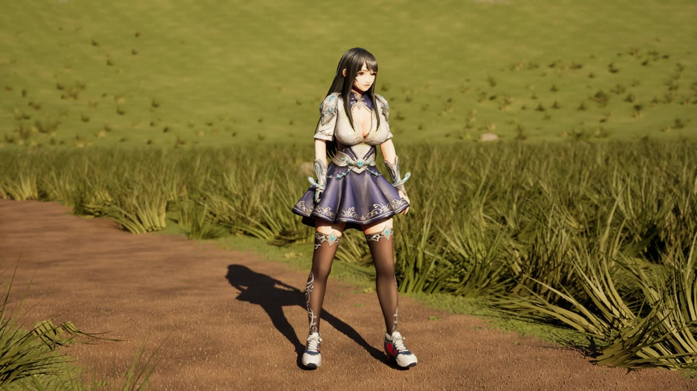
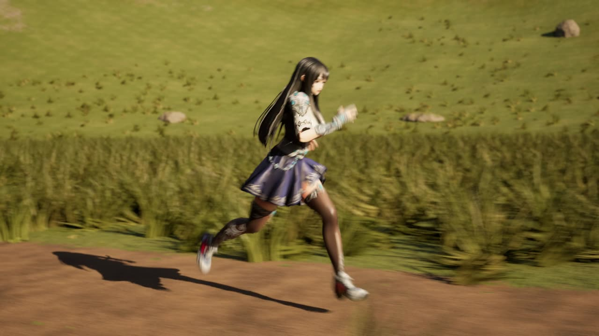
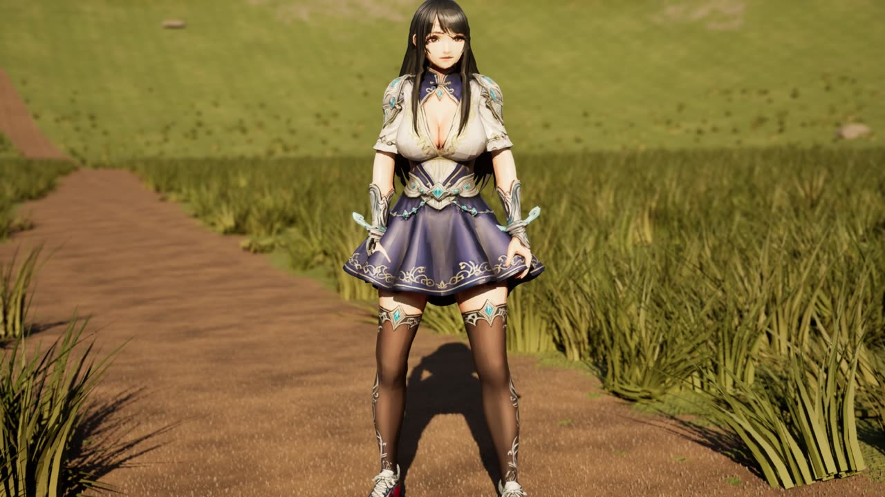
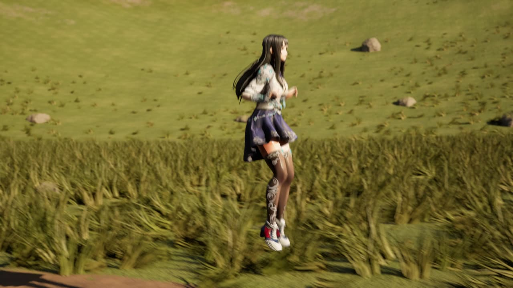
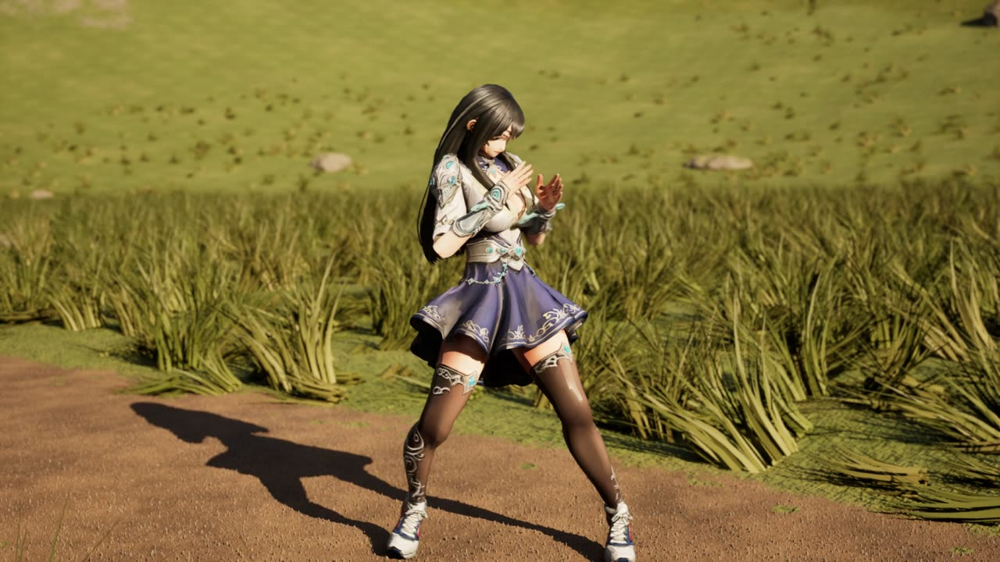
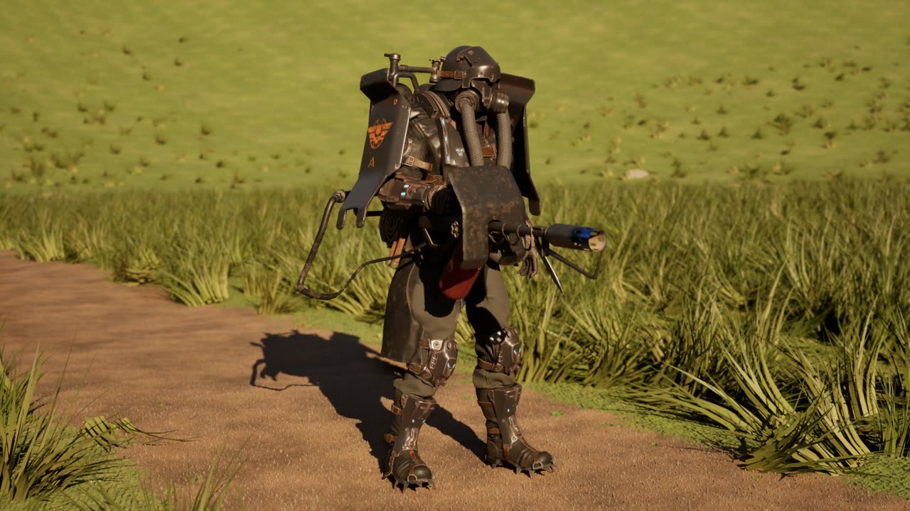
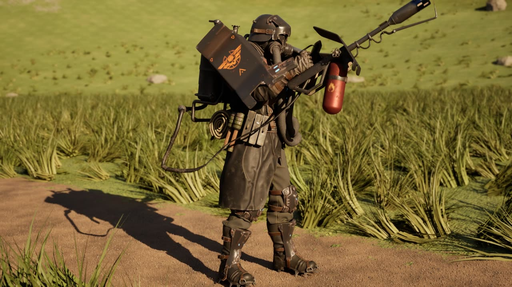
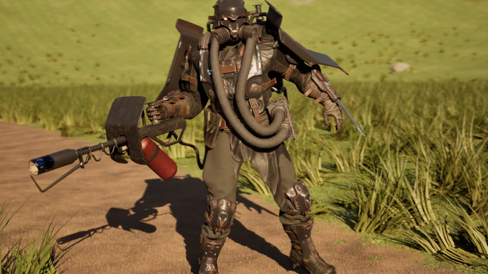

# claude-ue5

An Unreal Engine 5.8 project built almost entirely from scripts. The scripts drive the running editor over Python remote execution, and Blender + numpy prepare the source art. The project has several playable character showcase levels: third-person controls, a recorded demo route and a Movie Render Queue showcase video for each.

This repository is **source only**: the pipeline scripts, project config and small data files. Unreal assets (`Content/`), source art binaries, renders and the third-party packs they come from stay local. See [What's not in the repo](#whats-not-in-the-repo).

## Early results

Stills from the showcase videos: 1080p Movie Render Queue renders of each level's `*_Cine` copy, with the demo character running its recorded route.

**FF — Tripo anime female** (`ff_level`). A static GLB rigged onto a UE4-mannequin skeleton, with locomotion retargeted from the template.

| Idle | Run | Close-up |
|---|---|---|
|  |  |  |

**FF2 — animated Tripo anime female** (`ff2_level`). Her own clips, grounded on the sole contacts so she doesn't float or slide.

| Jump | Boxing | Casting |
|---|---|---|
|  |  |  |

**Dystopia Soldier 02** (`soldier_level`). Converted from a Unity-format Fab pack, with per-part PBR materials and retargeted locomotion.

| Idle | Flamethrower | Close-up |
|---|---|---|
|  |  |  |

## Levels

| Level | Character | What's in it |
|---|---|---|
| `L_Fig4_Studio` | `fig4`, a MetaHuman conformed to a 3D scan | Photo-studio cyclorama, plinth, studio and MegaLights lighting, strand hair groom, refitted scanned outfit |
| `L_Fig4_Meadow` | fig4 (`BP_Fig4Character`) | Outdoor meadow: procedural Nanite terrain, rocks and grass. Heel-stance locomotion retargeted from the UE mannequin |
| `L_Meshy_Meadow` | Meshy AI biped (`BP_MeshyCharacter`) | Same meadow; 18 moves on input actions plus a sprint |
| `soldier_level` | Dystopia Soldier 02 (`BP_SoldierCharacter`) | Same meadow; Unity-sourced soldier with retargeted locomotion |
| `ff_level` | Tripo anime female (`BP_FFCharacter`) | Same meadow; static GLB rigged onto a UE4-mannequin skeleton |
| `ff2_level` | Animated Tripo anime female (`BP_FF2Character`) | Same meadow; clips fixed on the sole contacts so she doesn't float or slide |
| `castle_level` | FF2 | The Medieval Fantasy Village pack's map with walk-in houses: doors, chests, trunks, wardrobes and barrels open with **F**. Interiors are furnished by building purpose (tavern, manor, homes, bakery, stable, barn, storehouse, smithy) with lofts, attics and lighting. Water splashes in the river |
| `sf-city-level` | jrpg-fem5-tripo (`BP_SFC_Fem5Character`: her own idle/walk/run, foot IK) | The Open World Science fiction City with the Monolith Megastructure streamed in beside it, joined by a 200 m bridge road. Four structures with furnished rooms behind automatic sci-fi blast doors: Port Authority (office + armory), neon noodle bar, hab apartment (living room + bedroom), excavation lab (relic lab + server room). Invisible barrier walls along every drop into the void, a fall guard, and a scripted walk test (`709`/`710`) |
| `random_level` | jrpg-fem5-tripo (`BP_SFC_Fem5Character`) | Procedural medieval town (C++ `ARTTownGenerator`). Starts as a 500 m x 500 m square built with a fixed seed; whenever she nears the edge of town heading outward, the next 250 m of terrain, cobbled streets, furnished buildings, props and foliage is generated ahead of her (fresh seed each play, never saved). Each new cell is marked as it appears: a glowing curtain rises on its border and a scan wave sweeps across it, the cell drawn as a cyan ghost until the wave passes. Buildings: the Modular Medieval Town packs' furnished docks houses, tavern (fireplace, dining tables, chairs, bar), stores and Sherwood cabins, streamed in as level instances and turned to face the street. Doors swing open as she approaches; bedroom chests, wardrobes and crates open with **F** |
| `random_dungeon_level` | jrpg-fem5-tripo (`BP_SFC_Fem5Character`) | Procedural dungeon (C++ `ARDDungeonGenerator`). A 252 m x 252 m start section of 49 interconnected rooms (fixed seed, saved), with hallways leaving every edge; walking toward the edge generates the next section (fresh seed each play, never saved) with random_level's reveal effect. Rooms have a purpose with matching furniture and lighting: great hall, barracks, prison cells, torture chamber, storeroom, armory, kitchen, library, chapel, crypt, treasury, guard room, forge; hallways are guard passages, supply passages or catacomb tunnels. Doors (crypt double doors, cell doors) and every container (chests, trunks, wardrobes, barrels, crates) open with **F**. Minimap of generated / discovered rooms, full map on **M**. Monsters from Creatures_Pack (troll, daemon, horned demon, ripper dog, spider, mutant) in 40% of the rooms wander from room to room |

Each level has a `*_Cine` copy (`MoviePipelineGameMode` with an AI demo character) for its `LS_*_Showcase` sequence.

**Controls:**
- WASD and mouse: move and look
- Space: jump
- Shift: run
- Ctrl: sprint (Meshy)
- F: open/close in `castle_level`; open/close chests, wardrobes and crates in `random_level` (doors open by themselves); open/close doors and containers in `random_dungeon_level`
- M: full dungeon map in `random_dungeon_level`
- Extra move/action inputs on Meshy, FF and FF2: see their input scripts (`110`, `150`, `214`, `260`)

## Requirements

- **Unreal Engine 5.8**, expected at `E:\Program Files\Epic Games\UE_5.8`. Enabled plugins: PythonScriptPlugin (with `bRemoteExecution=True`), EditorScriptingUtilities, EditorToolset, ModelContextProtocol, MetaHuman, HairStrands, MovieRenderPipeline, HDRIBackdrop (the sci-fi city's sky).
- **C++ toolchain** for the `claude_ue5` module (`claude_ue5/Source`, the random_level town generator): Visual Studio 2022/2026 C++ build tools (MSVC 14.38+) and a Windows 10/11 SDK. Build with the editor closed: `pipeline\build_cpp.ps1`. UE 5.8's build rules also want a .NET Framework SDK (4.6+); without one the script points UnrealBuildTool at a stand-in for that build only (installing the .NET Framework 4.8.x Developer Pack removes the need). Plugin ProceduralMeshComponent is enabled in the `.uproject`.
- **Blender 5.1**, run headless: `blender -b -P script.py -- args`.
- **Python 3.11+** with `numpy`, `scipy`, `imageio-ffmpeg` and `Pillow`, for the numpy tools, the remote-exec client and video encoding.
- The local asset packs listed below.

## Layout

```
claude_ue5/              UE project (claude_ue5.uproject, Config/; Content/ is local only)
  Source/claude_ue5/RT/  C++ procedural town for random_level: ARTTownGenerator, ARTCell, ARTBuilding
  Source/claude_ue5/RD/  C++ procedural dungeon for random_dungeon_level: ARDDungeonGenerator, ARDSection, ARDMonster, ARDHUD
  SourceArt/             exported/converted source art (only small JSON data is committed)
pipeline/
  unreal/                numbered editor scripts (NNN_name.py), run inside the editor
  blender_numpy/         Blender scripts (-b -P), numpy/scipy tools, ue_exec.py, encode_video.py, rl_reel_overlay.py
asset_survey/            survey of the local Fab library: UE5 usability, animation compatibility
local-packs.md           rig/animation summary of the local Fab packs
.mcp.json                MCP server config (UE ModelContextProtocol plugin on 127.0.0.1:8765)
```

## Running the pipeline

With the editor open on `claude_ue5.uproject`:

```powershell
python pipeline\blender_numpy\ue_exec.py pipeline\unreal\290_castle_level.py -2450 -1250 45   # script + args (sys.argv in the editor)
python pipeline\blender_numpy\ue_exec.py -c "import unreal; print(unreal.SystemLibrary.get_engine_version())"
python pipeline\blender_numpy\ue_exec.py --ping
```

The Blender stages write UE-ready FBX into `claude_ue5/SourceArt/...`:

```powershell
& "C:\Program Files\Blender Foundation\Blender 5.1\blender.exe" -b -P pipeline\blender_numpy\ff2_build.py -- <args>
```

Scripts are numbered roughly in build order. Each one's docstring states its purpose and arguments.

| Range | Stage |
|---|---|
| `01`–`25` | fig4: scan import, MetaHuman conform/look/build, studio level, groom, outfit, render setup |
| `31`–`95` | fig4 locomotion: retargeting, heel stance, character BP, meadow world (`50`, `51_level_outdoor.py level_path [cine] pawn=… gm=…`), demo, cinematic, render (`75`) |
| `100`–`154` | Meshy biped: import, Substrate material, retarget, moves, sprint, demo, sequence |
| `160`–`189` | Dystopia soldier |
| `200`–`230` | FF (Tripo, static) |
| `240`–`289` | FF2 (Tripo, animated): import, AnimBP, character, grounding and foot-contact fixes |
| `290`–`383` | castle_level: village copy, interactive pieces, door/container/wardrobe BPs, splashes, populate, furniture kit, furnishing, grass mask, cinematic |
| `700`–`714` | sf-city-level: map copies, Monolith strip/stream, bridge road, world-aligned materials, sci-fi door BP, structures + interiors, player/fall guard, barrier walls, walk-test planner and PIE walk test, foot IK, cinematic (demo paths, Simulate recorder, sequence) |
| `750`–`761` | random_level: building templates (docks level instances, Sherwood cabins), ground material, level + generator setup, generation indicator, cinematic (demo path, Simulate recorder, one-camera sequence), PIE walk test |
| `770`–`772` | random_dungeon_level: level + piece catalogue + monsters + game mode/HUD + start section (`770`), PIE walk test (`771` driven by `772_rd_walk.ps1`) |

**sf-city-level rebuild order** (needs the HDRIBackdrop plugin, enabled in the .uproject):
1. `700_sfc_maps.py city`, restart the editor, `700_sfc_maps.py monolith`, restart
2. `701_sfc_monolith_strip.py`, `702_sfc_assemble.py`, `703_sfc_road.py`
3. `704_sfc_materials.py`, `705_sfc_door_bp.py`, `706_sfc_structures.py`
4. `707_sfc_player.py`, `711_sfc_foot_ik.py`, `708_sfc_safety.py` (flood fill + barrier walls; re-run after any layout change)
5. Walk test: `709_sfc_walk_plan.py`, then during PIE `710_sfc_walk_test.py route|probes <from> <to> <tag>` (results in `SourceArt/sf_city/walk_<tag>.json`)
6. Showcase: `700_sfc_maps.py cine`, restart, open `sf-city-level_Cine`; `712_sfc_cine_setup.py`; `713_sfc_cine_record.py` (Simulate; stop it after "SFCPATH saved"); `714_sfc_sequence.py`; render `LS_SFC_Showcase` with `75` (no warm-up frames to drop: encode from 0)

**random_level** (`750`–`761`, C++ in `claude_ue5/Source/claude_ue5/RT`; packs: Modular Medieval Town "Sherwood" `Hive_Sherwood`, Modular Medieval Town Docks `Hivemind/Medieval_Docks`, Village Collection, the castle furniture kit):
1. Build the C++ module (`pipeline\build_cpp.ps1`, editor closed), relaunch.
2. `750_rl_templates.py` (opens a scratch level first: random_level holds these maps as level instances) (docks buildings: footprint, entry floor, doors + closed orientation, crate lids, added bedroom chests / wardrobes / washstands, interior walk paths; run it twice right after an editor restart: collision cooks asynchronously), `750b_rl_cabin_templates.py` (Sherwood houses) -> `SourceArt/random_level/templates.json`.
3. `751_rl_ground_material.py`, then `752_rl_level.py` (level, lighting, far ground, generator config, start square, PlayerStart, game mode; saved), then `753_rl_reveal.py` (generation indicator: post-process scan wave + border curtain materials, assigned to the generator).
4. Walk test: `761_rl_walk.ps1 "<plan>" <tag>` (PIE + `760_rl_walk_test.py`), e.g. `"expand:+x:400,visit:new:6,expand:-y:400,visit:new:4,visit:start:8,home"`; results in `SourceArt/random_level/walk_<tag>.json`.
5. Showcase: Save As `random_level_Cine` (`EditorLoadingAndSavingUtils.save_map`), restart, open it; `754_rl_cine_setup.py` (demo character + path, generator follows her with a fixed seed); `755_rl_cine_record.py` (Simulate; stop it after "RLPATH saved"); `756_rl_sequence.py` (one continuous camera: MRQ warms up at every camera cut, which would stall her); render `LS_RL_Showcase` with `75`; HUD with `pipeline/blender_numpy/rl_reel_overlay.py <frames> <out_dir> claude_ue5/Saved/Logs/claude_ue5.log` (reads the render's generation events from the log, so run it before the next PIE session), then encode from 0.

**random_dungeon_level** (`770`–`772`, C++ in `claude_ue5/Source/claude_ue5/RD`; packs: Dungeon Builder top-down kit `MysticDungeon`, Modular Dungeon kits `HallowedDepths` / `DarkHalls`, `Gothic_Props`, `Medieval_Weapons`, `Creatures_Pack`, castle_level's furniture kit and openable barrels / crates; reveal materials from random_level's `753`):
1. Build the C++ module (`pipeline\build_cpp.ps1`, editor closed), relaunch.
2. `770_rd_level.py` (pieces normalised to the dungeon frame, monsters with measured walk speeds, `BP_RD_GameMode` + `RDHUD`, level, start section, PlayerStart in the great hall; saved). Re-run after changing the generator's layout or furnishing code.
3. Walk test: `772_rd_walk.ps1 "<plan>" <tag>` (PIE + `771_rd_walk_test.py`), e.g. `"rooms:3,expand:+x,rooms:2,map:a,expand:-y,home"`; results in `SourceArt/random_dungeon/walk_<tag>.json`. `Config/DefaultEditorSettings.ini` keeps the editor at full speed in the background (otherwise PIE runs at ~3 fps while a script drives it).

**castle_level rebuild order:**
1. `290_castle_level.py -2450 -1250 45`
2. `340_castle_populate.py`
3. `383_grass_mask.py`
4. `380_castle_furnish.py`

**Showcase videos:**
- Build the sequence with the level's `*_sequence.py`.
- Render with `75_render_locomotion.py <out_dir> preview|final <level> <sequence> <prefix>`.
- Encode with `pipeline/blender_numpy/encode_video.py <frames_dir> <out.mp4> 36 30`. The `36` drops the warm-up frames.

## What's not in the repo

These are excluded for size (about 10 GB, with single files over 1 GB) and licensing:

- **Unreal content** (`claude_ue5/Content/`), including third-party packs:
  - [Medieval Fantasy Village](https://www.fab.com/) (LAYA DESIGN) and Fantasy Castle Environment (DanStudios), both from Fab
  - Monolith megastructure
  - Megascans scans (Saloon Interior pack)
  - MetaHuman assets and the UE template mannequins
- **Source characters:**
  - the Tripo anime female GLBs
  - the Meshy AI biped zip
  - the Dystopia Soldiers pack (Fab, Unity format)
  - the fig4 scan
- **Source art binaries:** FBX, GLB, Alembic, DNA and textures.
- **Renders and showcase videos** (`renders/`).
- **Per-machine folders:** `Saved/`, `Intermediate/`, `DerivedDataCache/`.

To rebuild a level you need the same packs locally:
1. Add the Fab packs to the project through the Epic Games Launcher.
2. Put the character sources where the build scripts expect them.
3. Run the scripts in order.
