# The player's guide

[README](../README.md) · [The tiers](tiers.md) · [The secondary abilities](secondary.md) · [Controls (short)](controls.md) · [Mistward Castle](levels/mistward_castle.md) · [The wilderness](levels/wilderness.md) · [The caves](levels/caves.md)

This guide is for the player. It covers:
- **Each hero:** what she can do at every tier from 1 to 30, what each ability costs (mana, dexterity energy, chi) and what it does in game terms.
- **What every hero earns in the wilderness**, and what she can craft.
- **Equipment:** what she wields and wears, and how far it can be improved.
- **Spells and magic:** every spell and who learns it.
- **Controls:** keyboard and mouse, and the gamepad.

It describes the game as its code stands after the user's list of 2026-11-22 (`docs/improvements16.txt`), all of it merged (main at `a7ca551`).

**Where the numbers come from.** Every number was read on 2026-11-25:
- **The tables the game plays.** These are the heroes, spells, secondary abilities, slashes, items and recipes on `mistward_castle`'s dungeon generator, read from the open map in the editor. The numbered stages in `pipeline/unreal/` write the same tables onto every map of the game: `910`, `911`, `918`, `925`, `928`, `934`, `943`, `945`.
- **The data files** they are built from (`claude_ue5/SourceArt/**.json`).
- **The C++ that applies them** (`claude_ue5/Source/claude_ue5/RD`).

Where the documents, the data and the code disagree, **the code and the map's data win**; the [last section](#where-the-data-and-the-code-disagree) lists every such place, and what could not be determined. The tier tables are computed from the formula in the code (`GrowthAt`) and the maps' values, not measured in play.

**Words used here:**
- **Tier:** one of the game's 30 tiers. Each dungeon has five; the wilds and caves have tiers too.
- **Her growth tier:** the deepest tier she has opened anywhere.
- **Damage:** hit points taken off a monster.
- **A share** written as a percentage is a share of her maximum, unless said otherwise.
- **A blow:** one strike of a melee weapon, or one bolt that lands.

## The world and its tiers

A new game starts in **Brokenspire**, the starting town, in a continent of wilds round it with five more cities. Each city has a dungeon of its own, and the dungeons are one chain of 30 tiers: each dungeon's five tiers are the game's next five (`DungeonTierBase`, `docs/tiers.md`). A dungeon's key is found in the one before it (`SourceArt/dungeons/chain.json`).

| Dungeon | Its city | The game's tiers | Its gear's quality | Later abilities given by its tier-5 boss |
|---|---|---|---|---|
| Mistward Castle | Brokenspire | 1-5 | plain | (each tier's boss: chi attacks, summonings, slashes) |
| The Catacombs of Vel Morrath | Vel Morrath, the holy city | 6-10 | Fine | Summon Tier 6, Barbed Bolt, Crashing Wave |
| The War Engine | Ashenreach, the forge city | 11-15 | Masterwork | Summon Tier 7, Incendiary Bolt, Thunder Step |
| The Sewers | Graymourne, the port | 16-20 | Exalted | Summon Tier 8, Shadow Fangs, Dragon Palm |
| The Black Tower | Kethrys Spire, the mage city | 21-25 | Celestial | Summon Tier 9, Storm Bolt, Comet Fist |
| Kratos Aurorim Research | Heaven, the modern city | 26-30 | Divine | Summon Tier 10, Death's Kiss, Heaven's Gale |

- **Opening a tier.** In a dungeon, tier 2 opens once the start set is cleared; each later tier once 50 % of the tier before is cleared (`TierOpenShare`): its rooms explored, its chests looted, its monsters killed. A tier's boss stands in an explored room of the tier before.
- **The wilds** rise in tier along the roads from Brokenspire (tier 1) to Heaven (25 at its gate, 30 some 40 km beyond it).
- **The caves** under every landmark tower take the region's tier. Monsters there are the region's kinds.
- **Gold and prices** go by the game's tier, the deepest opened in any dungeon: x 1 at tier 1, 8 at tier 5, about 17 % a tier after (17.5 at tier 10, 185 at 25, 405 at 30). A kill or container pays by the tier where she earned it.

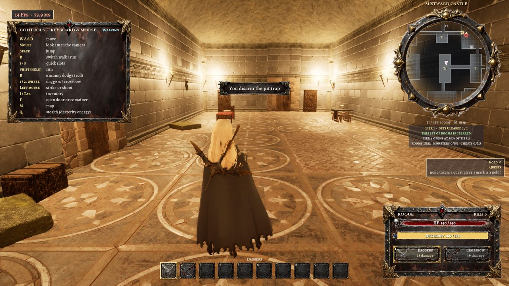

## Rules common to every hero

### Hit points, mana and healing

- **No passive healing:** hit points come back only from potions, food, spells, the healer, fountains, a rest at a cleared camp's tent or an inn room. The castle's `RegenPerSecond` reads 0, read from the map.
- **Mana** comes back every second by her hero's share of her pool (above). Mana potions restore a share of the pool at once.
- **Potions** restore a share of her maximum at once. **Food** heals a share of her maximum every second for its seconds; several foods add up. Both are refused at full health unless they carry a buff.
- **Speed potions** make her faster for 30 s and fill the Rogue's dexterity energy.
- **Buffs** from the advanced potions and meals (resist, might, speed, regen, warm, cool, darksight, poison guard) carry between levels. They show as chips over the status panel.

### When she is struck

A blow on her goes through these, in order, and the first that takes it whole ends it (`URDCombatComponent::ApplyDamage`, `RDCombat.cpp`):

1. A roll's dodge window; stealth (a hidden Rogue is never struck).
2. Her secondary abilities: parry, ablation layers, the recharge shield, the mana shield, then Iron Skin cuts it.
3. Null Sanctum's zone (no harm); Shadow Veil (75 % of blows miss).
4. The slashes' evasion, crystal shield and deflection.
5. A ward: Ash Ward, Bone Armor, Spectral Bulwark.
6. Mirror of Retribution turns its share back on the attacker.
7. Rune of Warding cuts it by half inside its zone.
8. **Armour and resistances added together, at most 95 %:**
   - her armour's share;
   - Iron Skin (spell) +40 %;
   - the shrine's Bulwark +25 %;
   - a resist buff (+25 % Elixir of Iron Hide, +15 % Hunter's Stew);
   - a white socket stone +8 %;
   - the Thorned Crown +15 %.
   - Armour worn down to 0 durability counts half.
9. **Her shield** takes its share of what is left (30 points more while the Warrior blocks), at most 95 %. A worn-out shield takes half. A shield wears by what it took (five times as fast while blocking).
10. Her armour loses 1 durability. Her hit points fall.
11. Undying Pact, if up, leaves her at 40 % instead of dying, once.

**Monsters' afflictions on her.** After a blow lands, unless it was absorbed whole (`ApplyMonsterAbility`, `RDSpells.cpp`; P is the tier's ability power, 0 to 1.8):

| Affliction | Effect | Lasts |
|---|---|---|
| Poison | the blow x 0.10 x P a second | 3 + P s |
| Weakness | her blows weaker by 0.15 x P (at most half) | 4 + P s |
| Slowness | her speed down 0.2 x P (at most 60 %) | 2.5 + 0.5 P s |

- Dispel Hex ends all three and blocks new ones for 3 s.
- Grave-moss Antivenom (60 %) and the Chitin Plate (50 %) cut poison's ticks, at most 90 % together. They do not stop a poison taking hold.
- Some traps slow or weaken her too.

**Harm no armour stops:**
- **Falls:** above 4.5 m, a share of her hit points growing to all of them at 15 m. Deep enough water takes the fall.
- **Traps:** a share of her hit points.
- **Poison ticks.**
- **Drowning:** 8 % a second once her breath is out.
- **Cold and heat** in the wilds: 3 % every 15 s once it has built up 90 s.

### Monsters, elites and bosses

- **A monster's strength** is the reference (100 hit points, 25 a blow), times its tier's multiplier ([the table above](#growth-by-tier)), times its kind's factor against its tier's mean, times the difficulty.
- **A tier's boss** has 3 times the hit points and 1.6 times the blows. The final boss, Aurorim, has 1.5 and 1.25 times a boss's more (`BossHealth`, `BossDamage`, `FinalBoss*`).
- **An elite** is shown on the map when it has more than 1.25 times its set's mean hit points. On Hell, 20 % of the monsters are elites made with 1.6 times the hit points and 1.25 times the blows.

### Death

- **When you die, drop items (the default):** everything she can drop goes into a pile where she fell. F takes it back.
- **She keeps:**
  - her keys and maps of the chain;
  - her learned spells, unlocked chi attacks, summonings and later abilities;
  - her secondary ranks and Rogue arts.
- She comes back after 3.5 s at full hit points and mana: at the dungeon's start room, or at the nearest town found in the wilds. Every spell and affliction on her ends.
- The Gameplay page's "keep your items" keeps everything.

### The quick bar and the HUD

- **Quick bar:** ten slots or more, scrolled to the chosen one. It holds her weapons, spells, chi attacks, summonings, abilities (`@Name`), potions, food and scrolls.
- **Cooldowns:** a cooldown darkens the slot. A green frame shows while a shield or mode is on her.
- **Messages:** the last 20 open with L.
- **HUD layout:**
  - Upper left: the controls.
  - Upper right: the minimap and, in a dungeon, the tiers' progress.
  - Under the minimap: the quest window.
  - Lower right: her status panel (hit points, mana or energy, the drawn weapons).
  - Lower left: her summons, for the Summoner.

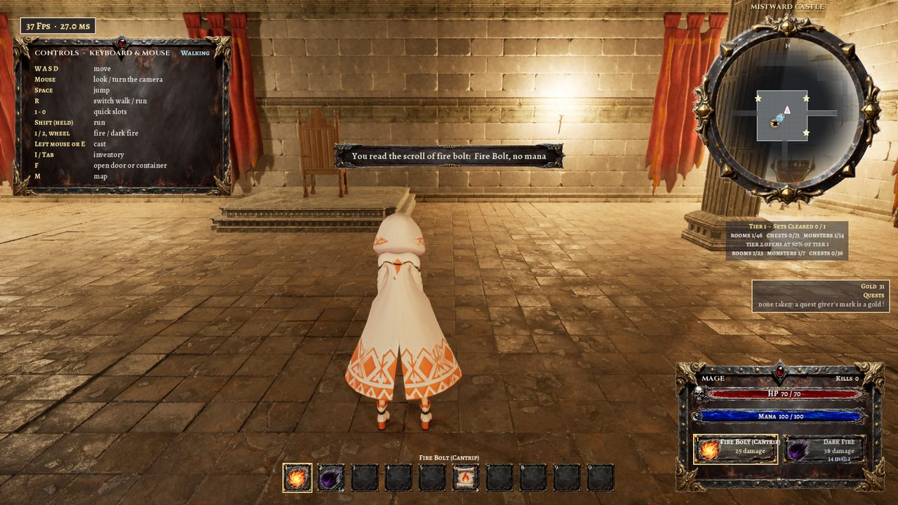

### Dungeon features every hero meets

- **Special rooms** (20 % of a set's rooms), each used once:
  - A shrine's blessing, one of three for 90 s: Might +25 % damage, Bulwark 25 % less taken, Swiftness +20 % speed.
  - The healing fountain: +60 % of her hit points.
  - The speed fountain: +30 % speed for 45 s.
  - The mana fountain: mana to full.
  - Other rooms: an arena of waves, a hall of traps with a chest at its end, a vault its key opens, a throne room and its usurper.
- **Traps:** pits, darts, deadfalls, crushers, snares, glyphs, wards, clouds, cursed skulls, chains, lingering traps, teleport traps and spring plates. Only the Rogue sees them before they go off.
  - Blessed rune stones look like the cursed ones and bless her instead.
  - The Revealing Ankh, carried as a light, shows traps and unlooted chests within 10 m.
- **Prison cells:** a prisoner freed gives a gift of the set's tier. A caged monster set free fights.
- **Teleporters:**
  - Teleport rings II to V take her to a tier's pad.
  - A boss's teleporter goes to the first room or the town (G / R3 picks which).

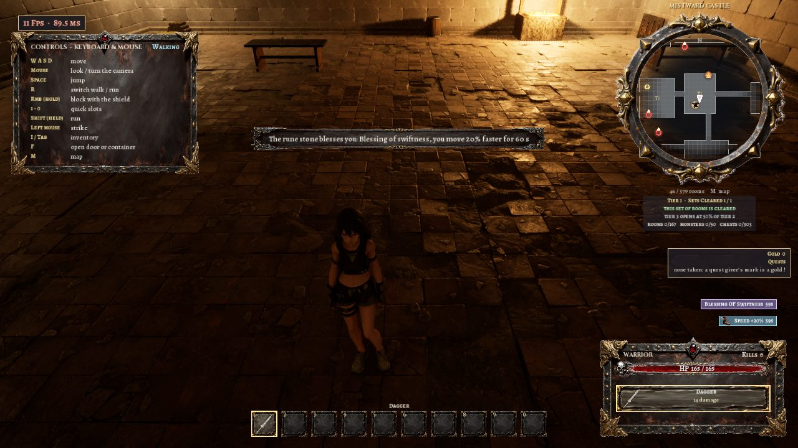

## Controls

Keyboard and mouse first, the gamepad (an Xbox controller) second. The HUD's upper left lists the hero's own controls for whichever device was used last (the Options page's Controls hint hides it). Read from the C++ (`RDCombat.cpp`'s `TickCasterInput`, `RDMistward2.cpp`'s quick bar and block, `RDList14.cpp`, `RDDungeonGenerator.cpp`, `RDTownGame.cpp`, `RDWildMap.cpp`, `RDHorse15.cpp`, `RDConsole.cpp`) and the heroes' `ControlsKeys` / `ControlsPad`. Moving, looking, jumping and running with Shift held come from the project's input mapping (`IMC_Default`), not the C++.

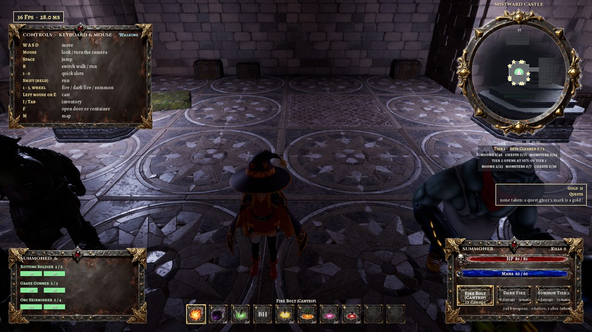

### Every hero

| Action | Keyboard and mouse | Gamepad |
|---|---|---|
| Move | W A S D | left stick |
| Look, turn the camera | mouse | right stick |
| Jump | Space | A |
| Run | Shift held; R switches walk / run | LT switches walk / run |
| Next / previous weapon or spell | mouse wheel | Y (next) |
| Quick bar | 1 to 0 use slots 1 to 10 (an ability goes off at once, a weapon is drawn) | D-pad left / right: the previous / next filled slot (a weapon is drawn; a potion, food or ability is made ready) |
| A potion or food made ready on the quick bar | left mouse uses one (that press makes no blow) | RB uses one |
| Act on what is nearest (doors, containers, people, stations, piles...) | F | X |
| Inventory (pauses the game) | I or Tab | Start, a short press |
| Escape menu (pauses the game) | Escape | Start held half a second |
| Map | M | Back (View) |
| The last 20 messages | L | D-pad down |
| Call her horse (not in a dungeon) | J | D-pad up |
| Hide or show her helmet | H | none |
| Pick a teleporter's destination (the great hall's tier pad; a boss's teleporter: the first room or the town) | G | R3 (with no map open) |

**Quick bar abilities.** A secondary ability, a Rogue art, the roll or the dash goes on the quick bar as `@<Name>`; potions, food and scrolls as items. With the keyboard, its number key uses it at once on every hero. On the gamepad the D-pad makes it ready and the attack button (RB) makes it: this works for the Rogue and the Martial Artist; **for the Warrior, Mage, Warlock and Summoner the code uses a ready potion, food or scroll with RB, but not a ready ability** (only the Rogue / Martial Artist input path calls `UseAbility` for it: `RDCombat.cpp` lines 2353-2357 against `QuickItemAttack` in `RDList14.cpp`, which takes items only). So on a pad those four heroes' secondary abilities have no button; their number keys work. This was read in the code and not tried in play.

### Each hero's own

| Hero | Keyboard and mouse | Gamepad |
|---|---|---|
| Warrior | left mouse strikes; right mouse held blocks with a shield (W / S walk her slowly along her facing, A / D turn her) | RB strikes; LB held blocks |
| Mage | left mouse, right mouse or E casts the spell drawn; the wheel steps through her spells | RB or LB casts; Y steps |
| Warlock | left mouse cuts with her sword (or uses the found weapon drawn); right mouse or E casts the spell alongside (Fire Bolt or a learned spell) | RB weapon; LB spell |
| Rogue | left mouse strikes or shoots with what she holds; the wheel switches daggers / crossbow; B rolls (her uncanny dodge); Q hides her (40 dexterity energy), Q again ends it | RB; Y switches; B rolls; LB stealth |
| Martial Artist | left mouse strikes or makes the chi attack drawn; the wheel switches her basic attacks / chi attacks; B dodges; V or right mouse dashes into a strike | RB; Y; B dodges; RT dashes |
| Summoner | left mouse, right mouse or E casts the spell or summoning drawn; the wheel steps through Fire Bolt, Dark Fire, her summonings and her hands | RB or LB casts; Y steps |

The Summoner picks the kind a summoning calls with Enter (A) on that summoning in her inventory, and puts away the found weapon in her hands with Enter (A) on it (then her attack says "Your hands are empty: draw a weapon or a spell"): `RDList15b.cpp`.

### F: what it acts on (X)

F acts on the nearest thing in reach; the prompt says what it will do. In order of priority (`RDDungeonGenerator.cpp`):

1. Mounted: she gets off the horse (above about 1.2 m/s she waits for it to slow).
2. A cave painting (studied), a lost traveller (helped), a broken tower's lift or top.
3. A pile within 2.6 m: her own dropped things, a harvest from a kill, a guarded ring.
4. A cave mouth; collectibles, treasure maps, buried chests; the wilds' tables and ovens; scenery and points of interest.
5. Heaven's tower lifts and doors.
6. In the towns: someone to talk to (quests, a keeper's service, a line), a service where it stands (the trader's counter, the healer's basin, the temple's altar, the storehouse's chest, the smith's anvil, the teleport circle, the quest board), the gate's lever, a pen's gate, a garden, the food on a table, a boarded door.
7. In the dungeons: an armory table's weapon, a shrine, a fountain, a vault's door, a teleporter's pad, a boss's teleporter, a library shelf.
8. The forge, an oven, the alchemist's or librarian's table, a trap she has seen (the Rogue disarms it), the anvil.
9. Her horse within 3.2 m, if nearer than any door or container: she mounts.
10. The nearest door or container (a prisoner's cell opens; a monster's cell is "locked from within"). A locked wild container: the Rogue picks it (2 s within 1.2 m), the Warrior breaks it; the others are refused.

### The inventory (I or Tab; Start)

- W / S, the arrows, the D-pad or the left stick walk the list (held: again after 0.35 s, then every 0.08 s). The pointer chooses a row, a click uses it, the wheel scrolls.
- Q / E or LB / RB, or a click on a tab: the tab before or after.
- Enter or Space (A): use the line: drink or eat, put armour, a shield, a ring or a charm on or off, light the torch, use a teleport ring, read a scroll, use an Angel Token (a list of her abilities opens), set a socket stone. On a repair item it lists what that mends, on a slash the weapons it can go on (Backspace or B back).
- A number key 1 to 0 puts the line's weapon, spell, ability or item into that quick slot (its own number again takes it off); on the pad, D-pad left / right picks a slot and Y puts it there; the right mouse button does the same with the pointer.
- T (X): takes a weapon's slash off.
- I, Tab, Start or B close it.

### Crafting panels (the anvil, the forge, ovens, the alchemist's and librarian's tables)

F (X) at a station opens its panel (it pauses the game). W / S, the arrows, the wheel, the D-pad or the stick choose; Enter, Space, E, the left mouse or A make the line. On a break-down line a tap breaks down one when let go, held 0.6 s the whole stack. F, Backspace, I, Tab, B, X or Start close it.

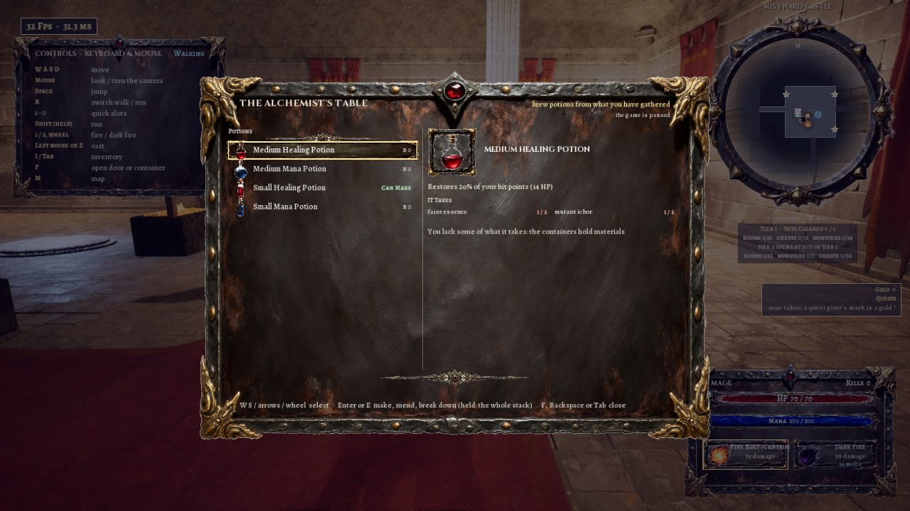

### Town panels (stores, storage, services, quests)

W / S, the arrows, the D-pad, the stick or the wheel choose (held: again after 0.35 s, then every 80 ms); Enter, Space, E, A or a click do it; A / D, the left and right arrows, the D-pad left / right, LB / RB or a click change the tab; Escape, Backspace, F, Tab or B close it. In the storage, Enter (A) or the left mouse button held stores or takes back the same thing again after 0.4 s, every 0.15 s.

### The maps (M; Back)

- **In a dungeon:** the whole map as a see-through overlay you keep playing under. The arrows (D-pad) scroll it, the wheel, + / - (right stick) zoom it, C (R3) centres it.
- **In a town:** the town from above; the wheel or + / - (right stick) zoom it up to six times; a drag with the left mouse button or the arrows (D-pad) move it; C (R3) shows the whole town.
- **In the wilds:** the map of the world, 4 km across round her at first; the wheel or + / - zoom about the pointer (right stick); a drag or the arrows (D-pad, left stick) move it; C (R3) brings it back over her; F, Enter (A) or a click travels to the found place (a town, a lit waystone, a cleared camp, an attuned cave mouth) under the cross, not while a monster is after her.

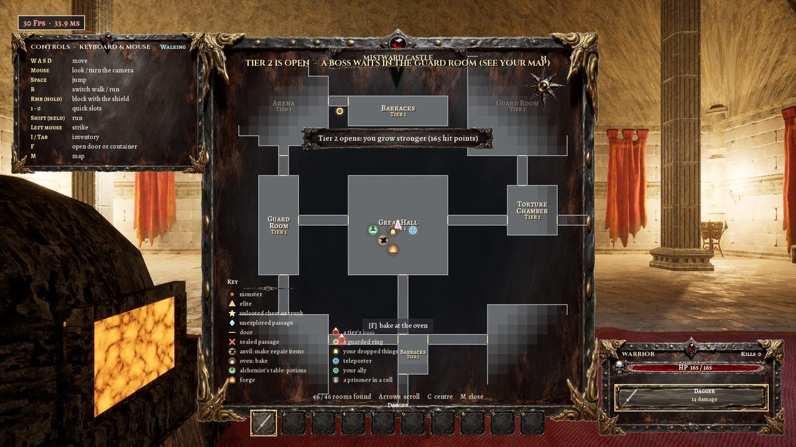

### The horse (outside the dungeons)

| Action | Keyboard and mouse | Gamepad |
|---|---|---|
| Call her horse (it must be bought at a stable by a town's gate) | J | D-pad up |
| Mount (within 3.2 m) / dismount | F | X |
| Walk or gallop | R switches walk / run: in walk mode a brisk walk at most; in run mode it walks under 60 % of the stick and gallops above | LT switches |
| Hard stop | let go at a gallop | let go |
| Back up | S, with the camera behind the horse | stick back |
| Jump | Space | A |
| Rear | left mouse (for the casters also their spell keys); no blows from the saddle | RB |

In deep water the horse swims, slower and without jumping (`RDHorse15.cpp`). The call is refused in a dungeon, indoors, swimming, mounted or with no room.

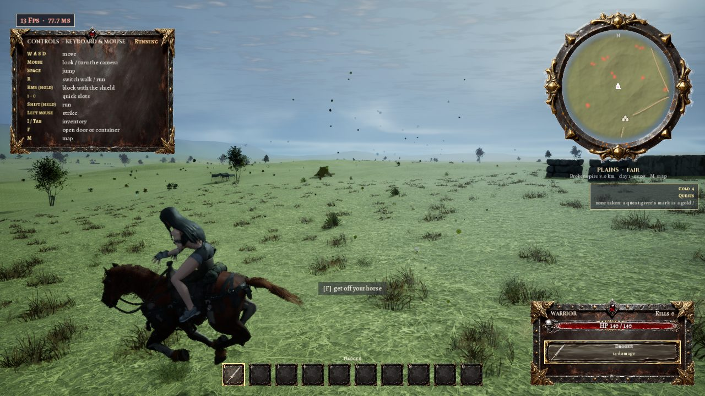

### Swimming and breath

She swims on the water's face by herself once it is deep enough (1.2 m, `SwimDepth`); there is no dive key. While swimming she cannot jump, strike, block, roll, dash, cast a chi attack, hide or use an ability, and she moves at 55 % of her speed (`SwimSpeedMul`). Only in a cave's flooded side tunnel is she under water: there her breath lasts 15 s (45 s in the Drowned Knight's armour), and once it is out she loses 8 % of her hit points a second until she surfaces (`Breath16`, `DrownShare16`, `RDCave16e.cpp`). A fall into deep enough water does no harm.

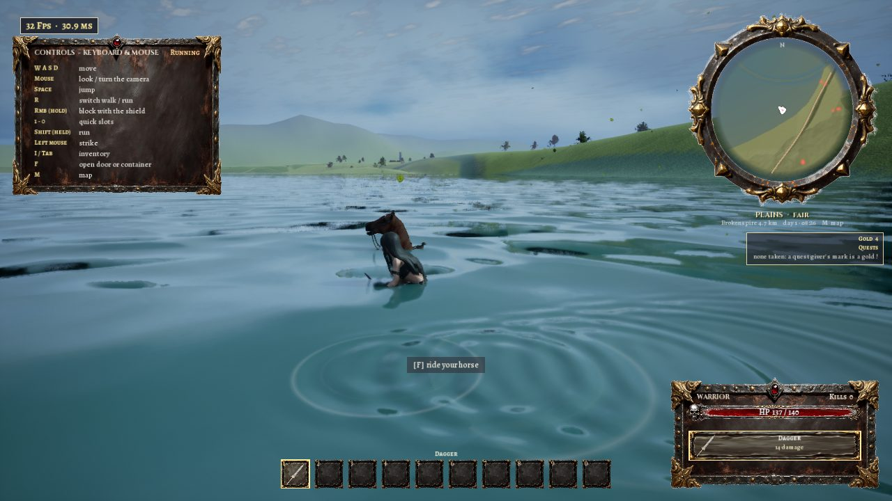

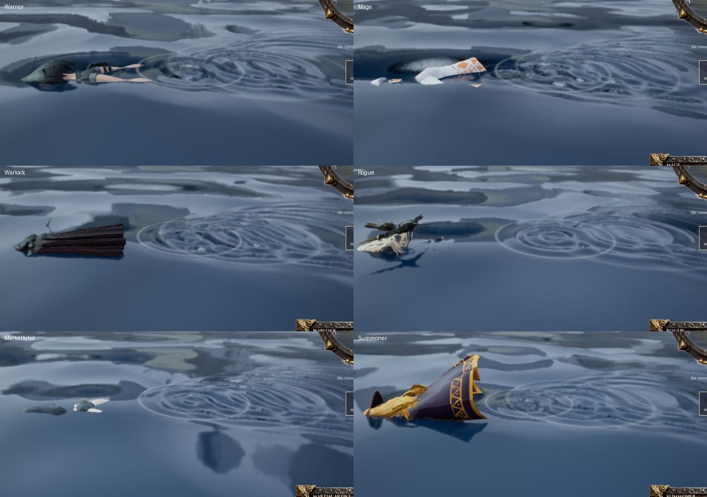

### The Escape menu (Escape; Start held)

W / S, the arrows or the D-pad choose a line; A / D, the arrows or the D-pad change a setting; Enter, Space or A press it; the mouse clicks and drags. Escape or B go back a page or close it.

- **Main page:** Resume, Save the game, Load a game, Options, Gameplay, (in a dungeon) Return to its town, Choose another hero (a new game), Quit.
- **Options:** Overall volume, Action sounds, Environment sounds, Music, Controls hint, Quest window, Resolution, Display mode (fullscreen, windowed fullscreen, windowed), Apply display settings, Back.
- **Gameplay:** "When you die" (keep your items, or drop them where you fall); Difficulty: Easy, Fair (the default), Difficult, Hell. The monsters' hit points and blows are x 0.6, 1, 1.5 or 2.5; Hell also brings 1.25 times as many monsters and makes 20 % of them elites (x 1.6 hit points, x 1.25 blows). Her allies and summons are not scaled (`DifficultyScale`, `RDMistward4.cpp`, `RDMonster.cpp`).
- **Save the game:** type a name (letters, digits, spaces, hyphens, apostrophes; 40 at most); Backspace deletes (held, it repeats), Delete clears; Up / Down choose a save to write over; Enter (A) saves.
- **Load a game:** the autosave and the named saves as cards, newest first; Enter, Space or A loads one.

### The hero menu

A / D, the arrows, the wheel, the D-pad, LB / RB, the left stick or a click: another hero. Enter, Space, A or Start (or her name clicked again): a new game in Brokenspire. C or X: CONTINUE, the newest save. P or Y: AUTOPLAY, the game plays her for 1, 2, 5, 10 or 30 minutes ([ / ], the D-pad down / up) or until any key. Escape or B: QUIT GAME (once asks, again within 3 s quits).

### The console

The console key (`) opens and shuts it; no gamepad button opens it. Enter runs a line, Up / Down bring back earlier lines, Tab completes, PageUp / PageDown scroll, `help` (or `?`) lists the game's commands, `clear` empties it. A command alone shows its value. The commands a player can use (`RDConsole.cpp`, `RDConsoleCmds.cpp`, `RDList11.cpp`, `RDList12.cpp`):

| Command | What it does |
|---|---|
| `rd.Time <dawn, morning, noon, afternoon, evening, night, midnight or 0-24>` | sets the hour |
| `rd.TimeSpeed <1-240>` | the day's clock that many times faster |
| `rd.GameSpeed <0.1-10>` | the whole game faster or slower |
| `rd.Weather <clear ... whiteout, dust, or 0-10> [light, moderate, strong, violent]`, `rd.Weather auto` | sets and holds the weather in the towns and wilds, or lets it go |
| `rd.GoTo <brokenspire, velmorrath, ashenreach, graymourne, kethrys, heaven>` | travels to a city, found or not |
| `rd.Pois [all, hide]` | shows every place on the map and lists the nearest 40 (or all); hide: only those found |
| `rd.GoToPoi <number or name>` | goes to a listed place (the wilds only) |
| `rd.Tier <1-30, 0>` | her growth tier for testing (0: the game's own) |
| `rd.RevealMap [off]` | the whole map shown |
| `rd.MapTeleport [off]` | with the map revealed, a click on the big map teleports her |
| `rd.WildRunSpeed <1, 5, 10, 15, 20, 30, 40>` | her running speed in the wilds |

## The heroes

The hero menu offers six heroes. Each has her own body, clips, weapons and rules. The table gives what she starts with at tier 1; the [growth tables](#growth-by-tier) give her numbers at every tier from 1 to 30.

| Hero | Hit points | Mana (back a second) | Other resource | Armour she wears | Rings she wears | Bonus | Starts with | Learns spells from tomes | Reads scrolls | Secondary abilities |
|---|---|---|---|---|---|---|---|---|---|---|
| Warrior | 140 | none | none | light, medium, heavy | Health | +30 % with melee weapons | a dagger (11 damage) that never breaks or drops; no shield | none | none | 6, by Angel Tokens |
| Mage | 70 | 100 (2.5 % of her pool) | none | none | Magic | none | Fire Bolt (a free cantrip), Dark Fire | offense, protection, curse, summoning | all four types | 6, by Angel Tokens |
| Warlock | 100 | 60 (2.5 % of her pool) | none | light, medium | Magic, Health | none | an arming sword (22) and Fire Bolt cast with her other hand | offense, curse (and her own thirteen curses) | offense, curse | 6, by Angel Tokens |
| Rogue | 100 | none | dexterity energy 100 (1.5 back a second) | light | Dexterity | +30 % with ranged weapons | two daggers (13) and a crossbow (26) | none | none | none: sixteen arts from manuals instead |
| Martial Artist | 140 | 100 (2 % of her pool) | chi attacks are paid in mana | light | Health, Dexterity | +30 % with knives and daggers ("short blades") | her fists and feet (44), two chi attacks | none | none | 5, by Angel Tokens |
| Summoner | 85 | 60 (4 % of her pool), +10 % a tier | none | none | Magic | none | Fire Bolt, Dark Fire, Summon Tier 1, her bare hands | none | all four types | 5, by Angel Tokens |

Source: the heroes table of `mistward_castle`'s generator (`Heroes`), read from the open map on 2026-11-25; stages `825`, `872`, `876`, `880` and `910` write it, and the same table is on every map of the game. The mana regeneration is `ManaRegenShare` (`balance6.json`'s `mana_regen_share`), which replaces the hero's own `ManaPerSecond` once it is above zero (`ARDDungeonGenerator::GetManaRegen`, `RDMistward6.cpp`).

**What grows and what does not.** Her own weapons and spells grow with the tiers she has opened (below). Weapons she finds do not grow with her: a found weapon's power is set by its own tier and quality. Secondary abilities grow by rank (Angel Tokens), not by tier. Control effects (stuns, slows, the Rogue's stealth, the curses' shares) keep their numbers at every tier.

### Growth by tier

Her **growth tier** is the deepest tier she has opened in any dungeon of the game (the game instance's counters, `GrowthTier`). Each tier opened past the first adds her hero's share, added up to tier 5; past tier 5 every hero's power grows by 1.12 a tier and her hit points and mana by 1.09 a tier, compounding:

> multiplier at tier t = (1 + share × (min(t, 5) - 1)) × growth ^ max(t - 5, 0)

(`ARDDungeonGenerator::GrowthAt`, `RDDungeonGenerator.h`; `TierHealthMul`, `TierSpellMul`, `TierOwnWeaponMul`, `TierManaMul` in `RDMistward6.cpp`; growth 1.12 and 1.09 from `tier_growth_power` and `tier_growth_health`, written by `910` from `SourceArt/balance/tier25.json`.)

| Hero | Hit points a tier (to 5) | Spells and chi a tier (to 5) | Her own weapons a tier (to 5) | Mana a tier (to 5) |
|---|---|---|---|---|
| Warrior | +18 % | - | none (her dagger grows only past tier 5) | - |
| Mage | +15 % | +12 % | - | none (grows only past tier 5) |
| Warlock | +25 % | +20 % | +30 % (her sword) | none |
| Rogue | +20 % | - | +8 % (her daggers and crossbow, and the abilities she earns after Mistward) | - |
| Martial Artist | +20 % | +12 % | +12 % (her fists) | none |
| Summoner | +25 % | +15 % | - | +10 % |

"Her own weapons" are the weapons of her hero (no item behind them); a spell, a chi attack or a scroll takes the spell multiplier; a bow or crossbow she found, and any found weapon, takes neither (`ARDDungeonGenerator::TierPowerOf`).

Hit points and mana at every tier (before rings, collectibles and fossils; whole numbers as the game rounds them):

| Tier | Warrior HP | Mage HP | Warlock HP | Rogue HP | Martial Artist HP | Summoner HP | Mage mana | Warlock mana | Martial Artist mana | Summoner mana |
|---|---|---|---|---|---|---|---|---|---|---|
| 1 | 140 | 70 | 100 | 100 | 140 | 85 | 100 | 60 | 100 | 60 |
| 2 | 165 | 81 | 125 | 120 | 168 | 106 | 100 | 60 | 100 | 66 |
| 3 | 190 | 91 | 150 | 140 | 196 | 128 | 100 | 60 | 100 | 72 |
| 4 | 216 | 102 | 175 | 160 | 224 | 149 | 100 | 60 | 100 | 78 |
| 5 | 241 | 112 | 200 | 180 | 252 | 170 | 100 | 60 | 100 | 84 |
| 6 | 262 | 122 | 218 | 196 | 275 | 185 | 109 | 65 | 109 | 92 |
| 7 | 286 | 133 | 238 | 214 | 299 | 202 | 119 | 71 | 119 | 100 |
| 8 | 312 | 145 | 259 | 233 | 326 | 220 | 130 | 78 | 130 | 109 |
| 9 | 340 | 158 | 282 | 254 | 356 | 240 | 141 | 85 | 141 | 119 |
| 10 | 371 | 172 | 308 | 277 | 388 | 262 | 154 | 92 | 154 | 129 |
| 11 | 404 | 188 | 335 | 302 | 423 | 285 | 168 | 101 | 168 | 141 |
| 12 | 440 | 205 | 366 | 329 | 461 | 311 | 183 | 110 | 183 | 154 |
| 13 | 480 | 223 | 399 | 359 | 502 | 339 | 199 | 120 | 199 | 167 |
| 14 | 523 | 243 | 434 | 391 | 547 | 369 | 217 | 130 | 217 | 182 |
| 15 | 570 | 265 | 473 | 426 | 597 | 402 | 237 | 142 | 237 | 199 |
| 16 | 621 | 289 | 516 | 464 | 650 | 439 | 258 | 155 | 258 | 217 |
| 17 | 677 | 315 | 563 | 506 | 709 | 478 | 281 | 169 | 281 | 236 |
| 18 | 738 | 343 | 613 | 552 | 773 | 521 | 307 | 184 | 307 | 258 |
| 19 | 805 | 374 | 668 | 602 | 842 | 568 | 334 | 201 | 334 | 281 |
| 20 | 877 | 408 | 728 | 656 | 918 | 619 | 364 | 219 | 364 | 306 |
| 21 | 956 | 445 | 794 | 715 | 1001 | 675 | 397 | 238 | 397 | 334 |
| 22 | 1042 | 485 | 866 | 779 | 1091 | 736 | 433 | 260 | 433 | 364 |
| 23 | 1136 | 528 | 943 | 849 | 1189 | 802 | 472 | 283 | 472 | 396 |
| 24 | 1238 | 576 | 1028 | 925 | 1296 | 874 | 514 | 308 | 514 | 432 |
| 25 | 1350 | 628 | 1121 | 1009 | 1412 | 953 | 560 | 336 | 560 | 471 |
| 26 | 1471 | 684 | 1222 | 1100 | 1539 | 1038 | 611 | 367 | 611 | 513 |
| 27 | 1603 | 746 | 1332 | 1199 | 1678 | 1132 | 666 | 400 | 666 | 559 |
| 28 | 1748 | 813 | 1452 | 1306 | 1829 | 1234 | 726 | 435 | 726 | 610 |
| 29 | 1905 | 886 | 1582 | 1424 | 1994 | 1345 | 791 | 475 | 791 | 665 |
| 30 | 2076 | 966 | 1725 | 1552 | 2173 | 1466 | 862 | 517 | 862 | 724 |

The multipliers at every tier, and the monsters' strength against which they are set (the monsters' hit points and blows are multiples of a reference of 100 hit points and 25 a blow, the generator's `TierHealth` and `TierDamage`):

| Tier | Warrior own dagger | Mage spells | Warlock spells | Warlock own sword | Rogue own daggers and crossbow | Martial Artist fists and chi | Summoner spells | Monsters' hit points | Monsters' blows |
|---|---|---|---|---|---|---|---|---|---|
| 1 | 1.00 | 1.00 | 1.00 | 1.00 | 1.00 | 1.00 | 1.00 | 0.50 | 0.45 |
| 2 | 1.00 | 1.12 | 1.20 | 1.30 | 1.08 | 1.12 | 1.15 | 1.00 | 1.00 |
| 3 | 1.00 | 1.24 | 1.40 | 1.60 | 1.16 | 1.24 | 1.30 | 1.60 | 1.35 |
| 4 | 1.00 | 1.36 | 1.60 | 1.90 | 1.24 | 1.36 | 1.45 | 2.40 | 1.75 |
| 5 | 1.00 | 1.48 | 1.80 | 2.20 | 1.32 | 1.48 | 1.60 | 3.40 | 2.20 |
| 6 | 1.12 | 1.66 | 2.02 | 2.46 | 1.48 | 1.66 | 1.79 | 3.81 | 2.40 |
| 7 | 1.25 | 1.86 | 2.26 | 2.76 | 1.66 | 1.86 | 2.01 | 4.26 | 2.61 |
| 8 | 1.40 | 2.08 | 2.53 | 3.09 | 1.85 | 2.08 | 2.25 | 4.78 | 2.85 |
| 9 | 1.57 | 2.33 | 2.83 | 3.46 | 2.08 | 2.33 | 2.52 | 5.35 | 3.11 |
| 10 | 1.76 | 2.61 | 3.17 | 3.88 | 2.33 | 2.61 | 2.82 | 5.99 | 3.38 |
| 11 | 1.97 | 2.92 | 3.55 | 4.34 | 2.61 | 2.92 | 3.16 | 6.71 | 3.69 |
| 12 | 2.21 | 3.27 | 3.98 | 4.86 | 2.92 | 3.27 | 3.54 | 7.52 | 4.02 |
| 13 | 2.48 | 3.66 | 4.46 | 5.45 | 3.27 | 3.66 | 3.96 | 8.42 | 4.38 |
| 14 | 2.77 | 4.10 | 4.99 | 6.10 | 3.66 | 4.10 | 4.44 | 9.43 | 4.78 |
| 15 | 3.11 | 4.60 | 5.59 | 6.83 | 4.10 | 4.60 | 4.97 | 10.56 | 5.21 |
| 16 | 3.48 | 5.15 | 6.26 | 7.65 | 4.59 | 5.15 | 5.57 | 11.83 | 5.68 |
| 17 | 3.90 | 5.77 | 7.01 | 8.57 | 5.14 | 5.77 | 6.23 | 13.25 | 6.19 |
| 18 | 4.36 | 6.46 | 7.85 | 9.60 | 5.76 | 6.46 | 6.98 | 14.84 | 6.74 |
| 19 | 4.89 | 7.23 | 8.80 | 10.75 | 6.45 | 7.23 | 7.82 | 16.62 | 7.35 |
| 20 | 5.47 | 8.10 | 9.85 | 12.04 | 7.23 | 8.10 | 8.76 | 18.61 | 8.01 |
| 21 | 6.13 | 9.07 | 11.03 | 13.49 | 8.09 | 9.07 | 9.81 | 20.84 | 8.73 |
| 22 | 6.87 | 10.16 | 12.36 | 15.11 | 9.06 | 10.16 | 10.99 | 23.34 | 9.52 |
| 23 | 7.69 | 11.38 | 13.84 | 16.92 | 10.15 | 11.38 | 12.30 | 26.15 | 10.38 |
| 24 | 8.61 | 12.75 | 15.50 | 18.95 | 11.37 | 12.75 | 13.78 | 29.28 | 11.31 |
| 25 | 9.65 | 14.28 | 17.36 | 21.22 | 12.73 | 14.28 | 15.43 | 32.80 | 12.33 |
| 26 | 10.80 | 15.99 | 19.45 | 23.77 | 14.26 | 15.99 | 17.29 | 36.73 | 13.44 |
| 27 | 12.10 | 17.91 | 21.78 | 26.62 | 15.97 | 17.91 | 19.36 | 41.14 | 14.65 |
| 28 | 13.55 | 20.06 | 24.39 | 29.82 | 17.89 | 20.06 | 21.68 | 46.08 | 15.97 |
| 29 | 15.18 | 22.46 | 27.32 | 33.39 | 20.04 | 22.46 | 24.29 | 51.61 | 17.40 |
| 30 | 17.00 | 25.16 | 30.60 | 37.40 | 22.44 | 25.16 | 27.20 | 57.80 | 18.97 |

From tier 5 on a fight takes as many blows each way as at tier 5: the hero's power (x 1.12) keeps pace with the monsters' hit points (x 1.12), and her hit points (x 1.09) with their blows (x 1.09). What she finds of the higher tiers is her edge ([docs/tiers.md](tiers.md)).

---

### Warrior

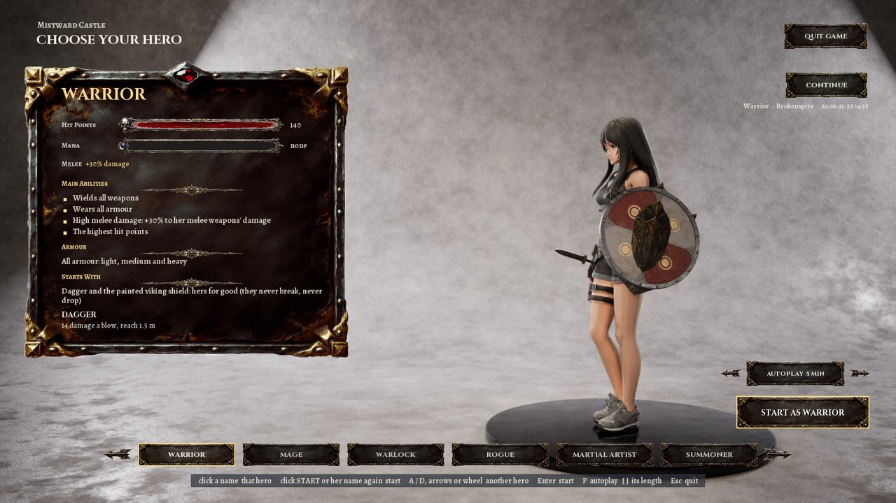

She fights with what she finds. Her own dagger stays the weakest weapon on purpose; found swords, bows, crossbows and shields are her strength, with +30 % on every melee blow. She alone takes the bosses' slashes, works the forge and breaks locks open in the wilds.

**Resources:** hit points only. 140 at tier 1, +18 % a tier to tier 5 (241), then x 1.09 a tier (1350 at tier 25, 2076 at tier 30).

**What she wields and wears**

- Every weapon of the weapons table: short blades, short swords, one-handed, curved and eastern swords, two-handed swords (swung with her one-handed clips), bows and crossbows ([the weapons](#weapons)).
- Every shield, held on her left forearm; with one she can block.
- Light, medium and heavy armour; Health rings and a charm.

**Primary abilities**

| Ability | Use | What it does | Base numbers | Grows by |
|---|---|---|---|---|
| Dagger | attack (left mouse; RB) | three swings in turn (`Anim_Weapon_Shield_Attack_01`, `_03`, `_08`) | 11 a blow, 14.3 with her +30 %; reach 1.5 m, arc 110° | none to tier 5, then x 1.12 a tier |
| Found melee weapons | attack | the weapon's own blows | the weapon's damage + 30 % | the weapon's tier and quality only |
| Found bows and crossbows | attack | a bolt that flies straight at the monster she faces | the weapon's damage (her +30 % is melee only) | the weapon's tier and quality only |
| Shield block | right mouse or LB held, a shield on her arm | the shield takes its share of a blow plus 30 points (a 40 % shield takes 70 %); she cannot swing; W / S walk her slowly along her facing (90 cm/s), A / D turn her (120°/s); the shield wears 5 times as fast while she blocks | +30 points on the shield's share (at most 95 %) | the shield's own share (found shields, qualities up to Divine) |
| Slashes | put on a weapon from the inventory | a boss's reward; its bonus and effect land with every hit | see [the slashes](#the-slashes) | a deeper tier's slash |

Her dagger at every tier (with her +30 %):

| Tier | Dagger |
|---|---|
| 1 | 14.3 |
| 2 | 14.3 |
| 3 | 14.3 |
| 4 | 14.3 |
| 5 | 14.3 |
| 6 | 16.0 |
| 7 | 17.9 |
| 8 | 20.1 |
| 9 | 22.5 |
| 10 | 25.2 |
| 11 | 28.2 |
| 12 | 31.6 |
| 13 | 35.4 |
| 14 | 39.7 |
| 15 | 44.4 |
| 16 | 49.7 |
| 17 | 55.7 |
| 18 | 62.4 |
| 19 | 69.9 |
| 20 | 78.3 |
| 21 | 87.7 |
| 22 | 98.2 |
| 23 | 110.0 |
| 24 | 123.2 |
| 25 | 137.9 |
| 26 | 154.5 |
| 27 | 173.0 |
| 28 | 193.8 |
| 29 | 217.1 |
| 30 | 243.1 |

**Secondary abilities** (Angel Tokens, ranks 1 to 6; no cooldown change by rank)

| Ability | Kind | Rank 1 → 6 | Cooldown | Reach | In game terms |
|---|---|---|---|---|---|
| Shield Bash | active | stun 5 / 6 / 7 / 8 / 9 / 10 s | 14 s | 3.5 m, in front of her | stuns every monster she can see within reach in front of her |
| Grapple | active | hold 5 → 10 s | 12 s | 2.5 m | slows the monster before her to a stop; it still turns and strikes |
| Trip | active | prone 5 → 10 s | 12 s | 2.5 m | stuns the monster before her: no move, no blow |
| Blinding Strike | active | blind 5 → 10 s | 12 s | 2.5 m | her drawn weapon's damage, and every blow of the monster misses (no swing plays) |
| Sweeping Push | active | 20 / 21 / 22 / 23 / 24 / 25 m | 16 s | 4 m all round | pushes every monster she can see within reach that far (walls stop it); stunned while it flies |
| Pulling Attack | active | 40 / 41 / 42 / 43 / 44 / 45 m | 12 s | its own length | pulls one monster from up to that far into her reach; stunned while it flies |

Source: `SourceArt/balance/secondary.json` as written by `911` (read from the map), `RD/RDSecondary.cpp`. The cooldowns and reaches are the project's own (the user's list gave none).

**What she crafts:** see [crafting](#crafting). Besides what any hero makes at an anvil, she alone works **the forge** (a tier-1 copy of a weapon, shield or set of armour she has looted, `ForgeHeroes`), and she alone can break a locked wild container open. She cannot brew healing or mana potions (`PotionBrewers` is the Mage and the Martial Artist).

**How far she improves:** her dagger reaches 138 at tier 25 and 243 at tier 30. Her real growth is the gear: a Divine two-handed sword does up to 1442 a blow before her +30 % (Divine Ursag's Horn Blade, tiers 29-30), Divine Epic Plate takes 70 % off every blow, a Divine Broddi's Shield 60 % (90 % while she blocks), Divine HP Potency Ring 10 adds 250 % hit points.

---

### Mage

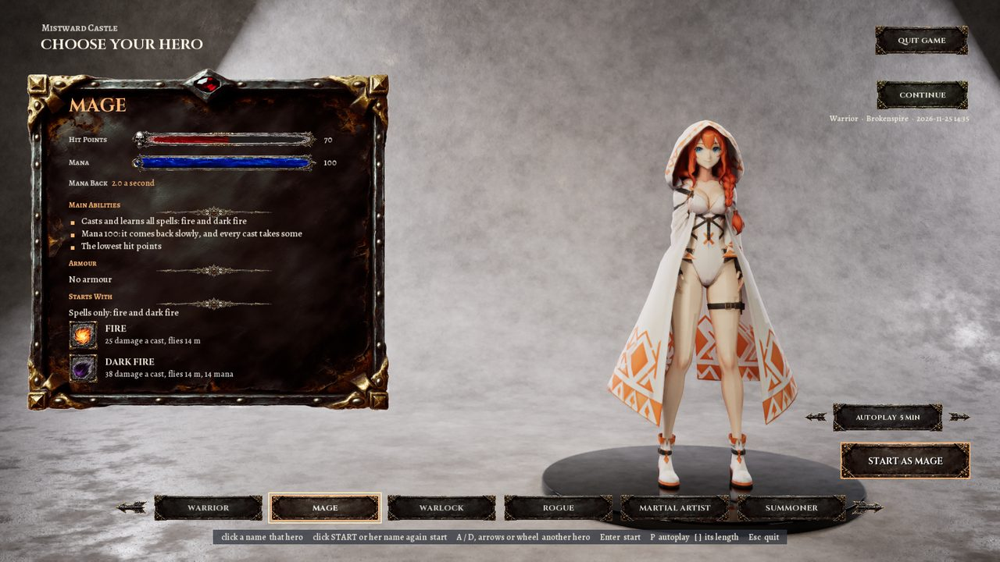

She fights from afar with spells and learns every type from tomes: offense, protection, curse and summoning. Her hit points are the lowest; she wears no armour and wields none of the found weapons.

**Resources:** hit points 70 (+15 % a tier to tier 5, then x 1.09); mana 100, back at 2.5 % of her pool a second (2.5 a second at tier 1), x 1.09 a tier past tier 5 (154 at tier 10, 560 at tier 25, 862 at tier 30), plus Magic rings. Learning Null Sanctum makes her pool at least 220, learning Apocalypse at least 300 (`TomeMana`): both cost more than any ring gave when they were made.

**Primary abilities**

| Ability | Mana | What it does | Base damage | Grows by |
|---|---|---|---|---|
| Fire Bolt (cantrip) | 0 | a seeking fire bolt, 14 m; half its damage to others within 1.7 m of the burst | 25 | spell growth (+12 % a tier to 5, then x 1.12) |
| Dark Fire | 14 | a seeking bolt of black flame that burns 60 % more over 4 s and gives 30 % of the burn back to her as hit points | 38 | spell growth |
| Tome spells | the spell's | every spell of [the spell table](#the-spell-table), learned from a tome found in the dungeons | the spell's | spell growth, Spell Boost |
| Scrolls | none | a spell once, of any type, at no mana | the spell's | spell growth |

Her own two spells at every tier:

| Tier | Fire Bolt (cantrip) | Dark Fire |
|---|---|---|
| 1 | 25.0 | 38.0 |
| 2 | 28.0 | 42.6 |
| 3 | 31.0 | 47.1 |
| 4 | 34.0 | 51.7 |
| 5 | 37.0 | 56.2 |
| 6 | 41.4 | 63.0 |
| 7 | 46.4 | 70.5 |
| 8 | 52.0 | 79.0 |
| 9 | 58.2 | 88.5 |
| 10 | 65.2 | 99.1 |
| 11 | 73.0 | 111.0 |
| 12 | 81.8 | 124.3 |
| 13 | 91.6 | 139.2 |
| 14 | 102.6 | 156.0 |
| 15 | 114.9 | 174.7 |
| 16 | 128.7 | 195.6 |
| 17 | 144.2 | 219.1 |
| 18 | 161.4 | 245.4 |
| 19 | 180.8 | 274.9 |
| 20 | 202.5 | 307.8 |
| 21 | 226.8 | 344.8 |
| 22 | 254.0 | 386.1 |
| 23 | 284.5 | 432.5 |
| 24 | 318.7 | 484.4 |
| 25 | 356.9 | 542.5 |
| 26 | 399.7 | 607.6 |
| 27 | 447.7 | 680.5 |
| 28 | 501.4 | 762.2 |
| 29 | 561.6 | 853.6 |
| 30 | 629.0 | 956.1 |

Her spells are cast with her own three cast clips (`AS_Caster_Cast1` to `3`); Starfall, Singularity and Soul Rend have clips of their own (`SpellClips`, the list of 2026-11-11).

**Secondary abilities**

| Ability | Kind | Rank 1 → 6 | Cooldown, rank 1 → 6 | In game terms |
|---|---|---|---|---|
| Mana Swarm | active | one light for every 20 / 18 / 16 / 14 / 12 / 10 mana she has | 15 / 13 / 11 / 9 / 7 / 6 s | spends that mana on seeking lights at one monster within 20 m before her, one every 0.07 s; each does 0.34 of her first spell's blow, so it grows with her |
| Mana Recharge Shield | active | 5 / 10 / 15 / 20 / 25 / 30 s | 15 → 6 s | each blow that reaches her becomes mana instead of hurting her |
| Ablation Shield | active | 1 / 2 / 3 / 4 / 5 / 6 layers for 5 → 30 s | 15 → 6 s | each blow peels a layer and strikes its maker for the blow's whole damage |
| Misty Step | active | 10 / 15 / 20 / 25 / 30 / 35 m | 15 → 6 s | teleports her to the floor farthest from her foes, in sight of where she stood |
| Spell Boost | passive | x 1.2 / 1.3 / 1.4 / 1.5 / 1.6 / 1.7 | - | one spell she chooses at rank 1 does that much more damage, for good |
| Second Spell Boost | passive | x 1.2 → 1.7 | - | a second spell, not the first one's |

**What she crafts:** every anvil recipe any hero makes; she is one of the two **potion brewers** (healing and mana potions at the alchemist's table); she makes the scrolls of every type, since she reads them all.

**How far she improves:** her spells' damage grows x 1.48 to tier 5, x 2.61 at 10, x 14.28 at 25 and x 25.16 at 30, and a boosted spell x 1.7 on top. Apocalypse (380 base) does 9561 at tier 30 to every monster she can see within 25 m, 16253 with a sixth-rank boost. Her mana grows with Magic rings up to +250 % (Divine Magic Potency Ring 10).

---

### Warlock

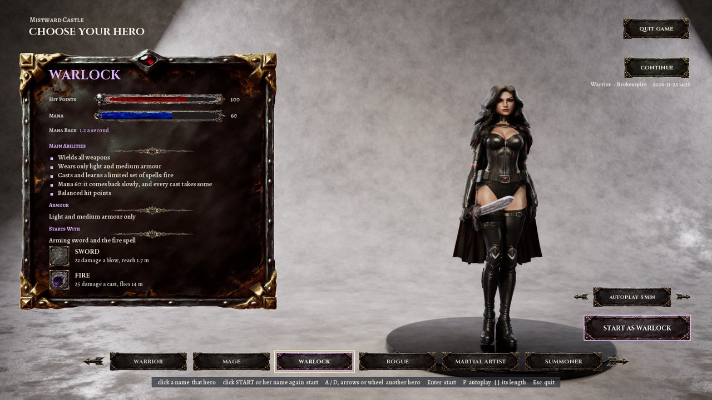

A sword in one hand and fire in the other. She learns offense spells, the curse of the spell table, and her own thirteen curses, which no other hero learns.

**Resources:** hit points 100 (+25 % a tier to tier 5, then x 1.09); mana 60, back at 2.5 % of her pool a second, x 1.09 a tier past tier 5, plus Magic rings. She wears Magic and Health rings.

**What she wields and wears:** every weapon of the weapons table (melee weapons with her sword's three cuts, bows and crossbows); light and medium armour; no shield.

**Primary abilities**

| Ability | Use | Mana | What it does | Base damage | Grows by |
|---|---|---|---|---|---|
| Sword (arming sword) | left mouse; RB | 0 | three cuts in turn (`AS_DarkCaster_Slash1` to `3`), reach 1.7 m, arc 130° | 22 | her own weapon growth: +30 % a tier to 5, then x 1.12 |
| Fire Bolt (cantrip) | right mouse or E; LB, with the sword still drawn | 0 | a seeking fire bolt from her left hand (`AS_DarkCaster_CastL1`, `L2`) | 25 | spell growth: +20 % a tier to 5, then x 1.12 |
| Found weapons | attack | 0 | the weapon's own | the weapon's | the weapon's tier and quality |
| Tome spells | as Fire Bolt | the spell's | the offense spells, Curse of Frailty and her thirteen curses | the spell's | spell growth |
| Scrolls | from the inventory or quick bar | 0 | an offense or curse spell, once | the spell's | spell growth |

Her sword and Fire Bolt at every tier:

| Tier | Sword | Fire Bolt (cantrip) |
|---|---|---|
| 1 | 22.0 | 25.0 |
| 2 | 28.6 | 32.5 |
| 3 | 35.2 | 40.0 |
| 4 | 41.8 | 47.5 |
| 5 | 48.4 | 55.0 |
| 6 | 54.2 | 61.6 |
| 7 | 60.7 | 69.0 |
| 8 | 68.0 | 77.3 |
| 9 | 76.2 | 86.5 |
| 10 | 85.3 | 96.9 |
| 11 | 95.5 | 108.6 |
| 12 | 107.0 | 121.6 |
| 13 | 119.8 | 136.2 |
| 14 | 134.2 | 152.5 |
| 15 | 150.3 | 170.8 |
| 16 | 168.4 | 191.3 |
| 17 | 188.6 | 214.3 |
| 18 | 211.2 | 240.0 |
| 19 | 236.5 | 268.8 |
| 20 | 264.9 | 301.0 |
| 21 | 296.7 | 337.2 |
| 22 | 332.3 | 377.6 |
| 23 | 372.2 | 422.9 |
| 24 | 416.9 | 473.7 |
| 25 | 466.9 | 530.5 |
| 26 | 522.9 | 594.2 |
| 27 | 585.7 | 665.5 |
| 28 | 655.9 | 745.4 |
| 29 | 734.6 | 834.8 |
| 30 | 822.8 | 935.0 |

**Her thirteen curses** ([the curses](#the-warlocks-curses)) are hers alone (`OnlyHeroes`). A tome found at a curse's place among the 30 tiers is that curse for her until she knows it, then the place's spell as for the Mage.

**Secondary abilities**

| Ability | Kind | Rank 1 → 6 | Cooldown, rank 1 → 6 | In game terms |
|---|---|---|---|---|
| Mana Shield | active | 5 / 10 / 15 / 20 / 25 / 30 s | 15 / 13 / 11 / 9 / 7 / 6 s | her mana takes blows instead of her, a point for a point |
| Curse Shield | active | 5 → 30 s | 15 → 6 s | every monster she can see within 2 m is cursed twice a second: it takes 25 % more and strikes for less |
| Blinding Shield | active | 5 → 30 s | 15 → 6 s | every monster within 2 m is blinded: its blows miss |
| Misty Transfer | active | 40 / 50 / 60 / 70 / 80 / 90 m | 15 → 6 s | sends the monster before her (within 15 m) to the floor farthest from her, in sight of where it stood; it is stunned 0.6 s |
| Bleeding Shield | active | 5 → 30 s | 15 → 6 s | every monster within 2 m bleeds 6 a second, times her spell growth |
| Mana Blade | toggle | x 2.0 / 2.4 / 2.8 / 3.2 / 3.6 / 4.0 | - | while on, each melee blow that lands takes 6 mana and does that many times 6 more damage (12 to 24 more) |

**What she crafts:** the anvil's recipes and the scrolls of offense and curse spells; not healing or mana potions, not at the forge.

**How far she improves:** her sword grows fastest of any hero's own weapon (x 2.2 at tier 5, x 21.2 at tier 25: 467 a blow), and her spells x 1.8 at tier 5, x 17.4 at tier 25, x 30.6 at tier 30. With found Divine weapons, Divine light or medium armour (up to 59 % off a blow: Divine Dardan's Armour), Health and Magic rings.

---

### Rogue

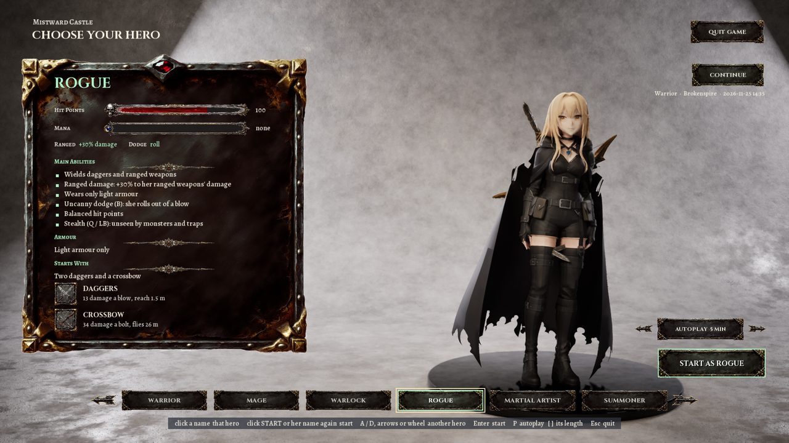

Stealth, daggers and the crossbow. She sees traps the others do not, disarms them, and picks the wilds' locks. She has no Angel Token abilities: her sixteen arts are learned from manuals.

**Resources:** hit points 100 (+20 % a tier to tier 5, then x 1.09). **Dexterity energy** 100, back 1.5 a second (none while hidden); her stealth and her arts spend it; a speed potion fills it.

**What she wields and wears:** daggers and knives ("short blades"), bows and crossbows; light armour; Dexterity rings (they add to her ranged weapons' bolts).

**Primary abilities**

| Ability | Use | Cost | What it does | Base numbers | Grows by |
|---|---|---|---|---|---|
| Daggers (two) | left mouse; RB, with the daggers drawn | none | three stabs in turn, reach 1.5 m | 13 a blow | her own weapon growth: +8 % a tier to 5, then x 1.12 |
| Crossbow | left mouse; RB, with the crossbow drawn | none | a bolt straight at the monster she faces, 26 m; it sticks in walls | 26, 33.8 with her +30 % | her own weapon growth |
| Stealth | Q; LB, or its quick slot | 40 dexterity energy | unseen by monsters and traps for 8 s; her first blow or bolt out of it does +75 % and ends it; pressed again, out of it. Refused in a swing | 8 s, +75 % | does not grow |
| Uncanny dodge | B | none | a roll 4.2 m along the way she pushes (a backward roll for a way behind her), 0.25 s between rolls | 4.2 m | does not grow |
| Trap sense and disarm | F at a trap she has seen | none | traps glow for her within 8 m (an outline and a red light); F disarms one in 1.6 s, 85 % of the time | 8 m, 85 % | does not grow |
| Found daggers, bows, crossbows | attack | none | the weapon's own; bows and crossbows +30 % | the weapon's | the weapon's tier and quality |

**Abilities earned after Mistward** (a later dungeon's tier-5 boss each, kept by the game through deaths and saves: `FRDHeroDef::LaterWeapons`, the counter `<dungeon>:bossdone:5`):

| Earned in | Ability | Copy of | Base damage | What changes |
|---|---|---|---|---|
| Vel Morrath | Barbed Bolt | Crossbow | 37.7 (x 1.45) | damage only |
| The War Engine | Incendiary Bolt | Crossbow | 44.2 (x 1.7) | bursts: half damage within 2.2 m |
| The Sewers | Shadow Fangs | Daggers | 26 (x 2.0) | reach 1.7 m |
| Kethrys Spire | Storm Bolt | Crossbow | 59.8 (x 2.3) | a lightning bolt; bursts: half damage within 3.2 m |
| Heaven | Death's Kiss | Daggers | 36.4 (x 2.8) | reach 1.8 m |

Her own weapons and the earned ones at every tier (bolts with her +30 %, before a Dexterity ring and the ambush):

| Tier | Daggers | Crossbow | Barbed Bolt | Incendiary Bolt | Shadow Fangs | Storm Bolt | Death's Kiss |
|---|---|---|---|---|---|---|---|
| 1 | 13.0 | 33.8 | 49.0 | 57.5 | 26.0 | 77.7 | 36.4 |
| 2 | 14.0 | 36.5 | 52.9 | 62.1 | 28.1 | 84.0 | 39.3 |
| 3 | 15.1 | 39.2 | 56.9 | 66.7 | 30.2 | 90.2 | 42.2 |
| 4 | 16.1 | 41.9 | 60.8 | 71.3 | 32.2 | 96.4 | 45.1 |
| 5 | 17.2 | 44.6 | 64.7 | 75.8 | 34.3 | 102.6 | 48.0 |
| 6 | 19.2 | 50.0 | 72.5 | 84.9 | 38.4 | 114.9 | 53.8 |
| 7 | 21.5 | 56.0 | 81.2 | 95.1 | 43.1 | 128.7 | 60.3 |
| 8 | 24.1 | 62.7 | 90.9 | 106.6 | 48.2 | 144.2 | 67.5 |
| 9 | 27.0 | 70.2 | 101.8 | 119.3 | 54.0 | 161.5 | 75.6 |
| 10 | 30.2 | 78.6 | 114.0 | 133.7 | 60.5 | 180.8 | 84.7 |
| 11 | 33.9 | 88.1 | 127.7 | 149.7 | 67.7 | 202.5 | 94.8 |
| 12 | 37.9 | 98.6 | 143.0 | 167.7 | 75.9 | 226.9 | 106.2 |
| 13 | 42.5 | 110.5 | 160.2 | 187.8 | 85.0 | 254.1 | 119.0 |
| 14 | 47.6 | 123.7 | 179.4 | 210.3 | 95.2 | 284.6 | 133.2 |
| 15 | 53.3 | 138.6 | 200.9 | 235.6 | 106.6 | 318.7 | 149.2 |
| 16 | 59.7 | 155.2 | 225.0 | 263.8 | 119.4 | 357.0 | 167.1 |
| 17 | 66.9 | 173.8 | 252.0 | 295.5 | 133.7 | 399.8 | 187.2 |
| 18 | 74.9 | 194.7 | 282.3 | 331.0 | 149.8 | 447.8 | 209.7 |
| 19 | 83.9 | 218.0 | 316.2 | 370.7 | 167.7 | 501.5 | 234.8 |
| 20 | 93.9 | 244.2 | 354.1 | 415.2 | 187.9 | 561.7 | 263.0 |
| 21 | 105.2 | 273.5 | 396.6 | 465.0 | 210.4 | 629.1 | 294.6 |
| 22 | 117.8 | 306.3 | 444.2 | 520.8 | 235.6 | 704.6 | 329.9 |
| 23 | 132.0 | 343.1 | 497.5 | 583.3 | 263.9 | 789.1 | 369.5 |
| 24 | 147.8 | 384.3 | 557.2 | 653.3 | 295.6 | 883.8 | 413.8 |
| 25 | 165.5 | 430.4 | 624.0 | 731.6 | 331.1 | 989.9 | 463.5 |
| 26 | 185.4 | 482.0 | 698.9 | 819.4 | 370.8 | 1108.7 | 519.1 |
| 27 | 207.6 | 539.9 | 782.8 | 917.8 | 415.3 | 1241.7 | 581.4 |
| 28 | 232.6 | 604.7 | 876.7 | 1027.9 | 465.1 | 1390.7 | 651.2 |
| 29 | 260.5 | 677.2 | 982.0 | 1151.3 | 520.9 | 1557.6 | 729.3 |
| 30 | 291.7 | 758.5 | 1099.8 | 1289.4 | 583.4 | 1744.5 | 816.8 |

**Her sixteen arts** ([the Rogue's arts](#the-rogues-arts)) replace the secondary abilities: each is learned from its manual, found at its place among the dungeons' 30 tiers, at one rank; Angel Tokens do not raise them. Their damage follows her blade's or crossbow's blow, so they grow as her own weapons do.

**What she crafts:** the anvil's recipes (repair items, torches, Angel Tokens, ingots); not potions, not scrolls (she reads none), not at the forge.

**How far she improves:** her crossbow does 33.8 at tier 1, 44.6 at tier 5, 430 at tier 25; Death's Kiss 36.4 → 463 at tier 25. A found Divine Dwarf Crossbow does 987 before her +30 %, and Divine Dexterity Ring 10 adds 250 % to her bolts. Her ambush adds 75 % to the first blow out of hiding, Marked for Death 30 % more from her.

---

### Martial Artist

Fists, feet and chi. Her chi attacks are spells: they cost mana, take her spell growth, and a Dexterity ring does not add to them. She unlocks two more each time she slays a tier's boss.

**Resources:** hit points 140 (+20 % a tier to tier 5, then x 1.09); mana 100, back at 2 % of her pool a second, x 1.09 a tier past tier 5. She wears Health and Dexterity rings; a Dexterity ring adds to her fists and her knives (`DexterityTypes`: unarmed, short blades), never to her chi.

**What she wields and wears:** her fists and feet; found knives and daggers with +30 % ("short blades", `TypeBonus`); light armour.

**Primary abilities**

| Ability | Use | Mana | What it does | Base numbers | Grows by |
|---|---|---|---|---|---|
| Basic Attacks (fists and feet) | left mouse; RB | 0 | a boxing combination (`AS_MartialArtist_Box_01`) and a front kick (`_Front_kick_02`) in turn, reach 1.6 m | 44 a blow | her own weapon growth: +12 % a tier to 5, then x 1.12; Dexterity rings add |
| Chi attacks (below) | left mouse; RB, once drawn (the wheel / Y) | 7 to 88 | a strike that bursts on the nearest monster within 4 m: it takes the damage, others within the burst half. Refused with no monster within 4 m, before the mana is taken | below | spell growth: +12 % a tier to 5, then x 1.12 |
| Dash | V or right mouse; RT | 0 | a dash 5 m forward into a strike, looking for a monster up to 9 m ahead; 0.8 s between dashes | 5 m | does not grow |
| Dodge | B | 0 | a roll 4.2 m, as the Rogue's | 4.2 m | does not grow |
| Found knives and daggers | attack | 0 | melee, +30 %; Dexterity rings add | the weapon's | the weapon's tier and quality |

**Her chi attacks.** She starts with the first two and unlocks two more, in this order, at each tier's boss (`LockedWeapons`, `UnlockPerBoss` 2). Their damage follows 23 x (mana / 7) ^ 0.75 (`balance6.json`'s `chi`, written by `880`):

| Unlocked | Chi attack | Mana | Base damage | Burst radius | Look |
|---|---|---|---|---|---|
| start | Straight Punch | 7 | 23 | 1.2 m | wind round her fist |
| start | Side Kick | 17 | 45 | 1.2 m | lightning round her leg |
| 1st tier boss | Smashing Strike | 27 | 63 | 1.6 m | both fists wrapped in fire |
| 1st tier boss | Roundhouse Kick | 37 | 80 | 1.6 m | thick smoke trailing her shin |
| 2nd tier boss | Chain Punch | 47 | 96 | 2.0 m | sparks at each punch |
| 2nd tier boss | Rear Kick | 57 | 111 | 2.0 m | glowing rings round her leg |
| 3rd tier boss | Piercing Palm | 67 | 125 | 2.5 m | glowing rods fly from her hands |
| 3rd tier boss | Axe Kick | 68 | 127 | 2.5 m | fireworks from the kick |
| 4th tier boss | Meteor Fist | 78 | 140 | 3.0 m | a fireball on her fist |
| 4th tier boss | Spinning Kick | 88 | 154 | 3.0 m | chain lightning along her leg |

**Earned after Mistward** (a later dungeon's tier-5 boss each; the same mana, clip and look as the move they copy):

| Earned in | Ability | Copy of | Mana | Base damage |
|---|---|---|---|---|
| Vel Morrath | Crashing Wave | Chain Punch | 47 | 192 (x 2.0) |
| The War Engine | Thunder Step | Axe Kick | 68 | 279.4 (x 2.2) |
| The Sewers | Dragon Palm | Piercing Palm | 67 | 312.5 (x 2.5) |
| Kethrys Spire | Comet Fist | Meteor Fist | 78 | 364 (x 2.6) |
| Heaven | Heaven's Gale | Spinning Kick | 88 | 446.6 (x 2.9) |

Every one of them at every tier (her fists take her own weapon growth, her chi her spell growth: the same shares for her):

| Tier | Basic Attacks | Straight Punch | Side Kick | Smashing Strike | Roundhouse Kick | Chain Punch | Rear Kick | Piercing Palm | Axe Kick | Meteor Fist | Spinning Kick | Crashing Wave | Thunder Step | Dragon Palm | Comet Fist | Heaven's Gale |
|---|---|---|---|---|---|---|---|---|---|---|---|---|---|---|---|---|
| 1 | 44.0 | 23.0 | 45.0 | 63.0 | 80.0 | 96.0 | 111.0 | 125.0 | 127.0 | 140.0 | 154.0 | 192.0 | 279.4 | 312.5 | 364.0 | 446.6 |
| 2 | 49.3 | 25.8 | 50.4 | 70.6 | 89.6 | 107.5 | 124.3 | 140.0 | 142.2 | 156.8 | 172.5 | 215.0 | 312.9 | 350.0 | 407.7 | 500.2 |
| 3 | 54.6 | 28.5 | 55.8 | 78.1 | 99.2 | 119.0 | 137.6 | 155.0 | 157.5 | 173.6 | 191.0 | 238.1 | 346.5 | 387.5 | 451.4 | 553.8 |
| 4 | 59.8 | 31.3 | 61.2 | 85.7 | 108.8 | 130.6 | 151.0 | 170.0 | 172.7 | 190.4 | 209.4 | 261.1 | 380.0 | 425.0 | 495.0 | 607.4 |
| 5 | 65.1 | 34.0 | 66.6 | 93.2 | 118.4 | 142.1 | 164.3 | 185.0 | 188.0 | 207.2 | 227.9 | 284.2 | 413.5 | 462.5 | 538.7 | 661.0 |
| 6 | 72.9 | 38.1 | 74.6 | 104.4 | 132.6 | 159.1 | 184.0 | 207.2 | 210.5 | 232.1 | 255.3 | 318.3 | 463.1 | 518.0 | 603.4 | 740.3 |
| 7 | 81.7 | 42.7 | 83.5 | 117.0 | 148.5 | 178.2 | 206.1 | 232.1 | 235.8 | 259.9 | 285.9 | 356.5 | 518.7 | 580.2 | 675.8 | 829.1 |
| 8 | 91.5 | 47.8 | 93.6 | 131.0 | 166.3 | 199.6 | 230.8 | 259.9 | 264.1 | 291.1 | 320.2 | 399.2 | 581.0 | 649.8 | 756.9 | 928.6 |
| 9 | 102.5 | 53.6 | 104.8 | 146.7 | 186.3 | 223.6 | 258.5 | 291.1 | 295.8 | 326.0 | 358.6 | 447.1 | 650.7 | 727.8 | 847.7 | 1040.0 |
| 10 | 114.8 | 60.0 | 117.4 | 164.3 | 208.7 | 250.4 | 289.5 | 326.0 | 331.2 | 365.2 | 401.7 | 500.8 | 728.7 | 815.1 | 949.4 | 1164.9 |
| 11 | 128.5 | 67.2 | 131.5 | 184.0 | 233.7 | 280.4 | 324.3 | 365.2 | 371.0 | 409.0 | 449.9 | 560.9 | 816.2 | 912.9 | 1063.3 | 1304.6 |
| 12 | 144.0 | 75.3 | 147.2 | 206.1 | 261.7 | 314.1 | 363.2 | 409.0 | 415.5 | 458.1 | 503.9 | 628.2 | 914.1 | 1022.4 | 1190.9 | 1461.2 |
| 13 | 161.2 | 84.3 | 164.9 | 230.9 | 293.2 | 351.8 | 406.8 | 458.1 | 465.4 | 513.0 | 564.3 | 703.6 | 1023.8 | 1145.1 | 1333.9 | 1636.5 |
| 14 | 180.6 | 94.4 | 184.7 | 258.6 | 328.3 | 394.0 | 455.6 | 513.0 | 521.2 | 574.6 | 632.0 | 788.0 | 1146.7 | 1282.5 | 1493.9 | 1832.9 |
| 15 | 202.3 | 105.7 | 206.8 | 289.6 | 367.7 | 441.3 | 510.2 | 574.6 | 583.8 | 643.5 | 707.9 | 882.6 | 1284.3 | 1436.5 | 1673.2 | 2052.9 |
| 16 | 226.5 | 118.4 | 231.7 | 324.3 | 411.9 | 494.2 | 571.5 | 643.5 | 653.8 | 720.8 | 792.8 | 988.5 | 1438.4 | 1608.8 | 1874.0 | 2299.2 |
| 17 | 253.7 | 132.6 | 259.5 | 363.3 | 461.3 | 553.5 | 640.0 | 720.8 | 732.3 | 807.2 | 888.0 | 1107.1 | 1611.0 | 1801.9 | 2098.8 | 2575.1 |
| 18 | 284.2 | 148.5 | 290.6 | 406.9 | 516.6 | 620.0 | 716.8 | 807.2 | 820.2 | 904.1 | 994.5 | 1239.9 | 1804.4 | 2018.1 | 2350.7 | 2884.1 |
| 19 | 318.2 | 166.4 | 325.5 | 455.7 | 578.6 | 694.4 | 802.9 | 904.1 | 918.6 | 1012.6 | 1113.9 | 1388.7 | 2020.9 | 2260.3 | 2632.8 | 3230.2 |
| 20 | 356.4 | 186.3 | 364.5 | 510.4 | 648.1 | 777.7 | 899.2 | 1012.6 | 1028.8 | 1134.1 | 1247.5 | 1555.4 | 2263.4 | 2531.5 | 2948.7 | 3617.9 |
| 21 | 399.2 | 208.7 | 408.3 | 571.6 | 725.8 | 871.0 | 1007.1 | 1134.1 | 1152.3 | 1270.2 | 1397.2 | 1742.0 | 2535.0 | 2835.3 | 3302.6 | 4052.0 |
| 22 | 447.1 | 233.7 | 457.3 | 640.2 | 812.9 | 975.5 | 1128.0 | 1270.2 | 1290.5 | 1422.6 | 1564.9 | 1951.1 | 2839.2 | 3175.5 | 3698.9 | 4538.2 |
| 23 | 500.8 | 261.8 | 512.2 | 717.0 | 910.5 | 1092.6 | 1263.3 | 1422.6 | 1445.4 | 1593.4 | 1752.7 | 2185.2 | 3179.9 | 3556.6 | 4142.7 | 5082.8 |
| 24 | 560.9 | 293.2 | 573.6 | 803.1 | 1019.8 | 1223.7 | 1414.9 | 1593.4 | 1618.9 | 1784.6 | 1963.0 | 2447.4 | 3561.5 | 3983.4 | 4639.9 | 5692.8 |
| 25 | 628.2 | 328.4 | 642.4 | 899.4 | 1142.1 | 1370.5 | 1584.7 | 1784.6 | 1813.1 | 1998.7 | 2198.6 | 2741.1 | 3988.9 | 4461.4 | 5196.7 | 6375.9 |
| 26 | 703.5 | 367.8 | 719.5 | 1007.4 | 1279.2 | 1535.0 | 1774.9 | 1998.7 | 2030.7 | 2238.6 | 2462.4 | 3070.0 | 4467.5 | 4996.8 | 5820.2 | 7141.0 |
| 27 | 788.0 | 411.9 | 805.9 | 1128.2 | 1432.7 | 1719.2 | 1987.8 | 2238.6 | 2274.4 | 2507.2 | 2757.9 | 3438.4 | 5003.6 | 5596.4 | 6518.7 | 7997.9 |
| 28 | 882.5 | 461.3 | 902.6 | 1263.6 | 1604.6 | 1925.5 | 2226.4 | 2507.2 | 2547.3 | 2808.0 | 3088.9 | 3851.0 | 5604.1 | 6268.0 | 7300.9 | 8957.7 |
| 29 | 988.4 | 516.7 | 1010.9 | 1415.3 | 1797.1 | 2156.6 | 2493.5 | 2808.0 | 2853.0 | 3145.0 | 3459.5 | 4313.2 | 6276.5 | 7020.1 | 8177.0 | 10032.6 |
| 30 | 1107.0 | 578.7 | 1132.2 | 1585.1 | 2012.8 | 2415.4 | 2792.8 | 3145.0 | 3195.3 | 3522.4 | 3874.7 | 4830.7 | 7029.7 | 7862.5 | 9158.3 | 11236.5 |

**Secondary abilities**

| Ability | Kind | Rank 1 → 6 | Cooldown | In game terms |
|---|---|---|---|---|
| Wall Run | active | a leap of up to 10 / 20 / 30 / 40 / 50 / 60 m | 8 s | launches her to the farthest floor along her way within its length, up to half its length higher, with the arc clear |
| Flash Steps | active | a dash of up to 10 → 60 m | 8 s | carries her straight ahead through monsters; only walls stop it |
| Water Walk | active | up to 10 → 60 m | 10 s | only in the wilds: from water within 8 m before her she runs on its face for that length; off it she falls in |
| Parry | active | 5 / 10 / 15 / 20 / 25 / 30 s | 15 / 13 / 11 / 9 / 7 / 6 s | every blow from in front of her is turned aside and its maker stunned 1.5 s |
| Iron Skin | active | 10 / 20 / 30 / 40 / 50 / 60 % weaker for 8 s | 20 s | every blow that reaches her is that much weaker |

Not the same as the Mage's tome spell **Iron Skin** (her armour's share of a blow up by 40 % for 12 s): two abilities share the name.

**What she crafts:** the anvil's recipes; she is one of the two **potion brewers** (healing and mana potions); no scrolls (she reads none), not at the forge.

**How far she improves:** Heaven's Gale does 446.6 x the tier's multiplier (14.277) = 6376 at tier 25 and 11237 at tier 30 for 88 mana; her fists 628 at tier 25 and 1107 at tier 30. A Divine Wrist Blade does 723 + 30 % = 940 before a Dexterity ring.

---

### Summoner

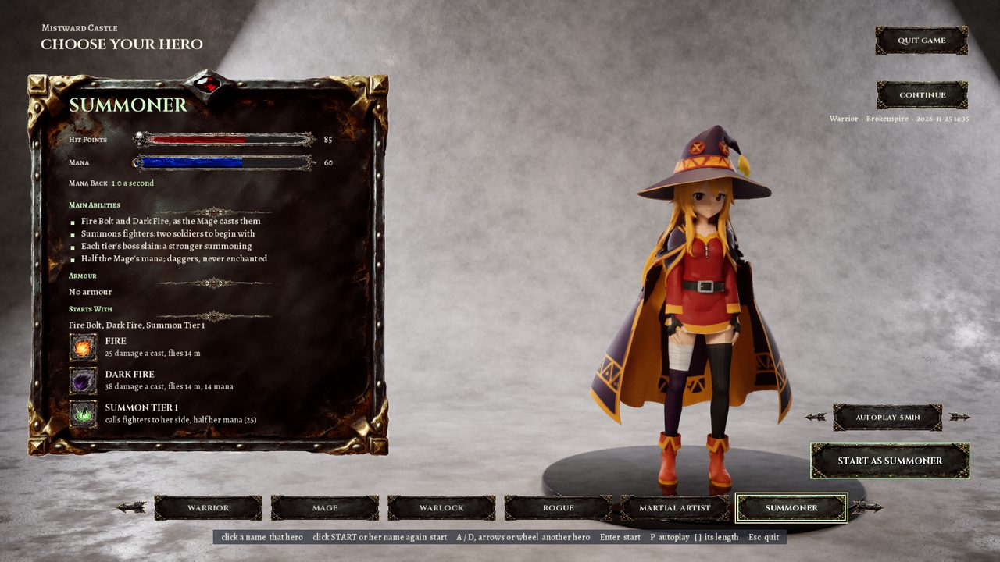

Her summons fight for her; her own spells are the Mage's first two. She calls a stronger summoning at each tier's boss, and a sixth to tenth in the later dungeons.

**Resources:** hit points 85 (+25 % a tier to tier 5, then x 1.09); mana 60, +10 % a tier to tier 5 (84), then x 1.09 a tier (471 at tier 25), back at 4 % of her pool a second; Magic rings. **A summoning costs half her mana pool** whatever its tier (`ManaShare` 0.5: 30 of 60 at tier 1).

**What she wields and wears:** her spells, her bare hands (an entry of her weapons since the list of 2026-11-20 that strikes nothing: "Your hands are empty: draw a weapon or a spell"; Enter on a found weapon in her hands puts it away), found daggers and knives (never enchanted); no armour.

**Primary abilities**

| Ability | Mana | What it does | Base damage | Grows by |
|---|---|---|---|---|
| Fire Bolt (cantrip) | 0 | as the Mage's | 25 | spell growth: +15 % a tier to 5, then x 1.12 |
| Dark Fire | 14 | as the Mage's (burn and drain) | 38 | spell growth |
| Summonings (below) | half her pool | calls a monster that fights at her side until it falls; she leads at most the summoning's number of each kind. At the cap a cast replaces her most hurt summon of it; at the cap with none hurt it is refused before the mana is taken | - | the tier she has reached, Minion Health and Damage, Frenzy |
| Bare Hands | 0 | her hands empty: strikes nothing (`RDCombat.cpp`'s `StartAttackWith` refuses `bUnarmed15`) | none | none |
| Scrolls | 0 | a spell once, all four types | the spell's | spell growth |

Her own spells at every tier:

| Tier | Fire Bolt (cantrip) | Dark Fire |
|---|---|---|
| 1 | 25.0 | 38.0 |
| 2 | 28.8 | 43.7 |
| 3 | 32.5 | 49.4 |
| 4 | 36.3 | 55.1 |
| 5 | 40.0 | 60.8 |
| 6 | 44.8 | 68.1 |
| 7 | 50.2 | 76.3 |
| 8 | 56.2 | 85.4 |
| 9 | 62.9 | 95.7 |
| 10 | 70.5 | 107.2 |
| 11 | 79.0 | 120.0 |
| 12 | 88.4 | 134.4 |
| 13 | 99.0 | 150.5 |
| 14 | 110.9 | 168.6 |
| 15 | 124.2 | 188.8 |
| 16 | 139.1 | 211.5 |
| 17 | 155.8 | 236.9 |
| 18 | 174.5 | 265.3 |
| 19 | 195.5 | 297.1 |
| 20 | 218.9 | 332.8 |
| 21 | 245.2 | 372.7 |
| 22 | 274.6 | 417.5 |
| 23 | 307.6 | 467.5 |
| 24 | 344.5 | 523.7 |
| 25 | 385.9 | 586.5 |
| 26 | 432.2 | 656.9 |
| 27 | 484.0 | 735.7 |
| 28 | 542.1 | 824.0 |
| 29 | 607.1 | 922.9 |
| 30 | 680.0 | 1033.6 |

**Her summonings.** Each summoning offers five kinds of its tier; she picks one with Enter (A) on the summoning in her hands, and her choice is saved (`SummonKinds`, `RDList15b.cpp`). A summon has the hit points and blows of a monster of the tier she has reached (or the summoning's own tier, if higher), times the summoning's factor (`ARDDungeonGenerator::SummonStrength`), and grows when a new tier opens:

| Summoning | Unlocked | Default kind | Kinds to choose | At most | Factor |
|---|---|---|---|---|---|
| Summon Tier 1 | start | Rotting Soldier | Rotting Soldier, Fowl Ghoul, Mad Surgeon, Bloated Drunkard, Legless Ghoul | 2 | 0.80 |
| Summon Tier 2 | 1st tier boss | Grave Gunner | Grave Gunner, Orc Raider, Flesh Parasite, Pustule Glutton, Stitched Horror | 3 | 0.85 |
| Summon Tier 3 | 2nd tier boss | Orc Skirmisher | Orc Skirmisher, Zombie Tank, Quillback, Venom Wasp, Devourer Hound | 4 | 0.90 |
| Summon Tier 4 | 3rd tier boss | Alien Defender | Alien Defender, War Raptor, Brood Spider, Cave Troll, Pit Daemon | 5 | 0.95 |
| Summon Tier 5 | 4th tier boss | Giant Spider | Giant Spider, Broodmother, Daemon Hunter, Mountain Titan, Stone Golem | 3 | 1.00 |
| Summon Tier 6 | Vel Morrath's tier-5 boss | Iron Golem | as Summon Tier 5's list | 3 | 1.04 |
| Summon Tier 7 | The War Engine's | Cyber Soldier | as Summon Tier 5's list | 4 | 1.08 |
| Summon Tier 8 | The Sewers' | Captain of the Tide | as Summon Tier 5's list | 3 | 1.12 |
| Summon Tier 9 | Kethrys Spire's | Lich of the Black Tower | as Summon Tier 5's list | 3 | 1.16 |
| Summon Tier 10 | Heaven's | Kratos Field Commander | as Summon Tier 5's list | 3 | 1.20 |

A summon's hit points and blow by the tier she has reached (before Minion Health and Minion Damage; 100 x the tier's health x the factor, 25 x the tier's blow x the factor):

| Summoning | Monster | At most | Factor | HP / blow at t1 | HP / blow at t5 | HP / blow at t10 | HP / blow at t15 | HP / blow at t20 | HP / blow at t25 | HP / blow at t30 |
|---|---|---|---|---|---|---|---|---|---|---|
| Summon Tier 1 | Soldier | 2 | 0.80 | 40 / 9 | 272 / 44 | 479 / 68 | 845 / 104 | 1489 / 160 | 2624 / 247 | 4624 / 379 |
| Summon Tier 2 | Gunner | 3 | 0.85 | 85 / 21 | 289 / 47 | 509 / 72 | 898 / 111 | 1582 / 170 | 2788 / 262 | 4913 / 403 |
| Summon Tier 3 | Orc_05 | 4 | 0.90 | 144 / 30 | 306 / 49 | 539 / 76 | 950 / 117 | 1675 / 180 | 2952 / 277 | 5202 / 427 |
| Summon Tier 4 | Alien_Warrior_05 | 5 | 0.95 | 228 / 42 | 323 / 52 | 569 / 80 | 1003 / 124 | 1768 / 190 | 3116 / 293 | 5491 / 451 |
| Summon Tier 5 | Spider | 3 | 1.00 | 340 / 55 | 340 / 55 | 599 / 85 | 1056 / 130 | 1861 / 200 | 3280 / 308 | 5780 / 474 |
| Summon Tier 6 | Iron_Golem | 3 | 1.04 | 396 / 62 | 396 / 62 | 623 / 88 | 1098 / 135 | 1935 / 208 | 3411 / 321 | 6011 / 493 |
| Summon Tier 7 | Cyber_Soldier | 4 | 1.08 | 461 / 71 | 461 / 71 | 647 / 91 | 1140 / 141 | 2010 / 216 | 3542 / 333 | 6242 / 512 |
| Summon Tier 8 | Tide_Captain | 3 | 1.12 | 535 / 80 | 535 / 80 | 671 / 95 | 1183 / 146 | 2084 / 224 | 3673 / 345 | 6474 / 531 |
| Summon Tier 9 | Skeleton_Archmage | 3 | 1.16 | 621 / 90 | 621 / 90 | 695 / 98 | 1225 / 151 | 2159 / 232 | 3804 / 358 | 6705 / 550 |
| Summon Tier 10 | Kratos_Commander | 3 | 1.20 | 719 / 102 | 719 / 102 | 719 / 102 | 1267 / 156 | 2233 / 240 | 3936 / 370 | 6936 / 569 |

**Secondary abilities**

| Ability | Kind | Rank 1 → 6 | Cooldown | In game terms |
|---|---|---|---|---|
| Minion Health | passive | x 1.2 / 1.3 / 1.4 / 1.5 / 1.6 / 1.7 | - | her summons' hit points |
| Minion Damage | passive | x 1.2 → 1.7 | - | her summons' blows |
| Summon Healing | active | 10 / 20 / 30 / 40 / 50 / 60 % | 20 s | heals each summon by that share of its hit points |
| Frenzy | passive | x 1.2 → 1.7 | - | her summons strike that much more often |
| Soul Harvest | passive | heals 10 → 60 %, blows x 1.2 → 1.7 for 10 s | - | each monster dying within 25 m of her heals her summons and strengthens their blows |

**What she crafts:** the anvil's recipes and the scrolls of every type; not potions, not at the forge.

**How far she improves:** a Kratos Field Commander called at tier 30 has 6936 hit points and 569 a blow, x 1.7 each with sixth-rank Minion Health and Damage (11791 and 967), striking 1.7 times as often with Frenzy; three of them at once. Her own Fire Bolt does 25 x 27.2 = 680 at tier 30.

## Spells and magic

### How spells are gained

| Way | Who | How |
|---|---|---|
| Starting spells | Mage (Fire Bolt, Dark Fire), Warlock (Fire Bolt), Summoner (Fire Bolt, Dark Fire, Summon Tier 1) | hers from the start |
| Tomes | Mage: every type; Warlock: offense and curse spells, and her own curses | a tome found in a dungeon's container teaches the spell of that tier's place (one spell to each of the 30 tiers); picked up, it is learned and goes on the quick bar |
| Ancient tablets (caves) | as tomes | two tablets are copies of the two highest tomes (Singularity at place 30, Doom at 29) |
| Scrolls | Mage and Summoner: all four types; Warlock: offense and curse; the others none | read from the inventory or the quick bar: the spell once, at no mana, with its cooldown |
| Chi attacks | Martial Artist | two at the start, two more at each tier's boss, five more in the later dungeons |
| Summonings | Summoner | one at the start, one more at each tier's boss, five more in the later dungeons |

The Summoner learns no tomes (her `Learns` is empty); she reads every scroll. A spell learned is kept through a death and saved with her. A tome found by a hero who cannot learn its spell can be sold. Source: `FRDHeroDef::Learns`, `ScrollTypes`; `HeroCanLearnSpell`, `TomeSpellOf`; the items table.

**Mana.** A cast is refused while she has less than its cost. Fire Bolt costs nothing (the list of 2026-11-11's "cantrip" for the three casters): the scroll and the table's line still read 7, but every caster's own Fire Bolt is 0 mana and 25 damage. The heroes' own Dark Fire is 14 mana and 38 damage (the table's line: 12 and 34).

**How spells grow.** Every spell, chi attack and scroll takes her **spell growth** (the multiplier table under [growth by tier](#growth-by-tier)): Mage +12 % a tier to tier 5, Warlock +20 %, Summoner +15 %, Martial Artist +12 %, then x 1.12 a tier for all. The Mage's **Spell Boost** and **Second Spell Boost** multiply one chosen spell each by 1.2 to 1.7. Nothing else in the code changes a spell's mana, cooldown, duration or radius: those are the same at every tier. The curses' shares (a third more damage taken, slower, silenced) do not grow either; Curse of Rot's poison is a share of the monster's own hit points, so it keeps pace by itself.

**Damage dealt** is multiplied, in order, by her weakness if a monster weakened her, the shrine's Might (+25 %), her growth, the Rogue's ambush, a spell boost, a Might buff (+25 % Elixir of Might, +15 % Feast Pie), a red socket stone (+10 %), a charm (+25 % Bleeding Idol, +15 % Black Candle) (`GetDamageOf`, `RDCombat.cpp`); then on the monster by its curses (Frailty +35 %, the Curse Shield +25 %, Sunder, Brittle, Dread, Ruin), the acid's exposure (+25 %), the mark (+30 % from her) and a contract's weakness (+75 % from her) (`ARDMonster::ApplyDamageEx`, `CurseDamageIn`).

### Spell damage by tier

Each damaging spell's base damage and what it does at seven tiers for the Mage (x 1, 1.48, 2.61, 4.59, 8.09, 14.28, 25.16) and for the Warlock at tiers 10 and 30 (x 3.17, 30.6). A Spell Boost multiplies by up to 1.7 more. For any other tier, multiply the base by [the multiplier table](#growth-by-tier). Fire Bolt's row uses the spell table's base (23, its scroll's); every caster's own Fire Bolt is the free cantrip of 25.

| Spell | Base | Mage t1 | Mage t5 | Mage t10 | Mage t15 | Mage t20 | Mage t25 | Mage t30 | Warlock t10 | Warlock t30 |
|---|---|---|---|---|---|---|---|---|---|---|
| Fire Bolt | 23.0 | 23.0 | 34.0 | 60.0 | 105.7 | 186.3 | 328.4 | 578.7 | 73.0 | 703.8 |
| Dark Fire | 34.0 | 34.0 | 50.3 | 88.7 | 156.3 | 275.4 | 485.4 | 855.4 | 107.9 | 1040.4 |
| Frost Shard | 31.0 | 31.0 | 45.9 | 80.9 | 142.5 | 251.1 | 442.6 | 780.0 | 98.3 | 948.6 |
| Shadow Lash | 46.0 | 46.0 | 68.1 | 120.0 | 211.4 | 372.6 | 656.7 | 1157.4 | 145.9 | 1407.6 |
| Bone Spear | 50.0 | 50.0 | 74.0 | 130.4 | 229.8 | 405.0 | 713.8 | 1258.0 | 158.6 | 1530.0 |
| Life Drain | 19.0 | 19.0 | 28.1 | 49.6 | 87.3 | 153.9 | 271.3 | 478.0 | 60.3 | 581.4 |
| Chain Lightning | 68.0 | 68.0 | 100.6 | 177.4 | 312.6 | 550.9 | 970.8 | 1710.9 | 215.7 | 2080.8 |
| Plague Cloud | 13.5 | 13.5 | 20.0 | 35.2 | 62.1 | 109.4 | 192.7 | 339.7 | 42.8 | 413.1 |
| Fireball | 91.0 | 91.0 | 134.7 | 237.4 | 418.3 | 737.2 | 1299.2 | 2289.6 | 288.7 | 2784.6 |
| Blood Nova | 64.0 | 64.0 | 94.7 | 166.9 | 294.2 | 518.5 | 913.7 | 1610.2 | 203.0 | 1958.4 |
| Soul Rend | 121.0 | 121.0 | 179.1 | 315.6 | 556.2 | 980.2 | 1727.5 | 3044.4 | 383.8 | 3702.6 |
| Blizzard | 17.6 | 17.6 | 26.0 | 45.9 | 80.9 | 142.6 | 251.3 | 442.8 | 55.8 | 538.6 |
| Corpse Explosion | 134.0 | 134.0 | 198.3 | 349.5 | 616.0 | 1085.5 | 1913.1 | 3371.5 | 425.1 | 4100.4 |
| Hellfire Pillar | 179.0 | 179.0 | 264.9 | 466.9 | 822.8 | 1450.1 | 2555.5 | 4503.7 | 567.8 | 5477.4 |
| Void Rift | 47.5 | 47.5 | 70.3 | 123.9 | 218.3 | 384.8 | 678.1 | 1195.1 | 150.7 | 1453.5 |
| Meteor Storm | 98.0 | 98.0 | 145.0 | 255.6 | 450.5 | 793.9 | 1399.1 | 2465.7 | 310.9 | 2998.8 |
| Apocalypse | 380.0 | 380.0 | 562.4 | 991.1 | 1746.7 | 3078.3 | 5425.1 | 9560.8 | 1205.4 | 11628.0 |
| Starfall | 147.0 | 147.0 | 217.6 | 383.4 | 675.7 | 1190.8 | 2098.6 | 3698.5 | 466.3 | 4498.2 |
| Singularity | 76.0 | 76.0 | 112.5 | 198.2 | 349.3 | 615.7 | 1085.0 | 1912.2 | 241.1 | 2325.6 |

### The spell table

Every spell in the game, ordered by its tome's place among the dungeons' 30 tiers (`FRDSpellDef::Slot`: the chain's index x 5 + the tier). Numbers are the table's base numbers as written on the maps by `858`, `910` and `918` (read from `mistward_castle`); the caster's spell growth multiplies the damage. The spells are cast with the hero's own cast clips.

| Place | Spell | Type | Mana | Cooldown | Base damage | What it does | Who learns it |
|---|---|---|---|---|---|---|---|
| start | Fire Bolt | Offense | 7 | - | 23 | a seeking bolt, 14 m range: 23 to the monster it strikes; half to others within 1.7 m | start: Mage, Warlock (Fire Bolt), Summoner |
| start | Dark Fire | Offense | 12 | - | 34 | a seeking bolt, 14 m range: 34 to the monster it strikes; burns 60 % more over 4 s, 30 % of the burn back to her; half to others within 1.7 m | start: Mage, Warlock (Fire Bolt), Summoner |
| 1 (Mistward Castle 1) | Frost Shard | Offense | 14 | - | 31 | a seeking bolt, 14 m range: 31 to the monster it strikes, piercing on through every monster in its line; slows them 40 % for 2 s | Mage, Warlock |
| 2 (Mistward Castle 2) | Ash Ward | Protection | 15 | 10 s | - | a shield on her that takes the next 3 blows whole for 8 s | Mage |
| 3 (Mistward Castle 3) | Shadow Lash | Offense | 18 | 2 s | 46 | an arc of 150 degrees within 4.2 m before her: 46 to each, and knocks them back | Mage, Warlock |
| 4 (Mistward Castle 4) | Bone Spear | Offense | 20 | - | 50 | a seeking bolt, 14 m range: 50 to the monster it strikes, piercing on through every monster in its line | Mage, Warlock |
| 5 (Mistward Castle 5) | Iron Skin | Protection | 22 | 15 s | - | her armour's share of each blow +40 % for 12 s | Mage |
| 6 (Vel Morrath 1) | Life Drain | Offense | 24 | 3 s | 19 | a beam on the monster she faces (12 m): 19 a second for 3 s, 60 % of it back to her as hit points | Mage, Warlock |
| 7 (Vel Morrath 2) | Dispel Hex | Protection | 25 | 12 s | - | ends her poison, weakness and slowness; none takes hold for 3 s | Mage |
| 8 (Vel Morrath 3) | Blood Nova | Offense | 28 | 8 s | 64 | spends 15 % of her hit points: a ring of 64 round her (5 m) | Mage, Warlock |
| 9 (Vel Morrath 4) | Chain Lightning | Offense | 30 | - | 68 | a seeking bolt, 14 m range: 68 to the monster it strikes; jumps to 4 more monsters within 7 m | Mage, Warlock |
| 10 (Vel Morrath 5) | Bone Armor | Protection | 35 | 20 s | - | a shield on her that takes the next 5 blows whole for 15 s | Mage |
| 11 (The War Engine 1) | Plague Cloud | Offense | 38 | 6 s | 13.5 | an area 3.5 m round the target for 6 s: 13.5 a second | Mage, Warlock |
| 12 (The War Engine 2) | Shadow Veil | Protection | 40 | 25 s | - | monsters lose her and do not see her for 4 s; 75 % of their blows miss her; it ends when she attacks | Mage |
| 13 (The War Engine 3) | Curse of Frailty | Curse | 42 | 10 s | - | monsters within 5 m of the target take 35 % more and deal 35 % less for 8 s | Mage, Warlock |
| 14 (The War Engine 4) | Fireball | Offense | 45 | 4 s | 91 | a seeking bolt, 14 m range: 91 to the monster it strikes; every monster within 3.5 m of the burst takes its whole damage | Mage, Warlock |
| 15 (The War Engine 5) | Raise Dead | Summon | 55 | 20 s | - | up to 3 corpses within 12 m rise as her allies for 30 s | Mage |
| 16 (The Sewers 1) | Rune of Warding | Protection | 60 | 30 s | - | a zone 4 m round her feet for 10 s: blows on her inside it take 50 % less | Mage |
| 17 (The Sewers 2) | Soul Rend | Offense | 65 | 6 s | 121 | a seeking bolt, 14 m range: 121 to the monster it strikes; ignores armour (the spell's line) | Mage, Warlock |
| 18 (The Sewers 3) | Mirror of Retribution | Protection | 70 | 35 s | - | for 5 s blows on her are turned back on the attacker (100 % of them; she takes the rest) | Mage |
| 19 (The Sewers 4) | Corpse Explosion | Offense | 75 | 3 s | 134 | up to 4 corpses within 8 m of the target burst: 134 within 4 m of each | Mage, Warlock |
| 20 (The Sewers 5) | Blizzard | Offense | 80 | 12 s | 17.6 | an area 5 m round the target for 8 s: 17.6 a second; slows 50 % | Mage, Warlock |
| 21 (Kethrys Spire 1) | Spectral Bulwark | Protection | 100 | 60 s | - | a shield on her that takes 60 % of her hit points of blows for 10 s | Mage |
| 22 (Kethrys Spire 2) | Hellfire Pillar | Offense | 110 | 15 s | 179 | a column at the target: 179 within 3.5 m at once, then burning ground for 6 s | Mage, Warlock |
| 23 (Kethrys Spire 3) | Void Rift | Offense | 120 | 20 s | 47.5 | a rift at the target for 4 s: monsters within 6 m pulled toward it, 47.5 a second | Mage, Warlock |
| 24 (Kethrys Spire 4) | Undying Pact | Protection | 150 | 180 s | - | within 60 s, a blow that would kill her leaves her at 40 % of her hit points instead (once) | Mage |
| 25 (Kethrys Spire 5) | Summon Abyssal Knight | Summon | 160 | 90 s | - | a champion fights for her until it falls (one at a time; casting again heals it) | Mage |
| 26 (Heaven 1) | Meteor Storm | Offense | 200 | 45 s | 98 | 12 strikes over 5 s within 6 m of the target, 98 within 2.6 m of each | Mage, Warlock |
| 27 (Heaven 2) | Null Sanctum | Protection | 220 | 120 s | - | a zone 4 m round her feet for 4 s: no blow hurts her or her allies inside it | Mage |
| 28 (Heaven 3) | Apocalypse | Offense | 300 | 300 s | 380 | every monster she can see within 25 m: 380 | Mage, Warlock |
| 29 (Heaven 4) | Starfall | Offense | 240 | 45 s | 147 | 12 strikes over 5 s within 6 m of the target, 147 within 2.6 m of each | Mage, Warlock |
| 30 (Heaven 5) | Singularity | Offense | 144 | 20 s | 76 | a rift at the target for 4 s: monsters within 6 m pulled toward it, 76 a second | Mage, Warlock |

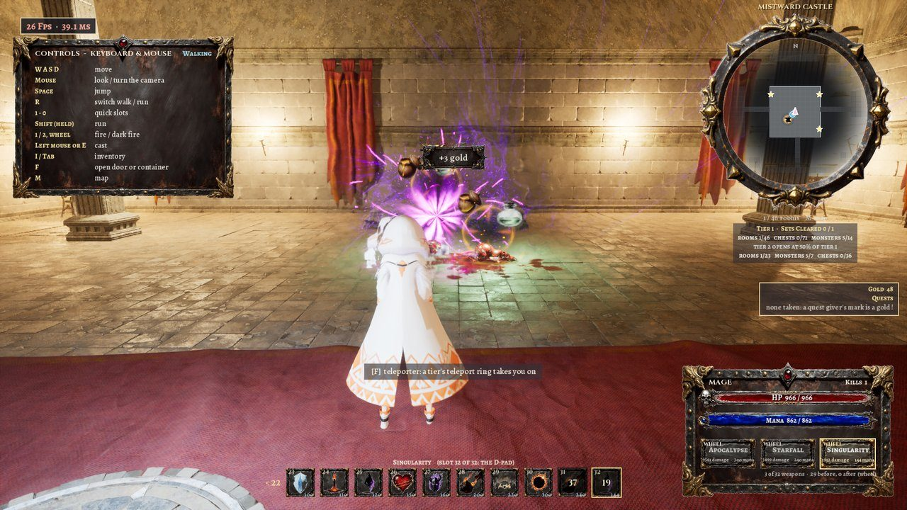

### The Warlock's curses

Thirteen curses kept to the Warlock (`OnlyHeroes`), each sharing a place among the 30 tiers with one of the Mage's spells: a tome drawn at that place teaches her the curse until she knows it (`918 spells3`, `RD/RDList11c.cpp`). A curse is cast like a spell (right mouse or E; LB), at the monster she faces or round it. Their shares do not grow with the tier. Each also has a scroll (Leech Hex, Contagion, Doom, Withering Brand) or a recipe for one.

| Place | Curse | Mana | Cooldown | Lasts | Area | What it does to the monster |
|---|---|---|---|---|---|---|
| 2 (Mistward Castle 2) | Curse of Rot | 24 | 1 s | 8 s | one monster | one enemy loses 6% of its hit points as poison over 8 s; up to 3 at once |
| 5 (Mistward Castle 5) | Hex of Lethargy | 42 | 8 s | 6 s | 4.5 m round the target | enemies in an area 30% slower and their blows 15% slower for 6 s |
| 7 (Vel Morrath 2) | Mark of the Hunted | 54 | 4 s | 20 s | one monster | one enemy seen through walls; your blows on it 10% likelier to strike twice as hard, for 20 s; one mark at a time |
| 10 (Vel Morrath 5) | Withering Brand | 72 | 6 s | 10 s | one monster | the enemy gets half the healing and none of its own regeneration for 10 s |
| 12 (The War Engine 2) | Curse of Silence | 84 | 10 s | 3 s | one monster | the enemy can't shoot, cast or use abilities for 3 s (1.5 s an elite or a boss) |
| 15 (The War Engine 5) | Curse of Brittle Bones | 102 | 8 s | 8 s | one monster | the enemy takes 25% more from weapons for 8 s, and a blow of yours that strikes twice as hard knocks it down |
| 16 (The Sewers 1) | Curse of Greed | 108 | 4 s | 20 s | one monster | killed while cursed, the enemy drops 50% more gold and has a 15% chance of a thing besides |
| 18 (The Sewers 3) | Leech Hex | 120 | 10 s | 10 s | one monster | 15% of all hurt dealt to the enemy (by anyone) heals you, for 10 s |
| 21 (Kethrys Spire 1) | Curse of Dread | 138 | 14 s | 3 s | 5 m round the target | enemies in an area flee in fear for 3 s and take 15% more; one that takes a tenth of its hit points stops |
| 24 (Kethrys Spire 4) | Contagion | 156 | 6 s | 15 s | one monster | when the cursed enemy dies, all its curses jump to up to 3 enemies within 8 m with the time they had left |
| 25 (Kethrys Spire 5) | Elemental Ruin | 162 | 10 s | 12 s | one monster | the enemy takes 40% more from one element for 12 s: fire, frost, shock or shadow, the element of the spell you cast last |
| 27 (Heaven 2) | Chains of Kinship | 174 | 12 s | 8 s | 6 m round the target | up to 4 enemies bound for 8 s: 30% of what one takes is split among the others |
| 29 (Heaven 4) | Doom | 186 | 20 s | 10 s | one monster | after 10 s the enemy takes half of all it took meanwhile; under a fifth of its hit points before that it dies (a boss takes the burst) |

How they work in the code (`RDList11c.cpp`, `RDTypes.h`'s `ERDCurseEffect`):
- **Rot** stacks up to three, each its own poison over its 8 s.
- **Lethargy** slows the monster 30 % and its blows 15 %.
- **Mark of the Hunted** shows it through walls; her blows on it have a 10 % chance to strike twice as hard. One mark at a time.
- **Silence** breaks off a shot or beam already in its wind-up; an elite or boss is silenced half as long.
- **Withering Brand** halves the healing it gets (a medic's heal, Kinship's share) and stops its own.
- **Brittle Bones**: 25 % more from her weapon blows; her blows on it have a 10 % chance (`CurseCritChance`) to strike twice as hard, and such a blow knocks it down 1.2 s.
- **Greed**: killed while cursed, 50 % more gold and 15 % a thing besides.
- **Leech**: 15 % of every hurt it takes, by anyone, heals her.
- **Dread**: they run from her 3 s and take 15 % more; one that takes a tenth of its hit points stops running.
- **Contagion**: killed while cursed, its curses go to up to 3 monsters within 8 m with the time they had left.
- **Elemental Ruin**: 40 % more from the element of the last spell she cast (fire, frost, shock or shadow; each spell's element is in the table's data).
- **Chains of Kinship**: up to 4 bound; 30 % of what one takes is split among the others.
- **Doom**: after 10 s it takes half of all it took meanwhile; under a fifth of its hit points before then it dies (a boss takes the burst instead).

These are the only "critical" hits in the code: there is no general chance for a blow to strike twice as hard.

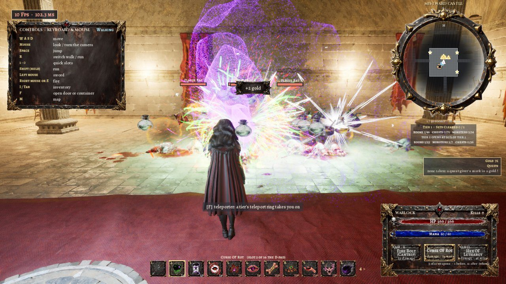

### Scrolls

36 scrolls, one for each tome spell and for four of the curses, and Starfall and Singularity. A scroll casts its spell once at no mana, with its cooldown, through her own cast clips; it is used up when the cast starts and given back if the cast is cut short (a roll, a death) before its hit. The hero must read its type (above). Scrolls are found in containers of their tier band (tiers 1, 6, 11 ... for the first band's scrolls), bought in a store whose tiers include one of the game's last two, and made at the librarian's table (see [crafting](#crafting)). A scroll may go on the quick bar and is used by the attack button there.

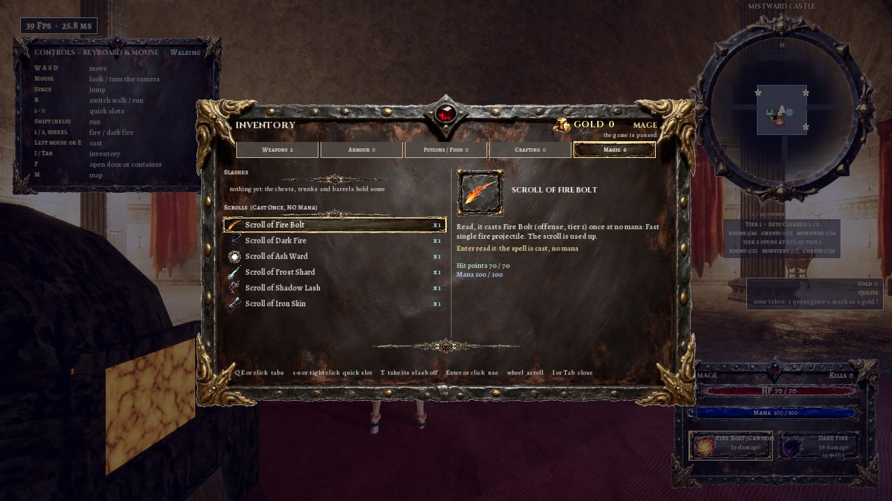

### The slashes

A slash is a flourish a boss gives (one of its tier's, when the boss falls): it goes on one weapon at a time and comes off again (T in the inventory). Only the Warrior takes them (`SlashHeroes`). Its bonus damage and its effect land with every hit of that weapon; a bow's or crossbow's bolt carries it too. Thirty slashes, six a tier (the second set of ten from the list of 2026-11-11 leaves a trail on the weapon). Source: the generator's `Slashes`, `870` and `918 slashes3`.

| Tier | Slash | Bonus a hit | Type | What it does |
|---|---|---|---|---|
| 1 | Ember Slash | 6 | fire | burns: 50 % more of the hit over 3 s |
| 1 | Frost Slash | 5 | frost | slows the monster 25 % for 2 s |
| 1 | Venom Slash | 4 | poison | poison: 12 over 4 s |
| 1 | Gale Slash | 5 | physical | her speed +10 % for 4 s after a hit |
| 1 | Rending Slash | 5 | physical | a bleed: 40 % of the hit over 4 s, stacking |
| 1 | Gust Slash | 5 | air | cleaves: every monster before her within 3 m takes half the hit |
| 2 | Blood Slash | 9 | blood | 30 % of the damage back to her as hit points |
| 2 | Wave Slash | 9 | water | pushes the monster 3 m |
| 2 | Verdant Slash | 8 | nature | 1.5 hit points a second for 5 s |
| 2 | Petal Slash | 8 | physical | 15 % of the blows on her miss for 3 s |
| 2 | Thorn Slash | 9 | nature | the monster's blows 20 % weaker for 5 s |
| 2 | Spark Slash | 9 | shock | the hit echoes: half of it again 0.4 s later |
| 3 | Crystal Slash | 14 | crystal | absorbs her next blow taken (once every 6 s) |
| 3 | Storm Slash | 15 | lightning | chains to 2 more monsters within 5 m at half damage |
| 3 | Ink Slash | 13 | dark | blinds: 40 % of the monster's blows miss for 3 s |
| 3 | Tide Slash | 14 | water | sweeps an arc: slows 20 % for 2 s and pushes 4 m |
| 3 | Sundering Slash | 14 | physical | the monster takes 15 % more from everything for 6 s |
| 3 | Riptide Slash | 14 | water | every monster round her within 3.5 m takes half the hit |
| 4 | Inferno Slash | 24 | fire | explodes within 2.5 m, burns 40 % more over 4 s |
| 4 | Shadow Slash | 22 | shadow | ignores armour; the monster takes 25 % more for 5 s |
| 4 | Neon Slash | 20 | arcane | her attacks 20 % faster for 5 s |
| 4 | Pulse Slash | 20 | energy | 25 % of the blows on her turned back on the attacker for 4 s |
| 4 | Quake Slash | 22 | earth | every monster within 3 m held 1 s (each once in 4 s) |
| 4 | Headsman's Slash | 22 | physical | a monster under 30 % of its hit points takes the hit twice |
| 5 | Magma Slash | 36 | fire | burning ground 3 m round, 10 a second for 4 s |
| 5 | Void Slash | 34 | void | pulls monsters within 5 m to the target and slows them 25 % |
| 5 | Overload Slash | 38 | energy | stuns the monster 1 s (once every 8 s a monster) |
| 5 | Prismatic Slash | 32 | all | each hit adds a random effect: burn, slow, poison or drain |
| 5 | Warcry Slash | 34 | fire | a kill with it gives her 12 % of her hit points back |
| 5 | Soulfire Slash | 34 | arcane | a kill with it bursts: every monster within 3.5 m takes 60 % of the hit |

The slashes' tables have five tiers; each later dungeon's bosses give their own tiers' slashes as Mistward's do (`docs/tiers.md`). Their bonus does not grow with the tier.

### The Rogue's arts

Sixteen arts, each learned from its manual ("Manual of ...", an item of kind Tome) found at its place among the 30 tiers: for the Rogue a tome drawn at an art's place is that art's manual until she knows it. Picked up, the art is hers at once and goes on the quick bar. Each is paid in dexterity energy, at one rank (Angel Tokens do not raise them). Damage follows her own blade's or crossbow's blow, so it grows with her (the hamstring's cut measured 13.0 at tier 1 and 30.2 at tier 10, as her blade); the control effects keep their numbers. Source: `SourceArt/balance/rogue12.json` as `925` writes it, `RD/RDRogue12.cpp`, [docs/secondary.md](secondary.md).

| Place | Art | Dexterity | Cooldown | Damage | What it does |
|---|---|---|---|---|---|
| 1 (Mistward 1) | Caltrops | 15 | 14 s | a bleed of 15 % of her blade's blow a second | spikes over 3 m for 10 s: monsters crossing them are slowed 40 % and bleed |
| 3 (Mistward 3) | Smoke Bomb | 0 | 18 s | none | a 4 m cloud for 5 s: monsters inside lose her for 4 s |
| 5 (Mistward 5) | Hamstring | 10 | 10 s | her blade's blow | a cut that slows its target 60 % for 5 s |
| 7 (Vel Morrath 2) | Marked for Death | 15 | 20 s | none | her target (within 20 m) takes 30 % more from her for 10 s |
| 9 (Vel Morrath 4) | Grappling Hook | 10 | 12 s | none | hooks a wall or monster up to 20 m away and pulls her to it (24 m a second) |
| 11 (War Engine 1) | Acid Flask | 20 | 16 s | a burn of 20 % of her best blow a second | a thrown vial (12 m): a 3 m pool for 6 s that exposes monsters (25 % more from everyone) and burns |
| 13 (War Engine 3) | Ricochet Bolt | 20 | 12 s | her crossbow's blow | a bolt that bounces between up to 4 monsters (8 m hops) |
| 14 (War Engine 4) | Shadow Double | 25 | 25 s | its burst: her blade's blow x 1.5 within 3 m | a copy of her that draws monsters within 12 m for 6 s, then bursts |
| 17 (Sewers 2) | Net Shot | 15 | 14 s | none | roots one monster (within 20 m) for 4 s |
| 19 (Sewers 4) | Fan of Knives | 25 | 12 s | her blade's blow x 0.8 | 8 knives in a ring, hitting everything within 6 m |
| 21 (Kethrys Spire 1) | Flashbang | 20 | 20 s | none | blinds and stuns monsters within 6 m for 3 s |
| 23 (Kethrys Spire 3) | Shadowstep | 25 | 14 s | her blade's blow x 1.75 (her ambush bonus) | teleports behind her target (within 15 m) and backstabs it |
| 26 (Heaven 1) | Gilded Lure | 10 | 18 s | none | a tossed coin (8 m): monsters within 15 m go after it for 5 s |
| 27 (Heaven 2) | Vanishing Act | 40 | 40 s | none | 12 s of stealth that survives her first 3 blows |
| 28 (Heaven 3) | Death Lotus | 30 | 16 s | her blade's blow x 0.8 a strike | spins, hitting everything within 3 m 3 times |
| 29 (Heaven 4) | Thousand Cuts | 50 | 60 s | her blade's blow x 2 on each | marks every monster she can see within 20 m, then blinks between them, slashing each (up to 8) |

An art that strikes out of stealth ends it as an attack does and takes her ambush bonus (unless the Vanishing Act still spares blows). Another art is refused while one still moves her.

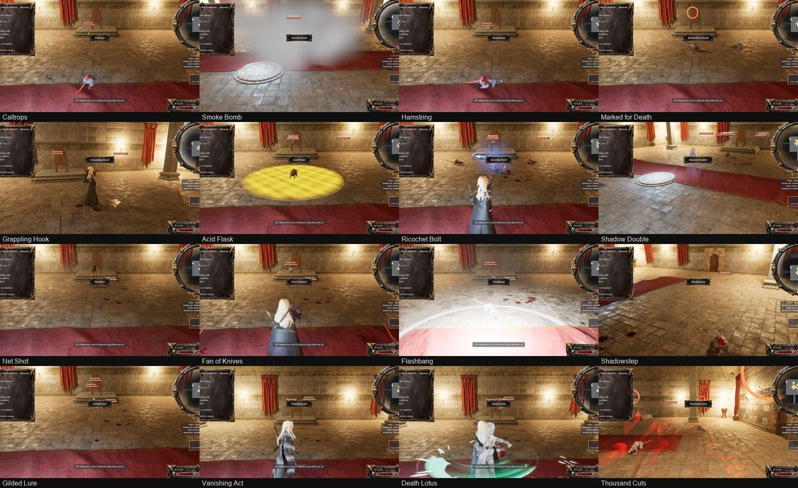

## Equipment

### Who wears and wields what

| Hero | Weapons | Armour | Shields | Rings | Charm |
|---|---|---|---|---|---|
| Warrior | every type: short blades, short swords, one-handed, curved and eastern, two-handed swords, bows, crossbows (+30 % melee) | light, medium, heavy | yes (block) | Health | yes |
| Mage | none of the found weapons | none | no | Magic | yes |
| Warlock | every type (her sword's cuts for every melee weapon) | light, medium | no | Magic, Health | yes |
| Rogue | short blades, bows, crossbows (+30 % ranged) | light | no | Dexterity | yes |
| Martial Artist | short blades (+30 %) | light | no | Health, Dexterity | yes |
| Summoner | short blades (never enchanted) | none | no | Magic | yes |

Source: each found weapon's `WeaponFits` (one fit per hero who can wield it), `FRDHeroDef::Wears`, `RingKinds`; a set of armour is worn only if its weight is in her `Wears` and a fit was made for her body. The charm is a ring kind of its own (`ERDRingKind::Charm`), worn beside her rings by any hero.

### How gear is improved

| Way | What it does | How far |
|---|---|---|
| **A deeper tier** | each weapon, set of armour, shield and ring comes again in each later dungeon at its tier there, in a quality: Fine (tiers 6-10), Masterwork (11-15), Exalted (16-20), Celestial (21-25), Divine (26-30) | a weapon's damage follows 8 + 3 x its damage rating, x the power of its first tier (1, 1.3, 1.65, 2.05, 2.5 for tiers 1 to 5, then x 1.12 a tier): the Viking Shortsword 20 → 56 → 99 → 174 → 307 → 540. Armour and shields +4 % blows taken off each quality (+20 % for Divine, at most 85 %); rings x 1.3, 1.6, 1.9, 2.2, 2.5 their bonus; durability x 1.25, 1.5, 1.75, 2.0, 2.25 |
| **A slash** (the Warrior) | a boss's flourish on one weapon: bonus damage and an effect with every hit | 4 to 38 bonus a hit, tiers 1 to 5 ([the slashes](#the-slashes)) |
| **A socket stone** | every weapon (not a spell, chi or scroll) and every set of armour has one socket; a stone used goes into the weapon in her hand, else her armour; a second replaces the first, which comes back | red +10 % damage, white -8 % damage taken, violet +8 % speed, green 0.2 % of her hit points back a second, blue / yellow the cold / heat building 40 % slower |
| **A charm** | one at a time; the cursed ones' cost is lifted for good at a town's temple (300 or 350 gold, +25 % a game tier past the first) | Glow-worm Amulet an 8 m light; Bleeding Idol +25 % damage (bleeds 0.25 % of her hit points a second, never to death); Gilded Skull +50 % gold found (monsters notice her 30 % farther); Black Candle +15 % damage (-15 % hit points); Thorned Crown -15 % damage taken (-10 % speed) |
| **Rings** | one ring of each kind she can wear (the Warlock and the Martial Artist two, the others one), and besides them a Ring of the Echo, a Miner's Lucky Stone and one charm, any hero (each a ring kind of its own: `WornRings`, `ARDDungeonGenerator` line 692) | Magic: +10 % to +100 % mana (tiers 1-5), to +250 % (Divine); Health: the same for hit points; Dexterity: the same for ranged bolts (and the Martial Artist's fists and knives). The named rings of the wilds: x 1.3 to 1.8 the strongest ring of their kind on the map |
| **Collectibles and fossils** | traded at a temple | +10 hit points or +10 mana a trade of five collectibles; +15 for a whole fossil set; or an Angel Token instead |
| **The forge** (the Warrior) | a tier-1 copy of a weapon, shield or armour set she has looted, for what breaking it down gives and half again | tier-1 gear only |
| **The cities' smiths** | Ashenreach's smith forges a Dragonglass Blade (4 dragonglass, 200 gold), Kethrys Spire's Blackstone Plate (6 blackstone, 300 gold), +25 % a game tier past the first | the blade x 1.35 a longsword's damage and x 1.3 durability, band by band (39.2 at tier 1, 783 Divine); the plate the Dark Knight's armour +4 % protection, x 1.4 durability (49 % at tier 4, 69 % Divine) |

Sources: `SourceArt/balance/tier25.json` (`quality_*`), the items on the map (Fine to Divine copies), `SourceArt/caves/treasure16.json` (`socket_stones`, `charms`), `RD/RDCave16c.cpp`, `RD/RDCave16f.cpp`, `RD/RDCave16i.cpp`.

### Durability and repair

- **Weapons:** a found weapon loses 1 durability for each blow or bolt that lands, and breaks at 0. Its slash comes back as an item; its socket stone comes back. Her own starting weapons never break.
- **Armour:** loses 1 for each blow that reaches her. At 0 it takes off only half its share until mended. She can carry several copies of a set, each with its own durability.
- **Shields:** wear by the damage they take, five times as fast while blocking. A worn-out shield does not break: it takes half its share until mended. If she carries a whole spare of the same shield, she takes it up.
- **Repair items** mend one piece of gear by a share of its full durability. They also mend the burn time of the torch and the ankh.
  - Repair Kit 100 %, Patch Kit 75 %, Whetstone 50 %, Slickstone 40 %, Leather Strips 30 %.
  - Heaven's twins: Toolkit 100 %, Kevlar Patches 75 %, Sharpening Rod 50 %, Lubricant Spray 40 %, Duct Tape 30 %.
  - The caves': Crawler Chitin 35 % (medium armour only), Bat-wing Patch 30 % (light armour only).
  - The Shard Blade is mended only by geode shards, 30 % each.
- **The anvil mends** to full for half of what breaking the piece down gives (rounded up).
- **A town's smith** mends for 30 % of the item's price.

### Weapons

The base weapons (tiers 1 to 5) and the caves' weapons, as each hero who wields them holds them; the Divine column is the strongest copy. Damage is the weapon's, before the hero's +30 %, a Dexterity ring, a slash or a socket stone. Speed and damage ratings are 1 (worst) to 10 (best); her blows with a faster weapon come quicker (each fit's own play rate).

| Weapon | Type | First tier | Damage | Reach (m) | Speed / damage rating | Durability (blows) | Wielded by | Divine copy (tier, damage) |
|---|---|---|---|---|---|---|---|---|
| Viking Shortsword | short sword | 1 | 20 | 1.65 | 7 / 4 | 67 | Warrior, Warlock | 26, 540 |
| Sherwood Sword | short sword | 1 | 20 | 1.65 | 7 / 4 | 68 | Warrior, Warlock | 26, 540 |
| Orc Cleaver | short sword | 2 | 30 | 1.65 | 6 / 5 | 69 | Warrior, Warlock | 27, 696 |
| Toothed Bone Sword | short sword | 2 | 34 | 1.65 | 5 / 6 | 70 | Warrior, Warlock | 27, 787 |
| Arming Sword | one handed sword | 1 | 26 | 1.75 | 5 / 6 | 86 | Warrior, Warlock | 26, 702 |
| Longsword | one handed sword | 1 | 29 | 1.75 | 4 / 7 | 87 | Warrior, Warlock | 26, 783 |
| Viking Sword | one handed sword | 1 | 29 | 1.75 | 4 / 7 | 88 | Warrior, Warlock | 26, 783 |
| Veteran's Sword | one handed sword | 2 | 42 | 1.75 | 3 / 8 | 89 | Warrior, Warlock | 27, 968 |
| Templar Sword | one handed sword | 2 | 42 | 1.75 | 3 / 8 | 90 | Warrior, Warlock | 27, 968 |
| Plate Knight's Sword | two handed sword | 2 | 46 | 2.10 | 2 / 9 | 97 | Warrior, Warlock | 27, 1059 |
| Paladin's Sword | two handed sword | 2 | 46 | 2.10 | 2 / 9 | 98 | Warrior, Warlock | 27, 1059 |
| Dark Knight's Sword | two handed sword | 3 | 63 | 2.10 | 1 / 10 | 99 | Warrior, Warlock | 28, 1287 |
| Ursag's Horn Blade | two handed sword | 4, 5 | 78 | 2.10 | 1 / 10 | 100 | Warrior, Warlock | 29, 30, 1442 |
| Eastern Sabre | curved and eastern sword | 1 | 20 | 1.80 | 7 / 4 | 78 | Warrior, Warlock | 26, 540 |
| Katana | curved and eastern sword | 2 | 30 | 1.80 | 6 / 5 | 79 | Warrior, Warlock | 27, 696 |
| Wakizashi | curved and eastern sword | 3 | 43 | 1.80 | 5 / 6 | 80 | Warrior, Warlock | 28, 881 |
| Dagger | short blades | 1 | 11 | 1.50 | 10 / 1 | 52 | Warrior, Warlock, Rogue, Martial Artist, Summoner | 26, 297 |
| Leaf-Blade Knife | short blades | 1 | 11 | 1.50 | 10 / 1 | 53 | Warrior, Warlock, Rogue, Martial Artist, Summoner | 26, 297 |
| Obsidian Knife | short blades | 2 | 14 | 1.50 | 10 / 1 | 54 | Warrior, Warlock, Rogue, Martial Artist, Summoner | 27, 333 |
| Bone Blade | short blades | 2 | 18 | 1.50 | 9 / 2 | 55 | Warrior, Warlock, Rogue, Martial Artist, Summoner | 27, 424 |
| Combat Knife | short blades | 3 | 23 | 1.50 | 9 / 2 | 56 | Warrior, Warlock, Rogue, Martial Artist, Summoner | 28, 474 |
| Survival Knife | short blades | 3 | 23 | 1.50 | 9 / 2 | 57 | Warrior, Warlock, Rogue, Martial Artist, Summoner | 28, 474 |
| Kukri | short blades | 4 | 35 | 1.50 | 8 / 3 | 58 | Warrior, Warlock, Rogue, Martial Artist, Summoner | 29, 645 |
| Sniper's Knife | short blades | 4 | 35 | 1.50 | 8 / 3 | 59 | Warrior, Warlock, Rogue, Martial Artist, Summoner | 29, 645 |
| Wrist Blade | short blades | 5 | 42 | 1.50 | 8 / 3 | 60 | Warrior, Warlock, Rogue, Martial Artist, Summoner | 30, 723 |
| Longbow | bow | 1 | 20 | 30.00 | 7 / 4 | 72 | Warrior, Warlock, Rogue | 26, 540 |
| Viking Bow | bow | 2 | 26 | 30.00 | 7 / 4 | 73 | Warrior, Warlock, Rogue | 27, 605 |
| Crossbow | crossbow | 3 | 38 | 26.00 | 6 / 5 | 74 | Warrior, Warlock, Rogue | 28, 779 |
| Dwarf Crossbow | crossbow | 4, 5 | 53 | 28.00 | 5 / 6 | 75 | Warrior, Warlock, Rogue | 29, 30, 987 |
| Miner's Pick | two handed sword | 2 | 41.4 | 2.10 | 2 / 9 | 97 | Warrior, Warlock | 27, 1059 |
| Shard Blade | one handed sword | 1 | 42 | 1.75 | 4 / 7 | 87 | Warrior, Warlock | 26, 783 |
| Jawbone Club | short sword | 2 | 28.9 | 1.65 | 5 / 6 | 70 | Warrior, Warlock | 27, 787 |
| Rib Dagger | short blades | 2 | 15.3 | 1.50 | 9 / 2 | 55 | Warrior, Warlock, Rogue, Martial Artist, Summoner | 27, 424 |
| Lightless Bow | bow | 1 | 20 | 30.00 | 7 / 4 | 72 | Warrior, Warlock, Rogue | 26, 540 |
| Maren's Falchion | curved and eastern sword | 1 | 26 | 1.80 | 7 / 4 | 78 | Warrior, Warlock | 26, 540 |
| Corvin's Gladius | short sword | 1 | 26 | 1.65 | 7 / 4 | 67 | Warrior, Warlock | 26, 540 |
| The Sandwalker's Khopesh | short sword | 2 | 39 | 1.65 | 6 / 5 | 69 | Warrior, Warlock | 27, 696 |
| Old Hessa's Notched Blade | one handed sword | 2 | 54.6 | 1.75 | 3 / 8 | 89 | Warrior, Warlock | 27, 968 |
| Lysander's Rapier | one handed sword | 1 | 37.7 | 1.75 | 4 / 7 | 87 | Warrior, Warlock | 26, 783 |
| The Warden's Runed Blade | one handed sword | 2 | 54.6 | 1.75 | 3 / 8 | 90 | Warrior, Warlock | 27, 968 |
| Dragonglass Blade | one handed sword | 1 | 39.2 | 1.75 | 4 / 7 | 87 | Warrior, Warlock | 26, 783 |

### Armour

"Blows taken off" is the share of each blow that reaches her that the set takes off; "speed lost" is the share of her speed she loses wearing it. A hero wears only the weights she can: light for the Rogue and the Martial Artist, light and medium for the Warlock, all three for the Warrior; the Mage and the Summoner wear none.

| Armour | Weight | Type | First tier | Blows taken off | Speed lost | Durability | Damage / speed rating | Divine copy (tier, blows off, durability) |
|---|---|---|---|---|---|---|---|---|
| Plate Armour | Heavy | full plate | 4 | 40 % | 21 % | 510 | 8 / 3 | 29, 60 %, 1147.5 |
| Lady Knight’s Armour | Heavy | full plate | 4 | 40 % | 21 % | 525 | 8 / 3 | 29, 60 %, 1181.25 |
| Paladin’s Armour | Heavy | full plate | 4 | 40 % | 21 % | 525 | 8 / 3 | 29, 60 %, 1181.25 |
| Dark Knight’s Armour | Heavy | full plate | 4 | 45 % | 24 % | 550 | 9 / 2 | 29, 65 %, 1237.5 |
| Broddi’s Dwarf Armour | Heavy | full plate | 4 | 45 % | 24 % | 575 | 9 / 2 | 29, 65 %, 1293.75 |
| Epic Plate (Male) | Heavy | full plate | 5 | 50 % | 27 % | 600 | 10 / 1 | 30, 70 %, 1350 |
| Epic Plate (Female) | Heavy | full plate | 5 | 50 % | 27 % | 600 | 10 / 1 | 30, 70 %, 1350 |
| Bear Warrior’s Armour | Heavy | heavy | 3 | 35 % | 12 % | 475 | 7 / 6 | 28, 55 %, 1068.75 |
| Elephant Warrior’s Armour | Heavy | heavy | 3 | 35 % | 9 % | 500 | 7 / 7 | 28, 55 %, 1125 |
| Crocodile Warrior’s Armour | Medium | medium | 2 | 30 % | 15 % | 400 | 6 / 5 | 27, 50 %, 900 |
| Split Armour | Medium | medium | 2 | 25 % | 12 % | 375 | 5 / 6 | 27, 45 %, 843.75 |
| Desert Hero’s Armour | Light | light | 1 | 20 % | 12 % | 200 | 4 / 6 | 26, 40 %, 450 |
| Tiefling’s Armour | Light | light | 1 | 15 % | 9 % | 175 | 3 / 7 | 26, 35 %, 393.75 |
| Orme’s Armour | Light | light | 1 | 10 % | 6 % | 150 | 2 / 8 | 26, 30 %, 337.5 |
| Templar’s Armour | Medium | partial | 1 | 20 % | 12 % | 210 | 4 / 6 | 26, 40 %, 472.5 |
| Eastern Knight’s Armour | Medium | partial | 1 | 20 % | 12 % | 225 | 4 / 6 | 26, 40 %, 506.25 |
| Demonic Armour | Medium | partial | 2 | 25 % | 15 % | 250 | 5 / 5 | 27, 45 %, 562.5 |
| Bedvar’s Armour | Medium | partial | 2 | 25 % | 15 % | 275 | 5 / 5 | 27, 45 %, 618.75 |
| Executioner’s Armour | Medium | partial | 3 | 30 % | 18 % | 300 | 6 / 4 | 28, 50 %, 675 |
| Orc Warrior’s Armour | Light | orc | 1 | 5 % | 0 % | 125 | 1 / 10 | 26, 25 %, 281.25 |
| Orc Veteran’s Armour | Light | orc | 1 | 10 % | 3 % | 150 | 2 / 9 | 26, 30 %, 337.5 |
| Orc Skirmisher’s Armour | Light | orc | 1 | 15 % | 6 % | 175 | 3 / 8 | 26, 35 %, 393.75 |
| Orc Bruiser’s Armour | Light | orc | 2 | 20 % | 9 % | 200 | 4 / 7 | 27, 40 %, 450 |
| Orc Raider’s Armour | Medium | orc | 2 | 25 % | 12 % | 375 | 5 / 6 | 27, 45 %, 843.75 |
| Gnur’s Armour | Medium | orc | 3 | 30 % | 15 % | 400 | 6 / 5 | 28, 50 %, 900 |
| Dardan’s Armour | Medium | orc | 4 | 35 % | 18 % | 475 | 7 / 4 | 29, 55 %, 1068.75 |
| Costalmed’s Armour | Heavy | orc | 5 | 40 % | 21 % | 510 | 8 / 3 | 30, 60 %, 1147.5 |
| Spelunker's Armour | Light | light | 1 | 20 % | 12 % | 200 | 4 / 6 | 26, 40 %, 450 |
| Chitin Plate | Heavy | full plate | 4 | 40 % | 21 % | 510 | 8 / 3 | 29, 60 %, 1147.5 |
| Drowned Knight's Armour | Medium | partial | 1 | 20 % | 12 % | 231 | 4 / 6 | 26, 40 %, 519.75 |
| Deepiron Mail | Light | orc | 2 | 24 % | 9 % | 230 | 4 / 7 | 27, 44 %, 517.5 |
| Deepiron Scale | Medium | medium | 2 | 29 % | 12 % | 431.25 | 5 / 6 | 27, 49 %, 970.312 |
| Deepiron Plate | Heavy | full plate | 4 | 49 % | 24 % | 632.5 | 9 / 2 | 29, 69 %, 1423.12 |
| Blackstone Plate | Heavy | full plate | 4 | 49 % | 24 % | 770 | 9 / 2 | 29, 69 %, 1732.5 |

The cave sets carry perks besides (`ArmourPerks16`): Spelunker's Armour, monsters notice her at 0.8 of their distance and a 6 m light round her; Chitin Plate, poison hurts half as much; the Drowned Knight's Armour, breath three times as long. The wilds' cold and heat are eased by some sets ([climate](#the-climate)).

### Shields

The Warrior's alone. The share is of what is left of a blow after her armour; while she blocks it is 30 points more (a 40 % shield takes 70 %; at most 95 %).

| Shield | Kind | First tier | Share of a blow it takes | Durability | Divine copy (tier, share, durability) |
|---|---|---|---|---|---|
| Broddi's Shield | shield metal | 5 | 40 % | 300 | 30, 60 %, 675 |
| Scutum | shield wood | 5 | 36 % | 240 | 30, 56 %, 540 |
| Crusader Shield | shield wood | 5 | 32 % | 230 | 30, 52 %, 517.5 |
| War Tower Shield | shield metal | 5 | 32 % | 260 | 30, 52 %, 585 |
| Plate Knight's Shield | shield metal | 4 | 28 % | 250 | 29, 48 %, 562.5 |
| Lady Knight's Shield | shield metal | 4 | 28 % | 240 | 29, 48 %, 540 |
| Kite Shield | shield metal | 4 | 24 % | 230 | 29, 44 %, 517.5 |
| Desert Shield | shield metal | 4 | 24 % | 210 | 29, 44 %, 472.5 |
| Heater Shield | shield metal | 3 | 20 % | 220 | 28, 40 %, 495 |
| Eastern Shield | shield metal | 3 | 20 % | 200 | 28, 40 %, 450 |
| Beast Shield | shield metal | 3 | 16 % | 190 | 28, 36 %, 427.5 |
| Rider's Shield | shield wood | 3 | 16 % | 130 | 28, 36 %, 292.5 |
| War Camp Shield | shield wood | 3 | 16 % | 130 | 28, 36 %, 292.5 |
| Heraldic Shield | shield wood | 2 | 12 % | 150 | 27, 32 %, 337.5 |
| Dock Shield | shield wood | 2 | 12 % | 150 | 27, 32 %, 337.5 |
| Viking Shield (iron-bound) | shield wood | 2 | 12 % | 160 | 27, 32 %, 360 |
| Village Shield (blue and white) | shield wood | 2 | 8 % | 120 | 27, 28 %, 270 |
| Village Shield (red) | shield wood | 1 | 8 % | 120 | 26, 28 %, 270 |
| Village Shield (green) | shield wood | 1 | 8 % | 120 | 26, 28 %, 270 |
| Viking Round Shield | shield wood | 1 | 4 % | 100 | 26, 24 %, 225 |
| Painted Viking Shield | shield wood | 1 | 4 % | 100 | 26, 24 %, 225 |
| Viking Shield (green and white) | shield wood | 1 | 4 % | 100 | 26, 24 %, 225 |

### Rings

| Ring | Kind | First tier | Bonus | Divine copy (tier, bonus) |
|---|---|---|---|---|
| Magic Potency Ring 1 | Magic | 1 | +10 % | 26, +25 % |
| Magic Potency Ring 2 | Magic | 1 | +20 % | 26, +50 % |
| Magic Potency Ring 3 | Magic | 2 | +30 % | 27, +75 % |
| Magic Potency Ring 4 | Magic | 2 | +40 % | 27, +100 % |
| Magic Potency Ring 5 | Magic | 3 | +50 % | 28, +125 % |
| Magic Potency Ring 6 | Magic | 3 | +60 % | 28, +150 % |
| Magic Potency Ring 7 | Magic | 4 | +70 % | 29, +175 % |
| Magic Potency Ring 8 | Magic | 4 | +80 % | 29, +200 % |
| Magic Potency Ring 9 | Magic | 5 | +90 % | 30, +225 % |
| Magic Potency Ring 10 | Magic | 5 | +100 % | 30, +250 % |
| HP Potency Ring 1 | Health | 1 | +10 % | 26, +25 % |
| HP Potency Ring 2 | Health | 1 | +20 % | 26, +50 % |
| HP Potency Ring 3 | Health | 2 | +30 % | 27, +75 % |
| HP Potency Ring 4 | Health | 2 | +40 % | 27, +100 % |
| HP Potency Ring 5 | Health | 3 | +50 % | 28, +125 % |
| HP Potency Ring 6 | Health | 3 | +60 % | 28, +150 % |
| HP Potency Ring 7 | Health | 4 | +70 % | 29, +175 % |
| HP Potency Ring 8 | Health | 4 | +80 % | 29, +200 % |
| HP Potency Ring 9 | Health | 5 | +90 % | 30, +225 % |
| HP Potency Ring 10 | Health | 5 | +100 % | 30, +250 % |
| Dexterity Ring 1 | Dexterity | 1 | +10 % | 26, +25 % |
| Dexterity Ring 2 | Dexterity | 1 | +20 % | 26, +50 % |
| Dexterity Ring 3 | Dexterity | 2 | +30 % | 27, +75 % |
| Dexterity Ring 4 | Dexterity | 2 | +40 % | 27, +100 % |
| Dexterity Ring 5 | Dexterity | 3 | +50 % | 28, +125 % |
| Dexterity Ring 6 | Dexterity | 3 | +60 % | 28, +150 % |
| Dexterity Ring 7 | Dexterity | 4 | +70 % | 29, +175 % |
| Dexterity Ring 8 | Dexterity | 4 | +80 % | 29, +200 % |
| Dexterity Ring 9 | Dexterity | 5 | +90 % | 30, +225 % |
| Dexterity Ring 10 | Dexterity | 5 | +100 % | 30, +250 % |

### Potions, food and other things used up

| Item | Kind | Tiers found | What it does |
|---|---|---|---|
| Small Healing Potion | Healing | 1, 6, 11, 16, 21, 26 | restores 10 % of her hit points |
| Medium Healing Potion | Healing | 1, 6, 11, 16, 21, 26 | restores 20 % of her hit points |
| Large Healing Potion | Healing | 2, 7, 12, 17, 22, 27 | restores 30 % of her hit points |
| Uncommon Healing Potion | Healing | 2, 7, 12, 17, 22, 27 | restores 40 % of her hit points |
| Wondrous Healing Potion | Healing | 3, 8, 13, 18, 23, 28 | restores 50 % of her hit points |
| Rare Healing Potion | Healing | 3, 8, 13, 18, 23, 28 | restores 60 % of her hit points |
| Very Rare Healing Potion | Healing | 4, 9, 14, 19, 24, 29 | restores 70 % of her hit points |
| Legendary Healing Potion | Healing | 5, 10, 15, 20, 25, 30 | restores 80 % of her hit points |
| Small Mana Potion | Mana | 1, 6, 11, 16, 21, 26 | restores 10 % of her mana |
| Medium Mana Potion | Mana | 1, 6, 11, 16, 21, 26 | restores 20 % of her mana |
| Large Mana Potion | Mana | 2, 7, 12, 17, 22, 27 | restores 30 % of her mana |
| Uncommon Mana Potion | Mana | 2, 7, 12, 17, 22, 27 | restores 40 % of her mana |
| Wondrous Mana Potion | Mana | 3, 8, 13, 18, 23, 28 | restores 50 % of her mana |
| Rare Mana Potion | Mana | 3, 8, 13, 18, 23, 28 | restores 60 % of her mana |
| Very Rare Mana Potion | Mana | 4, 9, 14, 19, 24, 29 | restores 70 % of her mana |
| Legendary Mana Potion | Mana | 5, 10, 15, 20, 25, 30 | restores 80 % of her mana |
| Small Speed Potion | Speed | 1, 6, 11, 16, 21, 26 | 10 % faster for 30 s |
| Medium Speed Potion | Speed | 1, 6, 11, 16, 21, 26 | 20 % faster for 30 s |
| Large Speed Potion | Speed | 2, 7, 12, 17, 22, 27 | 30 % faster for 30 s |
| Uncommon Speed Potion | Speed | 2, 7, 12, 17, 22, 27 | 40 % faster for 30 s |
| Wondrous Speed Potion | Speed | 3, 8, 13, 18, 23, 28 | 50 % faster for 30 s |
| Rare Speed Potion | Speed | 3, 8, 13, 18, 23, 28 | 60 % faster for 30 s |
| Very Rare Speed Potion | Speed | 4, 9, 14, 19, 24, 29 | 70 % faster for 30 s |
| Legendary Speed Potion | Speed | 5, 10, 15, 20, 25, 30 | 80 % faster for 30 s |
| Bread | Food | 1, 6, 11, 16, 21, 26 | 1 % of her hit points a second for 10 s (10 % in all) |
| Fish | Food | 1, 6, 11, 16, 21, 26 | 2 % of her hit points a second for 10 s (20 % in all) |
| Fruit | Food | 2, 7, 12, 17, 22, 27 | 3 % of her hit points a second for 10 s (30 % in all) |
| Nuts and Seeds | Food | 2, 7, 12, 17, 22, 27 | 4 % of her hit points a second for 10 s (40 % in all) |
| Jerky | Food | 3, 8, 13, 18, 23, 28 | 5 % of her hit points a second for 10 s (50 % in all) |
| Hardtack | Food | 3, 8, 13, 18, 23, 28 | 6 % of her hit points a second for 10 s (60 % in all) |
| Travel Cake | Food | 4, 9, 14, 19, 24, 29 | 7 % of her hit points a second for 10 s (70 % in all) |
| Sweet Roll | Food | 5, 10, 15, 20, 25, 30 | 8 % of her hit points a second for 10 s (80 % in all) |
| Well Done Steak | Food | 5, 10, 15, 20, 25, 30 | 9 % of her hit points a second for 10 s (90 % in all) |
| Repair Kit | Repair | any | mends 100 % of an item's durability |
| Patch Kit | Repair | any | mends 75 % of an item's durability |
| Whetstone | Repair | any | mends 50 % of an item's durability |
| Slickstone | Repair | any | mends 40 % of an item's durability |
| Leather Strips | Repair | any | mends 30 % of an item's durability |
| Torch | Torch | any | a light in her hand |
| Cheese | Food | 1, 6, 11, 16, 21, 26 | 1 % of her hit points a second for 10 s (10 % in all) |
| Revealing Ankh | Light | 2 | a light in her hand |
| Wild Honey | Food | any | 3 % of her hit points a second for 10 s (30 % in all) |
| Wild Apples | Food | any | 1.5 % of her hit points a second for 10 s (15 % in all) |
| Wild Plums | Food | any | 1.5 % of her hit points a second for 10 s (15 % in all) |
| Bird's Eggs | Food | any | 2 % of her hit points a second for 10 s (20 % in all) |
| Field Mushrooms | Food | any | 1.5 % of her hit points a second for 10 s (15 % in all) |
| Morels | Food | any | 2 % of her hit points a second for 10 s (20 % in all) |
| Pumpkin | Food | any | 2.5 % of her hit points a second for 10 s (25 % in all) |
| Wild Berries | Food | any | 1.5 % of her hit points a second for 10 s (15 % in all) |
| Grapes | Food | any | 1.5 % of her hit points a second for 10 s (15 % in all) |
| Elixir of Iron Hide | Healing | 2, 7, 12, 17, 22, 27 | restores 15 % of her hit points; buff: blows on her 25 % weaker for 60 s |
| Draught of Swiftness | Speed | 2, 7, 12, 17, 22, 27 | 35 % faster for 60 s |
| Elixir of Might | Healing | 3, 8, 13, 18, 23, 28 | restores 10 % of her hit points; buff: her blows 25 % stronger for 60 s |
| Elixir of Regeneration | Healing | 3, 8, 13, 18, 23, 28 | restores 10 % of her hit points; buff: 2 % of her hit points a second for 30 s |
| Greater Restoration Draught | Healing | 5, 10, 15, 20, 25, 30 | restores 95 % of her hit points |
| Greater Mana Draught | Mana | 5, 10, 15, 20, 25, 30 | restores 95 % of her mana |
| Hunter's Stew | Food | 2, 7, 12, 17, 22, 27 | 4 % of her hit points a second for 15 s (60 % in all); buff: blows on her 15 % weaker for 120 s |
| Honey Cake | Food | 2, 7, 12, 17, 22, 27 | 3 % of her hit points a second for 12 s (36 % in all); buff: 15 % faster for 120 s |
| Feast Pie | Food | 3, 8, 13, 18, 23, 28 | 5 % of her hit points a second for 20 s (100 % in all); buff: her blows 15 % stronger for 120 s |
| Eggs | Food | any | 1.5 % of her hit points a second for 10 s (15 % in all) |
| Frostleaf Stew | Food | any | 3 % of her hit points a second for 15 s (45 % in all); buff: the cold builds 60 % slower for 300 s |
| Sandroot Cooler | Food | any | 2 % of her hit points a second for 10 s (20 % in all); buff: the heat builds 60 % slower for 300 s |
| Crawler Chitin | Repair | any | mends 35 % of an item's durability |
| Bat-wing Patch | Repair | any | mends 30 % of an item's durability |
| Blind-fish Oil | Healing | any | buff: the torch and ankh burn twice as long for 1200 s |
| Darksight Draught | Healing | any | buff: a light of 18 m round her for 300 s |
| Grave-moss Antivenom | Healing | any | buff: poison hurts 60 % less for 300 s |
| Slow Mending Draught | Healing | any | buff: 0.5 % of her hit points a second for 180 s |
| Frost-quartz Lining | Healing | any | buff: the cold builds 50 % slower for 1800 s |
| Sun-glass Weave | Healing | any | buff: the heat builds 50 % slower for 1800 s |
| Blue Socket Stone | Healing | any |  |
| White Socket Stone | Healing | any |  |
| Red Socket Stone | Healing | any |  |
| Yellow Socket Stone | Healing | any |  |
| Green Socket Stone | Healing | any |  |
| Violet Socket Stone | Healing | any |  |
| Sandwich | Food | 1, 6, 11, 16, 21, 26 | 1 % of her hit points a second for 10 s (10 % in all) |
| Cheese Crackers | Food | 1, 6, 11, 16, 21, 26 | 1 % of her hit points a second for 10 s (10 % in all) |
| Sushi Box | Food | 1, 6, 11, 16, 21, 26 | 2 % of her hit points a second for 10 s (20 % in all) |
| Fruit Cup | Food | 2, 7, 12, 17, 22, 27 | 3 % of her hit points a second for 10 s (30 % in all) |
| Trail Mix | Food | 2, 7, 12, 17, 22, 27 | 4 % of her hit points a second for 10 s (40 % in all) |
| Energy Bar | Food | 3, 8, 13, 18, 23, 28 | 6 % of her hit points a second for 10 s (60 % in all) |
| Beef Jerky Pack | Food | 3, 8, 13, 18, 23, 28 | 5 % of her hit points a second for 10 s (50 % in all) |
| Protein Shake | Food | 4, 9, 14, 19, 24, 29 | 7 % of her hit points a second for 10 s (70 % in all) |
| Doughnut | Food | 5, 10, 15, 20, 25, 30 | 8 % of her hit points a second for 10 s (80 % in all) |
| Burger | Food | 5, 10, 15, 20, 25, 30 | 9 % of her hit points a second for 10 s (90 % in all) |
| Bandage Roll | Healing | 1, 6, 11, 16, 21, 26 | restores 10 % of her hit points |
| First-Aid Kit | Healing | 1, 6, 11, 16, 21, 26 | restores 20 % of her hit points |
| Med Kit | Healing | 2, 7, 12, 17, 22, 27 | restores 40 % of her hit points |
| Trauma Kit | Healing | 2, 7, 12, 17, 22, 27 | restores 30 % of her hit points |
| Surgical Kit | Healing | 3, 8, 13, 18, 23, 28 | restores 50 % of her hit points |
| Nano-Med Injector | Healing | 3, 8, 13, 18, 23, 28 | restores 60 % of her hit points |
| Regen Serum | Healing | 4, 9, 14, 19, 24, 29 | restores 70 % of her hit points |
| Phoenix Serum | Healing | 5, 10, 15, 20, 25, 30 | restores 80 % of her hit points |
| Focus Pills | Mana | 1, 6, 11, 16, 21, 26 | restores 10 % of her mana |
| Neuro Tonic | Mana | 1, 6, 11, 16, 21, 26 | restores 20 % of her mana |
| Mind Booster | Mana | 2, 7, 12, 17, 22, 27 | restores 40 % of her mana |
| Cortex Serum | Mana | 2, 7, 12, 17, 22, 27 | restores 30 % of her mana |
| Synapse Serum | Mana | 3, 8, 13, 18, 23, 28 | restores 50 % of her mana |
| Psi Injector | Mana | 3, 8, 13, 18, 23, 28 | restores 60 % of her mana |
| Aether Serum | Mana | 4, 9, 14, 19, 24, 29 | restores 70 % of her mana |
| Quantum Tonic | Mana | 5, 10, 15, 20, 25, 30 | restores 80 % of her mana |
| Energy Drink | Speed | 1, 6, 11, 16, 21, 26 | 10 % faster for 30 s |
| Caffeine Shot | Speed | 1, 6, 11, 16, 21, 26 | 20 % faster for 30 s |
| Adrenaline Gum | Speed | 2, 7, 12, 17, 22, 27 | 40 % faster for 30 s |
| Stim Pack | Speed | 2, 7, 12, 17, 22, 27 | 30 % faster for 30 s |
| Sprint Serum | Speed | 3, 8, 13, 18, 23, 28 | 50 % faster for 30 s |
| Overdrive Injector | Speed | 3, 8, 13, 18, 23, 28 | 60 % faster for 30 s |
| Hyperdrive Serum | Speed | 4, 9, 14, 19, 24, 29 | 70 % faster for 30 s |
| Quicksilver Serum | Speed | 5, 10, 15, 20, 25, 30 | 80 % faster for 30 s |
| Duct Tape | Repair | any | mends 30 % of an item's durability |
| Sharpening Rod | Repair | any | mends 50 % of an item's durability |
| Lubricant Spray | Repair | any | mends 40 % of an item's durability |
| Kevlar Patches | Repair | any | mends 75 % of an item's durability |
| Toolkit | Repair | any | mends 100 % of an item's durability |
| Road Flare | Torch | any | a light in her hand |

Heaven's goods (Bandage Roll, Focus Pills, Energy Drink, Sandwich and the rest) are twins of the everyday items with new names and pictures, sold in Heaven and found there instead (`946 goods`). The Revealing Ankh is a light carried in her left hand that shows traps and unlooted chests within 10 m.

## Crafting

### The stations

| Station | Where | Who | What it makes |
|---|---|---|---|
| **Anvil** | every dungeon set (`AnvilEverySection`), the towns' smithies | every hero | repair items, the torch, Angel Tokens, Deepiron ingots and armour, the Drowned Knight's armour, the Ring of the Echo, the cave linings; also mends and breaks down gear |
| **Forge** | a forge (the `Forge` piece: the forge rooms and smithies) | the Warrior only (`ForgeHeroes`) | a tier-1 copy of a weapon, shield or armour set she has looted |
| **Alchemist's table** | the towns' healers and the dungeons, beside the anvil | every hero; healing and mana potions only the Mage and the Martial Artist (`PotionBrewers`) | potions, elixirs, the cave draughts |
| **Librarian's table** | the towns' libraries and the dungeons, beside the anvil | the heroes who read the scroll's type | scrolls, inks, socket stones |
| **Oven** | town kitchens' bread ovens, the dungeons' great hall and kitchens, farmhouses | every hero | food and meals from the gardens' and fields' ingredients |

Every station's panel shows what each recipe takes and what she has. A recipe is offered once its tier is open in the dungeon she is in (`RecipeTiers`). The advanced recipes (elixirs, meals, the higher scrolls) must first be learned from a recipe item found in containers (`RD/RDList14e.cpp`). Source of all recipes below: the generator's `Recipes` on the map.

**How far crafting goes:**
- **Potions:** the alchemist makes healing and mana potions up to the Legendary (80 % at once), and the Greater Restoration and Greater Mana Draughts (95 %).
- **Scrolls:** the librarian makes a scroll of every tome spell up to Apocalypse, Starfall and Singularity, and four curses.
- **The forge:** makes tier-1 gear only.
- **The anvil:** makes the Deepiron sets in every quality band up to Divine (Divine Deepiron Plate: 69 % of blows taken off). No crafted item is better than the best found; crafting's reach is consumables, repairs, Angel Tokens and the cave sets.

### Anvil: repair items, tools and tokens

| Item | Takes |
|---|---|
| Leather Strips (mends 30 %) | 5 straw rope, 5 glue, 5 cured leather strip, 5 wood (any) |
| Slickstone (40 %) | 10 straw rope, 10 glue, 10 cured leather strip, 10 wood, 5 oils, 5 coarse hide, 5 wood glue |
| Whetstone (50 %) | 15 straw rope, 15 glue, 15 cured leather strip, 15 wood, 10 oils, 10 coarse hide, 5 light leather, 5 epoxy, 5 iron |
| Patch Kit (75 %) | 25 each of straw rope, glue, cured leather strip, wood; 15 oils, 15 coarse hide, 10 light leather, 10 epoxy, 10 iron, 5 bronze, 5 copper, 5 steel, 10 wood glue |
| Repair Kit (100 %) | 45 each of straw rope, glue, cured leather strip, wood; 25 oils, 25 coarse hide, 20 light leather, 20 epoxy, 20 iron, 10 bronze, 10 copper, 10 steel, 15 wood glue |
| Torch | 2 wood, 2 straw rope, 1 oils, 1 wood glue |
| Angel Token | 3 Seraph Feathers, 1 Hallowed Stone |
| Deepiron Ingot | 3 deepiron ore |
| Bat-wing Patch | 2 bat-wing leather |
| Frost-quartz Lining (warm 50 %, 30 min) | 2 frost quartz, 1 leather |
| Sun-glass Weave (cool 50 %, 30 min) | 2 sun-glass, 1 leather |
| Ring of the Echo (monsters within 60 m on her maps) | 2 cave pearls, 1 deepiron ingot |
| Drowned Knight's Armour | the helm, cuirass, gauntlets and greaves (one in each cave's first flooded side tunnel) |
| Deepiron Mail / Scale / Plate (tier 2 / 2 / 4) | 3 / 4 / 6 deepiron ingots, 2 leather; one more ingot for each quality band up to Divine (8 / 9 / 11) |

**Breaking down** gear at the anvil gives, for each tier of the item's lowest tier (`Breakdowns`):

| Gear | Gives a tier |
|---|---|
| short blades, short swords, one-handed, curved and two-handed swords | 2 steel ingots, 3 iron ingots, 2 cured leather strips |
| bows | 3 timber, 2 glue, 3 straw rope |
| crossbows | 3 hardwood, 2 steel ingots, 2 epoxy |
| full plate | 3 steel, 3 iron, 1 cured leather strip |
| heavy armour | 3 iron, 2 steel, 1 cured leather strip |
| medium armour | 2 iron, 2 light leather, 1 cured leather strip |
| light armour | 3 light leather, 2 coarse hide |
| partial armour | 1 iron, 2 light leather |
| orc armour | 2 iron, 2 coarse hide |
| metal shields | 2 iron, 1 steel |
| wooden shields | 2 timber, 1 iron |
| rings | 1 copper, 1 bronze, 1 faint essence |
| torches | 1 wood log, 1 straw rope, 1 oils |

### Forge (the Warrior)

Each of the 8 tier-1 armour sets, 8 tier-1 weapons and 5 tier-1 shields she has looted:

| Forged | Takes |
|---|---|
| Desert Hero's, Tiefling's, Orme's Armour | 5 light leather, 3 coarse hide |
| Templar's, Eastern Knight's Armour | 2 iron ingots, 3 light leather |
| Orc Warrior's, Veteran's, Skirmisher's Armour | 3 iron ingots, 3 coarse hide |
| Viking Shortsword, Sherwood Sword, Arming Sword, Longsword, Viking Sword, Eastern Sabre, Dagger, Leaf-Blade Knife | 3 steel ingots, 5 iron ingots, 3 cured leather strips |
| Longbow | 5 timber, 3 glue, 5 straw rope |
| Village Shields (red, green), Viking Round Shield, Painted Viking Shield, Viking Shield (green and white) | 3 timber, 2 iron ingots |

### Alchemist's table

| Potion | Tier | Takes | Brewed by |
|---|---|---|---|
| Small / Medium Healing Potion (10 / 20 %) | 1 | 1 / 2 faint essence, 1 / 2 mutant ichor | Mage, Martial Artist |
| Large / Uncommon Healing Potion (30 / 40 %) | 2 | 1 / 2 dim essence, 1 troll heart, 1 / 2 mutant ichor | Mage, Martial Artist |
| Wondrous / Rare Healing Potion (50 / 60 %) | 3 | 1 / 2 bright essence, 2 troll heart (and 1 mutant ichor for the Rare) | Mage, Martial Artist |
| Very Rare / Legendary Healing Potion (70 / 80 %) | 4 / 5 | 2 brilliant / radiant essence, 3 troll heart | Mage, Martial Artist |
| Small / Medium Mana Potion | 1 | 1 / 2 faint essence, 1 / 2 venom sac | Mage, Martial Artist |
| Large / Uncommon Mana Potion | 2 | 1 / 2 dim essence, 2 venom sac | Mage, Martial Artist |
| Wondrous / Rare Mana Potion | 3 | 1 / 2 bright essence, 2 / 3 venom sac | Mage, Martial Artist |
| Very Rare Mana Potion | 4 | 2 brilliant essence, 2 venom sac, 1 daemon ash | Mage, Martial Artist |
| Legendary Mana Potion | 5 | 2 radiant essence, 2 daemon ash | Mage, Martial Artist |
| Elixir of Iron Hide (heals 15 %; blows on her 25 % weaker for 60 s) | 2, recipe | 2 dim essence, 1 troll heart, 1 horn shard | Mage, Martial Artist (it heals: a healing potion to the rule) |
| Draught of Swiftness (35 % faster for 60 s) | 2, recipe | 2 dim essence, 1 venom sac, 1 hound fang | every hero |
| Elixir of Might (heals 10 %; her blows 25 % stronger for 60 s) | 3, recipe | 2 bright essence, 2 hound fang | Mage, Martial Artist |
| Elixir of Regeneration (heals 10 %; 2 % of her hit points a second for 30 s) | 3, recipe | 2 bright essence, 2 troll heart | Mage, Martial Artist |
| Greater Restoration Draught (95 % hit points) | 5, recipe | 3 radiant essence, 3 troll heart, 1 seraph feather | Mage, Martial Artist |
| Greater Mana Draught (95 % mana) | 5, recipe | 3 radiant essence, 2 daemon ash, 1 seraph feather | Mage, Martial Artist |
| Darksight Draught (an 18 m light round her, 5 min) | tablet | 2 glowcap | every hero |
| Grave-moss Antivenom (poison 60 % less, 5 min) | - | 2 grave-moss | every hero |
| Slow Mending Draught (0.5 % of her hit points a second, 3 min) | tablet | 1 grave-moss, 1 glowcap, 1 amber or petrified wood | every hero |

The essences and parts are **harvests**: F at a monster's body takes its family's part at 50 % (Mutant Ichor, Venom Sac, Troll Heart, Horn Shard, Hound Fang, Daemon Ash, each from some tiers), an essence of its tier and a common material at 40 % (`HarvestParts`, `HarvestPartChance`, `HarvestAnyChance`). A boss gives 3 essences and 2 parts.

### Librarian's table

| Scroll | Tier | Takes |
|---|---|---|
| Fire Bolt, Dark Fire, Ash Ward, Frost Shard | 1 | 2 faint essence, 1 venom sac (Ash Ward: 1 mutant ichor) |
| Shadow Lash, Iron Skin, Bone Spear, Dispel Hex, Life Drain, Chain Lightning, Blood Nova | 2 | 2 dim essence, 1 horn shard |
| Bone Armor, Shadow Veil, Rune of Warding | 3 | 3 bright essence, 2 troll heart |
| Plague Cloud, Fireball | 3 | 3 bright essence, 2 hound fang |
| Curse of Frailty | 3 | 3 bright essence, 2 venom sac |
| Raise Dead | 3 | 3 bright essence, 2 mutant ichor |
| Leech Hex (recipe) | 3 | 3 bright essence, 2 venom sac |
| Mirror of Retribution, Spectral Bulwark | 4 | 3 brilliant essence, 2 troll heart |
| Soul Rend, Blizzard, Corpse Explosion, Hellfire Pillar | 4 | 3 brilliant essence, 2 hound fang |
| Contagion (recipe) | 4 | 3 brilliant essence, 3 venom sac |
| Doom (recipe) | 4 | 3 brilliant essence, 2 daemon ash |
| Void Rift, Summon Abyssal Knight, Meteor Storm | 5 | 4 radiant essence, 3 daemon ash |
| Undying Pact | 5 | 4 radiant essence, 3 troll heart |
| Null Sanctum | 5 | 6 radiant essence, 3 troll heart |
| Apocalypse | 5 | 6 radiant essence, 3 daemon ash |
| Withering Brand (recipe) | 5 | 4 radiant essence, 3 daemon ash |
| Starfall, Singularity (recipe) | 5 | 5 radiant essence, 3 daemon ash, 1 seraph feather |
| Blue, White, Red, Yellow, Green, Violet Ink | - | 1 geode shard of its colour (any ink stands for a scroll recipe's reagent) |
| Blue ... Violet Socket Stone | - | 2 geode shards of its colour |

### Oven

| Food | Tier | Takes | What it does |
|---|---|---|---|
| Bread | - | 2 wheat | 1 % of her hit points a second for 10 s |
| Hardtack | - | 3 wheat | 6 % a second for 10 s |
| Nuts and Seeds | - | 3 sunflower seeds | 4 % a second for 10 s |
| Sweet Roll | - | 2 wheat, 2 sunflower seeds | 8 % a second for 10 s |
| Travel Cake | - | 2 wheat, 1 wild carrot, 1 pumpkin | 7 % a second for 10 s |
| Fruit | - | 1 pumpkin, 1 herbs | 3 % a second for 10 s |
| Well Done Steak | - | 1 raw meat | 9 % a second for 10 s |
| Hunter's Stew (recipe) | 2 | 1 meat, 2 wild carrot, 1 herbs | 4 % a second for 15 s; blows on her 15 % weaker for 120 s |
| Honey Cake (recipe) | 2 | 2 wheat, 1 wild honey, 1 berries | 3 % a second for 12 s; 15 % faster for 120 s |
| Feast Pie (recipe) | 3 | 2 wheat, 1 meat, 1 pumpkin, 1 mushrooms | 5 % a second for 20 s; her blows 15 % stronger for 120 s |
| Frostleaf Stew | - | 1 meat, 2 frostleaf | 3 % a second for 15 s; the cold builds 60 % slower for 300 s |
| Sandroot Cooler | - | 2 sandroot, 1 berries | 2 % a second for 10 s; the heat builds 60 % slower for 300 s |

The ingredients come from the towns' and farms' gardens and fields, the wilds' resource piles, and the farm animals (Raw Meat, Feathers, Eggs).

## Earned in the wilderness

The wilds round Brokenspire are the second half of the game's growth: what a hero earns there lasts the whole game and is saved. Sources: `SourceArt/wilderness/*.json` (the wilds' data on `brokenspire`), the C++ `RD/RDSecondary.cpp`, `RDList15j.cpp` to `RDList15p.cpp`, `RDCave16*.cpp`, and [docs/levels/wilderness.md](levels/wilderness.md), [docs/levels/caves.md](levels/caves.md).

### Angel Tokens and the secondary abilities

- **A token** is made at any anvil from **3 Seraph Feathers and 1 Hallowed Stone**.
  - Seraph Feathers drop from the wilds' monsters, 45 % of kills, in a pile where they fell. Some structure quests pay them too.
  - A Hallowed Stone lies at each ruin, ritual site and cave of the wilds. Once taken it never comes back.
- **Other tokens** come from:
  - five collectibles of one kind traded at a temple;
  - a whole fossil set traded at a temple;
  - a cave's last boss, which always drops one.
- **Using a token** (from the inventory) opens a list of her hero's abilities, each with its rank and what the next rank gives.
  - Each token raises one ability one rank, up to 6. The first rank learns it.
  - An active ability goes on the quick bar's first free slot.
  - A Spell Boost's first rank asks which spell.
- **Who has them:**
  - the Warrior, Mage and Warlock have six abilities each, the Summoner and Martial Artist five ([each hero's section](#the-heroes));
  - the Rogue has none: her arts come from manuals.
- Ranks are saved, carried between the towns, wilds and dungeons, and kept through a death.
- Fully raised, a hero's six abilities take 36 tokens: 108 feathers and 36 stones, or other sources.

### Named roaming monsters and their rings

- **Where:** 60 % of the wilds' region cells hold a named roamer, "&lt;name&gt; the &lt;epithet&gt;".
  - Its tier is the region's + 4 and its hit points 2.5 times its kind's.
  - It walks a round 700 to 1300 m across, 3 km or more from a town.
  - It is out at all hours (6 in 10), only at night (a quarter) or only in storms (the rest).
  - The map marks its round with a skull once she has been within 150 m.
- **Killed by her, it drops one of twelve named rings** (by the cell's hash) and stays dead.
  - Each ring is a copy of the strongest ring of its kind on the map, times its factor:

| Ring | Kind | x the strongest of its kind | On the castle (x Ring 10's +100 %) |
|---|---|---|---|
| Wanderer's Token | Health | 1.4 | +350 % |
| Grimfang's Band | Health | 1.5 | +375 % |
| Ashen Circlet | Magic | 1.5 | +375 % |
| Gloomhunter's Loop | Dexterity | 1.5 | +375 % |
| Bonebreaker's Coil | Health | 1.6 | +400 % |
| Nightwalker's Seal | Magic | 1.6 | +400 % |
| Hollow-Eye Ring | Dexterity | 1.6 | +400 % |
| Ring of the Unbowed | Health | 1.7 | +425 % |
| Stormborn Signet | Magic | 1.7 | +425 % |
| Ravager's Knuckle | Dexterity | 1.7 | +425 % |
| Ironhide Band | Health | 1.8 | +450 % |
| Devourer's Ring | Magic | 1.8 | +450 % |

The last column is the ring's bonus as written on the map (`Amount`, read from `mistward_castle`): 3.5 to 4.5, that is +350 % to +450 %. That is the strongest ring of its kind on the map counted as Divine (+250 %) times the factor. Source: `roamers15.json`, `RDList15j.cpp`.

### The 34 structures' named rings

The first chest of each of the 34 kinds of structure she opens holds that structure's ring, once a game (`rewards15.json`, `RDList15k.cpp`). Each is a copy of the strongest ring of its kind x 1.3 to 1.6 (+325 % to +400 % as written on the map):

| Factor | Rings |
|---|---|
| Health x 1.3 | Delver's Band (cave), Pass-Warden's Signet (pass), Fang-Bone Ring (den), Ferryman's Token (bridge), Wayfarer's Band (waystation), Woodcutter's Ring (logging camp), Last Villager's Band (village), Millstone Ring (dam) |
| Health x 1.4 / 1.5 / 1.6 | Heartwood Circlet (great tree), Spirecrown Band (spire), Deepdelve Band (mine); Castellan's Seal (fortress); Titanbone Band (titan) |
| Magic x 1.3 | Grotto Pearl Ring (waterfall), Hollow-Deep Ring (sinkhole), Lakeheart Signet (lake island) |
| Magic x 1.4 / 1.5 / 1.6 | Bog-King's Coil (swamp), Rimefrost Band (glacier), Standing-Stone Ring (shrine); Emberglass Ring (caldera), Ring of the Fair Folk (fairy ring), Barrow-Lord's Ring (tomb), Hexbound Ring (witch's hut); Skyshard Ring (floating isle), Riftborn Signet (rift) |
| Dexterity x 1.3 / 1.4 / 1.5 / 1.6 | Gorge-Runner's Loop (canyon), Tidewrack Loop (sea cave), Trapper's Knot Ring (cabin); Eyrie Feather Ring (aerie), Sentinel's Loop (watchtower), Smuggler's Loop (smugglers' den); Bandit-Chief's Signet (palisade), Drowned Captain's Ring (shipwreck); Beastrider's Ring (beast's back) |

Every ruin and structure chest also holds a recipe of the land's tier at 30 %.

### Collectibles: lasting hit points and mana

- **Where:** six kinds lie in 3 cells in 10 of a 500 m grid, 800 m or more from a town, each in its own lands. Each glows in its colour within 150 m and is taken with F, once.
  - Amber Shard: forests.
  - Bog Pearl: marshes and coasts.
  - Obsidian Flake: volcanic lands.
  - Frost Rune: mountains and the cold.
  - Wind Feather: grasslands, plains and hills.
  - Sun Stone: canyons and mesas.
- **The temple's trade:** five of one kind buy, at a town's temple:
  - **+10 to her maximum hit points** for the rest of the game;
  - **+10 to her maximum mana** (not offered to the Warrior);
  - or an Angel Token.
- The bonus is added after her rings and growth (tested: 140 → 150). Source: `rewards15.json`, `RDList15k.cpp` (`LastingHealth15`, `LastingMana15`).
- **Fossils** in the caves come in sets of three per region (Ammonite, Claw, Egg). A whole set traded at a temple gives +15 hit points, +15 mana or an Angel Token (`treasure16.json`'s `fossil_gain`).

### Monster contracts

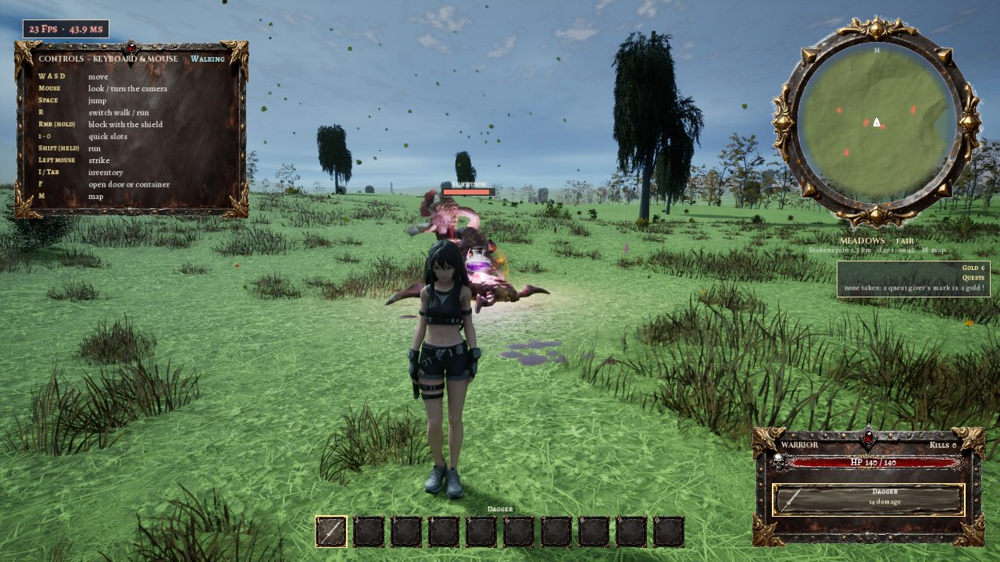

- **The board:** every wild town's quest board posts two contracts on a named beast, 3 to 6 km out.
- **The signs:** three signs lie on the way. Once she has read all three, the beast takes **75 % more from her blows**.
- **The bounty** is paid at the board: 80 gold at tier 1, +35 % a tier.
- **The beasts:**

| Beast | Kind | Hit points | Tier over its land |
|---|---|---|---|
| The Gloamhound | Devourer Hound | x 2.5 | +2 |
| Old Quillmaw | Quillback | x 3.0 | +2 |
| The Bog Troll of the Mere | Cave Troll | x 3.0 | +2 |
| Silkwidow | Giant Spider | x 2.5 | +2 |
| Redclaw | War Raptor | x 2.5 | +3 |
| The Carrion King | Bug | x 3.0 | +2 |

Source: `contracts15.json`, `RDList15l.cpp`.

### Camps, waystones, stories and quests

- **A camp cleared** (all its monsters killed) becomes a waypoint for the game:
  - a fire, a tent where she rests until 07:00 at full health, and a trader;
  - a place she can travel to.
  - Three days later settlers take the nearest ruin within 6 km.
- **Waystones**, one in each 7 km region beside the major road: lit with F, each becomes a place to travel to.
- **Story encounters** on the road:
  - a courier with a letter (12 gold and a healing potion);
  - a traveller chased by three monsters (15 gold);
  - a stranded carter (10 gold, jerky, iron);
  - the rival Varka racing her to a place's loot.
- **Quests:**
  - the captain's two (Wolves on the Mill Road, 120 gold; The Lost Patrol, 200 gold);
  - 25 structure quests, 30 to 120 gold with Seraph Feathers, ingots, potions or bread, and in one case a tamed horse.
- **Treasure maps:** 40 % of ruins hold one, showing a spot near a landmark where a chest of 3 items and gold is buried.

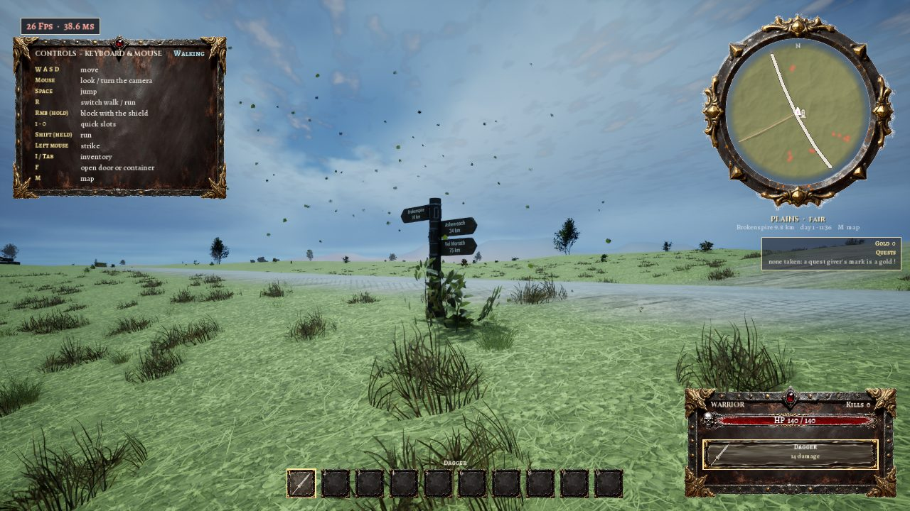

### The climate

- **Cold regions** away from a fire, shelter or town build up a cold. Past 90 s it bites 3 % of her hit points and slows her every 15 s.
- **Hot regions** (canyons, mesas, savannahs, the burned plain, 10:00 to 17:00) do the same out of shade or water.
- **Easing the cold:**
  - armour's warmth: Bear Warrior 0.6, Broddi's 0.4, orc sets 0.3, plate 0.2;
  - Frostleaf Stew (0.6, 5 min);
  - the Frost-quartz Lining (0.5, 30 min);
  - a blue socket stone (0.4).
- **Easing the heat:**
  - Desert Hero's armour 0.5, Tiefling's and Orme's 0.2 (plate -0.25: hotter);
  - the Sandroot Cooler (0.6);
  - the Sun-glass Weave (0.5);
  - a yellow socket stone (0.4).
- The rate never falls under 0.1. Source: `climate15.json`, `RDList15p.cpp`.

### The caves

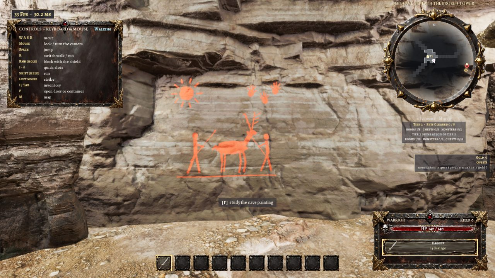

- **Where:** every landmark tower has a cave under it, of its region's tier.
- **What the caves hold:**
  - the cave materials: deepiron ore, glowcap, grave-moss, bat-wing leather, frost quartz, sun-glass, geode shards;
  - the cave weapons: the Miner's Pick, which breaks rubble in one blow; the Shard Blade x 1.45 damage; the Lightless Bow, whose shot from hiding keeps her hidden; six named lost blades x 1.3;
  - the Spelunker's, Chitin and Drowned Knight's armour;
  - charms and the Miner's Lucky Stone (+50 % from veins);
  - fossils, ancient tablets (recipes and the two highest spells), trade goods (gems and coins that sell for 35 to 60 gold, double to Graymourne's collector), dragonglass and blackstone.
- **The last boss** of a cave always drops an Angel Token and the tower's key.
  - The key opens the lift to the tower's top: a chest of 3 items and 150 gold (more by tier), and the land revealed 3 km round.

### Locks and the wild folk

- **Locks:** half the wilds' containers are locked.
  - Only the Rogue picks a lock (2 s, standing within 1.2 m).
  - Only the Warrior breaks one, at once.
  - The others are refused.
  - People who hear (30 m) or see (40 m) it turn on her. They calm down once she is 80 m off or hidden 6 s.
- **The wild folk and farm animals** can be killed and searched: gold, food, hides, raw meat. Children and quest folk never die.

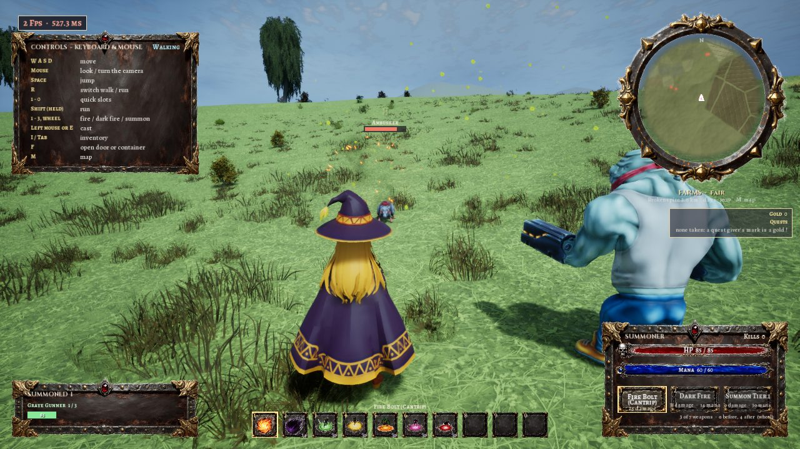

## Where the data and the code disagree

What the code or the maps' data do against what a document, a line in the game or the menu says. The code and data are what the game plays.

1. **The Warrior's starting shield.**
   - The hero menu's card says she starts with "Dagger and the painted viking shield: hers for good". Her figure on the menu holds a shield.
   - The game gives her none. `mistward_castle`'s hero says "Dagger: hers for good ...; no shield until she finds one", and its `StartShield` is empty (the list of 2026-11-08b took it away, `899`, `914`).
   - The menu level (`mistward_castle_select`) keeps hero copies of its own, which were not written again.
   - The same stale copies show the old mana regeneration on the cards ("Mana Back 2.0 a second" for the Mage, 1.2 for the Warlock). The game uses `mana_regen_share` (`balance6.json`): 2.5 % of the pool a second, 2.5 for the Mage and 1.5 for the Warlock at tier 1.
2. **The casters' Fire Bolt.**
   - The spell table's Fire Bolt line, and its scroll, read 7 mana and 23 damage.
   - Every caster's own Fire Bolt is a free cantrip doing 25 (`918 cantrip`).
   - [docs/classes.md](classes.md) (written 2026-11-10) still gives the Mage's Fire as 8 mana, the Warlock's as 10 and the Summoner's as 8.
   - The heroes' Dark Fire is 14 mana and 38 damage; the table's line reads 12 and 34.
3. **Summon Tier 5's line** says "5 at most". The summoning allows 3 (`Count`, set by `880`'s balance).
4. **Abilities made ready on the gamepad.**
   - [docs/secondary.md](secondary.md) and [docs/controls.md](controls.md) say a secondary ability is "made ready on the D-pad and then the attack button".
   - In the code that holds only for the Rogue and the Martial Artist (`TickCasterInput`'s `bRogueControls` branch).
   - For the Warrior, Mage, Warlock and Summoner, RB uses a ready potion, food or scroll (`QuickItemAttack`) but not a ready `@` ability, and the attack strikes instead. Their number keys work.
   - Read in the code only; not tried in play.
5. **The roll's dodge window.**
   - The Rogue's uncanny dodge and the Martial Artist's dodge are meant to make blows miss during the roll.
   - On the castle the window (`RollDodge`) reads (1, 1), the very end of the roll, so in practice the roll moves her but dodges almost nothing.
   - [docs/classes.md](classes.md) noted the same; where it became (1, 1) was not traced.
6. **Summon Tier 6 to 10's choice of kinds.**
   - Each lists Summon Tier 5's five kinds (Giant Spider, Broodmother, Daemon Hunter, Mountain Titan, Stone Golem), not its own default (Iron Golem, Cyber Soldier, Captain of the Tide, Lich, Kratos Field Commander).
   - Stepping the kind on one of them leaves the default for one of those five (at the summoning's own strength). Going back to the default is not offered.
   - Read in the data (`SummonKinds`) and `RDList15b.cpp`; not tried in play.
7. **[docs/controls.md](controls.md) is behind the code:**
   - the Escape menu's Gameplay page (death rule and difficulty) and the Options page's Quest window;
   - the dungeon map's zoom;
   - a click on the wilds' map to travel;
   - G / R3 at teleporters;
   - the break-down line's hold for a whole stack;
   - the horse's mount, gaits, jump and rear;
   - the Summoner's bare hands and her choice of kinds.
   - This guide follows the code.
8. **[docs/classes.md](classes.md) is older than several phases.** It was written 2026-11-10, before:
   - the cantrip;
   - the Warlock's curses;
   - the second ten slashes;
   - the Rogue's arts;
   - the Summoner's bare hands and her five kinds per summoning;
   - the cave gear.
   - Its other numbers agree with the maps' data.
9. **Iron Skin (the Mage's spell).** The table's line says "a large armor bonus", and older documents say "40 % off blows". In the code it adds 40 % to her armour's share. Armour, buffs and the spell together are capped at 95 % (`ApplyDamage`), so with armour it is less than 40 % more.

### What could not be determined

- **Brokenspire's own tables.** Only `mistward_castle`'s tables were read from a map. Brokenspire is a Save As copy with its own heroes and items, which the same stages write. Loading it in the editor was avoided (its play has run the GPU out of memory before).
- **The exact cold biomes and their 90 s threshold** are the level's data (`WildColdBiomes`, `WildColdSeconds`), not in the JSON files.
- **The healer's prices** come from [docs/levels/brokenspire.md](levels/brokenspire.md) and [docs/tiers.md](tiers.md); `RDTownGame.cpp`'s healer was not read line by line.
- **The forge's cost** is the stage `914`'s rule: what breaking it down gives and half again, rounded up. The recipes on the map agree.
- **Shadow Lash's push.** The table gives 600, but the knock-back's length in metres was not measured.
- **Thousand Cuts' 8.** Its value of 8 was read as the most monsters it slashes; the code was not traced for it.
- **No ability, damage or timing in this guide was measured in play for it.**
  - The numbers are the data's and the code's formulas.
  - The tests that did measure them are cited in [docs/secondary.md](secondary.md), [docs/tiers.md](tiers.md) and the level documents.
  - Sounds and the look of effects were not checked.

## Pictures

The pictures are the game's own:
- **The hero menu pictures** were taken for this guide on 2026-11-25 by `868_mistward_test.ps1 menulook` in the editor, one per hero, 1920 x 1080 HighResShot in play.
- **The others** are from the tests' HighResShots of the list of 2026-11-20 and 2026-11-22 (`claude_ue5/Saved/Screenshots`) and from `docs/images`.

They are kept as jpg in `docs/images/guide/`.
