# Heroes and playable characters of the Fab library

Every character in the local Fab library cache (`I:\game assets\3d epicgames media packs\VaultCache\FabLibrary`) that could be a hero or a player character: fighters, soldiers, adventurers and other figures built to be played or to fight. All 100 are in this project; each is shown three times, rendered in Unreal Engine:

- **full body:** standing in its model's reference pose;
- **upper body and head:** a closer look at the face and gear;
- **action:** a fighting pose.

## About the pictures

- **Action poses:** most packs come without attack clips. These characters all share the UE4-mannequin skeleton, so each pose is copied from another pack's clip at the moment of the blow: a sword strike, a two-handed axe blow, a spear thrust, rifle aim or a punch. Characters whose pack has attack clips of its own use one of those.
- **Props:** the weapons in the melee poses come from Medieval_Weapons; the rifle is MC_Environment's assault rifle. None of these props are the characters' own.
- **Animation:** each entry says what its character can play; the libraries they share are listed under [Animations](#animations).
- **Roles:** a role is a suggestion from the character's looks: what it wears, what it carries, how it is built.

The list is `claude_ue5/SourceArt/hero_gallery/heroes.json`; the pictures come from `pipeline/unreal/901_hero_gallery.py` and `pipeline/blender_numpy/hero_doc.py`, the animation notes from `pipeline/unreal/902_character_animations.py`. Many of them could be enemies as well: see [humanoid_enemies.md](humanoid_enemies.md). The sellers and listings of the packs are in [assets.md](assets.md).

## Categories

- [Knights and fantasy warriors](#knights-and-fantasy-warriors) (11): Armoured melee heroes of a medieval or high-fantasy world.
- [Barbarians, vikings and dwarves](#barbarians-vikings-and-dwarves) (11): Northmen, barbarians and dwarves: axes, furs and beards.
- [Tribal and primitive](#tribal-and-primitive) (4): Stone-age and tribal characters.
- [Beast warriors](#beast-warriors) (5): Animal-headed warriors in armour.
- [Martial artists](#martial-artists) (15): Unarmed fighters for a brawler or fighting game.
- [Sailors and adventurers](#sailors-and-adventurers) (7): Sailors and modern survivors.
- [Modern soldiers](#modern-soldiers) (12): Present-day soldiers and specialists.
- [Dystopian and post-apocalyptic](#dystopian-and-post-apocalyptic) (7): Gas masks, scavenged armour and a mech.
- [Sci-fi soldiers and mercenaries](#sci-fi-soldiers-and-mercenaries) (20): Power armour, mercenaries and future soldiers.
- [Space](#space) (8): Astronauts and alien warriors.
- [Animations](#animations)
- [Not included](#not-included)

## Knights and fantasy warriors

Armoured melee heroes of a medieval or high-fantasy world.

### Templar Knight

[Knights (Pack)](https://www.fab.com/listings/6907d3d8-d0db-43c0-bf9c-8ad43c70e7b3) · **Role:** tank / holy warrior · **Pose:** a sword strike · model `SK_Knight_01_Full_01`

Great helm, white tabard with a black cross over mail and leather: a crusader.

**Animations:** UE4-mannequin rig; of its own only the template's idle, walk, run and jump that came with the pack. Plays every UE4-mannequin library below as it is.

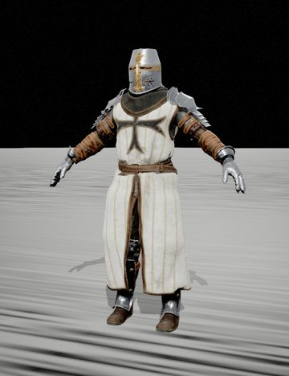 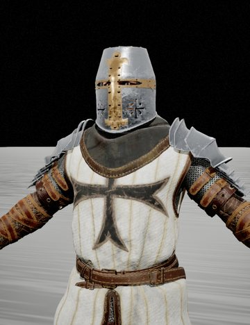 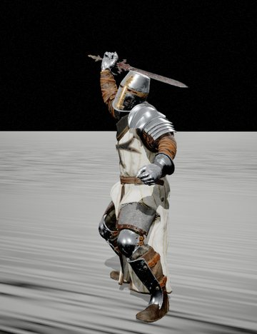

### Eastern Knight

[Knights (Pack)](https://www.fab.com/listings/6907d3d8-d0db-43c0-bf9c-8ad43c70e7b3) · **Role:** duelist · **Pose:** a sword strike · model `SK_Knight_02_Full_01`

Spiked turban helm, painted face, scale armour with a gold medallion and a long scarf.

**Animations:** UE4-mannequin rig; of its own only the template's idle, walk, run and jump that came with the pack. Plays every UE4-mannequin library below as it is.

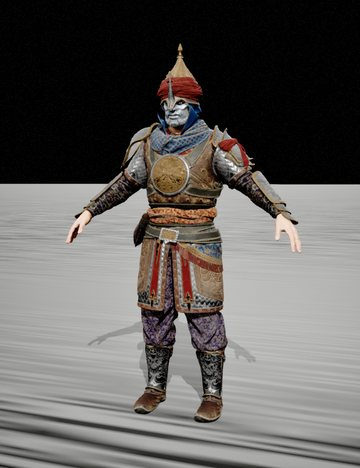 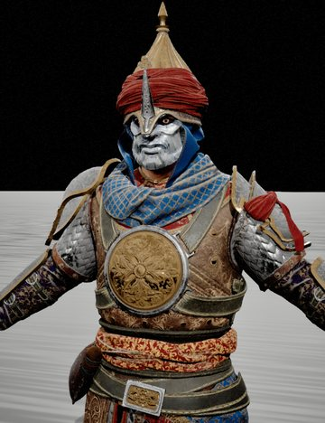 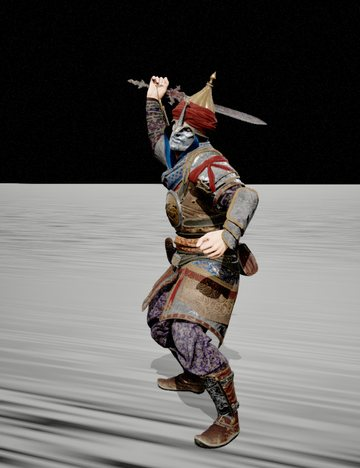

### Plate Knight

[Knights (Pack)](https://www.fab.com/listings/6907d3d8-d0db-43c0-bf9c-8ad43c70e7b3) · **Role:** tank · **Pose:** a sword strike · model `SK_Knight_03_Full_01`

Full polished plate armour and a visored sallet with a cross on the visor.

**Animations:** UE4-mannequin rig; of its own only the template's idle, walk, run and jump that came with the pack. Plays every UE4-mannequin library below as it is.

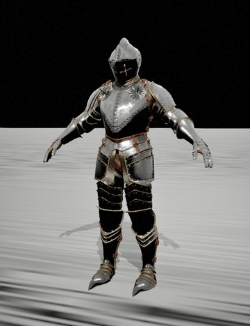 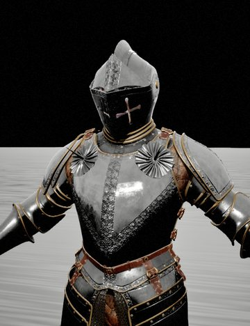 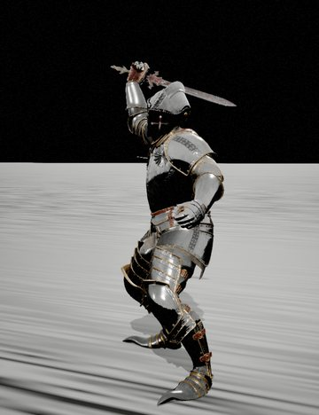

### Lady Knight

[Knights (Pack)](https://www.fab.com/listings/6907d3d8-d0db-43c0-bf9c-8ad43c70e7b3) · **Role:** duelist / leader · **Pose:** a sword strike · model `SK_Knight_04_Full_01`

A woman in a plumed half-mask helmet, gilded breastplate and red and white tassets.

**Animations:** UE4-mannequin rig; of its own only the template's idle, walk, run and jump that came with the pack. Plays every UE4-mannequin library below as it is.

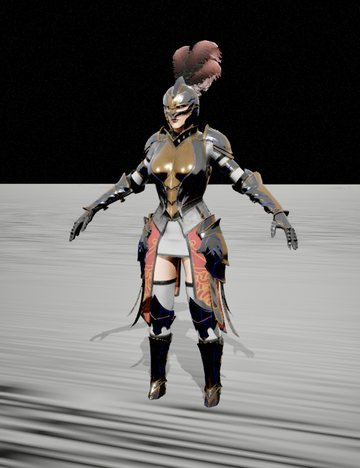 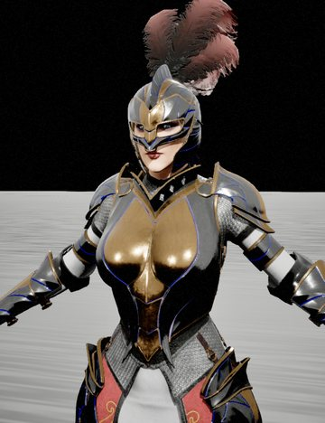 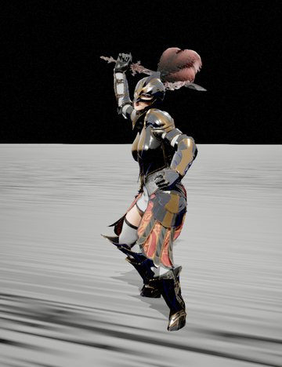

### Paladin

[Knights (Pack)](https://www.fab.com/listings/6907d3d8-d0db-43c0-bf9c-8ad43c70e7b3) · **Role:** tank / champion · **Pose:** a sword strike · model `SK_Knight_05_Full_01`

Ornate gilded plate with spikes and a tall crested helm, a banner hanging from the belt.

**Animations:** UE4-mannequin rig; of its own only the template's idle, walk, run and jump that came with the pack. Plays every UE4-mannequin library below as it is.

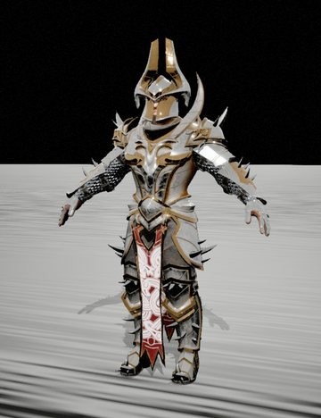 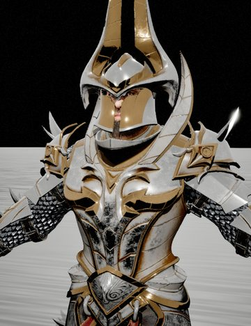 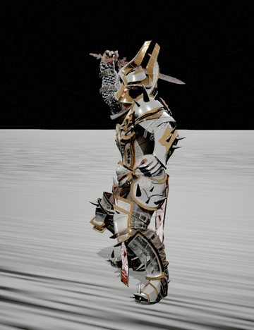

### Dark Knight

[Fantasy Warriors (Pack)](https://www.fab.com/listings/df8194f9-ec63-49f6-a885-6feb7a94fcb1) · **Role:** dark knight · **Pose:** a sword strike · model `SK_Dark_Knight_02_Full`

Ragged hooded robes over plate, spiked pauldrons and a caged faceplate: a plague crusader.

**Animations:** UE4-mannequin rig; of its own only the template's idle, walk, run and jump that came with the pack. Plays every UE4-mannequin library below as it is.

  

### Demonic Warrior

[Fantasy Warriors (Pack)](https://www.fab.com/listings/df8194f9-ec63-49f6-a885-6feb7a94fcb1) · **Role:** berserker · **Pose:** a two-handed axe blow · model `SK_Demonic_Warrior_Full`

Hooded and masked, one arm in scorched plate, a red skirt covered in runes.

**Animations:** UE4-mannequin rig; of its own only the template's idle, walk, run and jump that came with the pack. Plays every UE4-mannequin library below as it is.

  

### Desert Hero

[Fantasy Warriors (Pack)](https://www.fab.com/listings/df8194f9-ec63-49f6-a885-6feb7a94fcb1) · **Role:** skirmisher · **Pose:** a sword strike · model `SK_Fantasy_Hero_02_Full`

Leopard-patterned face wrap, studded leather and bare arms: a nomad warrior.

**Animations:** UE4-mannequin rig; of its own only the template's idle, walk, run and jump that came with the pack. Plays every UE4-mannequin library below as it is.

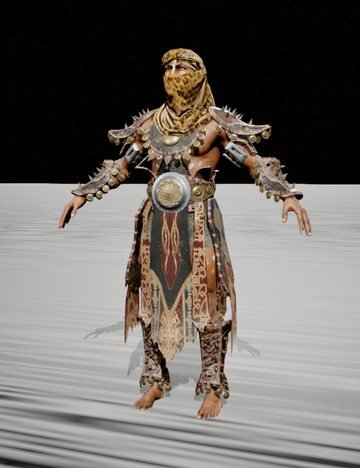 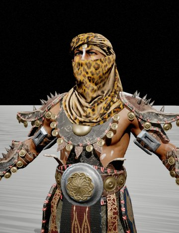 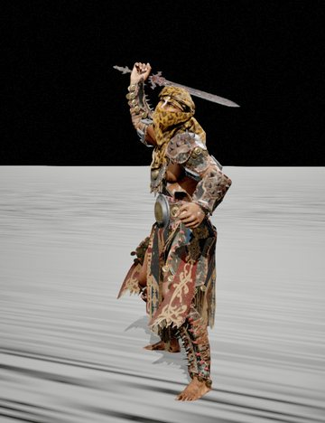

### Tiefling Hero

[Fantasy Warriors (Pack)](https://www.fab.com/listings/df8194f9-ec63-49f6-a885-6feb7a94fcb1) · **Role:** warlock / duelist · **Pose:** a sword strike · model `SK_UE4_Fantasy_Hero_Full`

Purple skin, ram horns and glowing red eyes, in ornate leather with gold trim.

**Animations:** UE4-mannequin rig; of its own only the template's idle, walk, run and jump that came with the pack. Plays every UE4-mannequin library below as it is.

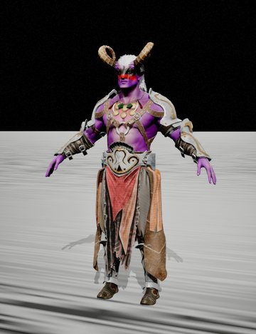 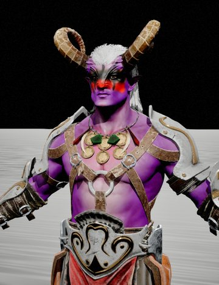 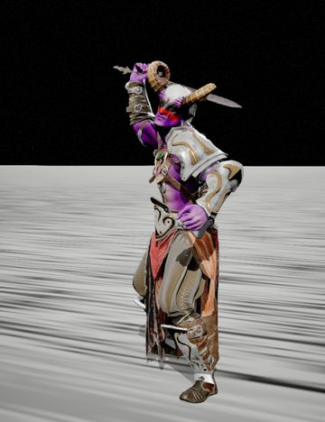

### Witch Hunter

[Fantasy Warriors (Pack)](https://www.fab.com/listings/df8194f9-ec63-49f6-a885-6feb7a94fcb1) · **Role:** ranged / hunter · **Pose:** aiming a rifle · model `SK_Witch_Full`

Wide-brimmed hat, purple long coat and a bandolier of potions.

**Animations:** UE4-mannequin rig; of its own only the template's idle, walk, run and jump that came with the pack. Plays every UE4-mannequin library below as it is.

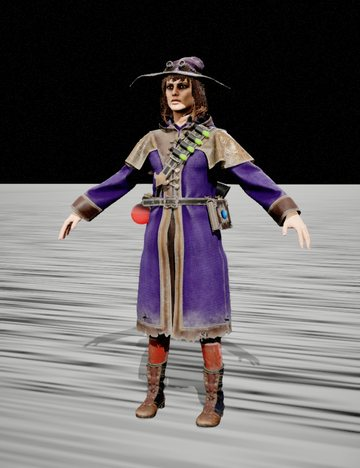 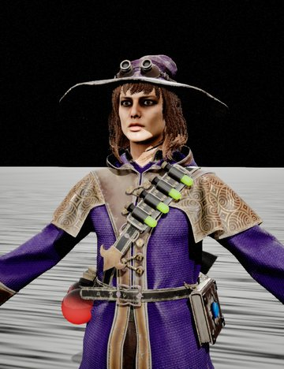 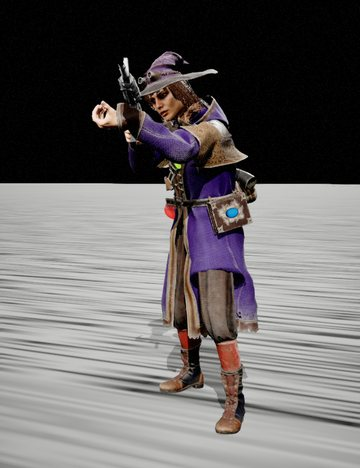

### Samurai

[SAMURAI](https://www.fab.com/listings/5f4c90b7-a282-45fc-89df-61468afc867b) · **Role:** duelist · **Pose:** a sword strike · model `SK_Samurai_Full_01`

Lacquered samurai armour, a crested kabuto and a red war mask.

**Animations:** UE4-mannequin rig; of its own only the template's idle, walk, run and jump that came with the pack. Plays every UE4-mannequin library below as it is.

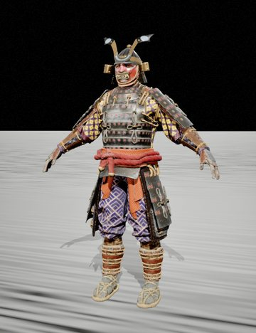 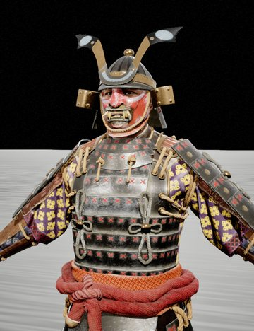 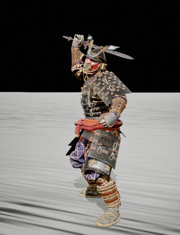

## Barbarians, vikings and dwarves

Northmen, barbarians and dwarves: axes, furs and beards.

### Barbarian

[Fantasy Characters (Pack)](https://www.fab.com/listings/f5816915-86d9-4bef-b8f3-921408ae240b) · **Role:** berserker · **Pose:** a two-handed axe blow · model `SK_Barbarian_Full`

Long hair and beard, bare chest in a fur mantle, horned skulls hanging from the shoulder.

**Animations:** UE4-mannequin rig; its pack's own 99 clips: 8 attacks, 8 deaths, 4 hit reactions, 10 idles, 6 jumps and falls, 60 moves, 3 other (shout without weapon, warrior shout, warrior take weapon). Plays every UE4-mannequin library below as it is.

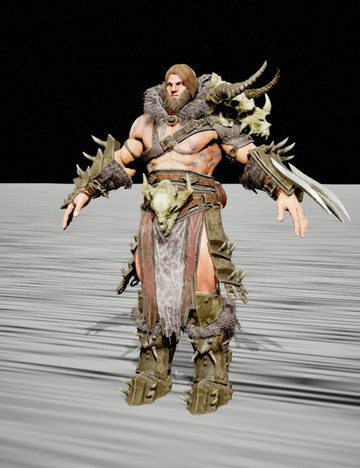 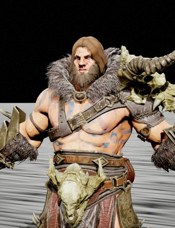 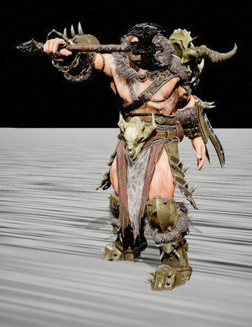

### Savage Barbarian

[Fantasy Characters (Pack)](https://www.fab.com/listings/f5816915-86d9-4bef-b8f3-921408ae240b) · **Role:** berserker · **Pose:** a two-handed axe blow · model `SK_Fantasy_Barbarian_Full`

Hooded in a hide cloak, painted muscles, a ram skull on the belt.

**Animations:** UE4-mannequin rig; its pack's own 99 clips: 8 attacks, 8 deaths, 4 hit reactions, 10 idles, 6 jumps and falls, 60 moves, 3 other (shout without weapon, warrior shout, warrior take weapon). Plays every UE4-mannequin library below as it is.

  

### Veteran

[Fantasy Characters (Pack)](https://www.fab.com/listings/f5816915-86d9-4bef-b8f3-921408ae240b) · **Role:** frontline fighter · **Pose:** a sword strike · model `SK_Knight_Full`

A bald, grey-bearded old soldier in leather and a steel breastplate.

**Animations:** UE4-mannequin rig; its pack's own 99 clips: 8 attacks, 8 deaths, 4 hit reactions, 10 idles, 6 jumps and falls, 60 moves, 3 other (shout without weapon, warrior shout, warrior take weapon). Plays every UE4-mannequin library below as it is.

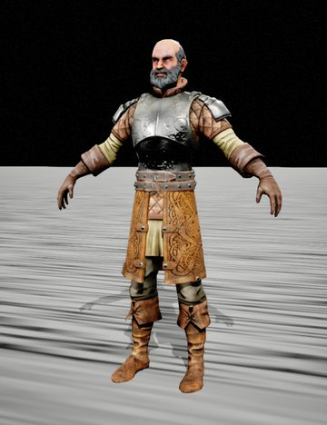 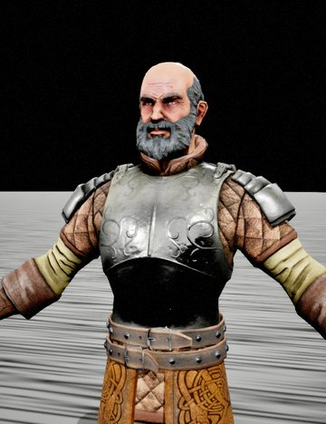 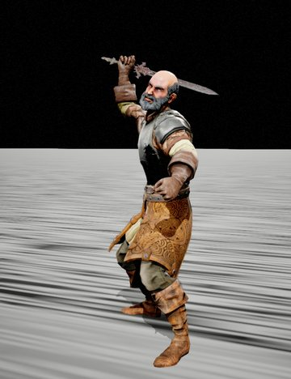

### Ulf

[Fantasy Characters (Pack)](https://www.fab.com/listings/f5816915-86d9-4bef-b8f3-921408ae240b) · **Role:** frontline fighter · **Pose:** a two-handed axe blow · model `SK_Ulf_Full`

Bearded northman in a nasal helm and a fur-collared padded coat.

**Animations:** UE4-mannequin rig; its pack's own 99 clips: 8 attacks, 8 deaths, 4 hit reactions, 10 idles, 6 jumps and falls, 60 moves, 3 other (shout without weapon, warrior shout, warrior take weapon). Plays every UE4-mannequin library below as it is.

  

### Werewolf

[Fantasy Characters (Pack)](https://www.fab.com/listings/f5816915-86d9-4bef-b8f3-921408ae240b) · **Role:** brawler / beast · **Pose:** a punch · model `SK_Werewolf_Full_01`

A werewolf in a loincloth and leather harness, all claws and fur.

**Animations:** UE4-mannequin rig; its pack's own 99 clips: 8 attacks, 8 deaths, 4 hit reactions, 10 idles, 6 jumps and falls, 60 moves, 3 other (shout without weapon, warrior shout, warrior take weapon). Plays every UE4-mannequin library below as it is.

  

### Viking

[Viking (Customized)](https://www.fab.com/listings/e814c3a3-11ba-4316-a07a-b0980fd016ef) · **Role:** frontline fighter · **Pose:** a two-handed axe blow · model `SK_Viking_Full_01`

Masked nasal helmet, a thick fur mantle over quilted armour.

**Animations:** UE4-mannequin rig; of its own only the template's idle, walk, run and jump that came with the pack. Plays every UE4-mannequin library below as it is.

  

### Dwarf Agvid

[Dwarfs Pack](https://www.fab.com/listings/80643e93-5d54-438c-ae9d-7717242e5a16) · **Role:** engineer · **Pose:** a two-handed axe blow · model `SK_Dwarf_Agvid_Full`

A stout dwarf in a goggled leather cap and a heavy smith's apron.

**Animations:** UE4-mannequin rig; its pack's own 94 clips: 8 attacks, 8 deaths, 5 hit reactions, 10 idles, 2 jumps and falls, 58 moves, 3 other (shout without weapon, warrior shout, warrior take weapon). Plays every UE4-mannequin library below as it is.

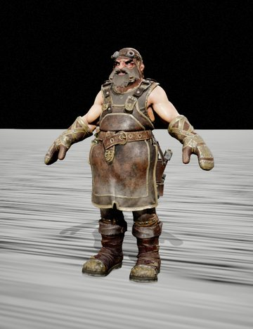 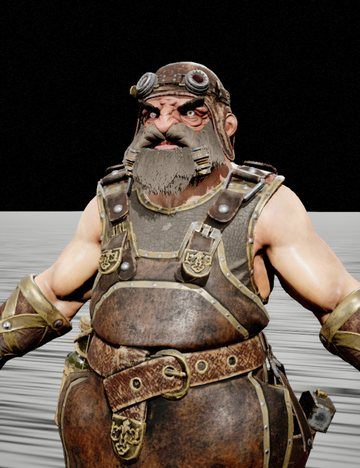 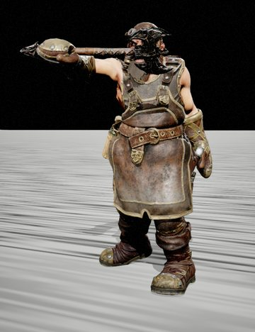

### Dwarf Bedvar

[Dwarfs Pack](https://www.fab.com/listings/80643e93-5d54-438c-ae9d-7717242e5a16) · **Role:** champion · **Pose:** a two-handed axe blow · model `SK_Dwarf_Bedvar_Full`

A mohawked dwarf in gilded, jewelled armour.

**Animations:** UE4-mannequin rig; its pack's own 94 clips: 8 attacks, 8 deaths, 5 hit reactions, 10 idles, 2 jumps and falls, 58 moves, 3 other (shout without weapon, warrior shout, warrior take weapon). Plays every UE4-mannequin library below as it is.

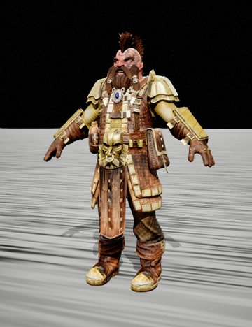 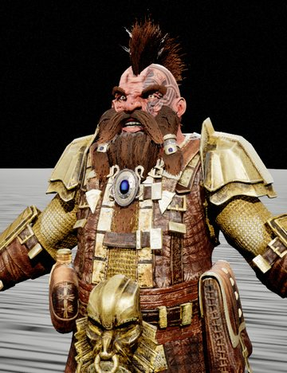 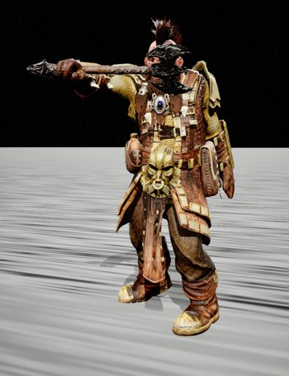

### Dwarf Broddi

[Dwarfs Pack](https://www.fab.com/listings/80643e93-5d54-438c-ae9d-7717242e5a16) · **Role:** tank · **Pose:** a two-handed axe blow · model `SK_Dwarf_BroddI_Full`

A dwarf sealed in heavy plate, his face hidden behind a squared helm.

**Animations:** UE4-mannequin rig; its pack's own 94 clips: 8 attacks, 8 deaths, 5 hit reactions, 10 idles, 2 jumps and falls, 58 moves, 3 other (shout without weapon, warrior shout, warrior take weapon). Plays every UE4-mannequin library below as it is.

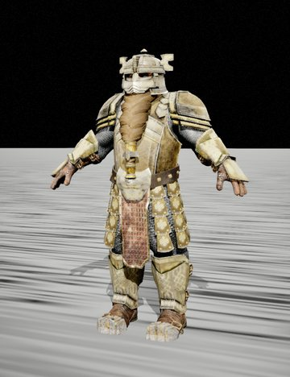 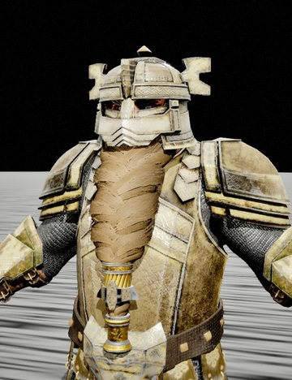 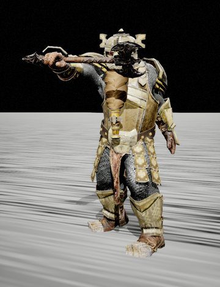

### Dwarf King

[Dwarfs Pack](https://www.fab.com/listings/80643e93-5d54-438c-ae9d-7717242e5a16) · **Role:** leader / tank · **Pose:** a two-handed axe blow · model `SK_Dwarf_King_Full`

A crowned, long-bearded dwarf in ornate plate over a blue and red skirt.

**Animations:** UE4-mannequin rig; its pack's own 94 clips: 8 attacks, 8 deaths, 5 hit reactions, 10 idles, 2 jumps and falls, 58 moves, 3 other (shout without weapon, warrior shout, warrior take weapon). Plays every UE4-mannequin library below as it is.

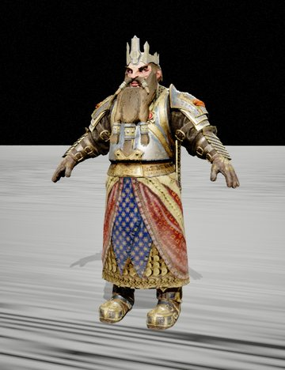 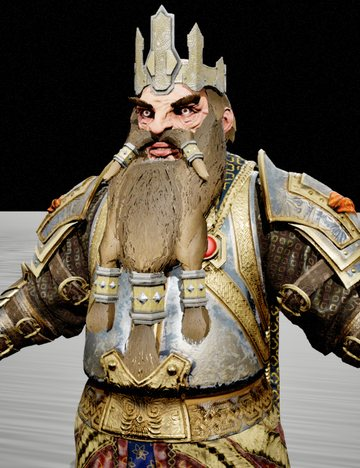 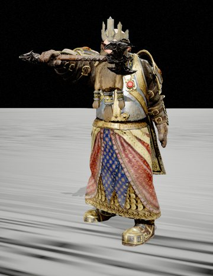

### Dwarf Orme

[Dwarfs Pack](https://www.fab.com/listings/80643e93-5d54-438c-ae9d-7717242e5a16) · **Role:** ranger · **Pose:** a two-handed axe blow · model `SK_Dwarf_Orme_Full`

A hooded dwarf with a beard to his belt, a quilted red vest and a quiver.

**Animations:** UE4-mannequin rig; its pack's own 94 clips: 8 attacks, 8 deaths, 5 hit reactions, 10 idles, 2 jumps and falls, 58 moves, 3 other (shout without weapon, warrior shout, warrior take weapon). Plays every UE4-mannequin library below as it is.

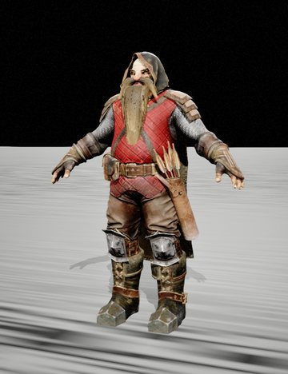 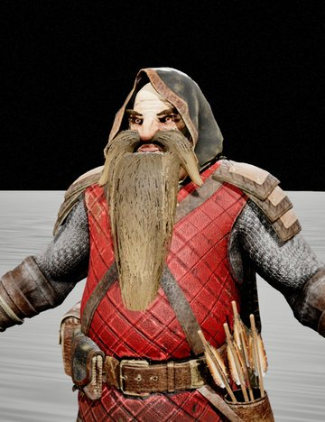 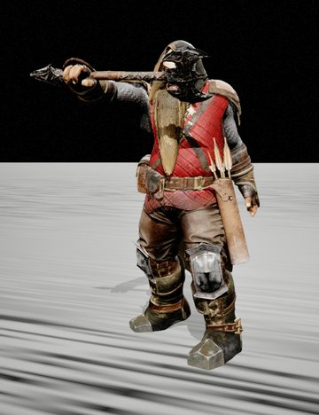

## Tribal and primitive

Stone-age and tribal characters.

### Cavewoman

[Primitive Characters (Pack)](https://www.fab.com/listings/3ce14ea2-e944-46b1-afec-e10c50e7fa96) · **Role:** hunter · **Pose:** a spear thrust · model `SK_Primitive_02_Full`

Red-haired, painted face, leopard hide and fur boots.

**Animations:** UE4-mannequin rig; of its own only the template's idle, walk, run and jump that came with the pack. Plays every UE4-mannequin library below as it is.

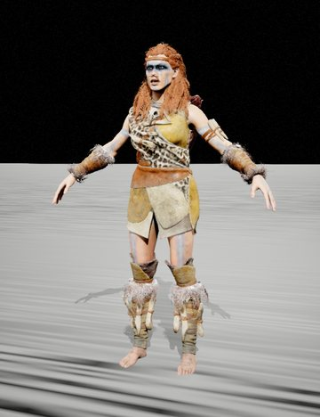 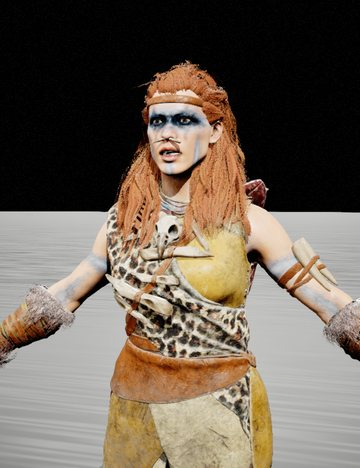 

### Tribal Elder

[Primitive Characters (Pack)](https://www.fab.com/listings/3ce14ea2-e944-46b1-afec-e10c50e7fa96) · **Role:** support / sage · **Pose:** a spear thrust · model `SK_Primitive_03_Full_01`

A grey-bearded old tribesman in a rough, stained tunic.

**Animations:** UE4-mannequin rig; of its own only the template's idle, walk, run and jump that came with the pack. Plays every UE4-mannequin library below as it is.

  

### Shaman

[Primitive Characters (Pack)](https://www.fab.com/listings/3ce14ea2-e944-46b1-afec-e10c50e7fa96) · **Role:** mystic · **Pose:** a spear thrust · model `SK_Primitive_04_Full_01`

An antlered deer-skull headdress hung with charms over a hide robe.

**Animations:** UE4-mannequin rig; of its own only the template's idle, walk, run and jump that came with the pack. Plays every UE4-mannequin library below as it is.

  

### Skull Tribesman

[Primitive Characters (Pack)](https://www.fab.com/listings/3ce14ea2-e944-46b1-afec-e10c50e7fa96) · **Role:** hunter · **Pose:** a spear thrust · model `SK_Primitive_05_Full_01`

A skull painted on the face, a hooded hide tunic.

**Animations:** UE4-mannequin rig; of its own only the template's idle, walk, run and jump that came with the pack. Plays every UE4-mannequin library below as it is.

  

## Beast warriors

Animal-headed warriors in armour.

### Bear Warrior

[Animals Warrior Pack](https://www.fab.com/listings/be0d1014-cd06-4fc8-a442-b107ee75b81f) · **Role:** tank / bruiser · **Pose:** a two-handed axe blow · model `SK_Bear_Full`

A bear-man in shaggy fur, iron armour on arms and skirt.

**Animations:** UE4-mannequin rig; its pack's own 92 clips: 8 attacks, 8 deaths, 4 hit reactions, 9 idles, 2 jumps and falls, 58 moves, 3 other (shout without weapon, warrior shout, warrior take weapon). Plays every UE4-mannequin library below as it is.

  

### Minotaur

[Animals Warrior Pack](https://www.fab.com/listings/be0d1014-cd06-4fc8-a442-b107ee75b81f) · **Role:** tank · **Pose:** a two-handed axe blow · model `SK_Bull_Full`

A horned bull-man in golden plate armour.

**Animations:** UE4-mannequin rig; its pack's own 92 clips: 8 attacks, 8 deaths, 4 hit reactions, 9 idles, 2 jumps and falls, 58 moves, 3 other (shout without weapon, warrior shout, warrior take weapon). Plays every UE4-mannequin library below as it is.

  

### Crocodile Warrior

[Animals Warrior Pack](https://www.fab.com/listings/be0d1014-cd06-4fc8-a442-b107ee75b81f) · **Role:** bruiser · **Pose:** a two-handed axe blow · model `SK_Crocodile_Full`

A crocodile-headed warrior in leather, skulls on his belt.

**Animations:** UE4-mannequin rig; its pack's own 92 clips: 8 attacks, 8 deaths, 4 hit reactions, 9 idles, 2 jumps and falls, 58 moves, 3 other (shout without weapon, warrior shout, warrior take weapon). Plays every UE4-mannequin library below as it is.

  

### Elephant Warrior

[Animals Warrior Pack](https://www.fab.com/listings/be0d1014-cd06-4fc8-a442-b107ee75b81f) · **Role:** tank · **Pose:** a two-handed axe blow · model `SK_Elephant_Full`

An elephant-headed giant in heavy steel plate.

**Animations:** UE4-mannequin rig; its pack's own 92 clips: 8 attacks, 8 deaths, 4 hit reactions, 9 idles, 2 jumps and falls, 58 moves, 3 other (shout without weapon, warrior shout, warrior take weapon). Plays every UE4-mannequin library below as it is.

  

### Hooded Ranger

[Animals Warrior Pack](https://www.fab.com/listings/be0d1014-cd06-4fc8-a442-b107ee75b81f) · **Role:** scout · **Pose:** a two-handed axe blow · model `SK_Warrior_02_Full_01`

A bearded man in a hood and layered leather with straps and pouches.

**Animations:** UE4-mannequin rig; its pack's own 92 clips: 8 attacks, 8 deaths, 4 hit reactions, 9 idles, 2 jumps and falls, 58 moves, 3 other (shout without weapon, warrior shout, warrior take weapon). Plays every UE4-mannequin library below as it is.

  

## Martial artists

Unarmed fighters for a brawler or fighting game.

### MMA Fighter

[Fighters Pack](https://www.fab.com/listings/53f4eb85-54c9-4760-835b-13c80a6420a2) · **Role:** brawler · **Pose:** a punch · model `SK_Fighter_01`

Bare-chested cage fighter in trunks and fingerless gloves.

**Animations:** UE4-mannequin rig; its pack's own 4 clips: 1 death, 1 jump or fall, 2 moves. Plays every UE4-mannequin library below as it is.

  

### Wandering Monk

[Fighters Pack](https://www.fab.com/listings/53f4eb85-54c9-4760-835b-13c80a6420a2) · **Role:** martial artist · **Pose:** a punch · model `SK_Fighter_02_Full`

Conical straw hat, masked face, orange trousers and a gourd on the back.

**Animations:** UE4-mannequin rig; its pack's own 4 clips: 1 death, 1 jump or fall, 2 moves. Plays every UE4-mannequin library below as it is.

  

### Soldier Brawler

[Fighters Pack](https://www.fab.com/listings/53f4eb85-54c9-4760-835b-13c80a6420a2) · **Role:** brawler · **Pose:** a punch · model `SK_Fighter_03`

A mohawked, muscular ex-soldier in camo trousers with dog tags.

**Animations:** UE4-mannequin rig; its pack's own 4 clips: 1 death, 1 jump or fall, 2 moves. Plays every UE4-mannequin library below as it is.

  

### Bear Jujitsu

[Fighters Pack](https://www.fab.com/listings/53f4eb85-54c9-4760-835b-13c80a6420a2) · **Role:** grappler · **Pose:** a punch · model `SK_Fighter_04`

A bear-headed fighter in a blue jiu-jitsu gi with a black belt.

**Animations:** UE4-mannequin rig; its pack's own 4 clips: 1 death, 1 jump or fall, 2 moves. Plays every UE4-mannequin library below as it is.

  

### Karate Master

[Fighters Pack](https://www.fab.com/listings/53f4eb85-54c9-4760-835b-13c80a6420a2) · **Role:** martial artist · **Pose:** a punch · model `SK_Fighter_05`

An old, white-bearded master in a white gi.

**Animations:** UE4-mannequin rig; its pack's own 4 clips: 1 death, 1 jump or fall, 2 moves. Plays every UE4-mannequin library below as it is.

  

### Rhino Fighter

[Fighters Pack](https://www.fab.com/listings/53f4eb85-54c9-4760-835b-13c80a6420a2) · **Role:** bruiser · **Pose:** a punch · model `SK_Fighter_06`

A rhino-headed fighter, bare-chested, in pink gi trousers.

**Animations:** UE4-mannequin rig; its pack's own 4 clips: 1 death, 1 jump or fall, 2 moves. Plays every UE4-mannequin library below as it is.

  

### Cossack Fighter

[Fighters Pack](https://www.fab.com/listings/53f4eb85-54c9-4760-835b-13c80a6420a2) · **Role:** brawler · **Pose:** a punch · model `SK_Fighter_07`

A moustached fighter with a topknot, baggy trousers and wrist wraps.

**Animations:** UE4-mannequin rig; its pack's own 4 clips: 1 death, 1 jump or fall, 2 moves. Plays every UE4-mannequin library below as it is.

  

### Kickboxer

[Fighters Pack](https://www.fab.com/listings/53f4eb85-54c9-4760-835b-13c80a6420a2) · **Role:** striker · **Pose:** a punch · model `SK_Fighter_08`

A woman in red boxing gloves, a sports top and flame-patterned shorts.

**Animations:** UE4-mannequin rig; its pack's own 4 clips: 1 death, 1 jump or fall, 2 moves. Plays every UE4-mannequin library below as it is.

  

### Ninja

[Fighters Pack](https://www.fab.com/listings/53f4eb85-54c9-4760-835b-13c80a6420a2) · **Role:** assassin · **Pose:** a punch · model `SK_Fighter_09`

Masked and hooded in grey, with arm guards.

**Animations:** UE4-mannequin rig; its pack's own 4 clips: 1 death, 1 jump or fall, 2 moves. Plays every UE4-mannequin library below as it is.

  

### Demon Brawler

[Fighters Pack](https://www.fab.com/listings/53f4eb85-54c9-4760-835b-13c80a6420a2) · **Role:** boss-like brawler · **Pose:** a punch · model `SK_Fighter_10_Full`

A horned demon with huge metal gauntlets and a golden belt.

**Animations:** UE4-mannequin rig; its pack's own 4 clips: 1 death, 1 jump or fall, 2 moves. Plays every UE4-mannequin library below as it is.

  

### Luchador

[Fighters Pack](https://www.fab.com/listings/53f4eb85-54c9-4760-835b-13c80a6420a2) · **Role:** grappler · **Pose:** a punch · model `SK_Fighter_11`

A masked wrestler in pink, with knee pads and boots.

**Animations:** UE4-mannequin rig; its pack's own 4 clips: 1 death, 1 jump or fall, 2 moves. Plays every UE4-mannequin library below as it is.

  

### Mutant Brawler

[Fighters Pack](https://www.fab.com/listings/53f4eb85-54c9-4760-835b-13c80a6420a2) · **Role:** bruiser · **Pose:** a punch · model `SK_Fighter_12`

A gas-masked, scarred, muscular mutant in silver trousers.

**Animations:** UE4-mannequin rig; its pack's own 4 clips: 1 death, 1 jump or fall, 2 moves. Plays every UE4-mannequin library below as it is.

  

### Rocket Brawler

[Fighters Pack](https://www.fab.com/listings/53f4eb85-54c9-4760-835b-13c80a6420a2) · **Role:** heavy hitter · **Pose:** a punch · model `SK_Fighter_13_Full`

A helmeted fighter with twin rockets strapped to the back.

**Animations:** UE4-mannequin rig; its pack's own 4 clips: 1 death, 1 jump or fall, 2 moves. Plays every UE4-mannequin library below as it is.

  

### Sumo

[Fighters Pack](https://www.fab.com/listings/53f4eb85-54c9-4760-835b-13c80a6420a2) · **Role:** grappler / tank · **Pose:** a punch · model `SK_Fighter_14`

A sumo wrestler in a mawashi.

**Animations:** UE4-mannequin rig; its pack's own 4 clips: 1 death, 1 jump or fall, 2 moves. Plays every UE4-mannequin library below as it is.

  

### Street Fighter

[Fighters Pack](https://www.fab.com/listings/53f4eb85-54c9-4760-835b-13c80a6420a2) · **Role:** striker · **Pose:** a punch · model `SK_Fighter_15`

A woman in a white and red cropped track jacket and leggings.

**Animations:** UE4-mannequin rig; its pack's own 4 clips: 1 death, 1 jump or fall, 2 moves. Plays every UE4-mannequin library below as it is.

  

## Sailors and adventurers

Sailors and modern survivors.

### Sailor

[Underwater odyssey](https://www.fab.com/listings/0ed3a669-a335-46d4-b8c4-16b48278e2b4) · **Role:** brawler · **Pose:** an attack from its own pack · model `SK_Sailor_01`

A sailor in a heavy knit sweater and a beanie.

**Animations:** a rig of its own (67 bones, not the mannequin's): its pack's 13 clips only, 5 attacks, 1 death, 1 hit reaction, 2 idles, 1 jump or fall, 2 moves, all of them on one timeline. Other animations need an IK rig and the retargeter.

  

### Navy Brawler

[Underwater odyssey](https://www.fab.com/listings/0ed3a669-a335-46d4-b8c4-16b48278e2b4) · **Role:** brawler · **Pose:** an attack from its own pack · model `SK_Sailor_02`

A sailor in a dark pea coat, cargo trousers and boots.

**Animations:** a rig of its own (67 bones, not the mannequin's): its pack's 12 clips only, 5 attacks, 1 death, 1 hit reaction, 2 idles, 1 jump or fall, 2 moves. Other animations need an IK rig and the retargeter.

  

### Survivor

[Adventure Characters (Pack)](https://www.fab.com/listings/db81464d-fcb5-43a8-b309-5555c392be3a) · **Role:** scout · **Pose:** aiming a rifle · model `SK_UE4_Adventure_01_Full_01`

A woman in a cap and sunglasses, denim crop top and cargo trousers.

**Animations:** UE4-mannequin rig; of its own only the template's idle, walk, run and jump that came with the pack. Plays every UE4-mannequin library below as it is.

  

### Gas-Mask Ranger

[Adventure Characters (Pack)](https://www.fab.com/listings/db81464d-fcb5-43a8-b309-5555c392be3a) · **Role:** ranged · **Pose:** aiming a rifle · model `SK_UE4_Adventure_02_Full_01`

A gas-masked survivor in a camo field coat and bandolier.

**Animations:** UE4-mannequin rig; of its own only the template's idle, walk, run and jump that came with the pack. Plays every UE4-mannequin library below as it is.

  

### Rope Girl

[Adventure Characters (Pack)](https://www.fab.com/listings/db81464d-fcb5-43a8-b309-5555c392be3a) · **Role:** scout · **Pose:** aiming a rifle · model `SK_UE4_Adventure_03_Full_01`

A masked girl in a purple hoodie with a coil of rope and a backpack.

**Animations:** UE4-mannequin rig; of its own only the template's idle, walk, run and jump that came with the pack. Plays every UE4-mannequin library below as it is.

  

### Stalker

[Adventure Characters (Pack)](https://www.fab.com/listings/db81464d-fcb5-43a8-b309-5555c392be3a) · **Role:** ranged / scavenger · **Pose:** aiming a rifle · model `SK_UE4_Adventure_04_Full_01`

A gas mask, a leather coat and a guitar slung on the back.

**Animations:** UE4-mannequin rig; of its own only the template's idle, walk, run and jump that came with the pack. Plays every UE4-mannequin library below as it is.

  

### Escaped Convict

[Adventure Characters (Pack)](https://www.fab.com/listings/db81464d-fcb5-43a8-b309-5555c392be3a) · **Role:** frontline fighter · **Pose:** aiming a rifle · model `SK_UE4_Adventure_05_Full_01`

An orange prison jumpsuit under a plate carrier, a gas mask.

**Animations:** UE4-mannequin rig; of its own only the template's idle, walk, run and jump that came with the pack. Plays every UE4-mannequin library below as it is.

  

## Modern soldiers

Present-day soldiers and specialists.

### Combat Diver

[Military Pack](https://www.fab.com/listings/295db2f7-fb2e-4f28-9a6c-dcd8ab724747) · **Role:** specialist · **Pose:** aiming a rifle · model `SK_Diver_Full`

A wetsuit, fins, rebreather and a tactical vest.

**Animations:** UE4-mannequin rig; its pack's own 4 clips: 1 jump or fall, 3 moves. Plays every UE4-mannequin library below as it is.

  

### Elite Soldier

[Military Pack](https://www.fab.com/listings/295db2f7-fb2e-4f28-9a6c-dcd8ab724747) · **Role:** heavy / tank · **Pose:** aiming a rifle · model `SK_Elite_Soldier_Full_01`

Heavy exo-armour and a helmet with red lenses.

**Animations:** UE4-mannequin rig; its pack's own 4 clips: 1 jump or fall, 3 moves. Plays every UE4-mannequin library below as it is.

  

### Marine

[Military Pack](https://www.fab.com/listings/295db2f7-fb2e-4f28-9a6c-dcd8ab724747) · **Role:** rifleman · **Pose:** aiming a rifle · model `SK_Marine_Full`

A red beret, scarf and a green plate carrier.

**Animations:** UE4-mannequin rig; its pack's own 4 clips: 1 jump or fall, 3 moves. Plays every UE4-mannequin library below as it is.

  

### Sapper

[Military Pack](https://www.fab.com/listings/295db2f7-fb2e-4f28-9a6c-dcd8ab724747) · **Role:** demolitions / tank · **Pose:** aiming a rifle · model `SK_Sapper_Full`

A bulky bomb-disposal suit and helmet.

**Animations:** UE4-mannequin rig; its pack's own 4 clips: 1 jump or fall, 3 moves. Plays every UE4-mannequin library below as it is.

  

### Cyber Soldier

[Military Pack](https://www.fab.com/listings/295db2f7-fb2e-4f28-9a6c-dcd8ab724747) · **Role:** rifleman · **Pose:** aiming a rifle · model `SK_Sci-Fi_Soldier_Full`

Camo fatigues and a robotic skull helmet.

**Animations:** UE4-mannequin rig; its pack's own 4 clips: 1 jump or fall, 3 moves. Plays every UE4-mannequin library below as it is.

  

### Jungle Commando

[Military Pack](https://www.fab.com/listings/295db2f7-fb2e-4f28-9a6c-dcd8ab724747) · **Role:** rifleman · **Pose:** aiming a rifle · model `SK_Soldier_Marine_2_Full_1`

Woodland camo, a black beret, face paint and a big pack.

**Animations:** UE4-mannequin rig; its pack's own 4 clips: 1 jump or fall, 3 moves. Plays every UE4-mannequin library below as it is.

  

### Exo Trooper

[Female Soldiers (Pack)](https://www.fab.com/listings/ecdc02f6-a5e4-4ee2-8b16-1cd2112b543e) · **Role:** rifleman · **Pose:** aiming a rifle · model `SK_Woman_01_Full_01`

A woman in black and yellow futuristic armour with a visored helmet.

**Animations:** UE4-mannequin rig; of its own only the template's idle, walk, run and jump that came with the pack. Plays every UE4-mannequin library below as it is.

  

### Masked Mercenary

[Female Soldiers (Pack)](https://www.fab.com/listings/ecdc02f6-a5e4-4ee2-8b16-1cd2112b543e) · **Role:** rifleman · **Pose:** aiming a rifle · model `SK_Woman_02_Full_01`

An alien-looking mask over a plate carrier and desert camo.

**Animations:** UE4-mannequin rig; of its own only the template's idle, walk, run and jump that came with the pack. Plays every UE4-mannequin library below as it is.

  

### Hazmat Operator

[Female Soldiers (Pack)](https://www.fab.com/listings/ecdc02f6-a5e4-4ee2-8b16-1cd2112b543e) · **Role:** specialist · **Pose:** aiming a rifle · model `SK_Woman_03_Full_01`

A gas mask, an orange and black tactical rig and bright blue trousers.

**Animations:** UE4-mannequin rig; of its own only the template's idle, walk, run and jump that came with the pack. Plays every UE4-mannequin library below as it is.

  

### Desert Scout

[Female Soldiers (Pack)](https://www.fab.com/listings/ecdc02f6-a5e4-4ee2-8b16-1cd2112b543e) · **Role:** scout · **Pose:** aiming a rifle · model `SK_Woman_04_Full_01`

A red shemagh, a dark visor, desert fatigues and a chest rig.

**Animations:** UE4-mannequin rig; of its own only the template's idle, walk, run and jump that came with the pack. Plays every UE4-mannequin library below as it is.

  

### Riot Officer

[Female Soldiers (Pack)](https://www.fab.com/listings/ecdc02f6-a5e4-4ee2-8b16-1cd2112b543e) · **Role:** tank / enforcer · **Pose:** aiming a rifle · model `SK_Woman_05_Full_01`

Full police riot armour and a helmet.

**Animations:** UE4-mannequin rig; of its own only the template's idle, walk, run and jump that came with the pack. Plays every UE4-mannequin library below as it is.

  

### Sniper

[Sniper Soldier](https://www.fab.com/listings/70c21220-f9a1-4c3c-8bc2-699508be793f) · **Role:** sniper · **Pose:** aiming a rifle · model `SK_Sniper_Full_01`

A shaggy ghillie suit over camo gear.

**Animations:** UE4-mannequin rig; of its own only the template's idle, walk, run and jump that came with the pack. Plays every UE4-mannequin library below as it is.

  

## Dystopian and post-apocalyptic

Gas masks, scavenged armour and a mech.

### Dystopian Trooper

[Dystopia Soldiers (Pack)](https://www.fab.com/listings/3be8756a-724d-4fca-a67f-8442a1fcb833) · **Role:** heavy · **Pose:** aiming a rifle · model `SK_Dystopia_Soldier_02_Full`

Black armour, a respirator hose and a radio pack.

**Animations:** UE4-mannequin rig; its pack's own 90 clips: 11 attacks, 3 deaths, 5 hit reactions, 5 idles, 9 jumps and falls, 53 moves, 4 other (door close, door open, mech reload, pilot disembarkation). Plays every UE4-mannequin library below as it is.

  

### Mech

[Dystopia Soldiers (Pack)](https://www.fab.com/listings/3be8756a-724d-4fca-a67f-8442a1fcb833) · **Role:** walker / heavy · **Pose:** an attack from its own pack · model `SK_Mech_Full`

A two-legged combat mech with blades for arms (it attacks with its own pack's clip).

**Animations:** UE4-mannequin rig; its pack's own 90 clips: 11 attacks, 3 deaths, 5 hit reactions, 5 idles, 9 jumps and falls, 53 moves, 4 other (door close, door open, mech reload, pilot disembarkation). Plays every UE4-mannequin library below as it is.

  

### Mutant Soldier

[Dystopia Soldiers (Pack)](https://www.fab.com/listings/3be8756a-724d-4fca-a67f-8442a1fcb833) · **Role:** dark hero / berserker · **Pose:** aiming a rifle · model `SK_UE4_Dystopia_Mutant_soldier_Full_01`

A coat burst open by red tentacled flesh.

**Animations:** UE4-mannequin rig; its pack's own 90 clips: 11 attacks, 3 deaths, 5 hit reactions, 5 idles, 9 jumps and falls, 53 moves, 4 other (door close, door open, mech reload, pilot disembarkation). Plays every UE4-mannequin library below as it is.

  

### Dystopian General

[Dystopia Soldiers (Pack)](https://www.fab.com/listings/3be8756a-724d-4fca-a67f-8442a1fcb833) · **Role:** leader / commander · **Pose:** aiming a rifle · model `SK_UE4_Dystopian_general_Full_01`

A peaked cap, gas mask and a long leather coat.

**Animations:** UE4-mannequin rig; its pack's own 90 clips: 11 attacks, 3 deaths, 5 hit reactions, 5 idles, 9 jumps and falls, 53 moves, 4 other (door close, door open, mech reload, pilot disembarkation). Plays every UE4-mannequin library below as it is.

  

### Dystopian Medic

[Dystopia Soldiers (Pack)](https://www.fab.com/listings/3be8756a-724d-4fca-a67f-8442a1fcb833) · **Role:** support / medic · **Pose:** aiming a rifle · model `SK_UE4_Medic_Dystopia_Full_01`

Hooded, gas-masked, in a coat hung with satchels.

**Animations:** UE4-mannequin rig; its pack's own 90 clips: 11 attacks, 3 deaths, 5 hit reactions, 5 idles, 9 jumps and falls, 53 moves, 4 other (door close, door open, mech reload, pilot disembarkation). Plays every UE4-mannequin library below as it is.

  

### Apocalypse Girl

[Post-Apocalyptic Characters (Pack)](https://www.fab.com/listings/3e123c6d-c51c-4fb6-b787-1e386d637143) · **Role:** scout · **Pose:** aiming a rifle · model `SK_Apocalypse_Girl_Full`

A blonde survivor in a tank top, jeans and a backpack.

**Animations:** UE4-mannequin rig; of its own only the template's idle, walk, run and jump that came with the pack. Plays every UE4-mannequin library below as it is.

  

### Bunker Survivor

[NPC Dystopia Characters](https://www.fab.com/listings/e15b75f6-0b60-4ac8-950a-ffb965a373cd) · **Role:** specialist / support · **Pose:** aiming a rifle · model `SK_UE4_NPC_Distopia_Full_01`

A woman in a grey jumpsuit with a patch on the chest.

**Animations:** UE4-mannequin rig; of its own only the template's idle, walk, run and jump that came with the pack. Plays every UE4-mannequin library below as it is.

  

## Sci-fi soldiers and mercenaries

Power armour, mercenaries and future soldiers.

### Shadow Operative

[Sci-Fi Characters (Pack)](https://www.fab.com/listings/2079cbeb-ec9f-425e-b5c9-feb92d96321c) · **Role:** assassin · **Pose:** aiming a rifle · model `SK_Sci_Fi_Character_01_Full`

Sleek black armour and a faceless helmet.

**Animations:** UE4-mannequin rig; its pack's own 4 clips: 1 attack, 1 death, 2 moves. Plays every UE4-mannequin library below as it is.

  

### Power Armour

[Sci-Fi Characters (Pack)](https://www.fab.com/listings/2079cbeb-ec9f-425e-b5c9-feb92d96321c) · **Role:** heavy / tank · **Pose:** aiming a rifle · model `SK_Sci_Fi_Character_02_Full`

Heavy black and green power armour with bladed shoulders.

**Animations:** UE4-mannequin rig; its pack's own 4 clips: 1 attack, 1 death, 2 moves. Plays every UE4-mannequin library below as it is.

  

### Strike Trooper

[Sci-Fi Characters (Pack)](https://www.fab.com/listings/2079cbeb-ec9f-425e-b5c9-feb92d96321c) · **Role:** rifleman · **Pose:** aiming a rifle · model `SK_Sci_Fi_Character_03_Full`

Black armour with orange accents and a slatted helmet.

**Animations:** UE4-mannequin rig; its pack's own 4 clips: 1 attack, 1 death, 2 moves. Plays every UE4-mannequin library below as it is.

  

### Infiltrator

[Sci-Fi Characters (Pack)](https://www.fab.com/listings/2079cbeb-ec9f-425e-b5c9-feb92d96321c) · **Role:** assassin / scout · **Pose:** aiming a rifle · model `SK_Sci_Fi_Character_04_Full`

A slim woman in black armour with a hooded helmet.

**Animations:** UE4-mannequin rig; its pack's own 4 clips: 1 attack, 1 death, 2 moves. Plays every UE4-mannequin library below as it is.

  

### Hooded Agent

[Sci-Fi Characters (Pack)](https://www.fab.com/listings/2079cbeb-ec9f-425e-b5c9-feb92d96321c) · **Role:** specialist · **Pose:** aiming a rifle · model `SK_Sci_Fi_Character_05_Full`

A hooded cloak, a mechanical arm and a big pack.

**Animations:** UE4-mannequin rig; its pack's own 4 clips: 1 attack, 1 death, 2 moves. Plays every UE4-mannequin library below as it is.

  

### Skull Valkyrie

[Sci-Fi Characters (Pack) Vol.2](https://www.fab.com/listings/d919d2b9-72be-4f86-a715-b8ce18e415f1) · **Role:** duelist · **Pose:** aiming a rifle · model `SK_Characters_07_Full`

Black armour with spiked shoulders, a hexagonal-mesh skirt and a skull face.

**Animations:** UE4-mannequin rig; its pack's own 85 clips: 11 attacks, 3 deaths, 5 hit reactions, 5 idles, 7 jumps and falls, 53 moves, 1 other (reload). Plays every UE4-mannequin library below as it is.

  

### Defender

[Sci-Fi Characters (Pack) Vol.2](https://www.fab.com/listings/d919d2b9-72be-4f86-a715-b8ce18e415f1) · **Role:** heavy / tank · **Pose:** an attack from its own pack · model `SK_Defender_Full`

A hulking armoured suit in camo plating (it attacks with its own pack's clip).

**Animations:** UE4-mannequin rig; its pack's own 85 clips: 11 attacks, 3 deaths, 5 hit reactions, 5 idles, 7 jumps and falls, 53 moves, 1 other (reload). Plays every UE4-mannequin library below as it is.

  

### Omar

[Sci-Fi Characters (Pack) Vol.2](https://www.fab.com/listings/d919d2b9-72be-4f86-a715-b8ce18e415f1) · **Role:** hacker / support · **Pose:** aiming a rifle · model `SK_Omar_Full`

A young man in a galaxy SPACE hoodie with goggles and a headset.

**Animations:** UE4-mannequin rig; its pack's own 85 clips: 11 attacks, 3 deaths, 5 hit reactions, 5 idles, 7 jumps and falls, 53 moves, 1 other (reload). Plays every UE4-mannequin library below as it is.

  

### Wraith

[Sci-Fi Characters (Pack) Vol.2](https://www.fab.com/listings/d919d2b9-72be-4f86-a715-b8ce18e415f1) · **Role:** assassin · **Pose:** aiming a rifle · model `SK_Sci_Fi_Character_06_Full`

A hooded, armoured stalker with a skull mask.

**Animations:** UE4-mannequin rig; its pack's own 85 clips: 11 attacks, 3 deaths, 5 hit reactions, 5 idles, 7 jumps and falls, 53 moves, 1 other (reload). Plays every UE4-mannequin library below as it is.

  

### Android

[Sci-Fi Characters (Pack) Vol.2](https://www.fab.com/listings/d919d2b9-72be-4f86-a715-b8ce18e415f1) · **Role:** duelist · **Pose:** aiming a rifle · model `SK_Sci_Fi_Character_09_Full_01`

A sleek white and black female armour suit, a skirt of red banners.

**Animations:** UE4-mannequin rig; its pack's own 85 clips: 11 attacks, 3 deaths, 5 hit reactions, 5 idles, 7 jumps and falls, 53 moves, 1 other (reload). Plays every UE4-mannequin library below as it is.

  

### Head Hunter

[Sci-Fi Mercenaries Pack](https://www.fab.com/listings/e0efc01c-ad86-428c-9103-d1f92c80db40) · **Role:** bounty hunter · **Pose:** aiming a rifle · model `SK_Head_Hunter_Full_01`

A cowboy hat, bandolier and a weathered duster.

**Animations:** UE4-mannequin rig; of its own only the template's idle, walk, run and jump that came with the pack. Plays every UE4-mannequin library below as it is.

  

### Marauder

[Sci-Fi Mercenaries Pack](https://www.fab.com/listings/e0efc01c-ad86-428c-9103-d1f92c80db40) · **Role:** raider · **Pose:** aiming a rifle · model `SK_Marauder_Full_01`

A scavenger in a scarf and goggles, with spiked scrap armour.

**Animations:** UE4-mannequin rig; of its own only the template's idle, walk, run and jump that came with the pack. Plays every UE4-mannequin library below as it is.

  

### Scrap Robot

[Sci-Fi Mercenaries Pack](https://www.fab.com/listings/e0efc01c-ad86-428c-9103-d1f92c80db40) · **Role:** heavy / tank · **Pose:** aiming a rifle · model `SK_Robot_Full_01`

A rusty robot with a skull painted on its head.

**Animations:** UE4-mannequin rig; of its own only the template's idle, walk, run and jump that came with the pack. Plays every UE4-mannequin library below as it is.

  

### Engineer

[Sci-Fi Mercenaries Pack](https://www.fab.com/listings/e0efc01c-ad86-428c-9103-d1f92c80db40) · **Role:** support / engineer · **Pose:** a punch · model `SK_Sci_Fi_Worker_Full_01`

A blue and orange work jumpsuit, a mask and tool pouches.

**Animations:** UE4-mannequin rig; of its own only the template's idle, walk, run and jump that came with the pack. Plays every UE4-mannequin library below as it is.

  

### Trader

[Sci-Fi Mercenaries Pack](https://www.fab.com/listings/e0efc01c-ad86-428c-9103-d1f92c80db40) · **Role:** support / merchant · **Pose:** a punch · model `SK_Seller_Full_01`

A conical straw hat, a gas mask and layered robes.

**Animations:** UE4-mannequin rig; of its own only the template's idle, walk, run and jump that came with the pack. Plays every UE4-mannequin library below as it is.

  

### Future Soldier

[Soldier Future 01](https://www.fab.com/listings/74bb0b33-bccb-4e35-b996-3fac2ad6960c) · **Role:** rifleman · **Pose:** aiming a rifle · model `SK_Soldier_Future_01_Full`

A skull mask, camo exo-armour and a backpack.

**Animations:** UE4-mannequin rig; of its own only the template's idle, walk, run and jump that came with the pack. Plays every UE4-mannequin library below as it is.

  

### Future Ranger

[Soldier Future 02](https://www.fab.com/listings/0414241c-8053-4139-a3b0-1bb481677e32) · **Role:** rifleman · **Pose:** aiming a rifle · model `SK_Soldier_Future_02_Full`

Green camo armour and a skull-like helmet.

**Animations:** UE4-mannequin rig; of its own only the template's idle, walk, run and jump that came with the pack. Plays every UE4-mannequin library below as it is.

  

### Future Heavy

[Soldier Future 03](https://www.fab.com/listings/75bde62a-fbe4-432f-99b2-00130b03e2a0) · **Role:** heavy · **Pose:** aiming a rifle · model `SK_Soldier_Future_03_Full_01`

Olive heavy armour and a skull helmet.

**Animations:** UE4-mannequin rig; of its own only the template's idle, walk, run and jump that came with the pack. Plays every UE4-mannequin library below as it is.

  

### Cyber Convict

[Cyber Characters Pack](https://www.fab.com/listings/f4631e9d-bea1-4258-a5fa-ead7247dc461) · **Role:** bruiser · **Pose:** a punch · model `SK_CyberPrisoner_Full`

A hulking bald convict with a cybernetic eye, in prison orange.

**Animations:** UE4-mannequin rig; its pack's own 5 clips: 1 death, 1 jump or fall, 2 moves, 1 other (prone to stand). Plays every UE4-mannequin library below as it is.

  

### Cyber Soldier

[Cyber Characters Pack](https://www.fab.com/listings/f4631e9d-bea1-4258-a5fa-ead7247dc461) · **Role:** rifleman · **Pose:** aiming a rifle · model `SK_CyberSoldier_Full_1`

An olive parka and a helmet with a green visor.

**Animations:** UE4-mannequin rig; its pack's own 5 clips: 1 death, 1 jump or fall, 2 moves, 1 other (prone to stand). Plays every UE4-mannequin library below as it is.

  

## Space

Astronauts and alien warriors.

### Astronaut Pilot

[Astronauts (Pack)](https://www.fab.com/listings/69267151-497d-494f-9592-551cd39246a2) · **Role:** pilot · **Pose:** aiming a rifle · model `SK_Astronaut_Pilot_Full`

An orange flight suit and a black-visored helmet.

**Animations:** UE4-mannequin rig; its pack's own 8 clips: 1 death, 1 idle, 1 jump or fall, 5 moves. Plays every UE4-mannequin library below as it is.

  

### Space Marine

[Astronauts (Pack)](https://www.fab.com/listings/69267151-497d-494f-9592-551cd39246a2) · **Role:** heavy · **Pose:** aiming a rifle · model `SK_Astronaut_Soldier_Full`

A white armoured spacesuit with heavy backpack modules.

**Animations:** UE4-mannequin rig; its pack's own 8 clips: 1 death, 1 idle, 1 jump or fall, 5 moves. Plays every UE4-mannequin library below as it is.

  

### Astronaut

[Astronauts (Pack)](https://www.fab.com/listings/69267151-497d-494f-9592-551cd39246a2) · **Role:** explorer · **Pose:** aiming a rifle · model `SK_Astronout_Full`

A classic white spacesuit with a gold visor.

**Animations:** UE4-mannequin rig; its pack's own 8 clips: 1 death, 1 idle, 1 jump or fall, 5 moves. Plays every UE4-mannequin library below as it is.

  

### Alien Warlord

[Aliens Warrior (Pack)](https://www.fab.com/listings/a683cdf2-a1b1-4c35-b788-eeae62c2ed37) · **Role:** tank · **Pose:** aiming a rifle · model `SK_UE4_Alien_Warrior_01_Full_01`

A pale, fanged alien in heavy blue armour.

**Animations:** UE4-mannequin rig; its pack's own 61 clips: 8 attacks, 2 deaths, 2 hit reactions, 6 idles, 12 jumps and falls, 30 moves, 1 other (reload). Plays every UE4-mannequin library below as it is.

  

### Alien Brute

[Aliens Warrior (Pack)](https://www.fab.com/listings/a683cdf2-a1b1-4c35-b788-eeae62c2ed37) · **Role:** heavy · **Pose:** aiming a rifle · model `SK_UE4_Alien_Warrior_02_Full_01`

A bulky red alien in armour and a gas mask.

**Animations:** UE4-mannequin rig; its pack's own 61 clips: 8 attacks, 2 deaths, 2 hit reactions, 6 idles, 12 jumps and falls, 30 moves, 1 other (reload). Plays every UE4-mannequin library below as it is.

  

### Alien Agent

[Aliens Warrior (Pack)](https://www.fab.com/listings/a683cdf2-a1b1-4c35-b788-eeae62c2ed37) · **Role:** duelist / leader · **Pose:** aiming a rifle · model `SK_UE4_Alien_Warrior_03_Full_01`

A blue-skinned alien woman in a long leather coat.

**Animations:** UE4-mannequin rig; its pack's own 61 clips: 8 attacks, 2 deaths, 2 hit reactions, 6 idles, 12 jumps and falls, 30 moves, 1 other (reload). Plays every UE4-mannequin library below as it is.

  

### Alien Hunter

[Aliens Warrior (Pack)](https://www.fab.com/listings/a683cdf2-a1b1-4c35-b788-eeae62c2ed37) · **Role:** assassin · **Pose:** aiming a rifle · model `SK_UE4_Alien_Warrior_04_Full_01`

A sleek grey insect-like alien with claw blades.

**Animations:** UE4-mannequin rig; its pack's own 61 clips: 8 attacks, 2 deaths, 2 hit reactions, 6 idles, 12 jumps and falls, 30 moves, 1 other (reload). Plays every UE4-mannequin library below as it is.

  

### Magma Alien

[Aliens Warrior (Pack)](https://www.fab.com/listings/a683cdf2-a1b1-4c35-b788-eeae62c2ed37) · **Role:** boss-like bruiser · **Pose:** an attack from its own pack · model `SK_UE4_Alien_Warrior_05_Full_01`

A hulking alien of glowing, molten rock (it attacks with its own pack's clip).

**Animations:** UE4-mannequin rig; its pack's own 61 clips: 8 attacks, 2 deaths, 2 hit reactions, 6 idles, 12 jumps and falls, 30 moves, 1 other (reload). Plays every UE4-mannequin library below as it is.

  

## Animations

Each entry says which rig the character has and which clips come with it. Most of these characters share the **UE4 mannequin's bone names** (pelvis, spine_01..03, neck_01, head, the arm and leg chains) and the mannequin's bone axes, so a clip made for one plays on all of them as it is (the action poses on these pages were made that way). The UE5 mannequin's clips (Manny and Quinn) play on them through the IK retargeter, and a rig of its own (3ds Max CAT, Maya AdvancedSkeleton, a custom one) plays its own clips only.

The UE4-mannequin libraries in the project (the same set that came with several packs is listed once):

| Library | Pack folder | Clips | What is in it |
|---|---|---|---|
| [Fantasy Characters (Pack)](https://www.fab.com/listings/f5816915-86d9-4bef-b8f3-921408ae240b) | `Fantasy_Pack` | 99 | 8 attacks, 8 deaths, 4 hit reactions, 10 idles, 6 jumps and falls, 60 moves, 3 other (shout without weapon, warrior shout, warrior take weapon) |
| [Dwarfs Pack](https://www.fab.com/listings/80643e93-5d54-438c-ae9d-7717242e5a16) | `Dwarf_Pack` | 94 | 8 attacks, 8 deaths, 5 hit reactions, 10 idles, 2 jumps and falls, 58 moves, 3 other (shout without weapon, warrior shout, warrior take weapon) |
| [92 Animations For Warrior](https://www.fab.com/listings/84b7b209-1450-4a0a-a46f-cc6d4ab61eac) | `Animations_Warrior` and 2 more | 92 | 8 attacks, 8 deaths, 4 hit reactions, 9 idles, 2 jumps and falls, 58 moves, 3 other (shout without weapon, warrior shout, warrior take weapon) |
| [Sci-Fi Characters (Pack) Vol.2](https://www.fab.com/listings/d919d2b9-72be-4f86-a715-b8ce18e415f1) | `Sci_Fi_Characters_Pack_Vol_2` | 85 | 11 attacks, 3 deaths, 5 hit reactions, 5 idles, 7 jumps and falls, 53 moves, 1 other (reload) |
| [Dystopia Soldiers (Pack)](https://www.fab.com/listings/3be8756a-724d-4fca-a67f-8442a1fcb833) | `Dystopia_Pack` | 83 | 11 attacks, 3 deaths, 5 hit reactions, 4 idles, 5 jumps and falls, 51 moves, 4 other (door close, door open, mech reload, pilot disembarkation) |
| [56 Animations For Creatures](https://www.fab.com/listings/0cb567e6-91cc-43fa-8aa2-df91debf1ab0) | `Animations_Creature` | 61 | 12 attacks, 4 deaths, 4 hit reactions, 4 idles, 10 jumps and falls, 16 moves, 11 other (creatures sit agoni, sit down on ground up, sit eat, sit eat loop, sit lies on the ground pose, ...) |
| [Launcher Animations](https://www.fab.com/listings/8556b5ba-9c44-4004-a0b5-7366e57ec888) | `Launcher_Animations` | 59 | 4 attacks, 3 deaths, 3 hit reactions, 3 idles, 1 jump or fall, 42 moves, 3 other (02 jamp, 02 reload, 02 sit reload) |
| [Aliens Warrior (Pack)](https://www.fab.com/listings/a683cdf2-a1b1-4c35-b788-eeae62c2ed37) | `Aliens_Warrior_Pack` | 47 | 8 attacks, 2 deaths, 2 hit reactions, 4 idles, 5 jumps and falls, 25 moves, 1 other (reload) |
| [NPC Beggars (Pack)](https://www.fab.com/listings/16e322c0-9ef8-4e83-bb6d-b1f0e69152fe) | `NPC_Beggars_Pack` | 43 | 1 death, 2 hit reactions, 26 idles, 8 jumps and falls, 6 moves |
| [41 Animations For Monsters](https://www.fab.com/listings/4b3285d9-e0dc-42a8-9f72-7579e9166f8b) | `41_Animations_Monsters` | 41 | 10 attacks, 4 deaths, 4 hit reactions, 2 idles, 1 jump or fall, 18 moves, 2 other (shout) |
| [Spear And Shield Animations](https://www.fab.com/listings/0302d959-984a-48be-9e4f-033dd545b525) | `Spear_And_Shield_Animations` | 36 | 7 attacks, 1 death, 4 hit reactions, 6 idles, 1 jump or fall, 16 moves, 1 other (shield shout) |
| [Weapon And Shield Animations](https://www.fab.com/listings/eb3cfd11-3525-4a0d-9f15-793f62847f6a) | `Weapon_Shield_Animations` | 35 | 8 attacks, 2 deaths, 3 hit reactions, 5 idles, 1 jump or fall, 16 moves |
| [Fantasy Animal (Pack)](https://www.fab.com/listings/4878a5f0-f82b-4530-b50d-a3f880ef4665) | `Animals_Pack` | 32 | 2 attacks, 3 deaths, 4 hit reactions, 4 idles, 8 jumps and falls, 8 moves, 3 other (climb get off animal, climb on animal, shout) |
| [Creeping Creatures Pack](https://www.fab.com/listings/a6c84c82-1c47-4e7f-ad5c-5628cf05bdd1) | `Half_Creatures_Pack` | 32 | 6 attacks, 3 deaths, 1 hit reaction, 4 idles, 2 jumps and falls, 13 moves, 3 other (eat, eat loop, shout) |
| [Drunk Man Animations](https://www.fab.com/listings/07b94e32-09cf-4778-b51d-c984a7e74079) | `Drunk_Man_Animations` | 25 | 3 attacks, 1 death, 1 hit reaction, 8 idles, 2 jumps and falls, 10 moves |
| [Monster In Capsule](https://www.fab.com/listings/e78e02b4-aeda-4ff4-ad3d-4217fd4a1265) | `Capsule_Scene` | 14 | 7 idles, 4 jumps and falls, 2 moves, 1 other (monster in capsule) |
| [Dungeon Builder: Modular Top Down RPG Environment Kit](https://www.fab.com/listings/10cbf8dd-ef59-48f8-bbea-606a2b66774d) | `MysticDungeon` | 12 | 2 idles, 4 jumps and falls, 2 moves, 4 other (emotes bow, emotes dance loop, emotes sit on ground loop, emotes wave) |
| [Military Drones](https://www.fab.com/listings/d0ab5611-041c-46c7-a9ee-192930e4fc34) | `Military_Drone` | 11 | 1 idle, 4 jumps and falls, 2 moves, 4 other (joystick get, joystick hide, joystick start drone, joystick stop drone) |
| [Sci-Fi Line With 3 Creatures](https://www.fab.com/listings/fb51619d-404d-44c0-8988-508257d0528c) | `Creatures` | 9 | 3 idles, 4 jumps and falls, 2 moves |
| [Astronauts (Pack)](https://www.fab.com/listings/69267151-497d-494f-9592-551cd39246a2) | `Astronauts_Pack` | 8 | 1 death, 1 idle, 1 jump or fall, 5 moves |
| Girl (an NPC pack) | `Girl` | 8 | 2 idles, 4 jumps and falls, 2 moves |
| [Cyber Characters Pack](https://www.fab.com/listings/f4631e9d-bea1-4258-a5fa-ead7247dc461) | `CyberCharacter_Pack` | 5 | 1 death, 1 jump or fall, 2 moves, 1 other (prone to stand) |
| [Monsters Underwater Pack](https://www.fab.com/listings/abbee71a-8ed4-4cc9-afe1-fd92b3028683) | `Monsters_Underwater_Pack` | 5 | 1 death, 1 hit reaction, 1 jump or fall, 2 moves |
| [Fighters Pack](https://www.fab.com/listings/53f4eb85-54c9-4760-835b-13c80a6420a2) | `Fighters_Pack` | 4 | 1 death, 1 jump or fall, 2 moves |
| [Military Pack](https://www.fab.com/listings/295db2f7-fb2e-4f28-9a6c-dcd8ab724747) | `Military_Pack` | 4 | 1 jump or fall, 3 moves |
| [Sci-Fi Characters (Pack)](https://www.fab.com/listings/2079cbeb-ec9f-425e-b5c9-feb92d96321c) | `Sci_Fi_Characters_Pack` | 4 | 1 attack, 1 death, 2 moves |
| the Third Person (UE4) template's demo set (idle, walk, run, jump) | 28 packs | 3 to 7 | in nearly every character pack |
| the UE5 template's mannequin clips (Manny and Quinn) (UE5 mannequin: retargeted) | `Characters` and 1 more | 97 | 8 attacks, 6 deaths, 8 hit reactions, 9 idles, 13 jumps and falls, 48 moves, 5 other (dash, pistol equip, pistol reload, rifle equip, rifle reload) |
| [Dark Fantasy Weapons](https://www.fab.com/listings/244607ad-e819-4320-bbc7-687b844b5bed) (UE5 mannequin: retargeted) | `Medieval_Weapons` | 27 | 2 attacks, 6 idles, 3 jumps and falls, 6 moves, 10 other (a-aim mf down, a-aim mf down neutral, aim mf center, aim mf center notpulled, aim mf crossbow center, ...) |
| [Toskov: Post Apocalyptic City Megapack](https://www.fab.com/listings/05f96d6a-bab8-40a3-9f59-0790824b17b6) (UE5 mannequin: retargeted) | `SilentZonePack` | 20 | 1 idle, 3 jumps and falls, 16 moves |
| [Modular Castle & Dungeon](https://www.fab.com/listings/580d5f13-5e27-4f99-8b6b-a2223874d7cc) (UE5 mannequin: retargeted) | `CastleofEternalMist` and 3 more | 11 | 2 idles, 3 jumps and falls, 5 moves, 1 other (t pose) |
| [Crownfall: Modular Cathedral Megapack](https://www.fab.com/listings/ef310a60-0412-41fa-822a-ba4e719f6c90) (UE5 mannequin: retargeted) | `Crownfall` and 2 more | 10 | 2 idles, 3 jumps and falls, 5 moves |
| the UE5 mannequin template's demo set (idle, walk, run, jump) | 28 packs | 3 to 7 | in nearly every character pack; retargeted |

Left out: the first-person packs (arms only: `FPS_*`, `Sci_Fi_Hands*`, `Automatic_Gun`), whose clips move a camera rig's arms, not a body.

## Not included

- **Civilians and townsfolk:** the NPC packs (villagers, kids, beggars, prisoners, the king and queen's court, the old gangster, the sailor NPC), the girl and the scientist. They could be played, but they are not built to fight.
- **Monsters and creatures:** see [monsters.md](monsters.md). The orcs are there too.
- **First-person arms and parts:** the FPS packs (hands only) and modular parts packs (heads, armour, clothing pieces: `MegaPost_Character`, `Tactical_masks`).
- **Unity-format packs:** character packs that exist only in Unity format and have no Unreal copy in the cache. All the hero packs in the cache have one, so none are left out for this.
