# Humanoid enemies of the Fab library

Every humanoid character in the local Fab library cache (`I:\game assets\3d epicgames media packs\VaultCache\FabLibrary`) that could be fought as an enemy: undead, orcs and trolls, demons, mutants, beast-men, thugs, soldiers and aliens. A humanoid here walks or crawls on a human body plan: two arms, a head, and two legs or a torso dragging itself (four-legged beasts, spiders, dragons and vehicles are on [monsters.md](monsters.md) only). All 140 are in this project; 38 of them are also on [heroes.md](heroes.md), since a soldier or a dark knight can be either, and show the same pictures there. Each is shown three times, rendered in Unreal Engine:

- **full body:** standing in its model's reference pose;
- **upper body and head:** a closer look at the face and gear;
- **action:** a fighting pose.

## About the pictures

- **Action poses:** a character whose pack has attack clips of its own on its own skeleton strikes with one of them (at the frame its right hand reaches farthest). The others are UE4-mannequin rigs without attack clips of their own: their pose is copied from another pack's clip, as on [heroes.md](heroes.md): a two-handed axe blow (92 Animations For Warrior), rifle aim (Sci-Fi Characters) or a punch (41 Animations For Monsters). The orcs' pack comes with the same 92 warrior clips the axe blow is taken from, so theirs is their own pack's blow too.
- **Props:** the axes come from Medieval_Weapons and the rifle is MC_Environment's assault rifle; they are not the characters' own. The orcs' and the fantasy enemies' own weapons are separate meshes in their packs and are not shown.
- **Several meshes:** the crawlers and one fish-man are made of several skeletal meshes (body, head, guts, shell), all posed alike.
- **Roles:** a role is a suggestion from the character's looks: how big it is, what it wears and carries, how it would fight.

The list is `claude_ue5/SourceArt/enemy_gallery/enemies.json`; the pictures come from `pipeline/unreal/901_hero_gallery.py` (`enemies`) and `pipeline/blender_numpy/enemy_doc.py`, the animation notes from `pipeline/unreal/902_character_animations.py`. The sellers and listings of the packs are in [assets.md](assets.md).

## Categories

- [Undead, zombies and crawlers](#undead-zombies-and-crawlers) (16): The walking dead, from cartoon zombies to torsos that drag themselves along on their arms.
- [Orcs, trolls and brutes](#orcs-trolls-and-brutes) (22): Orcs of every rank, trolls, a golem and the big hulks that hit hardest in a melee.
- [Demons and devils](#demons-and-devils) (16): Horned fiends and devils: lean ones that slash, fat ones that crush, a few bosses.
- [Mutants and abominations](#mutants-and-abominations) (26): Bodies taken over by growths, parasites and tentacles.
- [Beastmen, fish-men and insect-men](#beastmen-fish-men-and-insect-men) (16): Half animal: deep-sea men, insect warriors and beast-headed fighters.
- [Dark warriors, raiders and cultists](#dark-warriors-raiders-and-cultists) (10): Human or nearly human foes of a fantasy world: dark knights, raiders, cultists, assassins.
- [Thugs, convicts and raiders](#thugs-convicts-and-raiders) (13): Criminals, convicts and wasteland scum of a modern or ruined world.
- [Soldiers, guards and mercenaries](#soldiers-guards-and-mercenaries) (16): Armed and armoured: troopers, guards, mercenaries and their machines.
- [Aliens](#aliens) (5): Alien warriors from another world.
- [Animations](#animations)
- [Not included](#not-included)

## Undead, zombies and crawlers

The walking dead, from cartoon zombies to torsos that drag themselves along on their arms.

### Drinker Zombie

[Cartoon Zombies (Pack)](https://www.fab.com/listings/fd32f1e2-3b21-4e3c-aa7a-4e8437f55997) · **Role:** fodder · **Pose:** an attack from its own pack · model `SK_Drinker`

A skinny green cartoon zombie in a vest and shorts, bulging eyes and a red crest.

Ranked 6 of 107 by looks on [monsters.md](monsters.md).

**Animations:** a rig of its own (38 bones, not the mannequin's): its pack's 11 clips only, 2 attacks, 1 death, 1 hit reaction, 1 idle, 1 jump or fall, 4 moves, 1 other (shout). Other animations need an IK rig and the retargeter.

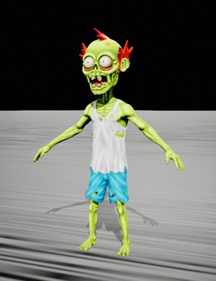 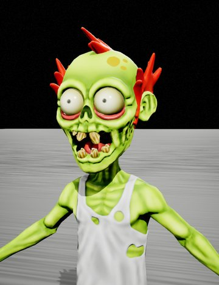 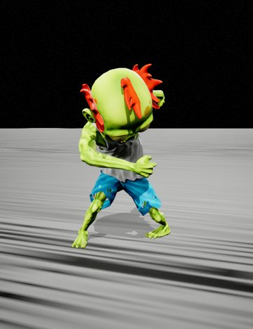

### Medic Zombie

[Cartoon Zombies (Pack)](https://www.fab.com/listings/fd32f1e2-3b21-4e3c-aa7a-4e8437f55997) · **Role:** fodder · **Pose:** an attack from its own pack · model `SK_Medic`

A skull-faced blue cartoon zombie in a doctor's coat.

Ranked 7 of 107 by looks on [monsters.md](monsters.md).

**Animations:** a rig of its own (46 bones, not the mannequin's): its pack's 11 clips only, 2 attacks, 1 death, 1 hit reaction, 1 idle, 1 jump or fall, 4 moves, 1 other (shout). Other animations need an IK rig and the retargeter.

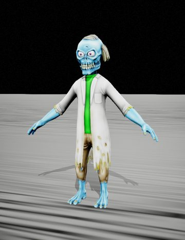 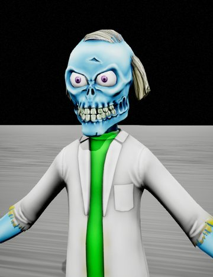 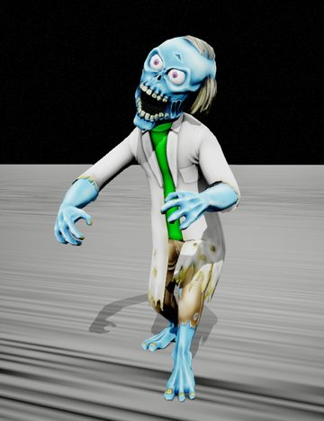

### Zombie Kid

[Cartoon Zombies (Pack)](https://www.fab.com/listings/fd32f1e2-3b21-4e3c-aa7a-4e8437f55997) · **Role:** fodder · **Pose:** a punch · model `SK_Boy`

A cartoon kid in an orange hoodie and sneakers; only his pale skin and red eyes say zombie.

Ranked 8 of 107 by looks on [monsters.md](monsters.md).

**Animations:** UE4-mannequin rig; no clips of its own. Plays every UE4-mannequin library below as it is.

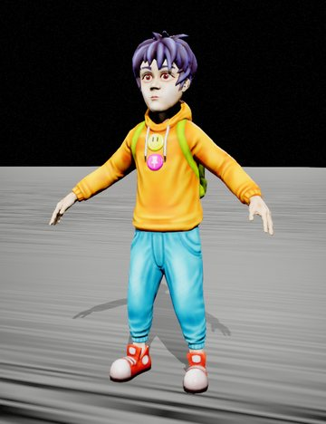 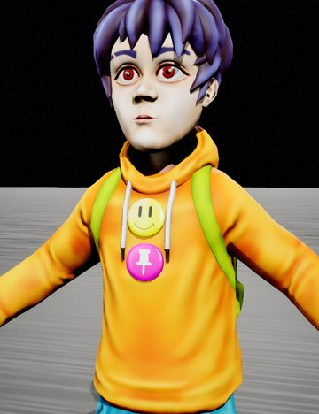 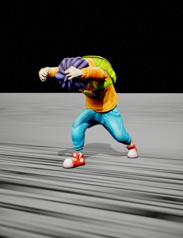

### Chicken-Suit Zombie

[Cartoon Zombies (Pack)](https://www.fab.com/listings/fd32f1e2-3b21-4e3c-aa7a-4e8437f55997) · **Role:** fodder (comic) · **Pose:** an attack from its own pack · model `SK_Chicken`

A zombie in a yellow chicken costume, its rotten face in the beak.

Ranked 9 of 107 by looks on [monsters.md](monsters.md).

**Animations:** a rig of its own (18 bones, not the mannequin's): its pack's 10 clips only, 1 attack, 1 death, 1 hit reaction, 1 idle, 1 jump or fall, 4 moves, 1 other (shout). Other animations need an IK rig and the retargeter.

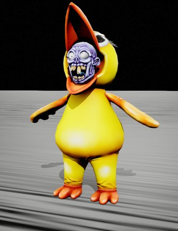 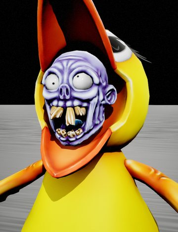 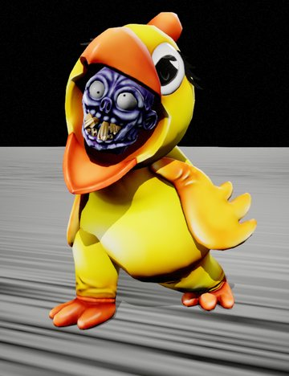

### Soldier Zombie

[Cartoon Zombies (Pack)](https://www.fab.com/listings/fd32f1e2-3b21-4e3c-aa7a-4e8437f55997) · **Role:** fodder · **Pose:** an attack from its own pack · model `SK_Soldier`

A scrawny cartoon zombie in a helmet and camouflage.

Ranked 10 of 107 by looks on [monsters.md](monsters.md).

**Animations:** a rig of its own (38 bones, not the mannequin's): its pack's 10 clips only, 2 attacks, 8 deaths. Other animations need an IK rig and the retargeter.

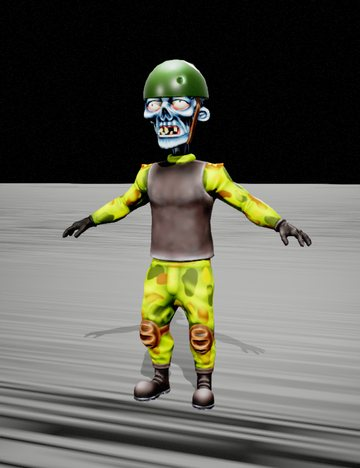 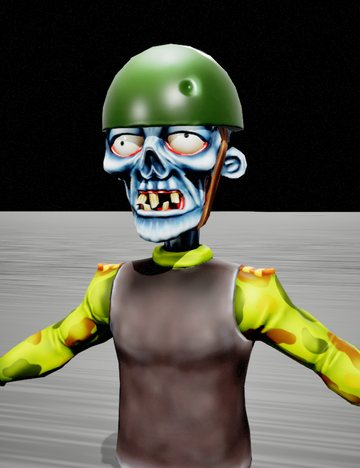 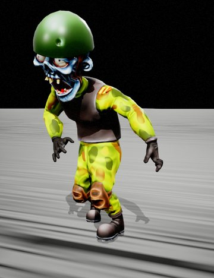

### Fat Zombie

[Cartoon Zombies (Pack)](https://www.fab.com/listings/fd32f1e2-3b21-4e3c-aa7a-4e8437f55997) · **Role:** slow brute · **Pose:** an attack from its own pack · model `SK_Fat`

A huge green belly in a red shirt and cap, covered in boils.

Ranked 15 of 107 by looks on [monsters.md](monsters.md).

**Animations:** a rig of its own (37 bones, not the mannequin's): its pack's 11 clips only, 3 attacks, 1 death, 1 hit reaction, 1 idle, 1 jump or fall, 4 moves. Other animations need an IK rig and the retargeter.

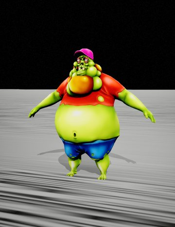 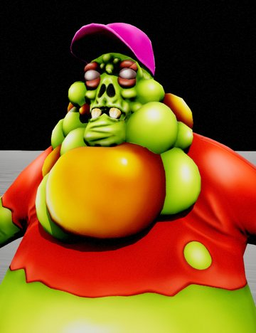 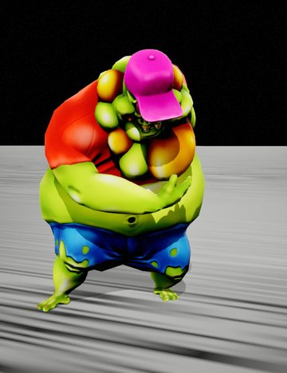

### Hazmat Zombie

[Cartoon Zombies (Pack)](https://www.fab.com/listings/fd32f1e2-3b21-4e3c-aa7a-4e8437f55997) · **Role:** brute · **Pose:** an attack from its own pack · model `SK_Mask`

A chubby zombie in a yellow hazmat suit and gas mask.

Ranked 16 of 107 by looks on [monsters.md](monsters.md).

**Animations:** a rig of its own (36 bones, not the mannequin's): its pack's 10 clips only, 2 attacks, 1 death, 1 hit reaction, 1 idle, 1 jump or fall, 4 moves. Other animations need an IK rig and the retargeter.

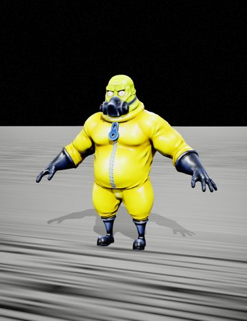 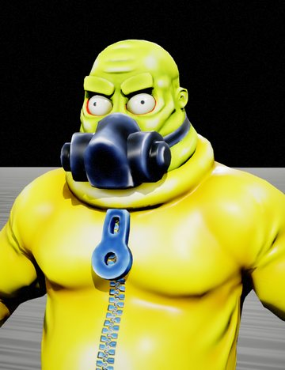 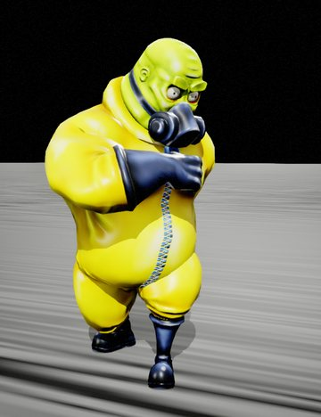

### Stitched Brute

[Cartoon Zombies (Pack)](https://www.fab.com/listings/fd32f1e2-3b21-4e3c-aa7a-4e8437f55997) · **Role:** brute · **Pose:** an attack from its own pack · model `SK_Monster`

A hunched, blue, stitched-together cartoon brute.

Ranked 17 of 107 by looks on [monsters.md](monsters.md).

**Animations:** a rig of its own (45 bones, not the mannequin's): its pack's 10 clips only, 2 attacks, 1 death, 1 hit reaction, 1 idle, 1 jump or fall, 4 moves. Other animations need an IK rig and the retargeter.

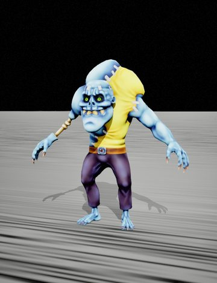 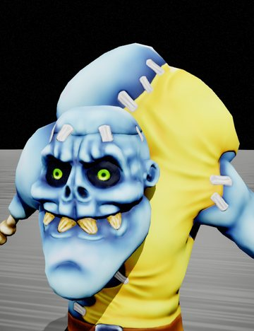 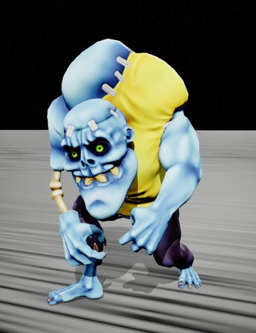

### Gunner Zombie

[Cartoon Zombies (Pack)](https://www.fab.com/listings/fd32f1e2-3b21-4e3c-aa7a-4e8437f55997) · **Role:** ranged · **Pose:** an attack from its own pack · model `SK_Gunner`

A stocky cartoon zombie in a bandana with a gun barrel for each hand.

Ranked 18 of 107 by looks on [monsters.md](monsters.md).

**Animations:** a rig of its own (21 bones, not the mannequin's): its pack's 10 clips only, 2 attacks, 1 death, 1 hit reaction, 1 idle, 1 jump or fall, 4 moves. Other animations need an IK rig and the retargeter.

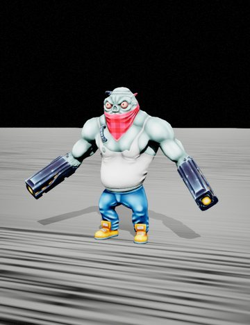 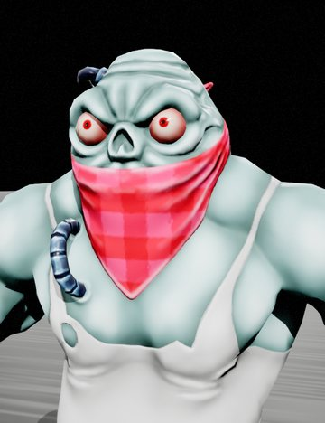 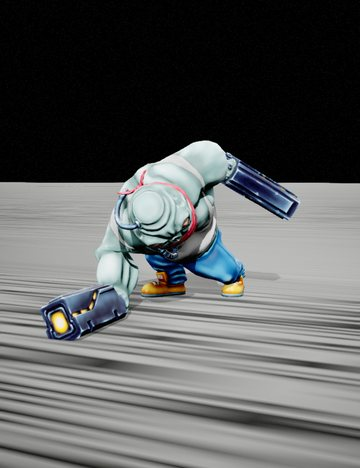

### Walker

[Post-Apocalyptic Characters (Pack)](https://www.fab.com/listings/3e123c6d-c51c-4fb6-b787-1e386d637143) · **Role:** grunt · **Pose:** a punch · model `SK_Zombie`

An emaciated, bald zombie in torn trousers, ribs showing.

**Animations:** UE4-mannequin rig; of its own only the template's idle, walk, run and jump that came with the pack. Plays every UE4-mannequin library below as it is.

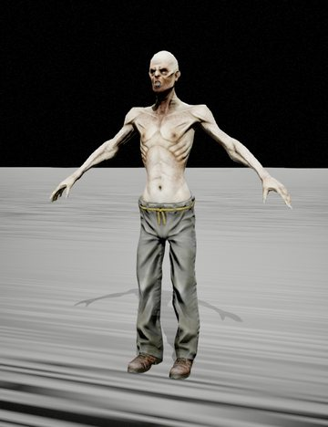 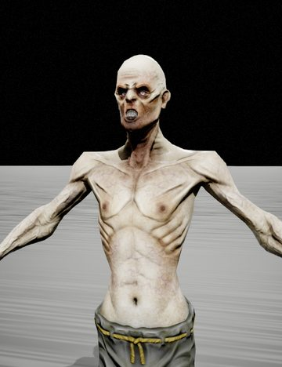 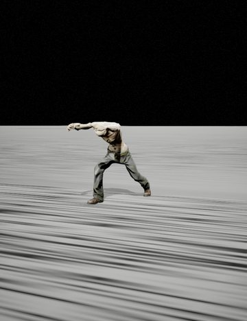

### Bloated Horror

[Post-Apocalyptic Characters (Pack)](https://www.fab.com/listings/3e123c6d-c51c-4fb6-b787-1e386d637143) · **Role:** brute · **Pose:** a punch · model `SK_Horror_Fat`

A bloated, blistered zombie in a blood-stained vest and jeans.

**Animations:** UE4-mannequin rig; of its own only the template's idle, walk, run and jump that came with the pack. Plays every UE4-mannequin library below as it is.

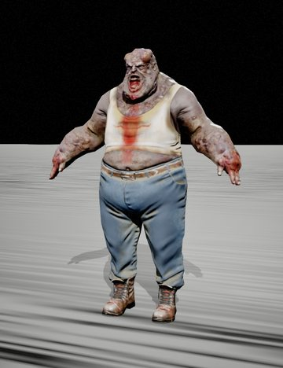 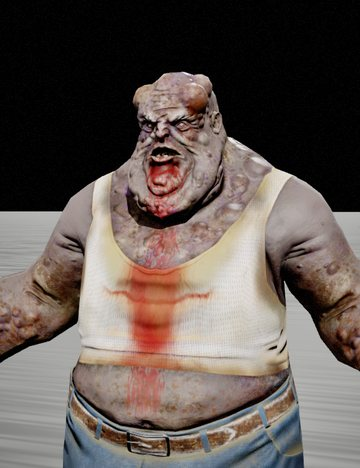 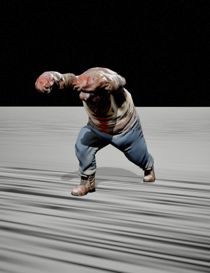

### Gut Crawler

[Creeping Creatures Pack](https://www.fab.com/listings/a6c84c82-1c47-4e7f-ad5c-5628cf05bdd1) · **Role:** crawler / ambusher · **Pose:** an attack from its own pack · model `SK_Half_Creature_01`

A flayed torso trailing its guts, dragging itself on its arms.

Ranked 11 of 107 by looks on [monsters.md](monsters.md).

**Animations:** UE4-mannequin rig; its pack's own 32 clips: 6 attacks, 3 deaths, 1 hit reaction, 4 idles, 2 jumps and falls, 13 moves, 3 other (eat, eat loop, shout). Plays every UE4-mannequin library below as it is.

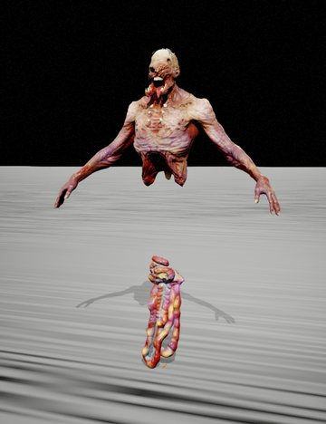 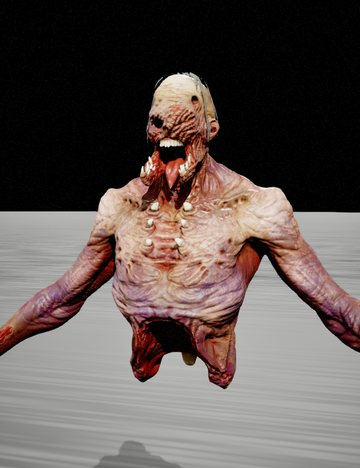 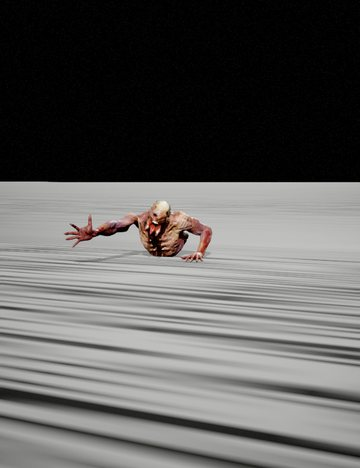

### Soldier Crawler

[Creeping Creatures Pack](https://www.fab.com/listings/a6c84c82-1c47-4e7f-ad5c-5628cf05bdd1) · **Role:** crawler · **Pose:** an attack from its own pack · model `SK_Half_Creature_02_Body`

A dead soldier's torso in a tactical vest, a rotting face, guts for legs.

Ranked 13 of 107 by looks on [monsters.md](monsters.md).

**Animations:** UE4-mannequin rig; its pack's own 32 clips: 6 attacks, 3 deaths, 1 hit reaction, 4 idles, 2 jumps and falls, 13 moves, 3 other (eat, eat loop, shout). Plays every UE4-mannequin library below as it is.

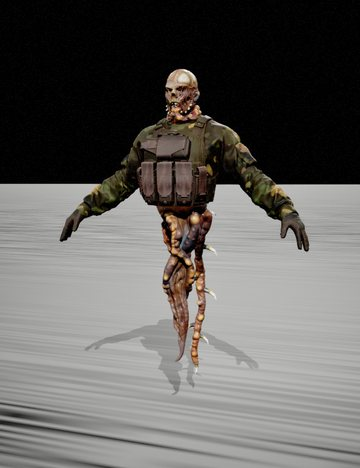 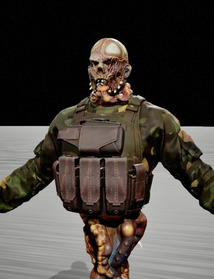 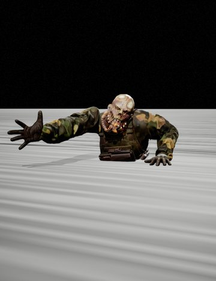

### Chained Crawler

[Creeping Creatures Pack](https://www.fab.com/listings/a6c84c82-1c47-4e7f-ad5c-5628cf05bdd1) · **Role:** crawler · **Pose:** an attack from its own pack · model `SK_Half_Creature_03_Body`

An emaciated torso with a chain hanging through its chest.

Ranked 12 of 107 by looks on [monsters.md](monsters.md).

**Animations:** UE4-mannequin rig; its pack's own 32 clips: 6 attacks, 3 deaths, 1 hit reaction, 4 idles, 2 jumps and falls, 13 moves, 3 other (eat, eat loop, shout). Plays every UE4-mannequin library below as it is.

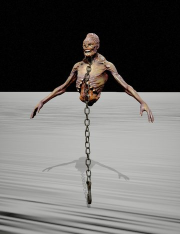 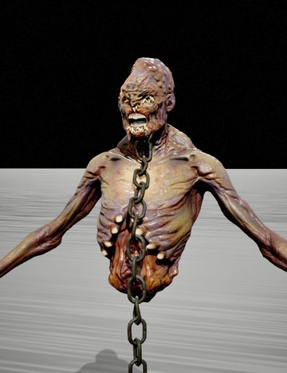 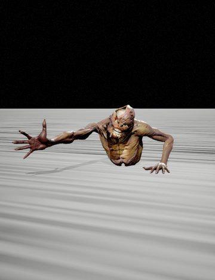

### Tumour Crawler

[Creeping Creatures Pack](https://www.fab.com/listings/a6c84c82-1c47-4e7f-ad5c-5628cf05bdd1) · **Role:** crawler · **Pose:** an attack from its own pack · model `SK_Half_Creature_04`

A torso with a studded, tumorous head and a mouth where its belly was.

Ranked 2 of 107 by looks on [monsters.md](monsters.md).

**Animations:** UE4-mannequin rig; its pack's own 32 clips: 6 attacks, 3 deaths, 1 hit reaction, 4 idles, 2 jumps and falls, 13 moves, 3 other (eat, eat loop, shout). Plays every UE4-mannequin library below as it is.

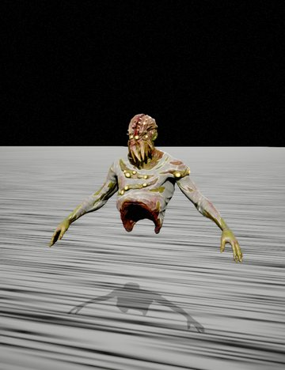 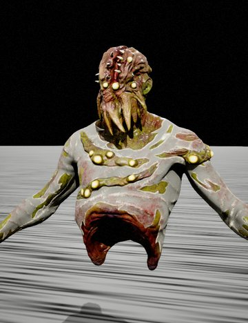 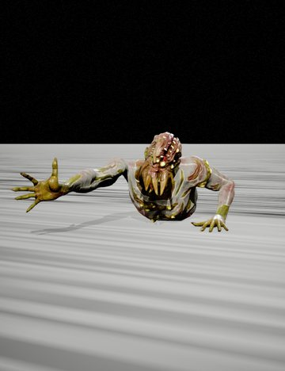

### Hooked Crawler

[Creeping Creatures Pack](https://www.fab.com/listings/a6c84c82-1c47-4e7f-ad5c-5628cf05bdd1) · **Role:** crawler / ambusher · **Pose:** an attack from its own pack · model `SK_Half_Creature_05`

A skinless torso with a split face and long hooked claws.

Ranked 5 of 107 by looks on [monsters.md](monsters.md).

**Animations:** UE4-mannequin rig; its pack's own 32 clips: 6 attacks, 3 deaths, 1 hit reaction, 4 idles, 2 jumps and falls, 13 moves, 3 other (eat, eat loop, shout). Plays every UE4-mannequin library below as it is.

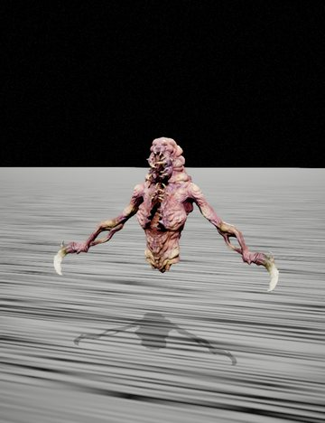 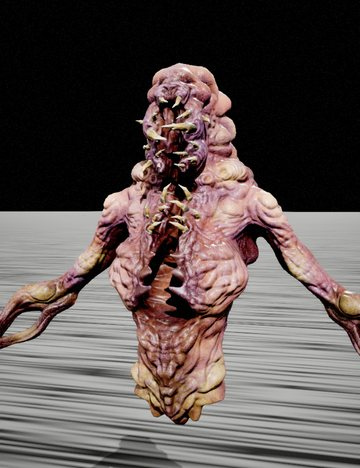 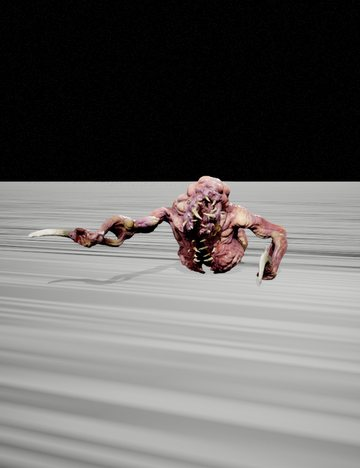

## Orcs, trolls and brutes

Orcs of every rank, trolls, a golem and the big hulks that hit hardest in a melee.

### Orc Warrior

[14 Orcs Pack](https://www.fab.com/listings/3c224616-e998-433c-910b-32901d426103) · **Role:** elite · **Pose:** a two-handed axe blow · model `SK_Orc_01_Full`

Tusked and bearded, spiked armour on the arms, a horn on one shoulder and a skull on the belt.

Ranked 60 of 107 by looks on [monsters.md](monsters.md).

**Animations:** UE4-mannequin rig; its pack's own 92 clips: 8 attacks, 8 deaths, 4 hit reactions, 9 idles, 2 jumps and falls, 58 moves, 3 other (shout without weapon, warrior shout, warrior take weapon). Plays every UE4-mannequin library below as it is.

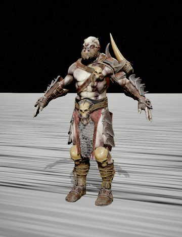 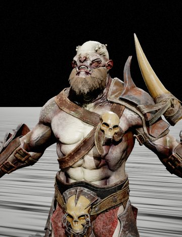 

### Orc Veteran

[14 Orcs Pack](https://www.fab.com/listings/3c224616-e998-433c-910b-32901d426103) · **Role:** elite · **Pose:** a two-handed axe blow · model `SK_Orc_02_Full`

Spiked pauldrons and bracers over a bare chest, a heavy plate on the belt.

Ranked 61 of 107 by looks on [monsters.md](monsters.md).

**Animations:** UE4-mannequin rig; its pack's own 92 clips: 8 attacks, 8 deaths, 4 hit reactions, 9 idles, 2 jumps and falls, 58 moves, 3 other (shout without weapon, warrior shout, warrior take weapon). Plays every UE4-mannequin library below as it is.

  

### Orc Skirmisher

[14 Orcs Pack](https://www.fab.com/listings/3c224616-e998-433c-910b-32901d426103) · **Role:** skirmisher · **Pose:** a two-handed axe blow · model `SK_Orc_03_Full`

A skinny orange orc in a spiked cage helmet and leg armour.

Ranked 25 of 107 by looks on [monsters.md](monsters.md).

**Animations:** UE4-mannequin rig; its pack's own 92 clips: 8 attacks, 8 deaths, 4 hit reactions, 9 idles, 2 jumps and falls, 58 moves, 3 other (shout without weapon, warrior shout, warrior take weapon). Plays every UE4-mannequin library below as it is.

  

### Orc Shaman

[14 Orcs Pack](https://www.fab.com/listings/3c224616-e998-433c-910b-32901d426103) · **Role:** caster · **Pose:** a two-handed axe blow · model `SK_Orc_04_Full`

A hooded orc under a totem of skulls, in rags and leather.

Ranked 63 of 107 by looks on [monsters.md](monsters.md).

**Animations:** UE4-mannequin rig; its pack's own 92 clips: 8 attacks, 8 deaths, 4 hit reactions, 9 idles, 2 jumps and falls, 58 moves, 3 other (shout without weapon, warrior shout, warrior take weapon). Plays every UE4-mannequin library below as it is.

  

### Orc Bruiser

[14 Orcs Pack](https://www.fab.com/listings/3c224616-e998-433c-910b-32901d426103) · **Role:** brute · **Pose:** a two-handed axe blow · model `SK_Orc_05_Full`

A fat, scarred green orc with a round helm and a plate skirt.

Ranked 34 of 107 by looks on [monsters.md](monsters.md).

**Animations:** UE4-mannequin rig; its pack's own 92 clips: 8 attacks, 8 deaths, 4 hit reactions, 9 idles, 2 jumps and falls, 58 moves, 3 other (shout without weapon, warrior shout, warrior take weapon). Plays every UE4-mannequin library below as it is.

  

### Orc Raider

[14 Orcs Pack](https://www.fab.com/listings/3c224616-e998-433c-910b-32901d426103) · **Role:** warrior · **Pose:** a two-handed axe blow · model `SK_Orc_06_Full`

A lean green orc in spiked shoulder and arm armour.

Ranked 35 of 107 by looks on [monsters.md](monsters.md).

**Animations:** UE4-mannequin rig; its pack's own 92 clips: 8 attacks, 8 deaths, 4 hit reactions, 9 idles, 2 jumps and falls, 58 moves, 3 other (shout without weapon, warrior shout, warrior take weapon). Plays every UE4-mannequin library below as it is.

  

### Azrak

[14 Orcs Pack](https://www.fab.com/listings/3c224616-e998-433c-910b-32901d426103) · **Role:** berserker · **Pose:** a two-handed axe blow · model `SK_Azrak_Full`

Lean, red and muscular, a spiked mask and nothing else but a loincloth.

Ranked 27 of 107 by looks on [monsters.md](monsters.md).

**Animations:** UE4-mannequin rig; its pack's own 92 clips: 8 attacks, 8 deaths, 4 hit reactions, 9 idles, 2 jumps and falls, 58 moves, 3 other (shout without weapon, warrior shout, warrior take weapon). Plays every UE4-mannequin library below as it is.

  

### Costalmed

[14 Orcs Pack](https://www.fab.com/listings/3c224616-e998-433c-910b-32901d426103) · **Role:** warrior · **Pose:** a two-handed axe blow · model `SK_Orc_Costalmed_Full`

Half armoured: heavy plates on the legs and one shoulder, a topknot.

Ranked 33 of 107 by looks on [monsters.md](monsters.md).

**Animations:** UE4-mannequin rig; its pack's own 92 clips: 8 attacks, 8 deaths, 4 hit reactions, 9 idles, 2 jumps and falls, 58 moves, 3 other (shout without weapon, warrior shout, warrior take weapon). Plays every UE4-mannequin library below as it is.

  

### Dardan

[14 Orcs Pack](https://www.fab.com/listings/3c224616-e998-433c-910b-32901d426103) · **Role:** warrior · **Pose:** a two-handed axe blow · model `SK_Dardan_Full`

A pale orc with blue war paint, tusks and a bone necklace.

Ranked 32 of 107 by looks on [monsters.md](monsters.md).

**Animations:** UE4-mannequin rig; its pack's own 92 clips: 8 attacks, 8 deaths, 4 hit reactions, 9 idles, 2 jumps and falls, 58 moves, 3 other (shout without weapon, warrior shout, warrior take weapon). Plays every UE4-mannequin library below as it is.

  

### Gnur

[14 Orcs Pack](https://www.fab.com/listings/3c224616-e998-433c-910b-32901d426103) · **Role:** warrior · **Pose:** a two-handed axe blow · model `SK_Gnur_Full`

A white-faced orc in spiked leather and plate, scars across the chest.

Ranked 31 of 107 by looks on [monsters.md](monsters.md).

**Animations:** UE4-mannequin rig; its pack's own 92 clips: 8 attacks, 8 deaths, 4 hit reactions, 9 idles, 2 jumps and falls, 58 moves, 3 other (shout without weapon, warrior shout, warrior take weapon). Plays every UE4-mannequin library below as it is.

  

### Kanit

[14 Orcs Pack](https://www.fab.com/listings/3c224616-e998-433c-910b-32901d426103) · **Role:** scout / assassin · **Pose:** a two-handed axe blow · model `SK_Kanit_Full`

A hooded orc in mail and leather, spiked bracers.

Ranked 30 of 107 by looks on [monsters.md](monsters.md).

**Animations:** UE4-mannequin rig; its pack's own 92 clips: 8 attacks, 8 deaths, 4 hit reactions, 9 idles, 2 jumps and falls, 58 moves, 3 other (shout without weapon, warrior shout, warrior take weapon). Plays every UE4-mannequin library below as it is.

  

### Magur

[14 Orcs Pack](https://www.fab.com/listings/3c224616-e998-433c-910b-32901d426103) · **Role:** brute · **Pose:** a two-handed axe blow · model `SK_Magur_Full`

A huge pale belly, ram horns and a loincloth.

Ranked 26 of 107 by looks on [monsters.md](monsters.md).

**Animations:** UE4-mannequin rig; its pack's own 92 clips: 8 attacks, 8 deaths, 4 hit reactions, 9 idles, 2 jumps and falls, 58 moves, 3 other (shout without weapon, warrior shout, warrior take weapon). Plays every UE4-mannequin library below as it is.

  

### Ursag

[14 Orcs Pack](https://www.fab.com/listings/3c224616-e998-433c-910b-32901d426103) · **Role:** chieftain · **Pose:** a two-handed axe blow · model `SK_Ursag_Full`

A deer skull with antlers for a helm, bone and fur armour.

Ranked 62 of 107 by looks on [monsters.md](monsters.md).

**Animations:** UE4-mannequin rig; its pack's own 92 clips: 8 attacks, 8 deaths, 4 hit reactions, 9 idles, 2 jumps and falls, 58 moves, 3 other (shout without weapon, warrior shout, warrior take weapon). Plays every UE4-mannequin library below as it is.

  

### Sufferer

[14 Orcs Pack](https://www.fab.com/listings/3c224616-e998-433c-910b-32901d426103) · **Role:** fodder / slave · **Pose:** a two-handed axe blow · model `SK_Sufferer_Full`

A grey-haired old man in a ragged tunic and a rope belt, barefoot.

Ranked 14 of 107 by looks on [monsters.md](monsters.md).

**Animations:** UE4-mannequin rig; its pack's own 92 clips: 8 attacks, 8 deaths, 4 hit reactions, 9 idles, 2 jumps and falls, 58 moves, 3 other (shout without weapon, warrior shout, warrior take weapon). Plays every UE4-mannequin library below as it is.

  

### Pale Orc

[Fantasy Characters (Pack)](https://www.fab.com/listings/f5816915-86d9-4bef-b8f3-921408ae240b) · **Role:** brute · **Pose:** an attack from its own pack · model `SK_Orc_Hummer`

A massive pale orc with white war paint and a loincloth; its pack gives it a hammer.

**Animations:** a rig of its own (61 bones, not the mannequin's): its pack's 12 clips only, 3 attacks, 1 death, 1 hit reaction, 1 idle, 1 jump or fall, 4 moves, 1 other (hummer shout). Other animations need an IK rig and the retargeter.

  

### Armoured Troll

[Fantasy Characters (Pack)](https://www.fab.com/listings/f5816915-86d9-4bef-b8f3-921408ae240b) · **Role:** boss · **Pose:** an attack from its own pack · model `SK_Troll`

A purple troll in spiked black plate, tusks and a skull on the belt.

**Animations:** a rig of its own (86 bones, not the mannequin's): its pack's 11 clips only, 3 attacks, 1 death, 1 hit reaction, 2 idles, 1 jump or fall, 2 moves, 1 other (shout). Other animations need an IK rig and the retargeter.

  

### Stone Golem

[Fantasy Characters (Pack)](https://www.fab.com/listings/f5816915-86d9-4bef-b8f3-921408ae240b) · **Role:** tank · **Pose:** a punch · model `SK_Golem`

A hulk of piled rocks with a carved face in its chest.

**Animations:** UE4-mannequin rig; its pack's own 99 clips: 8 attacks, 8 deaths, 4 hit reactions, 10 idles, 6 jumps and falls, 60 moves, 3 other (shout without weapon, warrior shout, warrior take weapon). Plays every UE4-mannequin library below as it is.

  

### Spiked Troll

[Fantasy Enemies (Pack)](https://www.fab.com/listings/79f79e3e-570b-4d96-bc3f-f62107178169) · **Role:** boss · **Pose:** a two-handed axe blow · model `SK_Troll_Full_01`

Bristling with horns, bone spikes and armour plates, a red face.

Ranked 99 of 107 by looks on [monsters.md](monsters.md).

**Animations:** UE4-mannequin rig; of its own only the template's idle, walk, run and jump that came with the pack. Plays every UE4-mannequin library below as it is.

  

### Executioner

[Fantasy Enemies (Pack)](https://www.fab.com/listings/79f79e3e-570b-4d96-bc3f-f62107178169) · **Role:** elite · **Pose:** a two-handed axe blow · model `SK_Executioner_Full`

A hooded giant in spiked pauldrons and chains, his apron bloodied.

Ranked 90 of 107 by looks on [monsters.md](monsters.md).

**Animations:** UE4-mannequin rig; of its own only the template's idle, walk, run and jump that came with the pack. Plays every UE4-mannequin library below as it is.

  

### Flesh Troll

[Creatures Mega Pack](https://www.fab.com/listings/13143978-3009-4fb1-893c-689e28b2e122) · **Role:** brute · **Pose:** an attack from its own pack · model `SK_Troll`

A hairless, heavily muscled troll with a wide, tusked mouth.

Ranked 89 of 107 by looks on [monsters.md](monsters.md).

**Animations:** a rig of its own (56 bones, not the mannequin's): its pack's 10 clips only, 2 attacks, 1 death, 1 hit reaction, 1 idle, 1 jump or fall, 2 moves, 1 other, all of them on one timeline (shout). Other animations need an IK rig and the retargeter.

  

### Exterminator

[Creatures Mega Pack](https://www.fab.com/listings/13143978-3009-4fb1-893c-689e28b2e122) · **Role:** brute · **Pose:** an attack from its own pack · model `SK_Exterminator`

A pale, ribbed hulk with a jutting, skull-like face.

Ranked 82 of 107 by looks on [monsters.md](monsters.md).

**Animations:** a rig of its own (72 bones, not the mannequin's): its pack's 11 clips only, 3 attacks, 1 death, 1 hit reaction, 1 idle, 1 jump or fall, 2 moves, 1 other, all of them on one timeline (shout). Other animations need an IK rig and the retargeter.

  

### Titan

[Creatures Mega Pack](https://www.fab.com/listings/13143978-3009-4fb1-893c-689e28b2e122) · **Role:** boss · **Pose:** an attack from its own pack · model `SK_Titan`

A grey hulk whose head sits low between huge clawed arms and fists of bone.

Ranked 102 of 107 by looks on [monsters.md](monsters.md).

**Animations:** a rig of its own (45 bones, not the mannequin's): its pack's 12 clips only, 3 attacks, 1 death, 1 hit reaction, 1 idle, 1 jump or fall, 2 moves, 2 other, all of them on one timeline (shout). Other animations need an IK rig and the retargeter.

  

## Demons and devils

Horned fiends and devils: lean ones that slash, fat ones that crush, a few bosses.

### Demon Lord

[Fantasy Enemies (Pack)](https://www.fab.com/listings/79f79e3e-570b-4d96-bc3f-f62107178169) · **Role:** boss · **Pose:** a two-handed axe blow · model `SK_Demon_Full`

Grey-furred, with curling horns and burning orange arms, hung with bones and gold.

Ranked 96 of 107 by looks on [monsters.md](monsters.md).

**Animations:** UE4-mannequin rig; of its own only the template's idle, walk, run and jump that came with the pack. Plays every UE4-mannequin library below as it is.

  

### Lava Devil

[Fantasy Enemies (Pack)](https://www.fab.com/listings/79f79e3e-570b-4d96-bc3f-f62107178169) · **Role:** boss · **Pose:** a two-handed axe blow · model `SK_Devil_Full`

A body of black stone cracked with glowing lava, horns and spikes all over.

Ranked 98 of 107 by looks on [monsters.md](monsters.md).

**Animations:** UE4-mannequin rig; of its own only the template's idle, walk, run and jump that came with the pack. Plays every UE4-mannequin library below as it is.

  

### Befouler

[Fantasy Enemies (Pack)](https://www.fab.com/listings/79f79e3e-570b-4d96-bc3f-f62107178169) · **Role:** boss · **Pose:** a two-handed axe blow · model `SK_Befouler_Full_01`

Giant curved horns and a rack of severed heads carried on its back.

Ranked 97 of 107 by looks on [monsters.md](monsters.md).

**Animations:** UE4-mannequin rig; of its own only the template's idle, walk, run and jump that came with the pack. Plays every UE4-mannequin library below as it is.

  

### Horned Fiend

[10 Creatures (Pack)](https://www.fab.com/listings/0094617c-9eba-433a-8a5e-d3e0aba5735b) · **Role:** elite · **Pose:** a punch · model `SK_Creature_01`

A pale demon with a horned helm of bone and spiked shoulders.

Ranked 77 of 107 by looks on [monsters.md](monsters.md).

**Animations:** UE4-mannequin rig; of its own only the template's idle, walk, run and jump that came with the pack. Plays every UE4-mannequin library below as it is.

  

### Ram Fiend

[10 Creatures (Pack)](https://www.fab.com/listings/0094617c-9eba-433a-8a5e-d3e0aba5735b) · **Role:** grunt · **Pose:** a punch · model `SK_Creature_02`

A lean yellow demon with ram horns and a toothy grin.

Ranked 47 of 107 by looks on [monsters.md](monsters.md).

**Animations:** UE4-mannequin rig; of its own only the template's idle, walk, run and jump that came with the pack. Plays every UE4-mannequin library below as it is.

  

### Tendril Fiend

[10 Creatures (Pack)](https://www.fab.com/listings/0094617c-9eba-433a-8a5e-d3e0aba5735b) · **Role:** grunt · **Pose:** a punch · model `SK_Creature_03`

A lean demon with a crown of tendrils round a fanged mouth.

Ranked 48 of 107 by looks on [monsters.md](monsters.md).

**Animations:** UE4-mannequin rig; of its own only the template's idle, walk, run and jump that came with the pack. Plays every UE4-mannequin library below as it is.

  

### Scythe Fiend

[10 Creatures (Pack)](https://www.fab.com/listings/0094617c-9eba-433a-8a5e-d3e0aba5735b) · **Role:** elite · **Pose:** a punch · model `SK_Creature_04`

Long yellow horns, a blade for one arm and a hooked scythe for the other.

Ranked 80 of 107 by looks on [monsters.md](monsters.md).

**Animations:** UE4-mannequin rig; of its own only the template's idle, walk, run and jump that came with the pack. Plays every UE4-mannequin library below as it is.

  

### Blade Fiend

[10 Creatures (Pack)](https://www.fab.com/listings/0094617c-9eba-433a-8a5e-d3e0aba5735b) · **Role:** assassin · **Pose:** a punch · model `SK_Creature_05`

A flayed red demon with two long blades for arms.

Ranked 81 of 107 by looks on [monsters.md](monsters.md).

**Animations:** UE4-mannequin rig; of its own only the template's idle, walk, run and jump that came with the pack. Plays every UE4-mannequin library below as it is.

  

### Bloated Fiend

[10 Creatures (Pack)](https://www.fab.com/listings/0094617c-9eba-433a-8a5e-d3e0aba5735b) · **Role:** brute · **Pose:** a punch · model `SK_Creature_06`

A huge fat, horned demon, grey skin cracked with orange.

Ranked 79 of 107 by looks on [monsters.md](monsters.md).

**Animations:** UE4-mannequin rig; of its own only the template's idle, walk, run and jump that came with the pack. Plays every UE4-mannequin library below as it is.

  

### Imp

[10 Creatures (Pack)](https://www.fab.com/listings/0094617c-9eba-433a-8a5e-d3e0aba5735b) · **Role:** fodder · **Pose:** a punch · model `SK_Creature_07`

A small-headed red demon with a crest and nothing to fight with but claws.

Ranked 46 of 107 by looks on [monsters.md](monsters.md).

**Animations:** UE4-mannequin rig; of its own only the template's idle, walk, run and jump that came with the pack. Plays every UE4-mannequin library below as it is.

  

### Crowned Fiend

[10 Creatures (Pack)](https://www.fab.com/listings/0094617c-9eba-433a-8a5e-d3e0aba5735b) · **Role:** elite · **Pose:** a punch · model `SK_Creature_08`

A broad-shouldered demon with a wide crown of bone.

Ranked 75 of 107 by looks on [monsters.md](monsters.md).

**Animations:** UE4-mannequin rig; of its own only the template's idle, walk, run and jump that came with the pack. Plays every UE4-mannequin library below as it is.

  

### Medusa Fiend

[10 Creatures (Pack)](https://www.fab.com/listings/0094617c-9eba-433a-8a5e-d3e0aba5735b) · **Role:** caster · **Pose:** a punch · model `SK_Creature_09`

A pink demon with a crown of coiling tendrils and tusks.

Ranked 78 of 107 by looks on [monsters.md](monsters.md).

**Animations:** UE4-mannequin rig; of its own only the template's idle, walk, run and jump that came with the pack. Plays every UE4-mannequin library below as it is.

  

### Skull Fiend

[10 Creatures (Pack)](https://www.fab.com/listings/0094617c-9eba-433a-8a5e-d3e0aba5735b) · **Role:** brute · **Pose:** a punch · model `SK_Creature_10`

A heavy demon with a skull face and great ram horns.

Ranked 76 of 107 by looks on [monsters.md](monsters.md).

**Animations:** UE4-mannequin rig; of its own only the template's idle, walk, run and jump that came with the pack. Plays every UE4-mannequin library below as it is.

  

### Daemon

[Creatures Mega Pack](https://www.fab.com/listings/13143978-3009-4fb1-893c-689e28b2e122) · **Role:** assassin · **Pose:** an attack from its own pack · model `SK_Daemon`

A tall, pale pink daemon with bat ears and long claws.

Ranked 88 of 107 by looks on [monsters.md](monsters.md).

**Animations:** a rig of its own (56 bones, not the mannequin's): its pack's 11 clips only, 3 attacks, 1 death, 1 hit reaction, 1 idle, 1 jump or fall, 2 moves, 1 other, all of them on one timeline (shout). Other animations need an IK rig and the retargeter.

  

### Horned Devil

[Creatures Mega Pack](https://www.fab.com/listings/13143978-3009-4fb1-893c-689e28b2e122) · **Role:** elite · **Pose:** an attack from its own pack · model `SK_Horned`

A brown devil with long, curling horns and long clawed arms.

Ranked 85 of 107 by looks on [monsters.md](monsters.md).

**Animations:** a rig of its own (62 bones, not the mannequin's): its pack's 11 clips only, 3 attacks, 1 death, 1 hit reaction, 1 idle, 1 jump or fall, 2 moves, 1 other, all of them on one timeline (shout). Other animations need an IK rig and the retargeter.

  

### Lab Horror

[Monster In Capsule](https://www.fab.com/listings/e78e02b4-aeda-4ff4-ad3d-4217fd4a1265) · **Role:** elite · **Pose:** a punch · model `SK_UE4_Monster_For_Capsule_Full`

An olive, horned creature with long bone claws on both hands: what the lab capsule held.

Ranked 92 of 107 by looks on [monsters.md](monsters.md).

**Animations:** UE4-mannequin rig; its pack's own 14 clips: 7 idles, 4 jumps and falls, 2 moves, 1 other (monster in capsule). Plays every UE4-mannequin library below as it is.

  

## Mutants and abominations

Bodies taken over by growths, parasites and tentacles.

### Tentacle Mutant

[Creatures Mega Pack](https://www.fab.com/listings/13143978-3009-4fb1-893c-689e28b2e122) · **Role:** brute · **Pose:** an attack from its own pack · model `SK_Mutant`

A grey, muscular man with a featureless head and one arm a long red tentacle.

Ranked 86 of 107 by looks on [monsters.md](monsters.md).

**Animations:** a rig of its own (47 bones, not the mannequin's): its pack's 12 clips only, 4 attacks, 1 death, 1 hit reaction, 1 idle, 1 jump or fall, 2 moves, 1 other, all of them on one timeline (shout). Other animations need an IK rig and the retargeter.

  

### Devourer

[Creatures Mega Pack](https://www.fab.com/listings/13143978-3009-4fb1-893c-689e28b2e122) · **Role:** ambusher · **Pose:** an attack from its own pack · model `SK_Devourer`

A lanky creature with a hooded, gaping head and long clawed arms.

Ranked 38 of 107 by looks on [monsters.md](monsters.md).

**Animations:** a rig of its own (62 bones, not the mannequin's): its pack's 11 clips only, 3 attacks, 1 death, 1 hit reaction, 1 idle, 1 jump or fall, 2 moves, 1 other, all of them on one timeline (shout). Other animations need an IK rig and the retargeter.

  

### Gaunt

[Creatures Mega Pack](https://www.fab.com/listings/13143978-3009-4fb1-893c-689e28b2e122) · **Role:** skirmisher · **Pose:** an attack from its own pack · model `SK_Alien`

A tall, gangly brown creature with long arms and a small head.

Ranked 37 of 107 by looks on [monsters.md](monsters.md).

**Animations:** a rig of its own (64 bones, not the mannequin's): its pack's 11 clips only, 3 attacks, 1 death, 1 hit reaction, 1 idle, 1 jump or fall, 2 moves, 1 other, all of them on one timeline (shout). Other animations need an IK rig and the retargeter.

  

### Shell

[Creatures Mega Pack](https://www.fab.com/listings/13143978-3009-4fb1-893c-689e28b2e122) · **Role:** brute · **Pose:** an attack from its own pack · model `SK_Shell`

A pale, ridged brute with a wide, toothy mouth and big claws.

Ranked 83 of 107 by looks on [monsters.md](monsters.md).

**Animations:** a rig of its own (56 bones, not the mannequin's): its pack's 10 clips only, 3 attacks, 1 death, 1 hit reaction, 1 idle, 1 jump or fall, 2 moves, 1 other (shout). Other animations need an IK rig and the retargeter.

  

### Host

[Parasites Pack](https://www.fab.com/listings/536252d1-3137-49fb-bfd8-67ce42dd9650) · **Role:** elite · **Pose:** an attack from its own pack · model `SK_Parasit`

A purple-skinned man split open by a creature erupting from his chest and head.

Ranked 20 of 107 by looks on [monsters.md](monsters.md).

**Animations:** a rig of its own (51 bones, not the mannequin's): its pack's 11 clips only, 3 attacks, 1 death, 1 hit reaction, 2 idles, 1 jump or fall, 2 moves, 1 other (shout). Other animations need an IK rig and the retargeter.

  

### Fat Host

[Parasites Pack](https://www.fab.com/listings/536252d1-3137-49fb-bfd8-67ce42dd9650) · **Role:** brute · **Pose:** an attack from its own pack · model `SK_Fat`

A fat man whose belly and chest are a nest of red tentacles.

Ranked 19 of 107 by looks on [monsters.md](monsters.md).

**Animations:** a rig of its own (65 bones, not the mannequin's): its pack's 11 clips only, 2 attacks, 1 death, 1 hit reaction, 2 idles, 1 jump or fall, 2 moves, 1 other, all of them on one timeline (shout). Other animations need an IK rig and the retargeter.

  

### Alfa

[Parasites Pack](https://www.fab.com/listings/536252d1-3137-49fb-bfd8-67ce42dd9650) · **Role:** boss · **Pose:** an attack from its own pack · model `SK_Alfa`

A fanged, armoured hulk with one arm a giant scythe.

Ranked 95 of 107 by looks on [monsters.md](monsters.md).

**Animations:** a rig of its own (34 bones, not the mannequin's): its pack's 20 clips only, 7 attacks, 2 deaths, 2 hit reactions, 2 idles, 1 jump or fall, 2 moves, 3 other, all of them on one timeline (shout, stand emergence, stand shout). Other animations need an IK rig and the retargeter.

  

### Slider

[Parasites Pack](https://www.fab.com/listings/536252d1-3137-49fb-bfd8-67ce42dd9650) · **Role:** crawler · **Pose:** an attack from its own pack · model `SK_Parasite_Slider`

A pale man's upper body on a slug's tail, a pincer growing from his back.

Ranked 3 of 107 by looks on [monsters.md](monsters.md).

**Animations:** a rig of its own (75 bones, not the mannequin's): its pack's 9 clips only, 2 attacks, 1 death, 1 hit reaction, 2 idles, 2 moves, 1 other (shout). Other animations need an IK rig and the retargeter.

  

### Horn-Growth Mutant

[Humanoids Creatures Pack](https://www.fab.com/listings/7a115ce2-cb54-4bcb-b1e7-a459f80b3f38) · **Role:** brute · **Pose:** a punch · model `SK_Creature_01`

A soldier in fatigues, a huge spined growth curling up from his shoulder.

Ranked 72 of 107 by looks on [monsters.md](monsters.md).

**Animations:** UE4-mannequin rig; of its own only the template's idle, walk, run and jump that came with the pack. The Fab download has 41 more clips for it that are not imported here: 10 attacks, 4 deaths, 4 hit reactions, 2 idles, 1 jump or fall, 18 moves, 2 other (shout). Plays every UE4-mannequin library below as it is.

  

### Tentacle-Head Soldier

[Humanoids Creatures Pack](https://www.fab.com/listings/7a115ce2-cb54-4bcb-b1e7-a459f80b3f38) · **Role:** grunt · **Pose:** a punch · model `SK_Creature_02`

A body in riot gear and a vest, its head a mass of tentacles.

Ranked 45 of 107 by looks on [monsters.md](monsters.md).

**Animations:** UE4-mannequin rig; of its own only the template's idle, walk, run and jump that came with the pack. The Fab download has 41 more clips for it that are not imported here: 10 attacks, 4 deaths, 4 hit reactions, 2 idles, 1 jump or fall, 18 moves, 2 other (shout). Plays every UE4-mannequin library below as it is.

  

### Pustule Mutant

[Humanoids Creatures Pack](https://www.fab.com/listings/7a115ce2-cb54-4bcb-b1e7-a459f80b3f38) · **Role:** grunt · **Pose:** a punch · model `SK_Creature_03`

Lumpy, spiny skin and a split, toothed head.

Ranked 44 of 107 by looks on [monsters.md](monsters.md).

**Animations:** UE4-mannequin rig; of its own only the template's idle, walk, run and jump that came with the pack. The Fab download has 41 more clips for it that are not imported here: 10 attacks, 4 deaths, 4 hit reactions, 2 idles, 1 jump or fall, 18 moves, 2 other (shout). Plays every UE4-mannequin library below as it is.

  

### Tumour Mutant

[Humanoids Creatures Pack](https://www.fab.com/listings/7a115ce2-cb54-4bcb-b1e7-a459f80b3f38) · **Role:** brute · **Pose:** a punch · model `SK_Creature_04`

A head swollen into a mass of tumours and eyes, on a lumpy body.

Ranked 73 of 107 by looks on [monsters.md](monsters.md).

**Animations:** UE4-mannequin rig; of its own only the template's idle, walk, run and jump that came with the pack. The Fab download has 41 more clips for it that are not imported here: 10 attacks, 4 deaths, 4 hit reactions, 2 idles, 1 jump or fall, 18 moves, 2 other (shout). Plays every UE4-mannequin library below as it is.

  

### Lurker

[Humanoids Creatures Pack](https://www.fab.com/listings/7a115ce2-cb54-4bcb-b1e7-a459f80b3f38) · **Role:** skirmisher · **Pose:** a punch · model `SK_Creature_05`

Lean and brown, a long ridged skull, warts down the chest.

Ranked 23 of 107 by looks on [monsters.md](monsters.md).

**Animations:** UE4-mannequin rig; of its own only the template's idle, walk, run and jump that came with the pack. The Fab download has 41 more clips for it that are not imported here: 10 attacks, 4 deaths, 4 hit reactions, 2 idles, 1 jump or fall, 18 moves, 2 other (shout). Plays every UE4-mannequin library below as it is.

  

### Horned Abomination

[Humanoids Monsters Pack](https://www.fab.com/listings/428ee6b9-42d5-4522-bd74-a7f5489f12ed) · **Role:** brute · **Pose:** a punch · model `SK_Monster_01`

Bulky, orange and lumpy with curled horns and a purple-streaked chest.

Ranked 56 of 107 by looks on [monsters.md](monsters.md).

**Animations:** UE4-mannequin rig; no clips of its own. The Fab download has 45 more clips for it that are not imported here: 9 attacks, 3 deaths, 2 hit reactions, 3 idles, 3 jumps and falls, 16 moves, 9 other (down on ground & up, eat, eat loop, lies on the ground pose, out of ground, ...). Plays every UE4-mannequin library below as it is.

  

### Crowned Abomination

[Humanoids Monsters Pack](https://www.fab.com/listings/428ee6b9-42d5-4522-bd74-a7f5489f12ed) · **Role:** elite · **Pose:** a punch · model `SK_Monster_02`

Orange-gold, a sweeping crown of horns and spiked shoulders.

Ranked 57 of 107 by looks on [monsters.md](monsters.md).

**Animations:** UE4-mannequin rig; no clips of its own. The Fab download has 45 more clips for it that are not imported here: 9 attacks, 3 deaths, 2 hit reactions, 3 idles, 3 jumps and falls, 16 moves, 9 other (down on ground & up, eat, eat loop, lies on the ground pose, out of ground, ...). Plays every UE4-mannequin library below as it is.

  

### Fanged Abomination

[Humanoids Monsters Pack](https://www.fab.com/listings/428ee6b9-42d5-4522-bd74-a7f5489f12ed) · **Role:** skirmisher · **Pose:** a punch · model `SK_Monster_03`

Grey-blue and pink, a toothy crested head and spines on the forearms.

Ranked 54 of 107 by looks on [monsters.md](monsters.md).

**Animations:** UE4-mannequin rig; no clips of its own. The Fab download has 45 more clips for it that are not imported here: 9 attacks, 3 deaths, 2 hit reactions, 3 idles, 3 jumps and falls, 16 moves, 9 other (down on ground & up, eat, eat loop, lies on the ground pose, out of ground, ...). Plays every UE4-mannequin library below as it is.

  

### Husk

[Humanoids Monsters Pack](https://www.fab.com/listings/428ee6b9-42d5-4522-bd74-a7f5489f12ed) · **Role:** grunt · **Pose:** a punch · model `SK_Monster_04`

Lean and pinkish, a ribbed belly and a skull for a face.

Ranked 50 of 107 by looks on [monsters.md](monsters.md).

**Animations:** UE4-mannequin rig; no clips of its own. The Fab download has 45 more clips for it that are not imported here: 9 attacks, 3 deaths, 2 hit reactions, 3 idles, 3 jumps and falls, 16 moves, 9 other (down on ground & up, eat, eat loop, lies on the ground pose, out of ground, ...). Plays every UE4-mannequin library below as it is.

  

### Pale Stalker

[Humanoids Monsters Pack](https://www.fab.com/listings/428ee6b9-42d5-4522-bd74-a7f5489f12ed) · **Role:** skirmisher · **Pose:** a punch · model `SK_Monster_05`

Grey and lean, a long flat skull and small claws.

Ranked 51 of 107 by looks on [monsters.md](monsters.md).

**Animations:** UE4-mannequin rig; no clips of its own. The Fab download has 45 more clips for it that are not imported here: 9 attacks, 3 deaths, 2 hit reactions, 3 idles, 3 jumps and falls, 16 moves, 9 other (down on ground & up, eat, eat loop, lies on the ground pose, out of ground, ...). Plays every UE4-mannequin library below as it is.

  

### Blister Mutant

[Sci-Fi Line With 3 Creatures](https://www.fab.com/listings/fb51619d-404d-44c0-8988-508257d0528c) · **Role:** grunt · **Pose:** a punch · model `SK_UE4_Creatures_01_Full`

A thin, grey mutant covered in glowing orange blisters.

Ranked 21 of 107 by looks on [monsters.md](monsters.md).

**Animations:** UE4-mannequin rig; its pack's own 9 clips: 3 idles, 4 jumps and falls, 2 moves. Plays every UE4-mannequin library below as it is.

  

### Blade-Arm Mutant

[Sci-Fi Line With 3 Creatures](https://www.fab.com/listings/fb51619d-404d-44c0-8988-508257d0528c) · **Role:** elite · **Pose:** a punch · model `SK_UE4_Creatures_02_Full`

A skinned, muscular mutant with one arm a long blade.

Ranked 36 of 107 by looks on [monsters.md](monsters.md).

**Animations:** UE4-mannequin rig; its pack's own 9 clips: 3 idles, 4 jumps and falls, 2 moves. Plays every UE4-mannequin library below as it is.

  

### Split-Head Mutant

[Sci-Fi Line With 3 Creatures](https://www.fab.com/listings/fb51619d-404d-44c0-8988-508257d0528c) · **Role:** grunt · **Pose:** a punch · model `SK_UE4_Creatures_03_Full`

A thin violet mutant with a split, crested head and its ribs outside.

Ranked 22 of 107 by looks on [monsters.md](monsters.md).

**Animations:** UE4-mannequin rig; its pack's own 9 clips: 3 idles, 4 jumps and falls, 2 moves. Plays every UE4-mannequin library below as it is.

  

### Mutant Thug

[Post-Apocalyptic Characters (Pack)](https://www.fab.com/listings/3e123c6d-c51c-4fb6-b787-1e386d637143) · **Role:** brute · **Pose:** a punch · model `SK_Mutant`

A hairless, muscled mutant in army trousers, a breathing mask fused to his face.

**Animations:** UE4-mannequin rig; of its own only the template's idle, walk, run and jump that came with the pack. Plays every UE4-mannequin library below as it is.

  

### Scrap Mutant

[Post-Apocalyptic Characters (Pack)](https://www.fab.com/listings/3e123c6d-c51c-4fb6-b787-1e386d637143) · **Role:** brute · **Pose:** a punch · model `SK_Mutant_01`

A mutant in scrap armour and pouches, his face a mass of flesh.

**Animations:** UE4-mannequin rig; of its own only the template's idle, walk, run and jump that came with the pack. Plays every UE4-mannequin library below as it is.

  

### Cockroach Mutant

[Post-Apocalyptic Characters (Pack)](https://www.fab.com/listings/3e123c6d-c51c-4fb6-b787-1e386d637143) · **Role:** assassin · **Pose:** a punch · model `SK_Mutant_Cockroach`

A scarred, bald mutant with two long blade claws for hands.

**Animations:** UE4-mannequin rig; of its own only the template's idle, walk, run and jump that came with the pack. Plays every UE4-mannequin library below as it is.

  

### Mutant Soldier

[Dystopia Soldiers (Pack)](https://www.fab.com/listings/3be8756a-724d-4fca-a67f-8442a1fcb833) · **Role:** berserker · **Pose:** aiming a rifle · model `SK_UE4_Dystopia_Mutant_soldier_Full_01`

A coat burst open by red tentacled flesh.

Also a hero on [heroes.md](heroes.md).

**Animations:** UE4-mannequin rig; its pack's own 90 clips: 11 attacks, 3 deaths, 5 hit reactions, 5 idles, 9 jumps and falls, 53 moves, 4 other (door close, door open, mech reload, pilot disembarkation). Plays every UE4-mannequin library below as it is.

  

### Mutant Brawler

[Fighters Pack](https://www.fab.com/listings/53f4eb85-54c9-4760-835b-13c80a6420a2) · **Role:** brawler · **Pose:** a punch · model `SK_Fighter_12`

A gas-masked, scarred, muscular mutant in silver trousers.

Also a hero on [heroes.md](heroes.md).

**Animations:** UE4-mannequin rig; its pack's own 4 clips: 1 death, 1 jump or fall, 2 moves. Plays every UE4-mannequin library below as it is.

  

## Beastmen, fish-men and insect-men

Half animal: deep-sea men, insect warriors and beast-headed fighters.

### Squid-Face

[Monsters Underwater Pack](https://www.fab.com/listings/abbee71a-8ed4-4cc9-afe1-fd92b3028683) · **Role:** caster · **Pose:** a punch · model `SK_Monster_Underwater_01`

A purple deep-sea man with a beard of tentacles and spines on its legs.

Ranked 74 of 107 by looks on [monsters.md](monsters.md).

**Animations:** UE4-mannequin rig; its pack's own 5 clips: 1 death, 1 hit reaction, 1 jump or fall, 2 moves. The Fab download has 41 more clips for it that are not imported here: 10 attacks, 4 deaths, 4 hit reactions, 2 idles, 1 jump or fall, 18 moves, 2 other (shout). Plays every UE4-mannequin library below as it is.

  

### Shell-Back

[Monsters Underwater Pack](https://www.fab.com/listings/abbee71a-8ed4-4cc9-afe1-fd92b3028683) · **Role:** tank · **Pose:** a punch · model `SK_Monster_Underwater_02_Body`

A muscular fish-man with a turtle's shell and a beaked head.

Ranked 42 of 107 by looks on [monsters.md](monsters.md).

**Animations:** UE4-mannequin rig; its pack's own 5 clips: 1 death, 1 hit reaction, 1 jump or fall, 2 moves. The Fab download has 41 more clips for it that are not imported here: 10 attacks, 4 deaths, 4 hit reactions, 2 idles, 1 jump or fall, 18 moves, 2 other (shout). Plays every UE4-mannequin library below as it is.

  

### Hammerhead

[Monsters Underwater Pack](https://www.fab.com/listings/abbee71a-8ed4-4cc9-afe1-fd92b3028683) · **Role:** brute · **Pose:** a punch · model `SK_Monster_Underwater_03`

A grey shark-man with a hammerhead bar across its head.

Ranked 43 of 107 by looks on [monsters.md](monsters.md).

**Animations:** UE4-mannequin rig; its pack's own 5 clips: 1 death, 1 hit reaction, 1 jump or fall, 2 moves. The Fab download has 41 more clips for it that are not imported here: 10 attacks, 4 deaths, 4 hit reactions, 2 idles, 1 jump or fall, 18 moves, 2 other (shout). Plays every UE4-mannequin library below as it is.

  

### Crested Fish-man

[Monsters Underwater Pack](https://www.fab.com/listings/abbee71a-8ed4-4cc9-afe1-fd92b3028683) · **Role:** grunt · **Pose:** a punch · model `SK_Monster_Underwater_04`

A lean green fish-man with a red fin crest and a toothy grin.

Ranked 24 of 107 by looks on [monsters.md](monsters.md).

**Animations:** UE4-mannequin rig; its pack's own 5 clips: 1 death, 1 hit reaction, 1 jump or fall, 2 moves. The Fab download has 41 more clips for it that are not imported here: 10 attacks, 4 deaths, 4 hit reactions, 2 idles, 1 jump or fall, 18 moves, 2 other (shout). Plays every UE4-mannequin library below as it is.

  

### Crab Knight

[Monsters Underwater Pack](https://www.fab.com/listings/abbee71a-8ed4-4cc9-afe1-fd92b3028683) · **Role:** elite · **Pose:** a punch · model `SK_Monster_Underwater_05`

Red crab claws, spiked shell armour and a horned head.

Ranked 91 of 107 by looks on [monsters.md](monsters.md).

**Animations:** UE4-mannequin rig; its pack's own 5 clips: 1 death, 1 hit reaction, 1 jump or fall, 2 moves. The Fab download has 41 more clips for it that are not imported here: 10 attacks, 4 deaths, 4 hit reactions, 2 idles, 1 jump or fall, 18 moves, 2 other (shout). Plays every UE4-mannequin library below as it is.

  

### Beetle Warrior

[Creatures Insects Pack](https://www.fab.com/listings/0c0ba07e-09b6-4cc7-bf2b-a7f5f77d7554) · **Role:** tank · **Pose:** a punch · model `SK_Creature_Insect_01`

A blue-armoured beetle-man with a great horn and a fanged mouth.

Ranked 58 of 107 by looks on [monsters.md](monsters.md).

**Animations:** UE4-mannequin rig; no clips of its own. The Fab download has 86 more clips for it that are not imported here: 19 attacks, 7 deaths, 6 hit reactions, 5 idles, 4 jumps and falls, 34 moves, 11 other (shout, sit down on ground & up, sit eat, sit eat loop, sit lies on the ground pose, ...). Plays every UE4-mannequin library below as it is.

  

### Locust

[Creatures Insects Pack](https://www.fab.com/listings/0c0ba07e-09b6-4cc7-bf2b-a7f5f77d7554) · **Role:** skirmisher · **Pose:** a punch · model `SK_Creature_Insect_02`

A thin golden grasshopper-man with huge eyes and long antennae.

Ranked 52 of 107 by looks on [monsters.md](monsters.md).

**Animations:** UE4-mannequin rig; no clips of its own. The Fab download has 86 more clips for it that are not imported here: 19 attacks, 7 deaths, 6 hit reactions, 5 idles, 4 jumps and falls, 34 moves, 11 other (shout, sit down on ground & up, sit eat, sit eat loop, sit lies on the ground pose, ...). Plays every UE4-mannequin library below as it is.

  

### Carapace Reaper

[Creatures Insects Pack](https://www.fab.com/listings/0c0ba07e-09b6-4cc7-bf2b-a7f5f77d7554) · **Role:** elite · **Pose:** a punch · model `SK_Creature_Insect_03`

A heavy dark carapace, a frilled head and long curved blades for hands.

Ranked 59 of 107 by looks on [monsters.md](monsters.md).

**Animations:** UE4-mannequin rig; no clips of its own. The Fab download has 86 more clips for it that are not imported here: 19 attacks, 7 deaths, 6 hit reactions, 5 idles, 4 jumps and falls, 34 moves, 11 other (shout, sit down on ground & up, sit eat, sit eat loop, sit lies on the ground pose, ...). Plays every UE4-mannequin library below as it is.

  

### Antlered Insect

[Creatures Insects Pack](https://www.fab.com/listings/0c0ba07e-09b6-4cc7-bf2b-a7f5f77d7554) · **Role:** caster · **Pose:** a punch · model `SK_Creature_Insect_04`

A copper carapace, branching antlers and long clawed fingers.

Ranked 55 of 107 by looks on [monsters.md](monsters.md).

**Animations:** UE4-mannequin rig; no clips of its own. The Fab download has 86 more clips for it that are not imported here: 19 attacks, 7 deaths, 6 hit reactions, 5 idles, 4 jumps and falls, 34 moves, 11 other (shout, sit down on ground & up, sit eat, sit eat loop, sit lies on the ground pose, ...). Plays every UE4-mannequin library below as it is.

  

### Mantis

[Creatures Insects Pack](https://www.fab.com/listings/0c0ba07e-09b6-4cc7-bf2b-a7f5f77d7554) · **Role:** assassin · **Pose:** a punch · model `SK_Creature_Insect_05`

A thin pale-green mantis-man with pink eyes.

Ranked 53 of 107 by looks on [monsters.md](monsters.md).

**Animations:** UE4-mannequin rig; no clips of its own. The Fab download has 86 more clips for it that are not imported here: 19 attacks, 7 deaths, 6 hit reactions, 5 idles, 4 jumps and falls, 34 moves, 11 other (shout, sit down on ground & up, sit eat, sit eat loop, sit lies on the ground pose, ...). Plays every UE4-mannequin library below as it is.

  

### Blue Bug

[Creatures Mega Pack](https://www.fab.com/listings/13143978-3009-4fb1-893c-689e28b2e122) · **Role:** skirmisher · **Pose:** an attack from its own pack · model `SK_Bug`

A blue insect-man with bone crests on the shoulders and spiked forearms.

Ranked 84 of 107 by looks on [monsters.md](monsters.md).

**Animations:** a rig of its own (44 bones, not the mannequin's): its pack's 11 clips only, 3 attacks, 1 death, 1 hit reaction, 1 idle, 1 jump or fall, 2 moves, 1 other, all of them on one timeline (shout). Other animations need an IK rig and the retargeter.

  

### Bear Warrior

[Animals Warrior Pack](https://www.fab.com/listings/be0d1014-cd06-4fc8-a442-b107ee75b81f) · **Role:** brute · **Pose:** a two-handed axe blow · model `SK_Bear_Full`

A bear-man in shaggy fur, iron armour on arms and skirt.

Also a hero on [heroes.md](heroes.md).

**Animations:** UE4-mannequin rig; its pack's own 92 clips: 8 attacks, 8 deaths, 4 hit reactions, 9 idles, 2 jumps and falls, 58 moves, 3 other (shout without weapon, warrior shout, warrior take weapon). Plays every UE4-mannequin library below as it is.

  

### Minotaur

[Animals Warrior Pack](https://www.fab.com/listings/be0d1014-cd06-4fc8-a442-b107ee75b81f) · **Role:** elite · **Pose:** a two-handed axe blow · model `SK_Bull_Full`

A horned bull-man in golden plate armour.

Also a hero on [heroes.md](heroes.md).

**Animations:** UE4-mannequin rig; its pack's own 92 clips: 8 attacks, 8 deaths, 4 hit reactions, 9 idles, 2 jumps and falls, 58 moves, 3 other (shout without weapon, warrior shout, warrior take weapon). Plays every UE4-mannequin library below as it is.

  

### Crocodile Warrior

[Animals Warrior Pack](https://www.fab.com/listings/be0d1014-cd06-4fc8-a442-b107ee75b81f) · **Role:** warrior · **Pose:** a two-handed axe blow · model `SK_Crocodile_Full`

A crocodile-headed warrior in leather, skulls on his belt.

Also a hero on [heroes.md](heroes.md).

**Animations:** UE4-mannequin rig; its pack's own 92 clips: 8 attacks, 8 deaths, 4 hit reactions, 9 idles, 2 jumps and falls, 58 moves, 3 other (shout without weapon, warrior shout, warrior take weapon). Plays every UE4-mannequin library below as it is.

  

### Elephant Warrior

[Animals Warrior Pack](https://www.fab.com/listings/be0d1014-cd06-4fc8-a442-b107ee75b81f) · **Role:** tank · **Pose:** a two-handed axe blow · model `SK_Elephant_Full`

An elephant-headed giant in heavy steel plate.

Also a hero on [heroes.md](heroes.md).

**Animations:** UE4-mannequin rig; its pack's own 92 clips: 8 attacks, 8 deaths, 4 hit reactions, 9 idles, 2 jumps and falls, 58 moves, 3 other (shout without weapon, warrior shout, warrior take weapon). Plays every UE4-mannequin library below as it is.

  

### Werewolf

[Fantasy Characters (Pack)](https://www.fab.com/listings/f5816915-86d9-4bef-b8f3-921408ae240b) · **Role:** berserker · **Pose:** a punch · model `SK_Werewolf_Full_01`

A werewolf in a loincloth and leather harness, all claws and fur.

Also a hero on [heroes.md](heroes.md).

**Animations:** UE4-mannequin rig; its pack's own 99 clips: 8 attacks, 8 deaths, 4 hit reactions, 10 idles, 6 jumps and falls, 60 moves, 3 other (shout without weapon, warrior shout, warrior take weapon). Plays every UE4-mannequin library below as it is.

  

## Dark warriors, raiders and cultists

Human or nearly human foes of a fantasy world: dark knights, raiders, cultists, assassins.

### Masked Bandit

[Fantasy Characters (Pack)](https://www.fab.com/listings/f5816915-86d9-4bef-b8f3-921408ae240b) · **Role:** bandit · **Pose:** a two-handed axe blow · model `SK_Warrior`

A man in a leather vest and greaves, a cloth over his mouth and a wolf's head on his belt.

**Animations:** UE4-mannequin rig; its pack's own 99 clips: 8 attacks, 8 deaths, 4 hit reactions, 10 idles, 6 jumps and falls, 60 moves, 3 other (shout without weapon, warrior shout, warrior take weapon). Plays every UE4-mannequin library below as it is.

  

### Dark Knight

[Fantasy Warriors (Pack)](https://www.fab.com/listings/df8194f9-ec63-49f6-a885-6feb7a94fcb1) · **Role:** elite / boss · **Pose:** a sword strike · model `SK_Dark_Knight_02_Full`

Ragged hooded robes over plate, spiked pauldrons and a caged faceplate: a plague crusader.

Also a hero on [heroes.md](heroes.md).

**Animations:** UE4-mannequin rig; of its own only the template's idle, walk, run and jump that came with the pack. Plays every UE4-mannequin library below as it is.

  

### Demonic Warrior

[Fantasy Warriors (Pack)](https://www.fab.com/listings/df8194f9-ec63-49f6-a885-6feb7a94fcb1) · **Role:** berserker · **Pose:** a two-handed axe blow · model `SK_Demonic_Warrior_Full`

Hooded and masked, one arm in scorched plate, a red skirt covered in runes.

Also a hero on [heroes.md](heroes.md).

**Animations:** UE4-mannequin rig; of its own only the template's idle, walk, run and jump that came with the pack. Plays every UE4-mannequin library below as it is.

  

### Savage Barbarian

[Fantasy Characters (Pack)](https://www.fab.com/listings/f5816915-86d9-4bef-b8f3-921408ae240b) · **Role:** raider · **Pose:** a two-handed axe blow · model `SK_Fantasy_Barbarian_Full`

Hooded in a hide cloak, painted muscles, a ram skull on the belt.

Also a hero on [heroes.md](heroes.md).

**Animations:** UE4-mannequin rig; its pack's own 99 clips: 8 attacks, 8 deaths, 4 hit reactions, 10 idles, 6 jumps and falls, 60 moves, 3 other (shout without weapon, warrior shout, warrior take weapon). Plays every UE4-mannequin library below as it is.

  

### Viking

[Viking (Customized)](https://www.fab.com/listings/e814c3a3-11ba-4316-a07a-b0980fd016ef) · **Role:** raider · **Pose:** a two-handed axe blow · model `SK_Viking_Full_01`

Masked nasal helmet, a thick fur mantle over quilted armour.

Also a hero on [heroes.md](heroes.md).

**Animations:** UE4-mannequin rig; of its own only the template's idle, walk, run and jump that came with the pack. Plays every UE4-mannequin library below as it is.

  

### Ulf

[Fantasy Characters (Pack)](https://www.fab.com/listings/f5816915-86d9-4bef-b8f3-921408ae240b) · **Role:** raider · **Pose:** a two-handed axe blow · model `SK_Ulf_Full`

Bearded northman in a nasal helm and a fur-collared padded coat.

Also a hero on [heroes.md](heroes.md).

**Animations:** UE4-mannequin rig; its pack's own 99 clips: 8 attacks, 8 deaths, 4 hit reactions, 10 idles, 6 jumps and falls, 60 moves, 3 other (shout without weapon, warrior shout, warrior take weapon). Plays every UE4-mannequin library below as it is.

  

### Skull Tribesman

[Primitive Characters (Pack)](https://www.fab.com/listings/3ce14ea2-e944-46b1-afec-e10c50e7fa96) · **Role:** cultist / hunter · **Pose:** a spear thrust · model `SK_Primitive_05_Full_01`

A skull painted on the face, a hooded hide tunic.

Also a hero on [heroes.md](heroes.md).

**Animations:** UE4-mannequin rig; of its own only the template's idle, walk, run and jump that came with the pack. Plays every UE4-mannequin library below as it is.

  

### Shaman

[Primitive Characters (Pack)](https://www.fab.com/listings/3ce14ea2-e944-46b1-afec-e10c50e7fa96) · **Role:** cultist / caster · **Pose:** a spear thrust · model `SK_Primitive_04_Full_01`

An antlered deer-skull headdress hung with charms over a hide robe.

Also a hero on [heroes.md](heroes.md).

**Animations:** UE4-mannequin rig; of its own only the template's idle, walk, run and jump that came with the pack. Plays every UE4-mannequin library below as it is.

  

### Ninja

[Fighters Pack](https://www.fab.com/listings/53f4eb85-54c9-4760-835b-13c80a6420a2) · **Role:** assassin · **Pose:** a punch · model `SK_Fighter_09`

Masked and hooded in grey, with arm guards.

Also a hero on [heroes.md](heroes.md).

**Animations:** UE4-mannequin rig; its pack's own 4 clips: 1 death, 1 jump or fall, 2 moves. Plays every UE4-mannequin library below as it is.

  

### Demon Brawler

[Fighters Pack](https://www.fab.com/listings/53f4eb85-54c9-4760-835b-13c80a6420a2) · **Role:** boss · **Pose:** a punch · model `SK_Fighter_10_Full`

A horned demon with huge metal gauntlets and a golden belt.

Also a hero on [heroes.md](heroes.md).

**Animations:** UE4-mannequin rig; its pack's own 4 clips: 1 death, 1 jump or fall, 2 moves. Plays every UE4-mannequin library below as it is.

  

## Thugs, convicts and raiders

Criminals, convicts and wasteland scum of a modern or ruined world.

### Inmate

[NPC Prisoners](https://www.fab.com/listings/e780c70f-46a5-4a7e-9d65-8eaa5013d4dc) · **Role:** fodder / rioter · **Pose:** a punch · model `SK_UE4_Prisoners_Man_01_Full_01`

A grey-haired man in a worn grey prison uniform.

**Animations:** UE4-mannequin rig; of its own only the template's idle, walk, run and jump that came with the pack. Plays every UE4-mannequin library below as it is.

  

### Old Gangster

[Old Gangster](https://www.fab.com/listings/0f896299-3dbd-447d-93b1-98da85ea2f81) · **Role:** boss / ranged · **Pose:** aiming a rifle · model `SK_UE4_NPC_Old_gangster_Full_01`

A heavy old mobster in a fedora, a three-piece suit and a coat.

**Animations:** UE4-mannequin rig; of its own only the template's idle, walk, run and jump that came with the pack. Plays every UE4-mannequin library below as it is.

  

### Death-Row Freak

[Post-Apocalyptic Characters (Pack)](https://www.fab.com/listings/3e123c6d-c51c-4fb6-b787-1e386d637143) · **Role:** berserker · **Pose:** a punch · model `SK_Prisoner_Epic`

A pale, bloody-mouthed thing in an orange prison jumpsuit.

**Animations:** UE4-mannequin rig; of its own only the template's idle, walk, run and jump that came with the pack. Plays every UE4-mannequin library below as it is.

  

### Gas-Mask Lunatic

[Post-Apocalyptic Characters (Pack)](https://www.fab.com/listings/3e123c6d-c51c-4fb6-b787-1e386d637143) · **Role:** berserker · **Pose:** a two-handed axe blow · model `SK_Crazy`

Bare-chested and scarred in a gas mask and jeans.

**Animations:** UE4-mannequin rig; of its own only the template's idle, walk, run and jump that came with the pack. Plays every UE4-mannequin library below as it is.

  

### Inquisitor

[Post-Apocalyptic Characters (Pack)](https://www.fab.com/listings/3e123c6d-c51c-4fb6-b787-1e386d637143) · **Role:** heavy · **Pose:** aiming a rifle · model `SK_Inquisitor`

A hulking mutant in scavenged plate with a fanged, flayed face.

**Animations:** UE4-mannequin rig; of its own only the template's idle, walk, run and jump that came with the pack. Plays every UE4-mannequin library below as it is.

  

### Flayed Mechanic

[Post-Apocalyptic Characters (Pack)](https://www.fab.com/listings/3e123c6d-c51c-4fb6-b787-1e386d637143) · **Role:** grunt · **Pose:** a two-handed axe blow · model `SK_Mechanic`

A skinless, bloody face over a blood-soaked mechanic's overall.

**Animations:** UE4-mannequin rig; of its own only the template's idle, walk, run and jump that came with the pack. Plays every UE4-mannequin library below as it is.

  

### Wastelander

[Post-Apocalyptic Characters (Pack)](https://www.fab.com/listings/3e123c6d-c51c-4fb6-b787-1e386d637143) · **Role:** ranged · **Pose:** aiming a rifle · model `SK_Full`

A gas mask and hood, a leather jacket, a backpack and pouches.

**Animations:** UE4-mannequin rig; of its own only the template's idle, walk, run and jump that came with the pack. Plays every UE4-mannequin library below as it is.

  

### Sea Captain

[Underwater odyssey](https://www.fab.com/listings/0ed3a669-a335-46d4-b8c4-16b48278e2b4) · **Role:** leader · **Pose:** an attack from its own pack · model `SK_Captain`

A white-bearded captain in a peaked cap and a double-breasted coat.

**Animations:** a rig of its own (67 bones, not the mannequin's): its pack's 12 clips only, 5 attacks, 1 death, 1 hit reaction, 1 idle, 1 jump or fall, 2 moves, 1 other (other). Other animations need an IK rig and the retargeter.

  

### Deep-Sea Diver

[Underwater odyssey](https://www.fab.com/listings/0ed3a669-a335-46d4-b8c4-16b48278e2b4) · **Role:** tank · **Pose:** an attack from its own pack · model `SK_Daiver`

A brass diving helmet and a canvas diving suit.

**Animations:** a rig of its own (67 bones, not the mannequin's): its pack's 11 clips only, 5 attacks, 1 death, 1 hit reaction, 1 idle, 1 jump or fall, 2 moves. Other animations need an IK rig and the retargeter.

  

### Escaped Convict

[Adventure Characters (Pack)](https://www.fab.com/listings/db81464d-fcb5-43a8-b309-5555c392be3a) · **Role:** rioter · **Pose:** aiming a rifle · model `SK_UE4_Adventure_05_Full_01`

An orange prison jumpsuit under a plate carrier, a gas mask.

Also a hero on [heroes.md](heroes.md).

**Animations:** UE4-mannequin rig; of its own only the template's idle, walk, run and jump that came with the pack. Plays every UE4-mannequin library below as it is.

  

### Cyber Convict

[Cyber Characters Pack](https://www.fab.com/listings/f4631e9d-bea1-4258-a5fa-ead7247dc461) · **Role:** brute · **Pose:** a punch · model `SK_CyberPrisoner_Full`

A hulking bald convict with a cybernetic eye, in prison orange.

Also a hero on [heroes.md](heroes.md).

**Animations:** UE4-mannequin rig; its pack's own 5 clips: 1 death, 1 jump or fall, 2 moves, 1 other (prone to stand). Plays every UE4-mannequin library below as it is.

  

### Marauder

[Sci-Fi Mercenaries Pack](https://www.fab.com/listings/e0efc01c-ad86-428c-9103-d1f92c80db40) · **Role:** raider · **Pose:** aiming a rifle · model `SK_Marauder_Full_01`

A scavenger in a scarf and goggles, with spiked scrap armour.

Also a hero on [heroes.md](heroes.md).

**Animations:** UE4-mannequin rig; of its own only the template's idle, walk, run and jump that came with the pack. Plays every UE4-mannequin library below as it is.

  

### Head Hunter

[Sci-Fi Mercenaries Pack](https://www.fab.com/listings/e0efc01c-ad86-428c-9103-d1f92c80db40) · **Role:** bounty hunter · **Pose:** aiming a rifle · model `SK_Head_Hunter_Full_01`

A cowboy hat, bandolier and a weathered duster.

Also a hero on [heroes.md](heroes.md).

**Animations:** UE4-mannequin rig; of its own only the template's idle, walk, run and jump that came with the pack. Plays every UE4-mannequin library below as it is.

  

## Soldiers, guards and mercenaries

Armed and armoured: troopers, guards, mercenaries and their machines.

### Cyber Hunter

[Cyber Characters Pack](https://www.fab.com/listings/f4631e9d-bea1-4258-a5fa-ead7247dc461) · **Role:** ranged · **Pose:** aiming a rifle · model `SK_CyberHunter`

A black visored helmet and a padded jacket with neon lettering.

**Animations:** UE4-mannequin rig; its pack's own 5 clips: 1 death, 1 jump or fall, 2 moves, 1 other (prone to stand). Plays every UE4-mannequin library below as it is.

  

### Cyber Hacker

[Cyber Characters Pack](https://www.fab.com/listings/f4631e9d-bea1-4258-a5fa-ead7247dc461) · **Role:** support · **Pose:** aiming a rifle · model `SK_CyberHucker`

Bald, with goggles and cybernetic arms under a yellow puffer vest.

**Animations:** UE4-mannequin rig; its pack's own 5 clips: 1 death, 1 jump or fall, 2 moves, 1 other (prone to stand). Plays every UE4-mannequin library below as it is.

  

### Spire Guard

[Sci-Fi Characters (Pack) Vol.2](https://www.fab.com/listings/d919d2b9-72be-4f86-a715-b8ce18e415f1) · **Role:** elite · **Pose:** aiming a rifle · model `SK_Guard`

Black and gold armour, a tall pointed helm, a mesh body suit.

**Animations:** UE4-mannequin rig; its pack's own 85 clips: 11 attacks, 3 deaths, 5 hit reactions, 5 idles, 7 jumps and falls, 53 moves, 1 other (reload). Plays every UE4-mannequin library below as it is.

  

### Dystopian Trooper

[Dystopia Soldiers (Pack)](https://www.fab.com/listings/3be8756a-724d-4fca-a67f-8442a1fcb833) · **Role:** rifleman · **Pose:** aiming a rifle · model `SK_Dystopia_Soldier_02_Full`

Black armour, a respirator hose and a radio pack.

Also a hero on [heroes.md](heroes.md).

**Animations:** UE4-mannequin rig; its pack's own 90 clips: 11 attacks, 3 deaths, 5 hit reactions, 5 idles, 9 jumps and falls, 53 moves, 4 other (door close, door open, mech reload, pilot disembarkation). Plays every UE4-mannequin library below as it is.

  

### Dystopian General

[Dystopia Soldiers (Pack)](https://www.fab.com/listings/3be8756a-724d-4fca-a67f-8442a1fcb833) · **Role:** commander · **Pose:** aiming a rifle · model `SK_UE4_Dystopian_general_Full_01`

A peaked cap, gas mask and a long leather coat.

Also a hero on [heroes.md](heroes.md).

**Animations:** UE4-mannequin rig; its pack's own 90 clips: 11 attacks, 3 deaths, 5 hit reactions, 5 idles, 9 jumps and falls, 53 moves, 4 other (door close, door open, mech reload, pilot disembarkation). Plays every UE4-mannequin library below as it is.

  

### Elite Soldier

[Military Pack](https://www.fab.com/listings/295db2f7-fb2e-4f28-9a6c-dcd8ab724747) · **Role:** heavy · **Pose:** aiming a rifle · model `SK_Elite_Soldier_Full_01`

Heavy exo-armour and a helmet with red lenses.

Also a hero on [heroes.md](heroes.md).

**Animations:** UE4-mannequin rig; its pack's own 4 clips: 1 jump or fall, 3 moves. Plays every UE4-mannequin library below as it is.

  

### Riot Officer

[Female Soldiers (Pack)](https://www.fab.com/listings/ecdc02f6-a5e4-4ee2-8b16-1cd2112b543e) · **Role:** enforcer · **Pose:** aiming a rifle · model `SK_Woman_05_Full_01`

Full police riot armour and a helmet.

Also a hero on [heroes.md](heroes.md).

**Animations:** UE4-mannequin rig; of its own only the template's idle, walk, run and jump that came with the pack. Plays every UE4-mannequin library below as it is.

  

### Masked Mercenary

[Female Soldiers (Pack)](https://www.fab.com/listings/ecdc02f6-a5e4-4ee2-8b16-1cd2112b543e) · **Role:** mercenary · **Pose:** aiming a rifle · model `SK_Woman_02_Full_01`

An alien-looking mask over a plate carrier and desert camo.

Also a hero on [heroes.md](heroes.md).

**Animations:** UE4-mannequin rig; of its own only the template's idle, walk, run and jump that came with the pack. Plays every UE4-mannequin library below as it is.

  

### Shadow Operative

[Sci-Fi Characters (Pack)](https://www.fab.com/listings/2079cbeb-ec9f-425e-b5c9-feb92d96321c) · **Role:** assassin · **Pose:** aiming a rifle · model `SK_Sci_Fi_Character_01_Full`

Sleek black armour and a faceless helmet.

Also a hero on [heroes.md](heroes.md).

**Animations:** UE4-mannequin rig; its pack's own 4 clips: 1 attack, 1 death, 2 moves. Plays every UE4-mannequin library below as it is.

  

### Power Armour

[Sci-Fi Characters (Pack)](https://www.fab.com/listings/2079cbeb-ec9f-425e-b5c9-feb92d96321c) · **Role:** heavy · **Pose:** aiming a rifle · model `SK_Sci_Fi_Character_02_Full`

Heavy black and green power armour with bladed shoulders.

Also a hero on [heroes.md](heroes.md).

**Animations:** UE4-mannequin rig; its pack's own 4 clips: 1 attack, 1 death, 2 moves. Plays every UE4-mannequin library below as it is.

  

### Skull Valkyrie

[Sci-Fi Characters (Pack) Vol.2](https://www.fab.com/listings/d919d2b9-72be-4f86-a715-b8ce18e415f1) · **Role:** elite · **Pose:** aiming a rifle · model `SK_Characters_07_Full`

Black armour with spiked shoulders, a hexagonal-mesh skirt and a skull face.

Also a hero on [heroes.md](heroes.md).

**Animations:** UE4-mannequin rig; its pack's own 85 clips: 11 attacks, 3 deaths, 5 hit reactions, 5 idles, 7 jumps and falls, 53 moves, 1 other (reload). Plays every UE4-mannequin library below as it is.

  

### Wraith

[Sci-Fi Characters (Pack) Vol.2](https://www.fab.com/listings/d919d2b9-72be-4f86-a715-b8ce18e415f1) · **Role:** assassin · **Pose:** aiming a rifle · model `SK_Sci_Fi_Character_06_Full`

A hooded, armoured stalker with a skull mask.

Also a hero on [heroes.md](heroes.md).

**Animations:** UE4-mannequin rig; its pack's own 85 clips: 11 attacks, 3 deaths, 5 hit reactions, 5 idles, 7 jumps and falls, 53 moves, 1 other (reload). Plays every UE4-mannequin library below as it is.

  

### Defender

[Sci-Fi Characters (Pack) Vol.2](https://www.fab.com/listings/d919d2b9-72be-4f86-a715-b8ce18e415f1) · **Role:** boss · **Pose:** an attack from its own pack · model `SK_Defender_Full`

A hulking armoured suit in camo plating.

Also a hero on [heroes.md](heroes.md).

**Animations:** UE4-mannequin rig; its pack's own 85 clips: 11 attacks, 3 deaths, 5 hit reactions, 5 idles, 7 jumps and falls, 53 moves, 1 other (reload). Plays every UE4-mannequin library below as it is.

  

### Scrap Robot

[Sci-Fi Mercenaries Pack](https://www.fab.com/listings/e0efc01c-ad86-428c-9103-d1f92c80db40) · **Role:** heavy · **Pose:** aiming a rifle · model `SK_Robot_Full_01`

A rusty robot with a skull painted on its head.

Also a hero on [heroes.md](heroes.md).

**Animations:** UE4-mannequin rig; of its own only the template's idle, walk, run and jump that came with the pack. Plays every UE4-mannequin library below as it is.

  

### Future Soldier

[Soldier Future 01](https://www.fab.com/listings/74bb0b33-bccb-4e35-b996-3fac2ad6960c) · **Role:** rifleman · **Pose:** aiming a rifle · model `SK_Soldier_Future_01_Full`

A skull mask, camo exo-armour and a backpack.

Also a hero on [heroes.md](heroes.md).

**Animations:** UE4-mannequin rig; of its own only the template's idle, walk, run and jump that came with the pack. Plays every UE4-mannequin library below as it is.

  

### Future Heavy

[Soldier Future 03](https://www.fab.com/listings/75bde62a-fbe4-432f-99b2-00130b03e2a0) · **Role:** heavy · **Pose:** aiming a rifle · model `SK_Soldier_Future_03_Full_01`

Olive heavy armour and a skull helmet.

Also a hero on [heroes.md](heroes.md).

**Animations:** UE4-mannequin rig; of its own only the template's idle, walk, run and jump that came with the pack. Plays every UE4-mannequin library below as it is.

  

## Aliens

Alien warriors from another world.

### Alien Warlord

[Aliens Warrior (Pack)](https://www.fab.com/listings/a683cdf2-a1b1-4c35-b788-eeae62c2ed37) · **Role:** elite · **Pose:** aiming a rifle · model `SK_UE4_Alien_Warrior_01_Full_01`

A pale, fanged alien in heavy blue armour.

Also a hero on [heroes.md](heroes.md).

**Animations:** UE4-mannequin rig; its pack's own 61 clips: 8 attacks, 2 deaths, 2 hit reactions, 6 idles, 12 jumps and falls, 30 moves, 1 other (reload). Plays every UE4-mannequin library below as it is.

  

### Alien Brute

[Aliens Warrior (Pack)](https://www.fab.com/listings/a683cdf2-a1b1-4c35-b788-eeae62c2ed37) · **Role:** brute · **Pose:** aiming a rifle · model `SK_UE4_Alien_Warrior_02_Full_01`

A bulky red alien in armour and a gas mask.

Also a hero on [heroes.md](heroes.md).

**Animations:** UE4-mannequin rig; its pack's own 61 clips: 8 attacks, 2 deaths, 2 hit reactions, 6 idles, 12 jumps and falls, 30 moves, 1 other (reload). Plays every UE4-mannequin library below as it is.

  

### Alien Agent

[Aliens Warrior (Pack)](https://www.fab.com/listings/a683cdf2-a1b1-4c35-b788-eeae62c2ed37) · **Role:** commander · **Pose:** aiming a rifle · model `SK_UE4_Alien_Warrior_03_Full_01`

A blue-skinned alien woman in a long leather coat.

Also a hero on [heroes.md](heroes.md).

**Animations:** UE4-mannequin rig; its pack's own 61 clips: 8 attacks, 2 deaths, 2 hit reactions, 6 idles, 12 jumps and falls, 30 moves, 1 other (reload). Plays every UE4-mannequin library below as it is.

  

### Alien Hunter

[Aliens Warrior (Pack)](https://www.fab.com/listings/a683cdf2-a1b1-4c35-b788-eeae62c2ed37) · **Role:** assassin · **Pose:** aiming a rifle · model `SK_UE4_Alien_Warrior_04_Full_01`

A sleek grey insect-like alien with claw blades.

Also a hero on [heroes.md](heroes.md).

**Animations:** UE4-mannequin rig; its pack's own 61 clips: 8 attacks, 2 deaths, 2 hit reactions, 6 idles, 12 jumps and falls, 30 moves, 1 other (reload). Plays every UE4-mannequin library below as it is.

  

### Magma Alien

[Aliens Warrior (Pack)](https://www.fab.com/listings/a683cdf2-a1b1-4c35-b788-eeae62c2ed37) · **Role:** boss · **Pose:** an attack from its own pack · model `SK_UE4_Alien_Warrior_05_Full_01`

A hulking alien of glowing, molten rock.

Also a hero on [heroes.md](heroes.md).

**Animations:** UE4-mannequin rig; its pack's own 61 clips: 8 attacks, 2 deaths, 2 hit reactions, 6 idles, 12 jumps and falls, 30 moves, 1 other (reload). Plays every UE4-mannequin library below as it is.

  

## Animations

Each entry says which rig the character has and which clips come with it. Most of these characters share the **UE4 mannequin's bone names** (pelvis, spine_01..03, neck_01, head, the arm and leg chains) and the mannequin's bone axes, so a clip made for one plays on all of them as it is (the action poses on these pages were made that way). The UE5 mannequin's clips (Manny and Quinn) play on them through the IK retargeter, and a rig of its own (3ds Max CAT, Maya AdvancedSkeleton, a custom one) plays its own clips only.

The UE4-mannequin libraries in the project (the same set that came with several packs is listed once):

| Library | Pack folder | Clips | What is in it |
|---|---|---|---|
| [Fantasy Characters (Pack)](https://www.fab.com/listings/f5816915-86d9-4bef-b8f3-921408ae240b) | `Fantasy_Pack` | 99 | 8 attacks, 8 deaths, 4 hit reactions, 10 idles, 6 jumps and falls, 60 moves, 3 other (shout without weapon, warrior shout, warrior take weapon) |
| [Dwarfs Pack](https://www.fab.com/listings/80643e93-5d54-438c-ae9d-7717242e5a16) | `Dwarf_Pack` | 94 | 8 attacks, 8 deaths, 5 hit reactions, 10 idles, 2 jumps and falls, 58 moves, 3 other (shout without weapon, warrior shout, warrior take weapon) |
| [92 Animations For Warrior](https://www.fab.com/listings/84b7b209-1450-4a0a-a46f-cc6d4ab61eac) | `Animations_Warrior` and 2 more | 92 | 8 attacks, 8 deaths, 4 hit reactions, 9 idles, 2 jumps and falls, 58 moves, 3 other (shout without weapon, warrior shout, warrior take weapon) |
| [Sci-Fi Characters (Pack) Vol.2](https://www.fab.com/listings/d919d2b9-72be-4f86-a715-b8ce18e415f1) | `Sci_Fi_Characters_Pack_Vol_2` | 85 | 11 attacks, 3 deaths, 5 hit reactions, 5 idles, 7 jumps and falls, 53 moves, 1 other (reload) |
| [Dystopia Soldiers (Pack)](https://www.fab.com/listings/3be8756a-724d-4fca-a67f-8442a1fcb833) | `Dystopia_Pack` | 83 | 11 attacks, 3 deaths, 5 hit reactions, 4 idles, 5 jumps and falls, 51 moves, 4 other (door close, door open, mech reload, pilot disembarkation) |
| [56 Animations For Creatures](https://www.fab.com/listings/0cb567e6-91cc-43fa-8aa2-df91debf1ab0) | `Animations_Creature` | 61 | 12 attacks, 4 deaths, 4 hit reactions, 4 idles, 10 jumps and falls, 16 moves, 11 other (creatures sit agoni, sit down on ground up, sit eat, sit eat loop, sit lies on the ground pose, ...) |
| [Launcher Animations](https://www.fab.com/listings/8556b5ba-9c44-4004-a0b5-7366e57ec888) | `Launcher_Animations` | 59 | 4 attacks, 3 deaths, 3 hit reactions, 3 idles, 1 jump or fall, 42 moves, 3 other (02 jamp, 02 reload, 02 sit reload) |
| [Aliens Warrior (Pack)](https://www.fab.com/listings/a683cdf2-a1b1-4c35-b788-eeae62c2ed37) | `Aliens_Warrior_Pack` | 47 | 8 attacks, 2 deaths, 2 hit reactions, 4 idles, 5 jumps and falls, 25 moves, 1 other (reload) |
| [NPC Beggars (Pack)](https://www.fab.com/listings/16e322c0-9ef8-4e83-bb6d-b1f0e69152fe) | `NPC_Beggars_Pack` | 43 | 1 death, 2 hit reactions, 26 idles, 8 jumps and falls, 6 moves |
| [41 Animations For Monsters](https://www.fab.com/listings/4b3285d9-e0dc-42a8-9f72-7579e9166f8b) | `41_Animations_Monsters` | 41 | 10 attacks, 4 deaths, 4 hit reactions, 2 idles, 1 jump or fall, 18 moves, 2 other (shout) |
| [Spear And Shield Animations](https://www.fab.com/listings/0302d959-984a-48be-9e4f-033dd545b525) | `Spear_And_Shield_Animations` | 36 | 7 attacks, 1 death, 4 hit reactions, 6 idles, 1 jump or fall, 16 moves, 1 other (shield shout) |
| [Weapon And Shield Animations](https://www.fab.com/listings/eb3cfd11-3525-4a0d-9f15-793f62847f6a) | `Weapon_Shield_Animations` | 35 | 8 attacks, 2 deaths, 3 hit reactions, 5 idles, 1 jump or fall, 16 moves |
| [Fantasy Animal (Pack)](https://www.fab.com/listings/4878a5f0-f82b-4530-b50d-a3f880ef4665) | `Animals_Pack` | 32 | 2 attacks, 3 deaths, 4 hit reactions, 4 idles, 8 jumps and falls, 8 moves, 3 other (climb get off animal, climb on animal, shout) |
| [Creeping Creatures Pack](https://www.fab.com/listings/a6c84c82-1c47-4e7f-ad5c-5628cf05bdd1) | `Half_Creatures_Pack` | 32 | 6 attacks, 3 deaths, 1 hit reaction, 4 idles, 2 jumps and falls, 13 moves, 3 other (eat, eat loop, shout) |
| [Drunk Man Animations](https://www.fab.com/listings/07b94e32-09cf-4778-b51d-c984a7e74079) | `Drunk_Man_Animations` | 25 | 3 attacks, 1 death, 1 hit reaction, 8 idles, 2 jumps and falls, 10 moves |
| [Monster In Capsule](https://www.fab.com/listings/e78e02b4-aeda-4ff4-ad3d-4217fd4a1265) | `Capsule_Scene` | 14 | 7 idles, 4 jumps and falls, 2 moves, 1 other (monster in capsule) |
| [Dungeon Builder: Modular Top Down RPG Environment Kit](https://www.fab.com/listings/10cbf8dd-ef59-48f8-bbea-606a2b66774d) | `MysticDungeon` | 12 | 2 idles, 4 jumps and falls, 2 moves, 4 other (emotes bow, emotes dance loop, emotes sit on ground loop, emotes wave) |
| [Military Drones](https://www.fab.com/listings/d0ab5611-041c-46c7-a9ee-192930e4fc34) | `Military_Drone` | 11 | 1 idle, 4 jumps and falls, 2 moves, 4 other (joystick get, joystick hide, joystick start drone, joystick stop drone) |
| [Sci-Fi Line With 3 Creatures](https://www.fab.com/listings/fb51619d-404d-44c0-8988-508257d0528c) | `Creatures` | 9 | 3 idles, 4 jumps and falls, 2 moves |
| [Astronauts (Pack)](https://www.fab.com/listings/69267151-497d-494f-9592-551cd39246a2) | `Astronauts_Pack` | 8 | 1 death, 1 idle, 1 jump or fall, 5 moves |
| Girl (an NPC pack) | `Girl` | 8 | 2 idles, 4 jumps and falls, 2 moves |
| [Cyber Characters Pack](https://www.fab.com/listings/f4631e9d-bea1-4258-a5fa-ead7247dc461) | `CyberCharacter_Pack` | 5 | 1 death, 1 jump or fall, 2 moves, 1 other (prone to stand) |
| [Monsters Underwater Pack](https://www.fab.com/listings/abbee71a-8ed4-4cc9-afe1-fd92b3028683) | `Monsters_Underwater_Pack` | 5 | 1 death, 1 hit reaction, 1 jump or fall, 2 moves |
| [Fighters Pack](https://www.fab.com/listings/53f4eb85-54c9-4760-835b-13c80a6420a2) | `Fighters_Pack` | 4 | 1 death, 1 jump or fall, 2 moves |
| [Military Pack](https://www.fab.com/listings/295db2f7-fb2e-4f28-9a6c-dcd8ab724747) | `Military_Pack` | 4 | 1 jump or fall, 3 moves |
| [Sci-Fi Characters (Pack)](https://www.fab.com/listings/2079cbeb-ec9f-425e-b5c9-feb92d96321c) | `Sci_Fi_Characters_Pack` | 4 | 1 attack, 1 death, 2 moves |
| the Third Person (UE4) template's demo set (idle, walk, run, jump) | 28 packs | 3 to 7 | in nearly every character pack |
| the UE5 template's mannequin clips (Manny and Quinn) (UE5 mannequin: retargeted) | `Characters` and 1 more | 97 | 8 attacks, 6 deaths, 8 hit reactions, 9 idles, 13 jumps and falls, 48 moves, 5 other (dash, pistol equip, pistol reload, rifle equip, rifle reload) |
| [Dark Fantasy Weapons](https://www.fab.com/listings/244607ad-e819-4320-bbc7-687b844b5bed) (UE5 mannequin: retargeted) | `Medieval_Weapons` | 27 | 2 attacks, 6 idles, 3 jumps and falls, 6 moves, 10 other (a-aim mf down, a-aim mf down neutral, aim mf center, aim mf center notpulled, aim mf crossbow center, ...) |
| [Toskov: Post Apocalyptic City Megapack](https://www.fab.com/listings/05f96d6a-bab8-40a3-9f59-0790824b17b6) (UE5 mannequin: retargeted) | `SilentZonePack` | 20 | 1 idle, 3 jumps and falls, 16 moves |
| [Modular Castle & Dungeon](https://www.fab.com/listings/580d5f13-5e27-4f99-8b6b-a2223874d7cc) (UE5 mannequin: retargeted) | `CastleofEternalMist` and 3 more | 11 | 2 idles, 3 jumps and falls, 5 moves, 1 other (t pose) |
| [Crownfall: Modular Cathedral Megapack](https://www.fab.com/listings/ef310a60-0412-41fa-822a-ba4e719f6c90) (UE5 mannequin: retargeted) | `Crownfall` and 2 more | 10 | 2 idles, 3 jumps and falls, 5 moves |
| the UE5 mannequin template's demo set (idle, walk, run, jump) | 28 packs | 3 to 7 | in nearly every character pack; retargeted |

Left out: the first-person packs (arms only: `FPS_*`, `Sci_Fi_Hands*`, `Automatic_Gun`), whose clips move a camera rig's arms, not a body.

## Not included

- **Beasts and vehicles:** four-legged creatures, spiders, the raptor mount, the war elephants, the dragon, the hounds, the cartoon rat and the zombie tank: see [monsters.md](monsters.md).
- **Trapped or harmless:** the man hanging in a sack of gut, the baby in a capsule; civilians and townsfolk (the NPC packs: villagers, kids, beggars, the court), unless they are prisoners or gangsters.
- **Parts and arms:** first-person arms and modular parts packs (heads, masks, armour and clothing pieces: `MegaPost_Character`, `Tactical_masks`).
- **Heroes that do not look hostile:** the rest of [heroes.md](heroes.md) (knights, monks, astronauts, survivors) could be enemies in a story, but nothing in their looks says so.
