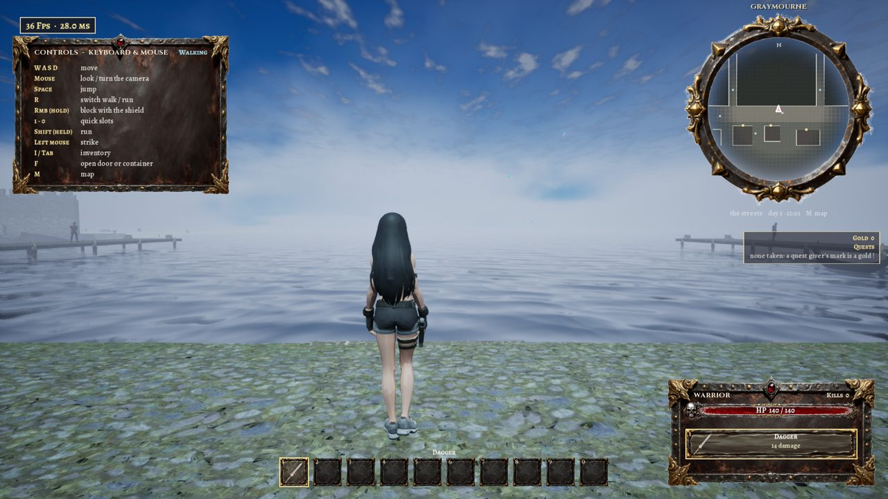
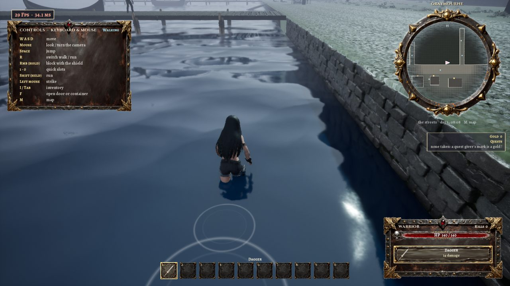

# Graymourne

A fog-bound port on the northern coast where the tide brings in more bodies than ships, with docks and ships moored at them; its dungeon is the sewers under it, entered by a sewer gate (the user's spec of 2026-11-07, [docs/graymourne.txt](../graymourne.txt)). The city is one of the wilderness's towns on the `brokenspire` level, rebuilt as a full-size port; the sewers are a level of their own, `sewers`.

- **Maps:** the city on `/Game/RandomDungeon/Maps/brokenspire` (streamed in the wilds as she comes, like the other towns); the sewers `/Game/RandomDungeon/Maps/sewers` (a Save As copy of `mistward_castle`: the same heroes, balance, loot, traps, special rooms and bosses)
- **Played from:** the round iron sewer gate in the Sluice House's far wall (walked into); the sewers' Escape menu's "Return to Graymourne" brings her back before the Sluice House's door. `sewers` has no menu of its own: played from the editor it starts the generator's `DefaultHero`.
- **C++:** `RD/RDTownPlan.cpp` (the port plan, `TownPlan` 3, `bPort`: the harbour carved along the sea wall, its piers, the quay road, the warehouses, the Sluice House, the harbour's spots and posts; the drawn ground sunk under the harbour, the walked ground at the water 1.7 m down and flat on the piers; nothing grown in the harbour), `RD/RDPort.cpp` (the harbour's water and blockers, the quay's stone face, the piers' decks, pilings and bollards, the ships, boats, wrecks, the dead, gibbets and dock things; the sewer gate), `RD/RDSky.cpp` (the port's fog, `PortFog`), `RD/RDWildWorld.cpp` (the city's place, size and plan), `RD/RDCeilings.cpp` (a vault wears its wall's and ceiling's piece material, the sewers' damp stone)
- **Scripts:** `896_graymourne_city.py` (the city's pieces, effect, people and quests on `brokenspire`, the sewers' level for the town), `897_sewers.py` (the dungeon level and its drowned), `898_improvements8.py block` (the Warrior's block walk, on `sewers` too), `920_wild11.py heads,port` (the list of 2026-11-11: the heads, the harbour open to the sea, its ramps, the splash and rings); tests `884 port,port11,descendsewer`, `888 world,towns`
- **Data:** `SourceArt/graymourne/city.json` (the townsfolk and the quests), `SourceArt/graymourne/port11.json` (the open harbour's ramp, splash and rings), `SourceArt/sewers/monsters.json` (the drowned)

## The city

- **Where:** on the northern coast mid-way across (197 km north of the continent's south edge in the test game, y 0), since the list of 2026-11-11 150 m in from the coast (until then 400 m: the sea 700 m north of its middle), its harbour open to the sea ([below](#the-list-of-2026-11-11-open-to-the-sea)).
- **Its size and plan:** Brokenspire's size (168 tiles, 504 m a side), built from the town's rules with the port plan (`FRDWildTown::Plan` 3): its frame faces north, the Sluice House at the middle (14 m from it measured), the trades (smithy, store, healer, storehouse, tavern, barracks, temple, a chapel), four warehouses along the quay, about 107 homes (3 burned, 31 boarded in one test), the graveyard; the town wall on the sea side pushed out to the frame's edge. Every building has rooms, a door that opens and containers (680 containers, 136 doors in `test_gm10.json`; the warehouses 131 of them).
- **The harbour** (as built until the list of 2026-11-11, and still with `bPortWaterOpen` off): every town's ground is at one height, 12 m or more over the sea, so the harbour is an inner basin of the town's own along the sea wall, 26 tiles deep and the frame's width less 48 tiles: its water 1.1 m under the quay (the wilds' sea material), its drawn bed 2.6 m down, the walked ground under the water 1.7 m down behind invisible blockers along every edge where walked ground meets water; the quay's face Castle Forge's plain wall from the bed to the quay. Five piers 16 tiles long and 2 wide (Medieval Docks' plank decks, Sea Side Docks' pilings every other tile, a pair of mooring posts at each end), each with a longship (Castle Forge's Viking boat) and a small boat (Harbour Collection) moored beside it; two wrecks (Harbour Collection's broken ship) half sunk and listing by the sea wall. She walks the piers and stops at their edges (pushed across one for 2.5 s each way she stayed on its deck, 2.55 m from its middle).
- **The harbour's edges** (PR #25's and #26's reviews, 2026-11-08): the walked ground is level up to every blocker on its land side. A vertex of the walking mesh on a tile's edge is water only if every tile it touches is; until then it took the tile on its +X / +Y side, so where the water lay +X or +Y of the quay the walked ground fell 1.4 m in its last 1.5 m and she slid down beside the blocker (the piers' decks hid it there). The drawn bed drops behind the quay's stone face, under the wall (the vertex on the harbour's edge 10 cm back into the land, the sunk one beside it 5 cm back), only where a quay stands beyond the edge; elsewhere the bed runs on to the edge. Left on the drawn ground's grid it was a 1 m ramp of grass out of the water in front of the face; dropped just in front of the line it covered the face with stretched grass. Measured (`test_gm10.json`): 152 quay edges and 170 pier-deck edges, none lower on the land side than 14 cm; pushed at the water from 3 m inland on each of the quay's three ways she stopped 0.45 m before the line on level ground; the stone shows in the edge pictures.
- **The quay:** the drowned dead laid along it (Pirates Age's dead pirates, 14 in one test) with mourners by them, three gibbets (Mystic Dungeon's), the fishers' racks with their fish and rope (Harbour Collection's three meshes on one origin), nets, crab cages (Docks), barrels; the harbourmaster on the quay, two sailors on each pier.
- **The fog:** within 700 m of the town's middle (eased in from 1.6 km) the wilds' fog is nine times as dense and starts 5 m out instead of 250 m (`PortFog`, `PortFogBoost` 8, `PortFogStart` 500 cm); the warehouses 50 m off stand grey in it. It fills the houses too.
- **The Sluice House:** one stone room (the castle's crypt room kind) over the sewers, labelled "The Sluice House"; in its far wall the Sewer pack's round iron gate (in Junkyard's rusted iron), a dim green-grey light, MERIDIAN's water leak dripping.
- **Its people** (31 kinds, `city.json`): Harbourmaster Edda Strand on the quay (the elder's part: talk, quests), Coroner Thaddeus Pell (the scholar's), Watch-Captain Bram Hollow (the captain's), the trades' keepers (Mother Wren of the Tides' temple, Osric Tarr's smithy, Mags Fennick's store, Sister Morwenna the healer, Old Gull's storehouse, Rosamund Brine's Drowned Lantern), sailors (NPC_Sailor_custom: 10 in one test), dockhands on the quay and in the warehouses (8), fishers at the racks (4), mourners by the dead (4), the harbour watch, a preacher on the quay, children, a fool at the drains, citizens. None of Brokenspire's notables is among them.
- **Its quests** (on its map and over its givers' heads): the harbourmaster's "Down the Old Grate" (go down into the sewers, 30 gold), "Open the Second Sluice" (its tier 2, 70), "What the Tide Brings" (tier 4, 180), each offered once the one before is done; the watch-captain's "Drowned Men Walking" (25 kills below, 50) and, after it, "The Sluice Warden" (a tier's boss, 90); the coroner's "Name the Dead" (talk to a mourner, 15); the board's "Bounty: The Outfall Rats" (10 kills, 25). They count the sewers' own counters (`sewers:enter`, `:tier`, `:kills`, `:boss`).
- **Frame rate:** 2 to 16 a second in the editor's play just after the city was built round her (not measured settled).

## The list of 2026-11-11: open to the sea

The list of 2026-11-11's fifth phase ([docs/improvements11.txt](../improvements11.txt): "in graymourne, the terrain should be shoreline, with the water extending out into an ocean. the player should be able to fall into the water, but be able to walk out via ramps. the docks should not be surrounded by walls ... the sea should extend 2km from the shore with the far away land obscured by volumetric fog, even during a clear day"; "when the player goes in the water, there should be displacement, a splash and a wake"; "some NPCs in graymourne do not have heads"; "near graymourne, it shifts abruptly to coastal regions"). The switch is the generator's `bPortWaterOpen` (`920 port`); C++ `RDPort.cpp` (the ramps, `WaterFaceAt`), `RDTownPlan.cpp` (no wall or tower along the harbour, the harbour on to the section's edge), `RDWildWorld.cpp` (the sea lifted to the harbour's water round the port, `PortLift`; the harbour's way out, the coast round it, `PortFlatten`), `RDWildChunk.cpp` (the wilds' water and ground under a loaded town), `RDWild11.cpp` (the splash and the rings). Measured in `884 port11 -Light` (`SourceArt/brokenspire/test_p11e.json`; the pictures `bs_p11d_port11_*`).

- **The sea round the port is at the harbour's water**: the town's ground stands 76 m over the sea (every town is at Brokenspire's height), so the land, the sea floor and the sea within 2.5 km of the port are lifted by 74.8 m (easing out to nothing by 40 km, so the sea's face slopes at most 0.3 % there by the curve; first over 6 km, 2 to 3 %, PR #50's review): the sea's face is 1.1 m under the quay, as the harbour's. Kethrys Spire and Heaven, placed from the port, are placed from where it stood before (they did not move with it). The town stands 150 m in from the coast, and north of its quay across the harbour's width the wilds' bed lies 60 cm under the harbour's walked floor at the section's edge, deepening out to sea (to 29 m at 2.3 km), the sea over it. Measured along the harbour's middle: water at every sample from 170 m to 2.3 km out, its face at -110 cm (within 1 cm).
- **No walls round the docks**: no blocker along the quay, the side quays or the piers, and no town wall or tower along the harbour (`NearOpenHarbour`); the harbour runs on through the frame's margin to the section's edge, where the wilds' sea goes on. A line 2.5 m up from each of the six quay ramps' tops out to sea meets nothing for 120 m.
- **Falling in and walking out**: she drops from the quay or a pier into the harbour; since 2026-11-12 its floor is 2.5 m under the quay (140 cm of water over it, 60 cm until then) and she swims there ([the wilderness's swimming](wilderness.md#swimming-2026-11-12)). Eight stone ramps lead up out of it ("Port.Ramp": a box in the quay's stone, a tile wide, 8 m long at 17 degrees down to the floor; 6 m to 1.7 m until then), one half way between each two piers and at each end of the quay, and one on each side quay; each is laid clear of the moored ships, boats and wrecks (moved 3 or 6 tiles along the quay if one is before it), on the end of the harbour with more land along it. Measured: pushed off the quay she came down at -85 cm (her middle; her feet on the floor), in the water; put 1 m past a ramp's foot and walked at it 6 s, she came up onto the quay (13.6 m past its top, on the ground, out of the water). Out at sea she wades on the wilds' floor where it is shallow and swims where it is deep; the wilds' bed out of the harbour's mouth lies 1.5 m under the sea at the section's edge (0.6 m until 2026-11-12), so the harbour's swimming goes on into the sea's.
- **The sea under the fog**: from the quay on a clear noon the sea runs out into the port's fog and nothing beyond it shows (`bs_p11d_port11_mouth`); the fog is the port's (`PortFog`, above).
- **The splash and the rings**: a splash where she comes into water (the harbour's or the wilds'; ArtemisTemple's single splash at three times, bigger for a fall), and rings on the water's face: a big one where she came in, one every 0.22 s behind her as she wades (her wake), one every 1.1 s round her as she stands. She is in once her feet are 5 cm under the face and out once they are 10 cm over it, and a splash comes at most once a second (PR #50's review: a capsule at a shore's edge would have splashed every few frames). The rings are our own (`M_RD_WaterRing` on a plane, growing from 25 to 140 cm and fading over 1.3 s): none of the project's ripple effects showed on the harbour's water by day (the screening: of nine candidates only the splash showed). Measured: one splash as she fell in, 6 rings in 2 s of wading, 6 on the water at once. The effects are asked to compile when play begins (in the editor the first splash otherwise came 9.4 s late). Since 2026-11-12 the splash is heard (Player.Splash) and the water's face itself is displaced round her and behind her ([the wilderness's swimming](wilderness.md#swimming-2026-11-12)).
- **Heads**: ten townsfolk kinds of the cities (Beggar_04 and 05, Kid_04 and 05 bodies, in Vel Morrath, Ashenreach, Graymourne, Kethrys Spire and Heaven) were bodies that end at the neck: the NPC packs carry their heads and hair as separate meshes. `920 heads` finds every def whose mesh's top is within 12 cm of its own neck bone and gives it its pack's separate head and hair. Measured: all 163 people in Graymourne have a mesh 12 cm or more over the neck.
- **The coast round it**: the glacial uplands 22 km south stood 1300 m high and fell to the coast in under 3 km (42 degrees between two samples 250 m apart, `RDWildProbe` along y 0); round the port the land's height over the shore is scaled down (35 % within 9 km, back to the whole by 30 km), so they rise from the coast over kilometres (at most 19 degrees between two samples, 12 % on average from the shore to the uplands), and the regions' mixing is wider near the port (2.6 times within 9 km). In play, on six lines across the coast 1 to 4 km either side of the town, no 20 m step drops more than 0.43 m. `wild_seams.py` over the 24 km square round the port: 1 seam (6.04 m, 14.6 km out, in the hills) against 161 the same square had without the open sea (`-NoPortSea`: the town's raised ground standing over the sea as a cliff).
- **What changed for the old test** (`884 port`): with the harbour open there is no blocker edge to trace; the step checks there is none (and that the pier holds her while she stands on it).

## What every town has

The city is built by Brokenspire's code, so what the user's lists of 2026-11-04 and 2026-11-07 gave the town is here too ([Brokenspire's](brokenspire.md#the-list-of-2026-11-04) [lists](brokenspire.md#the-list-of-2026-11-07)): the day and night, the sky, the weather and the town's music (the wilderness's), the port's fog on top of them; the animals' boxes and the pens' gates, the signs' painted faces, the tavern's candles and lamps, the mill's sails on its axle, the cobbled strip down each straight street, the open ground's rise and fall, the gardens' harvests, the kitchens' ovens and the tables' food; the boarded windows' planks' boxes (31 boarded homes in `test_gm10.json`), the barracks' dummy and target that rock when struck, the panels' held keys; the Warrior's slow block walk (in the sewers too). Its gate's portcullis stands raised (she comes to it from outside; only Brokenspire's is kept as she left it), and a lever each side lowers it. None of these has been measured in Graymourne: the tests measured them in Brokenspire ([TODO.md](../../TODO.md)).

## The sewers

- **Its floors go down** as Vel Morrath's catacombs (`bTierFloors`: each tier 4.5 m under the one before, ramps of 4 tiles between).
- **Its halls by tier:** tiers 1, 2 and 4 the sewer's brick (the Sewer pack's brick walls and concrete floor tiles, in damp copies darkened toward green-grey: `MI_Sewer_DampBrick`, `MI_Sewer_DampFloor`; "Sewer"), tier 3 the founders' vaulted cistern (the castle's "Castle" theme), tier 5 both mixed; by every room's walls the drowned things (`ThemeProps`: sludge, rags, rubbish, dead men, Underwater Odyssey's barrels, crates and ropes). Only tier 1's first hall has been seen, and it keeps the castle's great-hall furniture (throne, carpet, banners) in the saved start section, as The War Engine's.
- **Its drowned** (`monsters.json`, eleven kinds among the castle's 56, weighted so that about two in three monsters of a tier are these; 11 of the first hall's 19 in one test): tier 1 the drowned sailor and the drowned deckhand (poison); tier 2 the drowned diver (slow) and the finned lurker; tier 3 the drowned captain (weaken), the gaping deepman (its shell a part) and the hammerhead brute (slow); tier 4 the spearsnout (poison) and the shellclaw (weaken); tier 5 the captain of the tide (weaken) and the abyssal shellclaw (poison), both larger (1.35 and 1.3 times). The crew are Underwater Odyssey's, every clip their own; the fish-men are the Monsters Underwater Pack's on the UE4 mannequin rig, playing the Fantasy Pack's clips (their skeletons made compatible). All eleven measured playing (their bones moving 5.0 to 136 cm in half a second in `test_gd3.json`; 3.7 to 58 cm in an earlier run).
- **Its own record:** its tiers, its start set's loot, its bosses and prisoners and the quests' counters are kept under its key (`DungeonKey` "sewers"), apart from the other dungeons'. No final boss.
- **Her whole state** goes down and comes back with her.

## The test

- `884_brokenspire_test.ps1 "port" <tag>` (`SourceArt/brokenspire/test_gm10.json`): the sea within 1.5 km north, the port plan, the Sluice House near the middle, the harbour's water, the piers, ships, boats, wrecks, gibbets, the dead and dock things (spots and pieces placed), the warehouses, trades and homes, every building's rooms, door and containers; its people's roles and titles; the harbourmaster's panel with her first quest; the fog settled (`PortFog` 1, the world's fog starting 5 m out at density 0.18); a pier walked (her feet on its deck, pushed across it both ways she stays on it) and nothing but the port's pieces on it; every blocker of the harbour traced 30 to 150 cm either side (the land side level on every way: 152 quay edges and 170 pier-deck edges, none lower than 14 cm; a deck's edge told by the trace hitting its planks) and she pushed at the water from 3 m inland on each way the quay has (stopped 0.45 m before the line, on level ground), a picture down at the quay's face from there (`gm_edge_*`); the gate's dry run (walked into, it would open the sewers); pictures of the harbour from the quay, the quay from a pier, out from the pier's end to the harbour's far side (`gm_mouth`), the dead on the quay and the sewer gate.
- `884_brokenspire_test.ps1 "port11" <tag> -Light` (`test_p11e.json`, the list of 2026-11-11): the switch on; 8 ramps; from each of the 6 quay ramps' tops a line out to sea 2.5 m up meeting no wall, tower, parapet or blocker; the wilds' sea from 170 m to 2.3 km out along the harbour's middle, its face at the harbour's water; on six lines across the coast 1 to 4 km either side the largest 20 m drop (0.43 m); pushed off the quay: in the water on its floor, a splash; wading away from the ramp 2 s: still in the water, 3 rings or more made and 2 or more on the water at once; put past a ramp's foot and walked at it: out on the quay; every townsperson a mesh 12 cm or more over the neck; pictures of the splash, the wake and the harbour's mouth on a clear noon. `port` passes with the harbour open (`test_p11e.json`).
- `884_brokenspire_test.ps1 "descendsewer" <tag>` (`test_gd3.json`): the Warrior made different in the city, through the sewer gate into `sewers`: her state as she left and as she came in the same; its key, title and floors; the menu's "Return to Graymourne"; the drowned kinds and the drowned in the first hall; one of each kind spawned in a row, each one's clips playing, a picture of the row; the counter `sewers:enter` at 1. Changed again below and back by the menu: the city built round her again, she stands at `ReturnAt` (0.0 m), 2.5 m before the Sluice House's door, on the ground. In `test_gd3.json`: 57 lines down, 58 up, all the same; the start set at the city's level (85 cm); the tiers' themes Sewer, Sewer, Castle, Sewer, Mixed; 11 of the first hall's 19 monsters drowned (6 sailors, 5 deckhands).
- `888_wilderness_test.ps1 "world,towns"` (`SourceArt/wilderness/test_s9.json`): Graymourne on the north coast with the sea within 1.5 km, and every town built.
- The packaged game (`pipeline\package_mistward.ps1 -Out builds\graymourne -Test`, 2026-11-07; Shipping): down into `sewers` from the town (`-RDTownGo=dungeon:graymourne`) and out to the port (`-RDTownGo=town:graymourne`: the map's fast travel, in at its gate), each run without a crash; `869` first set the instanced-mesh usage on the harbour's nets, wrecks, fish racks, boats and piers and the sewers' mud and drowned props (16 base materials). The Development package from the same cook (`builds\graymourne_dev`) logged no "missing usage flag" in the port or the first hall. Not played in it: the sewer gate, the deeper tiers and the way back; no picture taken.

## Rebuild notes

1. `897_sewers.py saveas`: saves `mistward_castle` as `sewers` and quits the editor; start the editor again and run `897` (no argument): the damp stone, the Sewer theme's pieces, the props, the tiers' themes, its floors, key, title and town, no final boss, no menu, the drowned; its start section built. The sewers are a copy of the castle as it was on 2026-11-07: a later stage that writes the castle's heroes, items, monsters or pieces must be run on `sewers` too (and `897` again after a stage that writes its monsters; `898 block` does so for the Warrior's block walk).
2. `896_graymourne_city.py` on `brokenspire`, after `882` / `886` / `890` / `892` / `894`: the harbour's and the quay's pieces ("Port.*"), the sewer gate, the effect, `TownDungeons["Graymourne"]`, its people and quests from `city.json`.
3. The C++ (`RDPort.cpp`, the port plan in `RDTownPlan.cpp`, the fog in `RDSky.cpp`): `pipeline\build_cpp.ps1` with the editor closed.
3a. The list of 2026-11-11: C++ first, then on `brokenspire` `920_wild11.py heads,port` after `896` (which takes every "Port." piece out and writes its own; and after the cities' stages, which write their people anew): the heads, the switch `bPortWaterOpen`, "Port.Ramp", the splash, the ring material and its sizes from `SourceArt/graymourne/port11.json`. Check with `884 port11,port -Light` and the probe (`-run=RDWildProbe ... -X=193000 -Y=0 -Half=12000 -Step=25`, then `wild_seams.py`; `-NoPortSea` measures the world as it was).
4. The tests above; Brokenspire's (`884`), Vel Morrath's (`884 holy,descend`) and Ashenreach's (`884 forge,descendwar`) own after anything shared.
5. A game to play: `869_mistward_ism_usage.py` (the editor open; it reads `sewers`' pieces too), then `pipeline\package_mistward.ps1 -Out <dir> -Test` (the editor closed; `sewers` is named to the cook).
