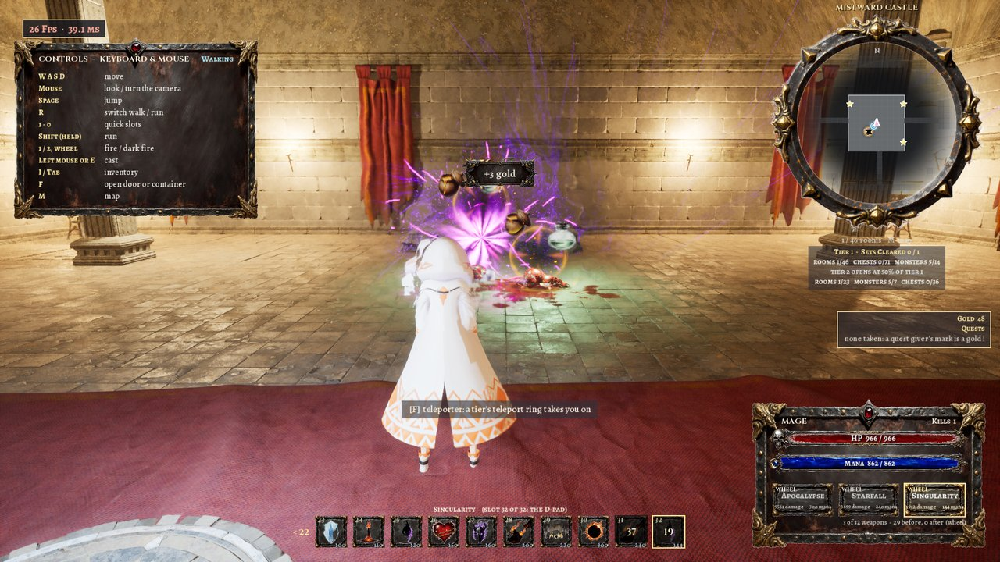
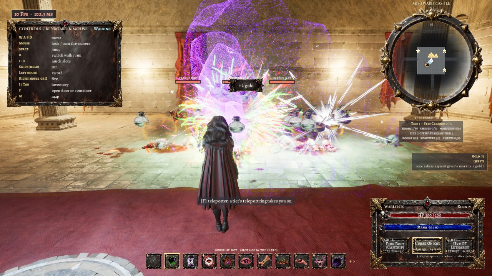
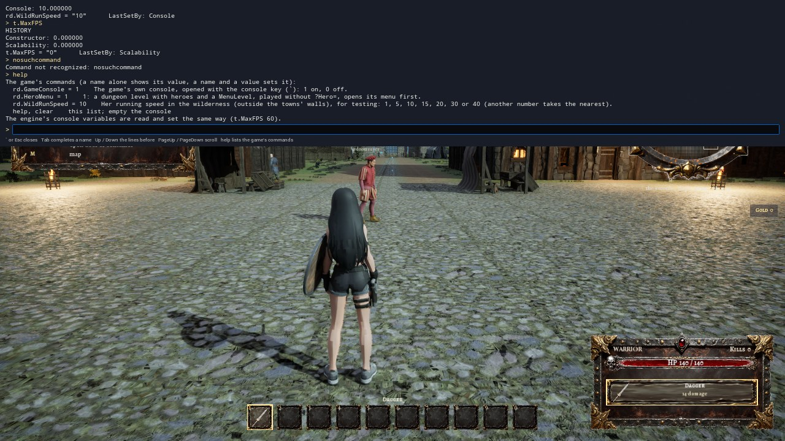

# mistward_castle

[README](../../README.md) · [Levels](../../README.md#levels) · [Documentation](../../README.md#documentation)

## What's in it

| Level | Character | What's in it |
|---|---|---|
| `mistward_castle` (Play opens its menu, `mistward_castle_select`, first; the menu's START opens [Brokenspire](brokenspire.md), the castle's town) | six: the four heroes of `random_dungeonmagic_level5` (the Warrior Warrior3), the Martial Artist (`BP_MA_MartialArtistCharacter`, `ai models/MartialArtist2.glb`: `872`) and the Summoner (`ai models/Summoner4.glb`: `876`) | `random_dungeonmagic_level5` as a castle (`863`-`868`; C++ `RD/RDMistward`, `RDTraps.cpp`, `RDGear.cpp`; see [mistward_castle: the castle](#mistward_castle-the-castle)): "Mistward Castle", five tiers each with a look of its own (the stone dungeon; a castle keep: Castle of Eternal Mist's blind arches, Medieval Castle's floors and ceilings; dwarven deep halls: Dwarven Citadel; then mixed), rooms of other shapes, heights and sizes, tidy furniture, containers that stay open, tiers opening at 50 %, a boss and a guarded magic potency ring at each opening, the Warrior's 22 shields, a torch for every hero, armour carried by the set, thirteen kinds of traps (a spring plate among them) the Rogue sees and disarms, teleporters with their rings, prisoners and caged monsters in the cells (no straw), all her things dropped where she falls, the frame rate in the corner, the mouse on the menu and in the inventory, the inventory walked by a held key or D-pad button, the anvil's lists alphabetical, the monsters' heights measured in play; and the third list (`870`, `RD/RDMistward2.cpp`, on level 5 too): seen traps outlined in red, the inventory's five tabs and stacks, ten quick slots, the helmet toggle, the Warrior's block and her start gear kept, armories' tables to take from, eight special rooms (shrine, healing / speed / mana fountains, arena, trap gauntlet, vault and key, throne room), twenty boss slashes for her weapons; the Martial Artist (`872`: fists, knives, chi attacks, a dash); and (`879`) monsters that shoot, meaningful names over the bars, an arena with no way out and an audience, vaulted and domed ceilings, autoplay; and (`875`-`877`) harvests, recipes by tier, scrolls and the Summoner; and (`880`) the Rogue's stealth and the six heroes balanced against each other tier by tier; and (`889`) Aurorim, the final boss of tier 5, and the door back to Brokenspire; and (`898`) the Warrior's slow block walk; and (`RD/RDConsole.cpp`) the game's own console in the Shipping game. Its Save As copies are the towns' dungeons: [Vel Morrath's catacombs](vel_morrath.md), [The War Engine](ashenreach.md) and [the sewers](graymourne.md) |
| `martial_arts` | the Martial Artist alone (`BP_MA_MartialArtistCharacter`) | One room of `mistward_castle` to try her (`873`; the generator's `bOneRoom` and `bUnlockAll`): the great hall alone (30 m, no doors), all ten of her chi attacks with infinite mana and no monster needed for them to go off, her fists, dodge and dash, three monsters of tier 1 that come back after one falls. See [the Martial Artist](#mistward_castle-the-castle) |

## mistward_castle: the castle

`mistward_castle` (stages `863`-`868`, the user's list of 2026-10-26 in `docs/improvements.txt`, and their second list of 2026-10-27) is level 5's game (a Save As copy of `random_dungeonmagic_level5`: its four heroes, menu, armour, weapons, spells, rings, crafting and tiers) rebuilt as a castle, with these rules on top. Each is a switch of its own on the generator (`ARDDungeonGenerator`, "Mistward" category; the menu's `ARDHeroSelect.bMouseUI`), off on every other level: `random_dungeonmagic_level5` plays as it did. Play it from `mistward_castle` (its menu opens first) or `mistward_castle_select`. Its test is `868_mistward_test.ps1` (`868_mistward_test.py`: 39 steps in the dungeon in its full plan (32 until the list of 2026-10-31b, 22 until the list of 2026-10-30, 13 until the third list), the balance trials (`balance`, a plan of its own) and a menu step; `test_m6all.json`: the 39 after the list of 2026-11-01 and its review (37 ok: teleport and cells were held by an arena that session's sets had put her in; in the full plan's order again both ok, `test_m6tc.json`; the run before the review's fixes had all 39 ok), `test_b.json`: the balance trials, results in `SourceArt/mistward/test_<tag>.json`; `test_t10.json`: all 22 in one run, about 7 minutes; `test_l5.json`: the third list's nine on `random_dungeonmagic_level5`; `test_m5.json`: the menu; `test_m3done.json`: all 29 steps after the list of 2026-10-30; `test_m4all.json`: the 32 after the list of 2026-10-31; `test_m4m.json`: the menu with QUIT GAME; `test_r2.json` / `test_r3.json` (2026-11-06): basics, tiers, layout and traps again (the chain's blows once sampled as one, ok when run again); `test_m8b.json`: `block` after the list of 2026-11-07; `test_con.json`: `console`). Steps outside the full plan, run by name: `menu` (the menu level), `balance` (the trials), `martialroom`, `chilook` and `quickbar` (`-lv martial_arts`), `finalboss` (it ends in Brokenspire: last in a plan), `console` (the game's own console) and `catacombs` (`-lv vel_morrath`: [vel_morrath.md](vel_morrath.md)). Its reels are `MistwardCastle_Heroes5_Showcase` (the six heroes, the Summoner the sixth: fighting at all five tiers, a harvest, new terrain), `MistwardCastle_Heroes4_Showcase` (the five heroes, the Martial Artist the fifth), `MistwardCastle_Heroes3_Showcase` (the third list: each hero's new things and the eight special rooms), `MistwardCastle_Heroes2_Showcase` (the four heroes after the second list) and the first, `MistwardCastle_Heroes_Showcase` (4:38). The third list (`870`, below) is on `random_dungeonmagic_level5` too, and `868` runs its nine steps there (`-lv random_dungeonmagic_level5`).

**The castle.** Its name, "Mistward Castle", is on the menu over CHOOSE YOUR HERO, over the minimap and on the big map's plaque. It has five tiers (1, 8, 16, 24 and 32 sets of rooms round the great hall), each with a look of its own (`864`, the user's choice):
- tier 1: the stone dungeon and crypt (the dungeon's own pieces);
- tier 2: a castle keep and its cells (Castle of Eternal Mist's blind arched walls, Medieval Castle's stone floors and wooden ceilings);
- tier 3: dwarven deep halls (Dwarven Citadel's brick and hall walls, floors and ceilings; until 2026-10-27 one of its floors, the main hall's pillar floor, had no collision and she fell through every room it floored: `868` now traces every room tile for a floor);
- tiers 4 and 5: the three mixed, a look for each set of rooms.

A theme's pieces are the generator's `Pieces` named `<Theme>.<Name>`; a piece a theme does not have falls back to the plain one.

**Brokenspire, its starting town** (the user's spec of 2026-11-02, `881`-`884`, the generator's `bTownLink`; [Brokenspire](brokenspire.md)). The hero menu's START opens the town now, a new game each time (AUTOPLAY still opens the castle). She comes into the castle through the town castle's Mistgate, with everything she carries, wears and has learned, her hit points and mana and her purse; the tiers she has opened this game stay open and the first set's containers she opened stay opened. Kills and containers give gold here too, and the town's quests count her kills (by kind), the bosses, the prisoners freed and the tiers opened. An arch in the great hall (F) and the Escape menu's **Return to Brokenspire** take her back to the town, before the castle's door. The Escape menu's "Choose another hero" says it starts a new game. Since the wilderness (2026-11-03) the castle's Escape menu reads Resume, Save the game, Load a game, Options, Return to Brokenspire, Choose another hero, Quit ([the save](wilderness.md)): a save made in the castle opens the castle at its own start, with her things and its tiers. The hero menu's CONTINUE (C or the pad's X) loads the newest save (not yet tested).

**Rooms of other shapes.** About 60 % of the rooms (`ShapedRoomShare`; never the prison or the great hall) are round, octagonal, hexagonal, triangular, a diamond, an L, a T or a U, or have a dome, a pyramid, a stepped pyramid or a high ceiling. Their tiles are cut from the rectangle, keeping the way to every door; walls follow the shape; the ceilings stand at each tile's height with risers between the steps. The maps draw the shapes (`FRDMapRect::Mask`). Measured in 7 generated sets (`868`'s layout step): 71 shaped rooms of every kind (8 each of octagons, high halls and stepped pyramids, 7 pyramids, 6 each of circles, hexagons, triangles and U's, 5 L's, 4 diamonds, 4 T's, 3 domes), each one's tiles fewer than its rectangle's and the domes' and pyramids' ceiling heights varying.

**Rooms of other sizes** (since 2026-10-27, from a stream of their own so that nothing else in the layout moves): a room is a small chamber (3 or 4 tiles a side, 9 to 12 m) one time in six, a long gallery (the block's 10 tiles by 3 or 4) one in six, and the block's largest (10 × 10) one in ten; the rest keep their kind's sizes (5 to 10 tiles). Never the great hall or a prison. Measured in those 7 sets: of 288 rooms, 41 small chambers, 37 galleries and 37 of the largest.

**Furniture that never gets in the way** (`bTidyFurniture`):
- Each piece's footprint is its mesh's box as built (or its nominal size where that is bigger, centred where the box is).
- A piece is placed only where its footprint meets no other: two beds or two chests never overlap. Pieces may touch by 1 cm at most (0.5 cm under their sizes on each side; 6 cm until 2026-10-27, which let a chest stand into a bed's foot board).
- A barracks chest stands at its bed's foot, 10 cm clear of the bed's frame as its mesh measures.
- A container also needs 95 cm in front of it, clear and on its room's floor, so it is never boxed in between beds or behind a table.
- Measured on the meshes as built in 7 sets (2342 pieces of furniture, 2104 containers): no two overlap by more than 1.5 cm, every container's way in is clear and on its room's floor, and no container stands between two beds. Pictures of tier 1's barracks are taken for a look.

**Containers stay open** (`bContainersStayOpen`): F opens a chest once; F again does nothing and no longer offers it, so she cannot close one; its set of rooms built again builds it open.

**The 50 % rule** (`TierOpenShare` 0.5; 75 % until 2026-10-27, the user's choices): a tier opens when the tier before has half of its rooms explored, half of its monsters killed and half of its chests and trunks looted, each counted over all of its sets. A set she has not reached yet is counted by a census: planned and furnished in a count-only mode, a few milliseconds a set, two a frame. Tier 2's eight sets hold about 340 rooms, 100 monsters and 800 chests and trunks, so about 400 of those must be looted before tier 3 opens. Measured kill by kill in the start set (14 monsters): tier 2 is shut at 6 killed and opens at the 7th.

**When a tier opens** (2 to 5):
- **A boss.** The strongest kind of the new tier waits in a room of the tier before that she has explored (not the one she is in), with 3 to 6 monsters of the new tier round it. It is 1.35 times bigger, has three times the hit points and hits 1.6 times as hard. The notice says where ("TIER 2 IS OPEN - A BOSS WAITS IN THE TREASURY (SEE YOUR MAP)"); the maps mark it with a crowned red ring, and a far one is pinned to the map's edge, the way to it.
- **A guarded ring.** If she has found neither magic potency ring of the tier before (1 or 2 when tier 2 opens, 3 or 4 for tier 3, and so on: the list's words, for every hero; until 2026-10-27 it was her kind of ring), the first is put into a container of a room she has explored, guarded by 4 monsters of the new tier. If every container there is already open, it lies on the floor instead (F takes it). The maps mark it with a gold ring until she has it.
- Both are put back if their set of rooms is dropped and generated again.

**Shields** (the Warrior; `SourceArt/mistward/shields.json`, the user's table of the 22 fantasy shields of `docs/objects.md`):
- Each shield has a damage rating, a speed rating and a durability. A blow takes damage × 4 % less (after her armour), and she moves (10 − speed) × 3 % slower (the user's choices).
- The shield loses what it takes and breaks at 0; a spare of the same kind takes its place.
- Shields are found in the containers by rank: the best five in tier 5, down to the plainest in tier 1 (measured in the generated sets' containers: all five of tier 1's, all four of tier 2's, four of tier 3's five, each of its own tier's ranks). Rank 17 is "Village Shield (blue and white)", as the table names it.
- Since the list of 2026-11-08b she starts with no shield ("the warrior should have no default shield"; `899 noshield`: on every map of the package, and the shield her weapons drew on her forearm taken off them); until then the worst shield, the Painted Viking Shield (the Heater Shield until the third list). A shield she finds is held only with a one-handed weapon: not with a spell, a bow or a two-handed sword. Measured (`868 startgear`, `shields`, `death`, `block`, `test_m9a.json`, `test_m9b.json`): none worn at the start, her found Kite Shield dropped at a fall and back on when she took the pile up, the block with a shield given as before.
- In the inventory's SHIELDS section Enter puts one on or takes it off. Several are carried, each with its own durability.
- At the anvil a shield breaks down into iron and steel or timber and iron, × its tier.
- Each shield's grip on her forearm is measured from its mesh: its face, which way is up, which end is wider. Six faced the wrong way in play and are turned in `shields.json`.

**Armour by the set** (`bArmourStacks`): two of one set are two sets, each with its own durability, and the anvil breaks a set down by its type (`shields.json`'s `armour_breakdown`). The worn one, if it is the last, is refused.

**The torch.** An anvil makes it from 2 wood (any kind), 2 straw rope and 1 oils. Any of the four heroes carries it in her left hand: the Medieval Castle pack's torch in her fist, its head turned 20° up, the dungeon's torch flame on it and an 80 cd light. It takes her left hand: the Warrior's shield is slung while it burns. Its light measured in the game's picture: round her, 138 lit against 99 put out (mean brightness of 255).

**Her things where she falls** (`bDropOnDeath`):
- All of her found equipment (found weapons, armour, shields, rings, potions, materials, the torch, teleport rings) drops in a pile where she fell. Her hero's own weapons and spells stay with her, and since the third list the Warrior's starting shield too (hers for good: `bKeepStartGear`).
- Each kind of thing is shown over the pile as its picture, twelve to a ring and a wider, higher ring for more, with Loot Drops Vol. 2's effect and a light. Measured with 16 kinds: 16 pictures.
- She comes back in the great hall. F at the pile takes everything back, each as worn as it was, the shield she wore back on her arm; the maps mark the pile with a sack.

**Traps** (`RDTraps.cpp`, 13 kinds, from streams of their own so the layout does not change; about 30 % of rooms and 12 % of hallway stretches):
- **Mechanical**: a pit (it drops and holds her), darts from the walls, a deadfall of stones, a crusher's block, a snare (it holds her).
- **Magical** (the spells' own effects): a glyph that bursts, a ward that throws her back (it sets itself again), a poison emanation (it slows and hurts while she is in it), a cursed rune stone (it weakens her blows).
- **Complex**: a chain (a snare, then stones, then a rune), and a lingering trap that does worse every moment she stays.
- **Transport**: a teleport trap carries her to another room of the tier; a spring plate on a room's way (directional, added 2026-10-27) hurls her along it to the room's far end. Either way she lands in three monsters or in a ring of glyphs going off one after another.

Each kind is set off on her in `868` and its own effect measured:
- what it takes off her, and whether it holds her;
- the curse's weakening and the emanation's slowing;
- the ward's throw (her speed);
- the chain holding her before its first blow;
- the lingering trap's worst blow coming after its first;
- the live particles of the magic ones' effects;
- where the teleport and the spring plate put her, and what waits there.

The Rogue alone sees them, within 8 m (a message and a red X on the maps). F by one disarms it: a moment's stillness, a bar, and a fumble sets it off (15 %). For everyone else they go off as they step on them.

**Teleporters** (`bTeleporters`):
- A pad (MysticDungeon's mosaic ring with a portal effect) stands in the great hall, and one in each tier's first set of rooms, that tier's ring lying on it.
- F takes the ring. The ring used from the inventory carries her to the great hall's pad.
- F on the great hall's pad takes her to any tier whose ring she holds (G picks which); F on a tier's pad takes her back. Tested both ways for tier 2, and tier 3's ring carrying her to the great hall's pad, which then offers tier 3.

**Prison cells** (`PrisonerDefs`; the NPC Prisoners pack's ten prisoners with their own idle and walk):
- 60 % of the cells hold someone.
- A prisoner: F at the door unlocks the cell, and the prisoner thanks her, gives her a thing of the tier, walks out and is gone.
- 35 % hold a monster instead. It unlocks its own cell as she comes within 5.2 m, walks out through the door's gap and comes for her (the test follows it 2.7 m out of its cell to strike her).
- A cell at the end of a row whose door would open against the room's wall is barred all across (the wall left too narrow a way out); it stays empty.
- Since 2026-10-27 the cells hold no straw: the mound was as tall as she is and read as a big rock in every cell. A cell holds a prisoner, a monster or nobody (in 7 generated sets: 104 cells, 44 prisoners, 21 monsters, 39 empty).

**The mouse** (since 2026-10-27; `bMouseUI`):
- **The hero menu's music** (the second list of 2026-11-02: thematic, not the dungeon's) is VHCMusic's Fantasy RPG Complete OST menu loop (90.5 s, a seamless loop by measurement). It is a different pack and composer from the dungeon's Epic Fantasy and Dark Fantasy Ambience tracks. It plays flat and looped at 0.8 times the saved overall and music volumes, faded in over 2 s (`ARDHeroSelect::MenuMusic`; `SourceArt/mistward/menu_sounds.json`, `885`). Nobody here hears it: it was chosen by its pack, title and stems (brass, choir, percussion, strings, woodwinds) and measured (-11 dB mean).
- On the hero menu the pointer stays shown and free; the name it is over gets a lit frame. A click on a name shows that hero, a click on her name again or on START starts, and the arrows step.
- In the inventory (and the repair list) the pointer is shown while it is open. Moved onto a row it chooses it, a click on the chosen row uses it (a double click uses it once), and the wheel scrolls the list three rows a notch while the chosen row stays. A row chosen by the pointer holds the list still. The keys work as before. The anvil's panel keeps the keys, the wheel and the click.
- The game's own mouse mode comes back when the list closes and when the menu opens the dungeon, so the camera turns with the mouse.
- `868` sends these the way the devices do: into Slate, then the viewport, then the player controller.
  - It hides the editor's windows that lie over the game's view while it runs: a floating Message Log once took the clicks.
  - The menu step clicks names, arrows and START, and follows START into the castle as the Rogue.
  - The inventory step holds S and W, the D-pad down and up, points at a potion, clicks it (drunk) and turns the wheel.

**Smaller things**:
- The frame rate and frame time are shown in the upper left corner, over the controls, in normal play: since 2026-10-27 larger, on a dark plate with a frame, green, amber or red by the rate.
- Holding a key or a D-pad button in the inventory walks the list: after 0.35 s, a line every 0.08 s.
- The anvil's lists are in alphabetical order: the recipes, then what she can break down (both checked).
- The Plate Knight's Sword is found in tier 2, not tier 1.
- The 29 found weapons, the 22 shields and the torch have pictures (`867`: rendered from their meshes with alpha; the found weapons had none before).

**The third list** (`870`, the user's list of 2026-10-27 in `docs/improvements2.txt`; on `mistward_castle` and on `random_dungeonmagic_level5`, each a switch on the generator, "Mistward2" category):
- **Traps the Rogue has seen are outlined in red**: the trap's plate or rune tinted red all over (an overlay material), a red disc at the reach it goes off within with a wide pulsing rim, and a red glow over it. Measured in the game's pictures from the same place and camera, her body hidden: a deep red covers 36 % of the area round a pit for the Rogue and 0.2 % for the Warrior (who sees no trap: nothing is outlined).
- **The inventory in five tabs**: weapons; armour (shields, the torch and the helmet too); potions and food; crafting (materials and repair items); magic (slashes, rings, keys, teleport rings, tomes). Q / E, LB / RB or a click on a tab changes it; E no longer uses (Enter or a click does). Each tab shows how many lines it holds. Copies of a found weapon as worn as each other are one line ("x 2"); one worn down becomes a line of its own.
- **The anvil says how many are left** of what it breaks down: "You break down the kite shield: 8 iron ingot, 4 steel ingot (1 left)".
- **The Warrior's start gear**: no armour, the worst weapon she can wield (the dagger, 11 a blow) and, until the list of 2026-11-08b, the worst shield (the Painted Viking Shield; none since, on the package's maps: level 5 keeps it). Both are hers for good: neither wears or breaks, and when she falls they stay with her (her found things drop; a found shield she wore goes back on when she takes the pile up). Her shield is held with any one-handed weapon.
- **Armories' tables** hold weapons and shields of the set's tier, laid flat (16 in the start set's armory). F takes the nearest and it is gone from the table.
- **The quick bar** for weapons and spells (and abilities), drawn as the hotbar: ten slots at least, 1 to 0 using the first ten; it holds every weapon she has (2026-10-29, the user's: the Martial Artist's eleventh had no slot and the D-pad never reached it), so with more than ten it grows past the tenth, the D-pad left / right steps through every filled slot, and the bar's ten pictures scroll to the one chosen ("< 3" / "2 >" at its ends say how many more each way; the slots past the tenth are numbered 11, 12... and have no key). In the inventory a weapon's number puts it in that slot (the one there moves to where it came from, or to a free slot), its own slot's number again takes it off the bar and it stays off (weapons found later still fill empty slots); the gamepad's Y (or the right mouse button) puts it in the slot the D-pad chose, one past the last making a new slot. Abilities go on it the same way from the weapons tab's ABILITIES (the Martial Artist's Dash and Dodge, the Rogue's Dodge): a number key makes an ability at once; the D-pad makes it ready ("DASH READY", its slot framed in blue) and the attack button makes it. New weapons fill the first empty slot.
- **The helmet**: H (or its line in the armour tab) hides the worn set's helmet and shows it again. A helmet is found on the mesh: the sections the head bone moves. 12 of the 27 sets have one; the other 15 have none (checked in their fit pictures).
- **The Warrior's block**: the right mouse button or LB held (LT until the second list of 2026-11-02, below) raises her shield (the boxing pose, her shield hand 31 cm higher). A blow then takes the shield's share + 30 % (a kite shield: 24 % to 54 %), she walks at half speed (311 to 155.5 cm/s) and the shield wears five times as fast (9.6 off a blow of 40 unblocked, 108 blocked); she cannot swing while blocking. The Mage cannot block. Since the second list of 2026-11-02 the block is an upper-body layer in her AnimBP (`885`: a layered blend from `spine_01` up over her locomotion, the block clip held at 1.6 s, weighted by `BlockAlpha`, which the combat component eases): her legs walk under the raised shield when she moves while blocking (the user's: "her legs should still be moving"); until then the held clip was the whole body's and her legs stood still. On the gamepad LB held blocks for the Warrior, and LT switches her run as it does every hero's (the user's of 2026-11-02, also on level 5 and in Brokenspire; until then LT blocked and the left stick pressed switched her run, which her controls panel had stopped listing). Since the list of 2026-11-07 (`898 block`, `BlockMoveSpeed`; on every map of the packaged game, level 5 keeping the half speed) she walks only ahead or back while she blocks: the stick's up and down walk her along her own facing at 90 cm/s, back at 72, whether she walks or runs; its left and right turn her (120 degrees a second) and never move her, so the shield stays before her ([Brokenspire's list of 2026-11-07](brokenspire.md#the-list-of-2026-11-07)). Measured (`868 block`, `test_m8b.json`): 311 cm/s, 90 blocking; a kite shield's share 24 % and 54 % blocking, 9.6 and 108 off the shield; her feet swinging 53.7 cm and her shield hand up as she walks blocking; LB blocks, LT switches her run, the Mage cannot block.
- **Eight special rooms** (about one room in five of each set; never the great hall): a **shrine** (F: one of three blessings for 90 s: might +25 % damage, the bulwark 25 % less from blows, swiftness +20 % speed; once), a **healing fountain** (60 % of her hit points), a **fountain of speed** (+30 % for 45 s) and a **fountain of mana** (her mana full), each once; an **arena** (as she steps in its doors shut; three waves of 2 + the tier's monsters; won, the doors unlock and three things of its tier lie in the middle); a **trap gauntlet** (a dozen or so traps of the tier, a chest of three things at the far end); a **vault** (locked; its key lies in a chest of another room of the set; F with the key opens it for good; its chests hold things of the tier above); a **throne room** (a dais, the royal throne, carpet and braziers; a usurper, a boss of the tier, waits before the throne). Each measured in `868` in the start set and four tier-2 sets.
- **Slashes** (the Stylized Slashes pack, 20 slashes in five tiers of four; `870`'s table): a slain boss or usurper gives a random slash of its tier. In the inventory's magic tab Enter on a slash, then on a weapon, puts it on (any weapon the Warrior can wield, bows and crossbows too: the user's choice); T takes it off for another weapon. The slash's swing effect plays on each swing and its burst on each hit, it adds its bonus damage, and its effect takes place:

  | Tier | Slash | Bonus | Type | Effect |
  |---|---|---|---|---|
  | 1 | Ember | 6 | Fire | burns: 50 % more over 3 s |
  | 1 | Frost | 5 | Frost | slows the monster 25 % for 2 s |
  | 1 | Venom | 4 | Poison | 12 over 4 s |
  | 1 | Gale | 5 | Physical | her speed +10 % for 4 s |
  | 2 | Blood | 9 | Blood | 30 % of the damage back to her as hit points |
  | 2 | Wave | 9 | Water | pushes the monster 3 m |
  | 2 | Verdant | 8 | Nature | 1.5 hit points a second for 5 s |
  | 2 | Petal | 8 | Physical | 15 % of blows on her miss for 3 s |
  | 3 | Crystal | 14 | Crystal | absorbs her next blow taken (once every 6 s) |
  | 3 | Storm | 15 | Lightning | chains to 2 more monsters within 5 m at half damage |
  | 3 | Ink | 13 | Dark | the monster's blows miss 40 % of the time for 3 s |
  | 3 | Tide | 14 | Water | an arc before her: slowed 20 % and pushed 4 m |
  | 4 | Inferno | 24 | Fire | explodes within 2.5 m, burns 40 % more over 4 s |
  | 4 | Shadow | 22 | Shadow | the monster takes 25 % more damage for 5 s |
  | 4 | Neon | 20 | Arcane | her attack speed +20 % for 5 s |
  | 4 | Pulse | 20 | Energy | 25 % of blows on her turned back on the attacker for 4 s |
  | 5 | Magma | 36 | Fire | burning ground 3 m round, 10 a second for 4 s |
  | 5 | Void | 34 | Void | pulls monsters within 5 m in and slows them 25 % |
  | 5 | Overload | 38 | Energy | holds the monster 1 s (once every 8 s each) |
  | 5 | Prismatic | 32 | All | each hit adds burn, slow, poison or drain at random |

  Each of the twenty is measured in `868` on a monster (or on her): the bonus, the burn's and the poison's damage over time, the slow, curse and blind shares, the push, the healing, her regeneration, evasion, haste, deflection, the crystal shield taking a blow, the chain striking the two near and not the far one, the inferno's burst, the magma's ground, the void's pull, the stun and its wait, the prism's pick; and a real swing and a bow shot with a slash on.

**The Mage's two great tomes** (`871`, the user's of 2026-10-28; on `mistward_castle` and `random_dungeonmagic_level5`): Null Sanctum costs 220 mana and Apocalypse 300, more than her pool can ever hold (100, 200 with the best Magic Potency Ring). Learning Null Sanctum's tome makes her pool 220, Apocalypse's makes it 300 ("Your mana pool grows to 300"; the tome's description says so beforehand). The pool is at least that from then on: a ring no longer adds past it. The numbers are `spells.json`'s `tome_mana`. The Mage only: the Summoner, who learns the same tomes, keeps her own pool. Measured in `868`'s `tomemana` step on both levels: 100, 200 ringed, 220 and the sanctum cast (220 taken), 220 with the ring off, 300 and Apocalypse cast (300 taken), both spells and the 300 kept through a death, back to 100 at a restart; the Summoner's pool unchanged. Spells learned from tomes now stay through a death too (her hero's starting list replaced them all, and she forgot every tome she had read).

**The Martial Artist** (`872`, `873`, C++ `RD/RDMartial.cpp`; the user's of 2026-10-28; `ai models/MartialArtist2.glb`): the fifth hero of `mistward_castle`'s menu (and of its generator's heroes, before the Summoner: level 5's was off the menu, the castle's own since `876` is the sixth on it) and the only one of `martial_arts`. She fights with her fists and feet: two basic attacks, Tripo's own `box_01` (a boxing combination) and `front_kick_02` (a front kick), each played whole with its blow where a hand or foot moves fastest (44 damage a blow, 1.6 m: her damage, below). She wields knives and daggers only (the nine short blades of the weapons table, one in each hand with the Rogue's stabs remade on her rig, +30 % damage: `FRDHeroDef::TypeBonus`), wears light armour only (the seven light sets fitted to her body), and wears HP and Dexterity rings; the Dexterity ring adds to her punches, kicks and knives but not to her chi (`DexterityTypes`). She has the Warrior's 140 hit points and the Mage's 100 mana (2 a second back). B dodges (a roll made for her rig); V, the right mouse button or RT dashes her at the monster ahead (up to 5 m, stopping short of it) and into a strike. **Chi attacks** (mana; `SourceArt/martial_arts/martial_arts.json`, the user's table) strike as unseen bolts: at the blow of each move (made for her in Blender, `martialartist_clips.py`) the force leaves her striking fist or foot, flies after the monster she faces and bursts on it, hurting others within 1.2 to 3 m half as much; it flies 4 m at most (`FRDWeaponDef::BoltRange`) and bursts there. Each has a painted picture of its own on the quick bar and in the inventory (`874`: `chi_<move>`, painted on the InvokeAI server as the spells' were: a fist in wind, a leg in lightning, fists in fire, a kick in smoke, a fist with stars, a leg in blue rings, rods from a fist, fireworks from a heel, a fist in a fireball, a leg in chain lightning; Dash and Dodge have theirs too). Each move's look is on her body while she makes it (the user's of 2026-10-29; `FRDWeaponDef::LimbFx`, the json's `look`: an effect following a hand, calf, thigh or foot bone from one time of the clip to another, or one left where the bone was at a time), and only the Piercing Palm's rod flies. In the castle one with no monster within 4 m is refused and costs nothing:

| Chi attack | Damage (2026-11-01: by its mana) | Mana | Tier | The move | Its look (the effects) |
|---|---|---|---|---|---|
| Straight Punch (start) | 23 (23 until 2026-11-01) | 7 | 1 | the rear fist driven straight out from her stance | a heavy wind round her fist (Stylized Shields' wind, Magic Projectiles' wind trail, a gust ring at the blow) |
| Side Kick (start) | 45 (24 until 2026-11-01) | 17 | 1 | turned side-on, the knee drawn up, the leg thrust out at hip height, the blade of the foot first | lightning round her calf and foot (Magic Projectiles' lightning) |
| Smashing Strike | 63 (25 until 2026-11-01) | 27 | 2 | both fists raised overhead, brought down together | fire wrapping both fists (Stylized Shields' fire, small) |
| Roundhouse Kick | 80 (26 until 2026-11-01) | 37 | 2 | the knee raised out to the side, the shin whipped round through the front at waist height | thick smoky tendrils round her calf and foot (Stylized Shields' ink) |
| Chain Punch | 96 (27 until 2026-11-01) | 47 | 3 | seven vertical-fist punches in turn, the last the strongest | a burst of star-points of light at each fist as it lands (Stylized Slashes' cosmic impact) |
| Rear Kick | 111 (28 until 2026-11-01) | 57 | 3 | a half turn away, the knee tucked, the leg driven straight back at the monster, heel first | glowing blue rings round her thigh, calf and foot (Loot Drops' ring, stood up across the leg) |
| Piercing Palm | 125 (29 until 2026-11-01) | 67 | 4 | from a hand chambered at the hip, a lunging spear-hand thrust | glowing rods on both hands, one flying forward to strike (Magic Projectiles' rod) |
| Axe Kick | 127 (30 until 2026-11-01) | 68 | 4 | the straight leg swung up past her head, then chopped down heel first | fireworks bursting from the kick as it lands (Magic Projectiles' fireworks) |
| Meteor Fist | 140 (31 until 2026-11-01) | 78 | 5 | a crouch, a leap, the fist driven down to the floor as she lands kneeling | a fireball on her fist, trailing flame (Magic Projectiles' fireball) |
| Spinning Kick | 154 (32 until 2026-11-01) | 88 | 5 | a full turn on her left foot, the right leg sweeping through at hip height | chain lightning all along the kicking leg (lightning trails, lightning shields on thigh, calf and foot, a lightning slash) |

**Her damage** (the user's of 2026-10-29: close to what the Warrior does with an average weapon): `872` works the Warrior's out of the weapons table (every weapon by its rules: 8 + 3 x its damage rating, +30 % her melee bonus, none on a bow, one blow every 1.6 - (speed - 1) x 1.05 / 9 s): 28.1 damage a second. Her fists strike once a clip (1.56 s on average at their play rate), so a blow does 44 (it was 14: 9 a second); her chi attacks already did 26.9 a second over their moves, so the user's table is scaled by 1.042 (22 to 31 became 23 to 32). Since the list of 2026-11-01 a chi attack's damage follows its mana (23 x (mana / 7) ^ 0.75: 23 to 154, the table above) and grows 12 % with each tier opened, as her fists do ([the list of 2026-11-01](#mistward_castle-the-castle)). A chi attack's hit no longer hangs on after the move (the user saw the Piercing Palm's rod stay up: its hit effect kept particles 1.5 s; the json's `hit_life` ends it, `FRDWeaponDef::BurstLife`): every move's effects are gone within 1 s of its end.

Two are hers from the start; each tier boss she slays (not a usurper) teaches her the next two ("YOU LEARN SMASHING STRIKE AND ROUNDHOUSE KICK"; the hero's `LockedWeapons`), and they stay through a death. **`martial_arts`** is a one-room level to try her form and function: a Save As copy of `mistward_castle` whose generator plans its great hall alone (`bOneRoom`: 10 × 10 tiles, 30 m, no doors, no hallways, nothing beyond), her alone with all ten chi attacks (`bUnlockAll`), infinite mana (`bInfiniteMana`: nothing is taken) and chi attacks that go off with no monster in range (`bChiWithoutTarget`: the bolt flies straight ahead and bursts 4 m out), and three monsters of tier 1 that come back 4 s after one falls. Measured in `868`: `martial` in the castle (her numbers, a fist's 14, the ring's +100 % on fists and knives (28; a dagger 25.3) and not on chi (22), a chi bolt's mana and damage and the half beside it, refused with no monster within 4 m, the dash 6 m to 0.76 m and its strike, the roll, a light set worn and a medium one refused, the tier boss's two chi attacks, kept through a death, forgotten at a restart) and `martialroom` in the room (one room of 100 tiles, eleven weapons, the monsters coming back, each of the ten chi attacks cast: one bolt, its damage, its hit's particles, a picture as it lands; with no monster at all a bolt bursts 4.2 m from her middle; none of her effects left 2.5 s after) and `chilook` in the room (each move played at a quarter speed: its effects made, on their bones (0.0 cm), pictured at three times from her front right; at full speed, every 0.25 s after the move, what of her effects is left: nothing after 1 s, the Piercing Palm's after 0.25 s), and `quickbar` in the room (as the gamepad and keyboard send them: the D-pad right from her fists through all eleven slots to the Spinning Kick, the bar's pictures scrolled one on, and round to the fists; Dash into slot 3 with the key 3 in the inventory, the Side Kick moved on; the Straight Punch off with its own key and still off when a dagger is found; 3 makes the dash; Dodge on a new thirteenth slot, the D-pad left from the first makes it ready (the pictures scrolled to slots 4 to 13), RB rolls). The Orme set's knee guards stand a little out behind her knees; the other six sit close.

**The user's list of 2026-10-30** (`docs/improvements3.txt`; `875`-`877`, C++ `RD/RDMistward3.cpp`; each rule a switch on the generator, "Mistward3", on the castle only):
- **Harvests** (`bHarvest`; `SourceArt/mistward/harvest.json`, the user's tables): a monster that dies leaves a pile of its parts floating about 1 m over its body (its pictures turning, the loot effect, a light in its tier's colour: green, blue, violet, orange, red); F takes it ("You harvest: 1 faint essence, 1 mutant ichor"). Each kill gives one essence of the tiers up to its own (Faint for tiers 1-5, Dim 2-5, Bright 3-5, Brilliant 4-5, Radiant 5: its own tier's half the time, else one of those below), its family's part half the time where the table has one in that tier, and 40 % of the time one of the materials of any tier (coarse hide, light leather, cured leather strip, epoxy, glue, wood glue, oils); a boss, a usurper and an arena won give 3 essences and 2 parts. The family is the monster's kind's sound set:

  | Family | Part | Tiers it drops in | Who drops it |
  |---|---|---|---|
  | Mutant (11 kinds) | Mutant Ichor | 1-4 | Medic, Soldier, Gunner, Alien, Mutant… |
  | Spider (10) | Venom Sac | 1, 3, 4, 5 | Rat, Parasite Slider, Insect, Bug, Spider… |
  | Troll (6) | Troll Heart | 2-5 | Fat, Tank, Troll, Rock, Titan |
  | Horned (20) | Horn Shard | 2-4 | the orcs, Bear / Bull / Crocodile Warrior… |
  | Dog (3) | Hound Fang | 3-4 | Devourer, Ripper dog, raptor mount |
  | Daemon (5) | Daemon Ash | 4-5 | Exterminator, Daemon, Alfa, Hunter, Nasty |

  The piles belong to the generator, not to their set of rooms: one stays where it lay when its set is dropped and built again. Raise Dead and Corpse Explosion use up a body, never its pile. The draws are hashes of the session seed and the count of harvests, so a reel repeats them.
- **Recipes by tier** (`bRecipeTiers`): the anvil offers a recipe once its tier is open. The 16 potions: Small and Medium (tier 1) 1 or 2 Faint Essence with 1 or 2 Mutant Ichor (healing) or Venom Sac (mana); Large and Uncommon (2) Dim Essence, Troll Heart and Ichor, or Venom Sac; Wondrous and Rare (3) Bright Essence with Troll Heart or Venom Sac; Very Rare (4) 2 Brilliant Essence with 3 Troll Heart, or 2 Venom Sac and 1 Daemon Ash; Legendary (5) 2 Radiant Essence with 3 Troll Heart or 2 Daemon Ash. A scroll for each of the 30 spells (its tier the spell's tome tier): 2 Faint / 2 Dim / 3 Bright / 3 Brilliant / 4 Radiant Essence and 1, 1, 2, 2 or 3 of a part by the spell's school and tier (offense: Venom Sac, Horn Shard, Hound Fang, Hound Fang, Daemon Ash; protection: Mutant Ichor, Horn Shard, then Troll Heart; Curse of Frailty: Venom Sac; Raise Dead: Mutant Ichor; the Abyssal Knight: Daemon Ash); Null Sanctum's and Apocalypse's take 6 Radiant Essence (they skip a 220 and a 300 mana price). A scroll's recipe is offered only to a hero who reads its school: the Mage and the Summoner all four, the Warlock offense and curses, the Warrior, the Rogue and the Martial Artist none. Measured (`868` `harvest`): a tier's monsters (the census of its sets) and its boss, harvested on paper by the game's own draws, give enough for every recipe of that tier and the ones below (tiers 1 to 5: 14, 101, 197, 301 and 397 monsters).
- **Scrolls** (kind Scroll): read from the inventory's magic tab, the scroll casts its spell once at no mana with her own cast clips and is used up; its cooldown is the spell's (a second scroll at once is refused, and the spell learned from its tome waits too). It is cast through a spell weapon that stands after hers for the cast only (`FRDWeaponDef::bScroll`): not on the quick bar, not in the inventory, gone once its bolts are down. A hero who does not read its school is refused ("The warrior cannot read the scroll of fire bolt (offense)").
- **Any equipment broken down** (`bBreakAnyGear`): rings (1 Copper Ingot, 1 Bronze Ingot and 1 Faint Essence a tier) and the torch (1 Wood Log, 1 Straw Rope, 1 Oils) join the weapons, armour and shields at the anvil's BREAK DOWN; a worn ring (the last) and a lit torch are refused. The heroes' own weapons stay theirs.
- **Wood Glue**, found but used by nothing, now goes into the Slickstone (5), the Patch Kit (10), the Repair Kit (15) and the torch (1).
- **The fires' crackle** (torches, braziers, hearths): `sounds.json`'s volumes × 0.2, half of the × 0.4 they had in the reels.

**The Summoner** (`876`, `ai models/Summoner4.glb`; the user's of 2026-10-30): the castle's sixth hero, in the place of level 5's Summoner. 85 hit points, 50 mana (half the Mage's, 1 a second back; since 2026-11-01 4 % of her pool a second, 2 at the start). She knows two spells of the table only, Fire Bolt and Dark Fire, with the Mage's damage and effects (the Mage's spell weapons, cast with her own clip); she learns no tome, but reads every scroll. She wields daggers only (the weapons table's nine short blades, one in each hand with the Rogue's stabs made again on her rig), and they never take a slash; she uses the Mage's equipment: no armour, Magic Potency rings, the torch, potions. Her summons (`FRDSpellDef::SummonKind`, kind Summon) each call one monster of its kind to fight at her side until it falls, as strong as a monster of its own tier, for half her mana pool (`FRDWeaponDef::ManaShare`: 25, 28 with a +10 % ring); a cast past the number she may lead is refused before its mana is taken ("You lead 2 of them already"). She starts with Summon Tier 1; each tier boss she slays (not a usurper) gives her the next (the hero's `LockedWeapons`, one a boss), kept through a death:

| Summoning | Calls | At most | Its tier's strength | The cast (summoner4_clips.py) |
|---|---|---|---|---|
| Summon Tier 1 (start) | the Rotting Soldier | 2 | 60 hit points, 14 a blow | a beckoning call, twice, the hand drawn back to her chest |
| Summon Tier 2 | the Grave Gunner | 3 | 103, 25 | both palms drawn in, then thrust forward with a step |
| Summon Tier 3 | the Orc Skirmisher | 4 | 162, 34 | down on one knee, the right palm struck at the floor |
| Summon Tier 4 | the Alien Defender | 5 | as tier 4's | both arms swept up overhead, then brought down to point at the floor ahead |
| Summon Tier 5 | the Giant Spider | 5 | 299, as tier 5's | a full turn on one foot, arms spread, ending with both hands thrust forward |

Her clips are made for her in Blender (`summoner4_clips.py`): Walk, Run and the hit reactions are Tripo's own, an idle, a quick bolt cast and the five summoning casts are posed and solved on her rig (her arms are 31 cm from shoulder to wrist: the ground strike ends a hand's breadth above the floor). Her death is Animations_Warrior's, retargeted. Measured in `868` `summoner`: her pawn, numbers and weapons, the fire bolt's 25, two soldiers for 25 mana each and a third refused at no cost, the soldiers as strong as a tier-1 one and fighting a monster beside her, a dagger in both hands, a slash refused, armour, an HP ring and a tome refused, a magic ring worn (her summon's mana follows her pool), the torch, a tier boss giving Summon Tier 2 (a Gunner called), kept through a death, gone at a restart.

**The user's list of 2026-10-31** (`docs/improvements4.txt`; `878`, C++ `RD/RDMistward4.cpp`; each rule a switch on the generator, "Mistward4", on the castle only: `random_dungeonmagic_level5` keeps its menu, maps and HUD):
- **The Escape menu in two pages** (`bOptionsMenu`): Resume, Options, Choose another hero, Quit. Options holds the four volumes, the controls hint on or off (the upper left panel; kept in the game's user settings), a resolution (1280×720, 1600×900, 1920×1080, 2560×1440, 3840×2160, those no larger than the screen), a display mode (fullscreen, windowed fullscreen, windowed), Apply and Back. Apply sets and saves both in the game's user settings; in windowed fullscreen the window is the screen's own size whatever the resolution (the engine sizes that window to the screen), and in the editor the choice is saved, not applied (play in the editor does not own its window). Escape on the Options page goes back to the main page.
- **QUIT GAME on the hero menu** (`ARDHeroSelect::bQuitButton`, upper right): a click quits; Escape (or the gamepad's B) once asks ("press Escape again to quit"), a second within 3 s quits.
- **Summoned allies keep apart** (`bAllySpacing`): a summon is called to a spot nobody stands on (in front of her first, then round her: clear of walls and of every ally's capsule by 25 cm), and her allies step away from each other and from her as they follow her, wait round her and fight (they still pass through each other, so a crowd never jams). Measured (`868` `allyspace`, six allies of three summonings): with the switch off they stood up to 76 cm into each other in every sample; on, at least 19 cm apart waiting round her.
- **The summons panel** (`bSummonPanel`, lower left): SUMMONED and how many, a row per summoning (its kind, how many of how many she may lead) and a bar per creature with its hit points.
- **Allies on the maps** (`bAllyMarkers`): a green ring for each of her allies on the minimap and the big map, and in the big map's key ("your ally").
- **The Martial Artist's right arm** (`martialartist_clips.py`, on `mistward_castle` and `martial_arts`): in her fighting stance (her idle, and where every chi attack starts and ends) her shoulders turn 24 degrees to her right, which carried the left elbow out and tucked the right one in: the right forearm lay 1.7 cm inside her body and the elbow 4.9 cm out from her chest's middle against the left's 24.2. Her right fist and elbow are now placed as a mirror of the left's in her turned chest (her frame turned 40 degrees), and the kicks' right guard the same way. Measured in Blender against her body as the pose bends it: the right elbow 22.5 cm out, the elbow 13.1 and the forearm 13.6 cm outside her body (the left's 13.8 and 13.6); in play (`868` `maarm`, from her bones): 21.7 against the left's 23.6.

**The list of 2026-10-31b** (`docs/improvements5.txt`; `879`, C++ `RD/RDMistward5.cpp`, `RD/RDCeilings.cpp`; each rule a switch on the generator, "Mistward5", on the castle only):
- **Monsters that shoot** (`bMonsterRanged`; `SourceArt/mistward/monsters5.json`): 28 of the 55 kinds also attack from afar, in the theme of their kind, from 3 m out to 8 m (medium) or 15 m (long), when they see her: a shot does 0.55 (medium) or 0.4 (long) of the kind's blow and the kind waits 2.2 or 3.0 times its blows' interval before the next (a tier that quickens its blows quickens the wait as much). Close in, they strike with their blows. The shots fly (Magic Projectiles Vol. 4 and 5: the projectile, its muzzle flash and its hit of one name), burst on walls, doors and furniture, strike her or her allies (an ally's shots strike monsters), and a roll dodges them as it dodges a blow. The kind casts with its own Shout or Shot clip where it has one, else its first attack.

  | Kind | Range | Its shot (the effect) |
  |---|---|---|
  | Mad Surgeon | medium | a syringe dart (poison dart) |
  | Rotting Soldier | long | a rifle shot (bullet) |
  | Grave Gunner | long | a rocket from his launcher (rocket) |
  | Void Stalker / Hulking Mutant | medium | a bile orb / a glob of bile (orbs) |
  | Venom Wasp, Brood Spider, Devourer Hound / Armoured Crawler | medium | venom / acid spat (poison dart) |
  | Quillback / War Raptor | medium | a volley / a spray of quills (shards) |
  | Giant Spider | long | a glob of acid (orb) |
  | Orc Raider, Orc Skirmisher, Orc Axeman | medium | a thrown axe (axe) |
  | Orc Shaman | long | a dark bolt (ghostly) |
  | Hooded Orc Seer | long | a cursed spiral (spiral) |
  | Orc Executioner | long | a thrown javelin (arrow) |
  | Alien Defender | long | a plasma shot (lightning) |
  | Bull Warrior | medium | a hurled rock (rock) |
  | Cave Troll, Stone Golem, Mountain Titan | long | a hurled boulder (rocks) |
  | Zombie Tank | long | a cannon shell (explosive bullet) |
  | Pit Daemon, Daemon Hunter | long | a hellfire bolt (fireball, sun) |
  | Scythe Alpha | medium | a gout of fire (fireball) |
  | Broodmother | long | a shadow orb (ghostly) |

- **Meaningful names, no hit points over them** (`bNameOnlyBars`): every kind has a name of its own in place of its model's ("Orc 03" is the Orc Raider, "Half Creature 04" the Crawling Wretch, "Warrior 02 (the leopard)" the Leopard Warrior; the 55 in `monsters5.json`), and its bar shows that name and the bar only. An arena's monsters keep their names (the wave is in the notice); the Summoner's summons name them (Rotting Soldier, Grave Gunner, Orc Skirmisher, Alien Defender, Giant Spider).
- **No way out of the arena** (`bArenaLock`): while an arena is fought its doors stay locked and say so at F ("the arena's doors are barred until its last wave falls"), the teleport ring is cold and the pads are dark, and if she is carried out by any other way she is put back inside.
- **An audience** (`bArenaCrowd`): as she steps into an arena, townsfolk (the NPC Characters pack's ten) appear in a puff of smoke along its walls, facing its middle, none in a doorway; the first wave comes 3 s later. They cheer when a wave comes and when the arena is won, clap (and some cheer) when a monster falls, and leave in a puff a few seconds after it is won or lost. Their clap and cheer are made for them in Blender (`crowd_clips.py`: palms meeting five times in 2 s; both fists pumped overhead twice in 2.4 s); their sounds are made from the library (`crowd_sounds.py`: the crowd's murmur, cheers of nine adult voices' shouts over it, applause of fourteen clappers from one person's claps). Nobody here hears them: they are chosen by name and measured (levels, lengths).
- **Autoplay** (`bAutoplayMode`): the game plays her hero. On the hero menu, AUTOPLAY over START (P, or the gamepad's Y) starts the hero shown that way; the arrows beside it (or [ and ]) choose how long: 1, 2, 5, 10 or 30 minutes, or until a key. From the command line, `-RDStartHero=<hero> -Autoplay=<seconds>` starts it and quits the game when the time is up (`-AutoplayStay` keeps the game open). She seeks the monsters she can see, fights with all her weapons, spells and chi in turn (summons first while she leads fewer than she may; a roll or a dash now and then), drinks when hurt, takes harvests and things found, opens chests, prays at shrines and drinks at fountains, puts on armour she finds, walks on to rooms she has not seen and then to the next set of rooms; a line at the top says how long is left and what she does. A key, a click or a stick of the player's hands her back at once.
- **Ceilings of more shapes and sizes** (`bCeilingStyles`): a rectangular room's ceiling is flat, raised (1 to 3 m higher), raised and beamed (wooden beams across and one along), a sail dome, a groin vault with ribs on its groins, a barrel vault with ribs across it, a cloister vault with ribs on its creases, or hipped; each room draws its own from a stream of its own (the layout, the furniture and the monsters are what they were). The vaults are made in the room's ceiling's own material and spring from where its walls end; chandeliers hang from the vault over them.

**The list of 2026-11-01** (`docs/improvements6.txt`; `880`, C++ `RD/RDMistward6.cpp`, `SourceArt/mistward/balance6.json`; each rule a switch on the generator, "Mistward6", on the castle only):
- **The Rogue's stealth** (`bStealth`): Q, the gamepad's LB or its quick slot (@Stealth) hides her for 8 s at 40 of her **dexterity energy** (a pool of 100, drawn in the mana bar's place in amber, violet while she is hidden, with the seconds left). It comes back 1.5 a second, like mana, but not while she is hidden; any speed potion fills it. Hidden, she is no monster's foe (one chasing her gives up; a blow or a shot already on its way passes her by) and no trap goes off under her (it stays set behind her). Her first blow or crossbow bolt out of it is an **ambush** (+75 %) and ends it; Q again ends it early. Too little energy: refused, and it says so. Measured (`868` `stealth`, `test_m6all.json`): 40 taken, 7.8 s hidden, nothing back while hidden then 1.5 a second; a monster that had struck her made no blow in 4 s beside her and she lost nothing; she stood on a pit and it stayed set (passed, no hit point lost); a dagger's 13 became 22.8 and a crossbow bolt's 33.8 became 59.2, each ending the stealth; refused at 10 ("Not enough dexterity energy for stealth (10 of 40)"); a small speed potion filled it; the Warrior has none.
- **The heroes balanced against each other, tier by tier** (`bTierGrowth`; the user's: different play for each, not the same hero six times). Before it, a weapon did the same at tier 5 as at tier 1 (the best found weapon 38 a blow against monsters with 6.8 times tier 1's hit points), the Mage's mana came back at 2 a second whatever her pool, and the dearer chi attacks did less for their mana than the first (the Spinning Kick 32 for 88 mana, the Straight Punch 23 for 7). Now each hero grows her own way as the tiers open (each tier opened past the first; "Tier 3 opens: you grow stronger (…)"):
  - **the Warrior** by what she finds: found weapons carry their tier's power (x 1, 1.3, 1.65, 2.05, 2.5 by the first tier a weapon is found in: Ursag's Horn Blade 38 became 78), with her heavy armour, shields, HP rings and slashes; her own dagger stays the worst weapon on purpose; +18 % hit points a tier.
  - **the Mage** by her spells: +12 % spell damage and +15 % hit points a tier, her mana back at 2.5 % of her pool a second (more with a magic ring), the tomes she reads; she fights from afar and steps back from what comes close.
  - **the Warlock** by her pact blade and fire: her own sword +30 % a tier (48 a blow at tier 5), her spells +20 %, +25 % hit points, her mana back at 2.5 % of her pool, found medium armour and rings of both kinds.
  - **the Rogue** by stealth, rings and crossbows: her own daggers and crossbow (now 13 and 26, from 15 and 34) +8 % a tier, +20 % hit points, the ambush, Dexterity rings on her bolts, the found crossbows' tiers; she shoots from afar and steps back.
  - **the Martial Artist** by her body: her fists and chi +12 % a tier, +20 % hit points, her chi attacks' damage by their mana (23 x (mana / 7) ^ 0.75: the Straight Punch 23, the Spinning Kick 154), HP and Dexterity rings worn together.
  - **the Summoner** by her summons (each tier boss gives the next, stronger kind; they stay with her until they fall) and mana: her mana back at 4 % of her pool a second (2 at the start: a summon takes half her pool), her spells +15 % and her hit points +25 % a tier.
  The numbers below are written from the game's own data (`880` writes `SourceArt/mistward/balance_state.json`, `pipeline/blender_numpy/mw_balance.py` the tables). Measured (`868` `growth`): every hero's hit points, spells, chi and own weapons with tiers 2 to 5 open by her shares, the found weapons by their tiers (and no growth of hers on them), mana back as her pool's share, a restart back to tier 1.

<!-- mw6:heroes -->
| Hero | Hit points with tiers 1 / 2 / 3 / 4 / 5 open | Mana (with tiers 1 to 5 open, if it grows; back a second) | Each tier opened past the first | Abilities |
|---|---|---|---|---|
| Warrior | 140 / 165 / 190 / 216 / 241 | none | +18 % hit points (her own dagger stays the worst weapon: she grows by what she finds) | +30 % melee |
| Mage | 70 / 81 / 91 / 102 / 112 | 100 (2.5: 2.5 % of her pool) | +15 % hit points, +12 % spell damage | - |
| Warlock | 100 / 125 / 150 / 175 / 200 | 60 (1.5: 2.5 % of her pool) | +25 % hit points, +20 % spell damage, +30 % damage of her own weapons | - |
| Rogue | 100 / 120 / 140 / 160 / 180 | none | +20 % hit points, +8 % damage of her own weapons | stealth: 40 of 100 dexterity energy (back 1.5 a second; a speed potion fills it), 8 s unseen by monsters and traps, her first blow out of it +75 %; +30 % ranged |
| Martial Artist | 140 / 168 / 196 / 224 / 252 | 100 (2: 2 % of her pool) | +20 % hit points, +12 % chi, +12 % damage of her own fists | +30 % short blades |
| Summoner | 85 / 106 / 128 / 149 / 170 | 60 / 66 / 72 / 78 / 84 (2.4: 4 % of her pool) | +25 % hit points, +10 % mana, her summons grow: the open tier's hit points and blows x 0.8 / 0.85 / 0.9 / 0.95 / 1 by the summoning's tier 1 to 5, +15 % spell damage | - |
<!-- /mw6:heroes -->

Her own weapons and spells, tier by tier (her melee, ranged and type bonuses in, no ring):

<!-- mw6:own -->
| Hero | Her own weapon or spell (mana) | Damage a hit, tiers 1 / 3 / 5 | A second, tier 1 / tier 5 |
|---|---|---|---|
| Warrior | Dagger | 14.3 / 14.3 / 14.3 | 26 / 26 |
| Mage | Fire (8) | 25 / 31 / 37 | 33 / 49 |
| Mage | Dark Fire (14) | 38 / 47 / 56 | 50 / 75 |
| Warlock | Sword | 22 / 35 / 48 | 34 / 74 |
| Warlock | Fire (10) | 25 / 35 / 45 | 33 / 60 |
| Rogue | Daggers | 13 / 15.1 / 17.2 | 27 / 36 |
| Rogue | Crossbow | 34 / 39 / 45 | 36 / 47 |
| Martial Artist | Fists | 44 / 55 / 65 | 28 / 42 |
| Martial Artist | Straight Punch (7) | 23 / 29 / 34 | 37 / 55 |
| Martial Artist | Side Kick (17) | 45 / 56 / 67 | 56 / 83 |
| Martial Artist | Smashing Strike (27) (locked: a boss) | 63 / 78 / 93 | 60 / 89 |
| Martial Artist | Roundhouse Kick (37) (locked: a boss) | 80 / 99 / 118 | 100 / 148 |
| Martial Artist | Chain Punch (47) (locked: a boss) | 96 / 119 / 142 | 80 / 118 |
| Martial Artist | Rear Kick (57) (locked: a boss) | 111 / 138 / 164 | 117 / 173 |
| Martial Artist | Piercing Palm (67) (locked: a boss) | 125 / 155 / 185 | 139 / 206 |
| Martial Artist | Axe Kick (68) (locked: a boss) | 127 / 157 / 188 | 138 / 204 |
| Martial Artist | Meteor Fist (78) (locked: a boss) | 140 / 174 / 207 | 97 / 143 |
| Martial Artist | Spinning Kick (88) (locked: a boss) | 154 / 191 / 228 | 134 / 198 |
| Summoner | Fire (8) | 25 / 33 / 40 | 26 / 42 |
| Summoner | Dark Fire (14) | 38 / 49 / 61 | 40 / 64 |
<!-- /mw6:own -->

The found weapons:

<!-- mw6:found -->
| Weapon | Type | Tier | Damage a hit (8 + 3 x its rating, x its tier's power) | Before |
|---|---|---|---|---|
| Arming Sword | one handed sword | 1 | 26 (x 1.0) | 26 |
| Dagger | short blades | 1 | 11 (x 1.0) | 11 |
| Eastern Sabre | curved and eastern sword | 1 | 20 (x 1.0) | 20 |
| Leaf-Blade Knife | short blades | 1 | 11 (x 1.0) | 11 |
| Longbow | ranged | 1 | 20 (x 1.0) | 20 |
| Longsword | one handed sword | 1 | 29 (x 1.0) | 29 |
| Sherwood Sword | short sword | 1 | 20 (x 1.0) | 20 |
| Viking Shortsword | short sword | 1 | 20 (x 1.0) | 20 |
| Viking Sword | one handed sword | 1 | 29 (x 1.0) | 29 |
| Bone Blade | short blades | 2 | 18 (x 1.3) | 14 |
| Katana | curved and eastern sword | 2 | 30 (x 1.3) | 23 |
| Obsidian Knife | short blades | 2 | 14 (x 1.3) | 11 |
| Orc Cleaver | short sword | 2 | 30 (x 1.3) | 23 |
| Paladin's Sword | two handed sword | 2 | 46 (x 1.3) | 35 |
| Plate Knight's Sword | two handed sword | 2 | 46 (x 1.3) | 35 |
| Templar Sword | one handed sword | 2 | 42 (x 1.3) | 32 |
| Toothed Bone Sword | short sword | 2 | 34 (x 1.3) | 26 |
| Veteran's Sword | one handed sword | 2 | 42 (x 1.3) | 32 |
| Viking Bow | ranged | 2 | 26 (x 1.3) | 20 |
| Combat Knife | short blades | 3 | 23 (x 1.65) | 14 |
| Crossbow | ranged | 3 | 38 (x 1.65) | 23 |
| Dark Knight's Sword | two handed sword | 3 | 63 (x 1.65) | 38 |
| Survival Knife | short blades | 3 | 23 (x 1.65) | 14 |
| Wakizashi | curved and eastern sword | 3 | 43 (x 1.65) | 26 |
| Dwarf Crossbow | ranged | 4, 5 | 53 (x 2.05) | 26 |
| Kukri | short blades | 4 | 35 (x 2.05) | 17 |
| Sniper's Knife | short blades | 4 | 35 (x 2.05) | 17 |
| Ursag's Horn Blade | two handed sword | 4, 5 | 78 (x 2.05) | 38 |
| Wrist Blade | short blades | 5 | 42 (x 2.5) | 17 |
<!-- /mw6:found -->

The Martial Artist's chi attacks:

<!-- mw6:chi -->
| Chi attack | Mana | Damage (tier 1) | With tiers 2-5 open (x 1.12 / 1.24 / 1.36 / 1.48) | Before |
|---|---|---|---|---|
| Straight Punch | 7 | 23 | 26 / 29 / 31 / 34 | 23 |
| Side Kick | 17 | 45 | 50 / 56 / 61 / 67 | 24 |
| Smashing Strike | 27 | 63 | 71 / 78 / 86 / 93 | 25 |
| Roundhouse Kick | 37 | 80 | 90 / 99 / 109 / 118 | 26 |
| Chain Punch | 47 | 96 | 108 / 119 / 131 / 142 | 27 |
| Rear Kick | 57 | 111 | 124 / 138 / 151 / 164 | 28 |
| Piercing Palm | 67 | 125 | 140 / 155 / 170 / 185 | 29 |
| Axe Kick | 68 | 127 | 142 / 157 / 173 / 188 | 30 |
| Meteor Fist | 78 | 140 | 157 / 174 / 190 / 207 | 31 |
| Spinning Kick | 88 | 154 | 172 / 191 / 209 / 228 | 32 |
<!-- /mw6:chi -->

- **The trials** (`868` `balance`, not in the default plan: about 20 minutes): each hero at each tier, with the tiers up to it open and what she typically carries arriving there (tier 1: her start; the kits below, `balance6.json`'s `kits`, with two of each potion of the tier), played by autoplay against three monsters of the tier coming at her from 9 m, then the tier's strongest kind as a boss (3 times its hit points, 1.6 times its blows). Autoplay plays each hero her way: the Rogue hides to come at a monster unseen and strike first (or to get away when hurt, and drinks a speed potion when her energy runs low), the Mage, the Summoner and the Rogue with her crossbow step back from a monster that comes close, the Summoner calls her summons first, and every hero uses only her best near and best far weapon (it had taken the Warrior's dagger in turn with the sword she found).

<!-- mw6:kits -->
| Hero | Tier 2 | Tier 3 | Tier 4 | Tier 5 |
|---|---|---|---|---|
| Warrior | Longsword, Desert Hero’s Armour, Village Shield (green), HP Potency Ring 2 | Templar Sword, Crocodile Warrior’s Armour, Heraldic Shield, HP Potency Ring 4, Ember Slash | Wakizashi, Bear Warrior’s Armour, Heater Shield, HP Potency Ring 6, Blood Slash | Ursag's Horn Blade, Dark Knight’s Armour, HP Potency Ring 8, Crystal Slash |
| Mage | Magic Potency Ring 2, tomes: Frost Shard, Ash Ward | Magic Potency Ring 4, tomes: Frost Shard, Ash Ward, Bone Spear, Chain Lightning, Iron Skin | Magic Potency Ring 6, tomes: Frost Shard, Ash Ward, Bone Spear, Chain Lightning, Iron Skin, Fireball, Bone Armor | Magic Potency Ring 8, tomes: Frost Shard, Ash Ward, Bone Spear, Chain Lightning, Iron Skin, Fireball, Bone Armor, Soul Rend |
| Warlock | Desert Hero’s Armour, HP Potency Ring 2, tomes: Frost Shard | Crocodile Warrior’s Armour, HP Potency Ring 4, tomes: Frost Shard, Bone Spear, Chain Lightning | Executioner’s Armour, HP Potency Ring 6, Blood Slash, tomes: Frost Shard, Bone Spear, Chain Lightning, Fireball | Dardan’s Armour, HP Potency Ring 8, Crystal Slash, tomes: Frost Shard, Bone Spear, Chain Lightning, Fireball, Soul Rend |
| Rogue | Desert Hero’s Armour, Dexterity Ring 2 | Orc Bruiser’s Armour, Dexterity Ring 4, Ember Slash | Crossbow, Orc Bruiser’s Armour, Dexterity Ring 6, Blood Slash | Dwarf Crossbow, Desert Hero’s Armour, Dexterity Ring 8, Crystal Slash |
| Martial Artist | Desert Hero’s Armour, HP Potency Ring 2, Dexterity Ring 2 | Desert Hero’s Armour, HP Potency Ring 4, Dexterity Ring 4 | Orc Bruiser’s Armour, HP Potency Ring 6, Dexterity Ring 6 | Orc Bruiser’s Armour, HP Potency Ring 8, Dexterity Ring 8 |
| Summoner | Magic Potency Ring 2, 2 of her best summoning called | Magic Potency Ring 4, 2 of her best summoning called | Magic Potency Ring 6, 2 of her best summoning called | Magic Potency Ring 8, 2 of her best summoning called |
<!-- /mw6:kits -->

<!-- mw6:trials -->
| Hero | Fight | Tier 1 | Tier 2 | Tier 3 | Tier 4 | Tier 5 |
|---|---|---|---|---|---|---|
| Warrior | three of the tier | won, 11.3 s, 89 % left | won, 14.3 s, 70 % left | won, 9.8 s, 53 % left | won, 17.1 s, 100 % left | won, 16.5 s, 77 % left |
|  | its boss | won 2 of 2 (9 / 9 s, 94 / 94 % left) | won 2 of 2 (14.2 / 14.1 s, 55 / 72 % left) | won 2 of 2 (11.3 / 11 s, 79 / 49 % left) | won 2 of 2 (22 / 21 s, 68 / 52 % left) | won 2 of 2 (24 / 24 s, 87 / 87 % left) |
| Mage | three of the tier | won, 4.5 s, 100 % left | won, 8.2 s, 94 % left | won, 17.7 s, 100 % left | won, 8.8 s, 100 % left | won, 18.4 s, 66 % left |
|  | its boss | won 2 of 2 (4.7 / 4.7 s, 100 / 100 % left) | won 2 of 2 (7.5 / 7.5 s, 100 / 100 % left) | won 2 of 2 (9.9 / 10 s, 83 / 83 % left) | won 2 of 2 (11.2 / 11.1 s, 100 / 100 % left) | won 2 of 2 (13.4 / 13.4 s, 100 / 100 % left) |
| Warlock | three of the tier | won, 6.8 s, 100 % left | won, 11.4 s, 70 % left | won, 10.2 s, 100 % left | won, 14.3 s, 93 % left | won, 16.5 s, 62 % left |
|  | its boss | won 2 of 2 (6.4 / 6.4 s, 100 / 100 % left) | won 2 of 2 (11.2 / 11.3 s, 86 / 86 % left) | won 2 of 2 (11.1 / 11.1 s, 34 / 34 % left) | won 2 of 2 (17.7 / 18.5 s, 88 / 77 % left) | won 2 of 2 (23 / 24 s, 85 / 85 % left) |
| Rogue | three of the tier | won, 6.1 s, 100 % left | won, 7.3 s, 68 % left | won, 12.4 s, 76 % left | won, 13.9 s, 68 % left | won, 10.7 s, 78 % left |
|  | its boss | won 2 of 2 (4.5 / 4.4 s, 100 / 100 % left) | won 2 of 2 (7.3 / 7.4 s, 100 / 100 % left) | won 2 of 2 (8.2 / 8.4 s, 100 / 85 % left) | won 2 of 2 (9.9 / 9.9 s, 100 / 100 % left) | won 2 of 2 (9.8 / 9.8 s, 100 / 100 % left) |
| Martial Artist | three of the tier | won, 6.4 s, 96 % left | won, 10.9 s, 89 % left | won, 10.6 s, 81 % left | won, 11.5 s, 78 % left | won, 17.6 s, 72 % left |
|  | its boss | won 2 of 2 (5.2 / 5.3 s, 100 / 100 % left) | won 2 of 2 (6.7 / 6.7 s, 100 / 100 % left) | won 2 of 2 (11.7 / 11.8 s, 58 / 58 % left) | won 2 of 2 (12.5 / 12.7 s, 100 / 90 % left) | won 2 of 2 (31 / 35 s, 81 / 63 % left) |
| Summoner | three of the tier | won, 5.4 s, 100 % left | won, 10.9 s, 79 % left | won, 12.1 s, 79 % left | won, 14.3 s, 98 % left | won, 25 s, 77 % left |
|  | its boss | won 2 of 2 (4.7 / 4.7 s, 100 / 100 % left) | won 2 of 2 (9.4 / 9.5 s, 100 / 100 % left) | won 2 of 2 (15.2 / 15.9 s, 100 / 100 % left) | won 2 of 2 (14.4 / 14.4 s, 100 / 100 % left) | won 2 of 2 (19.4 / 20 s, 100 / 100 % left) |
<!-- /mw6:trials -->

**The dungeon's boss in the trials** (2026-11-04, `868 balance`'s finals, `bal_final`): Aurorim as the game sets him (`DebugPlaceFinalBoss`: his encounter, his tactics, his door) in the largest room of a tier-5 set (79 free tiles) with his band (10, the most the roll gives, in all twelve), each hero 12 m from him with her tier-5 kit above and two of each tier-5 potion; autoplay fights him and his band only. Fought twice by each hero:

<!-- mw6:finals -->
| Hero | Fight 1 | Fight 2 |
|---|---|---|
| Warrior | down after 21 s: Aurorim 1836 of 1836 hit points left, 7 of his band of 10 left; 4 of his 5 lights on her | down after 16.2 s: Aurorim 1836 of 1836 hit points left, 9 of his band of 10 left; 3 of his 4 lights on her |
| Mage | down after 24 s: Aurorim 1774 of 1836 hit points left, 6 of his band of 10 left; 0 of his 5 lights on her | down after 12.6 s: Aurorim 1836 of 1836 hit points left, 10 of his band of 10 left; 0 of his 3 lights on her |
| Warlock | down after 28 s: Aurorim 1836 of 1836 hit points left, 9 of his band of 10 left; 1 of his 6 lights on her | down after 26 s: Aurorim 1836 of 1836 hit points left, 9 of his band of 10 left; 3 of his 6 lights on her |
| Rogue | down after 56 s: Aurorim slain, 8 of his band of 10 left; 0 of his 7 lights on her | down after 90 s: Aurorim slain, 7 of his band of 10 left; 0 of his 8 lights on her |
| Martial Artist | down after 22 s: Aurorim 1836 of 1836 hit points left, 6 of his band of 10 left; 2 of his 5 lights on her | down after 22 s: Aurorim 1836 of 1836 hit points left, 7 of his band of 10 left; 0 of his 5 lights on her |
| Summoner | down after 74 s: Aurorim 16 of 1836 hit points left, 9 of his band of 10 left; 0 of his 6 lights on her | down after 54 s: Aurorim 785 of 1836 hit points left, 9 of his band of 10 left; 0 of his 5 lights on her |
<!-- /mw6:finals -->

No hero won. The Warrior, the Warlock and the Martial Artist fell in 16 to 28 s with 1 to 4 of his band killed and him untouched, after taking 880 to 1080 damage (2 to 3 times their hit points with the kit's ring; the record read them after the fall, the ring dropped, and said 4 to 5). The Mage stepped out of every light (none of 8 on her) and fell to the shots of him and his band (10 and 21). The Rogue killed Aurorim himself both times (7 and 8 stealths) and fell to his band, 7 and 8 of them left. The Summoner's summons took the blows: she brought him down to 16 of 1836 hit points once and 785 the other time, and fell at 74 and 54 s.

**Him or his band** (2026-11-05, `868 balance` with `final_modes=both+boss+band;final_seed=<seed>;provoke=1`: each hero against him and his band, him alone and his band alone, twice each in the same set, room and band, everyone noticing her as the fight begins). Fights won:

| Seed (his band) | Him and his band | Him alone | His band alone |
|---|---|---|---|
| 13422 (8: 2665 hit points) | 0 of 12 | 11 of 12 | 9 of 12 |
| 13425 (10: 3727 hit points) | 0 of 12 | 9 of 11 | 5 of 12 |

Neither is unwinnable alone; together they are, and he kept 918 to 1836 of his hit points in every one of the 24 (she falls in 5 to 38 s fighting his band). His band is the larger part: a band of 10 alone beats the Rogue, the Martial Artist and the Summoner every time. Each hero's fights are in [hero-balance.md](../hero-balance.md#him-or-his-band-2026-11-05).

**Smaller bands and the Summoner** (2026-11-05 and 06, `868 balance`'s `band_sizes=1+2+3`: his band's number set for the trial, its kinds the seed's first ones). The five heroes other than the Summoner won 14 of 20 with a band of 1, 8 of 20 with 2, 3 of 20 with 3 and none with 4 to 6; the Summoner won none of them (autoplay called her tier-1 Soldiers). Her summons now grow with the tiers she has opened (the generator's `SummonTierStrength`: the open tier's monster numbers x 0.8 to 1.0 by the summoning's tier), autoplay calls her best summoning, she leads 3 Spiders at most, and her mana is 60 and +10 % a tier (`balance6.json`, `880`). As she is now she wins every tier trial, Aurorim alone, his band alone and bands of 1 to 3, and loses to him with his full band like everyone. The user kept her and the encounter as they are (2026-11-06): [hero-balance.md](../hero-balance.md#kept-as-it-is-2026-11-06).

What the trials say (`test_b.json`: the run of 2026-11-04, whose tier trials agree with the third run of 2026-11-01, after two runs that moved the numbers above): every hero wins every pack and both fights with every tier's boss; at each tier the slowest pack win is within 2.6 times the quickest. The heroes win their own ways: the Warrior and the Martial Artist stand in the blows (they lose the most hit points, and have the most); the Mage and the Summoner hardly get hit (she keeps her distance, her summons take the blows) but have the fewest hit points when something does reach them; the Rogue kills quickest (a found Dwarf Crossbow, a Dexterity ring and ambushes: 10 s for tier 5's boss against the Warrior's 24) but has light armour only; the Warlock sits between. The hardest fight is tier 3's boss, the Zombie Tank (the tier's strongest kind, a cannon and a slowing blow): it left the Warlock with less than 1 % once. In the first run (the first numbers: the Mage's spells +20 % a tier, less hit point growth for the heroes in light armour, the ambush +150 %; the Summoner with no summons called, the pilot not yet keeping after a monster that lost the Rogue) four of six heroes fell to it, the Summoner fell to tier 5's pack and the Rogue to tier 5's boss, and the Mage lost under 10 % anywhere; the second run made the Rogue the strongest by far (a tier-5 boss in 7.6 s, nothing lost).

**Monsters on the floor.** "Half Creature 05 is invisible": it had its model, but was drawn 6 to 54 cm under the floor. `859` had set each kind's height from its mesh in the reference pose, and the crawlers' clips hold the body far lower (others higher: the Rat 49 cm in the air). `866` measures each kind in play instead: the lowest 1 % of its body's skinned vertices against its capsule's bottom. It moved 38 of the 55 kinds on `mistward_castle` and on `random_dungeonmagic_level5`. The Insect, a winged flier whose walk holds it 25 cm lower than its idle, was raised to walk on the floor and hover when it stands. Measured by `868` over 6 s as each kind idles and wanders: every kind's lowest point comes to the floor (within 3.2 cm) and never sinks further; Half Creature 05 stays between −0.4 and +0.1 cm.

**The final boss** (the user's spec of 2026-11-03, `docs/final_boss.txt`; `889`, C++ `RD/RDAurorim.cpp`, `blender_numpy/aurorim_build.py`; the generator's `bFinalBossOn`, on the castle only):
- **Aurorim**, an angel of four wings (`ai models/Aurorim Low.glb`: Tripo's model on a Mixamo rig with no wing bones). `aurorim_build.py` adds a chain of three bones to each wing and skins the wings to them (Tripo had skinned them to the arms, so they bent with every punch); his idle (hovering), flight, lance throw, light-calling cast and death are made in Blender by aiming his bones; his three punches and his flinch are Tripo's, his legs hanging in them. The wings beat in every clip (slowly while he hovers, quicker in flight, folded in death).
- **When he comes:** once tier 5 reaches the tiers' 50 % (half of its rooms explored, monsters killed and chests and trunks looted, its sets she has not reached counted without building them), he waits in a tier-5 room she has explored, with 6 to 10 of tier 5's monsters round him: "TIER 5 HALF CLEARED - AURORIM WAITS IN THE BARRACKS (SEE YOUR MAP)". He is above tier 5's boss (the user's of 2026-11-04, "a little more challenging"): tier 5's strongest kind's factors, a tier boss's three times its hit points and 1.6 times its blows, and on top of those 1.5 times the hit points (`FinalBossHealth`: 4.5 times the kind's) and 1.25 times the blows (`FinalBossDamage`: 2.0 times); his lance's and light's waits are a quarter shorter (`FinalBossWaitScale` 0.75). Until 2026-11-04 he was exactly a tier boss.
- **He levitates** about 45 cm over the floor, bobbing (his mesh over his capsule); dead, he sinks to the floor.
- **His attacks by distance:**
  - from 9 to 32 m he throws a lance (Knights_Pack's spear, flying point first, a gust where it leaves his hand, a lightning burst where it lands); from 9 to 13 m only while his light cools down (until 2026-11-03's reel his lance began at 13 m, and in the castle's rooms of 9 to 13 m he never threw it);
  - from 3.5 to 13 m he calls down light from above: a blue ring where she stands, and 0.9 s later light rays and a holy burst there (230 cm round: one who moves on is spared);
  - in reach he punches with wind round both fists (the Martial Artist's Straight Punch's own look, on his hands).
- **His tactics** (2026-11-04; `ARDMonster::TickFinalHold`, `CircleStep`, the generator's `FinalBoss*`):
  - while any of his band is within 25 m of him (`FinalBossCloseBand` 0) he keeps 9 to 13 m from her (`FinalBossHold`), circling her (the way round turns every 4 s, or at a wall or furniture a sweep finds), throwing his lance and calling his light; his band fights her. Once any of them is after her he notices her from at least 40 m (else from the castle's noticing distance), so he joins the fight his band begins (a rehearsal's wandered 77 m off while his band fought her);
  - struck, he comes at her for 4 s (`FinalBossStruckHold`) with no lance or light on the way; his band dead, he comes in for good;
  - in reach, between his blows, he steps round her, facing her;
  - his poise: her blows make him flinch (his punch lost, a moment's stun) at most once in 3 s (`FinalBossPoise`). Every blow did until then: against the Warrior's one a second he landed 8 punches in 30 s and stood rooted;
  - autoplay plays against it: his band first (him only when none of them is in reach, or once he is not holding back), out of his light's mark when it falls round her and not back into it before the light, no new swing while he calls it, and a step round him after each of her swings.
- **The door back to Brokenspire** stands against a wall of his room (a wall with nothing to walk on behind it and no door through it, so the sealed arch never stands in the room's way out; in a small room it may stand beside him rather than not at all): Crownfall's pointed arch with Castle of Eternal Mist's iron grating in it while he lives.
- **His band's places:** every other free tile out from him, then every one; more of them than tiles go round the tiles again, each set off from the tile's middle (none stacked, none on him).
- **His death:**
  - **not a tier's boss:** no slash and no chi attack for him (the tier bosses give those); his lights not yet fallen go out with him.
  - **his loot:** the best of tier 5's things her hero can use: a weapon she wields (her best blow), else armour she wears, else the best ring of her kind; the Warrior got Ursag's Horn Blade. It lies with his harvest.
  - **gold:** 2500.
  - **the notice:** "MISTWARD CASTLE IS CONQUERED - THE DOOR TO BROKENSPIRE IS OPEN".
  - **the door opens:** the grating sinks into the floor and light fills the arch; walking into it takes her to Brokenspire, before the castle's door, once she has stood clear of it after it opened all the way (one who killed him with her back to it is not sent off before she takes his loot).
- **The showcase** (`-RDFinalShow [-RDShowReady=<file>] [-RDShowGo=<file>] [-RDShowDone=<file>]`, `StartFinalShow` in the editor; for a reel): through the town into the castle; every tier open (her full growth); the best of everything her hero can use put on her (the best armour she wears, the Female set of two rated alike; her best weapon; the best shield; the best ring of each kind; the slash table's last slash, the Prismatic Slash, on the weapon; six of the best healing potion); a set of tier 5 built round her, its own monsters gone; Aurorim and his band in its largest room, her about 12 m from him (the room's length) with the camera's room behind her, and they kept in that room (`HomeRoom`) until the go; the ready file; at the go file autoplay fights him and his band only (`AutoplayOnly`: seen across 40 m, no chests) and they notice her from 26 m; after his death the show ends once nobody has been after her for 3 s (40 s at most), she turns to the door, and 7 s later the done file, which also says where everyone stood at the go and how long the fight took (a Shipping game writes no log). Rehearsed in the editor (the Warrior, the go 40 s after the ready, as Game Bar's presses take): all 11 in his room at the go, a 36.5 s fight (3 lances, 2 lights, 40 wind fists, 7 blows landed), him and his whole band slain, her 310 of 482 hit points left.
  - The first two Game Bar takes went wrong: autoplay "tried on" every set she carried once, and `WearArmour` on the set she wears takes it off (her plate came off in the first second; autoplay now passes the set she wears by); and during the recorder's wait (three presses, about 40 s) his band and he wandered off down the hallways, and autoplay hunted them, and other sets' monsters, for one to three minutes.
  - The reel: `renders/gamebar renders/MistwardCastle_Aurorim_2026-11-03_22-55_Showcase.mp4` (and `_Showcase_20MB.mp4`), 46 s, the whole fight: the Warrior in Epic Plate with Broddi's Shield, HP Potency Ring 10 and Ursag's Horn Blade with the Prismatic Slash against Aurorim and 8 of his band, him slain in 32 s, his door open. Made with `pipeline\record_mistward_autoplay.ps1 -Recorder gamebar -FinalBoss -Heroes Warrior -Seconds 300 -Game builds\brokenspire\Windows\claude_ue5.exe -Out "renders\gamebar renders" -Title <Name>_GameBar -Py <python>` and `blender_numpy/cut_recording.py <rec> "renders\gamebar renders" <Name> 0 46.3`.
  - The second reel (2026-11-04, with his tactics and the strength above a tier boss's): `renders/gamebar renders/MistwardCastle_Aurorim2_2026-11-04_07-04_Showcase.mp4` (and `_Showcase_20MB.mp4`, 18.6 MB), 77 s, the whole fight in one take: his band first (her first blow on him at 31.5 s, the fight's seconds), he held back circling 8.9 s with his lance and light, then their duel, him stepping round her 5.8 s between his punches and her round him 7.5 s; 6 of his lights fell, all on her (she left each mark, too slowly in plate); her lowest 160 of 482; him slain at about 63 s with one of his band left far off and not after her; the victory and his open door. Rehearsals of the same (PIE, sampled four times a second) found what the measures above describe (he wandered off, flinched rooted, the lights all fell on her). The same record and cut commands, `cut_recording.py ... 0 77`.
- **The key and the map to Vel Morrath** (the list of 2026-11-08b's third phase, `905`, `RD/RDKeys.cpp`): beside his reward lie the Catacomb Key (it opens the stair beneath Vel Morrath's cathedral and no other way) and the Map to Vel Morrath (out in the wilds it shows the road and the land round the city on her map). Once a game. Measured (`868 finalboss`, `test_k9e.json`): his pile held the Catacomb Key and the Map to Vel Morrath with his reward. The other dungeons' order and keys: [the wilderness's section](wilderness.md#the-list-of-2026-11-08b-third-part-the-dungeons-keys-and-the-roads-tiers).
- **Kept for the game:** slain once, he does not come again (the game's counter `finalboss`). Placed and not yet slain when she leaves, he is set again once she has seen a room of tier 5 on her way back.
- Measured (`868` `finalboss`, `test_fb7.json`, with tier 5's share scaled to 1 % so that one cleared set of tier 5 reaches it; his tactics and strength in `test_fb_final3.json`, 2026-11-04):
  - **placing:** nothing placed before the set was cleared; placed after it (41 of 1301 rooms, 12 of 394 kills, 77 of 2643 chests);
  - **him and his escorts:** 6 escorts, all of tier 5; his hit points 3.0 times the strongest escort's (4.5 since 2026-11-04: 1836);
  - **his tactics:** his band alive and her put 6.7 m from him, in 8 s he went 5.7 m and 36 degrees round her, never nearer than he began (9.1 m at the end), no blow landed; struck, he came from 9.1 m to 3.0 m (his fight's choice each frame, `CombatBranch`: 67 of 79 frames chasing); his band dead, none counted near him; between his punches he stepped round her 0.9 s in 4 s;
  - **levitating:** his lowest point 32 to 53 cm over the floor; a wing tip's bone moved 70 cm;
  - **the door sealed:** in his room, its grating blocking;
  - **the lance:** thrown from 27 m, flying point first in all 26 frames measured, 76 hit points off her;
  - **the light:** its mark there for 13 frames, then the light on her, 102 off;
  - **the punches:** the four wind effects on his hand bones (0 cm off them), a punch, 102 off;
  - **his death:** Ursag's Horn Blade in his loot (a tier-5 weapon), 2705 gold (2500 and the kill's), the victory notice; the door open (the grating down and no longer blocking, its light 129 particles);
  - **the way back:** she walked into the door and Brokenspire opened, the counter kept (1).
  - In earlier runs the same step found what it was there to find: he was not placed while one of the three shares (the chests, 1.7 %) was under the rule's; and a starting Warrior dies in three of his blows (the test keeps her alive and adds up what he takes).
- **Not yet tested** ([TODO.md](../../TODO.md#the-final-boss-aurorim-2026-11-03)): coming back to him unslain after leaving the castle; the real share (the test's is 1 %: a game reaches 50 % over about 16 of tier 5's 32 sets, and nobody has played that far); a room with no wall free for his door (it then has none, and the log says so). The door has no mark of its own on the map (his mark is the boss's). The package cooks him, but no run of it has reached tier 5.

**Brokenspire's third list (2026-11-02, `886`, on the castle too).** Falls hurt (`bFallDamage`): from the highest point of a fall to where she lands, nothing up to 4.5 m, then a share of her hit points growing to all of them at 15 m; no dodge, stealth, ward, shield or armour takes it (`URDCombatComponent::TickFallDamage`; measured in the town: 3 m nothing, 9 m 37.5 of 85, 20 m she falls). The Warrior's Dagger was put where her sword is (its grip point 4.5 cm behind the guard on the sword's spot in her hand): on its 11 cm handle that left the handle over the middle of her palm, 6.4 cm from the wrist, its middle 4 cm toward the blade. `886` moves it 3 cm toward her fingers and 3.5 cm toward the pommel in her hand's frame (once: it moves only the grip as measured): the handle's middle now at the base of her fingers, 9.4 cm out, 0.2 cm from the palm's middle across the hand (`884 dagger`, in her own pose in play).

**The list of 2026-11-10's first part (`914`, on the castle and every dungeon of the game).** What it changed is told in [Brokenspire's section](brokenspire.md#the-list-of-2026-11-10-first-part): gold in the inventory; torches, potions and shields on the quick bar; found weapons' durability bars; shields worn out at half their share instead of broken; mending at the anvil for half the materials; whole stacks broken down with the button held; the anvil's recipes grouped, repair items first; potions brewed by the Mage and the Martial Artist only; the quest window and its option; the Save page's drop-down. The castle's own part is its prep tables: the bare one with the town's food on it in every set (`bTableFood`), taken with F. Walked through in `868 list10` (`test_l10e.json` after PR #38's review, `test_l10c.json` before it: the keys through Slate, the pictures `mw_l10c_l10_*`); `recipes` brews its potions as the Mage since, and `options` counts the quest window's choice (`test_l10a.json`, `test_l10b.json`).

## The list of 2026-11-10's second part

On the castle and the game's five other dungeons (`914 dungeon`, `914 crowd`; C++ `RD/RDList10b.cpp`, `RD/RDHUD.cpp`, `RD/RDMistward5.cpp`); the town's part (the sky, the stair, the see-through) is in [Brokenspire's section](brokenspire.md#the-list-of-2026-11-10-second-part). Walked through in `868 list10b` and `arena5` (`test_l10l.json` after PR #39's review; `test_l10k.json` before it, with `list10` again).

- **Prisoners on the map** ("there should be an indicator on the map if a player walks into a room and there are prisoners in the cells"): a cell still holding its prisoner has a mark on the minimap and the big map (a pale figure behind bars, in the key "a prisoner in a cell") once its room is discovered, that is once she has been in it; freed, the mark goes. Measured: none before she came into the prison room, one at the cell on the minimap and on the big map after; pictures `mw_l10k_l10b_prisoner_minimap.png`, `_map.png`.
- **The libraries' shelves** ("a library's bookshelves should contain either scrolls of that tier or below or crafting components for scrolls of that tier or below, could also contain tomes"): every bookshelf of a library is searched with F once ("search the bookshelf"); seven in ten hold one or two things, drawn from a stream of their own (the set, the shelf, the session's seed, as a container's): a scroll (45 %), a part a scroll recipe takes (40 %) or a tome (15 %, its spell one of the set's tier's, as a container's tome is), each of the set's tier or below (`bLibraryShelves`, `ShelfLootChance`). A door or container nearer than the shelf, in any set round her, is what F does. Measured: 600 shelves' draws over tiers 1 to 5 by the game's own draw, none of another kind or of a higher tier (the census: 43 to 54 scrolls, 28 to 56 parts, 16 to 24 tomes of every 120 shelves, by tier); one shelf searched gave what its draw said and then offered nothing more. By the items' weights alone the tomes were nine draws in ten: the kind is drawn first.
- **The arena's crowd with heads** ("some of the NPC crowd in the Arena have no heads"): the NPC Characters pack's `_Full_02` bodies carry their head and hair as meshes of their own (the townsfolk wear them since 882); the crowd's bodies now wear theirs (`CrowdParts`, by `914 crowd` from the pack's `Separate/` folders, following the body). Measured (`868 arena5`): of the ten bodies the five `_Full_02` ones wear 1 to 3 parts each, none without.
- **The boss's teleporter** ("when the tier boss appears, a teleporter back to the first dungeon room or to brokenspire should spawn there with him"): as a tier's boss is set, a teleporter pad stands in his room on the free tile farthest from its middle that none of his band stands on, marked on the map as a teleporter; F there takes her to the first room ("teleport back to the first room    [G] to Brokenspire"); G turns it to the town of her way back and F then takes her there as the hall's arch does (`bBossPorts`). A boss set again after a trip has his again. Measured: the pad in the boss's room, 10.5 m from him (10.8 m from the nearest of him and his band as they are set); F put her at the great hall's middle (0.0 m); after G it named Brokenspire and F set off the town's travel (the test's dry run).

**The list of 2026-11-10's third part (`914 forge,oven,ankh,block`, on the castle and every dungeon of the game).** The forge, the dungeons' ovens, the ankh and the Warrior's block stance: told in [Brokenspire's section](brokenspire.md#the-list-of-2026-11-10-third-part). The castle's own part: a forge by the great hall's anvil (its start section built again), the kitchens' bread ovens, the ankh in tier 2's containers and on its monsters.

## The list of 2026-11-11's second part

On the castle and every map of the game (`918 noshield11,basic`; C++ `RD/RDList11.cpp`, `RD/RDCombat.cpp`, `RD/RDGear.cpp`, `RD/RDMistward4.cpp`, the menu in `RD/RDDungeonGenerator.cpp`). The town's part (the guards, the console's commands) is in [Brokenspire's section](brokenspire.md#the-list-of-2026-11-11-second-part). Walked through in `868 list11` (`test_m11d.json` after PR #47's review, with `options`; `test_m11c.json` before it; `test_m11b.json` before three of its checks were put right: the castle's Martial Artist starts with two chi attacks, her mana refills while she waits, a blow of 9 at 0.6 rounds to 5).

- **The Warrior's old shield after a shield comes off** ("when the warrior puts on a shield in inventory, then takes it off, her default appears on her arm again"): 899 and 914 had taken the shield mesh off her own weapons and the level's, but every found sword's fit still held the old built-in `SM_Shield_1` in its off hand (105 fits on each dungeon map, 21 on martial_arts), shown once no shield was worn. `918 noshield11` takes it off every found weapon's fit, every hero's three lists and the level's; and where shields are things she finds, a weapon's own shield mesh is never shown (`UpdateLeftHand`). Measured: no fit left with one; the Warrior with a found Viking Shortsword in hand puts on the Kite Shield (`SM_Shield_3` on her arm) and takes it off: no shield mesh shows on her (`mw_m11c_l11_shield_off.png`).
- **Chi without a monster** ("martial artist should be able to do all of her chi moves even without a monster around, but if there's not a monster around, it should not take any mana"): a chi attack with no monster she can see within its range goes off all the same (its bolt flies to the end of its range) at no mana (`bChiFreeWithoutTarget`, counted in `ChiFreeMade`); with one in range it takes its mana as before. A free one that meets a monster after all (one coming into its way or its burst) takes its mana then, or with too little does no harm (PR #47's review: it hurt for nothing). Measured after the review: a dummy just past its range lost 23 and her mana went 100 -> 95.2; at no mana the same lost nothing. Measured: both of her start's chi attacks made in an empty hall, one bolt each, her mana unchanged (50.66 before and after); with a dummy 2.5 m ahead the Straight Punch took its 7.
- **"Basic Attacks"** ("the martial artist's default attacks without chi should be labeled as 'Basic Attacks'"): her fists are shown as Basic Attacks (`FRDWeaponDef::Label`, the HUD's status panel, the bar's title, the inventory; the weapon's name stays "Fists", the key of saves, the quick bar and the tables), and her controls read "switch basic attacks / chi" (`918 basic`; `872` and `martial_arts.json` carry both). Seen in `mw_m11c_l11_basic_attacks.png`.
- **The Escape menu's Gameplay page** ("in the ESC menu, there should be a gameplay section ... an option to drop all items when dying or to keep your items, a difficulty option from easy to fair to difficult to hell"): Gameplay after Options on the main page; "When you die: drop your items where you fall / keep your items" (`bKeepItemsOnDeath`: nothing drops at a death, she keeps all she has) and "Difficulty: Easy / Fair / Difficult / Hell" (`Difficulty`; kept with the other options in `GameUserSettings.ini`). The difficulty scales the monsters met from then on: their hit points and blows times 0.6, 1, 1.5 or 2.5 (the user's), and in hell a quarter more of them (40 made at hell after PR #47's review: 10 elites) (a set's rooms, the wilds' encounters and places, rounded up) and a fifth of them elites (1.6 times the hit points, 1.25 times the blow; marked on the map as elites). Not on her summons, nor on her raised dead (Raise Dead takes the factors off the corpse); a monster is marked elite against the difficulty it was made at. Measured: the page's rows, Enter on each choice (keep; Difficult, Hell, Easy, Fair), Back onto Gameplay; a death keeping her 3 Iron Ingots and no pile, a death dropping them in a pile; the same kind made 12 times at each difficulty: 24 / 40 / 60 / 100 hit points and 5 / 9 / 14 / 23 a blow, no elite but in hell (3 of 12), hell's count factor 1.25. A section made again after a change of difficulty keeps its kills by their place in its order, so it can bring one back or leave one out. Seen in `mw_m11c_l11_gameplay_page.png`.
- **The window grown by its corner** ("when in windowed mode, let the user grow the window by clicking and expanding on the corner"): measured in the packaged game (`builds\list10_ma3`), the window in Windowed mode already had a sizing frame (`WS_THICKFRAME`, its corner hit-tested as a sizing corner), kept a size it was grown to (1780 x 1020) and the engine saved it for the next start. A first start is in Windowed fullscreen, a borderless window the size of the screen with no corner to drag: Options' Display mode: Windowed. Now the Options page keeps a dragged size as a choice of its own (Apply had put the window back to a common size) and the window cannot be dragged smaller than 960 x 540 (`ApplyWindowLimits`). Those two are measured in the packaged game only.

## The list of 2026-11-11's third part

The spells and slashes, on every map of the game (`918 cantrip,spells3,slashes3,casts3`, from `SourceArt/balance/list11_spells.json`; the casts made in Blender by `blender_numpy/spell_casts11.py`; C++ `RD/RDList11c.cpp`, the curses' hooks in `RD/RDMonster.cpp`, `RD/RDSpells.cpp`, `RD/RDMistward2.cpp`). Walked through in `868 spells11` (its four parts run alone as `spells11_cantrip`, `_spells`, `_curses`, `_slashes`; `test_s11c.json`, the slashes' `test_s11e.json`, the curses with their pictures `test_s11f.json`), every number below measured there.

- **The cantrip** ("the base cantrip at tier 1 for every caster is the fire bolt. it costs no mana and it scales in damage per tier"): the Mage's, the Warlock's and the Summoner's Fire costs nothing and is shown as "Fire Bolt (cantrip)"; cast at 0.8 mana it went off and left her mana where it was. Its damage grows with her tier as every spell's does (`TierSpellMul`): 25 on a monster at tier 1, 65.2 at tier 10 (`rd.Tier 10`; the multiplier 2.608, the damage 2.608 times).
- **Starfall, Singularity and Soul Rend look and move otherwise** ("need new animation and visual for starfall that's different from meteor storm", the same for Singularity against Void Rift and Soul Rend against Life Drain):
  - Each has a cast of its own on the Mage, the Warlock and the Summoner (`spell_casts11.py`, made on each caster's own body):
    - Starfall (2.0 s): both arms raised over her head, then swept down (the release at 1.15 s).
    - Singularity (2.0 s): the hands drawn apart, then crushed together (1.25 s).
    - Soul Rend (1.6 s): the right hand thrust out, clawed, then ripped back (0.75 s).
  - A hero's `SpellClips` names a spell's clip and release, and a spell she learns is cast with it (`MakeSpellWeapon`). Measured: the Mage's spell weapons play `AS_Caster_Cast_*`, the Warlock's `AS_DarkCaster_Cast_*`, each with its release time.
  - Their effects come from packs the old spells do not use:
    - Starfall: Magic Projectiles Vol. 5's shooting star and sun hit (Meteor Storm: rocks and a ground blast).
    - Singularity: VortexNiagaraFX's void and AbsorbtionFX's inward burst (Void Rift: wind and a ground blast).
    - Soul Rend: an orb bolt with a teal inward burst (Life Drain: ghostly bolts).
  - Cast at a monster, each struck it, with 210, 33,326 and 10,586 particles round it.
- **The Warlock's thirteen curses** ("need warlock only spell list"): each is a curse (`FRDSpellDef::CurseEffect`) that only she learns (`OnlyHeroes`: the Mage's tome is refused). Each is found as a tome in the game's tier of its place (`docs/tiers.md`), and costs 12 + 6 x its place in mana. All thirteen were learned from their tomes and measured on monsters:

| Curse | Place (game tier) | Mana | What it does | Measured |
|---|---|---|---|---|
| Curse of Rot | 2 | 24 | 6 % of its hit points as poison over 8 s, up to 3 stacks | 24 mana taken by her own cast; "stacks 1", then "stacks 2"; 74.1 lost in 4 s (72 wanted) |
| Hex of Lethargy | 5 | 42 | enemies in 4.5 m 30 % slower, their blows 15 % slower, 6 s | the three in the area slowed 0.3, one 8 m off not |
| Mark of the Hunted | 7 | 54 | one enemy marked through walls; her blows on it doubled one time in ten; one mark at a time | 4 of 60 blows doubled; marking a second took the first's mark off |
| Withering Brand | 10 | 72 | half the healing, 10 s | a heal of 100 gave 50 (100 on another) |
| Curse of Silence | 12 | 84 | no shooting, casting or abilities for 3 s (1.5 s on an elite or a boss) | 2.92 s left on an ordinary one, 1.42 s on an elite, still silent at 2 s / not |
| Curse of Brittle Bones | 15 | 102 | her weapons' blows 25 % more, a doubled blow knocks it down | blows of 40 took 50 (one doubled: 100); another's and nobody's 40 |
| Curse of Greed | 16 | 108 | killed while cursed: 50 % more gold, 15 % a thing besides | 2 gold more, and a thing |
| Leech Hex | 18 | 120 | 15 % of all it takes heals her, 10 s | a blow of 100 by nobody healed her 15 |
| Curse of Dread | 21 | 138 | enemies in 5 m flee for 3 s and take 15 % more; a tenth of its hit points taken ends it | both fled 1.85 m in 1.5 s; a blow of 10 took 11.5; ended by a tenth |
| Contagion | 24 | 156 | at its death its curses go to up to 3 within 8 m with their time left | its Rot went to the three near (7.36 s of 7.46 left), not to one 12 m off |
| Elemental Ruin | 25 | 162 | 40 % more from the element of her last spell, 12 s | after her fire bolt: "fire"; the next fire bolt 35 against 25 |
| Chains of Kinship | 27 | 174 | the 4 nearest bound for 8 s: 30 % of what one takes split among the others | four bound, a fifth not; a blow of 100 took 70, the other three 10 each |
| Doom | 29 | 186 | after 10 s half of all it took meanwhile; under a fifth of its hit points before then it dies (a boss takes the burst) | 400 taken gave a burst of 200; one brought under a fifth died at once |

- **Ten more slashes for the Warrior** ("the warrior earns 1 slash per tier ... 30 slashes, and currently there are only 20"): two more to each tier (30, six a tier). Their effects ride her blade through the swing (the Weapon Slash pack's static-mesh trails, `FRDSlashDef::bTrail`, `StartSlashTrail`), with Magic Projectiles hits the other slashes do not use. Each was struck at monsters (`slash_trial`):

| Slash | Tier | Effect | Measured |
|---|---|---|---|
| Rending Slash | 1 | a bleed: 40 % of the hit over 4 s | 7.63 over 4 s (7.7 wanted) |
| Gust Slash | 1 | cleave: every enemy before her within 3 m takes half the hit | the one before her 9.7 (9.6), the one behind her and one 11 m off nothing |
| Thorn Slash | 2 | the enemy's blows 20 % weaker for 5 s | its blows x 0.8 |
| Spark Slash | 2 | the hit again at half, 0.4 s later | 11.65, once |
| Sundering Slash | 3 | the enemy takes 15 % more from everything for 6 s | a blow of 100 took 115 |
| Riptide Slash | 3 | whirl: every enemy round her within 3.5 m takes half the hit | before and behind her 14.2 each (14.1), 11 m off nothing |
| Quake Slash | 4 | every enemy within 3 m held 1 s | the one struck and one 2 m on held, one 11 m off not |
| Headsman's Slash | 4 | under 30 % of its hit points, the hit twice | 58.3 |
| Warcry Slash | 5 | a kill gives her 12 % of her hit points | 16.8 (12 % of 140) |
| Soulfire Slash | 5 | a kill bursts: every enemy within 3.5 m takes 60 % of the hit | 29.0 on the one 2 m off, nothing 11 m off |

- **Their pictures**: the thirteen curses had none (the quick bar showed letters), and Starfall and Singularity showed Meteor Storm's and Void Rift's. Fifteen were painted on the user's InvokeAI server (`ui_art.json`'s `spell_*` elements, `rdm4_ui_gen.py`, cut by `rdm4_ui_cut.py`) and put on every map (`918 icons3`); the test checks each curse's picture is its own and in the level's art. No slash has a picture, the old twenty's neither.
- **What the test found on the way:**
  - A learned spell is made from her first spell weapon, so it took the cantrip's new label: every learned spell showed as "Fire Bolt (cantrip)" on the status panel and the quick bar ("FBC"). `MakeSpellWeapon` clears the label now (measured: each shows its own name).
  - The Spark Slash's echo never struck: the slashes' tick ran only while a slash's ground area lasted. It runs while an echo waits too.
- **Not measured:** Lethargy's slower blows (the monsters' wait between blows), Brittle's knock-down beyond the doubled blow's stun, Silence stopping a shot (the shooters check it, not measured here), Hunted's mark seen through a wall on the map. No monster in the game heals itself, so Withering Brand acts only on heals the game gives a monster (measured with a test heal), and a monster's regeneration does not exist to stop.

## The game's own console

The user's of 2026-11-08: "create a console for the shipping game" (C++ `RD/RDConsole.cpp`, a game-instance subsystem, so it is in every level of the package: the menu, the castle, the town and the dungeons).

- **Why one of its own:** a Shipping game has no console: the engine compiles Unreal's console window out of it (`ALLOW_CONSOLE` is `ALLOW_CONSOLE_IN_SHIPPING`, 0). Turning it back on (`bUseConsoleInShipping` in the target) needs a target with a build environment of its own, which an installed engine refuses ("Targets with a unique build environment cannot be built with an installed engine"). Commands and console variables still run in a Shipping game (`bUseExecCommandsInShipping` is on by default, and `UEngine::Exec` hands a variable to the console manager): only the window to type them in was missing.
- **What it does:** the console key (` by default: the input settings' `ConsoleKeys`) opens it and shuts it, Escape shuts it. A Slate overlay over the game's view: the line being typed at the bottom of a dark panel across the top, the last 16 lines above it (the lines typed in gold). Enter runs the line as Unreal's console runs it (`APlayerController::ConsoleCommand`) and shows what it printed ("Command not recognized" for an unknown word). Up and Down bring back the lines typed before, Tab completes a command's name (several: their common start and a list), PageUp and PageDown scroll, `help` lists the game's own commands (`rd.*`) with their values, `clear` empties it. While it is open nothing typed or clicked reaches the game (a key the line does not use would bubble up to the game's view: W walked her), and keys held as it opens are let go.
- **Where it is on:** in a Shipping game always (`rd.GameConsole`, default 1 there). In the editor and a Development game the engine's own console keeps the key; `rd.GameConsole 1` or `-RDConsole` puts this one on it for testing. No gamepad button opens it, only the US layout's ` key has been tried, and the lines typed are not kept between games.
- **The test:** its self-test types into it through Slate as a keyboard sends it (each character's key down, the character, its key up): ` in the game's view opens it with the line focused and the key's own ` not typed; `rd.WildRunSpeed 10` and Enter sets the run speed; `rd.WildRunSpeed` and `t.MaxFPS` alone print their values; Up, Up, Down recall; `rd.Wild` and Tab completes `rd.WildRunSpeed `; an unknown word says so; `help` lists `rd.WildRunSpeed` and `rd.GameConsole`; a picture of the view with it open; W held 1.2 s under it reaches nothing; Escape shuts it and gives the view the keyboard; ` opens and ` shuts it; W held after that is the game's again. In play (`868 console`, `test_con.json`, 2026-11-08): all 13 checks (W under it: the game never saw it down, she moved 0 cm; after it: 103 cm in 1 s). In the packaged Shipping game: `package_mistward.ps1 -Test`'s console run (`-RDConsoleTest=<file>`), 2026-11-08: all 13 checks in Brokenspire (the run starts there), the game saw no W under it (0 cm) and 96 cm after; the picture below is that run's. Brokenspire's own `884 console` has not been run in the editor (play there ran the GPU out of memory that day).

## Rebuild

**mistward_castle** (`863`–`868`; C++: the generator's "Mistward" switches and `RD/RDMistward` (`ARDLootPile`, `ARDTeleporter`, `ARDPrisoner`, the census, the tiers' openings, the boss and the guarded ring, death drops, the teleporters, the cells), `RDTraps.cpp`, `RDGear.cpp` (her left hand: shield or torch; shields and armour by the copy; what she drops; breaking gear down), `ARDSection`'s shaped rooms, themes and tidy footprints, `ARDHUD`'s marks, title, frame rate and disarm bar, `RDInputSim` (tests' input as the devices send it), the pointer in `URDCombatComponent::TickPointerList` and `ARDHeroSelect::TickPointer`; packs: level 5's, plus Castle of Eternal Mist, Medieval Castle, Dwarven Citadel, Loot Drops Vol. 2 and the NPC Prisoners pack (copied into `Content/` from the Fab cache), the 22 shields' packs of `docs/objects.md`):
1. Build the C++ module (`pipeline\build_cpp.ps1`, editor closed), relaunch. random_dungeonmagic_level5 must exist.
2. `863_mistward_level.py`: the first run saves random_dungeonmagic_level5 as `mistward_castle` and stops: restart the editor, run it again (its title, its menu level `mistward_castle_select`, five tiers). Then `826_rdm4_select.py mistward` (the menu level: the four heroes, the Warrior with her starting shield, "Mistward Castle" over CHOOSE YOUR HERO).
3. `864_mistward_pieces.py [CASTLE_FRONT]`: the themes' pieces (the castle keep's walls are Castle of Eternal Mist's blind arches, faced `+y`: Medieval Castle's walls have doorways and windows through them), the tiers' themes, the start section built again.
4. `865_mistward_items.py` (reads `SourceArt/mistward/shields.json`): the 22 shields with a grip each on the Warrior's forearm, measured from the shield's mesh (its face, which way is up, which end is wider; `flip` / `turn` in the JSON where play showed it wrong: six were turned), the torch (a grip for each hero), the teleport rings and pads, the traps with the spells' effects, the prisoners, the loot pile's effect and its picture material, the breakdowns, the switches; then builds the start section again under the castle's switches (its furniture is saved with the map, and the copy had level 5's).
5. `866_monster_heights.py measure` in play (`rd.HeroMenu 0`; it writes `SourceArt/mistward/monster_heights.json`), then `866_monster_heights.py apply /Game/RandomDungeon/Maps/mistward_castle` and the same for `random_dungeonmagic_level5` (each kind's MeshZ from the MeshZ it had when measured, its lowest drawn point and `RAISE`: the same result however often it runs).
6. The pictures: `867_mistward_icons.py shoot <dir>` (play stopped: the editor world, a tick callback, texture streaming off), `python pipeline\blender_numpy\mw_icons.py <dir> --sheet <contact.jpg>` (look at the sheet: a shield seen from behind shows its grip and needs `flip`), `867_mistward_icons.py import <dir>`.
7. The third list: `870_mistward2.py` (the editor open, play stopped; on `mistward_castle` and `random_dungeonmagic_level5` in turn): the slash table (20 slashes: the Stylized Slashes pack's swing and impact systems, imported into `Content/StylizedSlashesV2` from the Fab cache) and their items, the Vault Key, the Warrior's start gear (the worst weapon and shield, no armour), level 5's copies of the castle's shields and traps (the traps with no share there: only the special rooms' gauntlets), the special rooms' pieces (Castle Collection's fountain and royal throne, Crownfall's praying statue) and effects (Loot Drops Vol. 2's red, green and blue glows for the fountains; a shield-of-light effect for the shrine), the trap outline's materials (made again every run), the block's pose (`AS_Warrior3_Box_03` held at 1.6 s), the switches; then the start section built again on both. Then `826_rdm4_select.py mistward` and `826_rdm4_select.py 5` (the menus: the Warrior's card says what she starts with now). Then `871_mage_tome_mana.py` (the Mage's pool from the Null Sanctum and Apocalypse tomes, `spells.json`'s `tome_mana`; on both levels; after anything that writes the levels' heroes again).
   The Martial Artist: `blender -b -P blender_numpy/tripo_build.py -- "ai models/MartialArtist2.glb" claude_ue5/SourceArt/jrpg_martialartist SK_JRPG_MartialArtist MartialArtist 165 blender_numpy/martialartist_clips.py` (her clips; `martialartist_clips.py -- <glb> <prefix> [clips]` previews key poses), `600` / `610` / `615` / `620 MartialArtist 82.5 keepmeadow`, her armour (`849 heroes MartialArtist`, `summoner3_armour.py -- claude_ue5/SourceArt/summoner3 --hero MartialArtist <the six light sets>` and `--pct 70 TieflingArmour`, `851 MartialArtist <the seven sets>`), then `872_martialartist.py` (her hero, chi spells, knife and armour fits on `mistward_castle` and `martial_arts`), `819` (her walk / run switch), `826_rdm4_select.py mistward` (the menu), her pictures (`rdm4_ui_gen.py <ui_art.json> <dir> --only chi_...,ability_dash,ability_dodge`, `rdm4_ui_cut.py <ui_art.json> <dir> --export <export_dir>` (and `--merge` into `SourceArt/random_dungeon_magic4/ui_art` for the reel), `874_martial_icons.py <export_dir>`). The room: `873_martial_arts_level.py saveas` (it quits the editor), the editor started again, `873_martial_arts_level.py`. Test it with `868_mistward_test.ps1 martialroom <tag> 900 -lv martial_arts`.
   The list of 2026-10-30 (C++ `RD/RDMistward3.cpp`; build first): `875_mistward3.py` (the harvests, the essences', parts' and scrolls' items, the potions' and scrolls' recipes by tier, Wood Glue, the rings' and the torch's breakdowns, who reads scrolls, the fires' volume; from `SourceArt/mistward/harvest.json`). The Summoner: `blender -b -P blender_numpy/tripo_build.py -- "ai models/Summoner4.glb" <abs>/claude_ue5/SourceArt/jrpg_summoner4 SK_JRPG_Summoner4 Summoner4 168 <abs>/pipeline/blender_numpy/summoner4_clips.py` (her clips; `summoner4_clips.py -- <glb> <prefix> [clips]` previews the key poses, `Name@` every third frame), `600` / `610` / `615` / `620 Summoner4 84 keepmeadow`, then `876_summoner4.py` (her hero from `SourceArt/mistward/summoner4.json`, her summons, dagger fits, the torch in her hand), `819` (her walk / run switch), `826_rdm4_select.py mistward` (the menu: six heroes; it makes the menu's pictures again from level 4's, so `877` comes after it). The pictures: `rdm4_ui_gen.py <ui_art.json> <dir> --only harvest_...,scroll_...,summon_1,...`, `rdm4_ui_cut.py <ui_art.json> <dir> --export <export_dir>` (and `--merge` into `SourceArt/random_dungeon_magic4/ui_art`), then `877_mistward3_icons.py <export_dir> claude_ue5/SourceArt/random_dungeon_magic4/ui_art` (the new pictures and the Martial Artist's again, on the castle and its menu), and `867_mistward_icons.py shoot` / `import` again (the Summoner's dagger fits get their pictures). Test with `868_mistward_test.ps1 "harvest,recipes,scrolls,gearbreak,summoner" <tag>` (`traps` needs `tiers` before it in the plan: it uses the higher tiers' sets).
   The list of 2026-10-31 (C++ `RD/RDMistward4.cpp`; build first): `878_mistward4.py` (the castle's Options page, ally spacing, summons panel and ally markers, the menu's QUIT GAME; run it after `826 mistward`, which makes the menu's actor again). The Martial Artist's right arm: her clips again (`tripo_build.py ... martialartist_clips.py`, as above), `600` / `610` / `615` / `620 MartialArtist 82.5 keepmeadow`, `872`, `819`, `826_rdm4_select.py mistward`, `877` (her chi pictures go with `826`), `878`. Test with `868_mistward_test.ps1 "options,allyspace,maarm" <tag>` and `868_mistward_test.ps1 menu <tag>` (QUIT GAME).
   The Martial Artist on MartialArtist3 (2026-11-10, `917`): `blender -b -P blender_numpy/tripo_build.py -- "ai models/MartialArtist3.glb" claude_ue5/SourceArt/jrpg_martialartist SK_JRPG_MartialArtist MartialArtist 165 -` (her clips are in the GLB: no clip maker), with an empty level open `917_martialartist3.py clean`, `600_tripo_import.py MartialArtist glb` (the build's own GLB in metres through the glTF import: both FBX imports misread her thighs), `610` / `615` / `620 MartialArtist 82.5 keepmeadow`, `849 heroes MartialArtist`, `summoner3_armour.py ... --hero MartialArtist` (the six sets, then `--pct 70 TieflingArmour`), `851 MartialArtist <the seven sets>`, `913_horse.py rider`, `917_martialartist3.py rig` (her flinch and death, her character, her knife grips and blows on every map of the game), `819`. Her names are kept, so nothing else is built again. Test with `868_mistward_test.ps1 "martial,maarm" <tag>`, `868_mistward_test.ps1 menulook <tag> 900 -lv mistward_castle_select` (her front, three-quarter, side and back on the menu, the turntable held: set them beside the GLB in a viewer) and `868_mistward_test.ps1 "martialroom,quickbar,chilook" <tag> 900 -lv martial_arts`.
   The list of 2026-11-11's first phase (`918`, `docs/improvements11.txt`), three bodies. The Martial Artist's new Idle (hands down, then on her hips with a foot's tap, the shoulders' roll, a look to each side, two rises on her toes; 9 s): `martialartist3_retarget.py -- "ai models/MartialArtist2.glb" <out> "<MartialArtist3 without clips>.glb"` (its output is `ai models/MartialArtist3.glb`), `tripo_build.py` on it as above, then `918_improvements11.py maidle` (that clip only, copied into her asset in place). The Rogue on Rogue2: `martialartist3_retarget.py -- "ai models/Rogue.glb" claude_ue5/SourceArt/jrpg_rogue "ai models/Rogue2.glb" --maker rogue_clips,weapon5_clips --tag Rogue --carry Stab1,Stab2,Stab3,Shoot,RollF,RollB,W5_Bow --own --inplace Walk,Run --noskin --name Rogue2 --env W5_CLIPS=Bow --env W5_HERO=Rogue`, `tripo_build.py -- <jrpg_rogue>/Rogue2_Animated.glb <jrpg_rogue> SK_JRPG_Rogue Rogue 170 -`, an empty level, `918 clean Rogue`, `600 Rogue glb`, `610` / `615` / `620 Rogue 85 keepmeadow`, `849 heroes Rogue`, `summoner3_armour.py ... --hero Rogue` (her six light sets, then `--pct 70 TieflingArmour`), `851 Rogue <the seven>`, `913_horse.py rider`, `918 rig Rogue`, `819`. The Summoner on Summoner5: `summoner5_idle.py -- "ai models/Summoner5.glb" <jrpg_summoner4>/Summoner5_Idle.glb`, `summoner5_cloak.py -- <…>/Summoner5_Idle.glb <…>/Summoner5_Cloak.glb` (her cloak baked while her walk and run still carry her), `martialartist3_retarget.py -- "ai models/Summoner4.glb" <jrpg_summoner4> <…>/Summoner5_Cloak.glb --maker summoner4_clips --tag Summoner4 --carry CastBolt,Summon1,Summon2,Summon3,Summon4,Summon5,Stab1,Stab2,Stab3,Hit_to_body_01 --own --inplace Walk,Run --noskin --name Summoner5`, `tripo_build.py ... SK_JRPG_Summoner4 Summoner4 168 -`, `918 clean Summoner`, `600 Summoner4 glb`, `610` / `615` / `620 Summoner4 84 keepmeadow`, `913_horse.py rider`, `918 rig Summoner`, `819`. Restart the editor before looking at the Idle in play (a clip changed in place plays its old compressed data until then). Test with `868_mistward_test.ps1 "summoner,stealth,martial,maarm" <tag>` and `868_mistward_test.ps1 menulook <tag> 600 -lv mistward_castle_select -opt hero=<Rogue|Summoner|MartialArtist>`.
   The list of 2026-11-11's third phase (C++ `RD/RDList11c.cpp`; build first; after `910` and `905`, which rebuild the made-up spells and the tome spells' places): the three casts on each caster, `blender -b -P blender_numpy/tripo_build.py -- "ai models/Mage.glb" <abs>/claude_ue5/SourceArt/spell11_clips/Caster SK_JRPG_Caster Caster 170 <abs>/pipeline/blender_numpy/spell_casts11.py`, the same with `"ai models/Warlock.glb" .../DarkCaster SK_JRPG_DarkCaster DarkCaster 170` (her arms lengthened as her build's) and `claude_ue5/SourceArt/jrpg_summoner4/Summoner5_Animated.glb .../Summoner4 SK_JRPG_Summoner4 Summoner4 168` (`SPELL11_PICS=<dir>` writes previews of the key poses, front and side), then `918_improvements11.py cantrip,spells3,slashes3,casts3,icons3 <the curses' pictures>` (the free fire bolt, the three spells' looks and every spell's element, the thirteen curses and their tomes, the ten slashes and their items, the casts imported onto each caster's skeleton and named in her `SpellClips`, the pictures). Test with `868_mistward_test.ps1 spells11 <tag> 1800`.
   The list of 2026-11-01 (C++ `RD/RDMistward6.cpp`; build first): `880_mistward6.py` (after `879`, and again after anything that writes the castle's heroes: `825`, `862`, `870`, `871`, `872`, `876`; from `SourceArt/mistward/balance6.json`: the switches, each hero's numbers and growth, the Rogue's stealth, found weapons by their tier, chi by its mana, the menu's cards; it writes `SourceArt/mistward/balance_state.json`), then `python pipeline\blender_numpy\mw_balance.py <tag>` (the tables of [the list of 2026-11-01](#mistward_castle-the-castle) from that state and the trials' record `test_<tag>.json`). Test with `868_mistward_test.ps1 "stealth,growth" <tag>` and the trials `868_mistward_test.ps1 balance <tag> 5400` (about 20 minutes; `-opt "heroes=Rogue;tiers=3+5"` narrows them).
   The list of 2026-10-31b (C++ `RD/RDMistward5.cpp`, `RD/RDCeilings.cpp`; build first): the audience's clips, `blender -b -P blender_numpy/crowd_clips.py -- <SK_NPC_Character_01.fbx> <NPC_Idle.fbx> claude_ue5/SourceArt/mistward_crowd <preview dir>` (the two FBX exported from the NPC Characters pack's `SK_NPC_Character_01_Full_01` and `ThirdPersonIdle`; it writes `SK_NPC_Crowd_Clips.fbx` and `crowd_clips.json`), their sounds, `python blender_numpy/crowd_sounds.py` (numpy and imageio-ffmpeg; it writes `SourceArt/mistward/audio5`), then `879_mistward5.py` (the names and shots from `SourceArt/mistward/monsters5.json`, the clips and sounds imported, the audience, the switches, the menu's AUTOPLAY; it builds the start section again for its ceilings). Test with `868_mistward_test.ps1 "names,ranged,arena5,ceilings,autoplay" <tag>` and `868_mistward_test.ps1 menu <tag>` (AUTOPLAY).
   The final boss (2026-11-03; C++ `RD/RDAurorim.cpp`: build first): `blender -b -P blender_numpy/aurorim_build.py -- "ai models/Aurorim Low.glb" <abs>/claude_ue5/SourceArt/jrpg_aurorim [<preview dir>]` (his mesh with its wing bones, his clips, `build.json` with the punches' hit times; the preview's key frames of each clip, front and side), `600_tripo_import.py Aurorim` (his mesh, clips and material), then `889_aurorim.py` on `mistward_castle` (his monster, tier 6, and the final boss's switches; after `859`, `866`, `879`, which write the castle's monsters anew). Test with `868_mistward_test.ps1 finalboss <tag>` (it ends in Brokenspire: put it last in a plan).
   The list of 2026-11-07's block (C++ `RD/RDMistward2.cpp`, `RD/RDCombat.cpp`; build first): `898_improvements8.py block` (the generator's `BlockMoveSpeed` on `brokenspire`, `mistward_castle`, `vel_morrath`, `war_engine` and `sewers`). Test with `868_mistward_test.ps1 block <tag>`.
   The game's own console (2026-11-08): C++ only (`RD/RDConsole.cpp`, no stage). Test with `868_mistward_test.ps1 console <tag>` (it puts it on with `rd.GameConsole 1`) and in the package with `package_mistward.ps1 -Test`.
8. Test: `868_mistward_test.ps1 all <tag>` (about 7 minutes of steps, with the editor's start and stop around them; or a comma-separated plan of its steps, see `868_mistward_test.py`; `-lv random_dungeonmagic_level5` runs it on level 5) and `868_mistward_test.ps1 menu <tag>` (the menu level with the mouse); results in `SourceArt/mistward/test_<tag>.json`, pictures in `Saved/Screenshots`. The test sends keys, the gamepad and the mouse through Slate (`RD/RDInputSim`): the editor's other windows over the game's view are hidden while it runs and shown again after.
9. Showcase (`MistwardCastle_Heroes2_Showcase`, after `MistwardCastle_Heroes_Showcase`; with sound: start the editor with `-deterministicaudio`, and without it again afterwards): for each hero `814_rdm_reel_sequence.py <seconds> mw`, `815_rdm_reel_pilot.py render <seconds> mw <hero> mistward <seed>` right before `816_rdm_reel_render.py <work>/final_<hero> final <hero> mw` (the Warrior 72 s and the Mage 50, the Warlock 62 and the Rogue 66; seed 13421, the Rogue 13422: a great hall chest with a shield, a disarm that works; `815 rehearse` first, in play); the menu: `814_rdm_reel_sequence.py 28 mwselect`, `829_rdm4_reel_menu.py 7 mw` right before `816_rdm_reel_render.py <work>/final_menu final menu mwselect`; the pictures for the overlay: `blender_numpy/mw_ui_art.py claude_ue5/SourceArt/random_dungeon_magic4/ui_art <icons dir> <ui_art_mw>`; then `rdm_reel_overlay.py <work>/final_<hero> <work>/hud_<hero> 1 mw <Hero> <ui_art_mw>` for each, `rdm4_reel_assemble.py <work> <frames_out> <the music pack's Track_1_Menu.wav> <track.wav> <ui_art_mw> hud_ mw` and `encode_video.py` (full, and a rate for 20 MB or less). The third list's reel, `MistwardCastle_Heroes3_Showcase`, the same way with the way `mistward2` (`815 ... render <seconds> mw <hero> mistward2 <seed>`: the Warrior 88 s, the Mage 64, the Warlock 82, the Rogue 50; the same seeds) and the level `mw2` for the overlay and the assembly (`rdm_reel_overlay.py ... 1 mw2 <Hero> <ui_art_mw>`, `rdm4_reel_assemble.py ... hud_ mw2`); rehearse each run first (`815 rehearse ...` in play: the record `cine_mw2_rehearsal_<hero>.json`). The five heroes' reel, `MistwardCastle_Heroes4_Showcase`, with the way `mistward3` (`815 ... render <seconds> mw <hero> mistward3 <seed>`: the four heroes' `mistward2` plans and the Martial Artist's `mw3_martial`, 140 s, seed 13421; the Rogue 13422), the menu's five passages (`814_rdm_reel_sequence.py 35 mwselect`, `829_rdm4_reel_menu.py 7 mw five`: `cine_menu_mw5.json`), the overlay's art folder made again (`867_mistward_icons.py shoot <dir>`, `mw_icons.py <dir>`, `mw_ui_art.py ... <dir> <ui_art_mw>`), the level `mw3` for the overlay and the assembly, and `encode_video.py` full size only. A render repeats a run exactly but does not keep a rehearsal's timing: read each render's record (`cine_mw3_<hero>.json`) before the overlay. The six heroes' reel of the list of 2026-10-30, `MistwardCastle_Heroes5_Showcase`, with the way `mistward4` (`815 ... render <seconds> mw <hero> mistward4 13421`: the Warrior 62 s, the Mage 55, the Warlock 55, the Rogue 55, the Martial Artist 60, the Summoner 70; each fights at the tiers her plan names, harvests a kill and walks on into a set generated as she comes; rehearse first, `cine_mw4_rehearsal_<hero>.json`), the menu's six passages (`814_rdm_reel_sequence.py 42 mwselect`, `829_rdm4_reel_menu.py 7 mw six`: `cine_menu_mw6.json`), the level `mw4` for the overlay and the assembly, and `encode_video.py` full size only (the user's: no 20 MB copy). Render one hero per editor session (restart the editor with `-deterministicaudio` before each run): the editor's memory grows by about 4 GB a run, and one session for all six ran the machine out of memory.
10. A game to play on another PC: `869_mistward_ism_usage.py` (after `870`, whose special rooms' pieces need it too; the editor open: every material the castle's pieces are drawn with gets the instanced-mesh usage, the menu's Nanite meshes' materials the Nanite usage, and they are saved; the editor sets a missing usage in memory while it draws, so play in the editor looked right while the packaged game drew those pieces in the default material), then `pipeline\package_mistward.ps1 -Test` (editor closed; Shipping; since 2026-11-08 its last run, `console`, types into the game's own console in a window (see [The game's own console](#the-games-own-console)); about 35 minutes the first time, 8 with the cook already done). It writes `builds\mistward_castle\Windows`: one directory (7.8 GB on 2026-10-27; 17.9 GB on 2026-11-08, with the town, the wilderness and the three towns' dungeons) with `claude_ue5.exe` and the Visual C++ runtime beside it, nothing to install; it starts on the hero menu. `-Test` starts the package without a window on the menu and in the castle and checks that the game runs 90 s without a crash report; then the castle in a window with `-RDApplyDisplay=1600x900x2` (a display setting applied at its start as the Escape menu's Apply applies one) and measures the window's inside (1600 x 900 of the screen's real pixels) and the game's saved settings. The castle is entered through the menu with `-RDStartHero=Warrior`: a Shipping game drops a map named on its command line (the engine's GameInstance), so until 2026-11-01 its "castle" run was the menu (the castle's memory figures before then were the menu's). The game handles the screen's scaling itself (`DefaultEngine.ini`'s `bAllowHighDPIInGameMode`; without it Windows stretched its picture, and Game Bar recorded it in a quarter of its frame on a 200 % screen). It keeps the game's own settings and puts them back, also when a run is stopped (its runs at 1280 x 720 had been saved as the player's resolution). A Development package (`-Config Development -SkipCook -Out <dir>`) writes a log (`<dir>\Windows\claude_ue5\Saved\Logs`) and takes `-ExecCmds="HighResShot 1280x720"`: its log is where a missing usage shows ("missing usage flag ... Default Material will be used in game"). Measured 2026-10-27: no missing usage on the menu or in the castle; the great hall's banners, carpet and throne drawn in their materials (grey and the engine's grid before `869`). Since 2026-11-06 the package holds Vel Morrath's catacombs and Aurorim too (`builds\vel_morrath`: the menu, Brokenspire, the castle, the catacombs, the city and the display setting ok; [vel_morrath.md](vel_morrath.md#the-test)); `869` gives a Nanite piece or plant the Nanite usage as well and writes nothing outside the project. Since 2026-11-07 it holds The War Engine and the sewers too (`builds\graymourne`: down into each from its city with `-RDTownGo=dungeon:<town>` and out with `town:<town>`, no crash; [ashenreach.md](ashenreach.md), [graymourne.md](graymourne.md)); `869` reads both maps' pieces and gives a monster's own material the skeletal-mesh usage. The package of 2026-11-08 (`builds\mistward_castle`) adds the game's own console and its run; packaged again that day with the wilderness's sheer walls fixed and PR #27's review: every run ok and no crash report (the menu 90 s, Brokenspire 60 s, the castle, the catacombs, The War Engine and the sewers 90 s each, Vel Morrath, Ashenreach and Graymourne 150 s each, the display setting, the console's 13 checks), the most memory 5.3 GB (the console's run in Brokenspire), 18,286 MB in 95 files, the cook's only errors the 15 known. Not yet run in a package: tier 5 and Aurorim, a walk out into the wilds, a journey, a save and a load ([TODO.md](../../TODO.md)).
11. Autoplay videos of the packaged game: `pipeline\record_mistward_autoplay.ps1 -Seconds 300 -Py <a Python with imageio-ffmpeg>` (the heroes in turn, `-Heroes` to choose): each hero started with `-RDStartHero=<hero> -Autoplay=<seconds + 20>` in windowed fullscreen at `-Res` (3840x2160; the game's settings written for the run and put back), brought to the front, and its screen recorded by ffmpeg's desktop duplication (`ddagrab`, the GPU's H.264) for the seconds, into Game Bar's captures folder (`Videos\Captures`) as `<Hero>.mp4`. No sound. `-Recorder gamebar -Suffix -gb` presses Win+Alt+R instead (with sound, at the size Game Bar records: 2560 x 1440 here): the game is started with `-AutoplayLocked` (Game Bar's hotkey reaches the game, and autoplay had taken it for the player's key and stood still from its 4th second), the start is confirmed by Game Bar's file appearing and pressed again if not (Game Bar ignores the hotkey for a while after a game starts), up to `-Presses`. Keep the terminal on another screen: with it on this one Game Bar recorded it (a window titled "~") in five trials of six. In exclusive fullscreen Game Bar recorded the game black. `-FromMenu` starts each video on the hero menu: the game is started with `-RDMenuPick=<hero> -RDMenuGo=<file> -RDMenuAutoplay=<seconds> -AutoplayLocked`, and once the recording has begun the script makes the file, the menu steps to her one hero at a time and starts her with AUTOPLAY (the video is the seconds from the menu on). `-Out <dir> -TimeName` puts each video in that folder as `<Hero>-<hour>-<minute>.mp4` (a colon cannot be in a Windows file name): the reels of 2026-11-01 are `renders\gamebar renders\<Hero>-HH-MM.mp4` (`-Recorder gamebar -FromMenu -Seconds 300 -Out "renders\gamebar renders" -TimeName`).
