# The wilderness

The continent round Brokenspire (the user's spec of 2026-11-03, [docs/wilderness.txt](../wilderness.txt)): 300 by 300 km of land and sea made from one seed as she comes to it, Brokenspire's gate opening onto it. Only the ground within a 2 km square round her exists at any moment; everything else, and every town she is not near, is gone from memory, and is made again the same when she comes back. What she has seen of it stays on her map, and her map, the places she found and where she is go into the save.

- **Ideas for later:** [docs/wilderness_ideas.md](../wilderness_ideas.md) (from other open-world RPGs, to make it more engaging; each says what is already in the game and what is open)
- **Level:** `brokenspire` (the generator's `bWild`; [Brokenspire](brokenspire.md) is the first of its towns)
- **C++:** `RD/RDWild.h` and `RD/RDWildWorld.cpp` (the world's model: the continent, its biome regions, heights, colours, rivers, lakes, ponds, roads, towns, places and the quests' places, pure functions of the seed), `RD/RDWildChunk.cpp` and `RD/RDWildGame.cpp` (the chunks of ground round her: computed on worker threads, made in steps over frames, dropped), `RD/RDWildTown.cpp` (the towns loaded and dropped, found places), `RD/RDWildPlaces.cpp` (the places' props and monsters), `RD/RDWildMap.cpp` and `RD/RDWildHUD.cpp` (the map and the minimap, fast travel), `RD/RDWildLife.cpp` (the animals, birds and swarms), `RD/RDWild8.cpp` (hunting, `rd.WildRunSpeed`), `RD/RDWildQuest.cpp` (the captain's quests), `RD/RDSky.cpp` (the sky, the weather, the wind), `RD/RDSave.h` / `RD/RDSave.cpp` (the save), `RD/RDWildProbe.cpp` (the world's ground written without a game)
- **Scripts:** `887_wilderness.py` (materials, trees, the pack fixes, the biome table, the symbols, the level's fog, kill height and switches), `890_improvements7.py` (the list of 2026-11-04), `893_wild_quests.py` (the captain's quests' words), `898_improvements8.py` (the list of 2026-11-07), `888_wilderness_test.py` / `.ps1` (the test); `blender_numpy/wild_trees.py` (the aspen, birch and acacia, made in Blender), `blender_numpy/wild_symbols.py` (the map's symbols), `blender_numpy/wild_sky.py` (the moon), `blender_numpy/wild_crops.py` (the corn and potato plants), `blender_numpy/wild_seams.py` (the ground's seams found)
- **Data:** `SourceArt/wilderness/biomes.json` (29 terrain templates: the spec's 28 and Ashenreach's burned plain (2026-11-07); shape, height, colours from above, plants and rocks; the places' pieces; the farms' crops)

## The continent

- **Its shape:** a rounded square with a coast that wanders in and out, islands off it, the sea around. North is up on the map (+X in the game), east right (+Y).
- **Its towns, where the spec puts them:** Brokenspire in the middle of the south (80 km from the south edge); Ashenreach in the continent's middle, due north of it (70 km); Graymourne on the north coast, half way across (found by walking north until the sea, then 400 m back: the sea 700 m north of its middle, measured; 650 m inland until 2026-11-07); Vel Morrath north-east of Brokenspire and inland (55 km north, 75 km east: the user's of 2026-11-06; until then 115 km due east, about 10 km inland of its coast); Kethrys Spire north-west of Graymourne and inland (the list of 2026-11-08b: placed 45 km south and 70 km west of the port and walked inland until the land is solid; 152.4 km north and 70 km west of Brokenspire in the test's game, 83 km from Graymourne), a road from it to Graymourne; Heaven past Kethrys Spire to the south-west and inland (placed 30 km south and 58 km west of it and walked inland; 114.1 km north and 110.9 km west of Brokenspire in the test's game, 56 km from Kethrys Spire), a road from it to Kethrys Spire. The six are on the map from the start, Brokenspire found. Since 2026-11-06 and 07 the three others are cities of Brokenspire's size (168 tiles, 504 m a side), each with its own plan, people and quests and a dungeon of its own under it: Vel Morrath the holy city over its catacombs ([its document](vel_morrath.md)), Ashenreach the forge city at the edge of a burned plain over The War Engine ([its document](ashenreach.md)), Graymourne the fog-bound port over its sewers ([its document](graymourne.md)); since 2026-11-08b Kethrys Spire the mage city round the black tower over the tower's dungeon ([its document](kethrys_spire.md)) and Heaven the modern city in its shield over the fortress under its research facility ([its document](heaven.md)); until then Ashenreach and Graymourne were small walled towns with no quests of their own. Every town's ground is at Brokenspire's height above the sea, its region eased to it over about 1.7 km.
- **Its regions:** 529 regions of about 14 km, each one of the spec's templates chosen by the climate at its middle: colder northward (the arctic, glaciers and tundra in the north, savannahs, mesas and canyons in the warm dry south), wetter toward the coasts, mountain ranges along a large ridged noise, volcanic country in rare patches. Every template is somewhere (one that the climate left out is given to the land region that suits it best). Brokenspire stands among farms, its neighbours open lowlands; Graymourne in a coastal region; Ashenreach at the southern edge of the burned plain, the 29th template, which only its region and the one north of it have. The regions' borders wander, and the land blends from one to the next over 2 to 5 km: heights, colours, plants and rocks.
- **The templates:** grasslands, meadows, farms, savannahs, hills, mountains, tundras, plains, pine forests, temperate autumn forests, marshes, wetlands, mountains and peaks, volcanoes, coastal regions, arctic regions, canyons, mesas, canyon networks, cold steppes, highland moorland, boreal pine forest, temperate aspen, volcanic tundra, geothermal caldera, glacial, taigas, rocky coastal, and Ashenreach's burned plain (2026-11-07: ash-grey ground, charred dead trees) (their tables in `biomes.json`); the spec's roads, rivers, lakes and ponds are features over them: 29 rivers (traced from the high wet regions down to the sea, the longest 31 km, cutting through rises, their water falling all the way), 80 lakes and the ponds of every 4 km cell (and the caldera's hot springs with steam over them, the marshes' pools, lava down the volcanoes' gullies), and the roads between the four towns (Brokenspire's from its gate: to Ashenreach 85 km, to Vel Morrath 145 km; Ashenreach to Graymourne 157 km and to Vel Morrath 156 km), found as the cheapest ways over the land (slopes, heights, the sea and lakes cost) and wandering a little. Farms are fields of crops in parcels, their colours from above.
- **What grows:** each template's trees, bushes, grass, flowers, reeds, rocks and ice from the project's packs (Wildlands' pines, BoneTemple's autumn trees, the scanned beeches, FrozenNorse's boulders, glaciers and ice, VolcanoLand's lava rocks and burnt trees, Hive Sherwood's grass, cattails and reeds by water, lily pads on it), each scaled to the height the table gives it; the aspen, birch and acacia that no pack has, made in Blender (`wild_trees.py`). Grass, flowers and crops are only in the chunks round her, as are the trees' and rocks' collision.

## In play

- **The ground round her:** chunks of 250 m, a chunk made when its middle is within 1 km of her on both axes (the spec's 2 km square), dropped when it is more than 1.125 km off (9 x 9 at the most, 72 measured, 4.5 km²). A chunk is computed on a worker thread (its ground at 2 m, its water, its plants and rocks, its places: 35 to 125 ms) and made into its actor in steps over frames (since 2026-11-07, `888 build7`: the drawn ground, its collision as a hidden mesh of its own, the water, the wading floor, its plants and rocks 2500 at a time, its places; at most 9.3 ms of making in a frame, the longest step 6 ms, against 14.7 ms for a whole chunk in one go and the same chunks to the instance). The frames that make one are still longer than the others: in the last run (`test_s11.json`) by 6 to 8 ms with the steps and 12 to 14 ms in one go, the GPU's time 25 against 24 ms and 33 against 27; see [TODO.md](../../TODO.md). Her pawn is never on a chunk still being made: put somewhere new (fast travel, a load) the chunks under her are made at once, collision and all.
- **The towns:** the one she nears is built when she is within 1.6 km of its middle (over frames: 2 to 5 s) and dropped, its people, guards, animals and lights with it, when she is more than 2 km off: what she opened there and the guards she killed stay in the game. Brokenspire's gate stands open onto the wilderness.
- **Memory:** a dropped chunk or town is given back to the system: a collection asked for and the allocator trimmed after a big drop (a journey, a town dropped) and once a minute while she walks. Eight teleports 10 km and more apart, each building 64 chunks: the editor's committed memory held at 30.2 to 30.5 GB (it climbed to 32 GB and the machine ran short before).
- **Places:** about every other 4 km cell holds one, chosen by its region: villages (four to seven houses round a well, hay, a cart), camps (tents round a fire), lone houses (a farmstead's fence and hay), spawn points (a totem in a ring of bones), ruins, ritual sites (a ring of standing stones round an altar), caves (a mouth among rocks), monster lairs (a great skeleton, bones and a nest of branches). Each has a name ("Briarmere", "Wolf Camp", "Ruins of Windstead", "Oak Circle", "Elm Cave", "Boar Lair"). Walking within 90 m of one finds it (a town: within its section): "Discovered: ..." and its symbol on the map. Spawn points and lairs have monsters of their tier (by the distance from Brokenspire: 1 to 5), which live on open ground: they notice her from 25 m, chase her straight, give up past 45 m or 60 m from their home and walk back. One killed stays dead when its chunk is made again (kept in the game and the save).
- **The fog of war:** her map is revealed 300 m round her as she goes (50 m cells, kept for the game and saved); what she has not seen is a parchment cloud on the map.
- **The map (M):** the world from above in its own colours, its relief shaded from the north-west (the reference's "3d canvas"), in tiles made on worker threads as the map asks for them (level 0, the continent at 1.2 km a pixel, to level 10, 1.1 m a pixel), the rivers and roads as lines, the fog over what she has not seen, the symbols (town, city, village, camp, house, spawn point, ruins, ritual site, cave, lair: `wild_symbols.py`'s, our own) and the names, her arrow, the scroll's torn edge round it. The wheel or + / - zoom (the continent to under a kilometre across), a drag or the arrows move it, C brings it back over her. It opens 4 km across round her.
- **The minimap:** the ground round her from above (280 m), the places near, the monsters after her, the region's name over it and the nearest town and its distance under it. In a town's walls the map and the minimap are the town's own (the spec's "when the hero enters a town").
- **Fast travel:** to any place she has found, from the map (the place under the cross, F, Enter or the pad's A) or from a town's teleport circle to another town's (built, not yet tested); refused while a monster is after her ("You cannot travel while enemies are near"). The journey takes its hours from the day (5 km an hour).
- **Death out there:** she comes back to life in the square of the nearest town she has found (built, not yet tested).
- **The save:** the Escape menu's Save the game and Load a game (in the towns, the wilds and the castle; since the list of 2026-11-04 every save by its name, newest first, up to eight and the autosave, each with where and when); an autosave when she finds a place, comes into a town, before and after fast travel, before the Mistgate, on Quit and every two minutes her map has grown; the hero menu's CONTINUE loads the newest. A save holds everything the game keeps between the levels (her things, gold, storage, quests, the towns' seeds and what she opened in each, the castle's tiers, the day), the wilderness's map and the places she found, and where she was: loaded, the level opens and she is put back there (another town loaded first), 0.0 m off in the test. A save made in the castle opens the castle at its own start, with her things and its tiers. Tested: saving, the Load page's lines and a load from the save step; not yet tested: the Load page's choice carried out (a named save among them), two saves of one name, CONTINUE, a load into another town, a load with a captain's quest half done, the autosaves on Quit and before the Mistgate.
- **The captain's two quests** (2026-11-07; Brokenspire's captain, `town.json`): "Wolves on the Mill Road": the Mill Road Den, a place of its own beside the road to Ashenreach 1.8 km or more out (as the crow flies), its sheep's bones, a broken fence and a pack of four ripper dogs (the nearest the castle's monsters come to wolves, at tier 1); done when all four are dead (the kills kept, `WildKilled`: one killed stays dead when the chunk is made again), 120 gold. "The Lost Patrol": the Old Watchtower on the higher side off the road to Vel Morrath 3 km or more out, Brokenspire's round tower's quarters two storeys whole and a third broken, its fallen stones, three of what killed them, the five of the watch lying before its door; done when she reaches them (within 6 m), 200 gold. Taken, each place is on the map and named (not found: no travel there until she comes to it); no other place stands within 600 m of them. They follow the roads out of Brokenspire's gate, which differ every game (a quest's hint names the road, not a compass way); a game whose roads leave over ground too steep or wet falls back to fixed points held to flat, dry ground (never seen yet). Not yet played by hand: the test kills the pack and puts her before the tower's door. C++ `FRDWildWorld::MakeQuestPlaces`, `RD/RDWildPlaces.cpp`, `RD/RDWildQuest.cpp`; their words `893_wild_quests.py`.

## The list of 2026-11-04

The user's list, [docs/improvements7.txt](../improvements7.txt) (`890_improvements7.py`; `RD/RDSky.cpp` the sky and the weather, `RD/RDWildLife.cpp` the animals and swarms, `RD/RDWildWorld.cpp` the land, `RD/RDSave.cpp` the named saves; the town's part in [Brokenspire](brokenspire.md#the-list-of-2026-11-04)). The sky, the weather, the music and the saves are the same in the towns.

- **The sky** ("the sky is uniformly grey ... clouds of different sizes and types, birds ..., the sun ..., the moon ..., stars if there's no cloud cover"): volumetric clouds (an instance of the engine's simple volumetric cloud material) whose cover follows the weather, a thin high cloud layer over them, a dome of stars that comes out after dusk where the sky is clear, and a moon's disc (`blender_numpy/wild_sky.py`) where the moon light is. The fog no longer covers the sky (it stops at 6 km). Birds: flocks overhead in every region, crows over the open country, gulls on the coasts.
- **Moonlight and starlight** ("when it's night time, there is no moonlight or starlight"): the moon light at 2.4 lux, the night's sky light 17 % of the day's, the exposure a little lower at night (-0.6): the land moonlit, not black. Measured (`888 sky7`): the stars' brightness 0.94 and the moon's 1.0 at midnight in a clear sky, both 0 at noon.
- **Wind and weather** ("there is no wind of weather effects"): clear, fair, cloudy, overcast, rain, storm, snow (in the cold regions) or fog, a new one every 4 to 9 minutes (the clouds gathering over up to a minute and a half, the rain over 20 s); rain and snow are our own falling drops round the camera (instanced planes with a drop material, `M_RD_Drops`), the grass sways with the wind (a parameter collection, `MPC_RD_Wind`, read by swaying copies of Hive Sherwood's grass materials), the rain and the wind have their sounds. The weather is named under the minimap.
- (The fog stopped at 6 km until 2026-11-07: see the list of 2026-11-07.)
- **The biomes' borders** ("too abrupt and looks like a straight line ... more natural and ragged and uneven ... gradually flow into each other"): the regions' borders are warped at two more scales (700 m and 180 m) and blend over a wider band. Measured: 2.5 km of mixed land along an 8 km line out of the farms.
- **The farms' fields** ("in regular squares and grids on the map"): each field is the land nearest a point of a jittered, warped grid (70 to 160 m across), its own crop, its rows its own way; toward the farms' edge they thin out field by field. Measured along 2 km: 19 fields, their lengths varying by 59 % (a grid's are two lengths).
- **Hills, dips, ridges and berms** ("all of the ground terrain in the wilderness is uniformly flat"): over every region the land rises and falls in hills and hollows of 150 to 500 m, ridges and berms of 60 to 250 m and swells of 25 m (the flattest regions keep 70 % of it). Measured over 300 m (`888 ground7`, `test_i7e.json`): grasslands 14.2 m from lowest to highest, meadows 6.9, temperate aspen 10.9, farms 4.0, tundras 3.8, plains 3.1; swells of 0.9 to 1.6 m in each; never more than 2.4 m in 5 m (walkable). The towns' ground is eased in over 400 to 1150 m (it was 480 to 1700 m: flat for a kilometre before the gate).
- **More foliage** ("lots more bushes, grass that's blowing in the wind, trees of various sizes"): `biomes.json`'s `list7` over each region's table: bushes x 2.5, grass and flowers x 1.6, reeds x 1.4, trees x 1.2; trees from 0.55 to 1.45 of their table's height (0.8 to 1.2 before), bushes 0.6 to 1.4; more bushes in the temperate, cold and dry regions (the Lake Village's, Old Windmill's, Hive Sherwood's, Wildlands' pine bush, bearberry, gorse), dry grass in the savannahs, mesas and canyons, ferns in the forests.
- **The road** ("visible on the map, but ... not visible in the wilderness"): the ground carries the road in its own channel (the chunks' third UV) to a road layer of the ground material (packed earth, `T_SoilRoad`), 4.6 to 6 m wide, its edges ragged, its bed levelled to 12 m. Measured: 6.25 m wide where it crosses rings 400 and 650 m round the gate, and seen in the game's picture.
- **The biome's name under the minimap** ("the biome's name should also be visible under the mini map"): "MEADOWS · fair" (the region and the weather), then the nearest town and its distance.
- **Animals and insects** ("more animals and insects that are appropriate for that biome. those animals should flee from the player if the player gets too close (1-3 meters)"): Wildlands' deer (the temperate regions), wolves (the cold), squirrels (the forests) and hares (the farm's rabbit, the open country), up to 10 round her at 60 to 150 m, standing, grazing and wandering; each flees once she is within its own distance (1 to 3 m, a squirrel's 1 to 2) and runs off. Butterflies by day where flowers grow, fireflies at night (meadows, wetlands, marshes, grasslands, the temperate and pine forests, the towns), flies over the marshes, savannahs and farms. Measured (`888 life7`, two runs): in the meadows hares, squirrels and deer, butterflies and a flock; in the taiga deer, squirrels and wolves; in the grasslands deer and hares, butterflies and crows; fireflies at night; an animal that stood still fled when she came within 1.3 m in one run and 2.8 m in the other (each animal draws its own distance) and ran 14 to 15 m.
- **The music** ("after 5-10 minutes, the music should change to another appropriate song for the scene"): a set for each scene (the town by day, the town at night, the wilds by day, the wilds at night: `SourceArt/brokenspire/music7.json`, from the library), a new track every 5 to 10 minutes and when the scene changes.
- **Naming a save** ("there is no way to name your own save"): the Escape menu's Save the game opens a page with a name to type (letters, digits, spaces, hyphens, apostrophes; Backspace and Delete), Enter saves it under that name (slot `save_<the name's letters>_<its hash>`: the same name overwrites it, names that differ only in case or punctuation are two saves); Load a game lists every save, named ones and the autosave, with where and when.
- **The showcase** (`RD/RDShow7.cpp`, `-RDShow7` in the game, `StartShow7` in play): a pilot that goes through the list beat by beat with a caption each, about 3 minutes 20 seconds; its reel is in `renders/gamebar renders`.

## The list of 2026-11-07

The user's list from the Graymourne build, [docs/improvements8.txt](../improvements8.txt) (`898_improvements8.py` with `887 materials,data,level` and `890 sky`; the towns' part in [Brokenspire](brokenspire.md#the-list-of-2026-11-07)).

- **Running in the air** ("at many points in the wilderness, the character is not on the ground"; "when stepping off from a higher level of terrain ... running on air instead of dropping"): within 2 km of Brokenspire she ran on `BS_FarGround`, the 4 km plane `881` laid at z -6 cm before the wilderness existed. `887 level` had hidden it and set its collision off, but the collision call did not keep in the saved level: wherever the land dips (the farms round the town) she ran on it up to 2 m over the drawn ground. It is taken out. Measured (`888 ground8`): running 12 s in each of six regions, her feet within 7 cm of the drawn ground at every sample (farms: 109 of 109 samples 2 m over it before).
- **The sky overhead** ("a giant circle of white that is not continuous with the rest of the sky"): the height fog stopped at 6 km (`FogSkyCutoff`), so the clouds overhead (1.6 km up) were fogged a flat white and those past 6 km, lower than 15 degrees, were not: an arc's edge round the zenith, sharpest in rain. The cutoff is now 1000 km: every cloud and the land fogged by their distance, the sky's own pixels still clear. A stronger fall-off with height (0.08, 0.12, 0.2) left the edge in rain and would wash out the valleys. Measured (`888 sky8`): the sharpest change between two strips down a picture of the horizon, 4 to 6 in fair weather, overcast and rain (52 in rain before). The high clouds' dome (the sphere's own mapping pinched the clouds into rays at the top) thins out toward the zenith.
- **The rain** ("they look like white rods"): each drop was the engine's plane pitched up with its 60 cm across and 1.6 cm up, a horizontal bar, flat and near-white by day. Now 4500 streaks 26 cm long and 0.9 cm wide stand up, soft toward their ends, grey-blue and see-through (`M_RD_Drops`); snow's flakes are round. Measured: every drop upright, the field turned with the camera; looked at in pictures by day and at dusk (thin streaks; against a bright sky they are faint). PR #27's review: turned with the camera, the rain stood still on the screen as she looked round; each drop is now two crossed upright planes (one faces the camera from any way) and the field keeps the world's axes (not yet run in play). The field still follows the camera's place, as since the list of 2026-11-04.
- **The farms' crops** ("regular lines of crops, like corn, cabbages, potatoes, pumpkins ... not barren or have only grass"): each field is one of six crops (`biomes.json`'s farms `crops`: wheat, corn, cabbage, potato, pumpkin, sunflower), planted in rows on the world's grid (each field's own way, the rows 1 to 2 m apart, a plant every 0.6 to 1.6 m with a little jitter, now and then one missing; the hedgerows bare). Corn and potato plants are made in Blender (`blender_numpy/wild_crops.py`: under 550 and 400 triangles); the others are the packs' (Medieval Lake Village's wheat, PureNature's cabbages, Bone Temple's pumpkins and sunflowers). Past the plants' 70 m the ground material draws each field's rows itself (its way and crop in the ground mesh's UV0, its weight in UV3's V), faded out where a row comes under three pixels. Measured (`888 fields8`): the chunks round her in the farms by Brokenspire hold 219,000 crop plants of all six kinds; the frame rate there 37 to 39 a second against 39 to 42 with the crops hidden (`perf8`; its run's record was not kept); pictures near (a cornfield in rows) and from above.
- **The fields' colours** ("abrupt banding of different colors instead of smoothly and gradually blending"): a field's colour came in whole within one 2 m quad of its hedgerow, six crops of very different colours, and 10 m stripes for its rows on the 2 m grid. A field eases in over 2.2 to 8 m from its edge, its colour is its crop's (soil with its leaves over a share) drawn half way toward the region's own ground, and the stripes are gone (the material's rows instead).
- **Hunting** ("player should be able to kill the animals ... and get appropriate crafting materials from them. animals should respawn after they've been killed at regular intervals"): her blows and bolts hurt the wild animals (deer 40 hit points, wolf 55, hare 10, squirrel 6); struck, one runs off; killed, it falls on its side where it stood and its things lie by it as a harvest (F): a deer Coarse Hide (1-2) and maybe Light Leather, a wolf Coarse Hide (1-2) and maybe a Hound Fang, a hare Light Leather and maybe Coarse Hide, a squirrel Light Leather. A bolt with no monster to fly at flies at the nearest animal within 30 degrees of her facing and 45 m (at her hand's height it passed over a wolf's back). A killed kind's place stays empty `WildAnimalRespawnSeconds` (120 s); then another comes as they come round her; the body goes after 90 s. Measured (`888 animals8`): a deer in 2 fire bolts, a wolf in 3, a hare in one sword blow, each lying on its side, its harvest taken with F; with the wait at 45 s, a deer of the wild's own killed: none came while its place waited, another came 45.5 s after. Not measured: the level's own 120 s, and a hunt of a fleeing animal (struck once, a deer runs at 8.5 m/s and the Summoner's next bolts fell short of it; the test holds the animals before her). PR #27's review: a killed animal now rolls onto its side about its own facing (`animals8` measures the body's axes; not yet run in play).
- **The run speed for testing** ("a console command ... 1x / 5x / 10x / 15x / 20x / 30x / 40x"): `rd.WildRunSpeed <x>` at the console (the editor's, a Development game's, or since 2026-11-08 a Shipping game's own, opened with ` ([mistward_castle.md](mistward_castle.md#the-games-own-console)); `-RDWildRunSpeed=<x>` on the command line sets it too). Another number takes the nearest of the seven. In the wilderness outside the towns' walls her top speed, acceleration and braking are multiplied; while it is over 1 the chunks' collision is cooked at once and where the ground is not made yet she is held on the world's height. Measured (`888 speed8`): 3.7 m/s at 1x, 36.4 at 10x, 145.6 at 40x, on the ground (at 40x she leaves it for moments over bumps). In the Shipping game its console sets it (the package test's console run reads back 10); her run at that speed there is not measured. PR #27's review: set as the console sets it, applied again to a new pawn, the hold checking the collision under her (not yet run in play).

## The sheer walls (2026-11-08)

The user found "a wall of earth that is a sheer drop that can't be climbed" about 12 km from Brokenspire in a Shipping game. Play on `brokenspire` ran the editor out of GPU memory, so the world was measured without a game: `RD/RDWildProbe.cpp`, a command-line tool (`-run=RDWildProbe -nullrhi`) that makes the world from a seed as the game does (the level's biome table) and writes its ground on a grid, and `pipeline/blender_numpy/wild_seams.py`, which finds the seams in it (a step more than 6 m and 4 times the ground's steps either side of it; a mountain's or a canyon's own face rises over many samples alike). Three causes, all fixed in `RDWildWorld.cpp`:

- **The regions' mixing** (the wall itself): each point mixed the four heaviest regions at their whole weight and dropped the rest, and every weight under 0.03. Where a mountain region took the fourth place from a farm's, or rose past 0.03, it came in at 2 to 9 % at once, and at its 650 to 3200 m the ground stepped 26 to 125 m between two samples. On the user's seed two walls 22 and 32 km long ran round the town, 11 to 15.5 km out: 57 m high 1.5 km north of where she saved. A region now counts by how much it is over the cut (the fifth heaviest's weight, at least 0.03), so it comes in from nothing; the 5 x 5 cells round the point are weighed (a town's region can have its site 16 km off its cell). The same wall is now a 5 cm step.
- **Lakes' and ponds' banks**: the ground near a lake was held under a 12-degree bank and let go of 120 m out (a pond's 40 m): a lake among hills or mountains stood in a pit with walls of 20 to 160 m. The bank is whole for 30 m (6) and eased out by 400 m (150).
- **Roads**: a road's bed (its ground smoothed along it) was eased in over 9 m whatever its height, so a bed 10 m over a dip stood on a 60-degree bank; and near every town the road was eased to the town's height over 480 to 1700 m while the ground is eased over 400 to 1150 m (the roads ran up to 12 m over or under the ground there). The bank widens 2.5 m a metre of height, to 60 m, and the road eases as the ground does.

Measured on the user's seed, a 32 km square round Brokenspire at 8 m: 21,337 seam samples (the largest 160 m) before, none after; four more squares of two seeds: none but the canyons' stepped walls (designed: five terraces of sheer faces, 30 m and more) and 7 m creases on peaks at 2,400 to 2,800 m. Making the ground costs about the same (16 million samples in 5.8 to 7.8 s against 6.0). Every height moves a little with it: Brokenspire's ground is 83.9 m above the sea on that seed (86.0 before). Not yet run in play: `888` (`ground7`, `ground8`, `quests` and `places` read the ground), `884` (the town's way out and its roads), and the user's spot walked over in the game.

## The list of 2026-11-08b, first part

The quick fixes of [docs/improvements9.txt](../improvements9.txt) (the town's share in [Brokenspire](brokenspire.md#the-list-of-2026-11-08b-first-part): the storage, the gamepad's Escape menu, Backspace held, `rd.TimeSpeed` / `rd.GameSpeed`, no starting shield, the sky's edges).

- **Thirteen crops, the commonest first** ("apply the list of most common crops raised to what is actually found in the wilderness in this order: wheat, barley, oats, rye, peas, beans, flax, hemp, corn, potatoes, cabbages, pumpkins, sunflowers"): each field's crop is drawn by weight (`biomes.json`'s farms `crops`, `weight` of 100: 20, 17, 14, 11, 8, 7, 6, 5, 4, 3, 2, 2, 1; `FRDWildCrop::Weight`). Oats, rye, peas, beans, flax and hemp are made in Blender (`blender_numpy/wild_crops.py`: two of each, 234 to 614 triangles), barley is PureNature Meadows' `SM_Barley`. The ground's rows read the crop / 16 (`887`'s ground material; / 8 held only eight). Measured (`884 crops9`, `test_b9a.json`, a point every 40 m over 6 km round Brokenspire): wheat 2681, barley 2610, oats 2162, rye 1659, peas 1173, beans 988, flax 834, hemp 751, corn 577, potatoes 391, cabbages 338, pumpkins 332, sunflowers 136, in the list's order.
- **What a field grows** ("have an indicator for what kind of crops there are at the farm terrain"): in a field the region's name under the minimap adds its crop ("FARMS · A FIELD OF BARLEY · FAIR"). Measured (`crops9`): put in fields of barley, oats, flax and hemp, the minimap's title named each, with 17,000 to 148,000 of that crop's plants in the chunks round her.
- **The meadows and the grasslands** (the user's question: "what difference are there between meadows and grasslands?"): both are rolling land; the meadows stand higher (90 m against 70) with a little more relief (26 against 22) and more ponds (1.2 a 4 km cell against 0.8), their green a shade fresher; the grasslands are grass and gorse with few flowers (about 1500 grass and 50 flowers a hectare), a lone tree and small rocks, the meadows less grass and far more flowers (900 and about 560 of four kinds), flowering gorse and beeches. As in nature: a meadow is grass kept with wildflowers (mown for hay), grassland open grass country.

## The list of 2026-11-08b, second part: the medieval farms

"Make the farms in the wilderness look more like medieval farms, with different sizes of farms, from the croft to the strip ... no hedges or fences between strips ... one crop per field ... ridge-and-furrow", and "farm houses, barns, fenced in animals, and farm families to go with the farms" ([docs/improvements9.txt](../improvements9.txt)). C++ `RDWildWorld.cpp` (`FarmAt`, `FarmsteadsIn`), `RDWildChunk.cpp` (the strips' furrows left unsown, the yards), `RDWildFarm.cpp` (the farmsteads); data `biomes.json` (the pieces) and `farms.json` (the families' lines, `899 farms`).

- **Great fields** (`FRDWildWorld::FarmAt`): the farms are cut into great fields, a warped Voronoi about 420 m across (the land warped 45 m so their edges bend), each easing in over 4 to 14 m from its edge and thinning out toward the farms' edge at a farm weight of its own. Each is one of: an **open field** (60 %), a farmstead's **crofts** (20 %), **pasture** (14 %), or left to the region's own ground.
- **The open field**: one crop the whole field, drawn by the crops' weights ("every strip in a field grew the same crop that year"); its **furlongs** (a Voronoi about 150 m across) each lay their strips their own way (the field's, or across it, give or take 10 degrees), with **headlands** of grass between them (2 to 4.5 m) where the plough turned. The **strips** are 15 to 24 m wide, unfenced, each a shade of its own (another hand sowed it), divided only by a bare **furrow** (the ground's own soil, nothing sown within 0.8 m of a strip's edge). **Ridge-and-furrow**: each strip is ploughed into a ridge 0.28 to 0.42 m over its furrows (sin² across it), in the drawn ground and in what she walks on (`Height` adds the same: measured equal to 0.000 m over a 5 km square of samples every 2 m).
- **Crofts**: the farmstead's yard (34 m round its point: grass only, its trees and hay left out), then small plots 30 to 60 m across (the holding's own size) out to 120 to 190 m, each one of the holding's three crops or grass, with grass baulks between them; the rest of the field is the holding's pasture. (A first picture drew plots of every crop over the whole field: confetti.) No holding stands within 450 m of a town.
- **Pasture and fallow**: grass over old ridges (0.16 m: "still visible in English pastures today").
- **Farmsteads** (`FarmsteadsIn`, `ARDDungeonGenerator::SpawnWildFarm`): one in each croft field's yard whose whole ground is dry, off the roads and level (samples on rings 10, 22 and 34 m round it: no water, no road, 4.5 m or less from lowest to highest; PR #30's review: a road 12 m off had lain under the barn when only the point was looked at) and at least 150 m from any other place (a village, a camp, a lair, a quest's), places of kind "farmstead" laid by their chunk (ids `FarmIdBase` 2^28 + the cell: not on the map, no save change). Each has a farmhouse (Medieval Lake Village's timber house or one of Medieval Fantasy Village's smaller houses, at 9 m), a thatched barn beside it (Lake Village's storage building), a paddock fenced all round with a rail fence (Lake Village's; a gate's gap toward the house) holding three to six of a big kind of the town's farm animals (cows, pigs, goats...), a hen run behind the house with a small kind (hens, rabbits), a trough and hay in the paddock, a well, a cart, a woodpile and a scarecrow out in the plots, everything laid out from the house's and the barn's measured sizes. A chunk's farmsteads are laid one a frame after its own steps (`WildFarmQueue`). The animals keep to their pens and to the ground as they walk (`ARDTownAnimal::bWildGround`, `PenYaw`; the ground's height read once over the pen into a grid, not the world's height every frame). The family stands at its work with the town's work clips: the farmer kneeling at the nearest sown plot's edge (`Tend`), the farmwife feeding the paddock over its fence with a bowl (`Scatter`), a farmhand by the barn on two farms of three (`Talk`), a child by the well on half. Their bodies are the town's: townsmen for the farmer and the farmhand, a townswoman for the farmwife, a child's for the child. F at one of them (within 2 m, and as the town's people a door or container of a loaded town nearer takes F): "talk to the farmwife of Odric's Croft", they turn to her and say a line of their own or every one's (`farms.json`, `WildFarmLines`).
- **The well's size**: the docks' well (`SM_Well`) is a 1.6 m stone ring 0.83 m high with no roof, and the pieces' heights made it 3.5 m (6.7 m across: a giant ring in the first farmstead's picture, in every village too). It is 0.85 m now, its own size.
- Measured (`884 farms9`, `test_f9f.json` after PR #30's review; `RDWildProbe` over 5 km round Brokenspire): open fields 60 % of the farms, crofts 7 %, pasture 20 %, yards 0.4 %; 67 open fields within 2 km, every one a single crop, 11 crops among them; strips 15.0 to 24.0 m; croft plots about 1200 m²; across a field 80 m: 5 strips, 4 furrows, ridges 0 to 0.31 m, and the walked ground less the same ground with no farm (`BareHeight`) follows the ridge exactly (correlation 1.0, slope 1.0, 0 to 0.31 m); 23 farmsteads within 3.5 km (34 before the review's whole-footprint checks; before them the probe found 24 of 29 croft yards in its 5 km with their farmstead, the others on a slope or a road: a yard left without one stays grass); the one visited: 29 props, 3 cows in the paddock and 5 rabbits in the run, all inside and on the ground before and after 12 s of walking, the farmer at `AS_Town_Tend`, the farmwife (a townswoman) at `AS_Town_Scatter`, the farmhand talking, the child idle; F at the farmwife named her and gave her line; 42 fence pieces in the chunks round her, none where the ground is an open field; no step of 6 m or seam over the probe's 5 km. Pictures: the farmstead, the paddock, the talk, a flax field's strips.

## The list of 2026-11-08b, third part: the dungeons' keys and the roads' tiers

"The defeat of the dungeon boss at Mistward Castle drops not just a reward, it drops a key and a map to vell morrath, that will be the key to opening its dungeon. this key will not open any of the other dungeons. the dungeons are opened in order, with Heaven being the last. Each town's dungeon drops a key to the next one", and the roads' encounters from tier 1 by Brokenspire to tier 25 by Heaven ([docs/improvements9.txt](../improvements9.txt)). C++ `RD/RDKeys.cpp` and `FRDWildWorld::TierAt`; data `SourceArt/dungeons/chain.json` (`905` writes it on every map of the game).

- **The chain** (`DungeonChain`): Mistward Castle (always open), the Catacombs of Vel Morrath (the Catacomb Key), the War Engine under Ashenreach (the Foundry Key), the Sewers of Graymourne (the Sluice Key), the Black Tower of Kethrys Spire (the Spire Key), Kratos Aurorim Research under Heaven (the Kratos Keycard). Each key and each map ("Map to Vel Morrath" ...) is an item of kind Key: never in a container, not sold or stored, kept at a death (the rest of her things drop as before), carried between the levels with her things.
- **Locked**: the way into a town's dungeon (the cathedral's stair, the foundry's gate, the sewer gate) refuses her without its key: "The way into the Catacombs of Vel Morrath is locked. Its key, the Catacomb Key, is held by the master of Mistward Castle." What she has had is kept in the game's counters (`dkey:<dungeon>`, saved): a key she lost would still open its way.
- **The drop**: a dungeon's boss drops the next dungeon's key and map where it fell, once a game: Mistward's final boss Aurorim the Catacomb Key; a dungeon with no final boss (Vel Morrath's, Ashenreach's, Graymourne's for now) its last tier's boss. The way is hers from that moment (PR #31's review: a pile left behind, by a death or the door taken at once, would have locked the rest of the chain for good); the pile is what she sees and carries. A game saved before the keys gets the ways its progress implies: Mistward's final boss slain, a dungeon she has been in, a dungeon's last tier's boss slain (the next one's). The tests' and the packaged runs' "every way open" (`-RDAllKeys`, `DebugAllDungeonKeys`) is a flag of the game instance, never saved.
- **The map**: out in the wilds, a map taken shows the road from the town before to its town (700 m either side) and 2.5 km round the town on her map, once ("Your map shows the way to Vel Morrath"); a map to a town not yet in the world waits until it is.
- **The roads' tiers** (`TierAt`): along the chain of towns (Brokenspire 1, Vel Morrath 5, Ashenreach 10, Graymourne 15, Kethrys Spire 20, Heaven 25), a place's tier read on the leg of the chain nearest it, from one town's tier to the next's (until the list: 1 to 5 by the distance from Brokenspire, 25 km a tier). Every town of the chain is in the world since 2026-11-09 (Heaven the last). **Past Heaven** (the list of 2026-11-12's sixth phase, the game to tier 30): one more leg from Heaven's 25 to the game's last tier, 30, some 40 km on, along the way from Kethrys Spire turned as little as it must (15 degrees a try) for the whole leg to stay on the continent's land (30 or 20 km where 40 will not); Heaven's defenders, whose dungeon is the game's tiers 26-30, meet her there (their wild band 26-30; `888 wild25`, `test_w30b.json`: a Kratos Guard at 27, a Kratos Tank at 30). **Until the list's fifth phase (the rebalance to tier 25) a monster of a tier past 5 has tier 5's strength** (`TierHealth` / `TierDamage` have five entries) and its kind and its harvest's parts are among tier 5's (PR #31's review: a part's tiers are 1 to 5, a monster of tier 10 gave none).
- Measured (`884 keys9`, `test_k9d.json`, after PR #31's review; `868 finalboss`, `test_k9e.json`): the chain in its order, with no key only the castle open; tiers 1 at Brokenspire, 3 half way to Vel Morrath, 5 at Vel Morrath, 8 half way to Ashenreach, 10 at Ashenreach, 13 half way to Graymourne, 15 at Graymourne, 1 behind Brokenspire; the map to Vel Morrath taken: the land by the city revealed (not before); at Vel Morrath the stair (a dry run) refused ("locked") with its line; the drop: one pile, not hers, the Catacomb Key and the map, taken with F; the stair then goes down (the dry run), Ashenreach's way still locked; a second drop gives nothing; she falls: the key and the map stay with her, not in her pile; Vel Morrath's last tier's boss counted slain (an old save's progress) gives the War Engine's way; the every-way switch leaves no saved counter; Aurorim's pile held both. The `holy` step passed with every way open (`run()` opens them for the steps that go down; `keys9` shuts them for itself).

## The list of 2026-11-08b, seventh part: something every 40 seconds

The user's words: "in order to retain engagement, the player should be able to interact or encounter something every 40 seconds when roaming the wilderness. the terrain generation algorithm should take this into account." She runs 3.5 m/s, so 40 s is about 140 m.

**Before:** the places came one in a 4 km cell, at a 48 % chance, about one in 33 km².

**Now there are two things:**

**Small points of interest** (`FRDWildWorld::PoisIn`, `RD/RDWildPoi.cpp`, `SourceArt/wilderness/poi.json`, `912`).
- **Where they go:** one in 85 % of the cells of a 120 m grid. A cell tries up to four spots: on dry ground, off the crop fields and the farmsteads' yards, 8 m of rise or less over a 9 m ring, 700 m from the towns, and 90 m from the places.
- **Kinds by region:** 24 kinds are placed, each tied to its regions by the biomes' names:
  - bog shrines and drowned ruins in the marshes;
  - fire altars on the volcanoes;
  - sun altars on the savannahs and in the canyons;
  - cairns, ore veins and frozen travellers on the high and cold ground;
  - woodcutters and hidden caches in the forests;
  - camps, bodies, graves, nests and ruined walls anywhere.
- **Beside the roads:** wayshrines, milestones, abandoned wagons and ambush points stand stepped off the road.
- **Landmarks:** one cell in nine may hold a landmark (an ancient ruin, a giant's bones), drawn at the chunks' whole reach.
- **What they do:**
  - loot and resources: a pile taken once a game;
  - guards: a nest's or a cache's of the place's tier;
  - blessings: 10–15 % more damage or less taken, for 5 min;
  - rests: hit points and mana back, every 3 min;
  - stories;
  - milestones: the two nearest towns, how far and which way.
- **What she keeps:** what is used is kept in the game instance's `WildKilled`, saved, at `-(id + 2)`.
- **Ids:** they take the free range `2^24 + (cell x << 11 | cell y)`, and `FindPlace` decodes it.
- **Not places:** they are not found or announced, and not on the map. `GetWildPlacesNear` lists them for a search of 3 km or less.

**The encounter director** (`TickWildEncounters`). Once a second it asks what is near her to do (within 45 m; an emptied or cleared spot does not count):
- a fight;
- a point of interest still to use;
- a live monster;
- a pile;
- an animal;
- its own roamers.

When 25 s pass with none, it meets her 45–70 m ahead on her way with a roaming kind of the region:
- ambushers (2 of the road's tier);
- a prowling pack (3, in the forests and on the cold ground);
- a lost satchel (a pile).

Its roamers and satchels go once she is 250 m off. It is off inside the towns' walls.

**Measured** (`888 poi7 -Light`, `test_pi6.json` after PR #36's review):
- **The world's spacing:** along 14 lines of the world's model (8 out of Brokenspire, 6 through other regions, 2 km each), the points within 75 m of the way.
  - Half the gaps are under 31.4 s at her run; 90 % are under 72 s.
  - 18 kinds were seen.
  - The longest gaps are in the mountains and a pine forest (7 min), where the slopes and lakes leave few spots.
- **The far band:** a line out of Graymourne holds 17 points of interest (half its gaps under 30 s). Before PR #36's review, the ids' 11 bits a cell had left the cells north of 165.8 km and east of 95.8 km empty.
- **In play:** a 150 s run off the roads met something 28 times, two of them the director's. The longest gap was 27.3 s.
- **Each use:** made with F where it stands:
  - a pile taken, with its things gained, and not laid again;
  - a grave's story;
  - a hermit's rest from half to full;
  - the standing stones' blessing.
- **Performance:**
  - `perf8`'s frame rates were unchanged: 52 a second in the farms, 37 in the grasslands.
  - `stream`'s memory over a flight out and back read +1078 MB in its first run (failed) and +119 MB in the next. Its earlier records read +666, −191 and +1638: the measure varies run to run.
## The list of 2026-11-10, sixth part: houses to walk into, the farms on the map, travellers

The list of 2026-11-10's sixth phase (`916_wilderness10.py`: `houses`, `map`, `life`; C++ `RD/RDWild10.cpp`; the symbol `wmap_farmstead` by `blender_numpy/wild_symbols.py`, imported by `887 symbols`). Measured by `888 houses10,tower10,farms10,travellers10 -Light` (`test_h10a.json`, `test_h10b.json`, `test_h10c.json`, `test_h10e.json`) and `884 town10 -Light` (`test_t10d.json`); `888 places` after (`test_w10g.json`).

- **Houses to walk into** ("the buildings in the wilderness do not have an interior and there is no way to get inside or climb any stairs on the outside"): every house of the wilds (a lone house, a village's, a farmstead's farmhouse) is now one of the village houses' open copies (`SM_house_0N_open`) at 0.8 of their size (their 2.3 m doors 1.85 m for her; the closed ones stood 9 m high and their doors would have been 1.5 m), with its door leaves on their hinges: F opens and shuts a door, and it swings away from her (in from outside, out from inside: swung at her it shut her out). Inside: a wooden floor set over the highest ground under the room (no grass or earth through it), a stone plinth and steps where the ground falls away, the dungeon's furniture (a fireplace with its fire, a bed, a chest, a long table and its benches, a barrel, a crate, a wardrobe), a lamp, its plants cleared and the near grass to come left out of it; a village's ring is 1.3 times wider for the larger houses. The Lake Village barn and the old farmhouse had no collision at all (she walked through them): their mesh is their collision now. Measured at a lone house, a village's long house and a farmstead: the door opened (1.00) and shut (0.00) by F, she walked in by her own movement and stood on the floor (2.5 to 3.4 cm over it), no plant in the room, 9 pieces of furniture, the lamp lit (`wd_w10a_houses10_house.png`, `wd_w10a_houses10_farmstead.png`).
- **The Old Watchtower climbed**: it stands on the highest ground under its ring, on a stone footing with steps down from its doorway where the ground falls; its doorway is the quarter that is one (B, pictured: 882's note had the letters in another order and its "doorway" had been a small window); its collision is 32 hidden boxes round the ring (its third storey's two standing quarters too), the town towers' spiral stair (`Town.Spiral`, quarter turns from just past the door) up to a stone floor at its second storey's top, the stairwell open over its last turns and a low wall round it. Measured: on a steep slope she walked in from the road and up all 40 of the stair's points by her own movement, 5.9 m, stood on the top floor (1.8 cm over it), and walking at the third storey's standing wall it held her (2.2 m from the middle) (`wd_h10e_tower10_door.png`). The Brokenspire castle's towers had the same small window as their doorway from the walk: B now, and their other quarters as the castle meant them (`884 castlewalls`, `test_t10c.json`).
- **The farms on the map** ("the small farm holdings should be noted on the large map"): a farmstead she passes within the finding distance is found as a place is ("Discovered: ...") and drawn on the big map and the minimap with its symbol (a barn over a field's rows), named, and travelled to as places are (`FindPlace` reads a farmstead's id). Measured: Odric's Croft not under the map's cross before she passed it, under it and named after (`wd_w10c_farms10_map.png`).
- **Travellers on the roads** (the liveliness the list asked for: "what can be done to make the wilderness more lively and alive?"): up to three groups of two or three (the shared townsfolk, refugees and soldiers) on the roads within 450 m of her, out of sight along them when they come, walking towards a town ("a townswoman on the road to Brokenspire"), each with the role's lines; at night they camp beside the road (the side with no field or water, else its verge) round a fire with its light and sit on logs, in the morning they go on. Travellers are people with a sitting clip, walk at the group's slowest pace, and a nearer door takes F before them. Measured: a pair walked 11 m in 6 s, she talked to one (a line of the role's: "talk to a refugee on the road to Ashenreach"), camped at 22:30 (fire, light, two logs: 5 pieces) sitting, walking on at 8 (`wd_w10e_travellers10_road.png`, `wd_w10f_travellers10_camp.png`).

## The list of 2026-11-11, fourth part: the farmsteads' designs

The list of 2026-11-11's fourth phase (`docs/improvements11.txt`; `blender_numpy/farm_designs.py`, `919_farms11.py`; C++ `RD/RDWildFarm11.cpp`, the wild containers and side doors in `RD/RDWild10.cpp`). Walked through in `888 farms11 -Light` (`test_f11f.json` after PR #49's review), with `houses10` and `884 farms9` (`test_f11g.json`) again.

- **Sixty designs** ("all the farms use the exact same design. have at least 50 different designs for farms"):
  - `farm_designs.py` lays out 60 by six plans (a row, a courtyard, an L, scattered, compact, long), each from a seeded stream.
  - A design is kept only if every footprint stands 2 m clear of the others, inside 31 m of the middle (the yard `FarmsteadsIn` keeps level and dry), with 4 m clear before every door. One that repeats another's buildings, pens and plan is drawn again.
  - Every design has a farmhouse, a barn, a pen and a garden. Many also have coops (20), granaries (20), sheds (15), second pens and gardens, and yard things (well, cart, woodpile, hay, trough, scarecrow).
  - Pens come in three shapes: one rectangle (56), two side by side with a kind each (28), and round (21). They hold the town's five farm animals (cows, goats, pigs, hens, rabbits). Half the barns have a stall inside with cattle, goats or pigs, and most coops have hens.
  - A farmstead takes one design by its id. The three nearest Brokenspire in the test had three different designs.
- **Every building has an inside and a door** ("not all the buildings at a farmhold have interiors nor can the doors be opened. example: Garrick's hold"):
  - Each building of a design is raised from the town's kit (`Town.<Timber|Stone|Thatch>_<part>`), 2 to 6 tiles of 3 m by 2 to 8.
  - Its floor lies over the ground's highest point under it, on a stone plinth down to the lowest (the plinth is the floor's collision). Windows in a house get a hidden box over their sills.
  - The doorway carries the kit's door on its hinge (F opens it, and it swings away from her); steps go down where the ground falls before the door.
  - Its inside goes by its kind:
    - the farmhouse: a fireplace and fire, a bed and chest, a long table with benches, a barrel, a crate, a wardrobe in a wide one, a lamp;
    - the barn: hay along the back, a trough, stores at its corners, its stall fenced off;
    - the shed, coop and granary: hay or sacks in a back corner, four stores, a woodpile in a shed.
  - The open village houses' doors on a side wall open now too: their leaf's way is taken from its mesh. The test walked her in at every building of the first farm: the house, barn, shed, granary and coop each opened, and she stood on its floor inside its walls (within 0.6 cm).
- **Food in the farms, containers that work** ("farmholds should have some food in them to loot - none of the containers work"):
  - The wilds' chests, barrels, crates and wardrobes open with F (a lid lifts, doors swing) and give food by their kind (`FarmLoot`: bread, cheese, jerky, fruit, fish, wheat, nuts and seeds, hardtack, carrots, pumpkins...; a barn's and granary's grain), always at least one thing. A garden harvested gives its crops (`Town.Crop1..6`'s items).
  - Each is kept looted in the game (`WildKilled`, saved). A chunk made again builds it open and empty, and F passes it by.
  - The village and lone houses' containers work the same way.
  - Measured: the chest gave Bread x 2 and Jerky (the FOUND plaque, her things counted); the garden gave Wild Carrot, Wheat and Sunflower Seeds; all 10 animals were still in their pens 6 s later.
- **Each design built and taken away**: `SpawnFarmDesignAt` built all 60 in turn near the first farm, and `RemoveWildFarm` took each away. Each had a house and a barn, every building five things or more, 9 to 21 containers, 1 or 2 gardens and 2 to 28 animals.
- **On the way**:
  - In a coop the test stood her 44 cm up, on its hay and then its hens: a small building's hay goes in a corner, its hens keep to its back without a fence, and the farm animals' boxes cannot be stepped on (`CanCharacterStepUpOn`, the town's animals too).
  - The yard's cart, scaled for the yard, filled a barn: a barn has a trough instead.

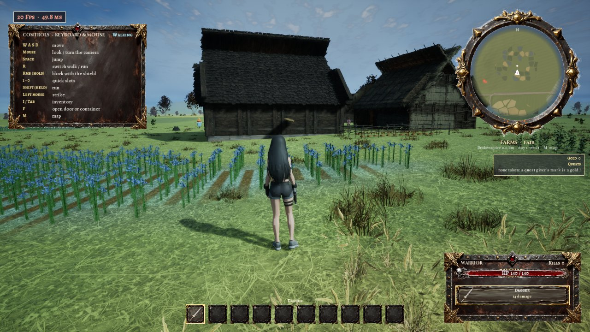

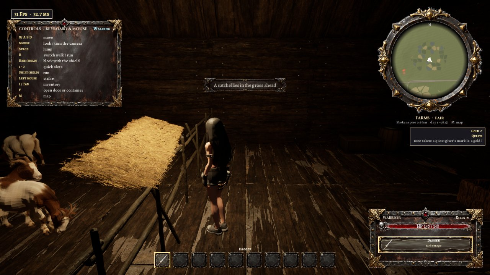

## The list of 2026-11-11, fifth part: the meadows, the encounters and Graymourne's coast

The list of 2026-11-11's fifth phase (`docs/improvements11.txt`; `920_wild11.py`, C++ `RD/RDWild11.cpp`, the grove pattern and the port's coast in `RDWildWorld.cpp`). Measured in `888 -Light` (`world` in `test_w11e.json`; `meadows11` and `towns` with the leaves chosen in `test_w11d.json`; `events11` in `test_w11e.json`). Graymourne's harbour, sea, splash and heads are in [its document](graymourne.md#the-list-of-2026-11-11-open-to-the-sea).

- **Groves, strips and clearings** ("meadows should have clusters of trees, strips of trees and clearings free of trees"): the meadows' trees grow only where the world's grove pattern lets them (`FRDWildWorld::Grove`: clusters a few tens of metres across, strips about 15 m wide along the winding zero lines of a coarse noise, and clearings a few hundred metres across with none), denser where they stand (120 a hectare, from 40); bushes follow it half way. Measured round a meadow spot: 183 trees within 250 m, 89 % of 20 m cells bare, the trees' counts per cell 3.1 times as spread as at random (clustered; 1.4 failed at the first density), at most 6 in a cell, an 80 m square with none.
- **Debris** ("dead tree stumps, differently sized/shaped fallen branches, differently sized / shaped logs"): seventeen kinds laid in the meadows (`meadows11.json`): the meadow beech's own stump and log, four other logs (1 to 2.9 m), seven dead branches and four leaf piles, each with its own density and the grove's share (logs and stumps among the trees). Their meshes were measured before choosing: a 6 m standing branch, two log stacks and flat 2 cm branch cards were left out. Within 100 m of the spot: 4 leaf piles, 10 branches, 3 stumps, 4 logs.
- **The grass moving in the wind**: `890`'s wind had never reached the wilds' grass (a struct read out of a list from Python is a copy, and the script changed the copy: the materials were set on nothing). Fixed (`890 wind`, its lists written back): the meadows', grasslands' and plains' grass take the swaying copy (`MI_Clasters_Grass_varient_Wind`, `MPC_RD_Wind`); 99 grass instances by her in it.
- **Leaves blowing** ("leaves blowing in the wind"): a Niagara system of blown leaves kept before the camera at her height while she is out of a town on dry ground in the meadows, grasslands, farms, plains, hills and the two broadleaf forests (`WildLeavesFx`, `WildLeavesBiomes`; checked twice a second). Six of the packs' leaf systems were screened in one place (`SetWildLeavesFx`, `wd_w11b_leaves11_*`): only Medieval Fantasy Village's `NS_leaves` reads as leaves blowing across the view (yellow-brown leaves); PureNature's left a few dark specks, Flower Meadows' are red petals.
- **More kinds of encounter** ("most of the types encountered are the satchels found and ambushers - what else can the player find within a 40s amount of time?"): the encounter director (every 40 s or so, when nothing is near) now also sends, by its weights (`events11.json`, 13 kinds):
  - a point of interest laid ahead of her, of her region (`Place`): an abandoned camp, a herb patch, a milestone, a great ruin or a monster nest, with its pieces, what it holds and its guards;
  - a herd of the wild animals (`Animals`): four deer, three hares or three wolves;
  - a person on the way (`Folk`) who speaks their lines and gives once (`Gift`, `GiftGold`): a weary pilgrim (bread), a travelling pedlar, a lost hunter (fish and jerky), a courier (gold by the tier), a refugee (bread, a healing potion). Spoken to again they say a line and give nothing. People and herds are taken away once she is 250 m from them.
  - Measured, each kind forced in turn ahead of her (`test_w11e.json`): every one met; each place laid of its kind (an abandoned camp, a herb patch, a milestone, a great ruin, a monster nest); 4 deer, 3 hares, 3 wolves; each person spoken to gave their gift (the pilgrim Bread, the pedlar Jerky, the hunter Jerky x 3, the courier 12 gold, the refugee Hardtack, Nuts and Seeds and 4 gold: drawn from each one's list) and only a line the second time. A pile lying in reach takes F before a person (the game's rule: the first run's refugee took a pile an earlier kind had left): the test takes it up first.
- **Graymourne's coast** ("near graymourne, it shifts abruptly to coastal regions. it should gradually turn into the coast from the previous biome"): the regions' mixing is 2.6 times as wide within 9 km of the port (easing back by 22 km), and the land's height over the shore is scaled down round it (35 % within 9 km, whole by 30 km): the glacial uplands that fell 1300 m in under 3 km (42 degrees between two samples) rise from the coast over kilometres (19 degrees at most; [Graymourne's document](graymourne.md#the-list-of-2026-11-11-open-to-the-sea)).

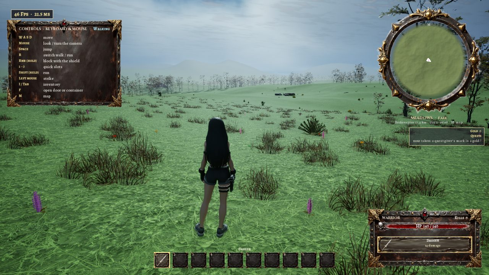

## Swimming (2026-11-12)

The user's of 2026-11-12: "create swimming animations for all current playable classes that are found in the choose a hero menu. create a splash sound for when a player falls into the water or is swimming. have water displacement and a wake for when the player moves through the water". C++ `RD/RDSwim.cpp` (with the water's tick in `RD/RDWild11.cpp`, the floors in `RDWildChunk.cpp` and Graymourne's harbour in `RDPort.cpp` / `RDTownPlan.cpp`), stage `921_swim.py`, the water's material in `887 materials`. Measured in `884 swim12 -Light` (`SourceArt/brokenspire/test_sw12u.json`).

- **Where she swims**: where her feet are 1.2 m or more under the water's face. The wilds' floor under deep water follows its depth down to 145 cm under the face, each corner of a water quad by its own depth (wading water's 90 cm, as before), so wading turns into swimming with no step; Graymourne's harbour is 140 cm deep. The deep sea's sheet 3 m over the water (past 8 m deep), which the documents called a wall, is gone: it held nothing (she would have walked off the floor's edge to the sea bed). The sea is swum where it is deep.
- **Her clips**: the "92 Animations For Warrior" pack's treading idle (2.0 s) and in-place swim loop (1.33 s), on its UE4 mannequin, retargeted onto each of the hero menu's six (Warrior, Mage, Warlock, Rogue, Martial Artist, Summoner) as the rider clips are (an IK rig on the pack's mannequin, a retargeter per hero onto her own `IK_JRPG_<rig>_Auto`), played on her slot as a looping montage: the treading idle below 40 cm/s, the swim loop above, its rate by her speed. Her body is held at the face: swimming along by her pelvis 6 cm under it (her back at the face; held 22 cm down the whole of her lay under the opaque water, and held by the head some rigs' flat bodies lay on the water, not in it), treading by her head 18 cm over it; the mesh is moved, eased, and put back as she leaves the water.
- **While she swims**: 55 % of her walk's speed, no jump, and no blow, block, roll, dash, chi, stealth or secondary ability (the saddle's rule).
- **The sounds** (`SourceArt/brokenspire/water.json`, Khron Studio's Sound Of Survival Vol 1): Player.Splash where she comes into water (a body jumping into the sea, the lighter falls into water: 7 files), Player.Swim a stroke every 0.67 s of the swim loop (hands scooping water: 6), Player.Wade a step every 0.42 s as she wades (5). Measured in what the game puts out (recorded, every other sound set silent; the loudest 30 % of the tenth-second windows): the splash 13.2 dB and the strokes 20.6 dB over the same falls and swims with their set at 0 (12.5 and 7.0 in the run before, with the game's other sounds louder).
- **The water's displacement and her wake**: the water's material bends its face's normal with rings spreading from up to 8 sources the game writes into `MPC_RD_Water` (where she came in, one every 0.22 s behind her as she moves through the water, one every 1.1 s round her as she stands: 110 cm/s, 1.9 s, waves of 26 cm) and a bulge pushed round her by her speed; the foam rings (`M_RD_WaterRing`) stay over it. In the pictures the rings trail out behind her as she swims; the wake's shape (a V) was not measured.
- **Measured** (`884 swim12`), for each of the six in Graymourne's harbour: swimming as she is put in the deep water, her treading idle, her head 19 to 20 cm over the face; no blow or roll; along the quay for 3 s the swim loop, her pelvis 4 to 8 cm under the face (the strokes' median), 194 to 210 cm/s (her swimming top speed), 3 or 4 strokes sounded, 6 to 8 ripples made, 5 to 8 of the collection's sources fresh, her push on; up a ramp and out, no longer swimming, her mesh back to 0.0 cm. Out at sea past the harbour's mouth (3.8 m deep) and 1.5 km out (8.3 m deep): swimming, her pelvis 3.5 cm under the face, no sinking (0 cm in 3 s), strokes sounded.

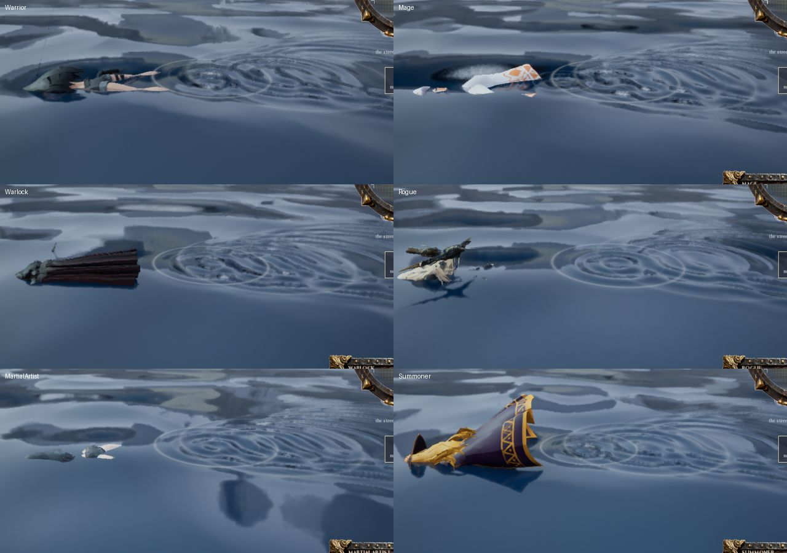

## The list of 2026-11-12, third part: twenty kinds of ruins

The list of 2026-11-12's third phase (`docs/improvements12.txt`: "have at least 20 kinds of ruins", and the twenty it names). C++ `RD/RDWildRuin12.cpp`, stage `924_list12_wild.py ruins` from `SourceArt/wilderness/ruins12.json`. Measured in `888 ruins12 -Light` in two batches of ten (`test_r12f.json`, `test_r12g.json`).

- **What a ruin is**: a wild place of kind "ruins" (the world's places are unchanged) is one of the twenty kinds, chosen from its id among the kinds its biome allows (`WildRuinKindOf`; the submerged town only where water lies within 300 m). Its parts are laid from its own random stream from 79 pack meshes in 61 groups (`r12_<group>#<n>` in the places' table), by a small layout language (`at`, `ring`, `arc`, `line`, `rect`, `grid`, `scatter`, `tiers`, with heights in metres, tilts, sinking, a share kept and a jitter). Every piece stands by its box: its bottom on the lowest ground under its corners.
- **The kinds** (title, what she is told as she comes within 30 m):

| Kind | Where | Guards | What stands there |
|---|---|---|---|
| Temple ruins | anywhere | 0 | toppled columns round an empty altar, a processional way of broken steps |
| Castle ruins | 8 biomes | 3 | a slighted keep and broken curtain walls |
| Abbey ruins | 7 | 2 | a roofless nave, its windows' tracery standing empty |
| Forest-swallowed city | 6 | 2 | walls the forest took back, roots prying the stones apart |
| A tell | 6 | 0 | a hill of the rubble of city on city, a dig cut into its side |
| A barrow | 7 | 2 | a long cairn of piled stone, its stone-lined passage open |
| Standing stones | 7 | 0 | a circle, a holed stone at its heart and a dolmen beside it |
| Rock-cut temple | 7 | 2 | a temple carved into the living rock |
| Cliff dwellings | canyons, mesas, mountains, hills | 0 | stone rooms against a rock face, row on row, reached by ladders |
| Catacomb entrance | anywhere | 3 | a way down into burial galleries under the hill |
| Submerged ruins | by water | 0 | columns and walls standing up out of the water |
| Ash-buried town | the volcanic lands | 2 | houses half under grey ash |
| Sand-buried city | 6 | 0 | the tops of arches and walls over drifting sand |
| Amphitheatre | 7 | 0 | rows of stone seats round an empty stage |
| Aqueduct | 9 | 0 | the arches of an aqueduct that outlasted its city |
| Ghost town | 10 | 0 | a village left in a hurry: houses to walk into, tables still set |
| Industrial ruins | 8 | 2 | a derelict mill, rusting hoppers, a crane, carts on broken rails |
| Battlefield ruins | 7 | 3 | a fort's broken walls, swords standing in the earth, a shattered statue |
| The forsaken works | 6 | 2 | works left all at once, the forest taking them back |
| A folly | 6 | 0 | a ruin built ruined, in a lord's park |

- **What each holds**: a chest or two of its kind's things (`Loot`, the wild boxes, kept looted under keys of their own: `(3 << 40)` + the place's id x 8 + n), and for nine kinds guardians of the place's tier (`Guards`, the spawn points' monsters).
- **Measured** (`test_r12f.json`, `test_r12g.json`): all twenty among the world's ruins within 150 km of Brokenspire (temple 37 to submerged and sand-buried 1 each; none left without a kind); the nearest of each visited, laid of its kind with 6 (the folly) to 68 pieces (the amphitheatre's seats), a chest within 40 m, its guards standing within 20 m of its middle; a message naming it as she comes (with its discovery, in one line: the test keeps every line the HUD showed over the visit, which also brought her within 20 m: on its shore for the submerged town); a picture of each from 45 m before its front. The pieces' bottoms stand at or under the ground under their middles but for those laid on others (the cliff dwellings' upper rooms, the barrow's cairn, a raised wheel) and the sunk ones (the submerged town's columns 1.6 to 2.6 m down, the sand-buried city's arches up to 10 m); none stands over the ground by more than its part raises it. Every piece laid to collide stops her (55 of the packs' meshes had no simple collision and were walked through until `924` gave each its own shape as its collision), and every ruin's guards stand, none inside a piece.

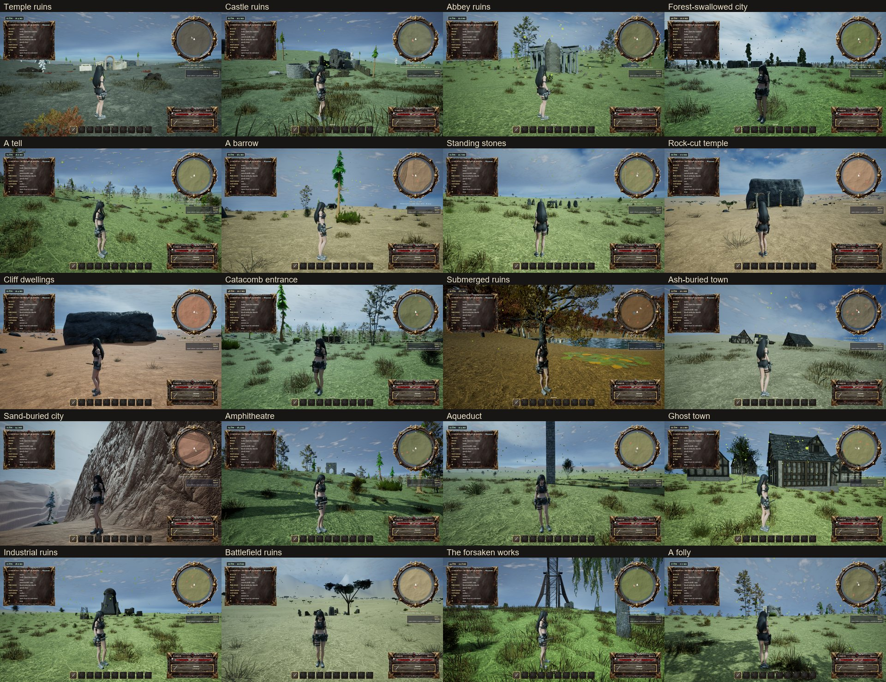

## The list of 2026-11-12, fourth part: the lairs hidden

The list of 2026-11-12's fourth phase ("monster lairs do not have any special structure around them. they should be hiding behind something, a stand of trees, a ruin, a cave, an abandoned house, an earth berm, something that can hide them from sight so that they're not just out in the open"). C++ `RD/RDWildLair12.cpp` (with the ruins' layout language, `RD/RDWildRuin12.cpp`'s `LayWildParts`), the monsters' cover in `RDMonster.cpp`, stage `924_list12_wild.py lairs` from `SourceArt/wilderness/lairs12.json`. Measured in `888 lairs12 -Light` (`test_l12c.json`).

- **Its cover**: every lair (the world's lairs are unchanged) has one of nine covers, chosen from its id among those its biome allows (`WildLairCoverOf`), laid round the den by the ruins' layout language with an opening on one side:

| Cover | Where | What hides it |
|---|---|---|
| A grove | meadows, grasslands, farms, plains, hills, the broadleaf forests, the coast, wetlands, moorland | a ring of beeches and autumn trees, two rings of thick bushes inside it |
| Under the pines | the pine forests, taiga, mountains, tundra | pines, two rings of young pines, fallen trunks |
| The deadwood | marshes, wetlands, the burned and volcanic lands | dead trees, a ring of bushes, fallen trunks and rubble heaped round |
| A ruin | anywhere | the ruins' broken walls in a ring, rubble |
| An abandoned house | farms, meadows, grasslands, plains, hills, the coast, the broadleaf forests | four roofless walls, a doorway, its chimney |
| A cave mouth | hills, mountains, mesas, canyons, moorland, glaciers, volcanoes | rock walls on three sides, the cave's mouth at its back, boulders |
| An earth bank | plains, grasslands, savannah, steppes, farms, meadows, moorland, tundra, the burned plain | a ring of heaped earth drawn as the ground is (`L=berm`: a procedural bank 10 m wide and 2.5 m high with the ground's own material and colours, open over 46 degrees), gorse round its foot |
| Among boulders | the arctic, glaciers, tundra, mountains, mesas, canyons, the rocky coast, steppes | two rings of great stones |
| A thicket | savannah, steppes, moorland, the coast, mesas, plains, grasslands | three rings of gorse, heather and bushes |

- **Its monsters keep to it**: they are spawned inside its circle (moved off any of its pieces), wander only there (`ARDMonster::CoverR`), and when they come for her they go out by its opening first (`CoverExit`, 2.5 m past its walls' reach) and round the cover to her if she is on its far side; coming home they go round it to its opening and in (`CoverRound`). Every cover opens at its frame's front (its arcs centred behind). Their draws are the same as before, in the same order: every other place's monsters stand where they did.
- **Seen through**: the bushes of the groves and thickets are laid to block sight lines but not her (`col=2`: query only, her pawn and the camera ignored); the walls, rocks and the bank stop her. The boulders and some trees had no simple collision; as the wilds also grow them as instanced plants and rocks, `924` lays solid copies of its own (`/Game/RandomDungeon/Wild/Solid`) and leaves the packs' meshes as they were (the ruins' copies of the four rocks they share with the biomes likewise).
- **Its discovery** names it with the place: "Discovered: <name>. A lair in a grove: a stand of trees, its undergrowth trampled into a den".
- **Measured** (`test_l12c.json`): all nine among the world's lairs within 150 km of Brokenspire. Of each, the nearest on gentle ground (its den's ground within 2 m over 8 m; the boulders' den moved 25 m off its place's slope) was laid with its monsters inside its circle. Sight lines from an eye 1.7 m over the ground at 16 points 30 m round it to each monster's legs, chest and head, traced against the cover's own pieces (with their complex collision: leaves count), were blocked: the grove 65 %, under the pines 88 %, the deadwood 69 %, the ruin 83 %, the house 88 %, the cave mouth 86 %, the earth bank 82 %, the boulders 69 %, the thicket 83 %; from 15 m 68 % to 90 %. Woken with her 18 m before its opening and again off to its side, a monster came out past the cover's walls in 2 to 9 s each time; after she went 60 m off, every lair's monsters were inside it again within 25 s.

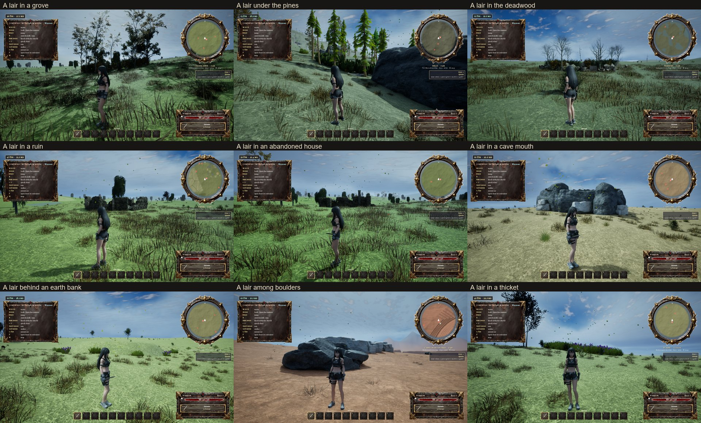

## The list of 2026-11-12, fifth part: the structures and their quests

The list of 2026-11-12's fifth phase (`docs/improvements12.txt`: the wilderness's structures and the quests found at them; the user's choices: every structure a set piece of the packs' meshes, all 25 quests with their twists, the stranded keep their gear, a tamed horse a second mount). The list names 34 structures (it was called 42 in the plan). C++ `RD/RDWildSite12.cpp` (the structures) and `RD/RDWildQuest12.cpp` (the quests), the world's sites in `FRDWildWorld::SitesIn` (`RDWildWorld.cpp`); stage `924_list12_wild.py sites,quests` from `SourceArt/wilderness/sites12.json` and `quests12.json`. Measured in `888 sites12,quests12 -Light` (`test_s12e.json`, `test_s12f.json`, `test_s12d.json`; `test_q12a.json` to `test_q12l.json`).

- **Where they stand**: the world's sites are a layer of their own over the places (a 2.5 km cell, up to six tries in each, a kind drawn by weight among those the biome allows, `SitesInCell`), kept per cell (`FSiteCache`); a chunk lays every site of the cells round its own, so one moved out of its cell (a weir to its river) is still laid. A water kind (the river crossing, the mill weir, the lake island, the sea cave, the shipwreck) looks for its water along 16 rays to 600 m, then by the rivers' and lakes' own lines within 1.25 km, and stands on the shore it walks back to (its crossing over the water).
- **What each is**: laid by the ruins' layout language (`LayWildParts`) from 81 pack meshes (`s12_<group>#<n>` in the places' table), with its chest, its guards (inside it, none in a piece), its prisoners (tied, F to free: a few gold or a thing in thanks), its traps (a spring plate that hurts) and the giver of its quests:

| Structure | Where | Guards, prisoners, traps | Its quests | What stands there |
|---|---|---|---|---|
| A cave system | 7 biomes | 2, 1, 2 | Lair clearing, Infestation, The lost ruin, The buried cache, The lost expedition, Stranded, The restless spirit | a cave's mouth in the rock, its passages running back into the dark |
| A gorge | canyons, canyon networks, mesas | 2, 0, 2 | Hold the pass, Trailblazing, The manhunt, Stranded, Weather the disaster | a narrow cut between sheer walls, a place for an ambush |
| A cliff aerie | 5 biomes | 2, 0, 0 | The legendary hunt, The rare ingredient, Tame a mount, Search and rescue | a nest of branches on a ledge, bones below it |
| A mountain pass | 6 biomes | 3, 0, 1 | Hold the pass, Trailblazing, Wilderness escort, Urgent delivery, Weather the disaster | the one way through the mountains, a gate across it |
| A waterfall grotto | 8 biomes | 1, 0, 0 | The buried cache, The rare ingredient, The sacred site | water falling over a rock face, a hollow behind it |
| A sinkhole | 7 biomes | 1, 0, 2 | The lost ruin, The buried cache, The rare ingredient, The sacred site | the ground fallen in, a ring of rock round a dark drop |
| An ancient great tree | 6 biomes | 2, 0, 0 | Infestation, Blight cleansing, The sacred site, Territory dispute | a tree older than any town, its roots wide as a house |
| A bog island | marshes, wetlands | 2, 1, 1 | The rare ingredient, Investigation, The restless spirit, Blight cleansing | a hump of firm ground in the bog, half sunk in peat and reeds |
| An ice cave | glacial, arctic regions, tundras, mountains and peaks | 2, 0, 1 | The lost expedition, Search and rescue, Stranded, Weather the disaster | a cave in the ice, old things frozen in its walls |
| Lava tubes | volcanoes, geothermal caldera, volcanic tundra, burned plain | 2, 0, 2 | The legendary hunt, The lost ruin, The rare ingredient, Weather the disaster, Blight cleansing | black rock round a vent, the ground hot underfoot |
| A sea cave | the coast | 2, 1, 1 | The buried cache, The manhunt, Stranded, Weather the disaster | a cave in the sea cliff, its floor wet with the tide |
| A rock spire | 7 biomes | 1, 0, 0 | Survey and cartography, Tame a mount, The sacred site | a needle of rock standing alone over the plain |
| A beast's den | anywhere | 2, 0, 0 | Monster bounty, The legendary hunt, Infestation, Live capture | a hollow among roots and rocks, bones round its mouth |
| A fairy ring | 5 biomes | 0, 0, 0 | Investigation, The sacred site, Territory dispute | a ring of toadstools in a clearing, the grass inside untrodden |
| A lake island | a lake | 1, 0, 0 | The buried cache, The restless spirit, The sacred site | a rocky islet off the shore, a boat drawn up before it |
| A ruined fortress | 7 biomes | 3, 1, 2 | Lair clearing, Hold the pass, The lost ruin, Frontier outpost | broken walls on a rise, a tower still standing among them |
| A watchtower | 9 biomes | 2, 0, 1 | Hold the pass, Survey and cartography, Weather the disaster, Frontier outpost | a lookout over the land, its ladder still sound |
| An abandoned mine | 6 biomes | 2, 1, 2 | Infestation, The buried cache, The lost expedition, Search and rescue, The restless spirit | a timbered shaft into the hill, carts left on their rails |
| A barrow tomb | 7 biomes | 2, 0, 2 | The lost ruin, The buried cache, The restless spirit | a carved front set into a mound, the door sealed long ago |
| A standing-stone shrine | anywhere | 0, 0, 0 | Investigation, Blight cleansing, The sacred site | stones round a praying figure, offerings at her feet |
| A trapper's cabin | 8 biomes | 1, 0, 2 | Monster bounty, The legendary hunt, The lost expedition, Investigation | a cabin at the edge of the deep woods, pelts drying by its door |
| A river crossing | a river | 2, 0, 1 | Hold the pass, Wilderness escort, The manhunt, Urgent delivery | an old bridge over the river, a toll post at its end |
| A roadside waystation | 8 biomes | 0, 0, 0 | Wilderness escort, The manhunt, Urgent delivery, Investigation | an inn at the crossroads, its sign creaking in the wind |
| A logging camp | 5 biomes | 1, 0, 0 | Infestation, Investigation, Territory dispute | stumps and stacked logs, a saw left in a cut trunk |
| A bandit palisade | 8 biomes | 3, 2, 2 | Lair clearing, Search and rescue, The manhunt | a stockade of sharpened logs, a camp behind it |
| A shipwreck | the coast | 2, 0, 0 | The buried cache, The lost expedition, Stranded | a broken hull on the shore, its cargo spilled in the sand |
| A witch's hut | 5 biomes | 1, 1, 1 | The rare ingredient, Investigation, Blight cleansing | a hut in the mire, charms hanging from its eaves, a pot steaming |
| An abandoned village | 7 biomes | 2, 0, 1 | The lost expedition, Weather the disaster, Investigation, The restless spirit | houses with their doors open and nobody home |
| A mill weir | a river | 1, 0, 0 | The lost ruin, Weather the disaster, Territory dispute | a stone weir across the river, a wheel turning beside it |
| A smugglers' tunnel | 6 biomes | 2, 1, 2 | The buried cache, The manhunt, Urgent delivery | a timbered tunnel mouth hidden in the hill, crates stacked inside |
| A titan's carcass | 7 biomes | 3, 0, 0 | The legendary hunt, Infestation, The lost ruin, Blight cleansing | the ribs of something vast, a fallen giant's head turned to stone beside them |
| A living beast's back | savannahs, plains, grasslands, cold steppes | 0, 0, 0 | Survey and cartography, Tame a mount, Frontier outpost | a beast the size of a hill, a whole camp built on its back, walking its slow round |
| A floating island | 6 biomes | 1, 0, 0 | Survey and cartography, The rare ingredient, The sacred site | a crag of crystal hanging in the air, shards of it scattered below |
| A rift | 7 biomes | 3, 0, 1 | Infestation, Investigation, Blight cleansing | a scar torn in the world, a ring of light standing over it |

- **The living beast's back**: the Animals pack's fantasy elephant (`SK_Fantasy_Elephant_Full`, its walk) with the war platform on its back (`SK_Fantasy_Elephant_Build_Full` following the body's pose), 2.6 times its size, walking a circle 45 m round its middle at 1.1 m/s, its head the way it walks; the camp's chest and giver at the round's middle.
- **Its quests**: each structure offers some of the 25 (`sites12.json`'s `quests`, one at a time, drawn from the site's id); F at the giver takes it, and its stages are run by the game wherever they lead (`TickWildQuests12`): a stage is begun as she comes within 4 km of the structure or of the stage's point, and its people, things and monsters are made then and taken away when she leaves.

| Quest | Giver | What happens (its twist) | Offered at |
|---|---|---|---|
| Monster bounty | a bounty hunter | two trail marks, the beast killed; its den is wrecked: a worse thing drove it out and comes for her | 2 kinds |
| Lair clearing | a carter | the "bandits" are ragged villagers: she lets them go (the carter is told the road is open) or clears the camp | 3 kinds |
| The legendary hunt | an old hunter | bait gathered, the trap set on its trail; a rival hunting party wants the beast and fights her for it, then the apex beast | 5 kinds |
| Infestation | a frightened settler | a swarm, then a second from further out, then the nest and its queen to destroy | 7 kinds |
| Hold the pass | a wounded soldier | three waves come while the refugees cross: the pass held for a minute | 5 kinds |
| Survey and cartography | a guild surveyor | three landmarks along a trail marked, the map handed in | 4 kinds |
| The lost ruin | a scholar | a map found, the ruin (one of the twenty kinds, up to 12 km off) reached, its wardens killed | 7 kinds |
| The buried cache | a dying smuggler | leaning stones, then where water meets rock, then the cache dug up | 9 kinds |
| The lost expedition | an expedition's patron | two abandoned camps searched; at the last a survivor and the thing that hunted them; the survivor walked home | 6 kinds |
| Trailblazing | a caravan master | firm ground, a safe ford, the far side; then the caravan led through | 2 kinds |
| The rare ingredient | a herbalist | three moonblooms, which open only at night, picked and brought back fresh | 7 kinds |
| Live capture | a menagerie's buyer | a beast beaten down and bound alive (killed, another comes: a dead one is no use) | 1 kinds |
| Tame a mount | a horse breaker | a wild horse won over at three slow approaches (running near it, it bolts): hers, a second mount | 3 kinds |
| Search and rescue | a worried mother | the boy's trail, the boy found cold and lost, brought home | 4 kinds |
| Wilderness escort | a pilgrim | the pilgrim led to the far shrine; an ambush on the way | 3 kinds |
| The manhunt | a warden | the fugitive tracked and found: he is innocent and running; she lets him go or brings him back | 6 kinds |
| Urgent delivery | a courier | the medicine taken to the nearest town in game time (15 minutes) | 4 kinds |
| Stranded | a ferryman | the ferry breaks up: washed up 1.5 km off with what she carried, she finds water, shelter, food and a town | 5 kinds |
| Weather the disaster | a shepherd | a storm comes down: the family brought to shelter, the storm weathered inside it | 8 kinds |
| Investigation | a farmer | clues gathered (strange charms in the branches), a ritual place, the cultists behind the lights | 9 kinds |
| The restless spirit | a wailing spirit | the spirit's keepsake found far off and laid on its grave, the spirit at rest | 6 kinds |
| Blight cleansing | a druid | the poisoned spring found, its guardians killed, the water cleansed | 7 kinds |
| The sacred site | a priestess | a rite at the stones, only at dawn; the guardians it wakes laid low | 8 kinds |
| Territory dispute | a woodsman | loggers against druids: she sides with one, and drives off the other's | 4 kinds |
| Frontier outpost | an outpost founder | timber gathered, then two raids on the new post held off | 3 kinds |

- **The stranded keep their gear** (the user's choice): the ferry breaks up and she washes up 1.5 km off on a dry shore with what she carried; water, shelter, food and the way to a town are hers to find. **A tamed horse is a second mount**: hers and out at once (in the wild grey's coat); with a bay bought too, the stable saddles either (`SwapHorse`), the other waiting there; tamed with none bought, the stable still sells her the bay. Both are saved.
- **Measured** (`test_s12e.json`, `test_s12f.json`, `test_s12d.json`, the beast in `test_q12c.json`): all 34 kinds among the world's sites within 150 km of Brokenspire (the den 523 to the mill weir 3); the nearest of each visited: laid of its kind (3 to 41 pieces), none walked through, none floating, its chest, its guards standing and none in a piece, its prisoners freed with F (gold in thanks), a trap stepped on hurting her, its giver there; the beast walked 3.7 m in the test's seconds and faced 3 degrees off its way. Every quest (the latest of `test_q12a.json` to `test_q12l.json` for each quest) was taken at a structure of its own and played to its end by the test: its every stage begun, its point reached, its things taken, its monsters killed, its people spoken to, led or chosen for, and its gold paid.

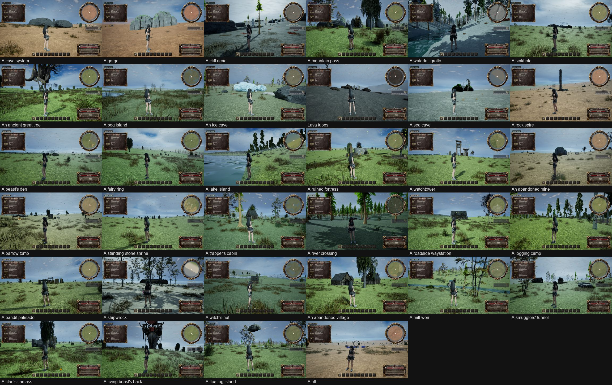

## The list of 2026-11-14: the biomes' scenery

The user's list of 2026-11-14 ([docs/improvements13.txt](../improvements13.txt)): for each of the 29 biomes a list of the scenery found in it, and what helps each kind of land. Built in phases, a PR each (the user's choices: every item to full depth, set pieces, hazards, new land shapes, weather; what no pack has made in Blender). C++ `RD/RDWildScenery13.cpp` (the uses, hazards, herds, ambushes, far storms), the layout language's new parts in `RD/RDWildRuin12.cpp`, the world's scenery, dry channels, tracks and crossroads in `RD/RDWildWorld.cpp`; stage `926_scenery13.py` from `SourceArt/wilderness/scenery13.json`; the pieces no pack has from `blender_numpy/scenery13_kit.py`. Measured in `888 scenery13,land13 -Light` (`test_s13f.json`, `test_s13g.json`).

### How a piece of scenery is placed and laid

- **Where**: the world puts one in 60 % of the cells of a 600 m grid (`FRDWildWorld::SceneryIn`, ids `SceneryIdBase` 2^26 + the cell), a kind of the cell's region by the kinds' weights, 50 m inside its own cell, 1 km or more from a town, 120 m from the places, 150 m from the structures, 70 m from the farmsteads and 40 m from the points of interest, on dry gentle ground off the fields and yards, and as its kind asks: beside a road (`road`, facing it), at a crossroads (`crossroads`), on the highest of six tries (`rise`), the lowest (`low`), or on the shore of water of its kind within 400 m (`need_water`: a river, a pond, a lake, the sea), facing the water. A cell that holds a crossroads takes a crossroads kind four times in five, one a road crosses a roadside kind two in five.
- **What**: its parts by the ruins' layout language, with four new: `fx=<name>` an effect at the layout's points (at its hours: day, night, dusk), `inst=1` many as instances (a patch of tall grass or flowers, faded from 100 m), `far=1` a landmark never culled (a lone tree, a butte), and `L=mound|cone|ridge` a rise of the land laid as the ground is drawn (a burrow's spoil, a burial cairn). What it lays after a rise stands on the rise. Its chests are kept looted under `(7 << 40)` + its id x 8 + n.
- **As she comes**: within 35 m its name and a line of what it is. F at one of its uses (`Uses`): take (loot, forage, fish, honey: its things; a reuse after a while), rest, pray (a blessing), read (a milestone's towns, a notice post's nearest structure, the tracks in a wallow's mud: the nearest lair's way), climb (a boulder or a butte: set on its top, the map revealed round it), step into a fairy ring (by night only). The nearest of a scenery's use, a point of interest, a wild door or container and a person takes F.
- **What hurts there** (`Hazards`): `collapse` (a burrow town's tunnels give way: 6 % of her hit points and a slow, and twice its diggers come up), `sting` (lingering 1.5 s by the hives: the bees, 3 % a sting while she stays), `lurker` (wading into a reed pond: something rises, once a play).
- **Its herd** (`Herd`): a fauna kind and a count laid round it, gone with its chunk; `migrate` walks it back and forth across 140 m along its way (across a road), `stampede` sets it running through where she stands when she comes within 16 m (a trampling 8 % and a slow), `pen` keeps it in a fold; the beasts she kills stay dead (kept with the game), and a herd past 250 m from her rests. The farm animals (goats, cows, pigs) are wild animals of no biome for this (`926 fauna`).
- **Its ambush** (`AmbushR`): its guards notice her no farther than 2.5 m until she comes within the kind's reach, then hunt her (the tall grass's).

### The land

- **The dry channels** (the grasslands' "arroyos and dry creek beds that cut hidden paths below the horizon"): `ChannelRules` (`scenery13.json`'s `channels`): wandering lines cut into the land at Init, stopping at water (3 a grassland region cell, 17 in a world, 0.6 to 1.6 km long, 8 to 14 m wide, 2.2 to 3.6 m deep, a flat sandy bed and walls), hashed on their own (`ChanHash`), cut in `Feature` (what she walks and what is drawn alike). The nearest's bed lies 4.4 m under its banks (depth 3.5 m); no seam in the 6 km square round it (`RDWildProbe`, `wild_seams.py`: 0 steps over 6 m).
- **The swales** ("rolling swales that hide what's over the next rise"): a biome's `Swale` (plains 5 m, grasslands 3.5, savannahs 3) adds low rises 400 m apart. Along 1.6 km lines: 3 crests in the plains, 8 in the grasslands, 5 in the savannahs; from most crests a 1.7 m eye does not see the ground 300 m on.
- **The tracks and crossroads**: the six roads join the towns and never met; tracks now leave them (`MakeTracks`: 152 in a world, from points 2.5 km apart, 1.5 to 4 km long, a third with one of their own), narrower, their beds eased less, drawn thinner on the map. Where a track leaves a road or a track is a crossroads (155 in a world, 49 within 50 km of Brokenspire).
- **The far storms** ("distant storm cells or tornadoes visible for miles"): over the plains, grasslands, savannahs and cold steppes now and then a storm cell 5 to 10 km off drifts across her view for six minutes (`ForceWildStorm`): the kit's cell, an anvil cloud 3.4 km across with a rain curtain (translucent, `M_N13_Translucent`) and a funnel to the ground, never culled.

### The open lands, first part: grasslands, meadows and plains

| Kind | Biomes | What stands there | What she does there |
|---|---|---|---|
| Tall grass | grasslands, savannahs | 650 stems of tall grass 1.8 to 2.5 m | two monsters lie low in it and come at her from 12 m; a lost chest |
| Burrow town | grasslands, plains, savannahs | 14 burrow mouths, four spoil mounds | the ground gives way in four places; rats come up |
| The hanging tree | grasslands, plains (on a rise) | a lone dead willow, a noose, bones, crows | search the dead man's coat |
| The nesting tree | grasslands, meadows, plains (rise) | a lone 18 m beech, a great nest in its crown | gather eggs and feathers fallen from it |
| The shrine tree | grasslands, meadows, plains (rise) | a lone beech, a praying statue, candles, flowers | pray: a blessing |
| Glacial erratic | grasslands, plains, cold steppes, tundras | a boulder 16 by 12 by 6.5 m | climb it: the map shows 1.5 km round |
| Herd on the move | grasslands, plains, savannahs, steppes, tundras (by a road) | 14 deer | they walk across the road; too near and they stampede through her |
| Mud wallow | grasslands, savannahs, plains (a hollow) | churned mud, reeds | read the tracks: the nearest lair's way and distance |
| Wild hives | meadows | 220 flowers, straw skeps on benches, bees | take honey; the bees sting whoever lingers |
| Stepping stones | meadows, grasslands, autumn forests, hills (by a river) | stones across the water, a small fall, reeds | fish the pool |
| Fairy ring | meadows, grasslands, autumn forests | a ring of 28 mushrooms, fireflies by night | step in by night: the Fair Folk's Favour; pick mushrooms |
| Shepherd's hut | meadows, hills, moorland, grasslands | a stone hut, a drystone fold, five goats in it | rest in the hut |
| Reed pond | meadows, grasslands, wetlands, marshes (by a pond) | reeds, two herons | wade in and something rises |
| Old orchard | meadows, grasslands, farms | gnarled apple and plum trees, fallen apples | gather wild fruit |
| Butterfly meadow | meadows | flowers, butterflies by day, fireflies at dusk | |
| Lookout butte | plains, grasslands, savannahs | a banded rock stack 24 m high | climb it: the map shows 2.5 km round |
| Old battlefield | plains, grasslands, cold steppes | rusted swords and spears, shields, bones, three burial cairns | two of the restless dead; iron to salvage; a chest |
| Old milestone | plains, grasslands, meadows, farms, steppes (by a road) | a cut milestone, broken paving, a toppled waymarker | read it: the two nearest towns |
| Crossroads gibbet | plains, grasslands, meadows, farms, hills (a crossroads) | a gibbet, bones, crows | its board: HIGHWAYMAN |
| Wayside shrine | (a crossroads) | a seated stone saint, candles | pray: the Traveller's Blessing |
| Notice post | (a crossroads) | a notice board | read the notices: the nearest structure of the wilds |
| Wagon wreck | the open lands (by a road) | a wagon on its side, a wheel, barrels, crates, sacks, arrows, a letter | read the letter; a chest |

- **Its new things** (on every map of the game, their pictures painted with `rdm4_ui_gen.py`): Wild Honey, Wild Apples, Wild Plums, Bird's Eggs, Field Mushrooms (food).
- **Its own pieces** (`scenery13_kit.py`, measured after their import: true size): straw skeps on benches, a great nest, two herons, a burrow mouth, a milestone, a noose, two drystone wall lengths, two apple and two plum trees, the storm cell.
- **Measured** (`test_s13f.json`, `test_s13g.json`, after PR #65's review): every kind found within 150 km of Brokenspire and visited: laid of its kind, no piece floating or walked through, its chest where it has one, its line told as she comes within 35 m; every use from beside it (the prompt named it, F did what it says: what it gave, how far she rose climbing (the erratic 4.8 m, the butte 21.3 m) and the map revealed, the blessing, the reading); every hazard stood in (the burrows 8.4 hit points each and their rats, the bees 12.6, the pond's lurker); the migrating herd walking (20.6 m in 12 s), set off beside her (56 m run in 7 s, trampling her twice for 11.2); the goats in their fold after 12 s; the tall grass's two monsters lying low (noticing within 2.5 m) at 30 m and coming at her from 15.1 to 11.5 m in 2.5 s once she came within 12 m. A picture of each from 40 m and from 15 m.

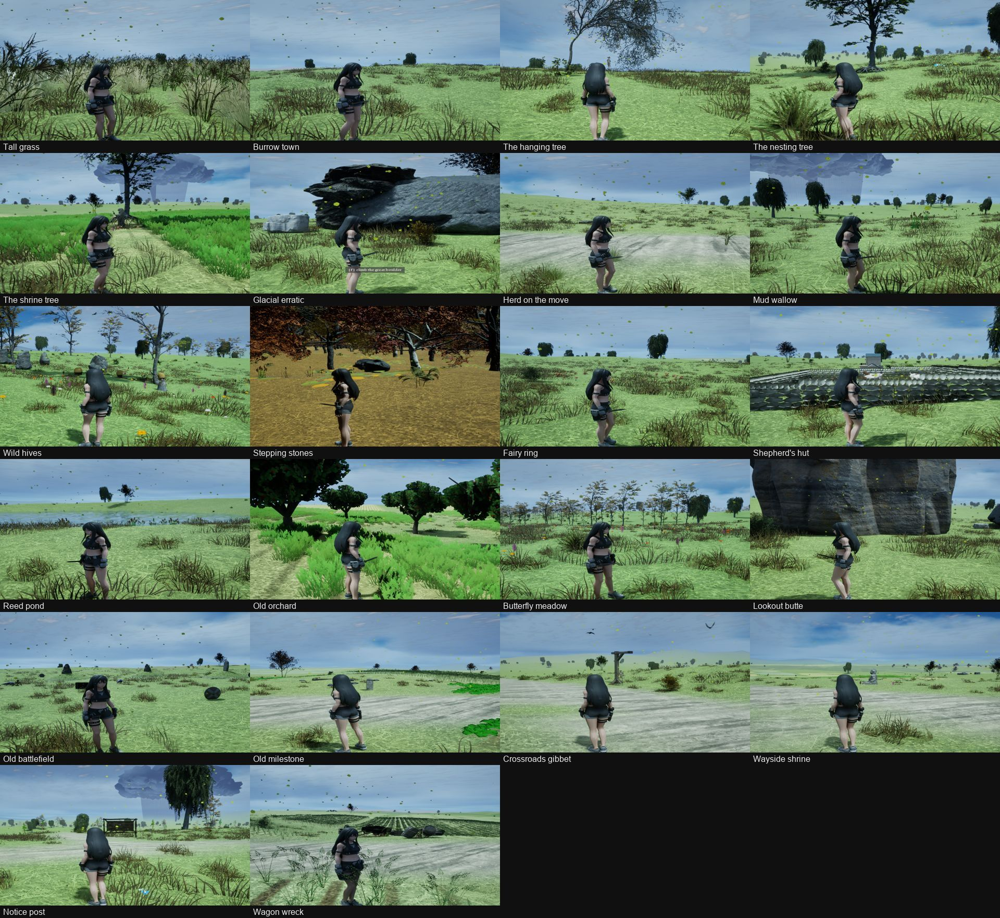

### The open lands, second part: farms, savannahs, cold steppes and the burned plain

| Kind | Biomes | What stands there | What she does there |
|---|---|---|---|
| Hedged fields | farms, meadows, hills | hedgerows and drystone walls in small enclosures | a chest in one of them |
| Scarecrows | farms | three scarecrows over the furrows | one is not a scarecrow: as she comes near it is gone and a creature stands there ("The Scarecrow") |
| Threshing yard | farms | haystacks, a stone threshing floor, a granary on staddle stones | gather threshed grain; rats pour out from under the granary |
| Mill and millpond | farms, meadows, grasslands (by water) | a water wheel, the miller's house, millstones, a well | drink from the well |
| Pumpkin patch | farms | pumpkins, skeps | gather pumpkins; the bees sting whoever lingers |
| Abandoned farmstead | farms, grasslands, meadows | a shut house, its fence fallen, the yard gone to tall grass, a root cellar's hatch | force the hatch: bread, potions, iron, and the rats living below |
| Loose livestock | farms, meadows, grasslands | five cows out of their broken fence | wolves come for them: one is taken while she is near |
| Baobab | savannahs (a rise) | a lone baobab 14 m high, seen from afar | climb it: the map shows 2 km round |
| Acacia shade | savannahs | five flat-topped acacias, deer in their shade | rest in the shade |
| Termite mounds | savannahs | a dozen mounds, some taller than she is | |
| Kopje | savannahs, cold steppes | a rocky outcrop, a cave mouth | two beasts lair in it; a chest |
| Waterhole | savannahs, grasslands (by a pond) | mud and reeds on a pond's shore, nine deer | a wolf runs one down while she watches; the herd scatters |
| A kill | savannahs, burned plain, cold steppes | a carcass and bones under circling crows | two scavengers at it; search the carcass: hides |
| Salt pan | savannahs, cold steppes (a hollow) | a white crust over the ground, 28 m across | read the tracks across it |
| Nomad camp | cold steppes | three yurts round a fire, the camp's horses grazing | two nomads to talk to; share their fire (rest); trade hides for cheese |
| Kurgan | cold steppes, grasslands, plains (a rise) | a great burial mound, stone figures on it | read the figures |
| Prayer cairn | cold steppes, mountains, moorland, tundras (a rise) | a cairn wrapped in prayer cloth | leave bread: the Blessing of the Steppe Wind |
| Carved rocks | cold steppes, savannahs, canyons, mesas | wind-carved rocks with petroglyphs | read the carvings |
| Hot spring | cold steppes, tundras, volcanic tundra, mountains (a hollow) | a steaming pool, a camp's fire | soak: healed |
| Pingo | cold steppes, tundras | an ice-cored hill | climb it and look out |
| Charred snags | burned plain | ten black trunks | one comes down as she nears: under it, a heavy blow |
| Smouldering ground | burned plain | charcoal, a burnt trunk, embers gusting, smoke | three hot spots burn while she stands in them |
| Ash drifts | burned plain | ash with tracks in it | read the tracks: what came through |
| First regrowth | burned plain | fireweed, morels | pick morels |
| Scorched farmstead | burned plain | a burnt house and fence, the survivors' tent and smoking fire | talk to the survivor; share bread for a potion |
| Looters' camp | burned plain | tents, crates, a fire | three looters; a chest |
| Fire break | burned plain | a cut line, its dug ditch | read it: the fire jumped it |
| Fused glass | burned plain | glassy, blackened stone | read it: this was no grass fire |
| Carcasses in the ash | burned plain | carcasses, bones, crows | the thing that started the fire rises from the ash: the Ash Wyrm |

- **What is new to the scenery** (`RD/RDWildScenery13.cpp`): hazards that `wake` (a laid piece hidden by its mesh's name and a monster, named, in its place, once a play; or a monster rising 8 m from her), `heat` (a burn a second while she stands in it), `fall` (the nearest burnt trunk topples toward her over 1.2 s: a blow if she is under it) and `hunt` (a predator runs one of the scenery's herd down while she is near, and the herd scatters); uses that `offer` (she leaves an item: a blessing) and `trade` (one thing for another); its people (`Folk`: townsfolk with their own lines, spoken to with F); `spawn=` on a use (the root cellar's rats); a part's material (`mat=`: the burnt timber) and a skin over the ground in a colour of its own (`L=patch;tint=`: the salt pan's crust).
- **Where**: a kind that stands by water is placed on the shore of a pond or lake in its cell first, walked out from its middle; a cell holding a pond's or lake's middle takes such a kind three times in five. A kind of a hollow wants level ground (1.5 m over its 10 m ring).
- **The land**: the farms' fields at their stages (each great field and each croft plot drawn ripe, sprouting, fallow or burned: a sprouting crop at a third of its height, fallow and burned ground drawn bare and black); the dry channels of the savannahs (dry riverbeds 14 to 24 m wide), the farms (irrigation ditches) and the burned plain (fire breaks).
- **The weather**: two of the regions' own, `whiteout` (snow and a white fog where the cold lands are) and `dust` (a brown fog where the dry ones are), in the weather's turn with the rest; the fog's colour follows the weather (`SkyFogTint`). Over the savannahs now and then a grass fire's smoke column stands on the horizon 6 to 10 km off (`WildFarSights`: the storm cell and the smoke plume alike, `ForceWildFarSight`).
- **Its new things**: Morels (food); the pumpkins are the kitchen's.
- **Its own pieces** (`scenery13_kit.py`): two baobabs, two termite mounds, two yurts, two stone figures (balbals), a prayer cairn, a hot spring's pool, a salt pan, two carved rocks, fused glass, a smoke plume 1.9 km high, fireweed, a granary. The steppe's horses are the ridable horse's body and gaits as a herd animal (`926 fauna`).
- **Measured** (`test_s13p2e.json`, `test_s13p2f.json`, `test_s13p2i.json`, `test_s13p2j.json`, `test_s13p2k.json`, after PR #66's review `test_s13p2l.json` (the hunts' kills not hers); the first part's 22 again in `test_s13p2g.json`, `test_s13p2h.json`, the old orchard in `test_s13p2j.json`): every kind found within 150 km of Brokenspire and visited as the first part's were (laid, nothing floating or walked through, its chest, its line told within 35 m, each use from beside it, each hazard stood in, its herd and people). The scarecrow and the Ash Wyrm rose (one monster each), three rats came from under the granary; the bees stung 8.4, the falling snag struck 21 and each hot spot burned 14 in 4 s; the wolves ran down a cow of the loose livestock and a deer at the waterhole; she rose 12.9 m up the baobab and saw 4,904 more of the map; the cairn took her bread for the Blessing of the Steppe Wind, the nomads two hides for two cheeses and the survivors her bread for a potion; the camp's two nomads and the farmstead's survivor were found and spoken to; the horses grazed (4.7 m in 12 s). The land (`land13`): the dry riverbed's bed 1.64 m under its banks (cut 1.9 m), the irrigation ditch's 0.83 (0.9), the fire break's 0.71 (0.7), her feet in each within 0.15 m of its bed; within 5 km of Brokenspire 4,999 fields and plots, 2,882 ripe, 1,122 sprouting, 708 fallow and 287 burned; the dust storm's fog (0.65, 0.50, 0.31) against fair weather's (0.42, 0.45, 0.50), the whiteout's (0.57, 0.62, 0.73); the grass fire's smoke standing 8 km off.

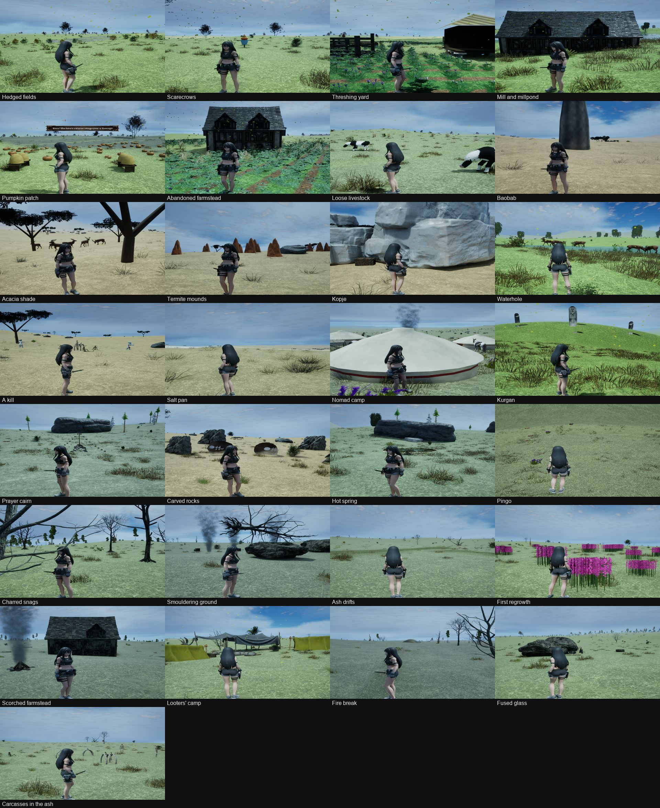

### The forests: pine, boreal, taiga, autumn and aspen

| Kind | Biomes | What stands there | What she does there |
|---|---|---|---|
| Resin camp | pine forests | tapped pines, each with a herringbone scar over a clay cup, a still, pots, a fire, a tapper | collect resin; talk to the tapper |
| Sunlit clearing | pine, boreal, aspen | a clearing where the canopy breaks (the forest's trees taken out of it), flowers, shafts of light by day, deer | rest in the sun |
| Granite outcrop | pine, boreal (a rise) | a great granite boulder, lesser ones, slabs, moss | climb it: the map shows 1.5 km round |
| Lightning-struck pine | pine, boreal, taiga | a great pine split and charred, still smoking, embers | salvage dry heartwood |
| Logging camp | pine, boreal, taiga | a clearing, a timber chute running downhill, a log cart, log piles, stumps, a saw and an axe, a tent, a logger | trade bread for logs; talk to the logger |
| Owl's hollow | pine, autumn, boreal | an old tree hollowed by woodpeckers, ferns | reach into the hollow: someone's hidden satchel |
| Pine ridge | pine forests (a rise) | a rock on the ridge, pines, needles | climb the rock: the map shows 2.5 km round |
| Lichen heath | boreal | pale lichen over the ground (a skin of its own colour), pines, reindeer grazing | gather reindeer lichen (herbs) |
| Esker | boreal, taiga | a long gravel ridge (180 m) winding through the forest, pines down both sides | walk it: what it is |
| Pine dunes | boreal | two sand dunes (mounds in sand's colour), pines on them | |
| Kettle lake | boreal, taiga (by a pond) | boulders and reeds on a round lake's shore | fish |
| Old fire scar | boreal, pine | burnt trunks, young pines all of one age | read the scars |
| Reindeer herders' camp | boreal, taiga | two cone tents (lavvus), a corral with reindeer in it, meat on drying racks, a fire, a herder | share their fire; trade a hide for food; talk |
| Seid stone | boreal, taiga | a great boulder set up on three small stones, candles and bones | leave bread: the Blessing of the Seid |
| Muskeg | taiga, boreal | dark peat (a skin of its colour), reeds, moss, dead trees | the bog slows her from her first step and drags at her after 4 s; search the body preserved in the peat |
| Spruce thicket | taiga | two rings of spruce so dense they stand as a wall, a gap into them | a chest in the middle |
| Beaver dam | taiga, aspen, boreal (by a river) | a dam of sticks, a lodge, drowned trees, gnawed stumps | |
| Bear's ground | taiga, boreal, pine | a moose wallow's mud, a ring of pines | read the tracks; a bear rises out of the brush |
| Trapper's cabin | taiga, boreal | a cabin, a cache up on stilts, fur stretchers, snares, a log pile | climb up to the cache: furs and stores |
| Drunken forest | taiga | spruces leaning every way on thawing ground, moss | |
| Golden larches | taiga, boreal | larches turned gold, needles falling | |
| Deep leaf litter | autumn | deep fallen leaves, roots | two pits hidden under the leaves; read the trail through them |
| Fungus glade | autumn, aspen, pine | logs stepped with shelf fungi, a ring of mushrooms | pick mushrooms and herbs |
| Hollow giant | autumn, pine | an old-growth giant 28 m high, its roots | shelter in the hollow (rest) |
| Mossy walls | autumn, aspen | drystone field walls through the woods, moss | |
| Nut cache | autumn | an oak, leaves, squirrels at it, a forager | gather nuts; talk to the forager |
| Charcoal hearth | autumn, pine | a clearing, a smoking charcoal clamp, coppiced stools, the burner's hut, a log pile | trade bread for wood; talk |
| Misty hollow | autumn, aspen, pine (a hollow) | fog lying in the hollow at dawn and dusk, ferns | |
| Harvest shrine | autumn | an oak's trunk carved with a face, gourds and candles, a ring of log seats | leave bread: the Blessing of the Harvest |
| Watching aspens | aspen | two rings of white aspens | look at the scars that seem to watch you |
| One grove | aspen | 34 aspens over a hillside, one root | rest a hand on it: the Grove's Calm |
| Carved trunks | aspen | a line of aspens carved with names and dates, an axe | read the carvings: one points the way to a structure of the wilds |
| Golden stand | aspen | aspens turned gold inside a ring of dark pines, leaves falling | |
| Beaver-felled stumps | aspen, autumn (by a river) | gnawed stumps by a stream, aspens, elk browsing | |
| Aspen undergrowth | aspen | wildflowers, aspens, butterflies by day | pick wild berries |
| Grove's edge | aspen, pine | where aspens meet pines: a cold camp, its watchers lying low | two of them come at her within 12 m; a chest |
| Windthrow | every forest | fallen pines all laid one way, torn-up root plates | |

- **The quiet floor** ("a soft floor of needles that muffles footsteps, good for stealth"): in the pine forests, the boreal pine forest and the taigas the wilds' monsters notice her from 0.65 of their distance (`WildQuietBiomes`, `WildQuietNotice`; a hunting monster is not fooled).
- **What is new to the scenery**: a clearing (`L=clear;r=`: the forest's plants taken out of a square round a point, as a house keeps its floor); hazards `bog` (slowed from her first step, dragged at after 4 s) and `pit` (a fall's harm under the leaves, once a minute); a part's material on one slot (`slot=`: the gold larches' needles, the gold aspens' leaves); effects at `dawn` (4:30 to 8:30, 17:30 to 19:30); a landform in a colour of its own (`tint=`: the lichen, the peat, the dunes' sand).
- **The land**: the autumn forests' holloways (sunken lanes 4 to 6 m wide, 2.8 to 4.2 m deep: a dry channel's rule).
- **Its new things**: Pine Resin (a component, as glue), Wild Berries (food).
- **Its own pieces** (`scenery13_kit.py`): a timber chute, a seid stone, two lavvus, a beaver lodge and dam, a fur stretcher, a cache on stilts, a charcoal clamp, a log of shelf fungi, an oak carved with a face, two tapped pines, gold leaves and needles.
- **Measured** (`test_s13r1.json` to `test_s13r3.json`, `test_s13r8.json`, after PR #67's review; the whole table of 88 kinds again in `test_s13r1.json` to `test_s13r7.json`, all passing but the kurgan's and the pingo's uses, on mounds over the test's 4 m trace: passing in `test_s13r8.json` once it passes only trees' crowns by): every kind found within 150 km of Brokenspire and visited as the others are. The clearings hold none of the forest's trees inside them, with 21 to 52 trees within 60 m. In the bog her walk falls from 353 to 159 cm/s, and it drags at her after 4 s (8.4 hit points). The pits hurt (9.8 each). The bear rises at its ground. The grove's edge's two watchers lie low at 30 m, then hunt her and strike her (54 hit points in 2.5 s, swinging). The holloway's bed lies 3.4 m under its banks. The quiet floor: a monster 20 m off (0.8 of the wilds' 25 m) did not notice her in the pine forest in 3 s; on the grassland one came 4.4 m nearer in the same time.

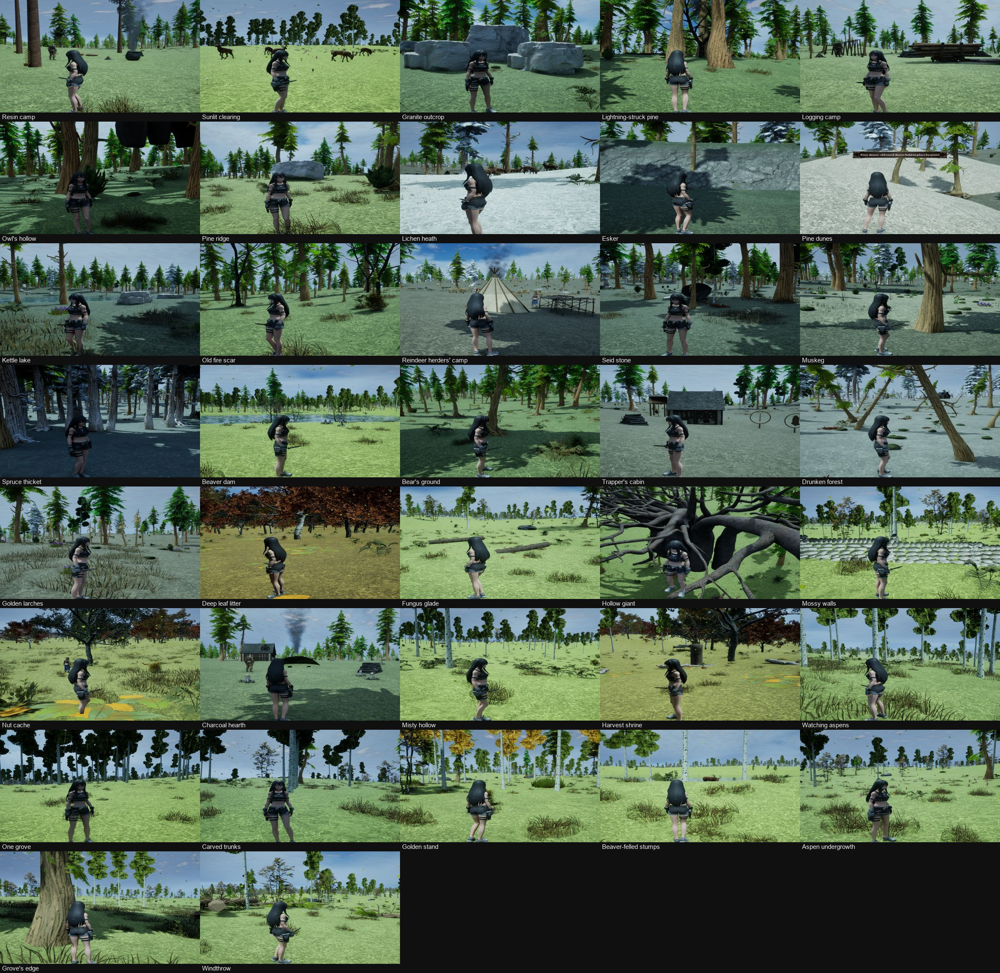

### Hills and highland moorland

| Kind | Biomes | What stands there | What she does there |
|---|---|---|---|
| Hillfort | hills (a rise) | two rings of earth bank on the summit, open at a gate, a broken palisade | look over the ramparts; a chest |
| Chalk horse | hills | a horse 54 m long cut into the hillside, white through the turf (a skin of the land in its outline) | |
| Terraced fields | hills | three drystone walls along the slope, flowers in the terraces | gather herbs |
| Dew pond | hills (a rise) | a round clay-lined pond on the hilltop, reeds | drink: rest |
| Folly tower | hills (a rise) | a lord's tower on the crest | climb it: the map shows 2.5 km round |
| Beacon hill | hills, moorland (a rise) | a beacon (it burns at night), a signpost, wood stacked for it | look at the beacon |
| Old quarry | hills | a cut rock face, a cave behind it, cut blocks, a cart, tools | two of the quarry's lurkers; a chest |
| Hillside vines | hills | rows of old vines on stakes, goats among them | pick grapes |
| Hidden combe | hills (a hollow) | a hermit's stone hut, apple trees, a fire, the hermit | pick apples; talk to the hermit |
| Peat hags | moorland | black peat, moss, lights over it at night | the bog slows her and drags at her |
| Tor | moorland, hills (a rise) | a granite stack of two great stones, lesser ones round | climb it: the map shows 2 km round; its lurker |
| Heather and gorse | moorland, hills | gorse and heather in bloom, butterflies by day | gather heather |
| Stone row | moorland | a row of eight standing stones, two hut circles | walk along it |
| Peat cutting | moorland | a peat bank cut into the moor, turves stacked to dry, a spade | take dried turves |
| Mist on the moor | moorland | gorse and a standing stone in a mist: the world's fog thickened round it, from 5 m out, whole within 35 m | |
| Shepherd's bothy | moorland | a bothy, a ruined shieling, bedding, a fire | rest in the bothy |
| Grouse butts | moorland | a line of shooting butts, the hunting lodge, the gamekeeper | trade a hide for food; talk |
| Peat-water ford | moorland, hills (by water) | stepping stones, reeds | fish |

- **What is new**: a skin of the land in an outline (`L=patch;poly=`: points round its middle, -1 to 1 of its reach; only what lies inside is laid: the chalk horse); a scenery's mist (`L=mist;r=`: the world's fog thickened round it as the port's is); the moors' fog three times as heavy in the weather's turn (`WeatherWeights`; `CountWeatherPicksHere` runs the pick itself); the hills' sheep tracks and holloways (dry channels' rules).
- **Its new things**: Grapes (food), Peat Turf (a component, as a log).
- **Its own pieces** (`scenery13_kit.py`): two stacks of peat turves (the dew pond is two skins of the land, clay and water: a pond piece laid flat on its hilltop lay buried).
- **Measured** (`test_s13p4a.json`, `test_s13p4b.json`, `test_s13p4c.json`; after PR #68's review `test_s13p4d.json`): every kind found within 150 km of Brokenspire and visited. She climbed the folly 10.5 m and the tor 5.3 m, and saw 7,613 and 4,903 more of the map. The peat hags' bog took her walk from 353 to 159 cm/s and dragged at her (8.4 hit points). The quarry laid its two lurkers and the tor its one. The weather's own pick, 4,000 turns of it where she stood, brought fog 12.7 % of the time on the moor and 4.5 % on the grassland (2.8 times: a repeat is turned away). The mist's fog in its middle: density 0.18 from 5 m (0.02 from 250 m, 200 m off). The sheep track's bed lies 0.2 m under its banks and the hills' holloway's 2.6 m.

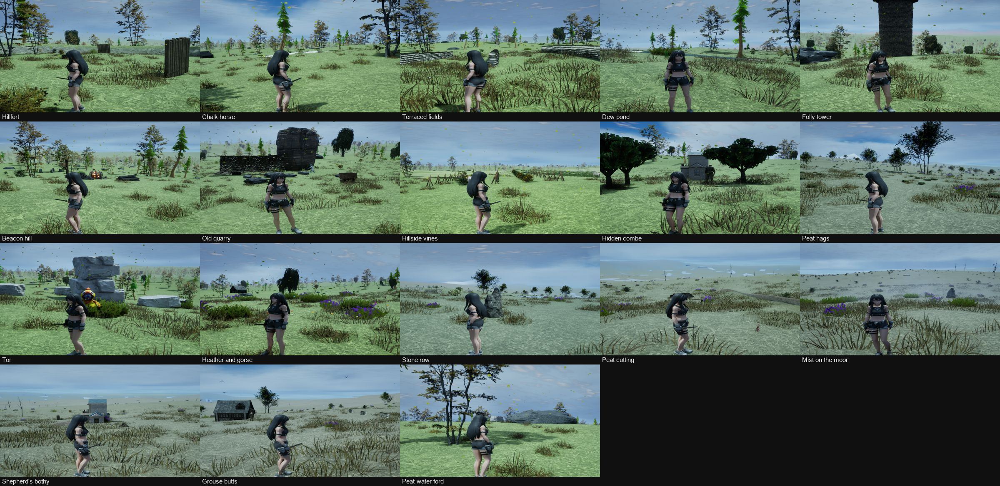

### Mountains, peaks and glaciers

| Kind | Biomes | What stands there | What she does there |
|---|---|---|---|
| Switchback trail | mountains | drystone switchbacks up the slope, fallen stones, a mule train walking it | stones come down on her if she lingers |
| Alpine pasture | mountains | a herder's stone cheese hut, flowers, cows, a fire, the herder | trade bread for cheese; talk |
| Mountain pass | mountains, peaks | a stone gate between two timber towers, a palisade, the toll keeper | pay the toll (bread): Safe Conduct |
| Scree slope | mountains, peaks | loose broken stone, a boulder | the scree slows her and carries her down the slope |
| Hanging waterfall | mountains (by water) | a rock face, a waterfall off it, reeds | fish the pool |
| Mine adit | mountains, peaks | a rock face, the adit's mouth and its frame, rails, a cart, a tailings heap | its two guards; a chest of iron |
| Cliff shrine | mountains, peaks | a rock stack, ladders up it, candles | climb the ladders: the map shows 2.5 km round |
| Rope bridge | mountains, peaks | a rope bridge slung between two rock stacks | |
| Tarn | mountains, peaks (by a pond) | boulders round a dark pool | fish |
| Goat ledges | mountains, peaks | a rock face, goats, birds over it | |
| Knife-edge ridge | peaks | a ridge 7 m high and 110 m long | its snow gives way under her (once) |
| Summit cairn | peaks (a rise) | a cairn with prayer flags, bones | leave bread: the Blessing of the Summit |
| Cornice | peaks, glacial | snow-capped rocks, an overhang of snow | it gives way under her (once) |
| Avalanche chute | peaks, mountains | broken trunks, cleared snow | the snow comes down on her if she lingers |
| Couloir | peaks | a steep gully between two rock walls | stones come down it |
| Rime ledge | peaks, glacial | rime-coated rocks, icicles, ice crystals | |
| Abandoned climbers' camp | peaks | two frozen tents, stakes | read the journal; a chest |
| Above the clouds | peaks (a rise) | a high rock | climb it: the map shows 3 km round |
| Aerie | peaks, mountains (a rise) | a nest of whole trees, bones, skulls | its keeper, the Aerie's Drake, comes home; a chest |
| Crevasse field | glacial | dark crevasses in the ice, icicles | a snow bridge gives way under her (once) |
| Seracs | glacial | towers of glacier ice | the nearest one topples toward her |
| Ice cave | glacial | an ice cave's arch, crystals inside | a chest in it |
| Moulin | glacial | a ring of ice round a black shaft (skins of the land) | the shaft hurts if she steps in |
| Moraine | glacial, peaks | a ridge of gravel 120 m long, boulders on it | |
| Meltwater lake | glacial (by water) | snow-capped rocks, boulders | fish the milky water |
| Frozen in the ice | glacial | a block of clear ice, great ribs inside it | |
| Nunatak | glacial (a rise) | a rock peak through the ice | climb it: the map shows 2.5 km round |
| Ruins in the ice | glacial | broken columns and walls coming out of the ice | a chest |

- **What is new**: hazards `rockfall` and `avalanche` (a warning and dust as she comes; 1.2 s on, a blow if she is still near), `scree` (slowed, and carried down the slope every 0.8 s), `cornice` and `crevasse` (once a play the snow gives way: a fall's harm and she is set down 4 m off); thin air (`WildThinAirBiomes`: on the peaks and the glaciers she walks slowed, told once as she comes).
- **Its own pieces** (`scenery13_kit.py`): a rope bridge, two seracs, an ice cave's arch, a climbers' tent drifted with snow, a block of clear ice (a moulin is two skins of the land, ice and its shaft; the meltwater lake a skin of milky blue in a hollow).
- **Measured** (`test_s13p5a.json` to `test_s13p5g.json`): every kind found within 150 km of Brokenspire and visited. The stones struck her (16.8 on the switchback and in the couloir), the avalanche 28; the cornices and the knife-edge's snow gave way (21 each) and the crevasse's bridge (28); the nearest serac toppled onto her (21); the moulin's shaft hurt (9.8); the scree carried her 1.15 m in 3 s; the Aerie's Drake came home. She climbed the cliff shrine's ladders 9.6 m, the nunatak 5.7 m and the high rock over the clouds 2.4 m, and saw 7,480, 7,614 and 11,065 more of the map. The pass's toll gave Safe Conduct, the summit cairn its blessing, the herder two cheeses for bread. Thin air: on the peaks her walk is 315 cm/s against 371 in the mountains below. The land's rises and skins (every phase's: 23 kinds) were drawn inside out until this phase (their triangles wound the other way: a skin's middle unseen from above, a mound seen by its far side's inner face); wound as the ground is, all 23 were visited again (`test_s13p5e.json` to `g`) and each skin's middle is traced to be the skin, not the ground under it.

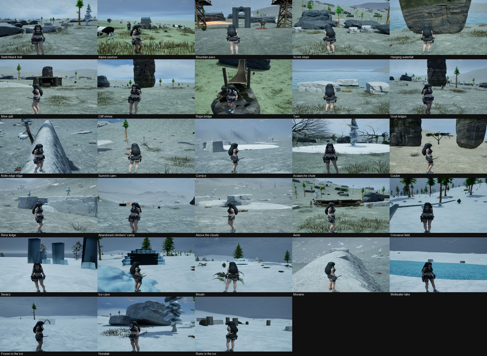

### Canyons, canyon networks and mesas

| Kind | Biomes | What stands there | What she does there |
|---|---|---|---|
| Banded cliff | canyons, networks (a cliff's foot) | rubble, great bones in the strata | look at the layers |
| Slot canyon | canyons (a slot's floor) | sandstone rubble | thunder, then a flash flood down the slot: it strikes her and carries her off |
| Canyon creek | canyons, networks (a channel) | a creek along the channel's bed and a sandbar (skins), cottonwoods, reeds | fish |
| Cliff dwellings | canyons, networks (a cliff's foot) | mud-brick rooms in an alcove under an overhang, a ladder, pots | search the rooms |
| Petroglyph panel | canyons, networks (a cliff's foot) | three carved panels | |
| Natural arch | canyons, mesas, networks | an arch of banded stone 18 m across | |
| Hanging garden | canyons (a cliff's foot) | ferns and flowers round a seep | gather berries |
| Echo point | canyons, networks, mesas (a rim) | rocks, a cairn | call out: something calls back |
| Rockfall | canyons, networks (a cliff's foot) | boulders and rubble under a fresh scar | stones come down on her |
| Toe-hold trail | canyons, mesas (a cliff's foot) | a rock face, a rope ladder | climb it: the map shows 2.5 km round |
| Box canyon | networks, canyons (a cliff's foot) | two walls closing a dead end, bones | an ambush; a chest |
| Canyon junction | networks | a cairn, a carving, a signpost | read the warning |
| Hidden side canyon | networks | a squeeze between two walls, a chest beyond | |
| Pour-off | networks, canyons (a cliff's foot) | a dry waterfall's lip, a log jam, rubble | climb over it |
| Tinaja | networks, canyons, mesas | three rock basins of rain water (skins), rocks | drink: wounds and mana restored |
| Outlaw hideout | networks, canyons (a cliff's foot) | a fire, bedrolls, a lookout | its three outlaws; a chest |
| Panning wash | networks, canyons (a channel) | a sluice trough, a mine's frame, gravel | pan for copper and iron |
| Flood debris | networks, canyons (a channel) | a log jam, rubble | |
| Hoodoos | networks, mesas, canyons | nine hoodoos with their caprocks | |
| Dry wash | networks, canyons (a channel) | cracked mud, rubble, a log jam | thunder, then a flash flood |
| Banded butte | mesas, canyons | a butte 14 m high in coloured layers, a talus apron (a landform) | |
| Mesa-top pueblo | mesas (a rise) | mud-brick rooms, a granary, a fire, an elder | trade bread for cheese; talk |
| Spire | mesas, canyons, networks | a needle of banded stone 24 m high (a landform) | |
| Talus apron | mesas (a cliff's foot) | boulders and rubble | the talus slides under her |
| Overlook | mesas, canyons (a rim) | a rock at the edge | climb it: the map shows 4 km round |
| Sky shrine | mesas (a rise) | a slab with a pecked spiral, two leaning stones, a ring of stones | at sunrise the sun's blade crosses the spiral: The Sun's Blade |
| Caprock pools | mesas (a rise) | rain pools on the caprock (skins) | drink |
| Condor ledge | mesas, canyons (a rim) | a great nest, birds below the rim | take eggs |
| Lone juniper | mesas, canyons, networks (a rim) | a twisted tree on the edge | |
| Storm below | mesas (a rim) | rocks at the edge; the far storms over the open lands are seen from the canyons and mesas too | |

- **What is new**: places `rim` (level ground at a cliff's top, facing the drop), `foot` (at a cliff's foot, facing the wall) and `channel` (a dry channel's bed, facing along it: a cell a channel crosses takes such a kind three times in five); the slot canyons, a channel rule 4 to 6 m wide and 6 to 9 deep in the canyons and networks; hazard `flood` (thunder as she comes onto the floor; 6 s on, the water comes down the channel: on its floor still, a blow and a push down it; once in 2 minutes); use `echo` (her call, then 1.6 s on what calls back); `hours=` on any use (a sun dagger's blessing only at sunrise, said so otherwise); landform `L=mesa` (a butte: a flat top, sheer sides, a talus apron) and `bands=` on any landform (its colour in layers by height); the canyons' and mesas' rock coloured in strata by height, each layer 6 to 10 m thick, the same layer at the same height across the region (`Sample`'s rock colour: the chunks and the far land alike).
- **Its own pieces** (`scenery13_kit.py`): a natural arch of banded sandstone, two hoodoos with their caprocks, cliff dwellings in an alcove, a sun dagger's slab and its leaning stones, flood debris, sandstone boulders (the rubble of every canyon kind: the packs' grey rocks stood out on the red sand), a terraced mesa-top pueblo with its ladders.
- **Measured** (`test_s13p6g.json` to `test_s13p6l.json`; the land pass, the slot canyons' channels 4 m wide and 8.7 m deep, in `test_s13p6a.json`): every kind found within 150 km of Brokenspire and visited. The slot canyon's flood struck her for 21 and carried her 3.3 m down it, the dry wash's 21 and 2.8 m; the rockfall 16.8; the talus slowed her to 194 cm/s against 353 out of it and carried her 1.9 m. The echo called back (one line, 1.6 s on); the sun dagger gave nothing at 14:00 and said so, and The Sun's Blade at 6:30. She climbed the toe-hold trail 9 m, the pour-off 4.5 m and the overlook's rock 2.1 m, and saw 7,734, 2,699 and 19,741 more of the map. The box canyon's three lay low at 30 m, then hunted and struck from 9 m (25 taken). The tinaja healed; the wash panned iron, the dwellings gave a potion and rope, the pueblo's elder cheese for bread. The canyons' slopes show their strata in every picture of the region (the sheet's far walls).

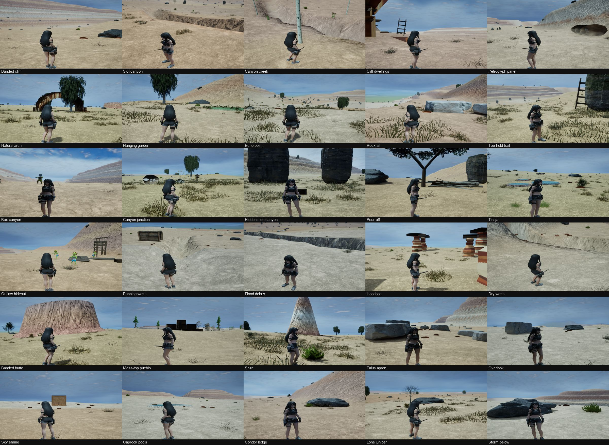

### Volcanoes, volcanic tundra and the geothermal caldera

| Kind | Biomes | What stands there | What she does there |
|---|---|---|---|
| Lava flow | volcanoes, tundra | a ridge of lava glowing under a black crust (skins with the ground's own glow), smoke | its heat burns |
| Lava tube | volcanoes, tundra | a lava tube's mouth of black basalt | its two guards; a chest |
| Cinder cone | volcanoes, tundra | a black cone of scoria 9 m high round its crater (a landform) | the cinders slide under her |
| Ash-buried village | volcanoes | grey ash, three roofs and a church's spire standing out of it | dig at a buried door |
| Volcanic bombs | volcanoes | blobs of black rock thrown from the crater | |
| Fumaroles | volcanoes, caldera | two sulfur-crusted vents, their steam | scrape sulfur; the gas at a vent hurts |
| Obsidian field | volcanoes, tundra | black glass shards | gather obsidian; its edges cut |
| Volcano's shoulder | volcanoes (a rise) | a rock, volcanic bombs, the crater's smoke above | climb the rock: the map shows 4 km round |
| Eruption signs | volcanoes | grey ash, dead birds | the ground shudders under her, ash falls |
| Fire temple | volcanoes | a temple's arch, a brazier's fire, a cauldron, its keeper | leave bread: The Mountain's Heat |
| Lava lake | volcanoes | a lake of glowing lava ringed with boulders, smoke | its heat burns |
| Moss-covered lava | tundra | green moss over a field of lava blocks | a hole under the moss |
| Black sand | tundra (a hollow) | black sand, blocks of glacier ice on it | |
| Basalt columns | tundra, volcanoes | hexagonal basalt columns stepped to 7 m | climb them: the map shows 2 km round |
| Meltwater flood | tundra (a fissure) | blocks of ice in a dry rift | thunder, then the meltwater comes down the rift |
| Rift | tundra (a fissure) | rubble in a fissure 6 to 10 m deep | |
| Pseudocraters | tundra | three small mossy craters (landforms) | |
| Turf farm | tundra | a turf-roofed hut, a stone sheep pen, sheep, the farmer | trade bread for cheese; talk |
| Hot river | tundra, caldera (by water) | steam off the water | bathe: wounds and mana restored |
| Troll rocks | tundra | three tall weathered rocks | |
| Geyser | caldera | a geyser's white sinter cone, its steam | watch it: it says when it goes again; every 30 s it erupts, scalds and throws her |
| Terraced pools | caldera | white, orange and teal mineral steps (skins), steam | bathe |
| Mud pots | caldera | boiling grey mud (a skin), steam | its heat burns |
| Bacterial mats | caldera | rings of orange, yellow and teal (skins) | |
| Thin crust | caldera | pale crust (a skin), a wisp of steam | it breaks under her (once): a scald, her legs slowed |
| Steam field | caldera | vents of steam, the world's fog thickened round it | |
| Crater lake | caldera (a hollow) | a turquoise lake (a skin), boulders | |
| Resurgent dome | caldera | a dome 6 m high and 60 m across, dark cracks round it (landforms) | the ground shudders |
| Spa village | caldera | a steaming hot spring, two houses, the bath keeper | bathe; talk |
| Dead forest | caldera, volcanoes | bare white dead trees | |
| Gas hollow | caldera, volcanoes (a hollow) | dead animals' bones | the gas hurts her after a breath and a half |

- **What is new**: hazards `geyser` (every `every=` seconds, its own offset in the cycle, 6 s of eruption: a column of steam, and a scald and a throw upward for her within its reach), `gas` (after a breath and a half, a hurt every second), `crust` (once a play: a scald and her legs slowed) and `tremor` (every 25 s while she is near: the ground shudders, her steps slowed a moment, ash sifting down); use `geyser` (the seconds to its next eruption, from its own hazard's cycle: a clock); a pit's `msg=`; `lava=` on any landform (the ground material's own glow: lava lakes and flows, the crater's lake below its rim); the volcanic tundra's fissures (a channel rule 3 to 5 m wide, 6 to 10 deep); Obsidian and Sulfur, gathered and sold (their pictures the steel ingot's and the oils').
- **Its own pieces** (`scenery13_kit.py`): basalt columns, obsidian shards, a fumarole, volcanic bombs, a sod hut, a geyser's cone, a church's spire, a lava tube's mouth.
- **Measured** (`test_s13p7a.json` to `test_s13p7g.json`; the land pass in `test_s13p7a.json`): every kind found within 150 km of Brokenspire and visited. The geyser erupted on its cycle and scalded and threw her (33.6 taken over its 6 s); its use told when it goes again. The lava flow's, the lava lake's and the mud pots' heat burned her (14 each); the gas in a hollow and at a fumarole hurt her after its breath and a half (16.8); the thin crust broke under her (16.8); the obsidian's edges and the moss's hidden hole cut (9.8); the cinder cone's scoria slowed her to 194 cm/s against 353 and carried her 1.8 m; the meltwater flood struck her (21) and pushed her 1.4 m down its fissure; the tremors shook the ground under her at the eruption signs and the resurgent dome. She climbed the basalt columns 6.6 m and the shoulder's rock 2.3 m, and saw 4,909 and 19,979 more of the map; scraped 3 Sulfur and gathered Obsidian; the fire temple's keeper gave The Mountain's Heat for bread; the farmer cheese; the spa healed her.

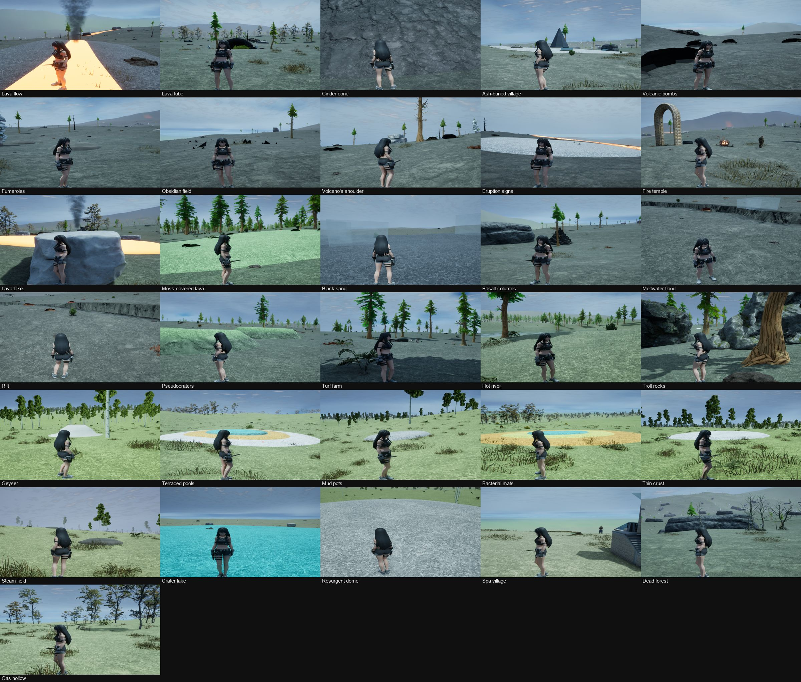

### Tundras and arctic regions

| Kind | Biomes | What stands there | What she does there |
|---|---|---|---|
| Polygon ground | tundras, arctic | a honeycomb of dark frost cracks 24 m across round a lichen skin (landforms) | |
| Thaw lake | tundras (by a pond) | reeds | fish; the mosquitoes sting |
| Caribou migration | tundras | a trampled trail (a landform), bones, the wilds' deer walking it | wolves come for the herd |
| Inuksuk | tundras, arctic | a stone figure pointing the way | read the way: the nearest towns, how far and which way |
| Mammoth bones | tundras | great tusks and a skull out of the thawing mud, ribs | |
| Cotton grass | tundras | a lichen skin, cotton grass | gather berries |
| Wolf den | tundras | a den in a mound, bones | its two guards; read the tracks |
| Summer bloom | tundras | wildflowers across the plain | |
| Reindeer herders' camp | tundras, arctic | two tents, a sledge, fish drying, antlers, a fire, the herd, the herder | trade bread for fish; talk |
| Pingo | cold steppes, tundras | (phase 2's kind, now in the tundras too) | |
| Pressure ridge | arctic | a jagged line of ice blocks | the broken ice drags at every step |
| Open lead | arctic | sea ice with a crack of black water across it (skins) | the ice at its edge gives way |
| Iceberg cave | arctic | a great block of ice, an ice cave's arch | a chest |
| Sastrugi | arctic, tundras | wind-carved ridges of snow (landforms) | they slow her |
| Seal holes | arctic | breathing holes in the sea ice (skins) | |
| Bear tracks | arctic | a seal's ribs, its blood on the ice | read the tracks |
| Frozen shipwreck | arctic | a ship frozen into the ice, its masts tilted, ice blocks | a chest; read the logbook |
| Ice shelf | arctic | a line of ice towers, the shelf's front | it calves with a roar onto her |
| Expedition hut | arctic, tundras | a plank hut drifted with snow, three graves | a chest; read the notes |
| Snow houses | arctic, tundras | two snow houses, a fire, the hunter | warm herself: wounds and mana restored; talk |
| Aurora hill | tundras, arctic, volcanic tundra (a rise) | a rock, a ring of stones | by night: The Lights' Blessing; by day it says to come back after dark |

- **What is new**: hazards `thin_ice` (after a second on it the ice gives: a hurt, her legs slowed; again after 30 s) and `drift` (slowed while in it); `msg=` on the sting (a thaw lake's mosquitoes) and the rockfall (an ice shelf calving); the auroras (`WildAuroraBiomes`: by night in the tundras, the arctic and the volcanic tundra a curtain of light 3 km long and 600 m tall hangs 4 km north of her, 1.2 km up, following her; the kit's `Aurora`, see-through and glowing).
- **Its own pieces** (`scenery13_kit.py`): an inuksuk, a mammoth's tusks and skull, an expedition hut, a snow house, a sledge, a pile of antlers, the aurora's curtain.
- **Measured** (`test_s13p8a.json` to `test_s13p8d.json`; the land pass with the auroras in `test_s13p8a.json`): every kind found within 220 km of Brokenspire and visited (the arctic lies 162 km north at its nearest, the tundras 116 km). At 23:00 in the arctic the aurora hung 4,000 m north of her and 887 m over her; at noon there, and at 23:00 on the grasslands, there was none. The open lead's ice gave way under her (16.8), the ice shelf calved onto her (16.8), the thaw lake's mosquitoes stung (8.4); the pressure ridge's and the sastrugi's drifts slowed her to 230 cm/s against 353; the caribou walked 7.1 m in 12 s, and the wolves' kill was not counted hers. The inuksuk told the way to the nearest towns; the Aurora hill gave nothing by day and said so, and The Lights' Blessing by night; the herder traded fish for bread; the snow houses healed her.`r`n`r`n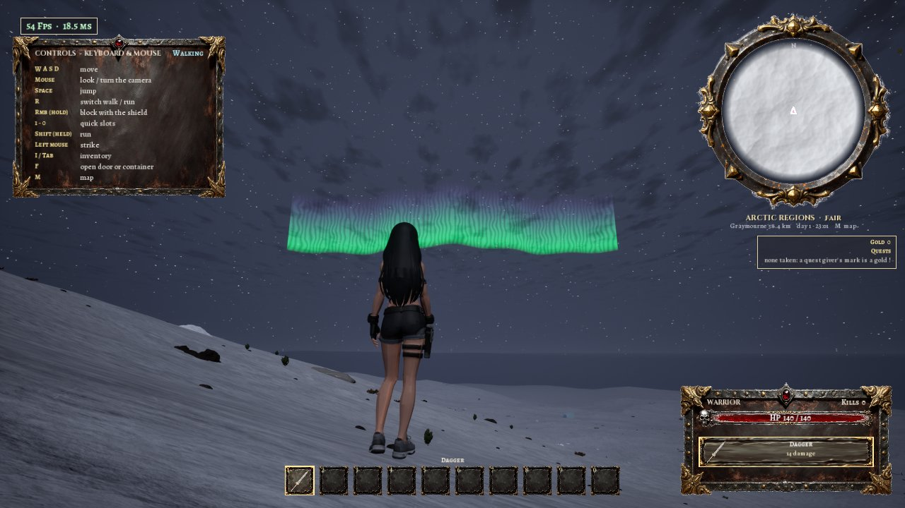

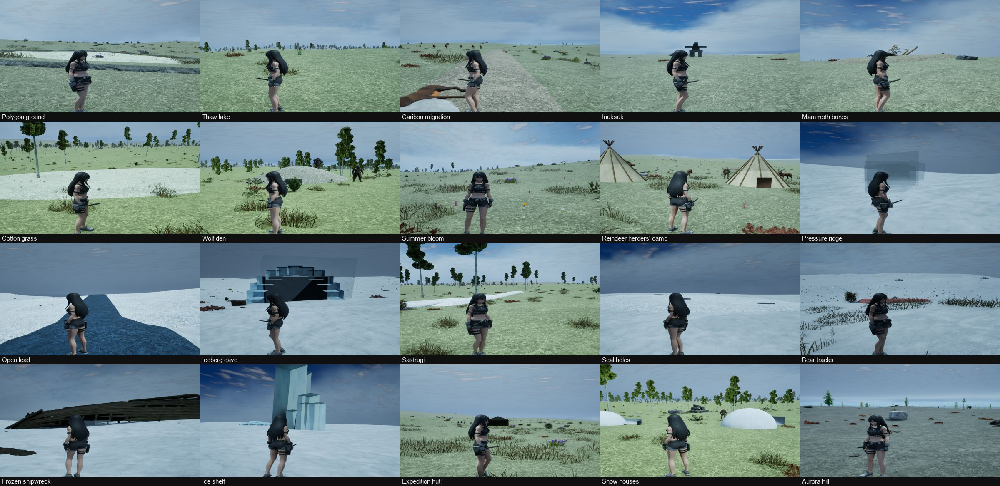

### Marshes, wetlands, coastal regions and rocky coasts

| Kind | Biomes | What stands there | What she does there |
|---|---|---|---|
| Reed bed | marshes, wetlands | reeds over her head, a nest | search the reed edge for eggs; an ambush lies low in the reeds |
| Boardwalk | marshes, wetlands | planks on stakes, a broken stretch over mud | the planks give into the mud |
| Stilt village | marshes, wetlands (by water) | two huts on stilts, a fish rack, a boat, the fisher | trade bread for eels; talk |
| Marsh lights | marshes, wetlands | lights drifting over dark water by night, reeds | |
| Heron rookery | marshes, coasts (by water) | herons wading, a flock over them | |
| Fish weir | marshes, wetlands (by water) | stakes across the water, eel traps, a punt | empty the traps |
| Salt-marsh creek | marshes, coasts | a creek that fills and drains with the tide (a tidal skin), mud, reeds | at high tide the sea comes in over her and takes her footing |
| Duck blind | marshes, wetlands (by water) | a hide of reeds | |
| Sunken causeway | marshes, wetlands | stones in a line just under dark water | |
| Drowned church | marshes, wetlands | a bell tower standing out of dark water | |
| Cypress swamp | wetlands | willows standing in dark water, roots | |
| Bog find | wetlands, marshes | a peat cutting, a bog idol, a body's ribs | |
| Floating mat | wetlands, marshes | a green mat of reeds over the water | it sinks under her |
| Quicksand | wetlands, coasts | a smooth grey patch | it pulls her in |
| Witch's hummock | wetlands | a hut on a hummock, a cauldron, the witch | leave bread: The Witch's Charm; talk |
| Log bridge | wetlands, marshes | a fallen tree over dark water | |
| Pitcher plants | wetlands | giant carnivorous pitchers | their reek and rim burn |
| Swamp gas | wetlands, marshes | dark water, bubbling steam | the gas hurts |
| Smugglers' camp | wetlands, marshes | a fire, crates, a boat | its three smugglers; a chest |
| Driftwood beach | coasts | sand, driftwood | search the tide line |
| Buried ruins | coasts | a dune over broken walls | a chest |
| Tidal flat | coasts, marshes | mud and a tidal skin of water | at high tide the sea comes over the flat |
| Fishing village | coasts, rocky coasts | a house, boats, nets, a fish rack, the fisherman | trade bread for fish; talk |
| Lighthouse | coasts, rocky coasts (a rise) | a lighthouse 14.6 m high, its lantern lit by night | climb to the gallery: the map shows 4 km round |
| Shipwreck | coasts | a ship heeled on a sandbar, its crates | a chest |
| Lagoon | coasts (by water) | reeds, a heron | fish |
| Seabird colony | coasts, rocky coasts | nests, guano (a skin), birds | take eggs |
| Wreckers' cove | coasts, rocky coasts | a fire on a brazier, crates | its three wreckers; a chest |
| Sea stacks | rocky coasts | pillars of rock 13 to 14 m | |
| Sea arch | rocky coasts | an arch of rock | |
| Sea cave | rocky coasts | a cave's mouth, a chest | search it at low tide; at high tide the sea fills its mouth |
| Tide pools | rocky coasts, coasts | rock pools (skins) among rocks | search the pools |
| Blowhole | rocky coasts | rocks, a wisp of spray | watch it: it says when it goes again; every 20 s it throws spray over her |
| Seal rocks | rocky coasts, coasts | flat rocks | |
| Clifftop ruin | rocky coasts (a rise) | an abbey's broken walls and columns | a chest |
| Rock-cut stairs | rocky coasts | a rock face, steps | climb: the map shows 2 km round |
| Storm surge | rocky coasts (by the sea) | rocks | a wave breaks over her and pulls her toward the sea |

- **What is new**: the tide (`GetWildTide`: a ten-minute sine on the world's clock, the same everywhere, `ForceWildTide` for tests), the skins laid with `tide=<m>` rising and falling with it (no collision: she wades); hazards `tide` (over 0.7 the sea comes in over her, slowing her; over 0.85 after 8 s it takes her footing) and `surge` (every 25 s a wave, a hurt and a pull toward the water); `tide=low|high` on a use (out of it it says when); the geyser's lines from `msg=` (a blowhole); the bog, thin ice, gas and sting given lines of their own (quicksand, a floating mat, swamp gas, a pitcher plant).
- **Its own pieces** (`scenery13_kit.py`): a fisher's hut on stilts, a lighthouse, giant pitcher plants, an eel trap, a duck blind, two sea stacks, a bog idol.
- **Measured** (`test_s13p9a.json` to `test_s13p9f.json`): every kind found within 220 km of Brokenspire and visited (the storm surge 198 km out). The salt-marsh creek's skin rose 1.2 m from low to high water and the tidal flat's 1.4 m; at high water each took her footing (14). The sea cave gave nothing at high tide and said so, and copper and fish at low. The blowhole's spray threw her (67.2 over its bursts), the storm surge's wave pulled her (11.2); the quicksand and the boardwalk's mud dragged (8.4), the floating mat sank under her (16.8), the swamp gas hurt (16.8), the pitcher plant stung (8.4). The reed bed's two lay low at 30 m and hunted from 9 m. She climbed the lighthouse to its gallery (11.2 m) and the rock-cut stairs (8.2 m), and saw 19,865 and 4,908 more of the map; the witch gave her charm for bread; the colony gave three eggs.

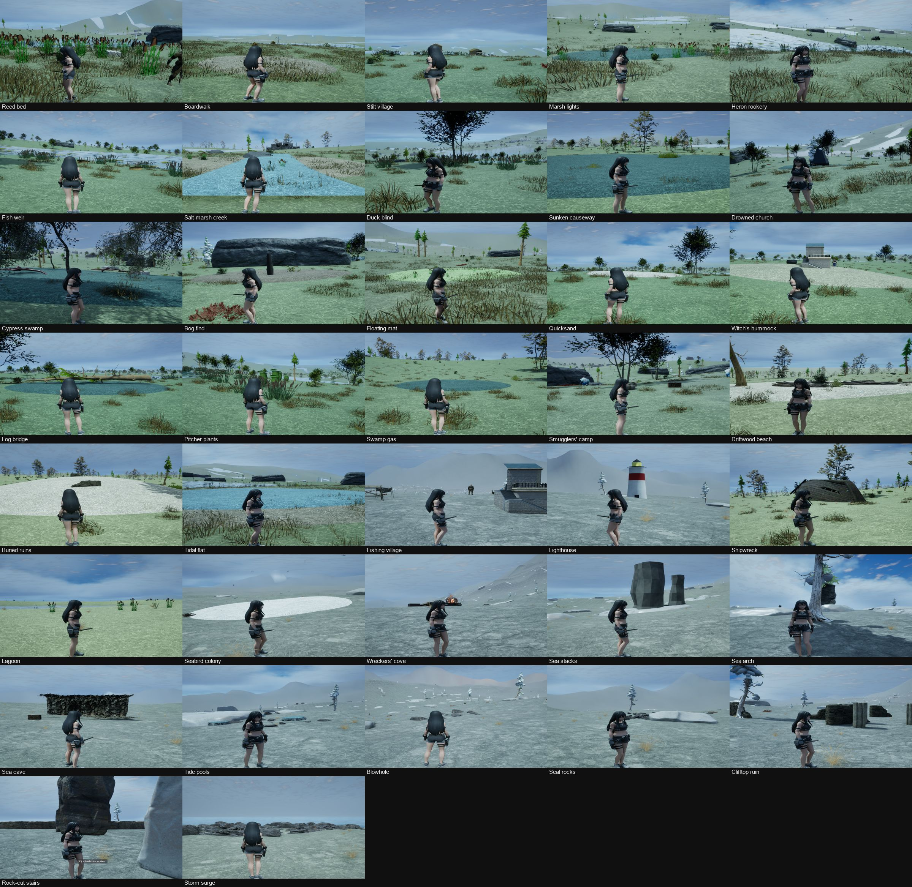

### The lists' tips ("what helps")

Each group of the list ends with what helps such land play well. What each tip became:

| Group | Tip | Where it is |
|---|---|---|
| Open lands | Gentle verticality | the swales (`biomes.json`'s `swale`): crests that hide the ground 300 m on (`land13`'s `swales`) |
| | A landmark always in view | a broken tower 182 m high at a fixed place in each 6 km square of the open lands, the same tower at the same place, the nearest within 8 km standing and solid when reached (`WildLandmarkBiomes`, this phase); the far storms and the grass fires' smoke |
| | Moving things | the herds and migrations, the far storms, the road travellers, the director's encounters |
| | Small stories | every region's warm campfire, dropped satchel and split tracks (this phase), and each region's own (a wagon wreck, a climbers' camp, a frozen ship) |
| Forests | Light changes, water, deadfall | the clearings, the light shafts' effect, the brooks and springs, the windthrow and log bridges (phase 3) |
| | Sound | not built: nobody hears a test (see TODO) |
| High terrain | Vertical goals, rewarding views | every climb shows the map round its top (phases 5 and 6) |
| | Changing routes | rockfalls, avalanches, cornices, floods (phases 5 and 6) |
| | Safe havens | huts, hot springs and snow houses heal and warm her (a shelter used: five minutes' warmth against the cold, this phase) |
| Canyon country | Light as a clock, rims and floors, weather danger | the rim, foot and channel places and the flash floods (phase 6); the light is the sky's own |
| | Water as power | tinajas, springs and the creek (phase 6) |
| Volcanic | Visible danger, a living world, contrast, resources | steam over the vents, the lava's glow, tremors before the eruption signs, obsidian and sulfur (phase 7) |
| Polar | Survival: cold, food, shelter | the cold (this phase): in the arctic, the glaciers, the peaks and the tundras she grows cold away from warmth (any fire within 8 m, the travellers' and farmsteads' too, a town, a shelter used); past 90 s the cold bites every 15 s while she is still cold, and stops the moment she is warm |
| | Scarce landmarks, things preserved in the ice | inuksuit, the frozen ship, the mammoth, the thing in the ice (phases 5 and 8) |
| | Seasonal change | not built (see TODO) |
| Water | The tide as a clock | the tide (phase 9) |
| | Footing | the mud slows her in the marshes and wetlands (this phase); the bogs, quicksand and floating mats (phase 9) |
| | What lies beneath | the sunken causeway, the drowned church, the sea cave at low tide (phase 9) |
| | Sound and fog | the fog comes three times as often on the marshes, wetlands and coasts as on the moors (this phase) |

- **What is new**: three small stories in every region (`*`: a warm campfire, a dropped satchel, split tracks); the landmark (the kit's `LandmarkTower`, `WildLandmarkBiomes`, `GetWildLandmark`); the cold (`WildColdBiomes`, `WildColdSeconds`, `GetWildColdState`); the mud's footing (`WildMudBiomes`, `WildMudSlow`); the fog's regions a list (`WildFogBiomes`, the moors' rule since the fourth phase).
- **Measured** (`test_s13p10a.json`): the small stories stand in every region, 142 warm campfires, 131 satchels and 126 split tracks within 30 km of Brokenspire; each was visited (the campfire's line, the satchel's bread, its potion at even chance, the tracks' two ways). On the plains the landmark stood 5.0 km off, and 990 m further on it was the same tower 4.4 km off; in the picture it is a dark spire on the horizon through the haze. In the arctic, cold past its limit, she was told and bitten (4.2); warmed (a shelter's warmth), the thaw was told once and nothing bit her in 16 s; on the grasslands the cold fell (200 to 188 in 3 s). In a marsh (its dry ground's mud 0.25) her walk was 300 cm/s against 353 on the grasslands. The weather's own pick brought fog 13.1 % of the time on the marshes and the moors against 4.8 % on the grasslands.

## The TODO sweep (2026-11-14)

The open items of `TODO.md` that a test could settle in the wilds (`888 ... -Light`):

| Step | What it measures |
|---|---|
| `questsave13` | The captain's two quests taken, two of the den's four wolves killed, saved and loaded: the quest still taken, the two kills kept (two wolves at the den), the rest killed, both quests turned in (320 gold) (`test_t13r12`). The captain's panel sometimes opened only at a second word: the step tries up to three times. A load waits for the level opened again (a world other than the one it was asked in) |
| `tamesave13` | The tamed horse kept by a save: tamed (`quests12`'s tame), saved mounted, loaded: still hers, she on it (`test_t13r12`) |
| `quests12b` | The quests whose choices the first run left untried, taken the other way (`test_t13r5`) |
| `animals13` | A wild deer killed at the game's own 120 s wait: no deer comes in its place before it, one 119.6 s after (`test_t13r7`) |
| `hunt13` | Hunting by the game's own rules, nothing held: eight bolts at a running deer hit once and left it at 38 % of its hit points; the Warrior running caught a hare 2.5 m off with one blow in 1.1 s (`test_t13r14`). Measured, not changed: struck, a deer outruns her bolts |
| `swim13` | Swimming in a lake (5.8 m deep) and a river (5.6 m): her swim clip on, her body at the face; a fall into deep water; saved swimming and loaded (still swimming, 0 m from where she saved); killed in the water, she comes back in Brokenspire's walls on foot (`test_t13r13`). It found two faults, fixed: a fall into deep water hurt her as a fall on land (82.7 of her hit points, `test_t13r3`): a fall that ends in water more than 1 m deep over her feet does no harm now (`TickFallDamage`); and `WildPutHer` (a load, a teleport) put her on the lake's bed, 4.3 m under the face, where she walked: she is put no deeper than the swimming floor (145 cm under the face) |
| `weather13` | An hour of the game's time at `rd.GameSpeed 10`: the weather changed 9 times, 4.7 to 9.1 minutes apart; the wilds' tracks every 5.4 to 8.7 minutes, and at dusk and dawn the scene's set changed with its track at once (those two left out of the gaps) (`test_t13r8`) |
| `farms1x13` | The farms at her own speed: 60 s outward over the fields from a field found round Brokenspire (the share of her run on fields read each second: all of it), its frames over 100 ms against the grassland's in the same run (the long frames' base rate): 2 of 2,171 against 0 of 2,327 (`test_t13r16`; an earlier run 7 against 50) |
| `caldera13` | The volcanoes' lava from her view, by day and night, she 60 m off unhurt, its glow measured in the night's picture (brightest 157.6 against a median of 33.7); the nearest hot spring (116 km out) and its steam effect, active, pictured from 35 m shown, hidden and hidden again: 4.4 against the water's own 4.0, not seen. It fails on the steam (`test_t13r15`). The steam was spawned with the pre-cull check (a chunk is made out of view) and is spawned without it now: not settled |
| `horse9 -Hero <hero>` | The horse ridden by the other five heroes: each bought, mounted, her rider clip playing, 14.0 cm over the saddle bone, as the Warrior (`test_t13hm`, `t13hw`, `t13hr`, `t13ha`, `t13hs`) |

The older steps the TODO asked to run again (the ground changed by the sheer walls' fix, the thirteen crops, PR #27's review) all pass: `ground7,ground8` (`test_t13o1`), `quests,places` (`test_t13o2`), `rain8,speed8` (`test_t13o3`), `fields8,perf8` (`test_t13o4`), `animals8` (`test_t13o6`: its wild deer now held within a sword's reach; at 300 cm the Warrior's swings had struck nothing).

## The list of 2026-11-16 (`docs/improvements14.txt`)

The user's list of 2026-11-16, in phases with a PR each ([its plan](../improvements14_plan.md)).

### The spires and collision (items 17 and 18)

- **The spires** ("very tall spires ... in the farm biomes that have no collision layers - check the game save labeled game3b"): the user's save (the packaged game's `save_game3b`, a Warrior on the farms 4.2 km from Brokenspire) loaded in play: the one piece over 30 m within 6 km of her was the tenth phase's landmark tower, 182 m high, 24 m off. Walked into, she reached 14.2 m from its middle, inside its 18.7 m shaft. Its collision was its first build's (107 m, before the tenth phase's review made it 1.7 times bigger): the kit's reimport (`926 kit`) kept a piece's old shapes. Measured on its own (`927 collide`): its shape stood 5.5 m inside its walls, and 16 of 48 rays passed through it (the upper third: the old hull's top was 75 m under the new one's).
- **The fix**: the landmark's shape made again from its own faces (a convex decomposition: `927 collide fix`), and `926 kit` makes a piece's collision again whenever its size changes on an import. After it: no ray through, none inside (0.0 m); in the user's save she stops 23.7 m from its middle (its half-width 21.9 m and her capsule).
- **Every structure the generator builds** (item 18): `927 collide` measures every mesh the wilds lay (brokenspire's `WildPieces`, the landmark, the 90 kit pieces): each traced from 16 ways at three heights against its faces and against its collision; a mesh whose shapes stand a metre inside its faces or let a third of the rays through fails (a pack's mesh gets a solid copy of our own, every table that lays it pointed at the copy; a kit piece is fixed in place; one still failing stops the stage). Of 254 solid meshes, only the landmark failed; 17 could not be measured (their faces met fewer than four rays: the amusement wheel's 439 boxes and the crane's 80 are built to trace their shapes as their faces, and the others' collision data, it seems, is cooked only on a first use the stage's one call never gives); they are named in `collide14.json`. In play (`888 collide14`), at the nearest place of each kind round Brokenspire (village, camp, lone house, ruins, ritual site, cave, lair, spawn point, a structure, a farmstead), every piece 2 m high or more whose foot is within 2 m of the ground (what she can walk into) is traced at a metre over its foot against itself alone: its faces against its collision, and its block of her channel; a piece laid with no collision is traced through the world. 238 solid pieces traced, none letting her in, and no piece without collision open (`test_s14p1.json`; a small place can hold nothing so high: the lair's bones and nest). What is meant to be walked or seen through is left out by whole parts of its name (`wild_tables.SOFT_PARTS`: plants, crops, roots, cloth, water, effects, the far sights), and so are roofs and gables (out of her reach: the walls stop her; the camera's boom passes them, as in the towns).

### The tables and the farms' ovens (items 2, 3 and 15)

Potions are made at the alchemist's table and scrolls at the librarian's (the castle's document has the rule and the tables' pieces; the towns' tables are in Brokenspire's). In the wilds (`RD/RDList14d.cpp`, from a hash of each place's own id, so no place's layout moves):

- **The tables**: a village one in two both tables, a camp one in three the alchemist's, a witch's hut and a standing-stone shrine the alchemist's, a structure's village one in two both, the abbey's and the temple's ruins the librarian's. Each stands on level, dry ground off the roads round the place's middle (4.2 to 8 m out, a ruin's or a structure's 3 to 16), clear of what its own chunk holds there (its pieces by a box overlap test from just over the lowest ground, its trees and rocks over 80 cm by their instances' bounds: they have no collision until she is near; smaller plants are cleared under it, and no grass grows through it or where she stands), its front to the middle. The rule names 6 villages, 3 camps and 2 temple ruins within 30 km of Brokenspire, and 3 structures' villages and 7 shrines within 15 km. A place with no room round its middle (a camp in the fens, ringed by pools and reeds) has none, and the log says so (`RDWILDTABLES14 no room`).
- **The ovens** ("ovens to craft food should be available at farms in the wilderness"): every farmhouse has the towns' bread oven (the castle kit's, at 0.65: 1.2 x 1.2 x 1.4 m; the kit's at full size took a third of a small farmhouse, and the packs' smaller stoves were modern or untextured), against a wall clear of the furniture and of the door's swing, its front to the room, or else behind the house's back wall. F there bakes as at a town's oven.
- **F** takes a table or an oven when it is the nearest of everything F reaches in the wilds (a scenery's use, a point of interest, a door or container, a person), within 2.3 m and seen from her: the line from her chest meets nothing before the station's own mesh (not through a wall).
- **Measured** (`888 tables14 -Light`, `test_s14p5c.json`): the Mage at the first farmstead near Brokenspire: its oven in the farmhouse named and opened by F, two wheat baked into a bread through the panel's Enter, and from behind it (1.7 m off, past its wall) nothing named; each of the 60 farm designs built in turn: one oven each, gone with its farm when it is taken away; the nearest village with both tables (Sundale, 19.6 km): both laid, each named and opened by F from in front, a Small Healing Potion and a Scroll of Fire Bolt made through the panel. Pictures of the oven and both tables.

### The farm folk asleep at night (item 16)

"The NPCs at farms should sleep at night": a farmstead's family had no town section, and the town's day (`ARDTownsfolk::TickDay`) passed them by: they stood at their work all night. Their own (`RD/RDList14f.cpp`): from 20:30 each walks straight over the ground to the farmhouse's door (tried again every 3 s, then put in at the door, as the town puts in a sleeper who could not get home) and goes in, to a place of its own inside; asleep from 21:00 to 5:30, in a bed of the house if it has one (lying on the town's Sleep clip, as the town's sleepers: the bed's top traced); at 6:00 out of the door and back to its work's place. The farmhouse has a bed for each of the family where the room has one free: besides its own, beds laid along the four walls 30 cm apart, head to the wall's inner face (the thatch kit's walls are 72 cm thick, the timber's 35), after everything else of the house and each clear of everything there and of the beds before it (an overlap test from 30 cm over the floor), at most four. F passes a sleeper over for anything else in reach; with nothing else, it names it asleep and does not wake it. With day and night switched off the family stays out at its work.

- **Measured** (`888 sleep14 -Light`, `test_s14p7a.json`): Odric's Croft's family of three walked home and were in by 23.3 s of the evening at four times the speed; at 23:00 all three asleep indoors, each in a bed on `AS_Town_Sleep` (the farmer's hips 29.6 cm over the bed's top, 0.4 cm off its middle, the clip moving with her looking at him); F beside the bed named the farmwife asleep and left her in bed; at 6:00 none asleep, in bed or indoors, each back at its work's place (0 cm). All 60 designs built in turn: every member of every family has a bed (36 of three, 16 of four, 8 of two), and no two beds of a house stand closer than 1.12 m (measured from their places, not counted: PR #84's review found the beds' overlap test lost from the code, four beds laid in one another, while the count passed). A picture of the farmer in bed.

### Locked containers, and who hears and who sees (items 13 and 14)

"In the wilderness, containers should be locked. Rogues can pick the locks of these locked containers and warriors can break the locks, but if they do, it alerts any nearby NPCs and makes them hostile"; "if someone breaks open a container or picks the lock within line of sight of an NPC, the NPC becomes hostile and starts attacking" (`RD/RDList14i.cpp`, `931`): about half the wild containers (the farms', the houses', the ruins' and structures' chests; never a garden) are locked, chosen by a hash of each one's key and the world's seed (always the same ones; one opened stays open). F names it by the hero: "pick the lock of the chest" (the Rogue: she stays within 1.2 m of it for 2 s, or "the pick slips"), "break the lock of the chest" (the Warrior: at once), "the chest is locked" (the others, refused with a line saying who could). A lock picked or broken is heard by every person of the wilds within 30 m of it and seen by one within 40 m of her with a clear line to her (static pieces between hide her; in the Rogue's stealth nobody sees her): they turn hostile ("N people noticed you: they turn on you"), come out of their houses, run at her and strike with the town guards' strikes (`918 guards`' clips; a blow of 6, grown with the wilds' tier), flinch at her blows and fight on; a child and a quest's people run from her instead. Once she is 80 m off, or hidden from them (stealth, a veil) for 6 s, they calm down; a calmed traveller goes back to its seat or its way. A blow is counted only when it hurt her. Who picks and who breaks are `locks14.json`'s `pickers` and `breakers` (`LockPickers`, `LockBreakers`). A person's step finds the floor under it (a farmhouse's stands over the ground). The numbers are `SourceArt/wilderness/locks14.json`. The test harness opens containers in the older steps with the locks off (they test other things).

- **Measured** (`888 locks14,npc14 -Light`, `test_s14p9r.json`): of 20 containers at the farmsteads round Brokenspire 55 % were locked and no garden; the Mage opened an unlocked one and was refused at a locked one ("the barrel is locked": it stayed shut, nobody turned); the Rogue picked a lock ("pick the lock of the wardrobe": shut 0.8 s after F, open after 2 s), with people placed round her: farmer of Elsa's Holding 16.2 m from the box and 16.0 m from her, no line to her heard it and turned; farmwife of Elsa's Holding 33.1 m from the box and 32.0 m from her saw it and turned; farmhand of Elsa's Holding 32.2 m from the box and 32.0 m from her, no line to her stayed calm; farmer of Odric's Croft 57.1 m from the box and 56.0 m from her stayed calm; 3 heard and 1 saw in all (the director's people near her among them); they ran at her and struck her 2 times (12.0 hit points). The Warrior broke a lock ("break the lock of the crate") and the box opened at once. A picture of them coming at her.

### People hurt, killed and looted (items 9 and 11)

"If a random monster encounter comes across a wandering NPC before it reaches the player, it should attack the NPC instead, damaging and killing it" and "kill NPCs and loot them" (`RD/RDList14h.cpp`, `930`): the wilds' people (a farmstead's family, the travellers on the roads, those the encounter director meets her with, a structure's freed captives, a scenery's people) take her blows and bolts and a wild monster's blows and shots. A wild monster that has a person within 20 m, nearer than her, in its sight, out in the open (not indoors or in bed) and within 150 m of her takes the person for its foe (`ARDMonster::PickFoe`, `IsWildPrey14`; what happens farther from her is not played out), notices and loses it by its own distances, and strikes it; the person stands and cowers, facing it, while it is near, and runs a short way when struck (her blows too). Killed, a person lies where it fell (the Dwarf pack's unarmed death retargeted onto the townsfolk's skeleton, with its flinch and run: `930 clips`) and leaves a pile of what it carried and a few gold beside it, which F names as the body's ("search the body of ...") and takes, the gold into her purse. Hit points, gold and things by a word of the person's title or its role (`SourceArt/wilderness/folk14.json`: a farmer 70, a farmwife 55, a farmhand 65, a pedlar 55 with 8-25 gold, a guard 110 ...), grown with the wilds' tier. The people laid again with their chunk (the farms', the captives', the scenery's) lie dead at their own places by their key in `WildKilled` (`(11 << 40)` + their kind, their place and their slot); the travellers and the director's people go with their group. A child and a quest's people are struck but never die (they keep 1 hit point) and are no monster's prey; a captive in its cage is behind its bars; a dead person takes no F.

- **Measured** (`888 npc14,travellers10,sleep14 -Light`, `test_s14p8r.json`): on the road out of Brokenspire's gate, the monsters' noticing as in play, a tier-1 monster set 4 m from three travellers, with her 45 m off, went for them, struck 7 times and killed a townswoman on the road to Ashenreach (she ran 6 times and cowered between; the monster's tick read chase, reach and swing by turns); her head lay 26.1 cm over the ground; she left Bread and 6 gold; the hero was never struck, from 45 m nor from 8 m. At Elsa's Holding the Warrior's dagger took its farmhand 65.0, 50.7, 36.4, 22.1, 7.8, 0.0 (it ran 1 time(s)); dead, its head 23.3 cm over the floor of its barn; F beside its pile said "search the body of farmhand of Elsa's Holding (4, 3 gold)" and took 4 things and 3 gold; its key kept, the chunk made again laid it dead at its own place by the barn's door (22.1 cm). A quest's giver (a wounded soldier) took 6 of her blows and a blow of a million and kept 1 hit point. The travellers walk and camp as before, and the farm folk sleep. Pictures of the fight on the road, the farmhand lying in its barn and laid again by its door.

### The farms' animals killed and looted (item 12)

"In the wilderness, enable the ability to kill farm animals and loot them - crafting items, food, can be found": a farmstead's animals (its yard's pens and its barn's and coop's stalls) take her blows and bolts (`RD/RDList14g.cpp`, as the hunted wild animals do: a blow within her weapon's reach and arc, a bolt whose way passes through its body), start away when struck, fall on their side when killed (no clip: the pose held and tipped, as the wild animals'), and leave their things in a pile taken with F. Their hit points and things by kind (`SourceArt/wilderness/farm_animals14.json`, `929 animals`): a cow 70 (2-3 Raw Meat, 1-2 Coarse Hide), a pig 50 (2-3 Raw Meat, Light Leather one in two), a goat 40 (1-2 Raw Meat, a Coarse Hide), a hen 10 (Raw Meat, 1-3 Feathers, 1-2 Eggs three in five), a rabbit 10 (Raw Meat, Light Leather). Three new things (`929 items`, on every map of the game, found only so): Raw Meat (the oven roasts it into a Well Done Steak; it is meat in the Hunter's Stew and the Feast Pie), Feathers, Eggs (food); their pictures painted on the InvokeAI server (the hen's eggs' as `hen_eggs`: an `eggs` element, the Bird's Eggs', was there). A killed animal stays dead in the game: its key (`(10 << 40)` + its farm's place x 256 + its place in the farm's plan) goes into `WildKilled`, and a farm laid again leaves it out, its draws still made so the others keep their places.

- **Measured** (`888 farmanimals14 -Light`, `test_s14p7b.json`): at the first farmstead (cows and goats), the Warrior's dagger took a cow 70, 55.7, 41.4, 27.1, 12.8, 0, it started away four times and lay on its side (its body's up axis level); it left 3 Raw Meat and 2 Coarse Hide, taken with F; the Mage's bolts killed a second cow (70, 45, 20, 0); both kept in `WildKilled`; the chunk made again, the farm had 8 animals of its 10 and neither of the dead. A picture of the cow lying in its stall by its things.

### Recipes in the ruins' and structures' chests (item 4)

Every kind of ruin and structure (54) holds "@recipe|1|1|0.3" in its chest's things (`928 wild`): when the chest is opened, a recipe of the land's tier where it stands (the recipes are of tiers 2 to 5 and their bands: the tier-1 land round Brokenspire gives none), drawn from a stream of its own by the chest's key so its other things keep their draws (`ResolveWildLoot14`). Measured (`888 recipes14 -Light`, `test_s14p6c.json`): every kind holds the line; at the nearest ruins on land of tier 2 or more, the Ruins of Hollowholt, its chest's own loot holds it and resolves to the Hunter's Stew Recipe (its tiers 2, 7, 12...); opened by F, the chest gave an Iron Ingot, a Small Healing Potion and the Hunter's Stew Recipe, all named by its resolved lines.

## Limits

What is not there yet, and what has not been tested, is listed in [TODO.md](../../TODO.md). In short:

- Caves are a mouth among rocks: there is no inside. Villages, camps and lone houses have their buildings and props but nobody in them (the farmsteads have their families). Since the list of 2026-11-11 every farm building can be entered; the farm folk stand at their work: they do not walk, sleep or go in at night. The farm buildings have one storey, and the gardens are harvested once a game (the town's grow again by the next day).
- The 34 structures (the list of 2026-11-12) are set pieces of the packs' meshes over the land, as the ruins: the caves, the mine, the tomb, the tunnel and the ice cave are mouths with no inside, the waterfall's hollow and the rift's scar are pieces, not places to go in. Their quests run in the wilds round them; the delivery is reached in game time (time spent in a menu does not count), and a quest left far away keeps its stage but drops its people and things until she comes back within 4 km.
- Monsters live only at spawn points, lairs (hidden in their covers since the list of 2026-11-12), ruins and structures with guards, the structures' quests and the captain's two quests' places; between places there are only the animals that flee from her (deer, wolves, squirrels, hares), which never fight (since the list of 2026-11-07 she can hunt them).
- Birds and insects are effects round her (flocks and swarms), not creatures: nothing hunts them and they do not land.
- The weather has no lightning, puddles or wet ground: the rain and snow are falling drops round the camera, the storm a darker sky, more rain and stronger wind.
- She wades shallow water and swims deep water at its face (since 2026-11-12); she does not dive, and nothing stops her swimming far out to sea. The lava does no harm.
- The towns are 85 to 157 km apart: walking from one to the next takes hours. Fast travel takes her there once she has found a town.
- Vel Morrath is walked into in `888 towns`; Ashenreach and Graymourne are built round her and their people are their own in Brokenspire's tests (`884 forge`, `port`), but no test has walked in through their gates or read the town's map there.
- In the default morning light (08:00) the land looks pale from a distance; the base colour buffer shows the ground's own colours right.
- The canyons' walls are sheer terraces, and the highest peaks' faces reach 80 degrees: she cannot climb out of a canyon by its walls.
- The editor's play runs at 10 to 48 frames a second out there (23 on average over the 28 templates); one long play session that visited all 28 templates ran the machine short of memory, so the test runs in batches with the editor restarted between them. Play on `brokenspire` ran the editor out of GPU memory on 2026-11-08 (with the user's other programs open), so that day's changes were measured without a game or on the castle.
- The packaged game: the Shipping package starts in Brokenspire, and since 2026-11-06 its test puts her out in Vel Morrath and builds the city round her (2026-11-07: Ashenreach and Graymourne too; 2026-11-08: the game's own console run in Brokenspire). Since 2026-11-14 its `wild` run plays the wilds itself: the Shipping package of 2026-11-14 (`builds\todo13`, `package_mistward.ps1 -Test`'s `wild` run, `-RDWildTest=<file>`: C++ `RD/RDWildSelfTest.cpp`, the game playing itself) walked to the lever by Brokenspire's gate and raised the portcullis with F (F named a guard standing by it first: she stepped nearer and waited), walked out through the gateway (60 m past it after 62 s, no step round), journeyed to Vel Morrath (`rd.GoTo`'s way: the city built round her in 5 s), saved there, was put 300 m off (measured before the load) and loaded (the level opened again, she 0.0 m from where she saved), then walked 20 minutes across the wilds from 3 km out of the town: 4.17 km walked, 3.40 km from its start, 43 to 70 frames a second, 0 deaths, no crash report. The memory, its start taken after a garbage collection: in use 5,116 MB at the start, 4,222 to 5,471 MB every 30 s, 4,408 MB at the end; committed 10,320 MB at the start, 10,438 to 10,844 MB for 7 minutes, then a step of about 0.7 GB at 7 minutes (in all three runs) and 11,385 to 11,836 MB for the last 13 (11,620 MB at the end). The first runs walked from inside Vel Morrath's streets (0.16 km in 20 minutes), and their 2 m steps round obstacles were not swept: they put her through the lowered portcullis, so their gate passes walked through nothing; the steps are swept now and the lever is pulled.

## The test

`pipeline\unreal\888_wilderness_test.ps1 <plan> <tag>` (plan `all`, and the default: the spec's nine steps, `world` to `save`; the later lists' steps are named in the plan); `SourceArt/wilderness/test_<tag>.json`. `look=<a>+<b>` visits only the templates named (their names with `_` for spaces). The whole test in one play session ran the machine short of memory (the editor's committed memory reached 32 to 34 GB): run it in batches with the editor restarted between them (`world`; `look` in four batches of seven templates; `stream,towns`; `gate,map`; `places,travel,save`; the later ones as their records were run: `sky7,life7,music7,save`; `world,gate,ground7`; `build7,quests`; `rain8,sky8,fields8,ground8,animals8,speed8`).

| Step | What it measures |
|---|---|
| `world` | the world made (0.1 s); the towns where the spec puts them (six checks: Brokenspire mid-south, Ashenreach in the middle and north of it, Graymourne on the north coast (the sea within 1.5 km north), Vel Morrath north-east and inland (since 2026-11-06: no sea within 20 km east of it, not on water)); every template in the regions; 8 rivers or more, 5 lakes or more, 4 roads or more (5 since Kethrys Spire, 6 since Heaven; Kethrys Spire north-west of Graymourne, inland, 60 to 120 km from it; Heaven south-west of Kethrys Spire, inland, 40 to 110 km from it: `test_hv7.json`, with `-Light`); the places' ids (the northern ones below the towns' range, none shared); pictures of the continent, of 40 km and 5 km round Brokenspire |
| `look` | each of the 28 templates visited (her put on walkable ground of its nearest region, the chunks round her made, her pawn there): a picture of her view, what the world has under her, the chunks' plants and rocks (some where its table has plants seen from afar, trees where it has trees), the frame rate; the first visit's base colour buffer |
| `stream` | 6 km out and back over the land at 100 m steps: never more than 81 chunks (72 measured), none outside the 2 km square, chunks made and dropped all the way, the memory back within 700 MB of where it began |
| `towns` | Brokenspire dropped 2.3 km off (no section, no people) and built again at 1.2 km; Vel Morrath built as she comes; in its walls the maps are the town's, outside the wilderness's; its people its own (no title naming Brokenspire; since 2026-11-06 its archbishop, archivist and commander, none of them Brokenspire's elder, scholar or captain) |
| `gate` | no "barred" at Brokenspire's gate; since the list of 2026-11-04 the portcullis raised by a lever first; she walks out through it (14.8 m past it) and out of the walls |
| `map` | the minimap drawn; the map opens over her at level 8 or finer with its tiles; at the region, the country and the continent (level 2 or coarser) the towns' symbols; revealed where she has been, not far off; the fog's picture made at most 3 times while the map is dragged and zoomed over 40 frames; pictures |
| `places` | one of each kind (camp, ruins, ritual site, house, village, cave, lair, spawn point) nearest Brokenspire: found when she comes to it, its props there; the lair's and the spawn point's monsters come at her over open ground (18 to 9 m, 15 to 6 m in 5 s); one of the spawn point's killed, its chunks made again: one fewer |
| `travel` | the place under the map's cross chosen and travelled to with F (28 m from it); a town by its id; refused at a lair with its monsters after her |
| `save` | saved; the Escape menu's Save and Load; gold and her place changed, the save loaded: back where she was (0.0 m), the gold, the places found and the map revealed as saved; since the list of 2026-11-04 a name typed on the Save page ("Test Save 7"), saved to its own slot (`save_test_save_7_<hash>`) and listed on the Load page |
| `sky7` | the list of 2026-11-04 (`test_i7f.json`): the clouds there, the fog stopping short of the sky, the next weather in 4 to 9 minutes; the noon sky not one grey (its picture's spread); an overcast sky takes the sun under half its light; at midnight in a clear sky the stars and the moon, the moonlit ground not black (pictures); rain turns its drops on; in the arctic it snows |
| `life7` | (`test_i7f.json`) in meadows, taiga and grasslands the animals and swarms round her, of the kinds the region has; at night fireflies; an animal put 9 m off stands, she walks at it and it flees within 1 to 3 m and runs off |
| `ground7` | (`test_i7e.json`) over 300 m of six open regions (moved 1.4 km clear of the towns, whose ground is level on purpose) the land's range and its swells (four of six over 4 m and 0.6 m), never a step of 4 m in 5 m; the blend out of the farms over a kilometre or more; the fields along 2 km of many lengths; the road 4 m wide or more where it crosses rings round the gate; the region's name under the minimap |
| `music7` | out in the wilds the wilds' set; a new track when its time comes, the next in 5 to 10 minutes; the town's set in the town |
| `build7` | (2026-11-07, `test_s5.json`; again 2026-11-08 after a big plant entry's parts kept their place instead of moving the rest down: the longest step 5.5 and 7.4 ms, at most 8.6 and 9.3 ms a frame, the first run's record `test_s10.json` since replaced by `test_s11.json`) the same 2.4 km flight over new ground at 100 m/s twice, chunks made in one go and in steps: the game thread's making (the longest step 6.0 ms, at most 9.3 ms a frame, against 14.7 ms a whole chunk), the frames' times and stat unit's threads in frames with and without making, all 79 chunks the same both ways (instances, triangles, trees, props, monsters, grass) |
| `rain8` | the list of 2026-11-07 (`test_w8j.json`: rain8, sky8, fields8, ground8, speed8; `test_w8q.json`: animals8): rain falling; every drop a streak standing up (0.26 by 0.009 of the plane), two crossed planes at each drop, the field keeping the world's axes (since PR #27's review; until then turned with the camera); pictures by day, looking up and at dusk |
| `sky8` | the fog's cutoff past 100 km; in fair weather, overcast and rain, pictures straight up (her body and the HUD hidden), half way up and of the horizon: the sharpest change between two strips down the horizon's picture under 15 (an edge's mark; `sky8=cut1000+falloff200` pictures other fogs beside the level's) |
| `fields8` | a field's middle in the farms by Brokenspire: the chunks round her hold every crop kind in rows (over 500 plants), the fields along 400 m, the frame rate there and in grassland; pictures near, low and far |
| `ground8` | she runs 12 s in each of six regions: her feet within 20 cm of the drawn ground at 98 % of the samples or more, what she stands on where she is not, pictures of the worst places |
| `animals8` | a deer and a wolf (the Summoner's bolts) and a hare (the Warrior's sword) put before her: each hurt by the first blow, killed, on its side, its kind's things dropped and taken with F; the kinds' places waiting; a deer of the wild's own killed: none while its place waits (45 s for the test), another after |
| `speed8` | `rd.WildRunSpeed` 1, 10, 40 at the console: her speed over 4 s each (10 and 40 times her run within 40 %), on the ground; back to 1 |
| `perf8` | (a measure, always ok) the frame rate in grassland, in the farms with the crops and with them hidden, each crop kind alone; frames' times running at 5x across the farms and the grassland |
| `memprobe` | (a probe, not in `all`) eight teleports far apart, each building its chunks anew: the memory, the chunks made and dropped, the map's tiles and the monsters after each; a `memreport -full` at the end |
| `list10w` | the list of 2026-11-10's first part (`test_w10d.json` after PR #38's review, `test_w10c.json` before; the horse in `test_w10b.json`): `rd.Weather storm` and `fog` held, `auto` lets go; `rd.GoTo ashenreach` builds Ashenreach round her inside its gate and `rd.GoTo brokenspire` brings her back; an ambush made to come (`ForceWildEncounter("roam_ambush")`: the director sends nothing while anything is within 45 m) hunts her from 57 m while she stands still, the distance falling at every half-second sample. As [Brokenspire's section](brokenspire.md#the-list-of-2026-11-10-first-part) says. Run with `-Light` |
| `horse9` (2026-11-10) | as before, and: unridden its box stops her (walking at its middle from 2.2 m, the nearest 64 cm), ridden it stops nothing; mounted she goes 5 times her speed or more, measured over the last 3 s of a 6 s run (5.69 in `test_w10b.json`; over the whole 4 s it read 5.04, the gallop's run-up) |
| `meadows11` | the list of 2026-11-11 (`test_w11d.json`): at a meadow spot the trees within 250 m (183), the 20 m cells bare (89 %) and the spread of their counts (3.1: clustered), an 80 m square with no tree; the debris within 100 m by kind; the grass by her on the swaying material; the leaves on in the meadows; six leaf systems pictured in one place (`leaves11_<n>`) |
| `swim12` (884's) | (`SourceArt/brokenspire/test_sw12u.json`, `-Light`) the six heroes swimming in Graymourne's harbour and the sea beyond it; the splash's and strokes' sounds recorded; a swing begun on the quay broken off in the water, her horse not mounted from it, her jump hers again out of it (PR #53's review) ([Swimming](#swimming-2026-11-12)) |
| `ruins12` | the list of 2026-11-12's third part (`test_r12f.json`, `test_r12g.json`; `ruins12=<kind>+<kind>` for some, run in two batches of ten): the table's 20 kinds, each among the ruins within 150 km; the nearest of each laid of its kind (3 pieces or more, where each stands against the ground), its chest within 40 m, its guards; the message naming it at 20 m; a picture from 45 m before its front ([its section](#the-list-of-2026-11-12-third-part-twenty-kinds-of-ruins)) |
| `lairs12` | the list of 2026-11-12's fourth part (`test_l12c.json`; `lairs12=<cover>+<cover>` for some): the table's nine covers, each among the lairs within 150 km; the nearest of each laid (3 pieces or more, none walked through, none over the ground by more than its part raised it), its monsters inside its circle, the share of sight lines to them its pieces block from 30 m (0.6 or more) and 15 m; woken from before its opening and from its side, one comes out past its walls to her within 8 s; how many are home again 20 s after she leaves; a picture from 30 m on its closed side ([its section](#the-list-of-2026-11-12-fourth-part-the-lairs-hidden)) |
| `sites12` | the list of 2026-11-12's fifth part (`test_s12e.json`, `test_s12f.json`, `test_s12d.json`; `sites12=<kind>+<kind>` for some, run in batches of about twelve): the table's 34 kinds and 25 quests, each kind among the sites within 150 km; the nearest of each laid of its kind (3 pieces or more, none walked through, none floating), its chest, its guards standing and none in a piece, its prisoners freed with F, a trap stepped on hurting her, its quests' giver; the beast moving and facing its way (30 degrees or less); a picture from 40 m before its front ([its section](#the-list-of-2026-11-12-fifth-part-the-structures-and-their-quests)) |
| `quests12` | (the latest of `test_q12a.json` to `test_q12l.json` for each quest; `quests12=<quest>+<quest>` for some, run in batches of about eight) each quest taken at the nearest structure offering it and played by the test to its end, stage by stage as the game runs it (go to its point, take its things, kill, capture, tame, lead, defend, choose, deliver, weather the storm), its gold paid; the tamed horse hers and out, and with a bay the stable swaps them and back; a stage laid again (one moonbloom taken, she 5 km off and back) lays only what is left (none away, two back) |
| `events11` | (`test_w11e.json`) each of the director's 13 new kinds forced ahead of her: met; a place laid of its kind, a herd made, a person who gives once (her things or gold more, the second F nothing) |
| `quests` | (2026-11-07; 2026-11-08 `test_s12.json`) the captain's two quests: the Mill Road Den 1.8 km out, 45 m from the Ashenreach road, the Old Watchtower 3.0 km out off the Vel Morrath road, both dry; taken at the captain, on the map and named, no travel there before they are found; the den's four ripper dogs (three killed, the chunks made again: one left; the fourth: done); the tower's three guards, its 18 props; the patrol found 2.5 m from their remains, not 10 m; both turned in for 320 gold, off the map |

The ground's seams are checked without a game (no editor, no GPU; C++ built first):

```
UnrealEditor-Cmd.exe claude_ue5\claude_ue5.uproject -run=RDWildProbe -nullrhi -unattended -Seed=<n> -X=0 -Y=0 -Half=16000 -Step=8 -Out=<scratch dir>
python pipeline\blender_numpy\wild_seams.py <scratch dir>
```

The tool's exit code is 1 for the 15 known unreadable pack files the asset registry logs; its `RDWILDPROBE written ... ok` line says it worked. Beside the ground it writes the drawn ground's colour (`col.bin`, sRGB bytes), the farms' kind and crop at each sample (`farm.bin`, `crop.bin`), and `info.txt` lists the farmsteads in the square and the crops; `-Heights` also writes the walked height less the drawn one (`hdiff.bin`). `-Points="x,y;x,y"` writes each point's regions and weights and its ground before and after the water, roads and towns (`points.txt`). The roads out of Brokenspire's gate are not the game's there (the gate is known once the town is built).

## Rebuild notes

1. `blender -b -P blender_numpy/wild_trees.py -- claude_ue5/SourceArt/wilderness/trees` (the trees' FBX and pictures, ignored) and `python blender_numpy/wild_symbols.py claude_ue5/SourceArt/wilderness/symbols` (the symbols, ignored).
2. `887_wilderness.py` on the open `brokenspire` (play stopped): every part (`materials,trees,fixmats,data,symbols,level`); it builds Brokenspire again with its gate open and saves the level. It can be run again (materials are built again in place).
2a. The list of 2026-11-04: Brokenspire's rebuild note 3d (`890_improvements7.py`, then `887_wilderness.py materials,data`).
2b. The captain's quests' words: `893_wild_quests.py` on `brokenspire` (from `town.json`; `882` writes them too).
2c. The list of 2026-11-07: `blender -b -P blender_numpy/wild_crops.py -- claude_ue5/SourceArt/wilderness/crops` (the corn and potato plants, ignored), then on `brokenspire` `898_improvements8.py` (`crops,fauna,block,sky`), `887_wilderness.py materials,data,level` (the crops' rows, the ground's rows, the far-ground plane taken out) and `890_improvements7.py sky` (the rain's streaks, the high clouds); `898 town` builds the town again. C++ first (`build_cpp.ps1`).
2d. The sheer walls (2026-11-08): C++ only (`RDWildWorld.cpp`, no stage); check the ground with `RDWildProbe` and `wild_seams.py` ([The test](#the-test)).
2e. The list of 2026-11-08b's first part: Brokenspire's rebuild note 3g (`899_improvements9.py`, then `887 materials,data,level`).
2g. Its third part, the dungeons' keys: C++ first (`RD/RDKeys.cpp`, `TierAt`), then `905_dungeon_keys.py` (every map of the game: the chain and the key and map items). Check with `884 keys9 -Light` and `868 finalboss`.
2f. Its second part, the medieval farms: C++ first (`build_cpp.ps1`), then on `brokenspire` `899_improvements9.py farms` (the families' lines) and `887_wilderness.py data` (the farmsteads' pieces and the well's height) and the level saved (`887 level`, or save it). Check with `884 farms9 -Light` and the probe (its `col.bin`, `farm.bin`, `crop.bin`, and with `-Heights` `hdiff.bin`: the walked height less the drawn one).
2h. The list of 2026-11-11's fourth part, the farmsteads' designs: C++ first (`RD/RDWildFarm11.cpp`), `python pipeline/blender_numpy/farm_designs.py [count] [seed]` (writes `SourceArt/wilderness/farm_designs.json`: 60 designs from seed 1111), then `919_farms11.py` (on `brokenspire`: the designs and the containers' loot; it reports any piece, item or animal they name that the level lacks). Check with `888_wilderness_test.ps1 farms11,houses10 <tag> 2400 -Light` and `884 farms9 -Light`.
2i. The list of 2026-11-11's fifth part: C++ first (`RD/RDWild11.cpp`, `RDWildWorld.cpp`, `RDWildChunk.cpp`, `RDPort.cpp`), then on `brokenspire` `890_improvements7.py wind` (once: the wilds' grass on the swaying copy), `920_wild11.py heads,meadows,leaves,events,port` (`meadows` after `887 data`, `events` after `912`, `port` after `896`). Check with `888_wilderness_test.ps1 meadows11,events11 <tag> 1700 -Light` and `884 port11,port -Light`.
2j. Swimming (2026-11-12): C++ first (`RD/RDSwim.cpp`), `887_wilderness.py materials` (the water's ripples and `MPC_RD_Water`), `python pipeline/blender_numpy/rdc_sound_prep.py claude_ue5/SourceArt/brokenspire/water.json claude_ue5/SourceArt/brokenspire/audio_water` (the water's sounds), then `921_swim.py clips,sounds,level` on `brokenspire` (after `913 rider`'s rigs exist; `sounds` adds its three sets to the level's table and keeps the rest). Check with `884_brokenspire_test.ps1 swim12,port11 <tag> 2400 -Light` (restart the editor first: a long session left too little memory for its play).
2k. The list of 2026-11-12's third part, the ruins: C++ first (`RD/RDWildRuin12.cpp`), then `924_list12_wild.py ruins` (on `brokenspire`: the ruins' pieces into the places' table and the twenty kinds; it checks every part's piece is there). Check with `888_wilderness_test.ps1 "ruins12=<ten kinds>" <tag> 1500 -Light` twice, the editor restarted between.
2l. Its fourth part, the lairs hidden: C++ first (`RD/RDWildLair12.cpp`, `RDWildRuin12.cpp`, `RDMonster.cpp`), then `924_list12_wild.py lairs` (after `ruins`: the covers use its walls, rubble, cliffs and cave). Check with `888_wilderness_test.ps1 lairs12 <tag> 1500 -Light`.
2m. Its fifth part, the structures and their quests: C++ first (`RD/RDWildSite12.cpp`, `RD/RDWildQuest12.cpp`, `RDWildWorld.cpp`'s sites, `RDHorse.cpp`'s second mount), then `924_list12_wild.py sites,quests` (after `ruins` and `lairs`: on `brokenspire`, the structures' pieces, kinds and beast, then the quests). Check with `888_wilderness_test.ps1 "sites12=<twelve kinds>" <tag> 1500 -Light` three times and `"quests12=<eight quests>" <tag> 2400 -Light` (the editor restarted between batches).
3. `888_wilderness_test.ps1 all <tag>`; Brokenspire's own test (`884_brokenspire_test.ps1 all`) after anything shared: its `gate` step expects the gate open when the wilderness is on.
