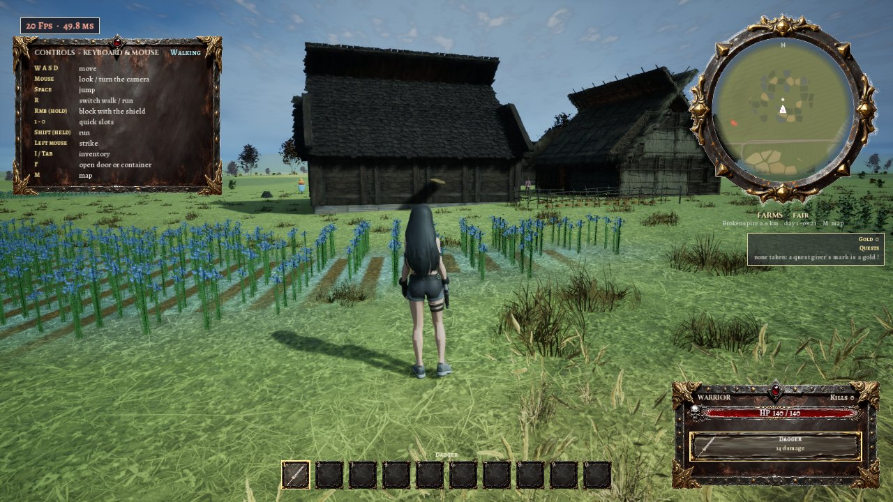
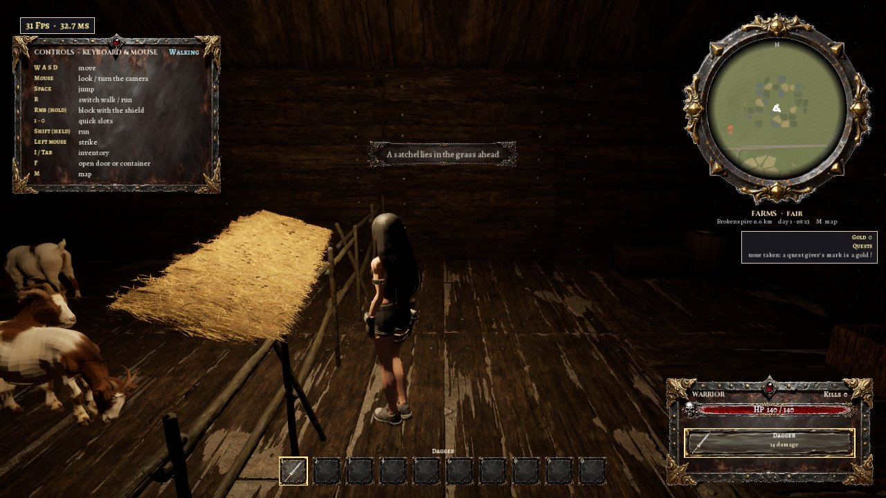
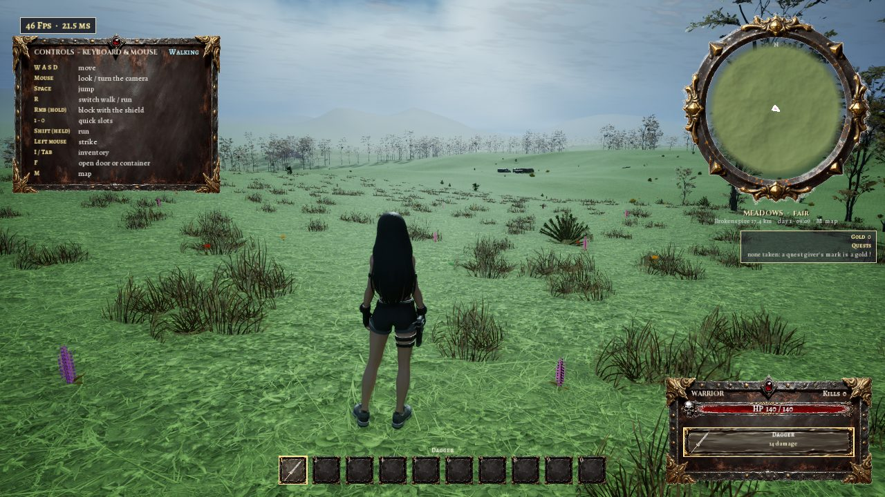
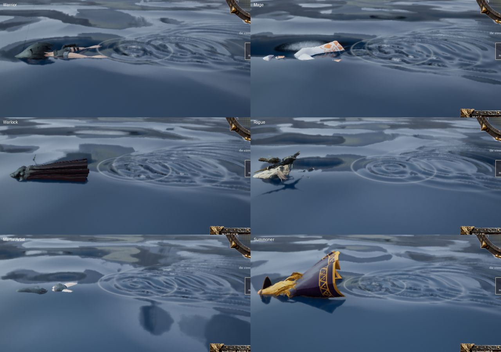

# The wilderness

The continent round Brokenspire (the user's spec of 2026-11-03, [docs/wilderness.txt](../wilderness.txt)): 300 by 300 km of land and sea made from one seed as she comes to it, Brokenspire's gate opening onto it. Only the ground within a 2 km square round her exists at any moment; everything else, and every town she is not near, is gone from memory, and is made again the same when she comes back. What she has seen of it stays on her map, and her map, the places she found and where she is go into the save.

- **Level:** `brokenspire` (the generator's `bWild`; [Brokenspire](brokenspire.md) is the first of its towns)
- **C++:** `RD/RDWild.h` and `RD/RDWildWorld.cpp` (the world's model: the continent, its biome regions, heights, colours, rivers, lakes, ponds, roads, towns, places and the quests' places, pure functions of the seed), `RD/RDWildChunk.cpp` and `RD/RDWildGame.cpp` (the chunks of ground round her: computed on worker threads, made in steps over frames, dropped), `RD/RDWildTown.cpp` (the towns loaded and dropped, found places), `RD/RDWildPlaces.cpp` (the places' props and monsters), `RD/RDWildMap.cpp` and `RD/RDWildHUD.cpp` (the map and the minimap, fast travel), `RD/RDWildLife.cpp` (the animals, birds and swarms), `RD/RDWild8.cpp` (hunting, `rd.WildRunSpeed`), `RD/RDWildQuest.cpp` (the captain's quests), `RD/RDSky.cpp` (the sky, the weather, the wind), `RD/RDSave.h` / `RD/RDSave.cpp` (the save), `RD/RDWildProbe.cpp` (the world's ground written without a game)
- **Scripts:** `887_wilderness.py` (materials, trees, the pack fixes, the biome table, the symbols, the level's fog, kill height and switches), `890_improvements7.py` (the list of 2026-11-04), `893_wild_quests.py` (the captain's quests' words), `898_improvements8.py` (the list of 2026-11-07), `888_wilderness_test.py` / `.ps1` (the test); `blender_numpy/wild_trees.py` (the aspen, birch and acacia, made in Blender), `blender_numpy/wild_symbols.py` (the map's symbols), `blender_numpy/wild_sky.py` (the moon), `blender_numpy/wild_crops.py` (the corn and potato plants), `blender_numpy/wild_seams.py` (the ground's seams found)
- **Data:** `SourceArt/wilderness/biomes.json` (29 terrain templates: the spec's 28 and Ashenreach's burned plain (2026-11-07); shape, height, colours from above, plants and rocks; the places' pieces; the farms' crops)

## The continent

- **Its shape:** a rounded square with a coast that wanders in and out, islands off it, the sea around. North is up on the map (+X in the game), east right (+Y).
- **Its towns, where the spec puts them:** Brokenspire in the middle of the south (80 km from the south edge); Ashenreach in the continent's middle, due north of it (70 km); Graymourne on the north coast, half way across (found by walking north until the sea, then 400 m back: the sea 700 m north of its middle, measured; 650 m inland until 2026-11-07); Vel Morrath north-east of Brokenspire and inland (55 km north, 75 km east: the user's of 2026-11-06; until then 115 km due east, about 10 km inland of its coast); Kethrys Spire north-west of Graymourne and inland (the list of 2026-11-08b: placed 45 km south and 70 km west of the port and walked inland until the land is solid; 152.4 km north and 70 km west of Brokenspire in the test's game, 83 km from Graymourne), a road from it to Graymourne; Heaven past Kethrys Spire to the south-west and inland (placed 30 km south and 58 km west of it and walked inland; 114.1 km north and 110.9 km west of Brokenspire in the test's game, 56 km from Kethrys Spire), a road from it to Kethrys Spire. The six are on the map from the start, Brokenspire found. Since 2026-11-06 and 07 the three others are cities of Brokenspire's size (168 tiles, 504 m a side), each with its own plan, people and quests and a dungeon of its own under it: Vel Morrath the holy city over its catacombs ([its document](vel_morrath.md)), Ashenreach the forge city at the edge of a burned plain over The War Engine ([its document](ashenreach.md)), Graymourne the fog-bound port over its sewers ([its document](graymourne.md)); since 2026-11-08b Kethrys Spire the mage city round the black tower over the tower's dungeon ([its document](kethrys_spire.md)) and Heaven the modern city in its shield over the fortress under its research facility ([its document](heaven.md)); until then Ashenreach and Graymourne were small walled towns with no quests of their own. Every town's ground is at Brokenspire's height above the sea, its region eased to it over about 1.7 km.
- **Its regions:** 529 regions of about 14 km, each one of the spec's templates chosen by the climate at its middle: colder northward (the arctic, glaciers and tundra in the north, savannahs, mesas and canyons in the warm dry south), wetter toward the coasts, mountain ranges along a large ridged noise, volcanic country in rare patches. Every template is somewhere (one that the climate left out is given to the land region that suits it best). Brokenspire stands among farms, its neighbours open lowlands; Graymourne in a coastal region; Ashenreach at the southern edge of the burned plain, the 29th template, which only its region and the one north of it have. The regions' borders wander, and the land blends from one to the next over 2 to 5 km: heights, colours, plants and rocks.
- **The templates:** grasslands, meadows, farms, savannahs, hills, mountains, tundras, plains, pine forests, temperate autumn forests, marshes, wetlands, mountains and peaks, volcanoes, coastal regions, arctic regions, canyons, mesas, canyon networks, cold steppes, highland moorland, boreal pine forest, temperate aspen, volcanic tundra, geothermal caldera, glacial, taigas, rocky coastal, and Ashenreach's burned plain (2026-11-07: ash-grey ground, charred dead trees) (their tables in `biomes.json`); the spec's roads, rivers, lakes and ponds are features over them: 29 rivers (traced from the high wet regions down to the sea, the longest 31 km, cutting through rises, their water falling all the way), 80 lakes and the ponds of every 4 km cell (and the caldera's hot springs with steam over them, the marshes' pools, lava down the volcanoes' gullies), and the roads between the four towns (Brokenspire's from its gate: to Ashenreach 85 km, to Vel Morrath 145 km; Ashenreach to Graymourne 157 km and to Vel Morrath 156 km), found as the cheapest ways over the land (slopes, heights, the sea and lakes cost) and wandering a little. Farms are fields of crops in parcels, their colours from above.
- **What grows:** each template's trees, bushes, grass, flowers, reeds, rocks and ice from the project's packs (Wildlands' pines, BoneTemple's autumn trees, the scanned beeches, FrozenNorse's boulders, glaciers and ice, VolcanoLand's lava rocks and burnt trees, Hive Sherwood's grass, cattails and reeds by water, lily pads on it), each scaled to the height the table gives it; the aspen, birch and acacia that no pack has, made in Blender (`wild_trees.py`). Grass, flowers and crops are only in the chunks round her, as are the trees' and rocks' collision.

## In play

- **The ground round her:** chunks of 250 m, a chunk made when its middle is within 1 km of her on both axes (the spec's 2 km square), dropped when it is more than 1.125 km off (9 x 9 at the most, 72 measured, 4.5 km²). A chunk is computed on a worker thread (its ground at 2 m, its water, its plants and rocks, its places: 35 to 125 ms) and made into its actor in steps over frames (since 2026-11-07, `888 build7`: the drawn ground, its collision as a hidden mesh of its own, the water, the wading floor, its plants and rocks 2500 at a time, its places; at most 9.3 ms of making in a frame, the longest step 6 ms, against 14.7 ms for a whole chunk in one go and the same chunks to the instance). The frames that make one are still longer than the others: in the last run (`test_s11.json`) by 6 to 8 ms with the steps and 12 to 14 ms in one go, the GPU's time 25 against 24 ms and 33 against 27; see [TODO.md](../../TODO.md). Her pawn is never on a chunk still being made: put somewhere new (fast travel, a load) the chunks under her are made at once, collision and all.
- **The towns:** the one she nears is built when she is within 1.6 km of its middle (over frames: 2 to 5 s) and dropped, its people, guards, animals and lights with it, when she is more than 2 km off: what she opened there and the guards she killed stay in the game. Brokenspire's gate stands open onto the wilderness.
- **Memory:** a dropped chunk or town is given back to the system: a collection asked for and the allocator trimmed after a big drop (a journey, a town dropped) and once a minute while she walks. Eight teleports 10 km and more apart, each building 64 chunks: the editor's committed memory held at 30.2 to 30.5 GB (it climbed to 32 GB and the machine ran short before).
- **Places:** about every other 4 km cell holds one, chosen by its region: villages (four to seven houses round a well, hay, a cart), camps (tents round a fire), lone houses (a farmstead's fence and hay), spawn points (a totem in a ring of bones), ruins, ritual sites (a ring of standing stones round an altar), caves (a mouth among rocks), monster lairs (a great skeleton, bones and a nest of branches). Each has a name ("Briarmere", "Wolf Camp", "Ruins of Windstead", "Oak Circle", "Elm Cave", "Boar Lair"). Walking within 90 m of one finds it (a town: within its section): "Discovered: ..." and its symbol on the map. Spawn points and lairs have monsters of their tier (by the distance from Brokenspire: 1 to 5), which live on open ground: they notice her from 25 m, chase her straight, give up past 45 m or 60 m from their home and walk back. One killed stays dead when its chunk is made again (kept in the game and the save).
- **The fog of war:** her map is revealed 300 m round her as she goes (50 m cells, kept for the game and saved); what she has not seen is a parchment cloud on the map.
- **The map (M):** the world from above in its own colours, its relief shaded from the north-west (the reference's "3d canvas"), in tiles made on worker threads as the map asks for them (level 0, the continent at 1.2 km a pixel, to level 10, 1.1 m a pixel), the rivers and roads as lines, the fog over what she has not seen, the symbols (town, city, village, camp, house, spawn point, ruins, ritual site, cave, lair: `wild_symbols.py`'s, our own) and the names, her arrow, the scroll's torn edge round it. The wheel or + / - zoom (the continent to under a kilometre across), a drag or the arrows move it, C brings it back over her. It opens 4 km across round her.
- **The minimap:** the ground round her from above (280 m), the places near, the monsters after her, the region's name over it and the nearest town and its distance under it. In a town's walls the map and the minimap are the town's own (the spec's "when the hero enters a town").
- **Fast travel:** to any place she has found, from the map (the place under the cross, F, Enter or the pad's A) or from a town's teleport circle to another town's (built, not yet tested); refused while a monster is after her ("You cannot travel while enemies are near"). The journey takes its hours from the day (5 km an hour).
- **Death out there:** she comes back to life in the square of the nearest town she has found (built, not yet tested).
- **The save:** the Escape menu's Save the game and Load a game (in the towns, the wilds and the castle; since the list of 2026-11-04 every save by its name, newest first, up to eight and the autosave, each with where and when); an autosave when she finds a place, comes into a town, before and after fast travel, before the Mistgate, on Quit and every two minutes her map has grown; the hero menu's CONTINUE loads the newest. A save holds everything the game keeps between the levels (her things, gold, storage, quests, the towns' seeds and what she opened in each, the castle's tiers, the day), the wilderness's map and the places she found, and where she was: loaded, the level opens and she is put back there (another town loaded first), 0.0 m off in the test. A save made in the castle opens the castle at its own start, with her things and its tiers. Tested: saving, the Load page's lines and a load from the save step; not yet tested: the Load page's choice carried out (a named save among them), two saves of one name, CONTINUE, a load into another town, a load with a captain's quest half done, the autosaves on Quit and before the Mistgate.
- **The captain's two quests** (2026-11-07; Brokenspire's captain, `town.json`): "Wolves on the Mill Road": the Mill Road Den, a place of its own beside the road to Ashenreach 1.8 km or more out (as the crow flies), its sheep's bones, a broken fence and a pack of four ripper dogs (the nearest the castle's monsters come to wolves, at tier 1); done when all four are dead (the kills kept, `WildKilled`: one killed stays dead when the chunk is made again), 120 gold. "The Lost Patrol": the Old Watchtower on the higher side off the road to Vel Morrath 3 km or more out, Brokenspire's round tower's quarters two storeys whole and a third broken, its fallen stones, three of what killed them, the five of the watch lying before its door; done when she reaches them (within 6 m), 200 gold. Taken, each place is on the map and named (not found: no travel there until she comes to it); no other place stands within 600 m of them. They follow the roads out of Brokenspire's gate, which differ every game (a quest's hint names the road, not a compass way); a game whose roads leave over ground too steep or wet falls back to fixed points held to flat, dry ground (never seen yet). Not yet played by hand: the test kills the pack and puts her before the tower's door. C++ `FRDWildWorld::MakeQuestPlaces`, `RD/RDWildPlaces.cpp`, `RD/RDWildQuest.cpp`; their words `893_wild_quests.py`.

## The list of 2026-11-04

The user's list, [docs/improvements7.txt](../improvements7.txt) (`890_improvements7.py`; `RD/RDSky.cpp` the sky and the weather, `RD/RDWildLife.cpp` the animals and swarms, `RD/RDWildWorld.cpp` the land, `RD/RDSave.cpp` the named saves; the town's part in [Brokenspire](brokenspire.md#the-list-of-2026-11-04)). The sky, the weather, the music and the saves are the same in the towns.

- **The sky** ("the sky is uniformly grey ... clouds of different sizes and types, birds ..., the sun ..., the moon ..., stars if there's no cloud cover"): volumetric clouds (an instance of the engine's simple volumetric cloud material) whose cover follows the weather, a thin high cloud layer over them, a dome of stars that comes out after dusk where the sky is clear, and a moon's disc (`blender_numpy/wild_sky.py`) where the moon light is. The fog no longer covers the sky (it stops at 6 km). Birds: flocks overhead in every region, crows over the open country, gulls on the coasts.
- **Moonlight and starlight** ("when it's night time, there is no moonlight or starlight"): the moon light at 2.4 lux, the night's sky light 17 % of the day's, the exposure a little lower at night (-0.6): the land moonlit, not black. Measured (`888 sky7`): the stars' brightness 0.94 and the moon's 1.0 at midnight in a clear sky, both 0 at noon.
- **Wind and weather** ("there is no wind of weather effects"): clear, fair, cloudy, overcast, rain, storm, snow (in the cold regions) or fog, a new one every 4 to 9 minutes (the clouds gathering over up to a minute and a half, the rain over 20 s); rain and snow are our own falling drops round the camera (instanced planes with a drop material, `M_RD_Drops`), the grass sways with the wind (a parameter collection, `MPC_RD_Wind`, read by swaying copies of Hive Sherwood's grass materials), the rain and the wind have their sounds. The weather is named under the minimap.
- (The fog stopped at 6 km until 2026-11-07: see the list of 2026-11-07.)
- **The biomes' borders** ("too abrupt and looks like a straight line ... more natural and ragged and uneven ... gradually flow into each other"): the regions' borders are warped at two more scales (700 m and 180 m) and blend over a wider band. Measured: 2.5 km of mixed land along an 8 km line out of the farms.
- **The farms' fields** ("in regular squares and grids on the map"): each field is the land nearest a point of a jittered, warped grid (70 to 160 m across), its own crop, its rows its own way; toward the farms' edge they thin out field by field. Measured along 2 km: 19 fields, their lengths varying by 59 % (a grid's are two lengths).
- **Hills, dips, ridges and berms** ("all of the ground terrain in the wilderness is uniformly flat"): over every region the land rises and falls in hills and hollows of 150 to 500 m, ridges and berms of 60 to 250 m and swells of 25 m (the flattest regions keep 70 % of it). Measured over 300 m (`888 ground7`, `test_i7e.json`): grasslands 14.2 m from lowest to highest, meadows 6.9, temperate aspen 10.9, farms 4.0, tundras 3.8, plains 3.1; swells of 0.9 to 1.6 m in each; never more than 2.4 m in 5 m (walkable). The towns' ground is eased in over 400 to 1150 m (it was 480 to 1700 m: flat for a kilometre before the gate).
- **More foliage** ("lots more bushes, grass that's blowing in the wind, trees of various sizes"): `biomes.json`'s `list7` over each region's table: bushes x 2.5, grass and flowers x 1.6, reeds x 1.4, trees x 1.2; trees from 0.55 to 1.45 of their table's height (0.8 to 1.2 before), bushes 0.6 to 1.4; more bushes in the temperate, cold and dry regions (the Lake Village's, Old Windmill's, Hive Sherwood's, Wildlands' pine bush, bearberry, gorse), dry grass in the savannahs, mesas and canyons, ferns in the forests.
- **The road** ("visible on the map, but ... not visible in the wilderness"): the ground carries the road in its own channel (the chunks' third UV) to a road layer of the ground material (packed earth, `T_SoilRoad`), 4.6 to 6 m wide, its edges ragged, its bed levelled to 12 m. Measured: 6.25 m wide where it crosses rings 400 and 650 m round the gate, and seen in the game's picture.
- **The biome's name under the minimap** ("the biome's name should also be visible under the mini map"): "MEADOWS · fair" (the region and the weather), then the nearest town and its distance.
- **Animals and insects** ("more animals and insects that are appropriate for that biome. those animals should flee from the player if the player gets too close (1-3 meters)"): Wildlands' deer (the temperate regions), wolves (the cold), squirrels (the forests) and hares (the farm's rabbit, the open country), up to 10 round her at 60 to 150 m, standing, grazing and wandering; each flees once she is within its own distance (1 to 3 m, a squirrel's 1 to 2) and runs off. Butterflies by day where flowers grow, fireflies at night (meadows, wetlands, marshes, grasslands, the temperate and pine forests, the towns), flies over the marshes, savannahs and farms. Measured (`888 life7`, two runs): in the meadows hares, squirrels and deer, butterflies and a flock; in the taiga deer, squirrels and wolves; in the grasslands deer and hares, butterflies and crows; fireflies at night; an animal that stood still fled when she came within 1.3 m in one run and 2.8 m in the other (each animal draws its own distance) and ran 14 to 15 m.
- **The music** ("after 5-10 minutes, the music should change to another appropriate song for the scene"): a set for each scene (the town by day, the town at night, the wilds by day, the wilds at night: `SourceArt/brokenspire/music7.json`, from the library), a new track every 5 to 10 minutes and when the scene changes.
- **Naming a save** ("there is no way to name your own save"): the Escape menu's Save the game opens a page with a name to type (letters, digits, spaces, hyphens, apostrophes; Backspace and Delete), Enter saves it under that name (slot `save_<the name's letters>_<its hash>`: the same name overwrites it, names that differ only in case or punctuation are two saves); Load a game lists every save, named ones and the autosave, with where and when.
- **The showcase** (`RD/RDShow7.cpp`, `-RDShow7` in the game, `StartShow7` in play): a pilot that goes through the list beat by beat with a caption each, about 3 minutes 20 seconds; its reel is in `renders/gamebar renders`.

## The list of 2026-11-07

The user's list from the Graymourne build, [docs/improvements8.txt](../improvements8.txt) (`898_improvements8.py` with `887 materials,data,level` and `890 sky`; the towns' part in [Brokenspire](brokenspire.md#the-list-of-2026-11-07)).

- **Running in the air** ("at many points in the wilderness, the character is not on the ground"; "when stepping off from a higher level of terrain ... running on air instead of dropping"): within 2 km of Brokenspire she ran on `BS_FarGround`, the 4 km plane `881` laid at z -6 cm before the wilderness existed. `887 level` had hidden it and set its collision off, but the collision call did not keep in the saved level: wherever the land dips (the farms round the town) she ran on it up to 2 m over the drawn ground. It is taken out. Measured (`888 ground8`): running 12 s in each of six regions, her feet within 7 cm of the drawn ground at every sample (farms: 109 of 109 samples 2 m over it before).
- **The sky overhead** ("a giant circle of white that is not continuous with the rest of the sky"): the height fog stopped at 6 km (`FogSkyCutoff`), so the clouds overhead (1.6 km up) were fogged a flat white and those past 6 km, lower than 15 degrees, were not: an arc's edge round the zenith, sharpest in rain. The cutoff is now 1000 km: every cloud and the land fogged by their distance, the sky's own pixels still clear. A stronger fall-off with height (0.08, 0.12, 0.2) left the edge in rain and would wash out the valleys. Measured (`888 sky8`): the sharpest change between two strips down a picture of the horizon, 4 to 6 in fair weather, overcast and rain (52 in rain before). The high clouds' dome (the sphere's own mapping pinched the clouds into rays at the top) thins out toward the zenith.
- **The rain** ("they look like white rods"): each drop was the engine's plane pitched up with its 60 cm across and 1.6 cm up, a horizontal bar, flat and near-white by day. Now 4500 streaks 26 cm long and 0.9 cm wide stand up, soft toward their ends, grey-blue and see-through (`M_RD_Drops`); snow's flakes are round. Measured: every drop upright, the field turned with the camera; looked at in pictures by day and at dusk (thin streaks; against a bright sky they are faint). PR #27's review: turned with the camera, the rain stood still on the screen as she looked round; each drop is now two crossed upright planes (one faces the camera from any way) and the field keeps the world's axes (not yet run in play). The field still follows the camera's place, as since the list of 2026-11-04.
- **The farms' crops** ("regular lines of crops, like corn, cabbages, potatoes, pumpkins ... not barren or have only grass"): each field is one of six crops (`biomes.json`'s farms `crops`: wheat, corn, cabbage, potato, pumpkin, sunflower), planted in rows on the world's grid (each field's own way, the rows 1 to 2 m apart, a plant every 0.6 to 1.6 m with a little jitter, now and then one missing; the hedgerows bare). Corn and potato plants are made in Blender (`blender_numpy/wild_crops.py`: under 550 and 400 triangles); the others are the packs' (Medieval Lake Village's wheat, PureNature's cabbages, Bone Temple's pumpkins and sunflowers). Past the plants' 70 m the ground material draws each field's rows itself (its way and crop in the ground mesh's UV0, its weight in UV3's V), faded out where a row comes under three pixels. Measured (`888 fields8`): the chunks round her in the farms by Brokenspire hold 219,000 crop plants of all six kinds; the frame rate there 37 to 39 a second against 39 to 42 with the crops hidden (`perf8`; its run's record was not kept); pictures near (a cornfield in rows) and from above.
- **The fields' colours** ("abrupt banding of different colors instead of smoothly and gradually blending"): a field's colour came in whole within one 2 m quad of its hedgerow, six crops of very different colours, and 10 m stripes for its rows on the 2 m grid. A field eases in over 2.2 to 8 m from its edge, its colour is its crop's (soil with its leaves over a share) drawn half way toward the region's own ground, and the stripes are gone (the material's rows instead).
- **Hunting** ("player should be able to kill the animals ... and get appropriate crafting materials from them. animals should respawn after they've been killed at regular intervals"): her blows and bolts hurt the wild animals (deer 40 hit points, wolf 55, hare 10, squirrel 6); struck, one runs off; killed, it falls on its side where it stood and its things lie by it as a harvest (F): a deer Coarse Hide (1-2) and maybe Light Leather, a wolf Coarse Hide (1-2) and maybe a Hound Fang, a hare Light Leather and maybe Coarse Hide, a squirrel Light Leather. A bolt with no monster to fly at flies at the nearest animal within 30 degrees of her facing and 45 m (at her hand's height it passed over a wolf's back). A killed kind's place stays empty `WildAnimalRespawnSeconds` (120 s); then another comes as they come round her; the body goes after 90 s. Measured (`888 animals8`): a deer in 2 fire bolts, a wolf in 3, a hare in one sword blow, each lying on its side, its harvest taken with F; with the wait at 45 s, a deer of the wild's own killed: none came while its place waited, another came 45.5 s after. Not measured: the level's own 120 s, and a hunt of a fleeing animal (struck once, a deer runs at 8.5 m/s and the Summoner's next bolts fell short of it; the test holds the animals before her). PR #27's review: a killed animal now rolls onto its side about its own facing (`animals8` measures the body's axes; not yet run in play).
- **The run speed for testing** ("a console command ... 1x / 5x / 10x / 15x / 20x / 30x / 40x"): `rd.WildRunSpeed <x>` at the console (the editor's, a Development game's, or since 2026-11-08 a Shipping game's own, opened with ` ([mistward_castle.md](mistward_castle.md#the-games-own-console)); `-RDWildRunSpeed=<x>` on the command line sets it too). Another number takes the nearest of the seven. In the wilderness outside the towns' walls her top speed, acceleration and braking are multiplied; while it is over 1 the chunks' collision is cooked at once and where the ground is not made yet she is held on the world's height. Measured (`888 speed8`): 3.7 m/s at 1x, 36.4 at 10x, 145.6 at 40x, on the ground (at 40x she leaves it for moments over bumps). In the Shipping game its console sets it (the package test's console run reads back 10); her run at that speed there is not measured. PR #27's review: set as the console sets it, applied again to a new pawn, the hold checking the collision under her (not yet run in play).

## The sheer walls (2026-11-08)

The user found "a wall of earth that is a sheer drop that can't be climbed" about 12 km from Brokenspire in a Shipping game. Play on `brokenspire` ran the editor out of GPU memory, so the world was measured without a game: `RD/RDWildProbe.cpp`, a command-line tool (`-run=RDWildProbe -nullrhi`) that makes the world from a seed as the game does (the level's biome table) and writes its ground on a grid, and `pipeline/blender_numpy/wild_seams.py`, which finds the seams in it (a step more than 6 m and 4 times the ground's steps either side of it; a mountain's or a canyon's own face rises over many samples alike). Three causes, all fixed in `RDWildWorld.cpp`:

- **The regions' mixing** (the wall itself): each point mixed the four heaviest regions at their whole weight and dropped the rest, and every weight under 0.03. Where a mountain region took the fourth place from a farm's, or rose past 0.03, it came in at 2 to 9 % at once, and at its 650 to 3200 m the ground stepped 26 to 125 m between two samples. On the user's seed two walls 22 and 32 km long ran round the town, 11 to 15.5 km out: 57 m high 1.5 km north of where she saved. A region now counts by how much it is over the cut (the fifth heaviest's weight, at least 0.03), so it comes in from nothing; the 5 x 5 cells round the point are weighed (a town's region can have its site 16 km off its cell). The same wall is now a 5 cm step.
- **Lakes' and ponds' banks**: the ground near a lake was held under a 12-degree bank and let go of 120 m out (a pond's 40 m): a lake among hills or mountains stood in a pit with walls of 20 to 160 m. The bank is whole for 30 m (6) and eased out by 400 m (150).
- **Roads**: a road's bed (its ground smoothed along it) was eased in over 9 m whatever its height, so a bed 10 m over a dip stood on a 60-degree bank; and near every town the road was eased to the town's height over 480 to 1700 m while the ground is eased over 400 to 1150 m (the roads ran up to 12 m over or under the ground there). The bank widens 2.5 m a metre of height, to 60 m, and the road eases as the ground does.

Measured on the user's seed, a 32 km square round Brokenspire at 8 m: 21,337 seam samples (the largest 160 m) before, none after; four more squares of two seeds: none but the canyons' stepped walls (designed: five terraces of sheer faces, 30 m and more) and 7 m creases on peaks at 2,400 to 2,800 m. Making the ground costs about the same (16 million samples in 5.8 to 7.8 s against 6.0). Every height moves a little with it: Brokenspire's ground is 83.9 m above the sea on that seed (86.0 before). Not yet run in play: `888` (`ground7`, `ground8`, `quests` and `places` read the ground), `884` (the town's way out and its roads), and the user's spot walked over in the game.

## The list of 2026-11-08b, first part

The quick fixes of [docs/improvements9.txt](../improvements9.txt) (the town's share in [Brokenspire](brokenspire.md#the-list-of-2026-11-08b-first-part): the storage, the gamepad's Escape menu, Backspace held, `rd.TimeSpeed` / `rd.GameSpeed`, no starting shield, the sky's edges).

- **Thirteen crops, the commonest first** ("apply the list of most common crops raised to what is actually found in the wilderness in this order: wheat, barley, oats, rye, peas, beans, flax, hemp, corn, potatoes, cabbages, pumpkins, sunflowers"): each field's crop is drawn by weight (`biomes.json`'s farms `crops`, `weight` of 100: 20, 17, 14, 11, 8, 7, 6, 5, 4, 3, 2, 2, 1; `FRDWildCrop::Weight`). Oats, rye, peas, beans, flax and hemp are made in Blender (`blender_numpy/wild_crops.py`: two of each, 234 to 614 triangles), barley is PureNature Meadows' `SM_Barley`. The ground's rows read the crop / 16 (`887`'s ground material; / 8 held only eight). Measured (`884 crops9`, `test_b9a.json`, a point every 40 m over 6 km round Brokenspire): wheat 2681, barley 2610, oats 2162, rye 1659, peas 1173, beans 988, flax 834, hemp 751, corn 577, potatoes 391, cabbages 338, pumpkins 332, sunflowers 136, in the list's order.
- **What a field grows** ("have an indicator for what kind of crops there are at the farm terrain"): in a field the region's name under the minimap adds its crop ("FARMS · A FIELD OF BARLEY · FAIR"). Measured (`crops9`): put in fields of barley, oats, flax and hemp, the minimap's title named each, with 17,000 to 148,000 of that crop's plants in the chunks round her.
- **The meadows and the grasslands** (the user's question: "what difference are there between meadows and grasslands?"): both are rolling land; the meadows stand higher (90 m against 70) with a little more relief (26 against 22) and more ponds (1.2 a 4 km cell against 0.8), their green a shade fresher; the grasslands are grass and gorse with few flowers (about 1500 grass and 50 flowers a hectare), a lone tree and small rocks, the meadows less grass and far more flowers (900 and about 560 of four kinds), flowering gorse and beeches. As in nature: a meadow is grass kept with wildflowers (mown for hay), grassland open grass country.

## The list of 2026-11-08b, second part: the medieval farms

"Make the farms in the wilderness look more like medieval farms, with different sizes of farms, from the croft to the strip ... no hedges or fences between strips ... one crop per field ... ridge-and-furrow", and "farm houses, barns, fenced in animals, and farm families to go with the farms" ([docs/improvements9.txt](../improvements9.txt)). C++ `RDWildWorld.cpp` (`FarmAt`, `FarmsteadsIn`), `RDWildChunk.cpp` (the strips' furrows left unsown, the yards), `RDWildFarm.cpp` (the farmsteads); data `biomes.json` (the pieces) and `farms.json` (the families' lines, `899 farms`).

- **Great fields** (`FRDWildWorld::FarmAt`): the farms are cut into great fields, a warped Voronoi about 420 m across (the land warped 45 m so their edges bend), each easing in over 4 to 14 m from its edge and thinning out toward the farms' edge at a farm weight of its own. Each is one of: an **open field** (60 %), a farmstead's **crofts** (20 %), **pasture** (14 %), or left to the region's own ground.
- **The open field**: one crop the whole field, drawn by the crops' weights ("every strip in a field grew the same crop that year"); its **furlongs** (a Voronoi about 150 m across) each lay their strips their own way (the field's, or across it, give or take 10 degrees), with **headlands** of grass between them (2 to 4.5 m) where the plough turned. The **strips** are 15 to 24 m wide, unfenced, each a shade of its own (another hand sowed it), divided only by a bare **furrow** (the ground's own soil, nothing sown within 0.8 m of a strip's edge). **Ridge-and-furrow**: each strip is ploughed into a ridge 0.28 to 0.42 m over its furrows (sin² across it), in the drawn ground and in what she walks on (`Height` adds the same: measured equal to 0.000 m over a 5 km square of samples every 2 m).
- **Crofts**: the farmstead's yard (34 m round its point: grass only, its trees and hay left out), then small plots 30 to 60 m across (the holding's own size) out to 120 to 190 m, each one of the holding's three crops or grass, with grass baulks between them; the rest of the field is the holding's pasture. (A first picture drew plots of every crop over the whole field: confetti.) No holding stands within 450 m of a town.
- **Pasture and fallow**: grass over old ridges (0.16 m: "still visible in English pastures today").
- **Farmsteads** (`FarmsteadsIn`, `ARDDungeonGenerator::SpawnWildFarm`): one in each croft field's yard whose whole ground is dry, off the roads and level (samples on rings 10, 22 and 34 m round it: no water, no road, 4.5 m or less from lowest to highest; PR #30's review: a road 12 m off had lain under the barn when only the point was looked at) and at least 150 m from any other place (a village, a camp, a lair, a quest's), places of kind "farmstead" laid by their chunk (ids `FarmIdBase` 2^28 + the cell: not on the map, no save change). Each has a farmhouse (Medieval Lake Village's timber house or one of Medieval Fantasy Village's smaller houses, at 9 m), a thatched barn beside it (Lake Village's storage building), a paddock fenced all round with a rail fence (Lake Village's; a gate's gap toward the house) holding three to six of a big kind of the town's farm animals (cows, pigs, goats...), a hen run behind the house with a small kind (hens, rabbits), a trough and hay in the paddock, a well, a cart, a woodpile and a scarecrow out in the plots, everything laid out from the house's and the barn's measured sizes. A chunk's farmsteads are laid one a frame after its own steps (`WildFarmQueue`). The animals keep to their pens and to the ground as they walk (`ARDTownAnimal::bWildGround`, `PenYaw`; the ground's height read once over the pen into a grid, not the world's height every frame). The family stands at its work with the town's work clips: the farmer kneeling at the nearest sown plot's edge (`Tend`), the farmwife feeding the paddock over its fence with a bowl (`Scatter`), a farmhand by the barn on two farms of three (`Talk`), a child by the well on half. Their bodies are the town's: townsmen for the farmer and the farmhand, a townswoman for the farmwife, a child's for the child. F at one of them (within 2 m, and as the town's people a door or container of a loaded town nearer takes F): "talk to the farmwife of Odric's Croft", they turn to her and say a line of their own or every one's (`farms.json`, `WildFarmLines`).
- **The well's size**: the docks' well (`SM_Well`) is a 1.6 m stone ring 0.83 m high with no roof, and the pieces' heights made it 3.5 m (6.7 m across: a giant ring in the first farmstead's picture, in every village too). It is 0.85 m now, its own size.
- Measured (`884 farms9`, `test_f9f.json` after PR #30's review; `RDWildProbe` over 5 km round Brokenspire): open fields 60 % of the farms, crofts 7 %, pasture 20 %, yards 0.4 %; 67 open fields within 2 km, every one a single crop, 11 crops among them; strips 15.0 to 24.0 m; croft plots about 1200 m²; across a field 80 m: 5 strips, 4 furrows, ridges 0 to 0.31 m, and the walked ground less the same ground with no farm (`BareHeight`) follows the ridge exactly (correlation 1.0, slope 1.0, 0 to 0.31 m); 23 farmsteads within 3.5 km (34 before the review's whole-footprint checks; before them the probe found 24 of 29 croft yards in its 5 km with their farmstead, the others on a slope or a road: a yard left without one stays grass); the one visited: 29 props, 3 cows in the paddock and 5 rabbits in the run, all inside and on the ground before and after 12 s of walking, the farmer at `AS_Town_Tend`, the farmwife (a townswoman) at `AS_Town_Scatter`, the farmhand talking, the child idle; F at the farmwife named her and gave her line; 42 fence pieces in the chunks round her, none where the ground is an open field; no step of 6 m or seam over the probe's 5 km. Pictures: the farmstead, the paddock, the talk, a flax field's strips.

## The list of 2026-11-08b, third part: the dungeons' keys and the roads' tiers

"The defeat of the dungeon boss at Mistward Castle drops not just a reward, it drops a key and a map to vell morrath, that will be the key to opening its dungeon. this key will not open any of the other dungeons. the dungeons are opened in order, with Heaven being the last. Each town's dungeon drops a key to the next one", and the roads' encounters from tier 1 by Brokenspire to tier 25 by Heaven ([docs/improvements9.txt](../improvements9.txt)). C++ `RD/RDKeys.cpp` and `FRDWildWorld::TierAt`; data `SourceArt/dungeons/chain.json` (`905` writes it on every map of the game).

- **The chain** (`DungeonChain`): Mistward Castle (always open), the Catacombs of Vel Morrath (the Catacomb Key), the War Engine under Ashenreach (the Foundry Key), the Sewers of Graymourne (the Sluice Key), the Black Tower of Kethrys Spire (the Spire Key), Kratos Aurorim Research under Heaven (the Kratos Keycard). Each key and each map ("Map to Vel Morrath" ...) is an item of kind Key: never in a container, not sold or stored, kept at a death (the rest of her things drop as before), carried between the levels with her things.
- **Locked**: the way into a town's dungeon (the cathedral's stair, the foundry's gate, the sewer gate) refuses her without its key: "The way into the Catacombs of Vel Morrath is locked. Its key, the Catacomb Key, is held by the master of Mistward Castle." What she has had is kept in the game's counters (`dkey:<dungeon>`, saved): a key she lost would still open its way.
- **The drop**: a dungeon's boss drops the next dungeon's key and map where it fell, once a game: Mistward's final boss Aurorim the Catacomb Key; a dungeon with no final boss (Vel Morrath's, Ashenreach's, Graymourne's for now) its last tier's boss. The way is hers from that moment (PR #31's review: a pile left behind, by a death or the door taken at once, would have locked the rest of the chain for good); the pile is what she sees and carries. A game saved before the keys gets the ways its progress implies: Mistward's final boss slain, a dungeon she has been in, a dungeon's last tier's boss slain (the next one's). The tests' and the packaged runs' "every way open" (`-RDAllKeys`, `DebugAllDungeonKeys`) is a flag of the game instance, never saved.
- **The map**: out in the wilds, a map taken shows the road from the town before to its town (700 m either side) and 2.5 km round the town on her map, once ("Your map shows the way to Vel Morrath"); a map to a town not yet in the world waits until it is.
- **The roads' tiers** (`TierAt`): along the chain of towns (Brokenspire 1, Vel Morrath 5, Ashenreach 10, Graymourne 15, Kethrys Spire 20, Heaven 25), a place's tier read on the leg of the chain nearest it, from one town's tier to the next's (until the list: 1 to 5 by the distance from Brokenspire, 25 km a tier). Every town of the chain is in the world since 2026-11-09 (Heaven the last). **Until the list's fifth phase (the rebalance to tier 25) a monster of a tier past 5 has tier 5's strength** (`TierHealth` / `TierDamage` have five entries) and its kind and its harvest's parts are among tier 5's (PR #31's review: a part's tiers are 1 to 5, a monster of tier 10 gave none).
- Measured (`884 keys9`, `test_k9d.json`, after PR #31's review; `868 finalboss`, `test_k9e.json`): the chain in its order, with no key only the castle open; tiers 1 at Brokenspire, 3 half way to Vel Morrath, 5 at Vel Morrath, 8 half way to Ashenreach, 10 at Ashenreach, 13 half way to Graymourne, 15 at Graymourne, 1 behind Brokenspire; the map to Vel Morrath taken: the land by the city revealed (not before); at Vel Morrath the stair (a dry run) refused ("locked") with its line; the drop: one pile, not hers, the Catacomb Key and the map, taken with F; the stair then goes down (the dry run), Ashenreach's way still locked; a second drop gives nothing; she falls: the key and the map stay with her, not in her pile; Vel Morrath's last tier's boss counted slain (an old save's progress) gives the War Engine's way; the every-way switch leaves no saved counter; Aurorim's pile held both. The `holy` step passed with every way open (`run()` opens them for the steps that go down; `keys9` shuts them for itself).

## The list of 2026-11-08b, seventh part: something every 40 seconds

The user's words: "in order to retain engagement, the player should be able to interact or encounter something every 40 seconds when roaming the wilderness. the terrain generation algorithm should take this into account." She runs 3.5 m/s, so 40 s is about 140 m.

**Before:** the places came one in a 4 km cell, at a 48 % chance, about one in 33 km².

**Now there are two things:**

**Small points of interest** (`FRDWildWorld::PoisIn`, `RD/RDWildPoi.cpp`, `SourceArt/wilderness/poi.json`, `912`).
- **Where they go:** one in 85 % of the cells of a 120 m grid. A cell tries up to four spots: on dry ground, off the crop fields and the farmsteads' yards, 8 m of rise or less over a 9 m ring, 700 m from the towns, and 90 m from the places.
- **Kinds by region:** 24 kinds are placed, each tied to its regions by the biomes' names:
  - bog shrines and drowned ruins in the marshes;
  - fire altars on the volcanoes;
  - sun altars on the savannahs and in the canyons;
  - cairns, ore veins and frozen travellers on the high and cold ground;
  - woodcutters and hidden caches in the forests;
  - camps, bodies, graves, nests and ruined walls anywhere.
- **Beside the roads:** wayshrines, milestones, abandoned wagons and ambush points stand stepped off the road.
- **Landmarks:** one cell in nine may hold a landmark (an ancient ruin, a giant's bones), drawn at the chunks' whole reach.
- **What they do:**
  - loot and resources: a pile taken once a game;
  - guards: a nest's or a cache's of the place's tier;
  - blessings: 10–15 % more damage or less taken, for 5 min;
  - rests: hit points and mana back, every 3 min;
  - stories;
  - milestones: the two nearest towns, how far and which way.
- **What she keeps:** what is used is kept in the game instance's `WildKilled`, saved, at `-(id + 2)`.
- **Ids:** they take the free range `2^24 + (cell x << 11 | cell y)`, and `FindPlace` decodes it.
- **Not places:** they are not found or announced, and not on the map. `GetWildPlacesNear` lists them for a search of 3 km or less.

**The encounter director** (`TickWildEncounters`). Once a second it asks what is near her to do (within 45 m; an emptied or cleared spot does not count):
- a fight;
- a point of interest still to use;
- a live monster;
- a pile;
- an animal;
- its own roamers.

When 25 s pass with none, it meets her 45–70 m ahead on her way with a roaming kind of the region:
- ambushers (2 of the road's tier);
- a prowling pack (3, in the forests and on the cold ground);
- a lost satchel (a pile).

Its roamers and satchels go once she is 250 m off. It is off inside the towns' walls.

**Measured** (`888 poi7 -Light`, `test_pi6.json` after PR #36's review):
- **The world's spacing:** along 14 lines of the world's model (8 out of Brokenspire, 6 through other regions, 2 km each), the points within 75 m of the way.
  - Half the gaps are under 31.4 s at her run; 90 % are under 72 s.
  - 18 kinds were seen.
  - The longest gaps are in the mountains and a pine forest (7 min), where the slopes and lakes leave few spots.
- **The far band:** a line out of Graymourne holds 17 points of interest (half its gaps under 30 s). Before PR #36's review, the ids' 11 bits a cell had left the cells north of 165.8 km and east of 95.8 km empty.
- **In play:** a 150 s run off the roads met something 28 times, two of them the director's. The longest gap was 27.3 s.
- **Each use:** made with F where it stands:
  - a pile taken, with its things gained, and not laid again;
  - a grave's story;
  - a hermit's rest from half to full;
  - the standing stones' blessing.
- **Performance:**
  - `perf8`'s frame rates were unchanged: 52 a second in the farms, 37 in the grasslands.
  - `stream`'s memory over a flight out and back read +1078 MB in its first run (failed) and +119 MB in the next. Its earlier records read +666, −191 and +1638: the measure varies run to run.
## The list of 2026-11-10, sixth part: houses to walk into, the farms on the map, travellers

The list of 2026-11-10's sixth phase (`916_wilderness10.py`: `houses`, `map`, `life`; C++ `RD/RDWild10.cpp`; the symbol `wmap_farmstead` by `blender_numpy/wild_symbols.py`, imported by `887 symbols`). Measured by `888 houses10,tower10,farms10,travellers10 -Light` (`test_h10a.json`, `test_h10b.json`, `test_h10c.json`, `test_h10e.json`) and `884 town10 -Light` (`test_t10d.json`); `888 places` after (`test_w10g.json`).

- **Houses to walk into** ("the buildings in the wilderness do not have an interior and there is no way to get inside or climb any stairs on the outside"): every house of the wilds (a lone house, a village's, a farmstead's farmhouse) is now one of the village houses' open copies (`SM_house_0N_open`) at 0.8 of their size (their 2.3 m doors 1.85 m for her; the closed ones stood 9 m high and their doors would have been 1.5 m), with its door leaves on their hinges: F opens and shuts a door, and it swings away from her (in from outside, out from inside: swung at her it shut her out). Inside: a wooden floor set over the highest ground under the room (no grass or earth through it), a stone plinth and steps where the ground falls away, the dungeon's furniture (a fireplace with its fire, a bed, a chest, a long table and its benches, a barrel, a crate, a wardrobe), a lamp, its plants cleared and the near grass to come left out of it; a village's ring is 1.3 times wider for the larger houses. The Lake Village barn and the old farmhouse had no collision at all (she walked through them): their mesh is their collision now. Measured at a lone house, a village's long house and a farmstead: the door opened (1.00) and shut (0.00) by F, she walked in by her own movement and stood on the floor (2.5 to 3.4 cm over it), no plant in the room, 9 pieces of furniture, the lamp lit (`wd_w10a_houses10_house.png`, `wd_w10a_houses10_farmstead.png`).
- **The Old Watchtower climbed**: it stands on the highest ground under its ring, on a stone footing with steps down from its doorway where the ground falls; its doorway is the quarter that is one (B, pictured: 882's note had the letters in another order and its "doorway" had been a small window); its collision is 32 hidden boxes round the ring (its third storey's two standing quarters too), the town towers' spiral stair (`Town.Spiral`, quarter turns from just past the door) up to a stone floor at its second storey's top, the stairwell open over its last turns and a low wall round it. Measured: on a steep slope she walked in from the road and up all 40 of the stair's points by her own movement, 5.9 m, stood on the top floor (1.8 cm over it), and walking at the third storey's standing wall it held her (2.2 m from the middle) (`wd_h10e_tower10_door.png`). The Brokenspire castle's towers had the same small window as their doorway from the walk: B now, and their other quarters as the castle meant them (`884 castlewalls`, `test_t10c.json`).
- **The farms on the map** ("the small farm holdings should be noted on the large map"): a farmstead she passes within the finding distance is found as a place is ("Discovered: ...") and drawn on the big map and the minimap with its symbol (a barn over a field's rows), named, and travelled to as places are (`FindPlace` reads a farmstead's id). Measured: Odric's Croft not under the map's cross before she passed it, under it and named after (`wd_w10c_farms10_map.png`).
- **Travellers on the roads** (the liveliness the list asked for: "what can be done to make the wilderness more lively and alive?"): up to three groups of two or three (the shared townsfolk, refugees and soldiers) on the roads within 450 m of her, out of sight along them when they come, walking towards a town ("a townswoman on the road to Brokenspire"), each with the role's lines; at night they camp beside the road (the side with no field or water, else its verge) round a fire with its light and sit on logs, in the morning they go on. Travellers are people with a sitting clip, walk at the group's slowest pace, and a nearer door takes F before them. Measured: a pair walked 11 m in 6 s, she talked to one (a line of the role's: "talk to a refugee on the road to Ashenreach"), camped at 22:30 (fire, light, two logs: 5 pieces) sitting, walking on at 8 (`wd_w10e_travellers10_road.png`, `wd_w10f_travellers10_camp.png`).

## The list of 2026-11-11, fourth part: the farmsteads' designs

The list of 2026-11-11's fourth phase (`docs/improvements11.txt`; `blender_numpy/farm_designs.py`, `919_farms11.py`; C++ `RD/RDWildFarm11.cpp`, the wild containers and side doors in `RD/RDWild10.cpp`). Walked through in `888 farms11 -Light` (`test_f11f.json` after PR #49's review), with `houses10` and `884 farms9` (`test_f11g.json`) again.

- **Sixty designs** ("all the farms use the exact same design. have at least 50 different designs for farms"):
  - `farm_designs.py` lays out 60 by six plans (a row, a courtyard, an L, scattered, compact, long), each from a seeded stream.
  - A design is kept only if every footprint stands 2 m clear of the others, inside 31 m of the middle (the yard `FarmsteadsIn` keeps level and dry), with 4 m clear before every door. One that repeats another's buildings, pens and plan is drawn again.
  - Every design has a farmhouse, a barn, a pen and a garden. Many also have coops (20), granaries (20), sheds (15), second pens and gardens, and yard things (well, cart, woodpile, hay, trough, scarecrow).
  - Pens come in three shapes: one rectangle (56), two side by side with a kind each (28), and round (21). They hold the town's five farm animals (cows, goats, pigs, hens, rabbits). Half the barns have a stall inside with cattle, goats or pigs, and most coops have hens.
  - A farmstead takes one design by its id. The three nearest Brokenspire in the test had three different designs.
- **Every building has an inside and a door** ("not all the buildings at a farmhold have interiors nor can the doors be opened. example: Garrick's hold"):
  - Each building of a design is raised from the town's kit (`Town.<Timber|Stone|Thatch>_<part>`), 2 to 6 tiles of 3 m by 2 to 8.
  - Its floor lies over the ground's highest point under it, on a stone plinth down to the lowest (the plinth is the floor's collision). Windows in a house get a hidden box over their sills.
  - The doorway carries the kit's door on its hinge (F opens it, and it swings away from her); steps go down where the ground falls before the door.
  - Its inside goes by its kind:
    - the farmhouse: a fireplace and fire, a bed and chest, a long table with benches, a barrel, a crate, a wardrobe in a wide one, a lamp;
    - the barn: hay along the back, a trough, stores at its corners, its stall fenced off;
    - the shed, coop and granary: hay or sacks in a back corner, four stores, a woodpile in a shed.
  - The open village houses' doors on a side wall open now too: their leaf's way is taken from its mesh. The test walked her in at every building of the first farm: the house, barn, shed, granary and coop each opened, and she stood on its floor inside its walls (within 0.6 cm).
- **Food in the farms, containers that work** ("farmholds should have some food in them to loot - none of the containers work"):
  - The wilds' chests, barrels, crates and wardrobes open with F (a lid lifts, doors swing) and give food by their kind (`FarmLoot`: bread, cheese, jerky, fruit, fish, wheat, nuts and seeds, hardtack, carrots, pumpkins...; a barn's and granary's grain), always at least one thing. A garden harvested gives its crops (`Town.Crop1..6`'s items).
  - Each is kept looted in the game (`WildKilled`, saved). A chunk made again builds it open and empty, and F passes it by.
  - The village and lone houses' containers work the same way.
  - Measured: the chest gave Bread x 2 and Jerky (the FOUND plaque, her things counted); the garden gave Wild Carrot, Wheat and Sunflower Seeds; all 10 animals were still in their pens 6 s later.
- **Each design built and taken away**: `SpawnFarmDesignAt` built all 60 in turn near the first farm, and `RemoveWildFarm` took each away. Each had a house and a barn, every building five things or more, 9 to 21 containers, 1 or 2 gardens and 2 to 28 animals.
- **On the way**:
  - In a coop the test stood her 44 cm up, on its hay and then its hens: a small building's hay goes in a corner, its hens keep to its back without a fence, and the farm animals' boxes cannot be stepped on (`CanCharacterStepUpOn`, the town's animals too).
  - The yard's cart, scaled for the yard, filled a barn: a barn has a trough instead.





## The list of 2026-11-11, fifth part: the meadows, the encounters and Graymourne's coast

The list of 2026-11-11's fifth phase (`docs/improvements11.txt`; `920_wild11.py`, C++ `RD/RDWild11.cpp`, the grove pattern and the port's coast in `RDWildWorld.cpp`). Measured in `888 -Light` (`world` in `test_w11e.json`; `meadows11` and `towns` with the leaves chosen in `test_w11d.json`; `events11` in `test_w11e.json`). Graymourne's harbour, sea, splash and heads are in [its document](graymourne.md#the-list-of-2026-11-11-open-to-the-sea).

- **Groves, strips and clearings** ("meadows should have clusters of trees, strips of trees and clearings free of trees"): the meadows' trees grow only where the world's grove pattern lets them (`FRDWildWorld::Grove`: clusters a few tens of metres across, strips about 15 m wide along the winding zero lines of a coarse noise, and clearings a few hundred metres across with none), denser where they stand (120 a hectare, from 40); bushes follow it half way. Measured round a meadow spot: 183 trees within 250 m, 89 % of 20 m cells bare, the trees' counts per cell 3.1 times as spread as at random (clustered; 1.4 failed at the first density), at most 6 in a cell, an 80 m square with none.
- **Debris** ("dead tree stumps, differently sized/shaped fallen branches, differently sized / shaped logs"): seventeen kinds laid in the meadows (`meadows11.json`): the meadow beech's own stump and log, four other logs (1 to 2.9 m), seven dead branches and four leaf piles, each with its own density and the grove's share (logs and stumps among the trees). Their meshes were measured before choosing: a 6 m standing branch, two log stacks and flat 2 cm branch cards were left out. Within 100 m of the spot: 4 leaf piles, 10 branches, 3 stumps, 4 logs.
- **The grass moving in the wind**: `890`'s wind had never reached the wilds' grass (a struct read out of a list from Python is a copy, and the script changed the copy: the materials were set on nothing). Fixed (`890 wind`, its lists written back): the meadows', grasslands' and plains' grass take the swaying copy (`MI_Clasters_Grass_varient_Wind`, `MPC_RD_Wind`); 99 grass instances by her in it.
- **Leaves blowing** ("leaves blowing in the wind"): a Niagara system of blown leaves kept before the camera at her height while she is out of a town on dry ground in the meadows, grasslands, farms, plains, hills and the two broadleaf forests (`WildLeavesFx`, `WildLeavesBiomes`; checked twice a second). Six of the packs' leaf systems were screened in one place (`SetWildLeavesFx`, `wd_w11b_leaves11_*`): only Medieval Fantasy Village's `NS_leaves` reads as leaves blowing across the view (yellow-brown leaves); PureNature's left a few dark specks, Flower Meadows' are red petals.
- **More kinds of encounter** ("most of the types encountered are the satchels found and ambushers - what else can the player find within a 40s amount of time?"): the encounter director (every 40 s or so, when nothing is near) now also sends, by its weights (`events11.json`, 13 kinds):
  - a point of interest laid ahead of her, of her region (`Place`): an abandoned camp, a herb patch, a milestone, a great ruin or a monster nest, with its pieces, what it holds and its guards;
  - a herd of the wild animals (`Animals`): four deer, three hares or three wolves;
  - a person on the way (`Folk`) who speaks their lines and gives once (`Gift`, `GiftGold`): a weary pilgrim (bread), a travelling pedlar, a lost hunter (fish and jerky), a courier (gold by the tier), a refugee (bread, a healing potion). Spoken to again they say a line and give nothing. People and herds are taken away once she is 250 m from them.
  - Measured, each kind forced in turn ahead of her (`test_w11e.json`): every one met; each place laid of its kind (an abandoned camp, a herb patch, a milestone, a great ruin, a monster nest); 4 deer, 3 hares, 3 wolves; each person spoken to gave their gift (the pilgrim Bread, the pedlar Jerky, the hunter Jerky x 3, the courier 12 gold, the refugee Hardtack, Nuts and Seeds and 4 gold: drawn from each one's list) and only a line the second time. A pile lying in reach takes F before a person (the game's rule: the first run's refugee took a pile an earlier kind had left): the test takes it up first.
- **Graymourne's coast** ("near graymourne, it shifts abruptly to coastal regions. it should gradually turn into the coast from the previous biome"): the regions' mixing is 2.6 times as wide within 9 km of the port (easing back by 22 km), and the land's height over the shore is scaled down round it (35 % within 9 km, whole by 30 km): the glacial uplands that fell 1300 m in under 3 km (42 degrees between two samples) rise from the coast over kilometres (19 degrees at most; [Graymourne's document](graymourne.md#the-list-of-2026-11-11-open-to-the-sea)).



## Swimming (2026-11-12)

The user's of 2026-11-12: "create swimming animations for all current playable classes that are found in the choose a hero menu. create a splash sound for when a player falls into the water or is swimming. have water displacement and a wake for when the player moves through the water". C++ `RD/RDSwim.cpp` (with the water's tick in `RD/RDWild11.cpp`, the floors in `RDWildChunk.cpp` and Graymourne's harbour in `RDPort.cpp` / `RDTownPlan.cpp`), stage `921_swim.py`, the water's material in `887 materials`. Measured in `884 swim12 -Light` (`SourceArt/brokenspire/test_sw12h.json`).

- **Where she swims**: where her feet are 1.2 m or more under the water's face. The wilds' floor under deep water follows its depth down to 145 cm under the face, each corner of a water quad by its own depth (wading water's 90 cm, as before), so wading turns into swimming with no step; Graymourne's harbour is 140 cm deep. The deep sea's sheet 3 m over the water (past 8 m deep), which the documents called a wall, is gone: it held nothing (she would have walked off the floor's edge to the sea bed). The sea is swum where it is deep.
- **Her clips**: the "92 Animations For Warrior" pack's treading idle (2.0 s) and in-place swim loop (1.33 s), on its UE4 mannequin, retargeted onto each of the hero menu's six (Warrior, Mage, Warlock, Rogue, Martial Artist, Summoner) as the rider clips are (an IK rig on the pack's mannequin, a retargeter per hero onto her own `IK_JRPG_<rig>_Auto`), played on her slot as a looping montage: the treading idle below 40 cm/s, the swim loop above, its rate by her speed. Her body is held at the face: swimming along by her pelvis 6 cm under it (her back at the face; held 22 cm down the whole of her lay under the opaque water, and held by the head some rigs' flat bodies lay on the water, not in it), treading by her head 18 cm over it; the mesh is moved, eased, and put back as she leaves the water.
- **While she swims**: 55 % of her walk's speed, no jump, and no blow, block, roll, dash, chi, stealth or secondary ability (the saddle's rule).
- **The sounds** (`SourceArt/brokenspire/water.json`, Khron Studio's Sound Of Survival Vol 1): Player.Splash where she comes into water (a body jumping into the sea, the lighter falls into water: 7 files), Player.Swim a stroke every 0.67 s of the swim loop (hands scooping water: 6), Player.Wade a step every 0.42 s as she wades (5). Measured in what the game puts out (recorded, every other sound set silent; the loudest 30 % of the tenth-second windows): the splash 13.2 dB and the strokes 20.6 dB over the same falls and swims with their set at 0 (12.5 and 7.0 in the run before, with the game's other sounds louder).
- **The water's displacement and her wake**: the water's material bends its face's normal with rings spreading from up to 8 sources the game writes into `MPC_RD_Water` (where she came in, one every 0.22 s behind her as she moves through the water, one every 1.1 s round her as she stands: 110 cm/s, 1.9 s, waves of 26 cm) and a bulge pushed round her by her speed; the foam rings (`M_RD_WaterRing`) stay over it. In the pictures the rings trail out behind her as she swims; the wake's shape (a V) was not measured.
- **Measured** (`884 swim12`), for each of the six in Graymourne's harbour: swimming as she is put in the deep water, her treading idle, her head 19 to 20 cm over the face; no blow or roll; along the quay for 3 s the swim loop, her pelvis 4 to 8 cm under the face (the strokes' median), 194 to 210 cm/s (her swimming top speed), 3 or 4 strokes sounded, 6 to 8 ripples made, 5 to 8 of the collection's sources fresh, her push on; up a ramp and out, no longer swimming, her mesh back to 0.0 cm. Out at sea past the harbour's mouth (3.8 m deep) and 1.5 km out (8.3 m deep): swimming, her pelvis 3.5 cm under the face, no sinking (0 cm in 3 s), strokes sounded.



## Limits

What is not there yet, and what has not been tested, is listed in [TODO.md](../../TODO.md). In short:

- Caves are a mouth among rocks: there is no inside. Villages, camps and lone houses have their buildings and props but nobody in them (the farmsteads have their families). Since the list of 2026-11-11 every farm building can be entered; the farm folk stand at their work: they do not walk, sleep or go in at night. The farm buildings have one storey, and the gardens are harvested once a game (the town's grow again by the next day).
- Monsters live only at spawn points, lairs and the captain's two quests' places; between places there are only the animals that flee from her (deer, wolves, squirrels, hares), which never fight (since the list of 2026-11-07 she can hunt them).
- Birds and insects are effects round her (flocks and swarms), not creatures: nothing hunts them and they do not land.
- The weather has no lightning, puddles or wet ground: the rain and snow are falling drops round the camera, the storm a darker sky, more rain and stronger wind.
- She wades shallow water and swims deep water at its face (since 2026-11-12); she does not dive, and nothing stops her swimming far out to sea. The lava does no harm.
- The towns are 85 to 157 km apart: walking from one to the next takes hours. Fast travel takes her there once she has found a town.
- Vel Morrath is walked into in `888 towns`; Ashenreach and Graymourne are built round her and their people are their own in Brokenspire's tests (`884 forge`, `port`), but no test has walked in through their gates or read the town's map there.
- In the default morning light (08:00) the land looks pale from a distance; the base colour buffer shows the ground's own colours right.
- The canyons' walls are sheer terraces, and the highest peaks' faces reach 80 degrees: she cannot climb out of a canyon by its walls.
- The editor's play runs at 10 to 48 frames a second out there (23 on average over the 28 templates); one long play session that visited all 28 templates ran the machine short of memory, so the test runs in batches with the editor restarted between them. Play on `brokenspire` ran the editor out of GPU memory on 2026-11-08 (with the user's other programs open), so that day's changes were measured without a game or on the castle.
- The packaged game: the Shipping package starts in Brokenspire, and since 2026-11-06 its test puts her out in Vel Morrath and builds the city round her (2026-11-07: Ashenreach and Graymourne too; 2026-11-08: the game's own console run in Brokenspire). A walk out of the gate, a journey, a save and a load, and its memory over a long walk have not been run in it.

## The test

`pipeline\unreal\888_wilderness_test.ps1 <plan> <tag>` (plan `all`, and the default: the spec's nine steps, `world` to `save`; the later lists' steps are named in the plan); `SourceArt/wilderness/test_<tag>.json`. `look=<a>+<b>` visits only the templates named (their names with `_` for spaces). The whole test in one play session ran the machine short of memory (the editor's committed memory reached 32 to 34 GB): run it in batches with the editor restarted between them (`world`; `look` in four batches of seven templates; `stream,towns`; `gate,map`; `places,travel,save`; the later ones as their records were run: `sky7,life7,music7,save`; `world,gate,ground7`; `build7,quests`; `rain8,sky8,fields8,ground8,animals8,speed8`).

| Step | What it measures |
|---|---|
| `world` | the world made (0.1 s); the towns where the spec puts them (six checks: Brokenspire mid-south, Ashenreach in the middle and north of it, Graymourne on the north coast (the sea within 1.5 km north), Vel Morrath north-east and inland (since 2026-11-06: no sea within 20 km east of it, not on water)); every template in the regions; 8 rivers or more, 5 lakes or more, 4 roads or more (5 since Kethrys Spire, 6 since Heaven; Kethrys Spire north-west of Graymourne, inland, 60 to 120 km from it; Heaven south-west of Kethrys Spire, inland, 40 to 110 km from it: `test_hv7.json`, with `-Light`); the places' ids (the northern ones below the towns' range, none shared); pictures of the continent, of 40 km and 5 km round Brokenspire |
| `look` | each of the 28 templates visited (her put on walkable ground of its nearest region, the chunks round her made, her pawn there): a picture of her view, what the world has under her, the chunks' plants and rocks (some where its table has plants seen from afar, trees where it has trees), the frame rate; the first visit's base colour buffer |
| `stream` | 6 km out and back over the land at 100 m steps: never more than 81 chunks (72 measured), none outside the 2 km square, chunks made and dropped all the way, the memory back within 700 MB of where it began |
| `towns` | Brokenspire dropped 2.3 km off (no section, no people) and built again at 1.2 km; Vel Morrath built as she comes; in its walls the maps are the town's, outside the wilderness's; its people its own (no title naming Brokenspire; since 2026-11-06 its archbishop, archivist and commander, none of them Brokenspire's elder, scholar or captain) |
| `gate` | no "barred" at Brokenspire's gate; since the list of 2026-11-04 the portcullis raised by a lever first; she walks out through it (14.8 m past it) and out of the walls |
| `map` | the minimap drawn; the map opens over her at level 8 or finer with its tiles; at the region, the country and the continent (level 2 or coarser) the towns' symbols; revealed where she has been, not far off; the fog's picture made at most 3 times while the map is dragged and zoomed over 40 frames; pictures |
| `places` | one of each kind (camp, ruins, ritual site, house, village, cave, lair, spawn point) nearest Brokenspire: found when she comes to it, its props there; the lair's and the spawn point's monsters come at her over open ground (18 to 9 m, 15 to 6 m in 5 s); one of the spawn point's killed, its chunks made again: one fewer |
| `travel` | the place under the map's cross chosen and travelled to with F (28 m from it); a town by its id; refused at a lair with its monsters after her |
| `save` | saved; the Escape menu's Save and Load; gold and her place changed, the save loaded: back where she was (0.0 m), the gold, the places found and the map revealed as saved; since the list of 2026-11-04 a name typed on the Save page ("Test Save 7"), saved to its own slot (`save_test_save_7_<hash>`) and listed on the Load page |
| `sky7` | the list of 2026-11-04 (`test_i7f.json`): the clouds there, the fog stopping short of the sky, the next weather in 4 to 9 minutes; the noon sky not one grey (its picture's spread); an overcast sky takes the sun under half its light; at midnight in a clear sky the stars and the moon, the moonlit ground not black (pictures); rain turns its drops on; in the arctic it snows |
| `life7` | (`test_i7f.json`) in meadows, taiga and grasslands the animals and swarms round her, of the kinds the region has; at night fireflies; an animal put 9 m off stands, she walks at it and it flees within 1 to 3 m and runs off |
| `ground7` | (`test_i7e.json`) over 300 m of six open regions (moved 1.4 km clear of the towns, whose ground is level on purpose) the land's range and its swells (four of six over 4 m and 0.6 m), never a step of 4 m in 5 m; the blend out of the farms over a kilometre or more; the fields along 2 km of many lengths; the road 4 m wide or more where it crosses rings round the gate; the region's name under the minimap |
| `music7` | out in the wilds the wilds' set; a new track when its time comes, the next in 5 to 10 minutes; the town's set in the town |
| `build7` | (2026-11-07, `test_s5.json`; again 2026-11-08 after a big plant entry's parts kept their place instead of moving the rest down: the longest step 5.5 and 7.4 ms, at most 8.6 and 9.3 ms a frame, the first run's record `test_s10.json` since replaced by `test_s11.json`) the same 2.4 km flight over new ground at 100 m/s twice, chunks made in one go and in steps: the game thread's making (the longest step 6.0 ms, at most 9.3 ms a frame, against 14.7 ms a whole chunk), the frames' times and stat unit's threads in frames with and without making, all 79 chunks the same both ways (instances, triangles, trees, props, monsters, grass) |
| `rain8` | the list of 2026-11-07 (`test_w8j.json`: rain8, sky8, fields8, ground8, speed8; `test_w8q.json`: animals8): rain falling; every drop a streak standing up (0.26 by 0.009 of the plane), two crossed planes at each drop, the field keeping the world's axes (since PR #27's review; until then turned with the camera); pictures by day, looking up and at dusk |
| `sky8` | the fog's cutoff past 100 km; in fair weather, overcast and rain, pictures straight up (her body and the HUD hidden), half way up and of the horizon: the sharpest change between two strips down the horizon's picture under 15 (an edge's mark; `sky8=cut1000+falloff200` pictures other fogs beside the level's) |
| `fields8` | a field's middle in the farms by Brokenspire: the chunks round her hold every crop kind in rows (over 500 plants), the fields along 400 m, the frame rate there and in grassland; pictures near, low and far |
| `ground8` | she runs 12 s in each of six regions: her feet within 20 cm of the drawn ground at 98 % of the samples or more, what she stands on where she is not, pictures of the worst places |
| `animals8` | a deer and a wolf (the Summoner's bolts) and a hare (the Warrior's sword) put before her: each hurt by the first blow, killed, on its side, its kind's things dropped and taken with F; the kinds' places waiting; a deer of the wild's own killed: none while its place waits (45 s for the test), another after |
| `speed8` | `rd.WildRunSpeed` 1, 10, 40 at the console: her speed over 4 s each (10 and 40 times her run within 40 %), on the ground; back to 1 |
| `perf8` | (a measure, always ok) the frame rate in grassland, in the farms with the crops and with them hidden, each crop kind alone; frames' times running at 5x across the farms and the grassland |
| `memprobe` | (a probe, not in `all`) eight teleports far apart, each building its chunks anew: the memory, the chunks made and dropped, the map's tiles and the monsters after each; a `memreport -full` at the end |
| `list10w` | the list of 2026-11-10's first part (`test_w10d.json` after PR #38's review, `test_w10c.json` before; the horse in `test_w10b.json`): `rd.Weather storm` and `fog` held, `auto` lets go; `rd.GoTo ashenreach` builds Ashenreach round her inside its gate and `rd.GoTo brokenspire` brings her back; an ambush made to come (`ForceWildEncounter("roam_ambush")`: the director sends nothing while anything is within 45 m) hunts her from 57 m while she stands still, the distance falling at every half-second sample. As [Brokenspire's section](brokenspire.md#the-list-of-2026-11-10-first-part) says. Run with `-Light` |
| `horse9` (2026-11-10) | as before, and: unridden its box stops her (walking at its middle from 2.2 m, the nearest 64 cm), ridden it stops nothing; mounted she goes 5 times her speed or more, measured over the last 3 s of a 6 s run (5.69 in `test_w10b.json`; over the whole 4 s it read 5.04, the gallop's run-up) |
| `meadows11` | the list of 2026-11-11 (`test_w11d.json`): at a meadow spot the trees within 250 m (183), the 20 m cells bare (89 %) and the spread of their counts (3.1: clustered), an 80 m square with no tree; the debris within 100 m by kind; the grass by her on the swaying material; the leaves on in the meadows; six leaf systems pictured in one place (`leaves11_<n>`) |
| `swim12` (884's) | (`SourceArt/brokenspire/test_sw12h.json`, `-Light`) the six heroes swimming in Graymourne's harbour and the sea beyond it; the splash's and strokes' sounds recorded ([Swimming](#swimming-2026-11-12)) |
| `events11` | (`test_w11e.json`) each of the director's 13 new kinds forced ahead of her: met; a place laid of its kind, a herd made, a person who gives once (her things or gold more, the second F nothing) |
| `quests` | (2026-11-07; 2026-11-08 `test_s12.json`) the captain's two quests: the Mill Road Den 1.8 km out, 45 m from the Ashenreach road, the Old Watchtower 3.0 km out off the Vel Morrath road, both dry; taken at the captain, on the map and named, no travel there before they are found; the den's four ripper dogs (three killed, the chunks made again: one left; the fourth: done); the tower's three guards, its 18 props; the patrol found 2.5 m from their remains, not 10 m; both turned in for 320 gold, off the map |

The ground's seams are checked without a game (no editor, no GPU; C++ built first):

```
UnrealEditor-Cmd.exe claude_ue5\claude_ue5.uproject -run=RDWildProbe -nullrhi -unattended -Seed=<n> -X=0 -Y=0 -Half=16000 -Step=8 -Out=<scratch dir>
python pipeline\blender_numpy\wild_seams.py <scratch dir>
```

The tool's exit code is 1 for the 15 known unreadable pack files the asset registry logs; its `RDWILDPROBE written ... ok` line says it worked. Beside the ground it writes the drawn ground's colour (`col.bin`, sRGB bytes), the farms' kind and crop at each sample (`farm.bin`, `crop.bin`), and `info.txt` lists the farmsteads in the square and the crops; `-Heights` also writes the walked height less the drawn one (`hdiff.bin`). `-Points="x,y;x,y"` writes each point's regions and weights and its ground before and after the water, roads and towns (`points.txt`). The roads out of Brokenspire's gate are not the game's there (the gate is known once the town is built).

## Rebuild notes

1. `blender -b -P blender_numpy/wild_trees.py -- claude_ue5/SourceArt/wilderness/trees` (the trees' FBX and pictures, ignored) and `python blender_numpy/wild_symbols.py claude_ue5/SourceArt/wilderness/symbols` (the symbols, ignored).
2. `887_wilderness.py` on the open `brokenspire` (play stopped): every part (`materials,trees,fixmats,data,symbols,level`); it builds Brokenspire again with its gate open and saves the level. It can be run again (materials are built again in place).
2a. The list of 2026-11-04: Brokenspire's rebuild note 3d (`890_improvements7.py`, then `887_wilderness.py materials,data`).
2b. The captain's quests' words: `893_wild_quests.py` on `brokenspire` (from `town.json`; `882` writes them too).
2c. The list of 2026-11-07: `blender -b -P blender_numpy/wild_crops.py -- claude_ue5/SourceArt/wilderness/crops` (the corn and potato plants, ignored), then on `brokenspire` `898_improvements8.py` (`crops,fauna,block,sky`), `887_wilderness.py materials,data,level` (the crops' rows, the ground's rows, the far-ground plane taken out) and `890_improvements7.py sky` (the rain's streaks, the high clouds); `898 town` builds the town again. C++ first (`build_cpp.ps1`).
2d. The sheer walls (2026-11-08): C++ only (`RDWildWorld.cpp`, no stage); check the ground with `RDWildProbe` and `wild_seams.py` ([The test](#the-test)).
2e. The list of 2026-11-08b's first part: Brokenspire's rebuild note 3g (`899_improvements9.py`, then `887 materials,data,level`).
2g. Its third part, the dungeons' keys: C++ first (`RD/RDKeys.cpp`, `TierAt`), then `905_dungeon_keys.py` (every map of the game: the chain and the key and map items). Check with `884 keys9 -Light` and `868 finalboss`.
2f. Its second part, the medieval farms: C++ first (`build_cpp.ps1`), then on `brokenspire` `899_improvements9.py farms` (the families' lines) and `887_wilderness.py data` (the farmsteads' pieces and the well's height) and the level saved (`887 level`, or save it). Check with `884 farms9 -Light` and the probe (its `col.bin`, `farm.bin`, `crop.bin`, and with `-Heights` `hdiff.bin`: the walked height less the drawn one).
2h. The list of 2026-11-11's fourth part, the farmsteads' designs: C++ first (`RD/RDWildFarm11.cpp`), `python pipeline/blender_numpy/farm_designs.py [count] [seed]` (writes `SourceArt/wilderness/farm_designs.json`: 60 designs from seed 1111), then `919_farms11.py` (on `brokenspire`: the designs and the containers' loot; it reports any piece, item or animal they name that the level lacks). Check with `888_wilderness_test.ps1 farms11,houses10 <tag> 2400 -Light` and `884 farms9 -Light`.
2i. The list of 2026-11-11's fifth part: C++ first (`RD/RDWild11.cpp`, `RDWildWorld.cpp`, `RDWildChunk.cpp`, `RDPort.cpp`), then on `brokenspire` `890_improvements7.py wind` (once: the wilds' grass on the swaying copy), `920_wild11.py heads,meadows,leaves,events,port` (`meadows` after `887 data`, `events` after `912`, `port` after `896`). Check with `888_wilderness_test.ps1 meadows11,events11 <tag> 1700 -Light` and `884 port11,port -Light`.
2j. Swimming (2026-11-12): C++ first (`RD/RDSwim.cpp`), `887_wilderness.py materials` (the water's ripples and `MPC_RD_Water`), `python pipeline/blender_numpy/rdc_sound_prep.py claude_ue5/SourceArt/brokenspire/water.json claude_ue5/SourceArt/brokenspire/audio_water` (the water's sounds), then `921_swim.py clips,sounds,level` on `brokenspire` (after `913 rider`'s rigs exist; `sounds` adds its three sets to the level's table and keeps the rest). Check with `884_brokenspire_test.ps1 swim12,port11 <tag> 2400 -Light` (restart the editor first: a long session left too little memory for its play).
3. `888_wilderness_test.ps1 all <tag>`; Brokenspire's own test (`884_brokenspire_test.ps1 all`) after anything shared: its `gate` step expects the gate open when the wilderness is on.
