# Monsters of the Fab library, ranked by looks

Every monster in the local Fab library cache (`I:\game assets\3d epicgames media packs\VaultCache\FabLibrary`), ranked from the one that looks easiest to defeat (1) to the one that looks toughest to beat (107). **Looks only**: nothing here comes from hit points, animations or any game data, just what the model looks like standing in front of you.

What counts as tougher-looking: size and bulk; armour, shells and plates; blades, claws, scythes, spikes and horns; extra limbs; teeth. What counts as easier: small, thin, legless or crippled, trapped, unarmed, or drawn as a cartoon.

## How the list was made

- **Which packs:** every pack in the cache whose models are creatures rather than people, props or rooms: the packs tagged *Monster* or *Creature* in their listing data, plus the orcs, zombies, aliens and beast warriors.
- **Rendering:** every model was rendered in this project in its reference pose (arms out), with its own textures. A 180 cm post stands beside it for scale (it is cut off in the pictures of small creatures).
- **Unity-only packs:** the Creatures Insects Pack and the Humanoids Monsters Pack exist only in Unity format, so they were unpacked (`pipeline/blender_numpy/unity_extract.py`) and imported for this (`pipeline/unreal/900_monster_gallery.py unity`).
- **Heights:** the height column is the model's bounding box in that pose, in cm. Most humanoids come out at about 180–200 cm whatever their build, so bulk matters more than the number. For models holding something up (a staff, horns, wings), the item is included.

## The pictures

Each monster is shown four times, left to right:

- **original:** its own textures and colours.
- **infernal:** charred red-black skin with ember highlights; a cracked-stone pattern, some of whose cracks glow.
- **venom:** sickly green to yellow, with scales.
- **frost:** pale ice-blue and glossier, with crystal facets and a cold glint along their edges.

The three alternates come from one material (`M_MON_Variant`). It keeps the model's own normal map, and maps the brightness of its own colour texture onto the scheme's dark, middle and light colours, so the original's painted detail survives. It then adds a pattern computed from the position on the body, so it covers every model the same way and stays put however the monster moves.

Pictures and this page are made by `pipeline/unreal/900_monster_gallery.py` (`stage`, `warm`, `shoot`) and `pipeline/blender_numpy/monster_doc.py`. The ranking itself is `claude_ue5/SourceArt/monster_gallery/monsters.json`.

## Tier 1: pushovers

| # | Monster | Pack | Model | Height | Looks | original · infernal · venom · frost |
|---|---|---|---|---|---|---|
| 1 | Rat | Cartoon Zombies (Pack) | `SK_Rat` | 50 | A cartoon rat, knee high | 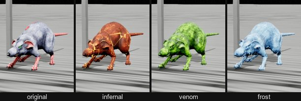 |
| 2 | Half Creature 04 | Creeping Creatures Pack | `Half_Creatures_04` | 94 | A torso with no legs, dragging itself along on its arms | 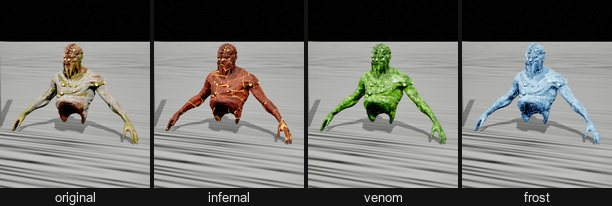 |
| 3 | Parasite Slider | Parasites Pack | `SK_Parasite_Slider` | 88 | A man's upper body on a slug's tail; slow by the look of it | 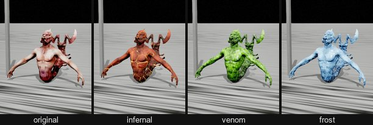 |
| 4 | Man In Gut | Creeping Creatures Pack | `SK_Man_In_Gut` | 251 | A body hanging head down in a sack of gut: trapped, not fighting | 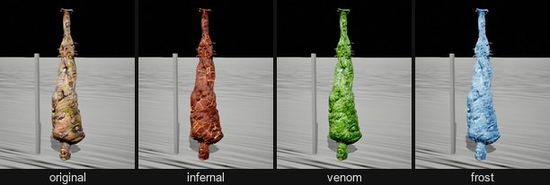 |
| 5 | Half Creature 05 | Creeping Creatures Pack | `Half_Creatures_05` | 96 | A legless torso trailing its innards; long thin clawed arms, but waist high | 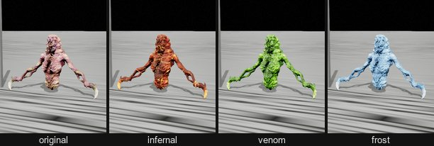 |
| 6 | Drinker | Cartoon Zombies (Pack) | `SK_Drinker` | 188 | Skinny cartoon zombie in shorts, bulging eyes | 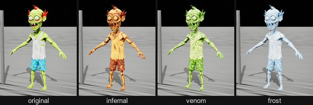 |
| 7 | Medic | Cartoon Zombies (Pack) | `SK_Medic` | 181 | Skinny, skull-faced, in a gown | 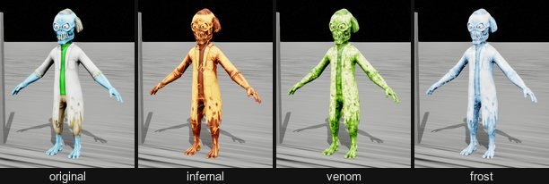 |
| 8 | Boy | Cartoon Zombies (Pack) | `SK_Boy` | 212 | A cartoon kid | 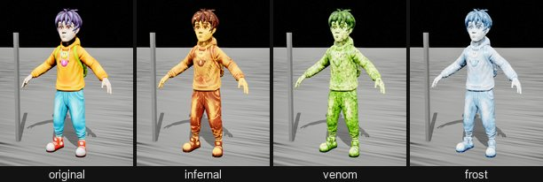 |
| 9 | Chicken | Cartoon Zombies (Pack) | `SK_Chicken` | 199 | A zombie in a chicken costume | 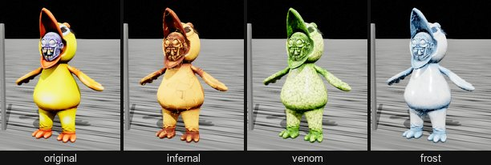 |
| 10 | Soldier | Cartoon Zombies (Pack) | `SK_Soldier` | 180 | Scrawny cartoon zombie in a helmet, unarmed | 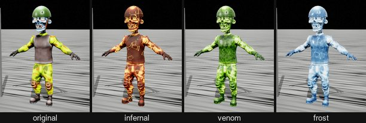 |
| 11 | Half Creature 01 | Creeping Creatures Pack | `Half_Creatures_01` | 188 | An upper body hanging over a trail of guts, no legs | 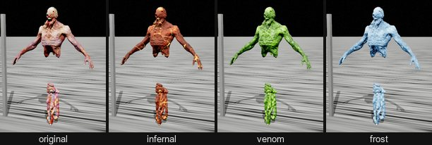 |
| 12 | Half Creature 03 | Creeping Creatures Pack | `Half_Creatures_03` | 184 | An emaciated torso on a chain | 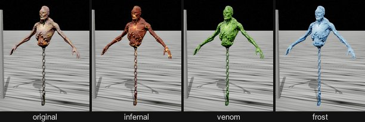 |
| 13 | Half Creature 02 | Creeping Creatures Pack | `Half_Creatures_02` | 189 | A legless torso in a tactical vest, guts for a lower body | 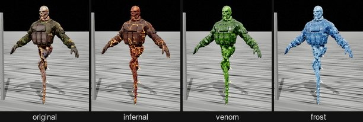 |

## Tier 2: weak but unpleasant

| # | Monster | Pack | Model | Height | Looks | original · infernal · venom · frost |
|---|---|---|---|---|---|---|
| 14 | Sufferer | 14 Orcs Pack | `SK_Sufferer_Full` | 188 | Robed and barefoot; no armour, no weapon | 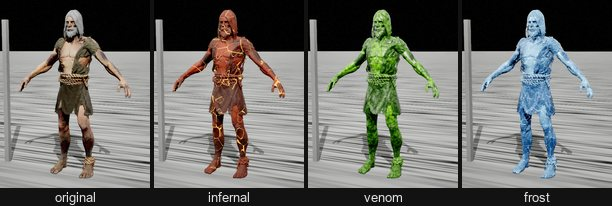 |
| 15 | Fat | Cartoon Zombies (Pack) | `SK_Fat` | 201 | Huge belly and a cap: slow | 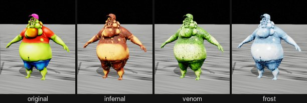 |
| 16 | Mask | Cartoon Zombies (Pack) | `SK_Mask` | 182 | Chubby, in a gas mask | 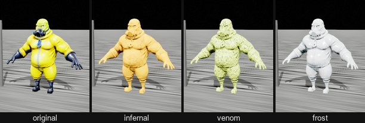 |
| 17 | Monster | Cartoon Zombies (Pack) | `SK_Monster` | 179 | Hunched, ape-like cartoon brute with a big grin | 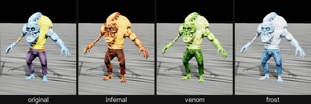 |
| 18 | Gunner | Cartoon Zombies (Pack) | `SK_Gunner` | 178 | Stocky, carries a big launcher, cartoon proportions | 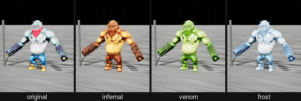 |
| 19 | Fat | Parasites Pack | `SK_Fat` | 185 | A fat man with tentacles bursting from his shoulder | 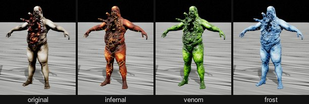 |
| 20 | Parasit | Parasites Pack | `SK_Parasit` | 180 | A man with a creature erupting from his chest and head, one claw | 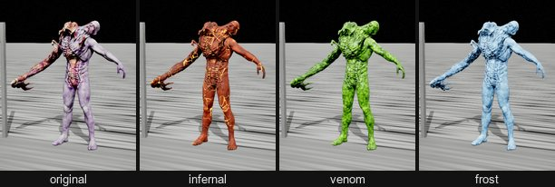 |
| 21 | Creature 01 | Sci-Fi Line With 3 Creatures | `SK_UE4_Creatures_01_Full` | 188 | Skinned, thin humanoid with a swollen belly | 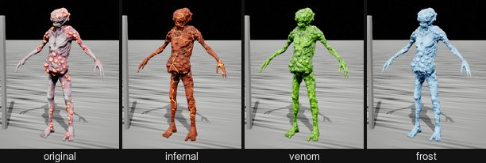 |
| 22 | Creature 03 | Sci-Fi Line With 3 Creatures | `SK_UE4_Creatures_03_Full` | 185 | Skinned and thin, with a split, crested head | 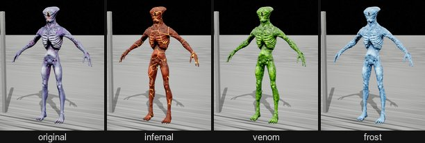 |
| 23 | Creature 05 | Humanoids Creatures Pack | `SK_Creature_05` | 186 | Lean, long ridged skull, nothing to fight with | 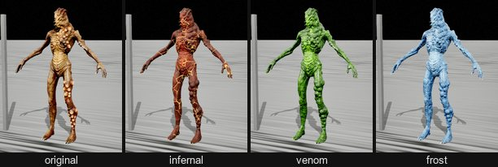 |
| 24 | Monster Underwater 04 | Monsters Underwater Pack | `SK_Monster_Underwater_04` | 200 | Lean fish-man with a fin crest and small hands | 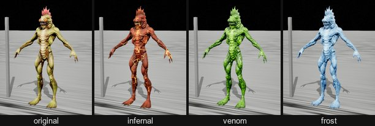 |
| 25 | Orc 03 | 14 Orcs Pack | `SK_Orc_03_Full` | 186 | A skinny orc in a spiked cage helmet and light leg armour | 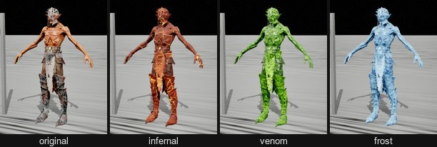 |

## Tier 3: an even fight

| # | Monster | Pack | Model | Height | Looks | original · infernal · venom · frost |
|---|---|---|---|---|---|---|
| 26 | Magur | 14 Orcs Pack | `SK_Magur_Full` | 181 | Very fat, barely armoured, a little creature on his head | 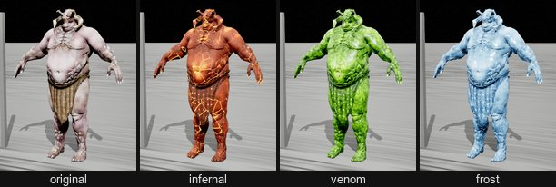 |
| 27 | Azrak | 14 Orcs Pack | `SK_Azrak_Full` | 184 | Big-bellied, loincloth, a spiked mask | 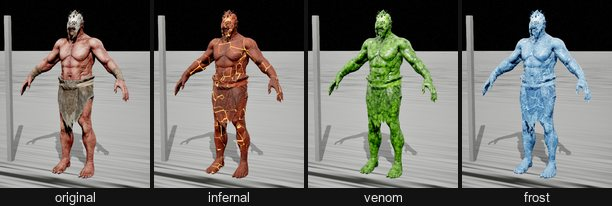 |
| 28 | Alien Warrior 03 | Aliens Warrior Pack | `SK_UE4_Alien_Warrior_03_Full_01` | 183 | The most human-looking alien: long coat, belt pouches | 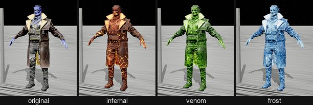 |
| 29 | Warrior 02 (the leopard) | Animals Warrior Pack | `SK_Warrior_02_Full_01` | 185 | Hooded leopard-man in cloth and light armour | 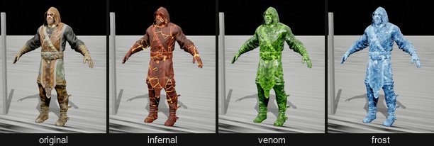 |
| 30 | Kanit | 14 Orcs Pack | `SK_Kanit_Full` | 186 | Hooded orc with spiked bracers | 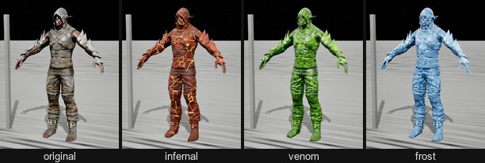 |
| 31 | Gnur | 14 Orcs Pack | `SK_Gnur_Full` | 184 | Robed orc, spikes on the shoulders | 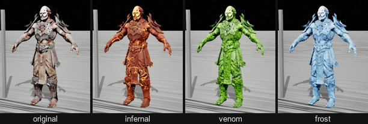 |
| 32 | Dardan | 14 Orcs Pack | `SK_Dardan_Full` | 182 | Tusked, bone necklace, spiked greaves | 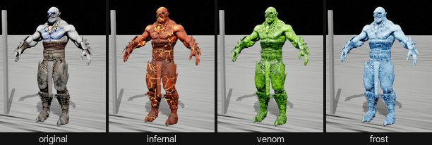 |
| 33 | Costalmed | 14 Orcs Pack | `SK_Orc_Costalmed_Full` | 189 | Half armoured: heavy leg plates and a shoulder guard | 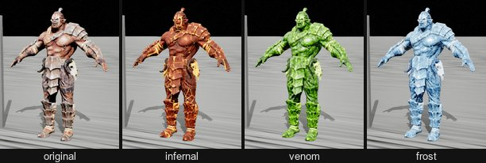 |
| 34 | Orc 05 | 14 Orcs Pack | `SK_Orc_05_Full` | 190 | Fat but armoured: belt plate, greaves, a mask | 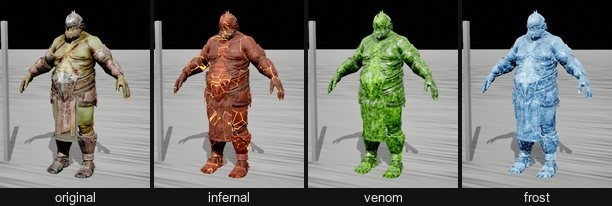 |
| 35 | Orc 06 | 14 Orcs Pack | `SK_Orc_06_Full` | 188 | Lean, spiked shoulder and arm armour | 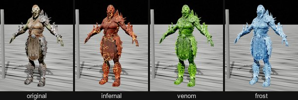 |
| 36 | Creature 02 | Sci-Fi Line With 3 Creatures | `SK_UE4_Creatures_02_Full` | 188 | Skinned and muscular, one arm a long blade | 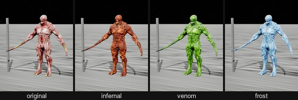 |
| 37 | Alien | Creatures Mega Pack | `SK_Alien` | 200 | Tall and gangly, long arms, small head | 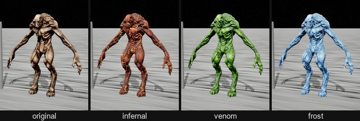 |
| 38 | Devourer | Creatures Mega Pack | `SK_Devourer` | 202 | Lanky, a wide mouth, long clawed arms | 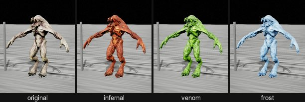 |
| 39 | Insect | Creatures Mega Pack | `SK_Insect` | 182 | A man-sized winged insect on thin legs | 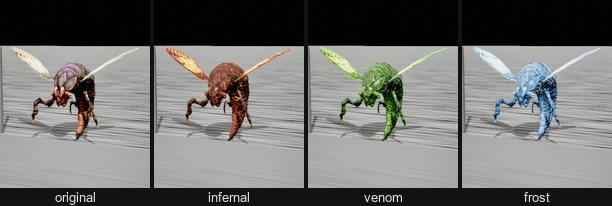 |
| 40 | Creepy | Creatures Mega Pack | `SK_Creepy` | 168 | A low, flat crawler with long reaching limbs and a toothy maw | 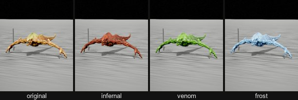 |
| 41 | Pangolin | Creatures Mega Pack | `SK_Pangolin` | 171 | Four-legged, toothy, a spiked tail | 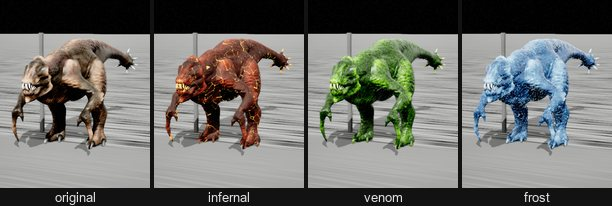 |
| 42 | Monster Underwater 02 | Monsters Underwater Pack | `SK_Monster_Underwater_02_Body` + `_Shell` | 185 | Muscular fish-man with a gaping, toothy head | 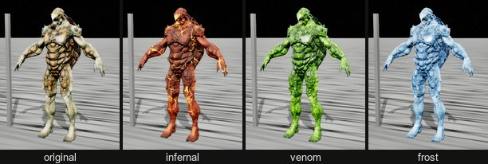 |
| 43 | Monster Underwater 03 | Monsters Underwater Pack | `SK_Monster_Underwater_03` | 179 | Muscular, a hammerhead bar across the head | 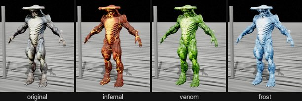 |
| 44 | Creature 03 | Humanoids Creatures Pack | `SK_Creature_03` | 189 | Lumpy, spiny skin, a crown of horns | 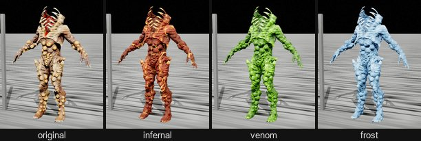 |
| 45 | Creature 02 | Humanoids Creatures Pack | `SK_Creature_02` | 208 | A tentacled head on a man's body in a vest and trousers | 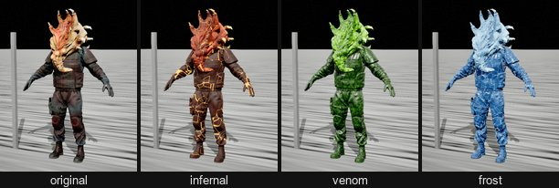 |
| 46 | Creature 07 | 10 Creatures (Pack) | `SK_Creature_07` | 188 | Lean demon, small crested head, no weapon | 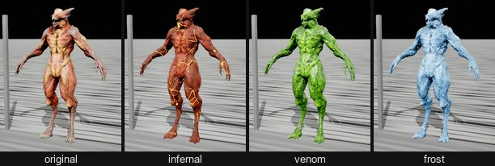 |
| 47 | Creature 02 | 10 Creatures (Pack) | `SK_Creature_02` | 186 | Lean demon with ram horns | 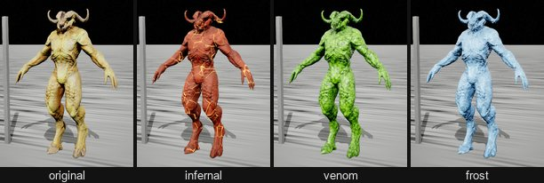 |
| 48 | Creature 03 | 10 Creatures (Pack) | `SK_Creature_03` | 186 | Lean demon with a crown of tendrils | 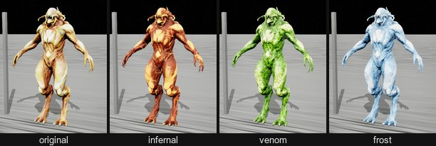 |
| 49 | Tank | Cartoon Zombies (Pack) | `SK_Tank_Mesh` | 180 | A cartoon zombie driving a toy-like tank with a cannon: armoured, but silly | 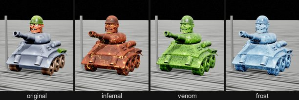 |
| 50 | Monster 04 | Humanoids Monsters Pack | `SK_Monster_04` | 182 | Lean, pinkish, ribbed belly, a skull of a face | 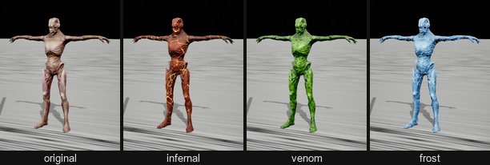 |
| 51 | Monster 05 | Humanoids Monsters Pack | `SK_Monster_05` | 181 | Grey and lean, a long flat skull, small claws |  |
| 52 | Creature Insect 02 | Creatures Insects Pack | `SK_Creature_Insect_02` | 223 | Thin golden grasshopper-man with huge eyes and long antennae |  |
| 53 | Creature Insect 05 | Creatures Insects Pack | `SK_Creature_Insect_05` | 218 | Thin pale-green mantis-man with pink eyes |  |
| 54 | Monster 03 | Humanoids Monsters Pack | `SK_Monster_03` | 193 | Grey-blue and pink, a toothy crested head, spines on the forearms |  |
| 55 | Creature Insect 04 | Creatures Insects Pack | `SK_Creature_Insect_04` | 206 | Copper carapace, branching antlers, clawed fingers |  |
| 56 | Monster 01 | Humanoids Monsters Pack | `SK_Monster_01` | 195 | Bulky, orange and lumpy, curled horns |  |
| 57 | Monster 02 | Humanoids Monsters Pack | `SK_Monster_02` | 192 | Orange-gold, a sweeping crown of horns, spiked shoulders |  |
| 58 | Creature Insect 01 | Creatures Insects Pack | `SK_Creature_Insect_01` | 213 | Blue armoured beetle-man with a great horn |  |
| 59 | Creature Insect 03 | Creatures Insects Pack | `SK_Creature_Insect_03` | 186 | Heavy dark carapace, a frilled head, long curved blades for arms |  |

## Tier 4: dangerous

| # | Monster | Pack | Model | Height | Looks | original · infernal · venom · frost |
|---|---|---|---|---|---|---|
| 60 | Orc 01 | 14 Orcs Pack | `SK_Orc_01_Full` | 186 | Armoured, spiked arm guards, tusks, skull on the belt |  |
| 61 | Orc 02 | 14 Orcs Pack | `SK_Orc_02_Full` | 184 | Full spiked armour, blade-edged gauntlets |  |
| 62 | Ursag | 14 Orcs Pack | `SK_Ursag_Full` | 197 | Antlered helm, fur and bone armour |  |
| 63 | Orc 04 | 14 Orcs Pack | `SK_Orc_04_Full` | 239 | A shaman under a totem of skulls |  |
| 64 | Bear Warrior | Animals Warrior Pack | `SK_Bear_Full` | 182 | Bear-man in a shaggy pelt |  |
| 65 | Bull Warrior | Animals Warrior Pack | `SK_Bull_Full` | 196 | Horned bull-man in plate armour |  |
| 66 | Crocodile Warrior | Animals Warrior Pack | `SK_Crocodile_Full` | 185 | Crocodile head, armour, trophies on the belt |  |
| 67 | Elephant Warrior | Animals Warrior Pack | `SK_Elephant_Full` | 187 | Elephant-man in full plate |  |
| 68 | Alien Warrior 05 | Aliens Warrior Pack | `SK_UE4_Alien_Warrior_05_Full_01` | 183 | Lean and muscular, crested head |  |
| 69 | Alien Warrior 01 | Aliens Warrior Pack | `SK_UE4_Alien_Warrior_01_Full_01` | 188 | Hunched and broad, armour plates |  |
| 70 | Alien Warrior 02 | Aliens Warrior Pack | `SK_UE4_Alien_Warrior_02_Full_01` | 185 | Bulky, heavy armour |  |
| 71 | Alien Warrior 04 | Aliens Warrior Pack | `SK_UE4_Alien_Warrior_04_Full_01` | 185 | Long claw blades on both hands |  |
| 72 | Creature 01 | Humanoids Creatures Pack | `SK_Creature_01` | 228 | A huge horn-like growth curling up from the shoulder |  |
| 73 | Creature 04 | Humanoids Creatures Pack | `SK_Creature_04` | 203 | Head swollen into a mass of tumours, lumpy body |  |
| 74 | Monster Underwater 01 | Monsters Underwater Pack | `SK_Monster_Underwater_01` | 187 | A spear-like snout across the head, spiny legs |  |
| 75 | Creature 08 | 10 Creatures (Pack) | `SK_Creature_08` | 191 | Broad-shouldered demon, wide horned head |  |
| 76 | Creature 10 | 10 Creatures (Pack) | `SK_Creature_10` | 190 | Skull face, ram horns, heavy build |  |
| 77 | Creature 01 | 10 Creatures (Pack) | `SK_Creature_01` | 192 | Horned, spiked shoulders, clawed feet |  |
| 78 | Creature 09 | 10 Creatures (Pack) | `SK_Creature_09` | 186 | Ripped, a crown of tendrils and tusks |  |
| 79 | Creature 06 | 10 Creatures (Pack) | `SK_Creature_06` | 206 | A huge fat horned bulk |  |
| 80 | Creature 04 | 10 Creatures (Pack) | `SK_Creature_04` | 199 | Horned, a blade for one arm and a hooked scythe in the other |  |
| 81 | Creature 05 | 10 Creatures (Pack) | `SK_Creature_05` | 184 | Two long blades for arms |  |
| 82 | Exterminator | Creatures Mega Pack | `SK_Exterminator` | 202 | Hulking brute |  |
| 83 | Shell | Creatures Mega Pack | `SK_Shell` | 200 | Pale armoured brute with big claws |  |
| 84 | Bug | Creatures Mega Pack | `SK_Bug` | 200 | Blue armoured insect-man, spiked forearms |  |
| 85 | Horned | Creatures Mega Pack | `SK_Horned` | 207 | Horned devil, long clawed arms |  |
| 86 | Mutant | Creatures Mega Pack | `SK_Mutant` | 201 | Muscular, one arm a long tentacle |  |
| 87 | Ripper dog | Creatures Mega Pack | `SK_Ripper_dog` | 194 | A big snarling hound with quills on its back |  |
| 88 | Daemon | Creatures Mega Pack | `SK_Daemon` | 219 | Tall, bat-eared, clawed |  |
| 89 | Troll | Creatures Mega Pack | `SK_Troll` | 201 | Heavily muscled and tusked |  |
| 90 | Executioner | Fantasy Enemies (Pack) | `SK_Executioner_Full` | 185 | Big armoured man, spiked shoulders |  |
| 91 | Monster Underwater 05 | Monsters Underwater Pack | `SK_Monster_Underwater_05` | 184 | Crab claws, spiked shell armour, horned head |  |
| 92 | Monster For Capsule | Monster In Capsule | `SK_UE4_Monster_For_Capsule_Full` | 201 | Horned, long blade claws on both hands |  |
| 93 | Parasite Spider | Parasites Pack | `SK_Parasite_Spider` | 199 | A human body on spider legs |  |
| 94 | Fantasy Animal (raptor mount) | Fantasy Animal (Pack) | `SK_Fantasy_Animal_Full` | 205 | Saddled raptor: jaws and clawed feet |  |

## Tier 5: bosses

| # | Monster | Pack | Model | Height | Looks | original · infernal · venom · frost |
|---|---|---|---|---|---|---|
| 95 | Alfa | Parasites Pack | `SK_Alfa` | 217 | Fanged, hulking, one arm a giant scythe |  |
| 96 | Demon | Fantasy Enemies (Pack) | `SK_Demon_Full` | 202 | Horned, in layered armour |  |
| 97 | Befouler | Fantasy Enemies (Pack) | `SK_Befouler_Full_01` | 200 | Giant curved horns, skulls carried on its back |  |
| 98 | Devil | Fantasy Enemies (Pack) | `SK_Devil_Full` | 197 | Horned, spikes all over |  |
| 99 | Troll | Fantasy Enemies (Pack) | `SK_Troll_Full_01` | 198 | Bristling with spikes and armour plates |  |
| 100 | Spider | Creatures Mega Pack | `SK_Spider` | 250 | Scythe legs, an open ribcage of a chest |  |
| 101 | Rock | Creatures Mega Pack | `SK_Rock` | 330 | Spines on its back, long claws |  |
| 102 | Titan | Creatures Mega Pack | `SK_Titan` | 250 | Massive clawed arms |  |
| 103 | Hunter | Creatures Mega Pack | `SK_Hunter` | 253 | A giant hulk on its knuckles |  |
| 104 | Nasty | Creatures Mega Pack | `SK_Nasty` | 270 | A giant spider, 6.7 m long |  |
| 105 | Fantasy Elephant | Fantasy Animal (Pack) | `SK_Fantasy_Elephant_Full` | 705 | A 7 m war elephant, armoured, spikes on the tusks |  |
| 106 | Fantasy Elephant with a tower | Fantasy Animal (Pack) | `SK_Fantasy_Elephant_Build_Full` | 1070 | The war elephant carrying a fortified tower |  |
| 107 | Fantasy Dragon | Fantasy Animal (Pack) | `SK_Fantasy_Dragon_Full` | 308 | A dragon with a 12 m wingspan |  |

## Not ranked

- **Pack animals:** the camel (`SK_Camel_Full`) and the laden buffalo (`SK_Bull_Fantasy_Full`) of the Fantasy Animal (Pack). They carry baggage; they are not monsters.
- **Creatures Mega Pack models that are not imported:** `Fat`, `Organic_trap`, `Poisonous_claw`, `Cocoon` and `Character_01` are in the cached pack but not in this project, so they could not be seen on their own.
- **Not creatures:**
  - Baby In Capsule: a human baby.
  - Sci-FI Creocapsule: a capsule prop overgrown with organic matter.
  - Sci-Fi Experimental: a lab with a specimen lying on the table, with no character model.
  - The scientist (`NPC_Scientist`) of Monster In Capsule.
