# Weapons and items of the Fab library

The weapons and the handheld or wearable items in the local Fab library cache (`I:\game assets\3d epicgames media packs\VaultCache\FabLibrary` and the environment packs downloaded through it), in five parts: fantasy weapons, modern weapons, futuristic weapons, armour and shields, and non-weapon items. All 311 are in this project. Each is shown three times, rendered in Unreal Engine:

- **side view:** its broad face, level (or from above if it lies flat);
- **three-quarter view;**
- a **frame of its own clip** for the 21 that have one (a gun's reload or shot, a can's lid, a syringe's plunger), or the **far three-quarter view** for the rest.

## About the pictures and notes

- **Sizes:** each entry gives the object's three extents in centimetres, from its bounds; every picture is framed to fill, from a 2 cm coin to a 1.5 m flamethrower.
- **Kept together:** the flamethrower (gun, hose, tank), the riot shield with its club and the police riot shield are several meshes, shown as they sit in their packs.
- **Armour sets:** the packs' armour comes in pieces skinned to a character's skeleton (chest, pauldrons, bracers, greaves, helmet). Each set is all of one character's armour pieces, without the body under them, shown as an empty suit in the character's reference pose (a T- or A-pose).
- **Variants:** many packs have several versions of a weapon (silencers, sights, paint, the ten knives of the FPS Starter Pack, eight pistols and revolvers in `Safehouse`); one of each kind is shown.
- **Animations:** each entry says what clips the object has of its own, which first-person arm clips were made for it (the FPS packs: arms only, a camera rig's), and which third-person animation sets in the project hold that kind of weapon on a UE4-mannequin character (see [heroes.md](heroes.md#animations) for those sets). Bows, crossbows, staves, knives and grenades have no third-person clips here.
- **Uses:** a use is a suggestion from the object's looks.

The list is `claude_ue5/SourceArt/object_gallery/objects.json`; the pictures come from `pipeline/unreal/904_object_gallery.py` and `pipeline/blender_numpy/object_doc.py`, the sizes and animation notes from `pipeline/unreal/902_character_animations.py`. The sellers and listings of the packs are in [assets.md](assets.md).

## Contents

- [Fantasy weapons](#fantasy-weapons) (75)
  - [Swords and daggers](#swords-and-daggers) (19)
  - [Axes, hammers, maces and clubs](#axes-hammers-maces-and-clubs) (33)
  - [Spears and polearms](#spears-and-polearms) (10)
  - [Primitive weapons](#primitive-weapons) (6)
  - [Bows, crossbows and staves](#bows-crossbows-and-staves) (7)
- [Modern weapons](#modern-weapons) (42)
  - [Rifles, machine guns and shotguns](#rifles-machine-guns-and-shotguns) (13)
  - [Sniper rifles and launchers](#sniper-rifles-and-launchers) (5)
  - [Pistols and revolvers](#pistols-and-revolvers) (7)
  - [Knives, melee weapons and grenades](#knives-melee-weapons-and-grenades) (17)
- [Futuristic weapons](#futuristic-weapons) (22)
  - [Energy and sci-fi guns](#energy-and-sci-fi-guns) (13)
  - [Energy blades and melee weapons](#energy-blades-and-melee-weapons) (9)
- [Armour and shields](#armour-and-shields) (107)
  - [Fantasy armour](#fantasy-armour) (37)
  - [Modern armour](#modern-armour) (13)
  - [Futuristic armour](#futuristic-armour) (14)
  - [Fantasy shields](#fantasy-shields) (22)
  - [Modern and sci-fi shields](#modern-and-sci-fi-shields) (4)
  - [Helmets and masks](#helmets-and-masks) (17)
- [Non-weapon items](#non-weapon-items) (65)
  - [Food and drink](#food-and-drink) (21)
  - [Potions and medicine](#potions-and-medicine) (9)
  - [Tools and devices](#tools-and-devices) (20)
  - [Treasure, keys and books](#treasure-keys-and-books) (15)
- [Not included](#not-included)

## Fantasy weapons

Swords, axes, maces, polearms, bows and shields of medieval and fantasy packs: knights, Vikings, samurai, orcs, dwarves, demons and cavemen.

### Swords and daggers

#### Arming Sword

[Dark Fantasy Weapons](https://www.fab.com/listings/244607ad-e819-4320-bbc7-687b844b5bed) · **Use:** one-handed sword · model `SM_Sword_1` · 88 × 18 × 4 cm

A dark, ornate sword with a winged crossguard and a pommel spike.

**Animations.** **Own:** a static mesh, no clips of its own. **Third person:** Held by [Weapon And Shield Animations](https://www.fab.com/listings/eb3cfd11-3525-4a0d-9f15-793f62847f6a) (35 clips: sword-and-shield attacks, blocks, hits, deaths, moves); the two-handed ones by [92 Animations For Warrior](https://www.fab.com/listings/84b7b209-1450-4a0a-a46f-cc6d4ab61eac) (92 clips: 8 two-handed attacks, deaths, hits, moves; the same set comes with the orc, beast-warrior, dwarf and fantasy-character packs).

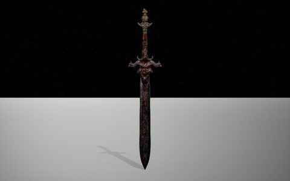 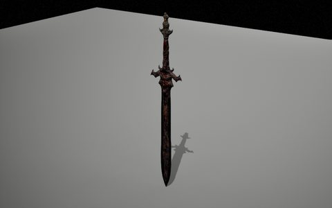 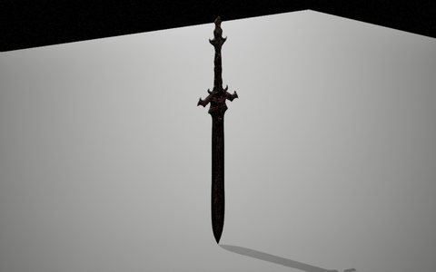

#### Broadsword

[Dark Fantasy Weapons](https://www.fab.com/listings/244607ad-e819-4320-bbc7-687b844b5bed) · **Use:** boss sword · model `SM_Sword_2` · 84 × 22 × 4 cm

A black, jagged blade sprouting spikes from its guard: an evil-looking greatsword.

**Animations.** **Own:** a static mesh, no clips of its own. **Third person:** Held by [Weapon And Shield Animations](https://www.fab.com/listings/eb3cfd11-3525-4a0d-9f15-793f62847f6a) (35 clips: sword-and-shield attacks, blocks, hits, deaths, moves); the two-handed ones by [92 Animations For Warrior](https://www.fab.com/listings/84b7b209-1450-4a0a-a46f-cc6d4ab61eac) (92 clips: 8 two-handed attacks, deaths, hits, moves; the same set comes with the orc, beast-warrior, dwarf and fantasy-character packs).

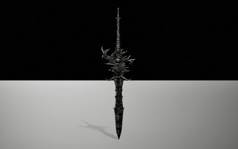 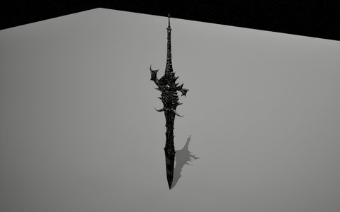 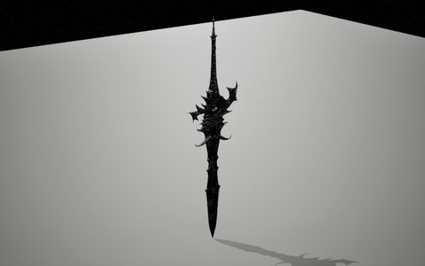

#### Longsword

[Dark Fantasy Weapons](https://www.fab.com/listings/244607ad-e819-4320-bbc7-687b844b5bed) · **Use:** one-handed sword · model `SM_Sword_3` · 93 × 23 × 3 cm

A long bronze-tinted blade with a plain cross guard.

**Animations.** **Own:** a static mesh, no clips of its own. **Third person:** Held by [Weapon And Shield Animations](https://www.fab.com/listings/eb3cfd11-3525-4a0d-9f15-793f62847f6a) (35 clips: sword-and-shield attacks, blocks, hits, deaths, moves); the two-handed ones by [92 Animations For Warrior](https://www.fab.com/listings/84b7b209-1450-4a0a-a46f-cc6d4ab61eac) (92 clips: 8 two-handed attacks, deaths, hits, moves; the same set comes with the orc, beast-warrior, dwarf and fantasy-character packs).

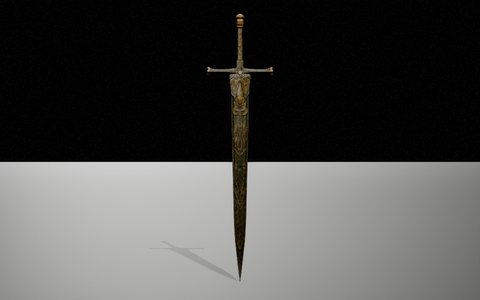 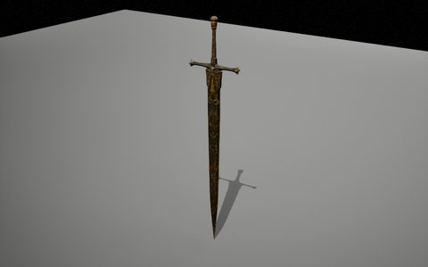 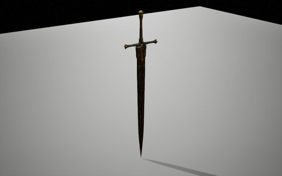

#### Dagger

[Dark Fantasy Weapons](https://www.fab.com/listings/244607ad-e819-4320-bbc7-687b844b5bed) · **Use:** dagger · model `SM_Dagger` · 34 × 6 × 2 cm

A narrow dagger with a spiked guard and a wrapped grip.

**Animations.** **Own:** a static mesh, no clips of its own. **Third person:** No third-person knife clips in the project; the first-person ones are in FPS Pistol And Knife, the FPS Starter Pack and Sci-Fi Hands With Knife.

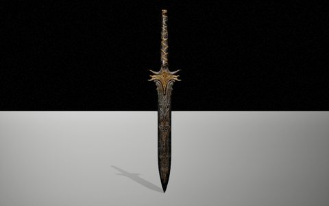 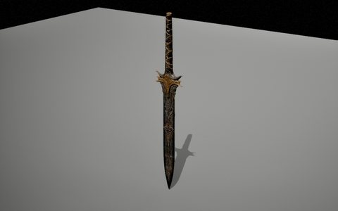 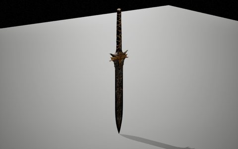

#### Templar Sword

[Knights (Pack)](https://www.fab.com/listings/6907d3d8-d0db-43c0-bf9c-8ad43c70e7b3) · **Use:** knight's sword · model `SM_Knight_01_Sword` · 109 × 23 × 5 cm

A long plain arming sword with a down-curved guard.

**Animations.** **Own:** a static mesh, no clips of its own. **Third person:** Held by [Weapon And Shield Animations](https://www.fab.com/listings/eb3cfd11-3525-4a0d-9f15-793f62847f6a) (35 clips: sword-and-shield attacks, blocks, hits, deaths, moves); the two-handed ones by [92 Animations For Warrior](https://www.fab.com/listings/84b7b209-1450-4a0a-a46f-cc6d4ab61eac) (92 clips: 8 two-handed attacks, deaths, hits, moves; the same set comes with the orc, beast-warrior, dwarf and fantasy-character packs).

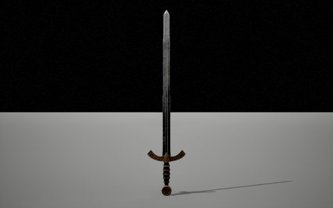 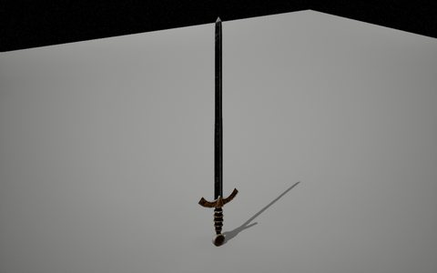 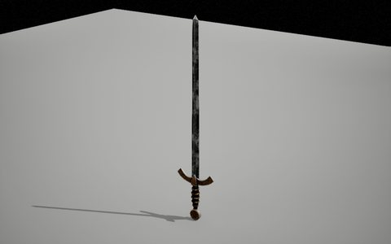

#### Eastern Sabre

[Knights (Pack)](https://www.fab.com/listings/6907d3d8-d0db-43c0-bf9c-8ad43c70e7b3) · **Use:** sabre · model `SM_Knight_02_Sword` · 115 × 24 × 5 cm

A long, deeply curved sabre.

**Animations.** **Own:** a static mesh, no clips of its own. **Third person:** Held by [Weapon And Shield Animations](https://www.fab.com/listings/eb3cfd11-3525-4a0d-9f15-793f62847f6a) (35 clips: sword-and-shield attacks, blocks, hits, deaths, moves); the two-handed ones by [92 Animations For Warrior](https://www.fab.com/listings/84b7b209-1450-4a0a-a46f-cc6d4ab61eac) (92 clips: 8 two-handed attacks, deaths, hits, moves; the same set comes with the orc, beast-warrior, dwarf and fantasy-character packs).

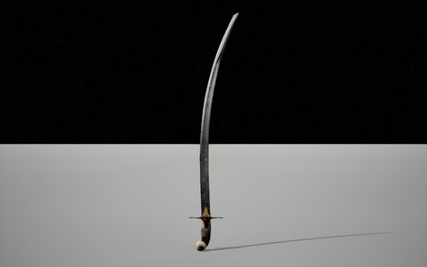 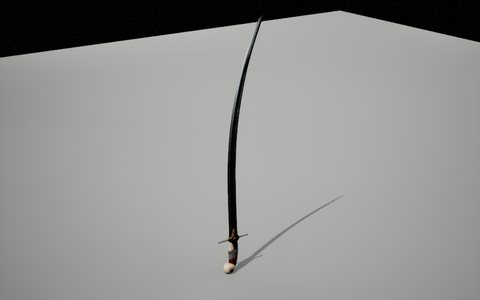 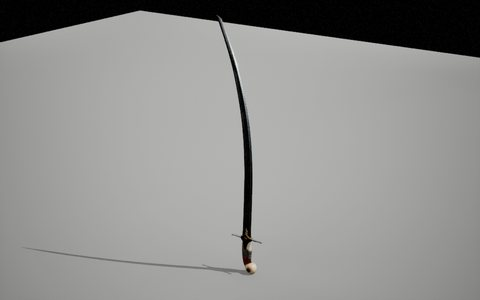

#### Plate Knight's Sword

[Knights (Pack)](https://www.fab.com/listings/6907d3d8-d0db-43c0-bf9c-8ad43c70e7b3) · **Use:** two-handed sword · model `SM_Knight_03_Sword` · 141 × 28 × 7 cm

A flamberge: a long twisted blade with a ringed guard.

**Animations.** **Own:** a static mesh, no clips of its own. **Third person:** Held by [Weapon And Shield Animations](https://www.fab.com/listings/eb3cfd11-3525-4a0d-9f15-793f62847f6a) (35 clips: sword-and-shield attacks, blocks, hits, deaths, moves); the two-handed ones by [92 Animations For Warrior](https://www.fab.com/listings/84b7b209-1450-4a0a-a46f-cc6d4ab61eac) (92 clips: 8 two-handed attacks, deaths, hits, moves; the same set comes with the orc, beast-warrior, dwarf and fantasy-character packs).

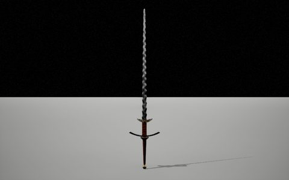 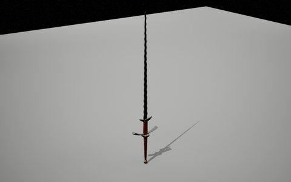 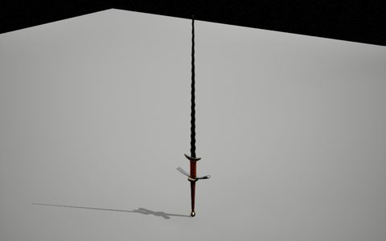

#### Paladin's Sword

[Knights (Pack)](https://www.fab.com/listings/6907d3d8-d0db-43c0-bf9c-8ad43c70e7b3) · **Use:** two-handed sword · model `SM_Knight_05_Sword` · 159 × 24 × 4 cm

A gilded, forked blade over an ornate silver guard.

**Animations.** **Own:** a static mesh, no clips of its own. **Third person:** Held by [Weapon And Shield Animations](https://www.fab.com/listings/eb3cfd11-3525-4a0d-9f15-793f62847f6a) (35 clips: sword-and-shield attacks, blocks, hits, deaths, moves); the two-handed ones by [92 Animations For Warrior](https://www.fab.com/listings/84b7b209-1450-4a0a-a46f-cc6d4ab61eac) (92 clips: 8 two-handed attacks, deaths, hits, moves; the same set comes with the orc, beast-warrior, dwarf and fantasy-character packs).

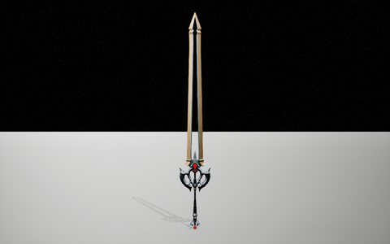 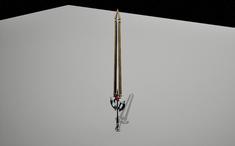 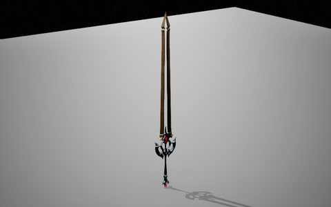

#### Dark Knight's Sword

[Fantasy Warriors (Pack)](https://www.fab.com/listings/df8194f9-ec63-49f6-a885-6feb7a94fcb1) · **Use:** two-handed sword · model `SM_Dark_Knight_02_Sword` · 158 × 32 × 13 cm

A long steel greatsword with curled quillons.

**Animations.** **Own:** a static mesh, no clips of its own. **Third person:** Held by [Weapon And Shield Animations](https://www.fab.com/listings/eb3cfd11-3525-4a0d-9f15-793f62847f6a) (35 clips: sword-and-shield attacks, blocks, hits, deaths, moves); the two-handed ones by [92 Animations For Warrior](https://www.fab.com/listings/84b7b209-1450-4a0a-a46f-cc6d4ab61eac) (92 clips: 8 two-handed attacks, deaths, hits, moves; the same set comes with the orc, beast-warrior, dwarf and fantasy-character packs).

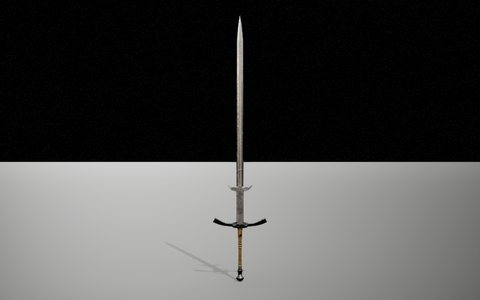 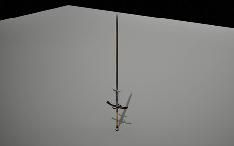 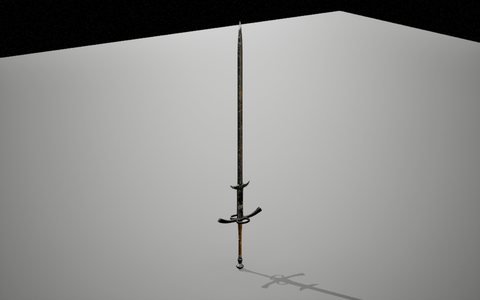

#### Demonic Blade

[Fantasy Warriors (Pack)](https://www.fab.com/listings/df8194f9-ec63-49f6-a885-6feb7a94fcb1) · **Use:** boss sword · model `SM_Demonic_Warrior_Sword` · 148 × 32 × 6 cm

A huge cleaver-like blade covered in glowing runes.

**Animations.** **Own:** a static mesh, no clips of its own. **Third person:** Held by [Weapon And Shield Animations](https://www.fab.com/listings/eb3cfd11-3525-4a0d-9f15-793f62847f6a) (35 clips: sword-and-shield attacks, blocks, hits, deaths, moves); the two-handed ones by [92 Animations For Warrior](https://www.fab.com/listings/84b7b209-1450-4a0a-a46f-cc6d4ab61eac) (92 clips: 8 two-handed attacks, deaths, hits, moves; the same set comes with the orc, beast-warrior, dwarf and fantasy-character packs).

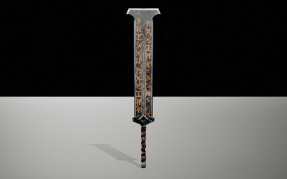 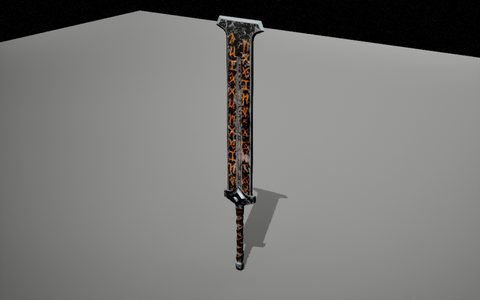 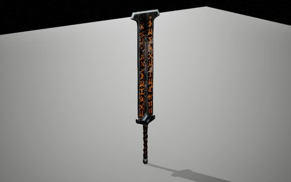

#### Katana

[SAMURAI](https://www.fab.com/listings/5f4c90b7-a282-45fc-89df-61468afc867b) · **Use:** katana · model `SM_Samurai_Sword_01` · 133 × 12 × 11 cm

A curved katana with a red-wrapped grip.

**Animations.** **Own:** a static mesh, no clips of its own. **Third person:** Held by [Weapon And Shield Animations](https://www.fab.com/listings/eb3cfd11-3525-4a0d-9f15-793f62847f6a) (35 clips: sword-and-shield attacks, blocks, hits, deaths, moves); the two-handed ones by [92 Animations For Warrior](https://www.fab.com/listings/84b7b209-1450-4a0a-a46f-cc6d4ab61eac) (92 clips: 8 two-handed attacks, deaths, hits, moves; the same set comes with the orc, beast-warrior, dwarf and fantasy-character packs).

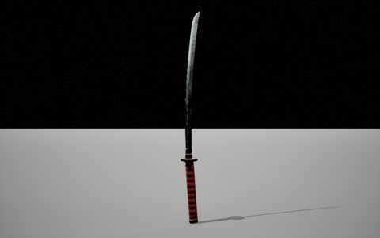 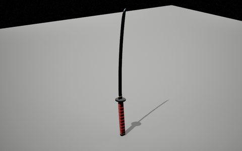 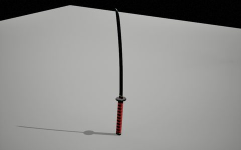

#### Wakizashi

[SAMURAI](https://www.fab.com/listings/5f4c90b7-a282-45fc-89df-61468afc867b) · **Use:** short sword · model `SM_Samurai_Sword_02` · 102 × 11 × 11 cm

The katana's shorter companion.

**Animations.** **Own:** a static mesh, no clips of its own. **Third person:** No third-person knife clips in the project; the first-person ones are in FPS Pistol And Knife, the FPS Starter Pack and Sci-Fi Hands With Knife.

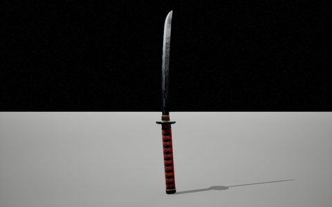 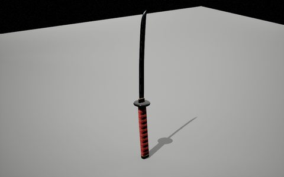 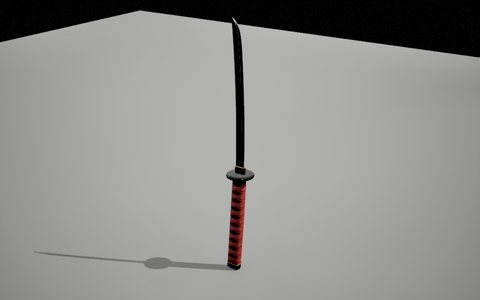

#### Viking Sword

[Viking (Customized)](https://www.fab.com/listings/e814c3a3-11ba-4316-a07a-b0980fd016ef) · **Use:** one-handed sword · model `SM_Viking_Sword_01` · 109 × 29 × 4 cm

A plain Viking sword with a brass guard.

**Animations.** **Own:** a static mesh, no clips of its own. **Third person:** Held by [Weapon And Shield Animations](https://www.fab.com/listings/eb3cfd11-3525-4a0d-9f15-793f62847f6a) (35 clips: sword-and-shield attacks, blocks, hits, deaths, moves); the two-handed ones by [92 Animations For Warrior](https://www.fab.com/listings/84b7b209-1450-4a0a-a46f-cc6d4ab61eac) (92 clips: 8 two-handed attacks, deaths, hits, moves; the same set comes with the orc, beast-warrior, dwarf and fantasy-character packs).

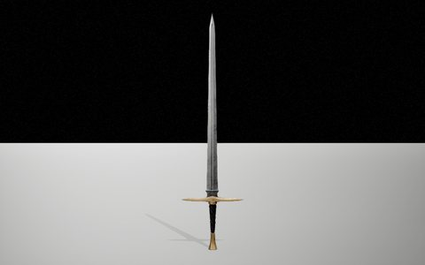 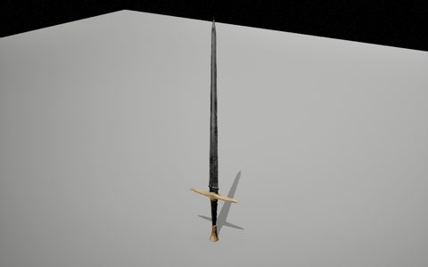 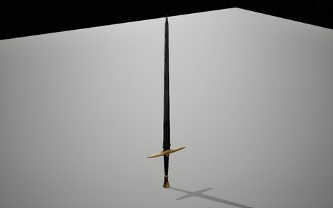

#### Viking Shortsword

[Viking (Customized)](https://www.fab.com/listings/e814c3a3-11ba-4316-a07a-b0980fd016ef) · **Use:** short sword · model `SM_Viking_Knife_01` · 66 × 15 × 4 cm

A narrow blade with a knobbed, ringed hilt.

**Animations.** **Own:** a static mesh, no clips of its own. **Third person:** Held by [Weapon And Shield Animations](https://www.fab.com/listings/eb3cfd11-3525-4a0d-9f15-793f62847f6a) (35 clips: sword-and-shield attacks, blocks, hits, deaths, moves); the two-handed ones by [92 Animations For Warrior](https://www.fab.com/listings/84b7b209-1450-4a0a-a46f-cc6d4ab61eac) (92 clips: 8 two-handed attacks, deaths, hits, moves; the same set comes with the orc, beast-warrior, dwarf and fantasy-character packs).

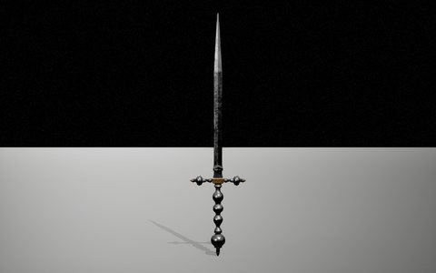 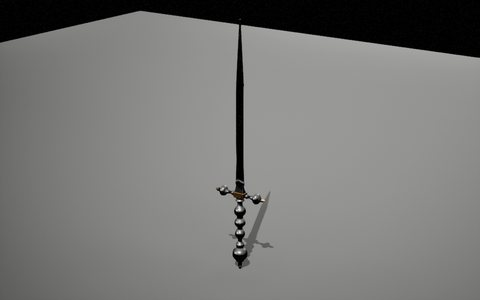 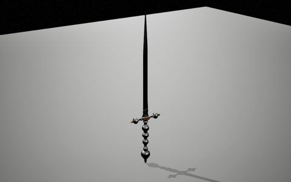

#### Veteran's Sword

[Fantasy Characters (Pack)](https://www.fab.com/listings/f5816915-86d9-4bef-b8f3-921408ae240b) · **Use:** one-handed sword · model `SM_Sword` · 146 × 27 × 4 cm

A long, worn arming sword.

**Animations.** **Own:** a static mesh, no clips of its own. **Third person:** Held by [Weapon And Shield Animations](https://www.fab.com/listings/eb3cfd11-3525-4a0d-9f15-793f62847f6a) (35 clips: sword-and-shield attacks, blocks, hits, deaths, moves); the two-handed ones by [92 Animations For Warrior](https://www.fab.com/listings/84b7b209-1450-4a0a-a46f-cc6d4ab61eac) (92 clips: 8 two-handed attacks, deaths, hits, moves; the same set comes with the orc, beast-warrior, dwarf and fantasy-character packs).

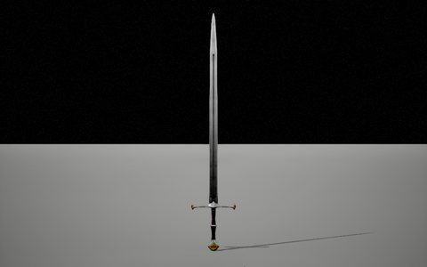 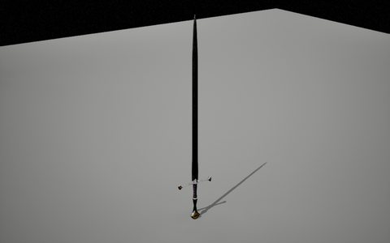 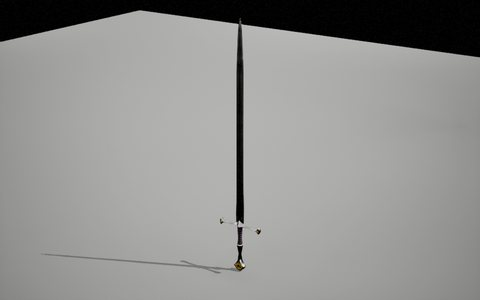

#### Orc Cleaver

[14 Orcs Pack](https://www.fab.com/listings/3c224616-e998-433c-910b-32901d426103) · **Use:** orc blade · model `SM_Gira_Sword` · 110 × 9 × 3 cm

A crude curved blade with a rope-wrapped grip.

**Animations.** **Own:** a static mesh, no clips of its own. **Third person:** Held by [Weapon And Shield Animations](https://www.fab.com/listings/eb3cfd11-3525-4a0d-9f15-793f62847f6a) (35 clips: sword-and-shield attacks, blocks, hits, deaths, moves); the two-handed ones by [92 Animations For Warrior](https://www.fab.com/listings/84b7b209-1450-4a0a-a46f-cc6d4ab61eac) (92 clips: 8 two-handed attacks, deaths, hits, moves; the same set comes with the orc, beast-warrior, dwarf and fantasy-character packs).

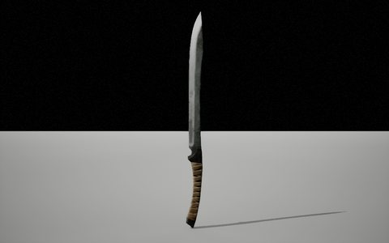 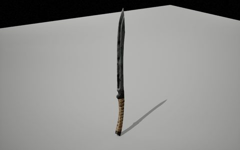 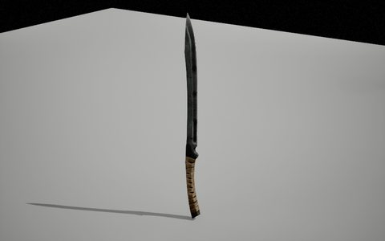

#### Sherwood Sword

[Modular Medieval Town](https://www.fab.com/listings/720ccb75-32a9-4130-acab-532239760d22) · **Use:** short sword · model `SM_Sword_01` · 79 × 14 × 5 cm

A short, broad iron sword with a square guard.

**Animations.** **Own:** a static mesh, no clips of its own. **Third person:** Held by [Weapon And Shield Animations](https://www.fab.com/listings/eb3cfd11-3525-4a0d-9f15-793f62847f6a) (35 clips: sword-and-shield attacks, blocks, hits, deaths, moves); the two-handed ones by [92 Animations For Warrior](https://www.fab.com/listings/84b7b209-1450-4a0a-a46f-cc6d4ab61eac) (92 clips: 8 two-handed attacks, deaths, hits, moves; the same set comes with the orc, beast-warrior, dwarf and fantasy-character packs).

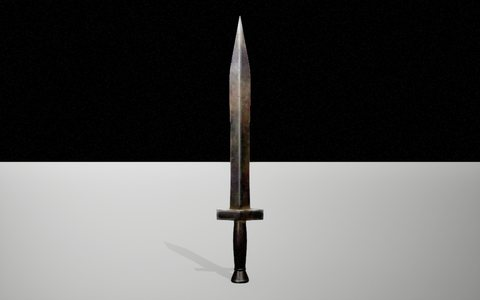 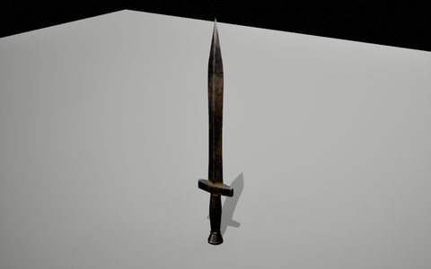 

#### Camel Rider's Sheathed Sword

[Fantasy Animal (Pack)](https://www.fab.com/listings/4878a5f0-f82b-4530-b50d-a3f880ef4665) · **Use:** sidearm · model `SK_Camel_Sword` · 101 × 32 × 31 cm

A curved sword in a carved, studded scabbard.

**Animations.** **Own:** a part skinned to its character's skeleton (35 bones): it moves with that character's clips. **Third person:** Held by [Weapon And Shield Animations](https://www.fab.com/listings/eb3cfd11-3525-4a0d-9f15-793f62847f6a) (35 clips: sword-and-shield attacks, blocks, hits, deaths, moves); the two-handed ones by [92 Animations For Warrior](https://www.fab.com/listings/84b7b209-1450-4a0a-a46f-cc6d4ab61eac) (92 clips: 8 two-handed attacks, deaths, hits, moves; the same set comes with the orc, beast-warrior, dwarf and fantasy-character packs).

  

#### Leaf-Blade Knife

[House Forge: Modular House Building Kit](https://www.fab.com/listings/277b975e-2158-41ef-908a-ef08bc26a409) · **Use:** knife · model `SM_WeaponKnife_01a` · 42 × 12 × 4 cm

A stone-grey knife with a pierced, leaf-shaped blade.

**Animations.** **Own:** a static mesh, no clips of its own. **Third person:** No third-person knife clips in the project; the first-person ones are in FPS Pistol And Knife, the FPS Starter Pack and Sci-Fi Hands With Knife.

  

### Axes, hammers, maces and clubs

#### Battle Axe

[Dark Fantasy Weapons](https://www.fab.com/listings/244607ad-e819-4320-bbc7-687b844b5bed) · **Use:** two-handed axe · model `SM_Axe` · 91 × 37 × 7 cm

A double-bladed axe with a winged head and a spiked butt.

**Animations.** **Own:** a static mesh, no clips of its own. **Third person:** Held by [92 Animations For Warrior](https://www.fab.com/listings/84b7b209-1450-4a0a-a46f-cc6d4ab61eac) (92 clips: 8 two-handed attacks, deaths, hits, moves; the same set comes with the orc, beast-warrior, dwarf and fantasy-character packs).

  

#### Double Axe

[Dark Fantasy Weapons](https://www.fab.com/listings/244607ad-e819-4320-bbc7-687b844b5bed) · **Use:** one-handed axe · model `SM_ThrowingAxe` · 57 × 32 × 5 cm

A short double-bitted axe with a heavy, wrapped haft.

**Animations.** **Own:** a static mesh, no clips of its own. **Third person:** Held by [Weapon And Shield Animations](https://www.fab.com/listings/eb3cfd11-3525-4a0d-9f15-793f62847f6a) (35 clips: sword-and-shield attacks, blocks, hits, deaths, moves).

  

#### Mace

[Dark Fantasy Weapons](https://www.fab.com/listings/244607ad-e819-4320-bbc7-687b844b5bed) · **Use:** mace · model `SM_Mace` · 83 × 18 × 17 cm

A spiked iron ball on a ringed shaft.

**Animations.** **Own:** a static mesh, no clips of its own. **Third person:** Held by [Weapon And Shield Animations](https://www.fab.com/listings/eb3cfd11-3525-4a0d-9f15-793f62847f6a) (35 clips: sword-and-shield attacks, blocks, hits, deaths, moves).

  

#### Bearded Axe

[Viking (Customized)](https://www.fab.com/listings/e814c3a3-11ba-4316-a07a-b0980fd016ef) · **Use:** one-handed axe · model `SM_Viking_Axe_01` · 69 × 22 × 3 cm

A Viking axe with a long, leather-wrapped haft.

**Animations.** **Own:** a static mesh, no clips of its own. **Third person:** Held by [Weapon And Shield Animations](https://www.fab.com/listings/eb3cfd11-3525-4a0d-9f15-793f62847f6a) (35 clips: sword-and-shield attacks, blocks, hits, deaths, moves).

  

#### Dane Axe

[Viking (Customized)](https://www.fab.com/listings/e814c3a3-11ba-4316-a07a-b0980fd016ef) · **Use:** two-handed axe · model `SM_Viking_Axe_02` · 115 × 45 × 6 cm

A double-bitted Viking axe on a long haft.

**Animations.** **Own:** a static mesh, no clips of its own. **Third person:** Held by [92 Animations For Warrior](https://www.fab.com/listings/84b7b209-1450-4a0a-a46f-cc6d4ab61eac) (92 clips: 8 two-handed attacks, deaths, hits, moves; the same set comes with the orc, beast-warrior, dwarf and fantasy-character packs).

  

#### Viking Mace

[Viking (Customized)](https://www.fab.com/listings/e814c3a3-11ba-4316-a07a-b0980fd016ef) · **Use:** mace · model `SM_Viking_Club_01` · 73 × 20 × 20 cm

A copper ball with spikes on a wooden haft.

**Animations.** **Own:** a static mesh, no clips of its own. **Third person:** Held by [Weapon And Shield Animations](https://www.fab.com/listings/eb3cfd11-3525-4a0d-9f15-793f62847f6a) (35 clips: sword-and-shield attacks, blocks, hits, deaths, moves).

  

#### Dwarven Axe

[Fantasy Characters (Pack)](https://www.fab.com/listings/f5816915-86d9-4bef-b8f3-921408ae240b) · **Use:** two-handed axe · model `SM_Dwarf_Axe` · 109 × 49 × 11 cm

A round double axe with glowing runes, on a pale haft with a ring.

**Animations.** **Own:** a static mesh, no clips of its own. **Third person:** Held by [92 Animations For Warrior](https://www.fab.com/listings/84b7b209-1450-4a0a-a46f-cc6d4ab61eac) (92 clips: 8 two-handed attacks, deaths, hits, moves; the same set comes with the orc, beast-warrior, dwarf and fantasy-character packs).

  

#### Knight's Poleaxe

[Fantasy Characters (Pack)](https://www.fab.com/listings/f5816915-86d9-4bef-b8f3-921408ae240b) · **Use:** polearm · model `SM_Knight_Axe` · 193 × 24 × 6 cm

A slim axe head on a long red pole.

**Animations.** **Own:** a static mesh, no clips of its own. **Third person:** Held by [Spear And Shield Animations](https://www.fab.com/listings/0302d959-984a-48be-9e4f-033dd545b525) (36 clips: 7 spear attacks, blocks, hits, moves).

  

#### Northman's Axe

[Fantasy Characters (Pack)](https://www.fab.com/listings/f5816915-86d9-4bef-b8f3-921408ae240b) · **Use:** two-handed axe · model `SM_Viking_Axe` · 73 × 31 × 6 cm

A heavy bearded double axe on a wrapped haft.

**Animations.** **Own:** a static mesh, no clips of its own. **Third person:** Held by [92 Animations For Warrior](https://www.fab.com/listings/84b7b209-1450-4a0a-a46f-cc6d4ab61eac) (92 clips: 8 two-handed attacks, deaths, hits, moves; the same set comes with the orc, beast-warrior, dwarf and fantasy-character packs).

  

#### Barbarian Axe

[Fantasy Characters (Pack)](https://www.fab.com/listings/f5816915-86d9-4bef-b8f3-921408ae240b) · **Use:** two-handed axe · model `SM_Fantasy_Barbarian_Weapon_01` · 92 × 23 × 5 cm

A single crescent blade on a long black-and-gold haft.

**Animations.** **Own:** a static mesh, no clips of its own. **Third person:** Held by [92 Animations For Warrior](https://www.fab.com/listings/84b7b209-1450-4a0a-a46f-cc6d4ab61eac) (92 clips: 8 two-handed attacks, deaths, hits, moves; the same set comes with the orc, beast-warrior, dwarf and fantasy-character packs).

  

#### Barbarian's Spiked Mace

[Fantasy Characters (Pack)](https://www.fab.com/listings/f5816915-86d9-4bef-b8f3-921408ae240b) · **Use:** two-handed mace · model `SM_Fantasy_Barbarian_Weapon_02` · 92 × 28 × 25 cm

A flanged, spiked iron head on a black wrapped shaft.

**Animations.** **Own:** a static mesh, no clips of its own. **Third person:** Held by [92 Animations For Warrior](https://www.fab.com/listings/84b7b209-1450-4a0a-a46f-cc6d4ab61eac) (92 clips: 8 two-handed attacks, deaths, hits, moves; the same set comes with the orc, beast-warrior, dwarf and fantasy-character packs).

  

#### Troll's Spiked Maul

[Fantasy Characters (Pack)](https://www.fab.com/listings/f5816915-86d9-4bef-b8f3-921408ae240b) · **Use:** two-handed maul · model `SK_Cudgel` · 173 × 66 × 66 cm

A black four-pointed iron head on a red-bound handle.

**Animations.** **Own:** a skeletal mesh (3 bones) without clips of its own. **Third person:** Held by [92 Animations For Warrior](https://www.fab.com/listings/84b7b209-1450-4a0a-a46f-cc6d4ab61eac) (92 clips: 8 two-handed attacks, deaths, hits, moves; the same set comes with the orc, beast-warrior, dwarf and fantasy-character packs).

  

#### Executioner's Axe

[Fantasy Enemies (Pack)](https://www.fab.com/listings/79f79e3e-570b-4d96-bc3f-f62107178169) · **Use:** polearm · model `SM_Executioner_Axe` · 179 × 36 × 9 cm

A blood-stained bearded axe on a tall pole.

**Animations.** **Own:** a static mesh, no clips of its own. **Third person:** Held by [92 Animations For Warrior](https://www.fab.com/listings/84b7b209-1450-4a0a-a46f-cc6d4ab61eac) (92 clips: 8 two-handed attacks, deaths, hits, moves; the same set comes with the orc, beast-warrior, dwarf and fantasy-character packs).

  

#### Demon Axe

[Fantasy Enemies (Pack)](https://www.fab.com/listings/79f79e3e-570b-4d96-bc3f-f62107178169) · **Use:** two-handed axe · model `SM_Demon_Axe` · 167 × 54 × 10 cm

A golden double axe on a long bone-studded shaft.

**Animations.** **Own:** a static mesh, no clips of its own. **Third person:** Held by [92 Animations For Warrior](https://www.fab.com/listings/84b7b209-1450-4a0a-a46f-cc6d4ab61eac) (92 clips: 8 two-handed attacks, deaths, hits, moves; the same set comes with the orc, beast-warrior, dwarf and fantasy-character packs).

  

#### Troll's Morning Star

[Fantasy Enemies (Pack)](https://www.fab.com/listings/79f79e3e-570b-4d96-bc3f-f62107178169) · **Use:** two-handed mace · model `SM_Troll_Axe` · 99 × 52 × 45 cm

A rusty spiked ball on a stout handle.

**Animations.** **Own:** a static mesh, no clips of its own. **Third person:** Held by [92 Animations For Warrior](https://www.fab.com/listings/84b7b209-1450-4a0a-a46f-cc6d4ab61eac) (92 clips: 8 two-handed attacks, deaths, hits, moves; the same set comes with the orc, beast-warrior, dwarf and fantasy-character packs).

  

#### Befouler's Weapon

[Fantasy Enemies (Pack)](https://www.fab.com/listings/79f79e3e-570b-4d96-bc3f-f62107178169) · **Use:** two-handed axe · model `SM_Befouler_Weapon` · 116 × 39 × 11 cm

A blood-red hooked blade on a bound bone haft.

**Animations.** **Own:** a static mesh, no clips of its own. **Third person:** Held by [92 Animations For Warrior](https://www.fab.com/listings/84b7b209-1450-4a0a-a46f-cc6d4ab61eac) (92 clips: 8 two-handed attacks, deaths, hits, moves; the same set comes with the orc, beast-warrior, dwarf and fantasy-character packs).

  

#### Dwarf Axe

[Dwarfs Pack](https://www.fab.com/listings/80643e93-5d54-438c-ae9d-7717242e5a16) · **Use:** two-handed axe · model `SM_Axe` · 94 × 55 × 10 cm

A broad dwarven double axe with gilded fittings.

**Animations.** **Own:** a static mesh, no clips of its own. **Third person:** Held by [92 Animations For Warrior](https://www.fab.com/listings/84b7b209-1450-4a0a-a46f-cc6d4ab61eac) (92 clips: 8 two-handed attacks, deaths, hits, moves; the same set comes with the orc, beast-warrior, dwarf and fantasy-character packs).

  

#### Bedvar's Warhammer

[Dwarfs Pack](https://www.fab.com/listings/80643e93-5d54-438c-ae9d-7717242e5a16) · **Use:** warhammer · model `SM_Dwarf_Bedvar_Hammer_Mesh` · 87 × 46 × 19 cm

A great gilded hammer with stone-faced heads and a red-wrapped grip.

**Animations.** **Own:** a static mesh, no clips of its own. **Third person:** Held by [92 Animations For Warrior](https://www.fab.com/listings/84b7b209-1450-4a0a-a46f-cc6d4ab61eac) (92 clips: 8 two-handed attacks, deaths, hits, moves; the same set comes with the orc, beast-warrior, dwarf and fantasy-character packs).

  

#### Hammer in the Stone

[House Forge: Modular House Building Kit](https://www.fab.com/listings/277b975e-2158-41ef-908a-ef08bc26a409) · **Use:** quest item / warhammer · model `SM_ThorHammer_01a` · 266 × 253 × 225 cm

A war hammer driven into a rock.

**Animations.** **Own:** a static mesh, no clips of its own. **Third person:** Held by [Weapon And Shield Animations](https://www.fab.com/listings/eb3cfd11-3525-4a0d-9f15-793f62847f6a) (35 clips: sword-and-shield attacks, blocks, hits, deaths, moves).

  

#### Sherwood Axe

[Modular Medieval Town](https://www.fab.com/listings/720ccb75-32a9-4130-acab-532239760d22) · **Use:** hatchet · model `SM_Axe_01` · 56 × 21 × 5 cm

A plain woodcutter's hatchet.

**Animations.** **Own:** a static mesh, no clips of its own. **Third person:** Held by [Weapon And Shield Animations](https://www.fab.com/listings/eb3cfd11-3525-4a0d-9f15-793f62847f6a) (35 clips: sword-and-shield attacks, blocks, hits, deaths, moves).

  

#### Headsman's Axe

[NPC King And Queen](https://www.fab.com/listings/cf92a409-cb02-460f-a4e1-27039c0e2a99) · **Use:** two-handed axe · model `SM_UE4_NPC_Executioner_Axe` · 123 × 30 × 6 cm

A bearded executioner's axe on a long wooden haft.

**Animations.** **Own:** a static mesh, no clips of its own. **Third person:** Held by [92 Animations For Warrior](https://www.fab.com/listings/84b7b209-1450-4a0a-a46f-cc6d4ab61eac) (92 clips: 8 two-handed attacks, deaths, hits, moves; the same set comes with the orc, beast-warrior, dwarf and fantasy-character packs).

  

#### Orc Axe

[14 Orcs Pack](https://www.fab.com/listings/3c224616-e998-433c-910b-32901d426103) · **Use:** two-handed axe · model `SM_Orc_01_Weapon` · 103 × 49 × 19 cm

A spiked axe head with a long spike on top.

**Animations.** **Own:** a static mesh, no clips of its own. **Third person:** Held by [92 Animations For Warrior](https://www.fab.com/listings/84b7b209-1450-4a0a-a46f-cc6d4ab61eac) (92 clips: 8 two-handed attacks, deaths, hits, moves; the same set comes with the orc, beast-warrior, dwarf and fantasy-character packs).

  

#### Orc Spiked Club

[14 Orcs Pack](https://www.fab.com/listings/3c224616-e998-433c-910b-32901d426103) · **Use:** club · model `SM_Orc_02_Weapon` · 102 × 19 × 17 cm

A thick wooden club ringed with iron spikes.

**Animations.** **Own:** a static mesh, no clips of its own. **Third person:** Held by [92 Animations For Warrior](https://www.fab.com/listings/84b7b209-1450-4a0a-a46f-cc6d4ab61eac) (92 clips: 8 two-handed attacks, deaths, hits, moves; the same set comes with the orc, beast-warrior, dwarf and fantasy-character packs).

  

#### Orc Bone Club

[14 Orcs Pack](https://www.fab.com/listings/3c224616-e998-433c-910b-32901d426103) · **Use:** club · model `SM_Orc_05_Weapon` · 98 × 33 × 14 cm

A curved club studded with fangs and a skull.

**Animations.** **Own:** a static mesh, no clips of its own. **Third person:** Held by [92 Animations For Warrior](https://www.fab.com/listings/84b7b209-1450-4a0a-a46f-cc6d4ab61eac) (92 clips: 8 two-handed attacks, deaths, hits, moves; the same set comes with the orc, beast-warrior, dwarf and fantasy-character packs).

  

#### Orc Warhammer

[14 Orcs Pack](https://www.fab.com/listings/3c224616-e998-433c-910b-32901d426103) · **Use:** warhammer · model `SM_Orc_06_Weapon_01` · 92 × 33 × 24 cm

A blocky iron hammer head on a ringed shaft.

**Animations.** **Own:** a static mesh, no clips of its own. **Third person:** Held by [Weapon And Shield Animations](https://www.fab.com/listings/eb3cfd11-3525-4a0d-9f15-793f62847f6a) (35 clips: sword-and-shield attacks, blocks, hits, deaths, moves).

  

#### Azrak's Weapon

[14 Orcs Pack](https://www.fab.com/listings/3c224616-e998-433c-910b-32901d426103) · **Use:** club · model `SK_Azrak_Weapon` · 108 × 38 × 12 cm

A gnarled, horn-spiked wooden club.

**Animations.** **Own:** a static mesh, no clips of its own. **Third person:** Held by [92 Animations For Warrior](https://www.fab.com/listings/84b7b209-1450-4a0a-a46f-cc6d4ab61eac) (92 clips: 8 two-handed attacks, deaths, hits, moves; the same set comes with the orc, beast-warrior, dwarf and fantasy-character packs).

  

#### Magur's Weapon

[14 Orcs Pack](https://www.fab.com/listings/3c224616-e998-433c-910b-32901d426103) · **Use:** mace · model `SK_Magur_Weapon` · 124 × 58 × 28 cm

A huge bone shaft topped with a horned skull.

**Animations.** **Own:** a static mesh, no clips of its own. **Third person:** Held by [92 Animations For Warrior](https://www.fab.com/listings/84b7b209-1450-4a0a-a46f-cc6d4ab61eac) (92 clips: 8 two-handed attacks, deaths, hits, moves; the same set comes with the orc, beast-warrior, dwarf and fantasy-character packs).

  

#### Ursag's Horn Blade

[14 Orcs Pack](https://www.fab.com/listings/3c224616-e998-433c-910b-32901d426103) · **Use:** two-handed blade · model `SK_Ursag_Weapon` · 89 × 44 × 11 cm

A great curved horn blade on a bone-wrapped grip.

**Animations.** **Own:** a static mesh, no clips of its own. **Third person:** Held by [92 Animations For Warrior](https://www.fab.com/listings/84b7b209-1450-4a0a-a46f-cc6d4ab61eac) (92 clips: 8 two-handed attacks, deaths, hits, moves; the same set comes with the orc, beast-warrior, dwarf and fantasy-character packs).

  

#### Shaman's Totem Staff

[14 Orcs Pack](https://www.fab.com/listings/3c224616-e998-433c-910b-32901d426103) · **Use:** staff · model `SK_Orc_04_Weapon` · 196 × 34 × 31 cm

A tall staff topped with a skull and hung with charms.

**Animations.** **Own:** a static mesh, no clips of its own. **Third person:** No staff or spell-casting clips in the project; a staff can borrow [Spear And Shield Animations](https://www.fab.com/listings/0302d959-984a-48be-9e4f-033dd545b525) (36 clips: 7 spear attacks, blocks, hits, moves).

  

#### Bear Warrior's Weapon

[Animals Warrior Pack](https://www.fab.com/listings/be0d1014-cd06-4fc8-a442-b107ee75b81f) · **Use:** two-handed axe · model `SM_Bear_Weapon` · 109 × 39 × 39 cm

A dark double axe with spiked wings.

**Animations.** **Own:** a static mesh, no clips of its own. **Third person:** Held by [92 Animations For Warrior](https://www.fab.com/listings/84b7b209-1450-4a0a-a46f-cc6d4ab61eac) (92 clips: 8 two-handed attacks, deaths, hits, moves; the same set comes with the orc, beast-warrior, dwarf and fantasy-character packs).

  

#### Minotaur's Axe

[Animals Warrior Pack](https://www.fab.com/listings/be0d1014-cd06-4fc8-a442-b107ee75b81f) · **Use:** two-handed axe · model `SM_Bull_Weapon_Mesh` · 111 × 47 × 9 cm

A heavy steel labrys with a skull at its centre.

**Animations.** **Own:** a static mesh, no clips of its own. **Third person:** Held by [92 Animations For Warrior](https://www.fab.com/listings/84b7b209-1450-4a0a-a46f-cc6d4ab61eac) (92 clips: 8 two-handed attacks, deaths, hits, moves; the same set comes with the orc, beast-warrior, dwarf and fantasy-character packs).

  

#### Crocodile's Spear

[Animals Warrior Pack](https://www.fab.com/listings/be0d1014-cd06-4fc8-a442-b107ee75b81f) · **Use:** spear · model `SM_Crocodile_Weapon_Mesh` · 180 × 17 × 16 cm

A bone-hung spear with skulls on its shaft.

**Animations.** **Own:** a static mesh, no clips of its own. **Third person:** Held by [Spear And Shield Animations](https://www.fab.com/listings/0302d959-984a-48be-9e4f-033dd545b525) (36 clips: 7 spear attacks, blocks, hits, moves).

  

#### Elephant's Trident

[Animals Warrior Pack](https://www.fab.com/listings/be0d1014-cd06-4fc8-a442-b107ee75b81f) · **Use:** polearm · model `SM_Elephant_Weapon` · 172 × 33 × 7 cm

A black three-pronged polearm.

**Animations.** **Own:** a static mesh, no clips of its own. **Third person:** Held by [Spear And Shield Animations](https://www.fab.com/listings/0302d959-984a-48be-9e4f-033dd545b525) (36 clips: 7 spear attacks, blocks, hits, moves).

  

### Spears and polearms

#### Spear

[Dark Fantasy Weapons](https://www.fab.com/listings/244607ad-e819-4320-bbc7-687b844b5bed) · **Use:** spear · model `SM_Spear` · 244 × 18 × 4 cm

A long dark spear with a barbed head.

**Animations.** **Own:** a static mesh, no clips of its own. **Third person:** Held by [Spear And Shield Animations](https://www.fab.com/listings/0302d959-984a-48be-9e4f-033dd545b525) (36 clips: 7 spear attacks, blocks, hits, moves).

  

#### War Scythe

[Dark Fantasy Weapons](https://www.fab.com/listings/244607ad-e819-4320-bbc7-687b844b5bed) · **Use:** scythe · model `SM_Scythe` · 82 × 37 × 8 cm

A black, toothed scythe blade on a short ornate haft.

**Animations.** **Own:** a static mesh, no clips of its own. **Third person:** Held by [Spear And Shield Animations](https://www.fab.com/listings/0302d959-984a-48be-9e4f-033dd545b525) (36 clips: 7 spear attacks, blocks, hits, moves).

  

#### Halberd

[Knights (Pack)](https://www.fab.com/listings/6907d3d8-d0db-43c0-bf9c-8ad43c70e7b3) · **Use:** halberd · model `SM_Knight_01_Halberd` · 234 × 29 × 5 cm

A halberd: axe blade, hook and spike on a long wooden pole.

**Animations.** **Own:** a static mesh, no clips of its own. **Third person:** Held by [Spear And Shield Animations](https://www.fab.com/listings/0302d959-984a-48be-9e4f-033dd545b525) (36 clips: 7 spear attacks, blocks, hits, moves).

  

#### Banner Spear

[Knights (Pack)](https://www.fab.com/listings/6907d3d8-d0db-43c0-bf9c-8ad43c70e7b3) · **Use:** spear · model `SM_Knight_01_Banner_Spear` · 307 × 9 × 4 cm

A plain spear with a pennon fitting.

**Animations.** **Own:** a static mesh, no clips of its own. **Third person:** Held by [Spear And Shield Animations](https://www.fab.com/listings/0302d959-984a-48be-9e4f-033dd545b525) (36 clips: 7 spear attacks, blocks, hits, moves).

  

#### Lady Knight's Spear

[Knights (Pack)](https://www.fab.com/listings/6907d3d8-d0db-43c0-bf9c-8ad43c70e7b3) · **Use:** spear · model `SM_Knight_04_Spear` · 220 × 29 × 7 cm

An ornate silver-and-white spear with a broad, winged head.

**Animations.** **Own:** a static mesh, no clips of its own. **Third person:** Held by [Spear And Shield Animations](https://www.fab.com/listings/0302d959-984a-48be-9e4f-033dd545b525) (36 clips: 7 spear attacks, blocks, hits, moves).

  

#### Viking Spear

[Viking (Customized)](https://www.fab.com/listings/e814c3a3-11ba-4316-a07a-b0980fd016ef) · **Use:** spear · model `SM_Viking_Spear_01` · 266 × 16 × 4 cm

A long Viking spear with a lugged head.

**Animations.** **Own:** a static mesh, no clips of its own. **Third person:** Held by [Spear And Shield Animations](https://www.fab.com/listings/0302d959-984a-48be-9e4f-033dd545b525) (36 clips: 7 spear attacks, blocks, hits, moves).

  

#### Desert Spear

[Fantasy Warriors (Pack)](https://www.fab.com/listings/df8194f9-ec63-49f6-a885-6feb7a94fcb1) · **Use:** spear · model `SM_Fantasy_Hero_02_Spear` · 211 × 4 × 4 cm

A dark spear wrapped in leather bands.

**Animations.** **Own:** a static mesh, no clips of its own. **Third person:** Held by [Spear And Shield Animations](https://www.fab.com/listings/0302d959-984a-48be-9e4f-033dd545b525) (36 clips: 7 spear attacks, blocks, hits, moves).

  

#### Broddi's Spear

[Dwarfs Pack](https://www.fab.com/listings/80643e93-5d54-438c-ae9d-7717242e5a16) · **Use:** spear · model `SM_Dwarf_BroddI_Spear_Dwarf_Broddi_Spear_Mesh` · 249 × 14 × 5 cm

A short dwarven spear with metal bands.

**Animations.** **Own:** a static mesh, no clips of its own. **Third person:** Held by [Spear And Shield Animations](https://www.fab.com/listings/0302d959-984a-48be-9e4f-033dd545b525) (36 clips: 7 spear attacks, blocks, hits, moves).

  

#### Sherwood Spear

[Modular Medieval Town](https://www.fab.com/listings/720ccb75-32a9-4130-acab-532239760d22) · **Use:** spear · model `SM_Spear_01` · 211 × 9 × 5 cm

A simple wooden spear.

**Animations.** **Own:** a static mesh, no clips of its own. **Third person:** Held by [Spear And Shield Animations](https://www.fab.com/listings/0302d959-984a-48be-9e4f-033dd545b525) (36 clips: 7 spear attacks, blocks, hits, moves).

  

#### Stone Spear

[Primitive Characters (Pack)](https://www.fab.com/listings/3ce14ea2-e944-46b1-afec-e10c50e7fa96) · **Use:** spear · model `SM_Primitive_Weapon_01` · 223 × 7 × 4 cm

A stone-tipped wooden spear.

**Animations.** **Own:** a static mesh, no clips of its own. **Third person:** Held by [Spear And Shield Animations](https://www.fab.com/listings/0302d959-984a-48be-9e4f-033dd545b525) (36 clips: 7 spear attacks, blocks, hits, moves).

  

### Primitive weapons

#### Bone Club

[Primitive Characters (Pack)](https://www.fab.com/listings/3ce14ea2-e944-46b1-afec-e10c50e7fa96) · **Use:** club · model `SM_Primitive_Weapon_02` · 50 × 23 × 7 cm

A wooden club with stones bound to its head.

**Animations.** **Own:** a static mesh, no clips of its own. **Third person:** Held by [92 Animations For Warrior](https://www.fab.com/listings/84b7b209-1450-4a0a-a46f-cc6d4ab61eac) (92 clips: 8 two-handed attacks, deaths, hits, moves; the same set comes with the orc, beast-warrior, dwarf and fantasy-character packs).

  

#### Obsidian Knife

[Primitive Characters (Pack)](https://www.fab.com/listings/3ce14ea2-e944-46b1-afec-e10c50e7fa96) · **Use:** knife · model `SM_Primitive_Weapon_03` · 28 × 6 × 4 cm

A black obsidian blade on a bound handle.

**Animations.** **Own:** a static mesh, no clips of its own. **Third person:** No third-person knife clips in the project; the first-person ones are in FPS Pistol And Knife, the FPS Starter Pack and Sci-Fi Hands With Knife.

  

#### Bone Blade

[Primitive Characters (Pack)](https://www.fab.com/listings/3ce14ea2-e944-46b1-afec-e10c50e7fa96) · **Use:** knife · model `SM_Primitive_Weapon_04` · 32 × 6 × 3 cm

A long bone blade with a leather grip.

**Animations.** **Own:** a static mesh, no clips of its own. **Third person:** No third-person knife clips in the project; the first-person ones are in FPS Pistol And Knife, the FPS Starter Pack and Sci-Fi Hands With Knife.

  

#### Bone Pick

[Primitive Characters (Pack)](https://www.fab.com/listings/3ce14ea2-e944-46b1-afec-e10c50e7fa96) · **Use:** pick · model `SM_Primitive_02_Weapons_01` · 61 × 37 × 12 cm

A bone pick with a horn point.

**Animations.** **Own:** a static mesh, no clips of its own. **Third person:** Held by [Weapon And Shield Animations](https://www.fab.com/listings/eb3cfd11-3525-4a0d-9f15-793f62847f6a) (35 clips: sword-and-shield attacks, blocks, hits, deaths, moves).

  

#### Toothed Bone Sword

[Primitive Characters (Pack)](https://www.fab.com/listings/3ce14ea2-e944-46b1-afec-e10c50e7fa96) · **Use:** blade · model `SM_Primitive_03_Weapon_01` · 56 × 11 × 5 cm

A bloodied bone blade set with teeth.

**Animations.** **Own:** a static mesh, no clips of its own. **Third person:** Held by [Weapon And Shield Animations](https://www.fab.com/listings/eb3cfd11-3525-4a0d-9f15-793f62847f6a) (35 clips: sword-and-shield attacks, blocks, hits, deaths, moves); the two-handed ones by [92 Animations For Warrior](https://www.fab.com/listings/84b7b209-1450-4a0a-a46f-cc6d4ab61eac) (92 clips: 8 two-handed attacks, deaths, hits, moves; the same set comes with the orc, beast-warrior, dwarf and fantasy-character packs).

  

#### Shaman's Staff

[Primitive Characters (Pack)](https://www.fab.com/listings/3ce14ea2-e944-46b1-afec-e10c50e7fa96) · **Use:** staff · model `SM_Primitive_04_Weapon` · 200 × 49 × 21 cm

A crooked staff topped with a ring of bone charms.

**Animations.** **Own:** a static mesh, no clips of its own. **Third person:** No staff or spell-casting clips in the project; a staff can borrow [Spear And Shield Animations](https://www.fab.com/listings/0302d959-984a-48be-9e4f-033dd545b525) (36 clips: 7 spear attacks, blocks, hits, moves).

  

### Bows, crossbows and staves

#### Longbow

[Dark Fantasy Weapons](https://www.fab.com/listings/244607ad-e819-4320-bbc7-687b844b5bed) · **Use:** bow · model `SM_Bow` · 122 × 32 × 10 cm

A dark recurve bow with gold ornament.

**Animations.** **Own:** a static mesh, no clips of its own. **Third person:** No bow clips for the UE4 mannequin; the Dark Fantasy Weapons pack (`Medieval_Weapons`) has UE5-mannequin clips that aim a bow (retargeted).

  

#### Crossbow

[Dark Fantasy Weapons](https://www.fab.com/listings/244607ad-e819-4320-bbc7-687b844b5bed) · **Use:** crossbow · model `SM_Crossbow` · 89 × 85 × 12 cm

A gilded crossbow with blade-tipped limbs.

**Animations.** **Own:** a static mesh, no clips of its own. **Third person:** No crossbow clips for the UE4 mannequin; the Dark Fantasy Weapons pack has UE5-mannequin clips that aim a crossbow (retargeted).

  

#### Arrow

[Dark Fantasy Weapons](https://www.fab.com/listings/244607ad-e819-4320-bbc7-687b844b5bed) · **Use:** ammunition · model `SM_Arrow_Var1` · 88 × 6 × 1 cm

A dark arrow with a barbed head and black fletching.

**Animations.** **Own:** a static mesh, no clips of its own.

  

#### Wizard's Staff

[Dark Fantasy Weapons](https://www.fab.com/listings/244607ad-e819-4320-bbc7-687b844b5bed) · **Use:** mage's staff · model `SM_Staff` · 106 × 17 × 9 cm

An ornate staff topped with a glowing blue gem.

**Animations.** **Own:** a static mesh, no clips of its own. **Third person:** No staff or spell-casting clips in the project; a staff can borrow [Spear And Shield Animations](https://www.fab.com/listings/0302d959-984a-48be-9e4f-033dd545b525) (36 clips: 7 spear attacks, blocks, hits, moves).

  

#### Viking Bow

[House Forge: Modular House Building Kit](https://www.fab.com/listings/277b975e-2158-41ef-908a-ef08bc26a409) · **Use:** bow · model `SM_WeaponBow_01a` · 129 × 25 × 8 cm

A plain wooden longbow.

**Animations.** **Own:** a static mesh, no clips of its own. **Third person:** No bow clips for the UE4 mannequin; the Dark Fantasy Weapons pack (`Medieval_Weapons`) has UE5-mannequin clips that aim a bow (retargeted).

  

#### Dwarf Crossbow

[Dwarfs Pack](https://www.fab.com/listings/80643e93-5d54-438c-ae9d-7717242e5a16) · **Use:** crossbow · model `SK_Crossbow` · 109 × 100 × 23 cm

A heavy wooden crossbow with a stirrup.

**Animations.** **Own:** a skeletal mesh (73 bones) without clips of its own. **Third person:** No crossbow clips for the UE4 mannequin; the Dark Fantasy Weapons pack has UE5-mannequin clips that aim a crossbow (retargeted).

  

#### Witch's Hooked Staff

[Fantasy Warriors (Pack)](https://www.fab.com/listings/df8194f9-ec63-49f6-a885-6feb7a94fcb1) · **Use:** staff · model `SM_Witch_Weapon` · 181 × 17 × 5 cm

A twisted dark staff with a hooked top.

**Animations.** **Own:** a static mesh, no clips of its own. **Third person:** No staff or spell-casting clips in the project; a staff can borrow [Spear And Shield Animations](https://www.fab.com/listings/0302d959-984a-48be-9e4f-033dd545b525) (36 clips: 7 spear attacks, blocks, hits, moves).

  

## Modern weapons

Firearms from flintlock-era revolvers to sniper rifles, the FPS packs' guns (skeletal, with their own shot and reload clips), and knives, clubs and grenades.

### Rifles, machine guns and shotguns

#### Bullpup Rifle (FPS)

[FPS Automatic Rifle 02 (Animations)](https://www.fab.com/listings/4b9f847b-b641-47b8-acc5-fdefc54d7912) · **Use:** assault rifle · model `SK_AutoRifle_Full` · 81 × 36 × 10 cm

A black and tan bullpup rifle with a long scope.

**Animations.** **Own:** a skeletal mesh (14 bones) with 2 clips of its own: reload, shot. **First person:** First-person arm clips: 26 in FPS Automatic Rifle 02: 5 attacks, 3 idles, 4 jumps and falls, 9 moves, 5 other (get weapon, hide, inspection cartridge, inspection weapon, reload). **Third person:** Held by UE4-mannequin clips with a long gun: the Aliens Warrior pack's 47 (3 shots, a reload, aims in eight directions, moves), the Sci-Fi Characters pack's fire, crouch-walk and sprint with iron sights, and the rifle jog, sprint and crouch-walk that came with the Military, Cyber Characters and Monsters Underwater packs; and the UE5 template's rifle equip and reload (retargeted).

  

#### Carbine (FPS)

[FPS Automatic Rifle 01 Animations](https://www.fab.com/listings/65791a45-5921-48c9-b683-1740fe51b674) · **Use:** carbine · model `SK_Automatic_Rifle_01_Basic` · 92 × 21 × 8 cm

A tan carbine on a rail-covered handguard, without sights.

**Animations.** **Own:** a skeletal mesh (12 bones) with 2 clips of its own: reload without arms, shot without arms. **First person:** First-person arm clips: 27 in FPS Automatic Rifle 01: 6 attacks, 1 hit reaction, 5 idles, 4 jumps and falls, 6 moves, 5 other (rifle 01 get weapon, rifle 01 hide weapon, rifle 01 inspection cartridge, rifle 01 reload, rifle 01 weapon inspection). **Third person:** Held by UE4-mannequin clips with a long gun: the Aliens Warrior pack's 47 (3 shots, a reload, aims in eight directions, moves), the Sci-Fi Characters pack's fire, crouch-walk and sprint with iron sights, and the rifle jog, sprint and crouch-walk that came with the Military, Cyber Characters and Monsters Underwater packs; and the UE5 template's rifle equip and reload (retargeted).

  

#### Submachine Gun (FPS)

[FPS Automatic Gun Animations](https://www.fab.com/listings/49622a89-4fae-4fe4-8ce4-47724f0e8aed) · **Use:** submachine gun · model `SK_FPS_Automatic_Gun_Full` · 67 × 24 × 11 cm

A compact black SMG with a red-dot sight and a long silencer.

**Animations.** **Own:** a skeletal mesh (28 bones) with 2 clips of its own: reload, shot. **First person:** First-person arm clips: 23 in FPS Automatic Gun: 4 attacks, 1 hit reaction, 4 idles, 4 jumps and falls, 5 moves, 5 other (gun get weapon, gun hide, gun inspection cartridge, gun inspection weapon, gun reload). **Third person:** Held by UE4-mannequin clips with a long gun: the Aliens Warrior pack's 47 (3 shots, a reload, aims in eight directions, moves), the Sci-Fi Characters pack's fire, crouch-walk and sprint with iron sights, and the rifle jog, sprint and crouch-walk that came with the Military, Cyber Characters and Monsters Underwater packs; and the UE5 template's rifle equip and reload (retargeted).

  

#### Automatic Shotgun (FPS)

[FPS Automatic-Shotgun Animations](https://www.fab.com/listings/4a25f93c-ec5d-4e98-81b4-c08390724e58) · **Use:** shotgun · model `SK_Automatic_Shotgun_Full` · 80 × 27 × 8 cm

A black magazine-fed combat shotgun with a skeleton stock.

**Animations.** **Own:** a skeletal mesh (22 bones) with 1 clip of its own: shotgun shot. **First person:** First-person arm clips: 30 in FPS Automatic-Shotgun: 30 attacks. **Third person:** Held by UE4-mannequin clips with a long gun: the Aliens Warrior pack's 47 (3 shots, a reload, aims in eight directions, moves), the Sci-Fi Characters pack's fire, crouch-walk and sprint with iron sights, and the rifle jog, sprint and crouch-walk that came with the Military, Cyber Characters and Monsters Underwater packs; and the UE5 template's rifle equip and reload (retargeted) (a shotgun has no third-person clips of its own).

  

#### Assault Rifle

[Military Base Megapack](https://www.fab.com/listings/61202d6c-1bc2-4e5d-b2d5-d005ea8b7c67) · **Use:** assault rifle · model `SM_Gun_AssaultRifle` · 112 × 30 × 9 cm

A classic black assault rifle with a carry handle.

**Animations.** **Own:** a static mesh, no clips of its own. **Third person:** Held by UE4-mannequin clips with a long gun: the Aliens Warrior pack's 47 (3 shots, a reload, aims in eight directions, moves), the Sci-Fi Characters pack's fire, crouch-walk and sprint with iron sights, and the rifle jog, sprint and crouch-walk that came with the Military, Cyber Characters and Monsters Underwater packs; and the UE5 template's rifle equip and reload (retargeted).

  

#### Pump Shotgun

[Military Base Megapack](https://www.fab.com/listings/61202d6c-1bc2-4e5d-b2d5-d005ea8b7c67) · **Use:** shotgun · model `SM_Gun_Shotgun` · 105 × 20 × 6 cm

A plain black pump-action shotgun.

**Animations.** **Own:** a static mesh, no clips of its own. **Third person:** Held by UE4-mannequin clips with a long gun: the Aliens Warrior pack's 47 (3 shots, a reload, aims in eight directions, moves), the Sci-Fi Characters pack's fire, crouch-walk and sprint with iron sights, and the rifle jog, sprint and crouch-walk that came with the Military, Cyber Characters and Monsters Underwater packs; and the UE5 template's rifle equip and reload (retargeted) (a shotgun has no third-person clips of its own).

  

#### Marine Rifle

[Military Pack](https://www.fab.com/listings/295db2f7-fb2e-4f28-9a6c-dcd8ab724747) · **Use:** battle rifle · model `SK_Rifle_05_Body` · 118 × 27 × 8 cm

A long black rifle with a rail handguard.

**Animations.** **Own:** a skeletal mesh (9 bones) without clips of its own. **Third person:** Held by UE4-mannequin clips with a long gun: the Aliens Warrior pack's 47 (3 shots, a reload, aims in eight directions, moves), the Sci-Fi Characters pack's fire, crouch-walk and sprint with iron sights, and the rifle jog, sprint and crouch-walk that came with the Military, Cyber Characters and Monsters Underwater packs; and the UE5 template's rifle equip and reload (retargeted).

  

#### Tactical Rifle

[Female Soldiers (Pack)](https://www.fab.com/listings/ecdc02f6-a5e4-4ee2-8b16-1cd2112b543e) · **Use:** assault rifle · model `SK_Woman_05_Weapon_Full_01` · 101 × 40 × 9 cm

A tan-and-black rifle with a scope.

**Animations.** **Own:** a skeletal mesh (14 bones) without clips of its own. **Third person:** Held by UE4-mannequin clips with a long gun: the Aliens Warrior pack's 47 (3 shots, a reload, aims in eight directions, moves), the Sci-Fi Characters pack's fire, crouch-walk and sprint with iron sights, and the rifle jog, sprint and crouch-walk that came with the Military, Cyber Characters and Monsters Underwater packs; and the UE5 template's rifle equip and reload (retargeted).

  

#### Dystopian Machine Gun

[Dystopia Soldiers (Pack)](https://www.fab.com/listings/3be8756a-724d-4fca-a67f-8442a1fcb833) · **Use:** heavy machine gun · model `SK_Machine_Gun_Full` · 86 × 47 × 40 cm

A twin-barrelled gun on a drum and tank housing.

**Animations.** **Own:** a static mesh, no clips of its own. **Third person:** Held by UE4-mannequin clips with a long gun: the Aliens Warrior pack's 47 (3 shots, a reload, aims in eight directions, moves), the Sci-Fi Characters pack's fire, crouch-walk and sprint with iron sights, and the rifle jog, sprint and crouch-walk that came with the Military, Cyber Characters and Monsters Underwater packs; and the UE5 template's rifle equip and reload (retargeted).

  

#### Dystopian Rifle

[Dystopia Soldiers (Pack)](https://www.fab.com/listings/3be8756a-724d-4fca-a67f-8442a1fcb833) · **Use:** submachine gun · model `SK_Weapon` · 83 × 26 × 9 cm

A short gun with a folding stock and a sling.

**Animations.** **Own:** a skeletal mesh (22 bones) without clips of its own. **Third person:** Held by UE4-mannequin clips with a long gun: the Aliens Warrior pack's 47 (3 shots, a reload, aims in eight directions, moves), the Sci-Fi Characters pack's fire, crouch-walk and sprint with iron sights, and the rifle jog, sprint and crouch-walk that came with the Military, Cyber Characters and Monsters Underwater packs; and the UE5 template's rifle equip and reload (retargeted).

  

#### Tommy Gun

[Old Gangster](https://www.fab.com/listings/0f896299-3dbd-447d-93b1-98da85ea2f81) · **Use:** submachine gun · model `SM_UE4_NPC_Old_gangster_Submachine_gun` · 86 × 23 × 17 cm

A drum-fed tommy gun with a wooden stock.

**Animations.** **Own:** a static mesh, no clips of its own. **Third person:** Held by UE4-mannequin clips with a long gun: the Aliens Warrior pack's 47 (3 shots, a reload, aims in eight directions, moves), the Sci-Fi Characters pack's fire, crouch-walk and sprint with iron sights, and the rifle jog, sprint and crouch-walk that came with the Military, Cyber Characters and Monsters Underwater packs; and the UE5 template's rifle equip and reload (retargeted).

  

#### Double-Barrel Shotgun

[Customized Post Apocalyptic Characters](https://www.fab.com/listings/2f9e8f01-d369-4d32-939a-e22f4d3d60e8) · **Use:** shotgun · model `SM_Rifle` · 42 × 10 × 4 cm

A side-by-side shotgun with a blue-taped grip.

**Animations.** **Own:** a static mesh, no clips of its own. **Third person:** Held by UE4-mannequin clips with a long gun: the Aliens Warrior pack's 47 (3 shots, a reload, aims in eight directions, moves), the Sci-Fi Characters pack's fire, crouch-walk and sprint with iron sights, and the rifle jog, sprint and crouch-walk that came with the Military, Cyber Characters and Monsters Underwater packs; and the UE5 template's rifle equip and reload (retargeted) (a shotgun has no third-person clips of its own).

  

#### Lever-Action Shotgun

[Post-Apocalyptic Characters (Pack)](https://www.fab.com/listings/3e123c6d-c51c-4fb6-b787-1e386d637143) · **Use:** shotgun · model `SM_Weapon` · 79 × 18 × 3 cm

A long lever-action shotgun with a red wooden stock.

**Animations.** **Own:** a static mesh, no clips of its own. **Third person:** Held by UE4-mannequin clips with a long gun: the Aliens Warrior pack's 47 (3 shots, a reload, aims in eight directions, moves), the Sci-Fi Characters pack's fire, crouch-walk and sprint with iron sights, and the rifle jog, sprint and crouch-walk that came with the Military, Cyber Characters and Monsters Underwater packs; and the UE5 template's rifle equip and reload (retargeted) (a shotgun has no third-person clips of its own).

  

### Sniper rifles and launchers

#### Large-Calibre Sniper Rifle (FPS)

[FPS Sniper Rifle Large Calibre (Animations)](https://www.fab.com/listings/9860c746-58de-4c1c-8cdf-70a267c8aa6d) · **Use:** anti-materiel rifle · model `SK_Sniper_Rifle_Full` · 166 × 33 × 13 cm

A long tan .50-calibre rifle with a big scope and muzzle brake.

**Animations.** **Own:** a skeletal mesh (18 bones) with 1 clip of its own: rifle shot. **First person:** First-person arm clips: 22 in FPS Sniper Rifle Large Calibre: 4 attacks, 4 idles, 4 jumps and falls, 5 moves, 5 other (hands sniper rifle get weapon, hands sniper rifle hide, hands sniper rifle inspection cartridge, hands sniper rifle inspection weapon, hands sniper rifle reload). **Third person:** Held by UE4-mannequin clips with a long gun: the Aliens Warrior pack's 47 (3 shots, a reload, aims in eight directions, moves), the Sci-Fi Characters pack's fire, crouch-walk and sprint with iron sights, and the rifle jog, sprint and crouch-walk that came with the Military, Cyber Characters and Monsters Underwater packs; and the UE5 template's rifle equip and reload (retargeted) (no third-person sniper clips).

  

#### Camouflaged Sniper Rifle (FPS)

[FPS Sniper Rifle 03 (Animations)](https://www.fab.com/listings/296631a1-03df-44d1-b494-9a8a1a167708) · **Use:** sniper rifle · model `SK_Sniper_Rifle_03_Full` · 143 × 34 × 16 cm

A sniper rifle wrapped in ghillie strips.

**Animations.** **Own:** a skeletal mesh (12 bones) with 1 clip of its own: rifle 03 shot. **First person:** First-person arm clips: 24 in FPS Sniper Rifle 03: 5 attacks, 4 idles, 4 jumps and falls, 6 moves, 5 other (rifle 03 get weapon, rifle 03 hide, rifle 03 inspection cartridge, rifle 03 inspection weapon, rifle 03 reload). **Third person:** Held by UE4-mannequin clips with a long gun: the Aliens Warrior pack's 47 (3 shots, a reload, aims in eight directions, moves), the Sci-Fi Characters pack's fire, crouch-walk and sprint with iron sights, and the rifle jog, sprint and crouch-walk that came with the Military, Cyber Characters and Monsters Underwater packs; and the UE5 template's rifle equip and reload (retargeted) (no third-person sniper clips).

  

#### Bipod Sniper Rifle

[Sniper Soldier](https://www.fab.com/listings/70c21220-f9a1-4c3c-8bc2-699508be793f) · **Use:** sniper rifle · model `SK_Sniper_Rifle` · 143 × 34 × 12 cm

A long green rifle with a bipod, scope and silencer.

**Animations.** **Own:** a skeletal mesh (12 bones) without clips of its own. **Third person:** Held by UE4-mannequin clips with a long gun: the Aliens Warrior pack's 47 (3 shots, a reload, aims in eight directions, moves), the Sci-Fi Characters pack's fire, crouch-walk and sprint with iron sights, and the rifle jog, sprint and crouch-walk that came with the Military, Cyber Characters and Monsters Underwater packs; and the UE5 template's rifle equip and reload (retargeted) (no third-person sniper clips).

  

#### Hunting Rifle

[Adventure Characters (Pack)](https://www.fab.com/listings/db81464d-fcb5-43a8-b309-5555c392be3a) · **Use:** marksman rifle · model `SK_Sniper_Rifle_Full` · 136 × 29 × 8 cm

A scoped rifle with a thumbhole stock and rag-wrapped barrel.

**Animations.** **Own:** a skeletal mesh (12 bones) without clips of its own. **Third person:** Held by UE4-mannequin clips with a long gun: the Aliens Warrior pack's 47 (3 shots, a reload, aims in eight directions, moves), the Sci-Fi Characters pack's fire, crouch-walk and sprint with iron sights, and the rifle jog, sprint and crouch-walk that came with the Military, Cyber Characters and Monsters Underwater packs; and the UE5 template's rifle equip and reload (retargeted) (no third-person sniper clips).

  

#### Rocket Launcher (FPS)

[FPS Rocket Launcher Animations](https://www.fab.com/listings/93bd04a5-1ea9-4d26-98d8-80577c201ec5) · **Use:** rocket launcher · model `SK_Rocket_Launcher` · 103 × 34 × 14 cm

A shoulder-fired RPG launcher with a wooden heat guard.

**Animations.** **Own:** a skeletal mesh (8 bones) without clips of its own. **First person:** First-person arm clips: 23 in FPS Rocket Launcher: 5 attacks, 4 idles, 4 jumps and falls, 6 moves, 4 other (launcher get weapon, launcher hide, launcher inspection weapon, launcher reload). **Third person:** Held by [Launcher Animations](https://www.fab.com/listings/8556b5ba-9c44-4004-a0b5-7366e57ec888) (59 third-person clips with a shoulder launcher: attacks, reloads, moves).

  

### Pistols and revolvers

#### Pistol (FPS)

[FPS Pistol (Single)](https://www.fab.com/listings/fd81af73-be14-4b89-894d-fb3cfd5e2b67) · **Use:** pistol · model `SK_Pistol` · 23 × 17 × 5 cm

A green-framed polymer pistol (the Tarantula).

**Animations.** **Own:** a skeletal mesh (14 bones) with 3 clips of its own: get weapon, reload, shot. **First person:** First-person arm clips: 36 in FPS Pistol (Single): 8 attacks, 1 hit reaction, 6 idles, 4 jumps and falls, 8 moves, 9 other (single get weapon, single hands up, single hide, single inspection cartridge, single lie down on the ground, ...). **Third person:** Held by the UE5 template's pistol clips (`MF_Pistol_*`, `MM_Pistol_*`: idle, aim, fire, reload; retargeted).

  

#### Service Pistol

[Military Base Megapack](https://www.fab.com/listings/61202d6c-1bc2-4e5d-b2d5-d005ea8b7c67) · **Use:** pistol · model `SM_Gun_Pistol` · 19 × 13 × 3 cm

A worn black service pistol.

**Animations.** **Own:** a static mesh, no clips of its own. **Third person:** Held by the UE5 template's pistol clips (`MF_Pistol_*`, `MM_Pistol_*`: idle, aim, fire, reload; retargeted).

  

#### Silenced Revolver

[Adventure Characters (Pack)](https://www.fab.com/listings/db81464d-fcb5-43a8-b309-5555c392be3a) · **Use:** revolver · model `SK_Gun_Full` · 49 × 19 × 6 cm

A revolver with a wrapped grip and a long perforated silencer.

**Animations.** **Own:** a skeletal mesh (10 bones) without clips of its own. **Third person:** Held by the UE5 template's pistol clips (`MF_Pistol_*`, `MM_Pistol_*`: idle, aim, fire, reload; retargeted).

  

#### Long-Barrel Revolver

[NPC Sailor (Adventure)](https://www.fab.com/listings/e33244ec-02db-4d09-a96f-9cb11ec5f69a) · **Use:** revolver · model `SM_UE4_NPC_Sailor_custom_Gun` · 31 × 17 × 5 cm

A long-barrelled revolver with a white grip.

**Animations.** **Own:** a static mesh, no clips of its own. **Third person:** Held by the UE5 template's pistol clips (`MF_Pistol_*`, `MM_Pistol_*`: idle, aim, fire, reload; retargeted).

  

#### Flare Pistol

[Customized Post Apocalyptic Characters](https://www.fab.com/listings/2f9e8f01-d369-4d32-939a-e22f4d3d60e8) · **Use:** signal pistol · model `SM_Gun_02` · 27 × 20 × 4 cm

A short, wide-bored flare pistol.

**Animations.** **Own:** a static mesh, no clips of its own. **Third person:** Held by the UE5 template's pistol clips (`MF_Pistol_*`, `MM_Pistol_*`: idle, aim, fire, reload; retargeted).

  

#### Old Revolver

[Safe House VOL.1 - Supplies and Guns (Nanite and Low Poly)](https://www.fab.com/listings/46c37125-b9e2-48f1-a5a2-a432959da27f) · **Use:** revolver · model `SM_Pistol_34a` · 21 × 11 × 3 cm

A worn revolver with a wooden grip.

**Animations.** **Own:** a static mesh, no clips of its own. **Third person:** Held by the UE5 template's pistol clips (`MF_Pistol_*`, `MM_Pistol_*`: idle, aim, fire, reload; retargeted).

  

#### Magnum Revolver

[Safe House VOL.1 - Supplies and Guns (Nanite and Low Poly)](https://www.fab.com/listings/46c37125-b9e2-48f1-a5a2-a432959da27f) · **Use:** revolver · model `SM_Revolver_12a` · 27 × 17 × 5 cm

A heavy revolver with a checkered wooden grip.

**Animations.** **Own:** a static mesh, no clips of its own. **Third person:** Held by the UE5 template's pistol clips (`MF_Pistol_*`, `MM_Pistol_*`: idle, aim, fire, reload; retargeted).

  

### Knives, melee weapons and grenades

#### Scrap Club

[Post-Apocalyptic Characters (Pack)](https://www.fab.com/listings/3e123c6d-c51c-4fb6-b787-1e386d637143) · **Use:** club · model `SM_Weapon_01` · 92 × 35 × 6 cm

A rag-wrapped club with a blade bound on, a ring at its end.

**Animations.** **Own:** a static mesh, no clips of its own. **Third person:** Swung by [92 Animations For Warrior](https://www.fab.com/listings/84b7b209-1450-4a0a-a46f-cc6d4ab61eac) (92 clips: 8 two-handed attacks, deaths, hits, moves; the same set comes with the orc, beast-warrior, dwarf and fantasy-character packs), or one-handed by [Weapon And Shield Animations](https://www.fab.com/listings/eb3cfd11-3525-4a0d-9f15-793f62847f6a) (35 clips: sword-and-shield attacks, blocks, hits, deaths, moves).

  

#### Combat Knife (FPS)

[FPS Pistol And Knife Animations](https://www.fab.com/listings/daffc36a-8fb6-4b0b-9b1a-75bb72020184) · **Use:** knife · model `SM_Knife` · 37 × 8 × 3 cm

A fighting knife with a stacked-leather grip.

**Animations.** **Own:** a static mesh, no clips of its own. **First person:** First-person arm clips: 31 in FPS Pistol And Knife: 8 attacks, 1 hit reaction, 5 idles, 4 jumps and falls, 6 moves, 7 other (knife get weapon, knife hide, knife inspect cartridge, knife reload, knife weapon inspection). **Third person:** No third-person knife clips in the project.

  

#### Survival Knife (FPS)

[FPS STARTER (PACK)](https://www.fab.com/listings/afe92192-dd5c-4bb0-a476-0c09646d897d) · **Use:** knife · model `SM_Knife_01` · 36 × 7 × 2 cm

A dark drop-point knife with a contoured grip.

**Animations.** **Own:** a static mesh, no clips of its own. **First person:** First-person arm clips: 14 in FPS Starter Pack (knife): 5 attacks, 1 hit reaction, 2 idles, 1 jump or fall, 2 moves, 3 other (knife block, knife down, knife up). **Third person:** No third-person knife clips in the project.

  

#### Tactical Axe (FPS)

[FPS STARTER (PACK)](https://www.fab.com/listings/afe92192-dd5c-4bb0-a476-0c09646d897d) · **Use:** axe · model `SM_Axe_01` · 48 × 19 × 3 cm

A black tactical tomahawk.

**Animations.** **Own:** a static mesh, no clips of its own. **Third person:** Swung by [92 Animations For Warrior](https://www.fab.com/listings/84b7b209-1450-4a0a-a46f-cc6d4ab61eac) (92 clips: 8 two-handed attacks, deaths, hits, moves; the same set comes with the orc, beast-warrior, dwarf and fantasy-character packs), or one-handed by [Weapon And Shield Animations](https://www.fab.com/listings/eb3cfd11-3525-4a0d-9f15-793f62847f6a) (35 clips: sword-and-shield attacks, blocks, hits, deaths, moves).

  

#### Ice Axe (FPS)

[FPS STARTER (PACK)](https://www.fab.com/listings/afe92192-dd5c-4bb0-a476-0c09646d897d) · **Use:** axe · model `SM_Ice_Axe` · 55 × 33 × 3 cm

A curved red ice axe.

**Animations.** **Own:** a static mesh, no clips of its own. **Third person:** Swung by [92 Animations For Warrior](https://www.fab.com/listings/84b7b209-1450-4a0a-a46f-cc6d4ab61eac) (92 clips: 8 two-handed attacks, deaths, hits, moves; the same set comes with the orc, beast-warrior, dwarf and fantasy-character packs), or one-handed by [Weapon And Shield Animations](https://www.fab.com/listings/eb3cfd11-3525-4a0d-9f15-793f62847f6a) (35 clips: sword-and-shield attacks, blocks, hits, deaths, moves).

  

#### Nail Bat (FPS)

[FPS STARTER (PACK)](https://www.fab.com/listings/afe92192-dd5c-4bb0-a476-0c09646d897d) · **Use:** club · model `SM_Bita` · 80 × 18 × 16 cm

A wooden bat studded with nails.

**Animations.** **Own:** a static mesh, no clips of its own. **Third person:** Swung by [92 Animations For Warrior](https://www.fab.com/listings/84b7b209-1450-4a0a-a46f-cc6d4ab61eac) (92 clips: 8 two-handed attacks, deaths, hits, moves; the same set comes with the orc, beast-warrior, dwarf and fantasy-character packs), or one-handed by [Weapon And Shield Animations](https://www.fab.com/listings/eb3cfd11-3525-4a0d-9f15-793f62847f6a) (35 clips: sword-and-shield attacks, blocks, hits, deaths, moves).

  

#### Stun Gun (FPS)

[FPS STARTER (PACK)](https://www.fab.com/listings/afe92192-dd5c-4bb0-a476-0c09646d897d) · **Use:** stun gun · model `SK_Stun_Gun` · 36 × 12 × 5 cm

A black handheld stun gun with a wrist strap.

**Animations.** **Own:** a skeletal mesh (5 bones) without clips of its own. **First person:** First-person arm clips: 12 in FPS Starter Pack (stun gun): 3 attacks, 1 hit reaction, 3 idles, 1 jump or fall, 2 moves, 2 other (stun gun down, stun gun up). **Third person:** Swung by [92 Animations For Warrior](https://www.fab.com/listings/84b7b209-1450-4a0a-a46f-cc6d4ab61eac) (92 clips: 8 two-handed attacks, deaths, hits, moves; the same set comes with the orc, beast-warrior, dwarf and fantasy-character packs), or one-handed by [Weapon And Shield Animations](https://www.fab.com/listings/eb3cfd11-3525-4a0d-9f15-793f62847f6a) (35 clips: sword-and-shield attacks, blocks, hits, deaths, moves).

  

#### Baseball Bat

[Old Gangster](https://www.fab.com/listings/0f896299-3dbd-447d-93b1-98da85ea2f81) · **Use:** club · model `SM_UE4_NPC_Old_gangster_Baseball_bat` · 71 × 6 × 6 cm

A blood-stained wooden baseball bat.

**Animations.** **Own:** a static mesh, no clips of its own. **Third person:** Swung by [92 Animations For Warrior](https://www.fab.com/listings/84b7b209-1450-4a0a-a46f-cc6d4ab61eac) (92 clips: 8 two-handed attacks, deaths, hits, moves; the same set comes with the orc, beast-warrior, dwarf and fantasy-character packs), or one-handed by [Weapon And Shield Animations](https://www.fab.com/listings/eb3cfd11-3525-4a0d-9f15-793f62847f6a) (35 clips: sword-and-shield attacks, blocks, hits, deaths, moves).

  

#### Butcher's Cleaver

[Old Gangster](https://www.fab.com/listings/0f896299-3dbd-447d-93b1-98da85ea2f81) · **Use:** cleaver · model `SM_UE4_NPC_Old_gangster_Cleaver` · 55 × 16 × 2 cm

A large meat cleaver.

**Animations.** **Own:** a static mesh, no clips of its own. **Third person:** Swung by [92 Animations For Warrior](https://www.fab.com/listings/84b7b209-1450-4a0a-a46f-cc6d4ab61eac) (92 clips: 8 two-handed attacks, deaths, hits, moves; the same set comes with the orc, beast-warrior, dwarf and fantasy-character packs), or one-handed by [Weapon And Shield Animations](https://www.fab.com/listings/eb3cfd11-3525-4a0d-9f15-793f62847f6a) (35 clips: sword-and-shield attacks, blocks, hits, deaths, moves).

  

#### Baton

[Adventure Characters (Pack)](https://www.fab.com/listings/db81464d-fcb5-43a8-b309-5555c392be3a) · **Use:** baton · model `SM_Club` · 68 × 4 × 4 cm

A black police baton.

**Animations.** **Own:** a static mesh, no clips of its own. **Third person:** Swung by [92 Animations For Warrior](https://www.fab.com/listings/84b7b209-1450-4a0a-a46f-cc6d4ab61eac) (92 clips: 8 two-handed attacks, deaths, hits, moves; the same set comes with the orc, beast-warrior, dwarf and fantasy-character packs), or one-handed by [Weapon And Shield Animations](https://www.fab.com/listings/eb3cfd11-3525-4a0d-9f15-793f62847f6a) (35 clips: sword-and-shield attacks, blocks, hits, deaths, moves).

  

#### Crowbar

[Post-Apocalyptic Characters (Pack)](https://www.fab.com/listings/3e123c6d-c51c-4fb6-b787-1e386d637143) · **Use:** crowbar · model `SM_Crazy_Weapon` · 84 × 19 × 4 cm

A red crowbar.

**Animations.** **Own:** a static mesh, no clips of its own. **Third person:** Swung by [92 Animations For Warrior](https://www.fab.com/listings/84b7b209-1450-4a0a-a46f-cc6d4ab61eac) (92 clips: 8 two-handed attacks, deaths, hits, moves; the same set comes with the orc, beast-warrior, dwarf and fantasy-character packs), or one-handed by [Weapon And Shield Animations](https://www.fab.com/listings/eb3cfd11-3525-4a0d-9f15-793f62847f6a) (35 clips: sword-and-shield attacks, blocks, hits, deaths, moves).

  

#### Bloody Cleaver

[Post-Apocalyptic Characters (Pack)](https://www.fab.com/listings/3e123c6d-c51c-4fb6-b787-1e386d637143) · **Use:** cleaver · model `SM_Backsword` · 43 × 12 × 3 cm

A blood-smeared cleaver.

**Animations.** **Own:** a static mesh, no clips of its own. **Third person:** Swung by [92 Animations For Warrior](https://www.fab.com/listings/84b7b209-1450-4a0a-a46f-cc6d4ab61eac) (92 clips: 8 two-handed attacks, deaths, hits, moves; the same set comes with the orc, beast-warrior, dwarf and fantasy-character packs), or one-handed by [Weapon And Shield Animations](https://www.fab.com/listings/eb3cfd11-3525-4a0d-9f15-793f62847f6a) (35 clips: sword-and-shield attacks, blocks, hits, deaths, moves).

  

#### Kukri

[Military Pack](https://www.fab.com/listings/295db2f7-fb2e-4f28-9a6c-dcd8ab724747) · **Use:** knife · model `SM_Knife` · 54 × 8 × 3 cm

A curved black kukri.

**Animations.** **Own:** a static mesh, no clips of its own. **Third person:** No third-person knife clips in the project.

  

#### Sniper's Knife

[Sniper Soldier](https://www.fab.com/listings/70c21220-f9a1-4c3c-8bc2-699508be793f) · **Use:** knife · model `SM_Sniper_Knife_02` · 33 × 5 × 2 cm

A plain combat knife with a leather grip.

**Animations.** **Own:** a static mesh, no clips of its own. **Third person:** No third-person knife clips in the project.

  

#### Frag Grenade

[Military Pack](https://www.fab.com/listings/295db2f7-fb2e-4f28-9a6c-dcd8ab724747) · **Use:** grenade · model `SM_Grenade_Mesh` · 14 × 8 × 8 cm

An olive fragmentation grenade.

**Animations.** **Own:** a static mesh, no clips of its own. **Third person:** No throwing clips in the project.

  

#### Stick Grenade

[Dystopia Soldiers (Pack)](https://www.fab.com/listings/3be8756a-724d-4fca-a67f-8442a1fcb833) · **Use:** grenade · model `SM_Grenade` · 31 × 7 × 7 cm

A green stick grenade with a wooden handle.

**Animations.** **Own:** a static mesh, no clips of its own. **Third person:** No throwing clips in the project.

  

#### Rocket

[Military Pack](https://www.fab.com/listings/295db2f7-fb2e-4f28-9a6c-dcd8ab724747) · **Use:** ammunition · model `SM_Rocket_Rocket_mesh` · 42 × 7 × 7 cm

A white rocket with a yellow nose.

**Animations.** **Own:** a static mesh, no clips of its own.

  

## Futuristic weapons

Sci-fi guns, arm cannons, energy blades and shields of the sci-fi, alien and dystopian packs.

### Energy and sci-fi guns

#### Defender's Cannon

[Sci-Fi Characters (Pack) Vol.2](https://www.fab.com/listings/d919d2b9-72be-4f86-a715-b8ce18e415f1) · **Use:** heavy gun · model `SK_Defender_Weapon` · 140 × 72 × 54 cm

A bulky black-and-yellow arm cannon.

**Animations.** **Own:** a skeletal mesh (6 bones) with 1 clip of its own: rotation. **Third person:** Held by UE4-mannequin clips with a long gun: the Aliens Warrior pack's 47 (3 shots, a reload, aims in eight directions, moves), the Sci-Fi Characters pack's fire, crouch-walk and sprint with iron sights, and the rifle jog, sprint and crouch-walk that came with the Military, Cyber Characters and Monsters Underwater packs; and the UE5 template's rifle equip and reload (retargeted).

  

#### Bounty Hunter's Pistol

[Sci-Fi Mercenaries Pack](https://www.fab.com/listings/e0efc01c-ad86-428c-9103-d1f92c80db40) · **Use:** heavy pistol · model `SK_Head_Hunter_Gun` · 36 × 17 × 5 cm

A gold-engraved revolver-blaster.

**Animations.** **Own:** a skeletal mesh (5 bones) without clips of its own. **Third person:** Held by the UE5 template's pistol clips (`MF_Pistol_*`, `MM_Pistol_*`: idle, aim, fire, reload; retargeted).

  

#### Marauder Rifle

[Sci-Fi Mercenaries Pack](https://www.fab.com/listings/e0efc01c-ad86-428c-9103-d1f92c80db40) · **Use:** rifle · model `SK_Marauder_Rifle_Full` · 89 × 37 × 22 cm

A chunky yellow-and-grey rifle with a big magazine.

**Animations.** **Own:** a skeletal mesh (8 bones) without clips of its own. **Third person:** Held by UE4-mannequin clips with a long gun: the Aliens Warrior pack's 47 (3 shots, a reload, aims in eight directions, moves), the Sci-Fi Characters pack's fire, crouch-walk and sprint with iron sights, and the rifle jog, sprint and crouch-walk that came with the Military, Cyber Characters and Monsters Underwater packs; and the UE5 template's rifle equip and reload (retargeted).

  

#### Robot's Arm Guns

[Sci-Fi Mercenaries Pack](https://www.fab.com/listings/e0efc01c-ad86-428c-9103-d1f92c80db40) · **Use:** twin guns · model `SK_Robot_Weapons` · 156 × 75 × 32 cm

Two camouflaged gun barrels for a robot's arms.

**Animations.** **Own:** a part skinned to its character's skeleton (68 bones): it moves with that character's clips. **Third person:** Held by UE4-mannequin clips with a long gun: the Aliens Warrior pack's 47 (3 shots, a reload, aims in eight directions, moves), the Sci-Fi Characters pack's fire, crouch-walk and sprint with iron sights, and the rifle jog, sprint and crouch-walk that came with the Military, Cyber Characters and Monsters Underwater packs; and the UE5 template's rifle equip and reload (retargeted).

  

#### Alien Sniper Rifle

[Aliens Warrior (Pack)](https://www.fab.com/listings/a683cdf2-a1b1-4c35-b788-eeae62c2ed37) · **Use:** sniper rifle · model `SK_Sci_Fi_Automatic_Sniper_Rifle_Full` · 114 × 27 × 7 cm

A long black-and-gold sniper rifle with a scope.

**Animations.** **Own:** a skeletal mesh (8 bones) without clips of its own. **Third person:** Held by UE4-mannequin clips with a long gun: the Aliens Warrior pack's 47 (3 shots, a reload, aims in eight directions, moves), the Sci-Fi Characters pack's fire, crouch-walk and sprint with iron sights, and the rifle jog, sprint and crouch-walk that came with the Military, Cyber Characters and Monsters Underwater packs; and the UE5 template's rifle equip and reload (retargeted) (no third-person sniper clips).

  

#### Alien Blaster

[Aliens Warrior (Pack)](https://www.fab.com/listings/a683cdf2-a1b1-4c35-b788-eeae62c2ed37) · **Use:** rifle · model `SM_UE4_Alien_Weapon_01` · 119 × 40 × 17 cm

A sleek green alien rifle with vents along its barrel.

**Animations.** **Own:** a static mesh, no clips of its own. **Third person:** Held by UE4-mannequin clips with a long gun: the Aliens Warrior pack's 47 (3 shots, a reload, aims in eight directions, moves), the Sci-Fi Characters pack's fire, crouch-walk and sprint with iron sights, and the rifle jog, sprint and crouch-walk that came with the Military, Cyber Characters and Monsters Underwater packs; and the UE5 template's rifle equip and reload (retargeted).

  

#### Future Assault Rifle

[Soldier Future 01](https://www.fab.com/listings/74bb0b33-bccb-4e35-b996-3fac2ad6960c) · **Use:** assault rifle · model `SK_Automatic_Rifle_Full` · 148 × 39 × 11 cm

A long tan rifle with a suppressor and optics.

**Animations.** **Own:** a skeletal mesh (14 bones) without clips of its own. **Third person:** Held by UE4-mannequin clips with a long gun: the Aliens Warrior pack's 47 (3 shots, a reload, aims in eight directions, moves), the Sci-Fi Characters pack's fire, crouch-walk and sprint with iron sights, and the rifle jog, sprint and crouch-walk that came with the Military, Cyber Characters and Monsters Underwater packs; and the UE5 template's rifle equip and reload (retargeted).

  

#### Rocket-Propelled Grenade

[Soldier Future 03](https://www.fab.com/listings/75bde62a-fbe4-432f-99b2-00130b03e2a0) · **Use:** ammunition · model `SK_Rocket` · 61 × 10 × 10 cm

A tan RPG warhead.

**Animations.** **Own:** a skeletal mesh (2 bones) without clips of its own.

  

#### Space Marine's Gun

[Astronauts (Pack)](https://www.fab.com/listings/69267151-497d-494f-9592-551cd39246a2) · **Use:** arm-mounted gun · model `SK_Astronaut_Soldier_Weapon_Full` · 192 × 136 × 80 cm

A white articulated gun mount with fittings.

**Animations.** **Own:** a skeletal mesh (10 bones) with 6 clips of its own: close, open, rotation 45 left, rotation 45 right, rotation 90 down, rotation 90 up. **Third person:** Held by UE4-mannequin clips with a long gun: the Aliens Warrior pack's 47 (3 shots, a reload, aims in eight directions, moves), the Sci-Fi Characters pack's fire, crouch-walk and sprint with iron sights, and the rifle jog, sprint and crouch-walk that came with the Military, Cyber Characters and Monsters Underwater packs; and the UE5 template's rifle equip and reload (retargeted).

  

#### Cyber Rifle

[Cyber Characters Pack](https://www.fab.com/listings/f4631e9d-bea1-4258-a5fa-ead7247dc461) · **Use:** rifle · model `SM_Weapon` · 121 × 38 × 14 cm

A black and silver cyberpunk rifle.

**Animations.** **Own:** a static mesh, no clips of its own. **Third person:** Held by UE4-mannequin clips with a long gun: the Aliens Warrior pack's 47 (3 shots, a reload, aims in eight directions, moves), the Sci-Fi Characters pack's fire, crouch-walk and sprint with iron sights, and the rifle jog, sprint and crouch-walk that came with the Military, Cyber Characters and Monsters Underwater packs; and the UE5 template's rifle equip and reload (retargeted).

  

#### Flamethrower

[Dystopia Soldiers (Pack)](https://www.fab.com/listings/3be8756a-724d-4fca-a67f-8442a1fcb833) · **Use:** flamethrower · model `SK_Firegun_Base` and 2 more meshes · 148 × 139 × 86 cm

A flamethrower gun on a hose to twin fuel tanks.

**Animations.** **Own:** a part skinned to its character's skeleton (73 bones): it moves with that character's clips. **Third person:** Held by UE4-mannequin clips with a long gun: the Aliens Warrior pack's 47 (3 shots, a reload, aims in eight directions, moves), the Sci-Fi Characters pack's fire, crouch-walk and sprint with iron sights, and the rifle jog, sprint and crouch-walk that came with the Military, Cyber Characters and Monsters Underwater packs; and the UE5 template's rifle equip and reload (retargeted).

  

#### Alien Wrist Cannons

[Aliens Warrior (Pack)](https://www.fab.com/listings/a683cdf2-a1b1-4c35-b788-eeae62c2ed37) · **Use:** arm cannons · model `SK_Alien_Weapon_04_Full_01` · 80 × 75 × 65 cm

Twin mechanical wrist-mounted cannons with claw guards.

**Animations.** **Own:** a skeletal mesh (28 bones) with 17 clips of its own: warrior 04 rotation 45 down, warrior 04 rotation 45 l, warrior 04 rotation 45 r, warrior 04 rotation 45 up, warrior 04 shot, warrior 04 shot rotation 45 down, warrior 04 shot rotation 45 l, warrior 04 shot rotation 45 r, warrior 04 shot rotation 45 up, weapon 04 rotation 45 45 down l, weapon 04 rotation 45 45 down r, weapon 04 rotation 45 45 up l, weapon 04 rotation 45 45 up r, weapon 04 shot rotation 45 45 down l, weapon 04 shot rotation 45 45 down r, weapon 04 shot rotation 45 45 up l, weapon 04 shot rotation 45 45 up r. **Third person:** Held by UE4-mannequin clips with a long gun: the Aliens Warrior pack's 47 (3 shots, a reload, aims in eight directions, moves), the Sci-Fi Characters pack's fire, crouch-walk and sprint with iron sights, and the rifle jog, sprint and crouch-walk that came with the Military, Cyber Characters and Monsters Underwater packs; and the UE5 template's rifle equip and reload (retargeted).

  

#### Magma Alien's Weapon

[Aliens Warrior (Pack)](https://www.fab.com/listings/a683cdf2-a1b1-4c35-b788-eeae62c2ed37) · **Use:** arm gun · model `SM_Alien_Warrior_05_Weapon` · 126 × 59 × 37 cm

A heavy mechanical gun with pipes and pistons.

**Animations.** **Own:** a static mesh, no clips of its own. **Third person:** Held by UE4-mannequin clips with a long gun: the Aliens Warrior pack's 47 (3 shots, a reload, aims in eight directions, moves), the Sci-Fi Characters pack's fire, crouch-walk and sprint with iron sights, and the rifle jog, sprint and crouch-walk that came with the Military, Cyber Characters and Monsters Underwater packs; and the UE5 template's rifle equip and reload (retargeted).

  

### Energy blades and melee weapons

#### Sci-Fi Staff Weapon

[Sci-Fi Characters (Pack)](https://www.fab.com/listings/2079cbeb-ec9f-425e-b5c9-feb92d96321c) · **Use:** staff / polearm · model `SK_Sci_Fi_Character_05_Weapon` · 226 × 57 × 18 cm

A long black staff with a fan of blades at its head.

**Animations.** **Own:** a skeletal mesh (5 bones) with 2 clips of its own: close, open. **Third person:** Held by [Spear And Shield Animations](https://www.fab.com/listings/0302d959-984a-48be-9e4f-033dd545b525) (36 clips: 7 spear attacks, blocks, hits, moves).

  

#### Guard's Halberd

[Sci-Fi Characters (Pack) Vol.2](https://www.fab.com/listings/d919d2b9-72be-4f86-a715-b8ce18e415f1) · **Use:** polearm · model `SM_Guard_Weapon` · 227 × 23 × 12 cm

A black polearm with a forked red-and-silver head.

**Animations.** **Own:** a static mesh, no clips of its own. **Third person:** Held by [Spear And Shield Animations](https://www.fab.com/listings/0302d959-984a-48be-9e4f-033dd545b525) (36 clips: 7 spear attacks, blocks, hits, moves).

  

#### Energy Knife (FPS)

[Sci-Fi Hands With Knife (Animation)](https://www.fab.com/listings/57215d02-5be7-4c74-bcfb-f1ae30012a7a) · **Use:** knife · model `SM_Sci_Fi_Knife` · 31 × 7 × 3 cm

A black serrated tactical knife.

**Animations.** **Own:** a static mesh, no clips of its own. **First person:** First-person arm clips: 34 in Sci-Fi Hands With Knife: 8 attacks, 2 hit reactions, 5 idles, 8 jumps and falls, 6 moves, 5 other (fi hands knife get, fi hands knife hide, fi hands knife inspection, fi hands knife shield get, fi hands knife shield hide). **Third person:** No third-person knife clips in the project.

  

#### Sci-Fi Sword

[Sci-Fi Characters (Pack)](https://www.fab.com/listings/2079cbeb-ec9f-425e-b5c9-feb92d96321c) · **Use:** energy sword · model `SM_Sci_Fi_Sword` · 119 × 5 × 3 cm

A sword with a glowing blue blade.

**Animations.** **Own:** a static mesh, no clips of its own. **Third person:** Held by [Weapon And Shield Animations](https://www.fab.com/listings/eb3cfd11-3525-4a0d-9f15-793f62847f6a) (35 clips: sword-and-shield attacks, blocks, hits, deaths, moves); the two-handed ones by [92 Animations For Warrior](https://www.fab.com/listings/84b7b209-1450-4a0a-a46f-cc6d4ab61eac) (92 clips: 8 two-handed attacks, deaths, hits, moves; the same set comes with the orc, beast-warrior, dwarf and fantasy-character packs).

  

#### Sci-Fi Blade

[Sci-Fi Characters (Pack)](https://www.fab.com/listings/2079cbeb-ec9f-425e-b5c9-feb92d96321c) · **Use:** energy blade · model `SM_Sci_Fi_Sword_02` · 160 × 34 × 8 cm

A black blade outlined in orange light.

**Animations.** **Own:** a static mesh, no clips of its own. **Third person:** Held by [Weapon And Shield Animations](https://www.fab.com/listings/eb3cfd11-3525-4a0d-9f15-793f62847f6a) (35 clips: sword-and-shield attacks, blocks, hits, deaths, moves); the two-handed ones by [92 Animations For Warrior](https://www.fab.com/listings/84b7b209-1450-4a0a-a46f-cc6d4ab61eac) (92 clips: 8 two-handed attacks, deaths, hits, moves; the same set comes with the orc, beast-warrior, dwarf and fantasy-character packs).

  

#### Reaper's Scythe

[Sci-Fi Characters (Pack) Vol.2](https://www.fab.com/listings/d919d2b9-72be-4f86-a715-b8ce18e415f1) · **Use:** scythe · model `SM_Scythe` · 197 × 83 × 8 cm

A black scythe with a curved blade.

**Animations.** **Own:** a static mesh, no clips of its own. **Third person:** Held by [Spear And Shield Animations](https://www.fab.com/listings/0302d959-984a-48be-9e4f-033dd545b525) (36 clips: 7 spear attacks, blocks, hits, moves).

  

#### Wrist Blade

[Dystopia Soldiers (Pack)](https://www.fab.com/listings/3be8756a-724d-4fca-a67f-8442a1fcb833) · **Use:** wrist blade · model `SM_Sword_Full` · 84 × 29 × 10 cm

A twin blade mounted on an armoured gauntlet.

**Animations.** **Own:** a static mesh, no clips of its own. **Third person:** Held by [Weapon And Shield Animations](https://www.fab.com/listings/eb3cfd11-3525-4a0d-9f15-793f62847f6a) (35 clips: sword-and-shield attacks, blocks, hits, deaths, moves); the two-handed ones by [92 Animations For Warrior](https://www.fab.com/listings/84b7b209-1450-4a0a-a46f-cc6d4ab61eac) (92 clips: 8 two-handed attacks, deaths, hits, moves; the same set comes with the orc, beast-warrior, dwarf and fantasy-character packs).

  

#### Alien Mace

[Aliens Warrior (Pack)](https://www.fab.com/listings/a683cdf2-a1b1-4c35-b788-eeae62c2ed37) · **Use:** mace · model `SM_UE4_Alien_Warrior_02_Mace` · 135 × 46 × 46 cm

A spiked metal ball on a long staff.

**Animations.** **Own:** a static mesh, no clips of its own. **Third person:** Held by [Weapon And Shield Animations](https://www.fab.com/listings/eb3cfd11-3525-4a0d-9f15-793f62847f6a) (35 clips: sword-and-shield attacks, blocks, hits, deaths, moves).

  

#### Alien Claw Blades

[Aliens Warrior (Pack)](https://www.fab.com/listings/a683cdf2-a1b1-4c35-b788-eeae62c2ed37) · **Use:** claws · model `SK_UE4_Alien_Warrior_04_Weapon` · 210 × 65 × 51 cm

A pair of long curved blades worn on the forearms.

**Animations.** **Own:** a part skinned to its character's skeleton (68 bones): it moves with that character's clips. **Third person:** Held by [Weapon And Shield Animations](https://www.fab.com/listings/eb3cfd11-3525-4a0d-9f15-793f62847f6a) (35 clips: sword-and-shield attacks, blocks, hits, deaths, moves).

  

## Armour and shields

Armour sets (all of a character's armour pieces, skinned to its skeleton, shown together as an empty suit in its reference pose), shields of every era, and helmets and masks.

### Fantasy armour

#### Templar's Armour

[Knights (Pack)](https://www.fab.com/listings/6907d3d8-d0db-43c0-bf9c-8ad43c70e7b3) · **Use:** partial armour · model `SK_Knight_01_Armors_Knees` and 3 more meshes · 179 × 86 × 35 cm

Great helm, plate pauldrons and arms, knee cops and greaves; the tabard and mail are the body's.

**Animations.** **Own:** 4 pieces skinned to the skeleton of the Templar Knight (heroes.md): worn over that character, they move with whatever it plays (its clips are on that page; no clips of their own).

  

#### Eastern Knight's Armour

[Knights (Pack)](https://www.fab.com/listings/6907d3d8-d0db-43c0-bf9c-8ad43c70e7b3) · **Use:** partial armour · model `SK_Knight_02_Armor_Body` and 6 more meshes · 198 × 133 × 40 cm

Spiked turban helm and mask, a scale breastplate, pauldrons, bracers and boots.

**Animations.** **Own:** 7 pieces skinned to the skeleton of the Eastern Knight (heroes.md): worn over that character, they move with whatever it plays (its clips are on that page; no clips of their own).

  

#### Plate Armour

[Knights (Pack)](https://www.fab.com/listings/6907d3d8-d0db-43c0-bf9c-8ad43c70e7b3) · **Use:** full plate · model `SK_Knigh_03_Body_Armors_01` and 13 more meshes · 189 × 135 × 52 cm

A full harness of polished plate: sallet, breastplate, articulated arms and legs.

**Animations.** **Own:** 14 pieces skinned to the skeleton of the Plate Knight (heroes.md): worn over that character, they move with whatever it plays (its clips are on that page; no clips of their own).

  

#### Lady Knight's Armour

[Knights (Pack)](https://www.fab.com/listings/6907d3d8-d0db-43c0-bf9c-8ad43c70e7b3) · **Use:** full plate · model `SK_Knight_04_Arms_Armor_01` and 10 more meshes · 198 × 138 × 35 cm

Black and gold plate for the arms and legs under a plumed half-mask helm.

**Animations.** **Own:** 11 pieces skinned to the skeleton of the Lady Knight (heroes.md): worn over that character, they move with whatever it plays (its clips are on that page; no clips of their own).

  

#### Paladin's Armour

[Knights (Pack)](https://www.fab.com/listings/6907d3d8-d0db-43c0-bf9c-8ad43c70e7b3) · **Use:** full plate · model `SK_Knight_05_Arms_Armors_01` and 13 more meshes · 208 × 139 × 50 cm

Gilded, spiked plate from crested helm to sabatons.

**Animations.** **Own:** 14 pieces skinned to the skeleton of the Paladin (heroes.md): worn over that character, they move with whatever it plays (its clips are on that page; no clips of their own).

  

#### Dark Knight's Armour

[Fantasy Warriors (Pack)](https://www.fab.com/listings/df8194f9-ec63-49f6-a885-6feb7a94fcb1) · **Use:** full plate · model `SK_Dark_Knight_02_Armor_Body_01` and 9 more meshes · 186 × 140 × 52 cm

Dark plate with spiked pauldrons and a caged faceplate.

**Animations.** **Own:** 10 pieces skinned to the skeleton of the Dark Knight (heroes.md, humanoid_enemies.md): worn over that character, they move with whatever it plays (its clips are on that page; no clips of their own).

  

#### Demonic Armour

[Fantasy Warriors (Pack)](https://www.fab.com/listings/df8194f9-ec63-49f6-a885-6feb7a94fcb1) · **Use:** partial armour · model `SK_Demonic_Warrior_Armor_01` and 8 more meshes · 183 × 109 × 60 cm

Scorched plate on one arm, a horned mask, and armoured boots and greaves.

**Animations.** **Own:** 9 pieces skinned to the skeleton of the Demonic Warrior (heroes.md, humanoid_enemies.md): worn over that character, they move with whatever it plays (its clips are on that page; no clips of their own).

  

#### Desert Hero's Armour

[Fantasy Warriors (Pack)](https://www.fab.com/listings/df8194f9-ec63-49f6-a885-6feb7a94fcb1) · **Use:** light armour · model `SK_Fantasy_Hero_02_Arms_Armors_01` and 4 more meshes · 153 × 128 × 37 cm

Studded leather pauldrons, bracers and high boots.

**Animations.** **Own:** 5 pieces skinned to the skeleton of the Desert Hero (heroes.md): worn over that character, they move with whatever it plays (its clips are on that page; no clips of their own).

  

#### Tiefling's Armour

[Fantasy Warriors (Pack)](https://www.fab.com/listings/df8194f9-ec63-49f6-a885-6feb7a94fcb1) · **Use:** light armour · model `SK_UE4_Fantasy_Hero_Armors_01` and 3 more meshes · 157 × 130 × 44 cm

Ornate leather pauldrons, bracers, a gorget and boots with gold trim.

**Animations.** **Own:** 4 pieces skinned to the skeleton of the Tiefling Hero (heroes.md): worn over that character, they move with whatever it plays (its clips are on that page; no clips of their own).

  

#### Barbarian's Armour

[Fantasy Characters (Pack)](https://www.fab.com/listings/f5816915-86d9-4bef-b8f3-921408ae240b) · **Use:** barbarian armour · model `SK_Barbarian_Armor_01` and 12 more meshes · 171 × 163 × 56 cm

Fur, bone and iron: spiked gauntlets, a skull-hung belt and fur boots.

**Animations.** **Own:** 13 pieces skinned to the skeleton of the Barbarian (heroes.md): worn over that character, they move with whatever it plays (its clips are on that page; no clips of their own).

  

#### Veteran's Pauldrons

[Fantasy Characters (Pack)](https://www.fab.com/listings/f5816915-86d9-4bef-b8f3-921408ae240b) · **Use:** pauldrons · model `SK_Knight_Armors` · 70 × 21 × 19 cm

A pair of heavy ridged steel pauldrons.

**Animations.** **Own:** 1 piece skinned to the skeleton of the Veteran (heroes.md): worn over that character, they move with whatever it plays (its clips are on that page; no clips of their own).

  

#### Samurai Armour

[SAMURAI](https://www.fab.com/listings/5f4c90b7-a282-45fc-89df-61468afc867b) · **Use:** full armour · model `SK_Samurai_Arms_Armor_01` and 10 more meshes · 183 × 135 × 45 cm

Lacquered samurai armour: kabuto, menpo, cuirass, sleeves and greaves.

**Animations.** **Own:** 11 pieces skinned to the skeleton of the Samurai (heroes.md): worn over that character, they move with whatever it plays (its clips are on that page; no clips of their own).

  

#### Broddi's Armour

[Dwarfs Pack](https://www.fab.com/listings/80643e93-5d54-438c-ae9d-7717242e5a16) · **Use:** full plate · model `SK_Dwarf_BroddI_Armor_01` and 6 more meshes · 180 × 144 × 50 cm

Heavy dwarven plate in pale gold with a squared full helm.

**Animations.** **Own:** 7 pieces skinned to the skeleton of Dwarf Broddi (heroes.md): worn over that character, they move with whatever it plays (its clips are on that page; no clips of their own).

  

#### Dwarf King's Gauntlets and Crown

[Dwarfs Pack](https://www.fab.com/listings/80643e93-5d54-438c-ae9d-7717242e5a16) · **Use:** regalia · model `SK_Dwarf_King_Armor_01` and 2 more meshes · 130 × 88 × 42 cm

Big red-and-gold gauntlets and a spiked iron crown.

**Animations.** **Own:** 3 pieces skinned to the skeleton of the Dwarf King (heroes.md): worn over that character, they move with whatever it plays (its clips are on that page; no clips of their own).

  

#### Orme's Armour

[Dwarfs Pack](https://www.fab.com/listings/80643e93-5d54-438c-ae9d-7717242e5a16) · **Use:** light armour · model `SK_Dwarf_Orme_Armor_01` and 4 more meshes · 140 × 120 × 40 cm

Copper pauldrons, bracers and knee pieces.

**Animations.** **Own:** 5 pieces skinned to the skeleton of Dwarf Orme (heroes.md): worn over that character, they move with whatever it plays (its clips are on that page; no clips of their own).

  

#### Bedvar's Armour

[Dwarfs Pack](https://www.fab.com/listings/80643e93-5d54-438c-ae9d-7717242e5a16) · **Use:** partial armour · model `SK_Dwarf_Bedvar_Armor_Hands_Mesh` and 1 more meshes · 130 × 60 × 38 cm

Gilded pauldrons and gauntlets.

**Animations.** **Own:** 2 pieces skinned to the skeleton of Dwarf Bedvar (heroes.md): worn over that character, they move with whatever it plays (its clips are on that page; no clips of their own).

  

#### Orc Warrior's Armour

[14 Orcs Pack](https://www.fab.com/listings/3c224616-e998-433c-910b-32901d426103) · **Use:** orc armour · model `SK_Orc_01_Armor_01` and 8 more meshes · 186 × 140 × 49 cm

Spiked shoulder and arm guards, a skull belt, knee plates and greaves.

**Animations.** **Own:** 9 pieces skinned to the skeleton of the Orc Warrior (humanoid_enemies.md): worn over that character, they move with whatever it plays (its clips are on that page; no clips of their own).

  

#### Orc Veteran's Armour

[14 Orcs Pack](https://www.fab.com/listings/3c224616-e998-433c-910b-32901d426103) · **Use:** orc armour · model `SK_Orc_02_Armor_01` and 13 more meshes · 166 × 146 × 57 cm

Crossed bone-and-iron pauldrons, a plate skirt and heavy boots.

**Animations.** **Own:** 14 pieces skinned to the skeleton of the Orc Veteran (humanoid_enemies.md): worn over that character, they move with whatever it plays (its clips are on that page; no clips of their own).

  

#### Orc Skirmisher's Armour

[14 Orcs Pack](https://www.fab.com/listings/3c224616-e998-433c-910b-32901d426103) · **Use:** orc armour · model `SK_Orc_03_Armor_01` and 5 more meshes · 186 × 52 × 44 cm

A spiked cage helmet, a belt plate and thigh-high leg armour.

**Animations.** **Own:** 6 pieces skinned to the skeleton of the Orc Skirmisher (humanoid_enemies.md): worn over that character, they move with whatever it plays (its clips are on that page; no clips of their own).

  

#### Orc Bruiser's Armour

[14 Orcs Pack](https://www.fab.com/listings/3c224616-e998-433c-910b-32901d426103) · **Use:** orc armour · model `SK_Orc_05_Armor_01_Mesh` and 9 more meshes · 190 × 122 × 55 cm

A round helm, shoulder pieces, a wide plate skirt and boots.

**Animations.** **Own:** 10 pieces skinned to the skeleton of the Orc Bruiser (humanoid_enemies.md): worn over that character, they move with whatever it plays (its clips are on that page; no clips of their own).

  

#### Orc Raider's Armour

[14 Orcs Pack](https://www.fab.com/listings/3c224616-e998-433c-910b-32901d426103) · **Use:** orc armour · model `SK_Orc_06_Armor_01_Mesh` and 14 more meshes · 183 × 128 × 45 cm

A mask and layered leather and iron from shoulders to boots.

**Animations.** **Own:** 15 pieces skinned to the skeleton of the Orc Raider (humanoid_enemies.md): worn over that character, they move with whatever it plays (its clips are on that page; no clips of their own).

  

#### Gnur's Armour

[14 Orcs Pack](https://www.fab.com/listings/3c224616-e998-433c-910b-32901d426103) · **Use:** orc armour · model `SK_Gnur_Armor_01_Mesh` and 5 more meshes · 166 × 97 × 44 cm

A spiked chest harness, pauldrons, a plated skirt and greaves.

**Animations.** **Own:** 6 pieces skinned to the skeleton of Gnur (humanoid_enemies.md): worn over that character, they move with whatever it plays (its clips are on that page; no clips of their own).

  

#### Dardan's Armour

[14 Orcs Pack](https://www.fab.com/listings/3c224616-e998-433c-910b-32901d426103) · **Use:** orc armour · model `SK_Dardan_Armor_01` and 3 more meshes · 137 × 133 × 33 cm

Spiked bracers and greaves.

**Animations.** **Own:** 4 pieces skinned to the skeleton of Dardan (humanoid_enemies.md): worn over that character, they move with whatever it plays (its clips are on that page; no clips of their own).

  

#### Costalmed's Armour

[14 Orcs Pack](https://www.fab.com/listings/3c224616-e998-433c-910b-32901d426103) · **Use:** orc armour · model `SK_Orc_Costalmed_Armor_Arm_01_Mesh` and 4 more meshes · 167 × 134 × 56 cm

Rusty plate on one shoulder and arm, and on both legs.

**Animations.** **Own:** 5 pieces skinned to the skeleton of Costalmed (humanoid_enemies.md): worn over that character, they move with whatever it plays (its clips are on that page; no clips of their own).

  

#### Executioner's Armour

[Fantasy Enemies (Pack)](https://www.fab.com/listings/79f79e3e-570b-4d96-bc3f-f62107178169) · **Use:** partial armour · model `SK_Executioner_Armor_01` and 1 more meshes · 144 × 60 × 29 cm

Spiked pauldrons and bracers.

**Animations.** **Own:** 2 pieces skinned to the skeleton of the Executioner (humanoid_enemies.md): worn over that character, they move with whatever it plays (its clips are on that page; no clips of their own).

  

#### Demon Lord's Armour

[Fantasy Enemies (Pack)](https://www.fab.com/listings/79f79e3e-570b-4d96-bc3f-f62107178169) · **Use:** demon armour · model `SK_Demon_Armors_01` and 5 more meshes · 123 × 87 × 54 cm

Gold armour for the arms and legs, a gold breastplate.

**Animations.** **Own:** 6 pieces skinned to the skeleton of the Demon Lord (humanoid_enemies.md): worn over that character, they move with whatever it plays (its clips are on that page; no clips of their own).

  

#### Spiked Troll's Armour

[Fantasy Enemies (Pack)](https://www.fab.com/listings/79f79e3e-570b-4d96-bc3f-f62107178169) · **Use:** troll armour · model `SK_Troll_Armors_01` and 6 more meshes · 157 × 139 × 73 cm

A horned helm and plates bristling with bone spikes.

**Animations.** **Own:** 7 pieces skinned to the skeleton of the Spiked Troll (humanoid_enemies.md): worn over that character, they move with whatever it plays (its clips are on that page; no clips of their own).

  

#### Befouler's Armour

[Fantasy Enemies (Pack)](https://www.fab.com/listings/79f79e3e-570b-4d96-bc3f-f62107178169) · **Use:** demon armour · model `SK_Befouler_Arms_Armors_01` and 7 more meshes · 154 × 135 × 109 cm

Pale, spiked bone armour with skulls on its back.

**Animations.** **Own:** 8 pieces skinned to the skeleton of the Befouler (humanoid_enemies.md): worn over that character, they move with whatever it plays (its clips are on that page; no clips of their own).

  

#### Bear Warrior's Armour

[Animals Warrior Pack](https://www.fab.com/listings/be0d1014-cd06-4fc8-a442-b107ee75b81f) · **Use:** heavy armour · model `SK_Bear_Armor_01` and 11 more meshes · 143 × 131 × 49 cm

Black lamellar, iron arm guards and a red cloth skirt.

**Animations.** **Own:** 12 pieces skinned to the skeleton of the Bear Warrior (heroes.md): worn over that character, they move with whatever it plays (its clips are on that page; no clips of their own).

  

#### Minotaur's Armour

[Animals Warrior Pack](https://www.fab.com/listings/be0d1014-cd06-4fc8-a442-b107ee75b81f) · **Use:** heavy armour · model `SK_Bull_Armor_01_Mesh` and 12 more meshes · 171 × 130 × 48 cm

Golden plate cuirass and pauldrons over a mail skirt.

**Animations.** **Own:** 13 pieces skinned to the skeleton of the Minotaur (heroes.md): worn over that character, they move with whatever it plays (its clips are on that page; no clips of their own).

  

#### Crocodile Warrior's Armour

[Animals Warrior Pack](https://www.fab.com/listings/be0d1014-cd06-4fc8-a442-b107ee75b81f) · **Use:** medium armour · model `SK_Crocodile_Armor_01_Mesh` and 10 more meshes · 170 × 125 × 56 cm

A studded leather cuirass with a skull belt and greaves.

**Animations.** **Own:** 11 pieces skinned to the skeleton of the Crocodile Warrior (heroes.md): worn over that character, they move with whatever it plays (its clips are on that page; no clips of their own).

  

#### Elephant Warrior's Armour

[Animals Warrior Pack](https://www.fab.com/listings/be0d1014-cd06-4fc8-a442-b107ee75b81f) · **Use:** heavy armour · model `SK_Elephant_Armor_01` and 11 more meshes · 186 × 135 × 61 cm

Steel plate armour cut for a giant.

**Animations.** **Own:** 12 pieces skinned to the skeleton of the Elephant Warrior (heroes.md): worn over that character, they move with whatever it plays (its clips are on that page; no clips of their own).

  

#### War Elephant Barding

[Fantasy Animal (Pack)](https://www.fab.com/listings/4878a5f0-f82b-4530-b50d-a3f880ef4665) · **Use:** barding · model `SK_Fantasy_Elephant_Armors_01` and 6 more meshes · 1107 × 667 × 409 cm

An elephant's armour: a riveted saddle-cloth plate, head and leg pieces, tusk caps.

**Animations.** **Own:** 7 pieces skinned to the skeleton of the War Elephant (vehicles.md): worn over that character, they move with whatever it plays (its clips are on that page; no clips of their own).

  

#### Dragon Barding

[Fantasy Animal (Pack)](https://www.fab.com/listings/4878a5f0-f82b-4530-b50d-a3f880ef4665) · **Use:** barding · model `SK_Fantasy_Dragon_Armor_Heads` and 6 more meshes · 830 × 297 × 226 cm

A dragon's armour: head, neck, back, tail and leg plates.

**Animations.** **Own:** 7 pieces skinned to the skeleton of the Armoured Dragon (vehicles.md): worn over that character, they move with whatever it plays (its clips are on that page; no clips of their own).

  

#### Epic Plate (male)

[Dungeon Builder: Modular Top Down RPG Environment Kit](https://www.fab.com/listings/10cbf8dd-ef59-48f8-bbea-606a2b66774d) · **Use:** full plate · model `SK_Male_EpicArmorArms` and 3 more meshes · 163 × 136 × 47 cm

A complete dark steel suit: cuirass, pauldrons, gauntlets and legs.

**Animations.** **Own:** 4 pieces skinned to the skeleton of the dungeon pack's male modular character (a UE5 mannequin): worn over that character, they move with whatever it plays (its clips are on that page; no clips of their own).

  

#### Epic Plate (female)

[Dungeon Builder: Modular Top Down RPG Environment Kit](https://www.fab.com/listings/10cbf8dd-ef59-48f8-bbea-606a2b66774d) · **Use:** full plate · model `SK_Female_EpicArmorGloves` and 3 more meshes · 160 × 122 × 41 cm

The same dark steel suit cut for a woman.

**Animations.** **Own:** 4 pieces skinned to the skeleton of the dungeon pack's female modular character (a UE5 mannequin): worn over that character, they move with whatever it plays (its clips are on that page; no clips of their own).

  

#### Split Armour (male)

[Dungeon Builder: Modular Top Down RPG Environment Kit](https://www.fab.com/listings/10cbf8dd-ef59-48f8-bbea-606a2b66774d) · **Use:** medium armour · model `SK_MaleArmor_Dress01` and 5 more meshes · 162 × 133 × 57 cm

Steel cuirass and pauldrons over a blue gambeson, with gloves and boots.

**Animations.** **Own:** 6 pieces skinned to the skeleton of the dungeon pack's male modular character (a UE5 mannequin): worn over that character, they move with whatever it plays (its clips are on that page; no clips of their own).

  

### Modern armour

#### Exo Trooper's Armour

[Female Soldiers (Pack)](https://www.fab.com/listings/ecdc02f6-a5e4-4ee2-8b16-1cd2112b543e) · **Use:** combat armour · model `SK_Woman_01_Armors_Elbows` and 4 more meshes · 140 × 118 × 31 cm

A yellow-visored helmet, shoulder, forearm, elbow and knee armour.

**Animations.** **Own:** 5 pieces skinned to the skeleton of the Exo Trooper (heroes.md): worn over that character, they move with whatever it plays (its clips are on that page; no clips of their own).

  

#### Mercenary's Plate Carrier

[Female Soldiers (Pack)](https://www.fab.com/listings/ecdc02f6-a5e4-4ee2-8b16-1cd2112b543e) · **Use:** combat armour · model `SK_Woman_02_Bulletproof_Vest` and 5 more meshes · 117 × 114 × 40 cm

A tan plate carrier, an exo frame on the arms, a helmet and leg plates.

**Animations.** **Own:** 6 pieces skinned to the skeleton of the Masked Mercenary (heroes.md): worn over that character, they move with whatever it plays (its clips are on that page; no clips of their own).

  

#### Hazmat Operator's Vest

[Female Soldiers (Pack)](https://www.fab.com/listings/ecdc02f6-a5e4-4ee2-8b16-1cd2112b543e) · **Use:** bulletproof vest · model `SK_Woman_03_Bulletproof_Vest` · 66 × 36 × 35 cm

A grey modular bulletproof vest.

**Animations.** **Own:** 1 piece skinned to the skeleton of the Hazmat Operator (heroes.md): worn over that character, they move with whatever it plays (its clips are on that page; no clips of their own).

  

#### Desert Scout's Vest

[Female Soldiers (Pack)](https://www.fab.com/listings/ecdc02f6-a5e4-4ee2-8b16-1cd2112b543e) · **Use:** chest rig · model `SK_Woman_04_Bulletproof_Vest` · 46 × 37 × 36 cm

A green load-bearing vest full of pouches.

**Animations.** **Own:** 1 piece skinned to the skeleton of the Desert Scout (heroes.md): worn over that character, they move with whatever it plays (its clips are on that page; no clips of their own).

  

#### Riot Armour

[Female Soldiers (Pack)](https://www.fab.com/listings/ecdc02f6-a5e4-4ee2-8b16-1cd2112b543e) · **Use:** riot armour · model `SK_Woman_05_Armors_Body_01` and 10 more meshes · 129 × 74 × 36 cm

Black 'POLICE' riot armour from shoulders to shins.

**Animations.** **Own:** 11 pieces skinned to the skeleton of the Riot Officer (heroes.md): worn over that character, they move with whatever it plays (its clips are on that page; no clips of their own).

  

#### Sniper's Armour

[Sniper Soldier](https://www.fab.com/listings/70c21220-f9a1-4c3c-8bc2-699508be793f) · **Use:** combat armour · model `SK_Sniper_Armors_Arms` and 2 more meshes · 118 × 90 × 37 cm

A camouflage plate carrier, arm guards and knee pads.

**Animations.** **Own:** 3 pieces skinned to the skeleton of the Sniper (heroes.md): worn over that character, they move with whatever it plays (its clips are on that page; no clips of their own).

  

#### Armoured Vest

[Adventure Characters (Pack)](https://www.fab.com/listings/db81464d-fcb5-43a8-b309-5555c392be3a) · **Use:** bulletproof vest · model `SK_UE4_Adventure_05_Armored_Vest` · 58 × 39 × 38 cm

A black bulletproof vest with shoulder straps.

**Animations.** **Own:** 1 piece skinned to the skeleton of the Escaped Convict (heroes.md): worn over that character, they move with whatever it plays (its clips are on that page; no clips of their own).

  

#### Soldier's Body Armour

[Military Pack](https://www.fab.com/listings/295db2f7-fb2e-4f28-9a6c-dcd8ab724747) · **Use:** combat armour · model `SK_Armor_01` and 1 more meshes · 83 × 51 × 25 cm

Tan shoulder plates and thigh guards.

**Animations.** **Own:** 2 pieces skinned to the skeleton of the Military pack's customisable soldier: worn over that character, they move with whatever it plays (its clips are on that page; no clips of their own).

  

#### Sapper's Helmet and Pads

[Military Pack](https://www.fab.com/listings/295db2f7-fb2e-4f28-9a6c-dcd8ab724747) · **Use:** combat armour · model `SK_Sapper_Helmet_Mesh` and 1 more meshes · 69 × 45 × 35 cm

A green steel helmet and two big shoulder guards.

**Animations.** **Own:** 2 pieces skinned to the skeleton of the Sapper (heroes.md): worn over that character, they move with whatever it plays (its clips are on that page; no clips of their own).

  

#### Dystopian Soldier's Armour

[Dystopia Soldiers (Pack)](https://www.fab.com/listings/3be8756a-724d-4fca-a67f-8442a1fcb833) · **Use:** combat armour · model `SK_Dystopia_Soldier_Armor_01` and 2 more meshes · 187 × 85 × 36 cm

A dark helmet, shoulder armour and boots.

**Animations.** **Own:** 3 pieces skinned to the skeleton of the Dystopia pack's first soldier: worn over that character, they move with whatever it plays (its clips are on that page; no clips of their own).

  

#### Dystopian Trooper's Armour

[Dystopia Soldiers (Pack)](https://www.fab.com/listings/3be8756a-724d-4fca-a67f-8442a1fcb833) · **Use:** combat armour · model `SK_Dystopia_Soldier_02_Armor_01` and 10 more meshes · 192 × 133 × 46 cm

Black armour with a respirator hose: helmet, chest, arms and legs.

**Animations.** **Own:** 11 pieces skinned to the skeleton of the Dystopian Trooper (heroes.md): worn over that character, they move with whatever it plays (its clips are on that page; no clips of their own).

  

#### General's Armour

[Dystopia Soldiers (Pack)](https://www.fab.com/listings/3be8756a-724d-4fca-a67f-8442a1fcb833) · **Use:** officer's armour · model `SK_UE4_Dystopian_general_Armor_01` and 3 more meshes · 107 × 62 × 45 cm

Green-and-orange armour plates and a large shoulder pad.

**Animations.** **Own:** 4 pieces skinned to the skeleton of the Dystopian General (heroes.md): worn over that character, they move with whatever it plays (its clips are on that page; no clips of their own).

  

#### Medic's Armour

[Dystopia Soldiers (Pack)](https://www.fab.com/listings/3be8756a-724d-4fca-a67f-8442a1fcb833) · **Use:** light armour · model `SK_UE4_Medic_Dystopia_Armor_01` and 1 more meshes · 144 × 76 × 19 cm

Black shoulder and shin plates.

**Animations.** **Own:** 2 pieces skinned to the skeleton of the Dystopian Medic (heroes.md): worn over that character, they move with whatever it plays (its clips are on that page; no clips of their own).

  

### Futuristic armour

#### Alien Warlord's Armour

[Aliens Warrior (Pack)](https://www.fab.com/listings/a683cdf2-a1b1-4c35-b788-eeae62c2ed37) · **Use:** alien armour · model `SK_UE4_Alien_Warrior_01_Armor_01` and 6 more meshes · 169 × 136 × 63 cm

Blue power armour with a high gorget, pauldrons and greaves.

**Animations.** **Own:** a static mesh, no clips of its own.

  

#### Alien Brute's Armour

[Aliens Warrior (Pack)](https://www.fab.com/listings/a683cdf2-a1b1-4c35-b788-eeae62c2ed37) · **Use:** alien armour · model `SK_UE4_Alien_Warrior_02_Armor` and 2 more meshes · 141 × 91 × 78 cm

A bulky green carapace, bracers and a gas mask.

**Animations.** **Own:** 3 pieces skinned to the skeleton of the Alien Brute (heroes.md): worn over that character, they move with whatever it plays (its clips are on that page; no clips of their own).

  

#### Alien Agent's Armour

[Aliens Warrior (Pack)](https://www.fab.com/listings/a683cdf2-a1b1-4c35-b788-eeae62c2ed37) · **Use:** alien armour · model `SK_UE4_Alien_Warrior_03_Armor_01` and 1 more meshes · 103 × 44 × 29 cm

A silver collar, a harness and armoured boots.

**Animations.** **Own:** 2 pieces skinned to the skeleton of the Alien Agent (heroes.md): worn over that character, they move with whatever it plays (its clips are on that page; no clips of their own).

  

#### Alien Hunter's Armour

[Aliens Warrior (Pack)](https://www.fab.com/listings/a683cdf2-a1b1-4c35-b788-eeae62c2ed37) · **Use:** alien armour · model `SK_UE4_Alien_Warrior_04_Armor` · 98 × 46 × 44 cm

A grey insect-like chest carapace and belt.

**Animations.** **Own:** 1 piece skinned to the skeleton of the Alien Hunter (heroes.md): worn over that character, they move with whatever it plays (its clips are on that page; no clips of their own).

  

#### Defender's Plating

[Sci-Fi Characters (Pack) Vol.2](https://www.fab.com/listings/d919d2b9-72be-4f86-a715-b8ce18e415f1) · **Use:** power armour · model `SK_Defender_Forearm_Armor_L` and 3 more meshes · 154 × 57 × 40 cm

Camouflaged shoulder and forearm plates.

**Animations.** **Own:** 4 pieces skinned to the skeleton of the Defender (heroes.md): worn over that character, they move with whatever it plays (its clips are on that page; no clips of their own).

  

#### Android's Armour

[Sci-Fi Characters (Pack) Vol.2](https://www.fab.com/listings/d919d2b9-72be-4f86-a715-b8ce18e415f1) · **Use:** sci-fi armour · model `SK_Sci_Fi_Character_09_Forearm_Armor_L` and 9 more meshes · 130 × 128 × 49 cm

A white-and-gold helmet, shoulder shields and black leg armour.

**Animations.** **Own:** 10 pieces skinned to the skeleton of the Android (heroes.md): worn over that character, they move with whatever it plays (its clips are on that page; no clips of their own).

  

#### Skull Valkyrie's Arm Armour

[Sci-Fi Characters (Pack) Vol.2](https://www.fab.com/listings/d919d2b9-72be-4f86-a715-b8ce18e415f1) · **Use:** sci-fi armour · model `SK_Characters_07_Armors_Arms` · 74 × 34 × 28 cm

Black spiked shoulder and arm armour.

**Animations.** **Own:** 1 piece skinned to the skeleton of the Skull Valkyrie (heroes.md): worn over that character, they move with whatever it plays (its clips are on that page; no clips of their own).

  

#### Marauder's Scrap Armour

[Sci-Fi Mercenaries Pack](https://www.fab.com/listings/e0efc01c-ad86-428c-9103-d1f92c80db40) · **Use:** scrap armour · model `SK_Marauder_Armor_01` and 3 more meshes · 133 × 72 × 32 cm

Orange scrap-metal shoulder and arm plates.

**Animations.** **Own:** 4 pieces skinned to the skeleton of the Marauder (heroes.md): worn over that character, they move with whatever it plays (its clips are on that page; no clips of their own).

  

#### Robot's Plating

[Sci-Fi Mercenaries Pack](https://www.fab.com/listings/e0efc01c-ad86-428c-9103-d1f92c80db40) · **Use:** scrap armour · model `SK_Robot_Armor_01_L` and 3 more meshes · 96 × 32 × 30 cm

Spiked orange plates for a robot's shoulders and arms.

**Animations.** **Own:** 4 pieces skinned to the skeleton of the Scrap Robot (heroes.md): worn over that character, they move with whatever it plays (its clips are on that page; no clips of their own).

  

#### Bounty Hunter's Arm Guards

[Sci-Fi Mercenaries Pack](https://www.fab.com/listings/e0efc01c-ad86-428c-9103-d1f92c80db40) · **Use:** arm guards · model `SK_Head_Hunter_Armor_Arm_01` and 2 more meshes · 66 × 56 × 34 cm

Worn tan arm armour.

**Animations.** **Own:** 3 pieces skinned to the skeleton of the Head Hunter (heroes.md): worn over that character, they move with whatever it plays (its clips are on that page; no clips of their own).

  

#### Future Soldier's Vest

[Soldier Future 01](https://www.fab.com/listings/74bb0b33-bccb-4e35-b996-3fac2ad6960c) · **Use:** combat armour · model `SK_Soldier_Future_01_Bulletproof_Vest` and 2 more meshes · 122 × 67 × 44 cm

A tan plate carrier with an exoskeleton frame for the arms.

**Animations.** **Own:** 3 pieces skinned to the skeleton of the Future Soldier (heroes.md): worn over that character, they move with whatever it plays (its clips are on that page; no clips of their own).

  

#### Future Ranger's Pads

[Soldier Future 02](https://www.fab.com/listings/0414241c-8053-4139-a3b0-1bb481677e32) · **Use:** pads · model `SK_Soldier_Future_02_Armors_Armors_Legs` and 1 more meshes · 96 × 87 × 31 cm

Black elbow and knee guards.

**Animations.** **Own:** 2 pieces skinned to the skeleton of the Future Ranger (heroes.md): worn over that character, they move with whatever it plays (its clips are on that page; no clips of their own).

  

#### Future Heavy's Shoulder Guards

[Soldier Future 03](https://www.fab.com/listings/75bde62a-fbe4-432f-99b2-00130b03e2a0) · **Use:** pauldrons · model `SK_Soldier_Future_03_Shoulder_Protection_01` and 1 more meshes · 84 × 35 × 29 cm

Two olive armoured shoulder guards.

**Animations.** **Own:** 2 pieces skinned to the skeleton of the Future Heavy (heroes.md): worn over that character, they move with whatever it plays (its clips are on that page; no clips of their own).

  

#### Space Marine's Armour

[Astronauts (Pack)](https://www.fab.com/listings/69267151-497d-494f-9592-551cd39246a2) · **Use:** space armour · model `SK_Astronaut_Soldier_Armors_Arms` and 5 more meshes · 163 × 100 × 49 cm

A white armoured vest, arm plates and heavy space boots.

**Animations.** **Own:** 6 pieces skinned to the skeleton of the Space Marine (heroes.md): worn over that character, they move with whatever it plays (its clips are on that page; no clips of their own).

  

### Fantasy shields

#### Heater Shield

[Dark Fantasy Weapons](https://www.fab.com/listings/244607ad-e819-4320-bbc7-687b844b5bed) · **Use:** shield · model `SM_Shield_1` · 76 × 60 × 13 cm

An ornate gold-and-iron shield with a monster's face in relief.

**Animations.** **Own:** a static mesh, no clips of its own. **Third person:** Carried by [Weapon And Shield Animations](https://www.fab.com/listings/eb3cfd11-3525-4a0d-9f15-793f62847f6a) (35 clips: sword-and-shield attacks, blocks, hits, deaths, moves) and [Spear And Shield Animations](https://www.fab.com/listings/0302d959-984a-48be-9e4f-033dd545b525) (36 clips: 7 spear attacks, blocks, hits, moves).

  

#### Beast Shield

[Dark Fantasy Weapons](https://www.fab.com/listings/244607ad-e819-4320-bbc7-687b844b5bed) · **Use:** shield · model `SM_Shield_2` · 69 × 67 × 14 cm

A shield shaped like a horned beast's face.

**Animations.** **Own:** a static mesh, no clips of its own. **Third person:** Carried by [Weapon And Shield Animations](https://www.fab.com/listings/eb3cfd11-3525-4a0d-9f15-793f62847f6a) (35 clips: sword-and-shield attacks, blocks, hits, deaths, moves) and [Spear And Shield Animations](https://www.fab.com/listings/0302d959-984a-48be-9e4f-033dd545b525) (36 clips: 7 spear attacks, blocks, hits, moves).

  

#### Kite Shield

[Dark Fantasy Weapons](https://www.fab.com/listings/244607ad-e819-4320-bbc7-687b844b5bed) · **Use:** shield · model `SM_Shield_3` · 90 × 57 × 25 cm

A dark kite shield with a demonic face.

**Animations.** **Own:** a static mesh, no clips of its own. **Third person:** Carried by [Weapon And Shield Animations](https://www.fab.com/listings/eb3cfd11-3525-4a0d-9f15-793f62847f6a) (35 clips: sword-and-shield attacks, blocks, hits, deaths, moves) and [Spear And Shield Animations](https://www.fab.com/listings/0302d959-984a-48be-9e4f-033dd545b525) (36 clips: 7 spear attacks, blocks, hits, moves).

  

#### Heraldic Shield

[Knights (Pack)](https://www.fab.com/listings/6907d3d8-d0db-43c0-bf9c-8ad43c70e7b3) · **Use:** shield · model `SM_Knight_01_Shield` · 79 × 52 × 13 cm

A heater shield painted with a gold lion on black and gold stripes.

**Animations.** **Own:** a static mesh, no clips of its own. **Third person:** Carried by [Weapon And Shield Animations](https://www.fab.com/listings/eb3cfd11-3525-4a0d-9f15-793f62847f6a) (35 clips: sword-and-shield attacks, blocks, hits, deaths, moves) and [Spear And Shield Animations](https://www.fab.com/listings/0302d959-984a-48be-9e4f-033dd545b525) (36 clips: 7 spear attacks, blocks, hits, moves).

  

#### Eastern Shield

[Knights (Pack)](https://www.fab.com/listings/6907d3d8-d0db-43c0-bf9c-8ad43c70e7b3) · **Use:** shield · model `SM_Knight_02_Shield` · 77 × 77 × 20 cm

A round, domed shield in black and gold filigree.

**Animations.** **Own:** a static mesh, no clips of its own. **Third person:** Carried by [Weapon And Shield Animations](https://www.fab.com/listings/eb3cfd11-3525-4a0d-9f15-793f62847f6a) (35 clips: sword-and-shield attacks, blocks, hits, deaths, moves) and [Spear And Shield Animations](https://www.fab.com/listings/0302d959-984a-48be-9e4f-033dd545b525) (36 clips: 7 spear attacks, blocks, hits, moves).

  

#### Plate Knight's Shield

[Knights (Pack)](https://www.fab.com/listings/6907d3d8-d0db-43c0-bf9c-8ad43c70e7b3) · **Use:** shield · model `SM_Knight_03_Shield` · 108 × 48 × 13 cm

A tall shield with fleurs-de-lis and red stripes.

**Animations.** **Own:** a static mesh, no clips of its own. **Third person:** Carried by [Weapon And Shield Animations](https://www.fab.com/listings/eb3cfd11-3525-4a0d-9f15-793f62847f6a) (35 clips: sword-and-shield attacks, blocks, hits, deaths, moves) and [Spear And Shield Animations](https://www.fab.com/listings/0302d959-984a-48be-9e4f-033dd545b525) (36 clips: 7 spear attacks, blocks, hits, moves).

  

#### Lady Knight's Shield

[Knights (Pack)](https://www.fab.com/listings/6907d3d8-d0db-43c0-bf9c-8ad43c70e7b3) · **Use:** shield · model `SM_Knight_04_Shield` · 103 × 53 × 22 cm

A black-and-gold shield with purple gems.

**Animations.** **Own:** a static mesh, no clips of its own. **Third person:** Carried by [Weapon And Shield Animations](https://www.fab.com/listings/eb3cfd11-3525-4a0d-9f15-793f62847f6a) (35 clips: sword-and-shield attacks, blocks, hits, deaths, moves) and [Spear And Shield Animations](https://www.fab.com/listings/0302d959-984a-48be-9e4f-033dd545b525) (36 clips: 7 spear attacks, blocks, hits, moves).

  

#### Viking Round Shield

[Viking (Customized)](https://www.fab.com/listings/e814c3a3-11ba-4316-a07a-b0980fd016ef) · **Use:** shield · model `SM_Viking_Shield_01` · 66 × 66 × 11 cm

A round wooden shield painted with green knotwork and a steel boss.

**Animations.** **Own:** a static mesh, no clips of its own. **Third person:** Carried by [Weapon And Shield Animations](https://www.fab.com/listings/eb3cfd11-3525-4a0d-9f15-793f62847f6a) (35 clips: sword-and-shield attacks, blocks, hits, deaths, moves) and [Spear And Shield Animations](https://www.fab.com/listings/0302d959-984a-48be-9e4f-033dd545b525) (36 clips: 7 spear attacks, blocks, hits, moves).

  

#### Painted Viking Shield

[Viking (Customized)](https://www.fab.com/listings/e814c3a3-11ba-4316-a07a-b0980fd016ef) · **Use:** shield · model `SM_Viking_Shield_03` · 66 × 66 × 11 cm

A round shield quartered red and white.

**Animations.** **Own:** a static mesh, no clips of its own. **Third person:** Carried by [Weapon And Shield Animations](https://www.fab.com/listings/eb3cfd11-3525-4a0d-9f15-793f62847f6a) (35 clips: sword-and-shield attacks, blocks, hits, deaths, moves) and [Spear And Shield Animations](https://www.fab.com/listings/0302d959-984a-48be-9e4f-033dd545b525) (36 clips: 7 spear attacks, blocks, hits, moves).

  

#### Desert Shield

[Fantasy Warriors (Pack)](https://www.fab.com/listings/df8194f9-ec63-49f6-a885-6feb7a94fcb1) · **Use:** shield · model `SM_Fantasy_Hero_02_Shield` · 82 × 82 × 16 cm

A round bronze shield with gold arabesques.

**Animations.** **Own:** a static mesh, no clips of its own. **Third person:** Carried by [Weapon And Shield Animations](https://www.fab.com/listings/eb3cfd11-3525-4a0d-9f15-793f62847f6a) (35 clips: sword-and-shield attacks, blocks, hits, deaths, moves) and [Spear And Shield Animations](https://www.fab.com/listings/0302d959-984a-48be-9e4f-033dd545b525) (36 clips: 7 spear attacks, blocks, hits, moves).

  

#### Broddi's Shield

[Dwarfs Pack](https://www.fab.com/listings/80643e93-5d54-438c-ae9d-7717242e5a16) · **Use:** tower shield · model `SM_Dwarf_BroddI_Shield_Dwarf_Broddi_Sheld_Mesh` · 136 × 78 × 13 cm

A tall stone-grey dwarven tower shield.

**Animations.** **Own:** a static mesh, no clips of its own. **Third person:** Carried by [Weapon And Shield Animations](https://www.fab.com/listings/eb3cfd11-3525-4a0d-9f15-793f62847f6a) (35 clips: sword-and-shield attacks, blocks, hits, deaths, moves) and [Spear And Shield Animations](https://www.fab.com/listings/0302d959-984a-48be-9e4f-033dd545b525) (36 clips: 7 spear attacks, blocks, hits, moves).

  

#### Village Shield

[House Forge: Modular House Building Kit](https://www.fab.com/listings/277b975e-2158-41ef-908a-ef08bc26a409) · **Use:** shield · model `SM_VikingShield_01a` · 78 × 78 × 18 cm

A round plank shield painted blue and white.

**Animations.** **Own:** a static mesh, no clips of its own. **Third person:** Carried by [Weapon And Shield Animations](https://www.fab.com/listings/eb3cfd11-3525-4a0d-9f15-793f62847f6a) (35 clips: sword-and-shield attacks, blocks, hits, deaths, moves) and [Spear And Shield Animations](https://www.fab.com/listings/0302d959-984a-48be-9e4f-033dd545b525) (36 clips: 7 spear attacks, blocks, hits, moves).

  

#### Dock Shield

[Modular Medieval Town, Docks](https://www.fab.com/listings/9bec871e-2d9b-4261-aa26-868d4300f81a) · **Use:** shield · model `SM_Shield_01` · 78 × 78 × 13 cm

A plain round iron-rimmed wooden shield.

**Animations.** **Own:** a static mesh, no clips of its own. **Third person:** Carried by [Weapon And Shield Animations](https://www.fab.com/listings/eb3cfd11-3525-4a0d-9f15-793f62847f6a) (35 clips: sword-and-shield attacks, blocks, hits, deaths, moves) and [Spear And Shield Animations](https://www.fab.com/listings/0302d959-984a-48be-9e4f-033dd545b525) (36 clips: 7 spear attacks, blocks, hits, moves).

  

#### War Camp Shield

[[Nanite] Medieval War Camp Kit](https://www.fab.com/listings/3cc08b13-9cb1-46a5-9bd2-47d743ee82b9) · **Use:** shield · model `SM_Shield` · 88 × 88 × 10 cm

A round shield quartered blue and white.

**Animations.** **Own:** a static mesh, no clips of its own. **Third person:** Carried by [Weapon And Shield Animations](https://www.fab.com/listings/eb3cfd11-3525-4a0d-9f15-793f62847f6a) (35 clips: sword-and-shield attacks, blocks, hits, deaths, moves) and [Spear And Shield Animations](https://www.fab.com/listings/0302d959-984a-48be-9e4f-033dd545b525) (36 clips: 7 spear attacks, blocks, hits, moves).

  

#### Viking Shield (iron-bound)

[Viking (Customized)](https://www.fab.com/listings/e814c3a3-11ba-4316-a07a-b0980fd016ef) · **Use:** shield · model `SM_Viking_Shield_02` · 71 × 70 × 11 cm

A round shield painted orange with a gold cross and a toothed iron rim.

**Animations.** **Own:** a static mesh, no clips of its own. **Third person:** Carried by [Weapon And Shield Animations](https://www.fab.com/listings/eb3cfd11-3525-4a0d-9f15-793f62847f6a) (35 clips: sword-and-shield attacks, blocks, hits, deaths, moves) and [Spear And Shield Animations](https://www.fab.com/listings/0302d959-984a-48be-9e4f-033dd545b525) (36 clips: 7 spear attacks, blocks, hits, moves).

  

#### Viking Shield (green and white)

[Viking (Customized)](https://www.fab.com/listings/e814c3a3-11ba-4316-a07a-b0980fd016ef) · **Use:** shield · model `SM_Viking_Shield_04` · 66 × 66 × 11 cm

A round shield painted green and white with a brass boss.

**Animations.** **Own:** a static mesh, no clips of its own. **Third person:** Carried by [Weapon And Shield Animations](https://www.fab.com/listings/eb3cfd11-3525-4a0d-9f15-793f62847f6a) (35 clips: sword-and-shield attacks, blocks, hits, deaths, moves) and [Spear And Shield Animations](https://www.fab.com/listings/0302d959-984a-48be-9e4f-033dd545b525) (36 clips: 7 spear attacks, blocks, hits, moves).

  

#### Village Shield (red)

[House Forge: Modular House Building Kit](https://www.fab.com/listings/277b975e-2158-41ef-908a-ef08bc26a409) · **Use:** shield · model `SM_VikingShield_01b` · 78 × 78 × 18 cm

A round plank shield with a red and white saltire.

**Animations.** **Own:** a static mesh, no clips of its own. **Third person:** Carried by [Weapon And Shield Animations](https://www.fab.com/listings/eb3cfd11-3525-4a0d-9f15-793f62847f6a) (35 clips: sword-and-shield attacks, blocks, hits, deaths, moves) and [Spear And Shield Animations](https://www.fab.com/listings/0302d959-984a-48be-9e4f-033dd545b525) (36 clips: 7 spear attacks, blocks, hits, moves).

  

#### Village Shield (green)

[House Forge: Modular House Building Kit](https://www.fab.com/listings/277b975e-2158-41ef-908a-ef08bc26a409) · **Use:** shield · model `SM_VikingShield_01c` · 78 × 78 × 18 cm

A round plank shield with worn green paint.

**Animations.** **Own:** a static mesh, no clips of its own. **Third person:** Carried by [Weapon And Shield Animations](https://www.fab.com/listings/eb3cfd11-3525-4a0d-9f15-793f62847f6a) (35 clips: sword-and-shield attacks, blocks, hits, deaths, moves) and [Spear And Shield Animations](https://www.fab.com/listings/0302d959-984a-48be-9e4f-033dd545b525) (36 clips: 7 spear attacks, blocks, hits, moves).

  

#### Rider's Shield

[Fantasy Animal (Pack)](https://www.fab.com/listings/4878a5f0-f82b-4530-b50d-a3f880ef4665) · **Use:** shield · model `SM_Shield_03` · 113 × 113 × 8 cm

A round wooden shield with blue knotwork and a steel boss.

**Animations.** **Own:** a static mesh, no clips of its own. **Third person:** Carried by [Weapon And Shield Animations](https://www.fab.com/listings/eb3cfd11-3525-4a0d-9f15-793f62847f6a) (35 clips: sword-and-shield attacks, blocks, hits, deaths, moves) and [Spear And Shield Animations](https://www.fab.com/listings/0302d959-984a-48be-9e4f-033dd545b525) (36 clips: 7 spear attacks, blocks, hits, moves).

  

#### Crusader Shield

[Fantasy Animal (Pack)](https://www.fab.com/listings/4878a5f0-f82b-4530-b50d-a3f880ef4665) · **Use:** shield · model `SM_Shield_04` · 122 × 94 × 24 cm

A white kite shield with a red cross.

**Animations.** **Own:** a static mesh, no clips of its own. **Third person:** Carried by [Weapon And Shield Animations](https://www.fab.com/listings/eb3cfd11-3525-4a0d-9f15-793f62847f6a) (35 clips: sword-and-shield attacks, blocks, hits, deaths, moves) and [Spear And Shield Animations](https://www.fab.com/listings/0302d959-984a-48be-9e4f-033dd545b525) (36 clips: 7 spear attacks, blocks, hits, moves).

  

#### Scutum

[Fantasy Animal (Pack)](https://www.fab.com/listings/4878a5f0-f82b-4530-b50d-a3f880ef4665) · **Use:** shield · model `SM_Shield_06` · 151 × 88 × 26 cm

A curved Roman-style shield with gold wings and a boss.

**Animations.** **Own:** a static mesh, no clips of its own. **Third person:** Carried by [Weapon And Shield Animations](https://www.fab.com/listings/eb3cfd11-3525-4a0d-9f15-793f62847f6a) (35 clips: sword-and-shield attacks, blocks, hits, deaths, moves) and [Spear And Shield Animations](https://www.fab.com/listings/0302d959-984a-48be-9e4f-033dd545b525) (36 clips: 7 spear attacks, blocks, hits, moves).

  

#### War Tower Shield

[Fantasy Animal (Pack)](https://www.fab.com/listings/4878a5f0-f82b-4530-b50d-a3f880ef4665) · **Use:** pavise · model `SK_Fantasy_Elephant_Build_Shield_01` · 122 × 73 × 62 cm

A plain grey heater shield from the elephant's war tower.

**Animations.** **Own:** a skeletal mesh (13 bones) without clips of its own. **Third person:** Carried by [Weapon And Shield Animations](https://www.fab.com/listings/eb3cfd11-3525-4a0d-9f15-793f62847f6a) (35 clips: sword-and-shield attacks, blocks, hits, deaths, moves) and [Spear And Shield Animations](https://www.fab.com/listings/0302d959-984a-48be-9e4f-033dd545b525) (36 clips: 7 spear attacks, blocks, hits, moves).

  

### Modern and sci-fi shields

#### Riot Shield and Club (FPS)

[FPS STARTER (PACK)](https://www.fab.com/listings/afe92192-dd5c-4bb0-a476-0c09646d897d) · **Use:** shield and club · model `SK_Shield_Full` and 1 more meshes · 122 × 48 × 29 cm

A canvas-covered riot shield with a viewport (its club alongside).

**Animations.** **Own:** a skeletal mesh (1 bone) without clips of its own. **First person:** First-person arm clips: 13 in FPS Starter Pack (shield and club): 5 attacks, 1 hit reaction, 2 idles, 1 jump or fall, 2 moves, 2 other (shield and club down, shield and club up). **Third person:** Carried by [Weapon And Shield Animations](https://www.fab.com/listings/eb3cfd11-3525-4a0d-9f15-793f62847f6a) (35 clips: sword-and-shield attacks, blocks, hits, deaths, moves) and [Spear And Shield Animations](https://www.fab.com/listings/0302d959-984a-48be-9e4f-033dd545b525) (36 clips: 7 spear attacks, blocks, hits, moves).

  

#### Ballistic Shield (FPS)

[FPS ANIMATIONS PISTOL (TACTICAL SHIELD)](https://www.fab.com/listings/9f81d42c-fbe9-49e6-aa6b-a227edb3f36f) · **Use:** ballistic shield · model `SK_Shield_Full` · 121 × 48 × 29 cm

A khaki ballistic shield with a window and lights.

**Animations.** **Own:** a skeletal mesh (1 bone) without clips of its own. **First person:** First-person arm clips: 24 in FPS Pistol (Tactical Shield): 6 attacks, 1 hit reaction, 5 idles, 1 jump or fall, 6 moves, 5 other (shield get weapon, shield hide, shield reload, shield weapon inspection). **Third person:** Carried by [Weapon And Shield Animations](https://www.fab.com/listings/eb3cfd11-3525-4a0d-9f15-793f62847f6a) (35 clips: sword-and-shield attacks, blocks, hits, deaths, moves) and [Spear And Shield Animations](https://www.fab.com/listings/0302d959-984a-48be-9e4f-033dd545b525) (36 clips: 7 spear attacks, blocks, hits, moves).

  

#### Arm Shield (FPS)

[FPS Sci-Fi Hands Empty](https://www.fab.com/listings/1c1fbb6f-1a9a-42d7-b0c2-80837c55c564) · **Use:** energy shield · model `SK_Sci_Fi_Shield` · 55 × 55 × 8 cm

A folded arm device that opens into a round blue energy shield.

**Animations.** **Own:** a skeletal mesh (32 bones) with 2 clips of its own: close, open. **First person:** First-person arm clips: 27 in FPS Sci-Fi Hands Empty: 5 attacks, 2 hit reactions, 6 idles, 4 jumps and falls, 6 moves, 4 other (fi hands empty get, fi hands empty hide, fi hands empty shield get, fi hands empty shield hide). **Third person:** Carried by [Weapon And Shield Animations](https://www.fab.com/listings/eb3cfd11-3525-4a0d-9f15-793f62847f6a) (35 clips: sword-and-shield attacks, blocks, hits, deaths, moves) and [Spear And Shield Animations](https://www.fab.com/listings/0302d959-984a-48be-9e4f-033dd545b525) (36 clips: 7 spear attacks, blocks, hits, moves).

  

#### Police Riot Shield

[Weapon And Shield Animations](https://www.fab.com/listings/eb3cfd11-3525-4a0d-9f15-793f62847f6a) · **Use:** riot shield · model `Shield_Mesh_Police_Shield_Detail_01_Mesh` and 3 more meshes · 112 × 60 × 11 cm

A tall black 'POLICE' riot shield with a handle (the shield of Weapon And Shield Animations).

**Animations.** **Own:** a static mesh, no clips of its own. **Third person:** Carried by [Weapon And Shield Animations](https://www.fab.com/listings/eb3cfd11-3525-4a0d-9f15-793f62847f6a) (35 clips: sword-and-shield attacks, blocks, hits, deaths, moves) and [Spear And Shield Animations](https://www.fab.com/listings/0302d959-984a-48be-9e4f-033dd545b525) (36 clips: 7 spear attacks, blocks, hits, moves).

  

### Helmets and masks

#### Viking Helmet

[Viking (Customized)](https://www.fab.com/listings/e814c3a3-11ba-4316-a07a-b0980fd016ef) · **Use:** helmet · model `SK_Viking_Helmet_01` · 39 × 31 × 31 cm

A banded nasal helm with a mail aventail.

**Animations.** **Own:** a part of its character, skinned to the character's skeleton: it plays whatever the character plays.

  

#### Great Helm

[Knights (Pack)](https://www.fab.com/listings/6907d3d8-d0db-43c0-bf9c-8ad43c70e7b3) · **Use:** helmet · model `SK_Knight_01_Helmet` · 31 × 26 × 22 cm

A flat-topped great helm with a cross.

**Animations.** **Own:** a part of its character, skinned to the character's skeleton: it plays whatever the character plays.

  

#### Kabuto

[SAMURAI](https://www.fab.com/listings/5f4c90b7-a282-45fc-89df-61468afc867b) · **Use:** helmet · model `SK_Samurai_Helmet_01` · 40 × 34 × 27 cm

A samurai kabuto with crescent horns.

**Animations.** **Own:** a part of its character, skinned to the character's skeleton: it plays whatever the character plays.

  

#### Samurai War Mask

[SAMURAI](https://www.fab.com/listings/5f4c90b7-a282-45fc-89df-61468afc867b) · **Use:** mask · model `SK_Samurai_Mask` · 18 × 18 × 17 cm

A red menpo war mask with teeth and a moustache.

**Animations.** **Own:** a part of its character, skinned to the character's skeleton: it plays whatever the character plays.

  

#### Plague Doctor's Mask

[NPC King And Queen](https://www.fab.com/listings/cf92a409-cb02-460f-a4e1-27039c0e2a99) · **Use:** mask · model `SK_UE4_NPC_Plague_doctor_Mask` · 42 × 24 × 19 cm

A leather plague doctor's beak mask with goggles.

**Animations.** **Own:** a part of its character, skinned to the character's skeleton: it plays whatever the character plays.

  

#### Wizard's Hat

[Dungeon Builder: Modular Top Down RPG Environment Kit](https://www.fab.com/listings/10cbf8dd-ef59-48f8-bbea-606a2b66774d) · **Use:** hat · model `SK_MaleWizard_Hat01` · 55 × 54 × 43 cm

A floppy brown wizard's hat.

**Animations.** **Own:** a part of its character, skinned to the character's skeleton: it plays whatever the character plays.

  

#### Gas Mask

[Tactical Masks](https://www.fab.com/listings/2362889e-5c63-4a0b-9391-7ca1b0b9c72f) · **Use:** mask · model `SK_UE4_Gas_mask_01` · 40 × 39 × 22 cm

A grey rubber gas mask with a filter.

**Animations.** **Own:** a part of its character, skinned to the character's skeleton: it plays whatever the character plays.

  

#### Tactical Mask

[Tactical Masks](https://www.fab.com/listings/2362889e-5c63-4a0b-9391-7ca1b0b9c72f) · **Use:** mask · model `SK_UE4_Tactical_mask_01` · 28 × 27 × 18 cm

A black tactical face mask on straps.

**Animations.** **Own:** a part of its character, skinned to the character's skeleton: it plays whatever the character plays.

  

#### Pilot's Helmet

[Astronauts (Pack)](https://www.fab.com/listings/69267151-497d-494f-9592-551cd39246a2) · **Use:** helmet · model `SK_Astronaut_Pilot_Helmet` · 35 × 34 × 31 cm

A white flight helmet with a visor.

**Animations.** **Own:** a part of its character, skinned to the character's skeleton: it plays whatever the character plays.

  

#### VR Headset

Geek Room · **Use:** wearable · model `SK_UE4_Girl_for_room_Virtual_reality_helmet` · 30 × 25 × 24 cm

A bulky home-made VR headset.

**Animations.** **Own:** a part of its character, skinned to the character's skeleton: it plays whatever the character plays.

  

#### Sallet

[Dungeon Builder: Modular Top Down RPG Environment Kit](https://www.fab.com/listings/10cbf8dd-ef59-48f8-bbea-606a2b66774d) · **Use:** helmet · model `SK_Helmet_01` · 34 × 29 × 29 cm

A blued steel sallet with a long tail.

**Animations.** **Own:** a part of its character, skinned to the character's skeleton: it plays whatever the character plays.

  

#### Nasal Helm

[Dungeon Builder: Modular Top Down RPG Environment Kit](https://www.fab.com/listings/10cbf8dd-ef59-48f8-bbea-606a2b66774d) · **Use:** helmet · model `SK_Helmet_02` · 36 × 29 × 23 cm

A blued steel helm with a nasal and cheek guards.

**Animations.** **Own:** a part of its character, skinned to the character's skeleton: it plays whatever the character plays.

  

#### Corinthian Helm

[Dungeon Builder: Modular Top Down RPG Environment Kit](https://www.fab.com/listings/10cbf8dd-ef59-48f8-bbea-606a2b66774d) · **Use:** helmet · model `SK_Helmet_03` · 30 × 27 × 21 cm

A blued steel full helm with a T-shaped opening.

**Animations.** **Own:** a part of its character, skinned to the character's skeleton: it plays whatever the character plays.

  

#### Horned Death Helm

[Dungeon Builder: Modular Top Down RPG Environment Kit](https://www.fab.com/listings/10cbf8dd-ef59-48f8-bbea-606a2b66774d) · **Use:** helmet · model `SK_Helmet_04` · 55 × 40 × 33 cm

A black horned helm with glowing red eyes.

**Animations.** **Own:** a part of its character, skinned to the character's skeleton: it plays whatever the character plays.

  

#### Mech Pilot's Helmet

[Dystopia Soldiers (Pack)](https://www.fab.com/listings/3be8756a-724d-4fca-a67f-8442a1fcb833) · **Use:** helmet · model `SK_Dystopia_Pilot_Helmet` · 30 × 23 × 22 cm

A padded leather flying helmet.

**Animations.** **Own:** a part of its character, skinned to the character's skeleton: it plays whatever the character plays.

  

#### Diving Helmet

[Underwater odyssey](https://www.fab.com/listings/0ed3a669-a335-46d4-b8c4-16b48278e2b4) · **Use:** helmet · model `SK_Daiver_Helmet_Epic` · 45 × 33 × 29 cm

A brass deep-sea diving helmet.

**Animations.** **Own:** a part of its character, skinned to the character's skeleton: it plays whatever the character plays.

  

#### Hard Hat

[Desert Industrial Outpost Environment](https://www.fab.com/listings/20c9a5be-5f39-4b25-ac96-61cbad30a74f) · **Use:** helmet · model `SM_helmet` · 76 × 55 × 36 cm

A worn yellow construction hard hat.

**Animations.** **Own:** a static mesh, no clips of its own.

  

## Non-weapon items

Food and drink, medicine, tools and devices, treasure, keys and books, and wearable helmets and masks: pickups, quest items and props for hands.

### Food and drink

#### Chocolate Bar

[FPS STARTER (PACK)](https://www.fab.com/listings/afe92192-dd5c-4bb0-a476-0c09646d897d) · **Use:** food · model `SK_Chocolate_01` · 18 × 8 × 1 cm

A bar of milk chocolate in an orange wrapper.

**Animations.** **Own:** a skeletal mesh (4 bones) with 1 clip of its own: 01 hide. **First person:** First-person arm clips: 2 in FPS Starter Pack (chocolate): 2 other (chocolate 01 eat, chocolate 02 eat).

  

#### Canned Sardines

[FPS STARTER (PACK)](https://www.fab.com/listings/afe92192-dd5c-4bb0-a476-0c09646d897d) · **Use:** food · model `SK_Sardines` · 9 × 9 × 5 cm

A blue tin of sardines with a ring-pull lid.

**Animations.** **Own:** a skeletal mesh (10 bones) with 1 clip of its own: open. **First person:** First-person arm clips: 1 in FPS Starter Pack (sardines): 1 other (sardines eat).

  

#### Canned Sprats

[FPS STARTER (PACK)](https://www.fab.com/listings/afe92192-dd5c-4bb0-a476-0c09646d897d) · **Use:** food · model `SK_Sprats` · 18 × 10 × 3 cm

An oval tin of sprats in oil.

**Animations.** **Own:** a skeletal mesh (10 bones) with 1 clip of its own: open. **First person:** First-person arm clips: 1 in FPS Starter Pack (sprats): 1 other (sprats eat).

  

#### Canned Meatballs

[FPS STARTER (PACK)](https://www.fab.com/listings/afe92192-dd5c-4bb0-a476-0c09646d897d) · **Use:** food · model `SK_Meatball` · 20 × 20 × 6 cm

A foil tray of beef meatballs.

**Animations.** **Own:** a skeletal mesh (18 bones) with 1 clip of its own: open. **First person:** First-person arm clips: 1 in FPS Starter Pack (meatballs): 1 other (meatball eat).

  

#### Porridge

[FPS STARTER (PACK)](https://www.fab.com/listings/afe92192-dd5c-4bb0-a476-0c09646d897d) · **Use:** food · model `SK_Porridge_Plate` · 20 × 18 × 6 cm

A sealed pot of porridge.

**Animations.** **Own:** a skeletal mesh (8 bones) with 1 clip of its own: plate open. **First person:** First-person arm clips: 1 in FPS Starter Pack (porridge): 1 other (porridge eat).

  

#### Canned Stew

[FPS STARTER (PACK)](https://www.fab.com/listings/afe92192-dd5c-4bb0-a476-0c09646d897d) · **Use:** food · model `SK_Jar` · 13 × 10 × 10 cm

A tin of stewed meat with a green label.

**Animations.** **Own:** a skeletal mesh (10 bones) with 1 clip of its own: open. **First person:** First-person arm clips: 1 in FPS Starter Pack (jar): 1 other (jar of food eat).

  

#### Soda Can

[FPS STARTER (PACK)](https://www.fab.com/listings/afe92192-dd5c-4bb0-a476-0c09646d897d) · **Use:** drink · model `SK_Soda` · 17 × 9 × 9 cm

A red and orange soda can.

**Animations.** **Own:** a skeletal mesh (6 bones) with 1 clip of its own: open close. **First person:** First-person arm clips: 1 in FPS Starter Pack (soda): 1 other (soda drink).

  

#### Juice Carton

[FPS STARTER (PACK)](https://www.fab.com/listings/afe92192-dd5c-4bb0-a476-0c09646d897d) · **Use:** drink · model `SK_Juce` · 22 × 9 × 8 cm

A fruit juice carton.

**Animations.** **Own:** a skeletal mesh (4 bones) with 1 clip of its own: open close. **First person:** First-person arm clips: 1 in FPS Starter Pack (juice): 1 other (juce drink).

  

#### Lemonade Bottle

[FPS STARTER (PACK)](https://www.fab.com/listings/afe92192-dd5c-4bb0-a476-0c09646d897d) · **Use:** drink · model `SK_Lemonade_Bottle` · 31 × 7 × 7 cm

A brown swing-top bottle.

**Animations.** **Own:** a skeletal mesh (8 bones) with 1 clip of its own: bottle open close. **First person:** First-person arm clips: 1 in FPS Starter Pack (lemonade): 1 other (lemonade bottle drink).

  

#### Coffee Mug

[FPS STARTER (PACK)](https://www.fab.com/listings/afe92192-dd5c-4bb0-a476-0c09646d897d) · **Use:** drink · model `SK_Mug` · 15 × 10 × 10 cm

A dark enamel mug of coffee.

**Animations.** **Own:** a skeletal mesh (4 bones) with 1 clip of its own: rotation. **First person:** First-person arm clips: 1 in FPS Starter Pack (coffee): 1 other (coffe drink).

  

#### Sausage

[FPS STARTER (PACK)](https://www.fab.com/listings/afe92192-dd5c-4bb0-a476-0c09646d897d) · **Use:** food · model `SK_Sausage` · 62 × 6 × 5 cm

A sausage on a roasting stick.

**Animations.** **Own:** a skeletal mesh (4 bones) with 1 clip of its own: sausage marshmallows hide. **First person:** First-person arm clips: 1 in FPS Starter Pack (fish, sausage, marshmallows): 1 other (fish sausage marshmallows eat).

  

#### Fish

[FPS STARTER (PACK)](https://www.fab.com/listings/afe92192-dd5c-4bb0-a476-0c09646d897d) · **Use:** food · model `SK_Fish` · 71 × 10 × 5 cm

A small fish on a roasting stick.

**Animations.** **Own:** a skeletal mesh (4 bones) with 1 clip of its own: sausage marshmallows hide. **First person:** First-person arm clips: 1 in FPS Starter Pack (fish, sausage, marshmallows): 1 other (fish sausage marshmallows eat).

  

#### Loaf of Bread

[(Nanite) Medieval Food & Dining Kit - Food Props](https://www.fab.com/listings/a694f62c-fe40-4227-b556-d9e17652e69e) · **Use:** food · model `SM_Bread_Var1` · 24 × 24 × 14 cm

A round crusty loaf.

**Animations.** **Own:** a static mesh, no clips of its own.

  

#### Cheese Wheel

[(Nanite) Medieval Food & Dining Kit - Food Props](https://www.fab.com/listings/a694f62c-fe40-4227-b556-d9e17652e69e) · **Use:** food · model `SM_Cheese_Var1` · 32 × 32 × 7 cm

A cheese wheel with a wedge cut out.

**Animations.** **Own:** a static mesh, no clips of its own.

  

#### Apple

[(Nanite) Medieval Food & Dining Kit - Food Props](https://www.fab.com/listings/a694f62c-fe40-4227-b556-d9e17652e69e) · **Use:** food · model `SM_Fruit_Apple` · 7 × 7 × 7 cm

A red apple.

**Animations.** **Own:** a static mesh, no clips of its own.

  

#### Steak

[(Nanite) Medieval Food & Dining Kit - Food Props](https://www.fab.com/listings/a694f62c-fe40-4227-b556-d9e17652e69e) · **Use:** food · model `SM_PieceMeat` · 28 × 16 × 6 cm

A raw steak.

**Animations.** **Own:** a static mesh, no clips of its own.

  

#### Wine Bottle

[(Nanite) Medieval Food & Dining Kit - Food Props](https://www.fab.com/listings/a694f62c-fe40-4227-b556-d9e17652e69e) · **Use:** drink · model `SM_WineBottles_Var1` · 34 × 10 × 10 cm

A dark, faceted wine bottle.

**Animations.** **Own:** a static mesh, no clips of its own.

  

#### Wooden Tankard

[(Nanite) Medieval Food & Dining Kit - Food Props](https://www.fab.com/listings/a694f62c-fe40-4227-b556-d9e17652e69e) · **Use:** drink · model `SM_WoodCup_SM_WoodCup` · 20 × 18 × 13 cm

A faceted wooden tankard.

**Animations.** **Own:** a static mesh, no clips of its own.

  

#### Silver Goblet

[(Nanite) Medieval Food & Dining Kit - Food Props](https://www.fab.com/listings/a694f62c-fe40-4227-b556-d9e17652e69e) · **Use:** drink / treasure · model `SM_SilverCup` · 26 × 13 × 13 cm

A tall silver goblet.

**Animations.** **Own:** a static mesh, no clips of its own.

  

#### Chalice

[Medieval Furniture Props](https://www.fab.com/listings/aa584fda-82a3-4f6f-8675-e2f8fab14daf) · **Use:** drink / treasure · model `SM_Prop_Chalice_A` · 14 × 6 × 6 cm

An embossed bronze chalice.

**Animations.** **Own:** a static mesh, no clips of its own.

  

#### Flatbread

[Bazaar](https://www.fab.com/listings/ccde8d34-48fc-4876-b1cd-1658af34ffbb) · **Use:** food · model `SM_His_Baz_Food_Bread_Naan_01` · 26 × 26 × 3 cm

A round naan flatbread (a Megascans scan).

**Animations.** **Own:** a static mesh, no clips of its own.

  

### Potions and medicine

#### Vaccine Gun

[FPS STARTER (PACK)](https://www.fab.com/listings/afe92192-dd5c-4bb0-a476-0c09646d897d) · **Use:** healing item · model `SK_Syringe_01` · 20 × 17 × 4 cm

A pistol-grip injector with a vial on top.

**Animations.** **Own:** a skeletal mesh (2 bones) with 1 clip of its own: 01 push. **First person:** First-person arm clips: 3 in FPS Starter Pack (syringes): 3 other (syringe 01 using, syringe 02 using, syringe 03 using).

  

#### Syringe

[FPS STARTER (PACK)](https://www.fab.com/listings/afe92192-dd5c-4bb0-a476-0c09646d897d) · **Use:** healing item · model `SK_Syringe_02` · 24 × 8 × 3 cm

A black syringe.

**Animations.** **Own:** a skeletal mesh (4 bones) with 1 clip of its own: 02 push. **First person:** First-person arm clips: 3 in FPS Starter Pack (syringes): 3 other (syringe 01 using, syringe 02 using, syringe 03 using).

  

#### Dosing Syringe

[FPS STARTER (PACK)](https://www.fab.com/listings/afe92192-dd5c-4bb0-a476-0c09646d897d) · **Use:** healing item · model `SK_Syringe_03` · 22 × 20 × 3 cm

A blue dosing syringe with a vial and finger loops.

**Animations.** **Own:** a skeletal mesh (4 bones) with 1 clip of its own: 03 push. **First person:** First-person arm clips: 3 in FPS Starter Pack (syringes): 3 other (syringe 01 using, syringe 02 using, syringe 03 using).

  

#### Canteen

[FPS STARTER (PACK)](https://www.fab.com/listings/afe92192-dd5c-4bb0-a476-0c09646d897d) · **Use:** drink · model `SK_Flask` · 25 × 19 × 12 cm

A water canteen in a khaki cover.

**Animations.** **Own:** a skeletal mesh (6 bones) with 1 clip of its own: open close. **First person:** First-person arm clips: 1 in FPS Starter Pack (flask): 1 other (flask drink).

  

#### Potion

[(Nanite) Medieval Food & Dining Kit - Food Props](https://www.fab.com/listings/a694f62c-fe40-4227-b556-d9e17652e69e) · **Use:** potion · model `SM_Potions_Var1` · 18 × 11 × 11 cm

A dark purple potion in a round corked bottle.

**Animations.** **Own:** a static mesh, no clips of its own.

  

#### Tall Potion

[(Nanite) Medieval Food & Dining Kit - Food Props](https://www.fab.com/listings/a694f62c-fe40-4227-b556-d9e17652e69e) · **Use:** potion · model `SM_Potions_Var2` · 16 × 8 × 8 cm

A green potion in a square corked bottle.

**Animations.** **Own:** a static mesh, no clips of its own.

  

#### Pill

[Abandoned Hospital Mortuary Environment](https://www.fab.com/listings/ef1e3661-2b7d-47ec-af8f-a7c402433bbb) · **Use:** healing item · model `SM_Pill_01` · 2 × 2 × 0 cm

A round white tablet scored with a cross.

**Animations.** **Own:** a static mesh, no clips of its own.

  

#### Medical Bag

[Hospital Props VOL.1 - Interior & Emergency Equipment](https://www.fab.com/listings/af2570f1-b718-4f43-ad0c-f0d7444032ee) · **Use:** healing item · model `SM_MedicalBag_01a` · 82 × 55 × 42 cm

A red emergency first-aid bag.

**Animations.** **Own:** a static mesh, no clips of its own.

  

#### Witch's Flasks

[Fantasy Warriors (Pack)](https://www.fab.com/listings/df8194f9-ec63-49f6-a885-6feb7a94fcb1) · **Use:** potions · model `SK_Witch_Flasks` · 20 × 19 × 14 cm

A bandolier of five glowing green flasks.

**Animations.** **Own:** a part skinned to its character's skeleton (68 bones): it moves with that character's clips.

  

### Tools and devices

#### Lighter

[FPS STARTER (PACK)](https://www.fab.com/listings/afe92192-dd5c-4bb0-a476-0c09646d897d) · **Use:** tool · model `SK_Lighter` · 11 × 8 × 2 cm

A brushed-steel flip lighter, its lid opening.

**Animations.** **Own:** a skeletal mesh (2 bones) with 2 clips of its own: close, open. **First person:** First-person arm clips: 9 in FPS Starter Pack (lighter): 2 attacks, 1 hit reaction, 2 idles, 2 moves, 2 other (lighter down, lighter up).

  

#### Binoculars

[FPS STARTER (PACK)](https://www.fab.com/listings/afe92192-dd5c-4bb0-a476-0c09646d897d) · **Use:** tool · model `SM_Binoculars` · 24 × 23 × 12 cm

A pair of rugged black binoculars.

**Animations.** **Own:** a static mesh, no clips of its own. **First person:** First-person arm clips: 9 in FPS Starter Pack (binoculars): 2 attacks, 1 idle, 1 jump or fall, 2 moves, 3 other (binoculars down, binoculars up, binoculars watch).

  

#### Handheld Candle

[FPS STARTER (PACK)](https://www.fab.com/listings/afe92192-dd5c-4bb0-a476-0c09646d897d) · **Use:** light · model `SM_Candle` · 18 × 14 × 12 cm

A candle in a tin chamberstick with a ring handle.

**Animations.** **Own:** a static mesh, no clips of its own. **First person:** First-person arm clips: 10 in FPS Starter Pack (candle): 2 attacks, 1 hit reaction, 2 idles, 1 jump or fall, 2 moves, 2 other (candle down, candle up).

  

#### Torch

[FPS STARTER (PACK)](https://www.fab.com/listings/afe92192-dd5c-4bb0-a476-0c09646d897d) · **Use:** light / club · model `SM_Torch` · 63 × 10 × 10 cm

A rag-wrapped torch on a wooden stick.

**Animations.** **Own:** a static mesh, no clips of its own. **First person:** First-person arm clips: 26 in FPS Starter Pack (lantern and torch): 7 attacks, 2 hit reactions, 4 idles, 3 jumps and falls, 4 moves, 6 other (lantern 01 down, lantern 02 block, lantern 02 down, lantern 02 knife down, lantern 02 knife up, ...).

  

#### Camcorder

[FPS Devices](https://www.fab.com/listings/cd0ce7d0-a66b-42bf-afbb-0f195c41d320) · **Use:** device · model `SK_Camera` · 23 × 17 × 9 cm

A handheld camcorder with a flip-out screen.

**Animations.** **Own:** a skeletal mesh (4 bones) without clips of its own. **First person:** First-person arm clips: 12 in FPS Devices (camera): 1 hit reaction, 1 idle, 4 jumps and falls, 2 moves, 4 other (get, hide, video, watching video).

  

#### Smartphone

[FPS Devices](https://www.fab.com/listings/cd0ce7d0-a66b-42bf-afbb-0f195c41d320) · **Use:** device · model `SM_Phone` · 20 × 10 × 2 cm

A rugged smartphone.

**Animations.** **Own:** a static mesh, no clips of its own. **First person:** First-person arm clips: 19 in FPS Devices (phone): 1 hit reaction, 4 idles, 4 jumps and falls, 4 moves, 6 other (action, get, hide, video end, video loop, ...).

  

#### Walkie-Talkie

[FPS Devices](https://www.fab.com/listings/cd0ce7d0-a66b-42bf-afbb-0f195c41d320) · **Use:** device · model `SM_Walkie_Talkie` · 35 × 9 × 6 cm

A walkie-talkie with a keypad and antenna.

**Animations.** **Own:** a static mesh, no clips of its own. **First person:** First-person arm clips: 15 in FPS Devices (walkie-talkie): 1 hit reaction, 3 idles, 4 jumps and falls, 7 moves.

  

#### Listening Device

[FPS Devices](https://www.fab.com/listings/cd0ce7d0-a66b-42bf-afbb-0f195c41d320) · **Use:** device · model `SM_Listening_Device` · 46 × 38 × 36 cm

A pistol-grip directional microphone.

**Animations.** **Own:** a static mesh, no clips of its own. **First person:** First-person arm clips: 16 in FPS Devices (listening device): 2 attacks, 1 hit reaction, 3 idles, 4 jumps and falls, 3 moves, 3 other (device action, device get, device hide).

  

#### Military Radio

[Military Base Megapack](https://www.fab.com/listings/61202d6c-1bc2-4e5d-b2d5-d005ea8b7c67) · **Use:** device / prop · model `SM_MilitaryRadio` · 68 × 63 × 56 cm

A stacked green military radio set.

**Animations.** **Own:** a static mesh, no clips of its own.

  

#### Handheld Radio

[Sniper Soldier](https://www.fab.com/listings/70c21220-f9a1-4c3c-8bc2-699508be793f) · **Use:** device · model `SM_Sniper_Radio_Set02` · 26 × 9 × 6 cm

A black handheld radio.

**Animations.** **Own:** a static mesh, no clips of its own.

  

#### Rugged Tablet

[Military Pack](https://www.fab.com/listings/295db2f7-fb2e-4f28-9a6c-dcd8ab724747) · **Use:** device · model `SK_Elite_Soldier_Laptop_Mesh` · 16 × 13 × 12 cm

A rugged tablet computer.

**Animations.** **Own:** a part skinned to its character's skeleton (74 bones): it moves with that character's clips.

  

#### Candelabrum

[Medieval Furniture Props](https://www.fab.com/listings/aa584fda-82a3-4f6f-8675-e2f8fab14daf) · **Use:** light / treasure · model `SM_Prop_CandleStand_A` · 298 × 153 × 136 cm

A tall brass candelabrum.

**Animations.** **Own:** a static mesh, no clips of its own.

  

#### Pitchfork

[(Nanite) Medieval Village Kit - Village Props](https://www.fab.com/listings/f9df4890-75d6-4f7e-a0b2-6774ba87c641) · **Use:** tool · model `SM_Pitchfork` · 193 × 38 × 10 cm

A wooden pitchfork with iron tines.

**Animations.** **Own:** a static mesh, no clips of its own.

  

#### Shovel

[(Nanite) Medieval Village Kit - Village Props](https://www.fab.com/listings/f9df4890-75d6-4f7e-a0b2-6774ba87c641) · **Use:** tool · model `SM_Shovel` · 151 × 31 × 9 cm

A long-handled spade.

**Animations.** **Own:** a static mesh, no clips of its own.

  

#### Pickaxe

[Old Mine](https://www.fab.com/listings/dc4dc139-f3a3-4375-875f-d1831506953e) · **Use:** tool · model `SM_His_Med_Tools_Pickaxe_Metal_Old_03` · 87 × 50 × 7 cm

An old pickaxe (a Megascans scan).

**Animations.** **Own:** a static mesh, no clips of its own.

  

#### Claw Hammer

[Modular Medieval Town, Docks](https://www.fab.com/listings/9bec871e-2d9b-4261-aa26-868d4300f81a) · **Use:** tool · model `SM_Hammer` · 39 × 19 × 4 cm

A claw hammer with a wooden handle.

**Animations.** **Own:** a static mesh, no clips of its own.

  

#### Forge Tongs

[Dwarfs Pack](https://www.fab.com/listings/80643e93-5d54-438c-ae9d-7717242e5a16) · **Use:** tool · model `SM_Tools_For_Animations_Forge_Forceps_Mesh001` · 130 × 41 × 12 cm

A smith's long forge tongs.

**Animations.** **Own:** a static mesh, no clips of its own.

  

#### Duct Tape

[Safe House VOL.1 - Supplies and Guns (Nanite and Low Poly)](https://www.fab.com/listings/46c37125-b9e2-48f1-a5a2-a432959da27f) · **Use:** crafting item · model `SM_Tool_Kit_01a` · 16 × 16 × 6 cm

A roll of grey duct tape.

**Animations.** **Own:** a static mesh, no clips of its own.

  

#### Jerrycan

[Warehouse](https://www.fab.com/listings/a3149fab-3906-4043-b6ee-3937b752a06c) · **Use:** fuel · model `SM_Ind_War_Container_Jerrycan_Metal_Red_03` · 38 × 26 × 23 cm

A rusty red jerrycan (a Megascans scan).

**Animations.** **Own:** a static mesh, no clips of its own.

  

#### Pocket Watch

[Anemoia Manor](https://www.fab.com/listings/5ff66818-b91e-4705-8a7a-652c771885a9) · **Use:** treasure / tool · model `SM_Watch_01a` · 14 × 10 × 3 cm

A gold pocket watch.

**Animations.** **Own:** a static mesh, no clips of its own.

  

### Treasure, keys and books

#### Gold Coin

[Medieval Castle Kit - Medieval Castle Props](https://www.fab.com/listings/8da1c211-3eca-4c8e-93a3-22796f3b0b87) · **Use:** currency · model `SM_Coin_var1` · 2 × 2 × 0 cm

An embossed gold coin.

**Animations.** **Own:** a static mesh, no clips of its own.

  

#### Coin Pile

[Crownfall: Modular Cathedral Megapack](https://www.fab.com/listings/ef310a60-0412-41fa-822a-ba4e719f6c90) · **Use:** currency · model `SM_S_CoinPack` · 40 × 39 × 2 cm

A scattered pile of silver coins.

**Animations.** **Own:** a static mesh, no clips of its own.

  

#### Gem

[Medieval Castle Kit - Medieval Castle Props](https://www.fab.com/listings/8da1c211-3eca-4c8e-93a3-22796f3b0b87) · **Use:** treasure · model `SM_Gem_Var1` · 7 × 5 × 2 cm

A blue faceted gem.

**Animations.** **Own:** a static mesh, no clips of its own.

  

#### Cut Gem

[Medieval Castle Kit - Medieval Castle Props](https://www.fab.com/listings/8da1c211-3eca-4c8e-93a3-22796f3b0b87) · **Use:** treasure · model `SM_Gem_Var2` · 7 × 7 × 2 cm

A green square-cut gem.

**Animations.** **Own:** a static mesh, no clips of its own.

  

#### Iron Key

[Medieval Castle Kit - Medieval Castle Props](https://www.fab.com/listings/8da1c211-3eca-4c8e-93a3-22796f3b0b87) · **Use:** key · model `SM_Key_Var1` · 11 × 4 × 1 cm

A large iron key with an ornate bow.

**Animations.** **Own:** a static mesh, no clips of its own.

  

#### Brass Key

[Anemoia Manor](https://www.fab.com/listings/5ff66818-b91e-4705-8a7a-652c771885a9) · **Use:** key · model `SM_Key_01a` · 11 × 4 × 1 cm

A brass skeleton key with a scrolled bow.

**Animations.** **Own:** a static mesh, no clips of its own.

  

#### Leather Pouch

[Medieval Castle Kit - Medieval Castle Props](https://www.fab.com/listings/8da1c211-3eca-4c8e-93a3-22796f3b0b87) · **Use:** container · model `SM_LeatherSmallBag` · 13 × 9 × 9 cm

A small tied leather pouch.

**Animations.** **Own:** a static mesh, no clips of its own.

  

#### Gold Lion Statuette

[Medieval Castle Kit - Medieval Castle Props](https://www.fab.com/listings/8da1c211-3eca-4c8e-93a3-22796f3b0b87) · **Use:** treasure · model `SM_GoldLionStatue` · 215 × 184 × 148 cm

A golden statuette of a seated lion.

**Animations.** **Own:** a static mesh, no clips of its own.

  

#### Dwarf King's Crown

[Dwarfs Pack](https://www.fab.com/listings/80643e93-5d54-438c-ae9d-7717242e5a16) · **Use:** treasure / wearable · model `SK_Dwarf_King_Crown` · 27 × 23 × 20 cm

A spiked iron crown with gold scales.

**Animations.** **Own:** a part skinned to its character's skeleton (83 bones): it moves with that character's clips.

  

#### King's Crown

[NPC King And Queen](https://www.fab.com/listings/cf92a409-cb02-460f-a4e1-27039c0e2a99) · **Use:** treasure / wearable · model `SK_UE4_NPC_King_Crown` · 23 × 21 × 17 cm

A jewelled gold crown over a red velvet cap.

**Animations.** **Own:** a part skinned to its character's skeleton (68 bones): it moves with that character's clips.

  

#### Leather Book

[Medieval Castle Kit - Medieval Castle Props](https://www.fab.com/listings/8da1c211-3eca-4c8e-93a3-22796f3b0b87) · **Use:** book · model `SM_Book_Var1` · 35 × 30 × 4 cm

A leather-bound book with gold tooling.

**Animations.** **Own:** a static mesh, no clips of its own.

  

#### Book of Eddrick

[Crownfall: Modular Cathedral Megapack](https://www.fab.com/listings/ef310a60-0412-41fa-822a-ba4e719f6c90) · **Use:** book / quest item · model `SM_S_BookOfEddrick` · 39 × 32 × 10 cm

A thick tooled-leather tome titled 'Book of Eddrick'.

**Animations.** **Own:** a static mesh, no clips of its own.

  

#### Witch's Spellbook

[Fantasy Warriors (Pack)](https://www.fab.com/listings/df8194f9-ec63-49f6-a885-6feb7a94fcb1) · **Use:** spellbook · model `SK_Witch_Book` · 21 × 18 × 12 cm

A chained 'Witchcraft' book with a blue gem.

**Animations.** **Own:** a part skinned to its character's skeleton (68 bones): it moves with that character's clips.

  

#### Ink Bottle

[Victorian Office Environment](https://www.fab.com/listings/2e874e30-de1d-4123-b6cf-c0a4a512c182) · **Use:** item · model `SM_inkBottle` · 15 × 7 × 7 cm

A small black ink bottle.

**Animations.** **Own:** a static mesh, no clips of its own.

  

#### Chess Set

[Victorian Office Environment](https://www.fab.com/listings/2e874e30-de1d-4123-b6cf-c0a4a512c182) · **Use:** game · model `SM_chess` · 110 × 110 × 15 cm

A chess board with its pieces on a marble slab.

**Animations.** **Own:** a static mesh, no clips of its own.

  

## Not included

- **Parts:** magazines, cartridges, bullets, sleeves, sights, silencers, flashlights, scabbards and holsters, sold with the guns and blades as separate meshes.
- **Duplicates and variants:** the same weapon in several volumes or colours, the fake toy weapons of `HOLIDAY`, a pack's second and third version of a shield, sword or spear.
- **Scenery:** tables, racks and shelves with weapons on them (`Safehouse`'s gunsmith tables), weapon statues, spike barriers, the `Crownfall` spear-knight statues; furniture, lamps, food stalls and other set dressing.
- **Clothing:** bags, belts, backpacks, cloth and hair; armour pieces are shown only as whole sets, and a pack's second and third version of a helmet is left out. The mech's armour plates, the Vikings' bracers and the elephant war tower's other five shields are left out too.
- **The project's own:** the castle furniture kit's props (the tankard, the cart), modelled for this project.
