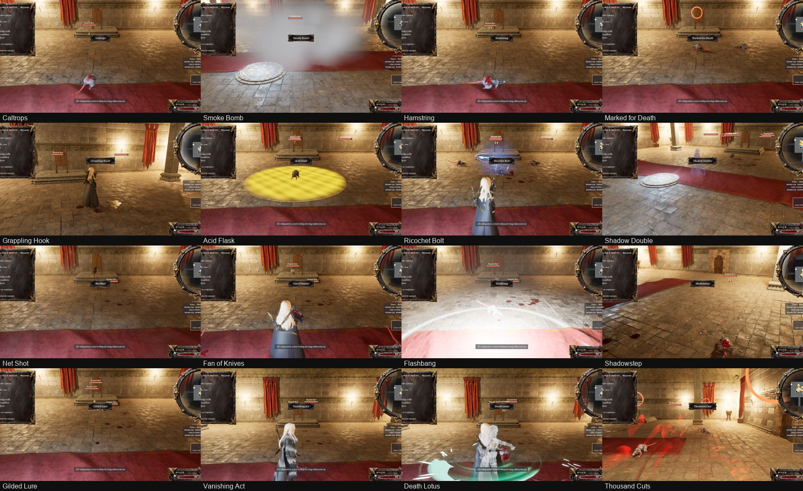

# The secondary abilities

[README](../README.md) · [The tiers](tiers.md) · [Mistward Castle](levels/mistward_castle.md) · [The wilderness](levels/wilderness.md) · [TODO](../TODO.md)

This is the sixth phase of the user's list of 2026-11-08b ([docs/improvements9.txt](improvements9.txt)): "earned in the wilderness by gathering materials and making Angel Tokens".
- **Who has them:** the Warrior and the Mage have six each, as do the Warlock; the Summoner and the Martial Artist have five each. The Rogue has none of these: the list names none for her. Her sixteen arts (the list of 2026-11-12) are learned from manuals, not tokens ([The Rogue's arts](#the-rogues-arts-the-list-of-2026-11-12)).
- **Ranks:** each ability has six ranks. An Angel Token raises one ability one rank, and the first rank learns it.
- **Data and code:** the data is `claude_ue5/SourceArt/balance/secondary.json`, which stage `911` writes onto every map of the game. The game's side is `RD/RDSecondary.cpp`.

## Angel Tokens

- **What a token is made of:** three Seraph Feathers and a Hallowed Stone, at an anvil, in the town or in a dungeon.
- **Seraph Feathers:** the wilderness's monsters drop them, at 45 % a kill, as a pile where the monster fell.
- **Hallowed Stones:** one lies at each ruin, ritual site and cave of the wilds, near where the place stands. Once taken it never comes back (the game's `WildKilled`, saved).
- **Using a token:** used from the inventory, it opens a list of her hero's abilities with each one's rank and what the next rank gives. A spell boost's first rank then asks for one of the spells she knows; the second boost cannot take the first's spell.
- **Learning an active ability:** it goes on the quick bar's first free slot.
- **What she keeps:** her ranks travel with her between the town, the wilds and the dungeons, are saved, and stay through a death. A new game starts without them.

## The abilities

Active abilities are made from the quick bar (`@<Name>`: a number key, or made ready on the D-pad and then the attack button). A cooldown darkens the slot, and a green frame shows while a shield or mode is on her. A toggle goes on and off there. Passive abilities always hold once learned.

The table's numbers run from rank 1 to rank 6, as the list gives them. Where the list gives none, the numbers are ours, marked in the data (`ours`):
- the Warrior's cooldowns and reaches;
- the cooldowns of the Summoner's healing and of the Martial Artist's movements and iron skin;
- all of the Warlock's mana blade's numbers;
- iron skin's 8 s;
- the soul harvest's 10 s and 25 m;
- the ablation's blow back (the blow's own);
- the parry's stagger (1.5 s).

### Warrior

| Ability | Kind | What it does (rank 1 to 6) | Cooldown (s) |
|---|---|---|---|
| Shield Bash | active | stuns every enemy within reach in front of her for 5 to 10 s | 14 |
| Grapple | active | holds the enemy before her where it stands for 5 to 10 s (it still strikes) | 12 |
| Trip | active | throws the enemy before her prone for 5 to 10 s: it neither moves nor strikes | 12 |
| Blinding Strike | active | a blow of her weapon that blinds the enemy before her for 5 to 10 s (its blows miss) | 12 |
| Sweeping Push | active | pushes every enemy within reach 20 to 25 m away from her | 16 |
| Pulling Attack | active | pulls an enemy up to 40 to 45 m away before her into her reach | 12 |

### Mage

| Ability | Kind | What it does (rank 1 to 6) | Cooldown (s) |
|---|---|---|---|
| Mana Swarm | active | seeking points of light at one enemy: one for every 20 to 10 mana she has left, each a third of a fire bolt | 15 to 6 |
| Mana Recharge Shield | active | for 5 to 30 s each blow that reaches her becomes mana instead of hurting her | 15 to 6 |
| Ablation Shield | active | for 5 to 30 s, 1 to 6 layers: each blow peels a layer away and strikes its maker back | 15 to 6 |
| Misty Step | active | steps up to 10 to 35 m away from her foes, to a safe place | 15 to 6 |
| Spell Boost | passive | one spell she chooses does 1.2 to 1.7 times its damage, for good | - |
| Second Spell Boost | passive | a second spell she chooses does 1.2 to 1.7 times its damage, for good | - |

### Warlock

| Ability | Kind | What it does (rank 1 to 6) | Cooldown (s) |
|---|---|---|---|
| Mana Shield | active | for 5 to 30 s her mana takes the blows instead of her, a point for a point | 15 to 6 |
| Curse Shield | active | for 5 to 30 s every enemy within 2 m of her is cursed (it takes 25% more and strikes for less) | 15 to 6 |
| Blinding Shield | active | for 5 to 30 s every enemy within 2 m of her is blinded (its blows miss) | 15 to 6 |
| Misty Transfer | active | sends the enemy before her 40 to 90 m away, elsewhere in the area | 15 to 6 |
| Bleeding Shield | active | for 5 to 30 s every enemy within 2 m of her bleeds 6 a second | 15 to 6 |
| Mana Blade | toggle | while on, each blow that lands takes 6 mana and does 2 to 4 times that more damage | - |

### Summoner

| Ability | Kind | What it does (rank 1 to 6) | Cooldown (s) |
|---|---|---|---|
| Minion Health | passive | her summons have 1.2 to 1.7 times their hit points | - |
| Minion Damage | passive | her summons strike 1.2 to 1.7 times as hard | - |
| Summon Healing | active | heals each of her summons by 10 to 60% of its hit points | 20 |
| Frenzy | passive | her summons strike 1.2 to 1.7 times as often | - |
| Soul Harvest | passive | each enemy dying near her heals her summons by 10 to 60% and makes their blows 1.2 to 1.7 times as hard for 10 s | - |

### Martial Artist

| Ability | Kind | What it does (rank 1 to 6) | Cooldown (s) |
|---|---|---|---|
| Wall Run | active | a leap of up to 10 to 60 m: up walls and across gaps without climbing gear | 8 |
| Flash Steps | active | a dash of up to 10 to 60 m that passes through enemies | 8 |
| Water Walk | active | runs across water for up to 10 to 60 m | 10 |
| Parry | active | for 5 to 30 s each blow from in front of her is turned aside and staggers its maker | 15 to 6 |
| Iron Skin | active | for 8 s every blow that reaches her is 10 to 60% weaker | 20 |

How each one works in the game:
- **Blocking a blow:** the shields and modes take a blow before her ward, armour and shield do. The order is parry, then ablation, then recharge, then mana shield, then iron skin. A blow taken whole brings no poison, weakness or slowness with it.
- **Through walls:** the abilities that reach all around her (the bash, the push, the Warlock's shields) take only monsters she can see.
- **Grapple:** it slows the monster to a stop, so it still turns and strikes. Trip stuns it: no move and no blow.
- **The push and the pull:** both move the monster tick by tick and are swept, so walls stop them.
- **The mana swarm:** its lights are Fire Bolt's bolts aimed at the target, one every 0.07 s. Each light does a third of her first spell's blow, so it grows with her.
- **Misty Step:** it picks, out of 16 ways and distances down to a fifth of its length, the floor farthest from her foes, in sight of where she stood. It never goes through a wall into a vault, a cell or past the arena's bars (PR #35's review).
- **Misty Transfer:** it picks the floor farthest from her, in sight of where the monster stood, so a hall gives less than its length.
- **The leap (Wall Run):** it lands on the farthest floor along her way within its length, up to half its length higher, with the arc clear. It is a launch, so she flies it.
- **Flash Steps:** it ignores pawns for its length, so only the walls stop it.
- **Water Walk:** only in the wilds. From the shore she runs onto the water within 8 m before her, and is held on its face for its length; off it, she falls in.
- **The parry:** it takes only blows from in front of her. The list's "perfectly timed" is the mode itself: no timing of a key is asked.
- **The Summoner's passives:**
  - Her summons' health and damage are part of their strength, and they grow with them.
  - Frenzy divides their wait between blows.
  - Soul harvest works for a death within 25 m of her.

## The Rogue's arts (the list of 2026-11-12)

The seventh phase of the user's list of 2026-11-12 ([docs/improvements12.txt](improvements12.txt)): sixteen abilities for the Rogue, each at a place the list sets among the dungeons' thirty tiers. The data is `claude_ue5/SourceArt/balance/rogue12.json`, which stage `925` writes onto every map she plays; the game's side is `RD/RDRogue12.cpp`.
- **What an art is:** a secondary ability of hers with a place (`FRDSecondaryDef::Slot`), at one rank. Tokens cannot raise one ("learned from its manual").
- **Earning:** its manual ("Manual of <art>", an item of kind Tome) is found in its place's containers as the Mage finds a tome: for her, a tome drawn at an art's place is that art's manual until she knows it, then the place's spell tome as before (the Warlock's curses share places the same way). Read from the inventory, the art is hers and goes on the quick bar's first free slot. The manuals are never drawn by themselves (`Weight` 0). What she has learned is carried and saved with her other abilities.
- **Use:** from the quick bar (`@<Name>`: a number key, or made ready on the D-pad and then the attack button), with a cooldown, paid in dexterity energy (her stealth's pool: 100, back 1.5 a second; the smoke bomb costs none, as the list says). Refused with the reason said: not ready, too little energy, no enemy, no room, in the middle of a move.
- **Growth:** the arts that do damage take it from her own weapons as her growth makes them (her blade's blow, her crossbow's), so they grow as her daggers and crossbow do; the control effects (slow, root, stun, blind, the mark, the exposure) keep their numbers, as her stealth does. Measured: the hamstring's cut was 13.0 at the game's tier 1 and 30.2 at tier 10 (x 2.323), her blade 13.0 and 30.2 (x 2.326); its slow 60 % at both.
- **From hiding:** an art that strikes out of stealth ends it as an attack does (and takes her ambush bonus), unless the Vanishing Act still spares blows. Shadowstep always strikes with the ambush bonus.
- **The monsters' side:** the smoke makes a monster lose her (it takes no foe of hers for its time); her double and the coin are decoys (a monster within one's round goes for it); the mark (30 % more from her) and the acid's exposure (25 % more from everyone) are on the monster.

| Place | Art | Dexterity | Cooldown (s) | Damage | What it does | How it looks |
|---|---|---|---|---|---|---|
| 1 (Mistward 1) | Caltrops | 15 | 14 | a bleed of 15 % of her blade's blow a second | Scatters spikes over 3 m: monsters crossing them are slowed 40% and bleed | iron spikes of our own (`blender_numpy/caltrop.py`) scattered on the floor, no glow |
| 3 (Mistward 3) | Smoke Bomb | 0 | 18 | none (a control) | A 4 m cloud: monsters inside lose her for 4 s, with no dexterity energy spent | a ring of grey smoke bursting out (ShockWaves' 03), then a cloud of our own: soft grey puffs over its round, rising |
| 5 (Mistward 5) | Hamstring | 10 | 10 | her blade's blow | A dagger cut that slows its target 60% for 5 s | a crimson slash on her cut (StylizedSlashes' blood) and blood at the monster |
| 7 (Vel Morrath 2) | Marked for Death | 15 | 20 | none (a control) | Her target takes +30% from her for 10 s | a red crosshair (Medieval Weapons' bow sight, tinted) over its head, facing her and turning |
| 9 (Vel Morrath 4) | Grappling Hook | 10 | 12 | none (a control) | Hooks a wall or monster up to 20 m away and pulls her to it | a hook (Gothic Props') on a rope from her hand while she is pulled |
| 11 (the War Engine 1) | Acid Flask | 20 | 16 | a burn of 20 % of her best blow a second | A thrown vial: a 3 m puddle that eats armour (+25% damage taken) and burns | a vial (Crownfall's) thrown in an arc, an icy shard burst as it breaks, then a bubbling amber pool of our own |
| 13 (the War Engine 3) | Ricochet Bolt | 20 | 12 | her crossbow's blow | A crossbow bolt that bounces between up to 4 monsters | her own bolt flying from monster to monster, a white-violet streak with it (Magic Projectiles' lightning), white sparks at each |
| 14 (the War Engine 4) | Shadow Double | 25 | 25 | its burst: her blade's blow x 1.5 within 3 m | Leaves a copy of herself that draws monsters within 12 m for 6 s, then bursts | a copy of her body in her pose, in a smoky see-through material of our own; a burst of smoke as it goes |
| 17 (the Sewers 2) | Net Shot | 15 | 14 | none (a control) | Roots one monster for 4 s | Harbour's fishing net flying to it and wrapped round it while it holds |
| 19 (the Sewers 4) | Fan of Knives | 25 | 12 | her blade's blow x 0.8 | 8 knives thrown in a ring, hitting everything within 6 m round her | eight knives (Medieval Weapons' dagger) spinning outward |
| 21 (Kethrys Spire 1) | Flashbang | 20 | 20 | none (a control) | Blinds and stuns monsters within 6 m for 3 s | a white flash of light and a white ring of our own spreading over the floor |
| 23 (Kethrys Spire 3) | Shadowstep | 25 | 14 | her blade's blow with her ambush bonus (x 1.75) | Teleports behind her target and backstabs it with her ambush bonus | a dark plume where she leaves and where she comes (Desert Outpost's smoke), a crimson slash on the backstab |
| 26 (Heaven 1) | Gilded Lure | 10 | 18 | none (a control) | A tossed coin: monsters within 15 m go after it for 5 s | a gold coin (Castle Collection's) tossed in an arc, spinning where it lands, a glint (the shooting star's sparkle) |
| 27 (Heaven 2) | Vanishing Act | 40 | 40 | none (a control) | 12 s stealth that survives her first 3 blows | a shimmer of light bands drifting up through her body (an overlay of our own) |
| 28 (Heaven 3) | Death Lotus | 30 | 16 | her blade's blow x 0.8 each strike | Spins, hitting everything within 3 m 3 times | her spin, a pale crescent at each strike (StylizedSlashes' wind) and silver afterimages of her |
| 29 (Heaven 4) | Thousand Cuts | 50 | 60 | her blade's blow x 2 on each | Her last: marks every monster she can see within 20 m, then blinks between them, slashing each | time slowed a moment, a red crosshair on each, then a red slash on each as she reaches it |

Numbers that are ours (the list gives none): the costs, the cooldowns, the damage shares, the hook's pull (24 m a second), the ricochet's hop (8 m), the double's draw (12 m) and burst, the coin's toss (8 m), the knives' round (6 m).

## The tests

`868 secondary` runs on Mistward Castle (`test_sc4.json` after PR #35's review):
- **The token:** 3 feathers and a stone made a token at the anvil. Used, its list showed the Warrior's six, and Shield Bash became rank 1 and went on the quick bar; the token was used up.
- **Warrior:**
  - Shield Bash stunned two monsters in front of her, still at 4.7 s and over at 5.7 s, and a second use was refused.
  - Grapple held a monster (it was not stunned and did not move as she walked 6 m off).
  - Trip stunned it.
  - Blinding Strike hurt it and blinded it.
  - Sweeping Push pushed two monsters away as far as the room let them.
  - Pulling Attack pulled one from 15 m to under 3 m.
- **Mage:**
  - Mana Swarm sent five lights for her 100 mana, all of it spent; the monster lost 51, the five lights' worth.
  - Spell Boost made Fire Bolt 30 against 25.
  - The ablation's two layers took two blows and struck their maker for 40; the third blow hurt her.
  - The recharge turned a blow of 30 into 30 mana.
  - Misty Step took her 10 m from two monsters at 2 m to 11.6 m from the nearest.
- **Warlock:**
  - The mana shield took a blow of 20 from her mana.
  - The curse (25 %), blinding (100 %) and bleeding (11 in 2 s) shields worked on a monster within 2 m.
  - Misty Transfer sent a monster 16 m, as far as the great hall's sight lines let it.
  - The mana blade added 12 to a blow (22 to 34) for its 6 mana. The 3.5 mana read was less: her mana came back over the 2 s.
- **Summoner:** a Soldier called before the passives grew to 1.2 times its hit points and blow and 1.2 times its pace. Summon Healing healed 10 % of its hit points, and a kill near her healed it and boosted its blows 1.2 times for 10 s.
- **Martial Artist:**
  - The leap and Flash Steps moved her their planned lengths, the flash past a monster in her way.
  - Water Walk was refused in the castle (no water).
  - The parry took a blow from in front, staggered its maker and refused a second use.
  - Iron Skin made a blow 10 % weaker.

`888 secondary9` runs on Brokenspire (`-Light`, `test_sw3.json`):
- **The stone:** a Hallowed Stone at the Old Watchtower; F took it, and it was not laid again when its chunk was made again. The captain's patrol quest there still counted no kill (the stone's key is out of the places' kill range: PR #35's review). `quests` passes on its own (`test_sq1.json`); in one session after `secondary9` it fails, because that step killed the den's pack.
- **The feathers:** the Mill Road Den's four monsters dropped two Seraph Feathers.
- **Water Walk:** from a lake's shore the Martial Artist ran 10 m over the water, her feet 1 to 2 cm over its face the whole way.

The castle's steps the abilities touch still pass (`test_r26a.json`: `inventory`, `tabs`, `slots`, `death`, `martial`, `summoner`, `growth`, `shields`, `scrolls`, `recipes`), and so does `quickbar` on `martial_arts` (`test_r26b.json`).

`868 rogue12` runs on Mistward Castle (`test_r12f.json`), as the Rogue in the start room on harmless monsters:
- **The manuals:** over 40 seeds her tome draws in the start set (tier 1, place 1) gave the Manual of Caltrops (228 times) and no other manual; read, Caltrops was hers at rank 1 on the quick bar and the manual was used up; then the place gave Frost Shard's tome again; the Warrior's draws gave no manual; an Angel Token offered her nothing to raise.
- **Each art** took its cost in dexterity energy (the smoke none) and was refused a second time on its cooldown, and:
  - Caltrops: the monster on them slowed 40 % and bleeding. Smoke Bomb: the monster in it had lost her (not her foe with the monsters let loose).
  - Hamstring: its cut, slowed 60 %, still at 4.6 s, gone at 5.6 s. Marked for Death: a blow of 100 from her did 130 on it and 100 on another; its crosshair over it.
  - Grappling Hook: pulled 14.4 m to 0.8 m from a wall 15.2 m off, its rope there. Acid Flask: the pool, the monster in it exposed 25 % and burning.
  - Ricochet Bolt: three monsters struck, 33.8 each. Shadow Double: a monster set free went for the double (its foe), the double gone after its time.
  - Net Shot: rooted at once and at 3.4 s, free at 5.0 s. Fan of Knives: the four round her struck, one 9 m off not.
  - Flashbang: the two within 6 m blinded and stunned, the one 10 m off not; none stunned at 3.5 s.
  - Shadowstep: behind its monster 8 m off (1.2 m from it), its backstab 22.8. Gilded Lure: a monster 9 m off went for the coin (its foe) and moved toward it.
  - Vanishing Act: in stealth with its shimmer, three blows spared, the fourth ended it (the shimmer gone with it).
  - Death Lotus: three monsters within 3 m struck three times each (9 strikes). Thousand Cuts: three monsters in sight cut, time at 0.3 while they were marked and back at 1 after.
- **Growth:** the hamstring's cut at the game's tier 1 and 10 (`rd.Tier`) as her blade's, its slow the same.
- `868 rogue12fx` pictures candidate effects on the castle's floor to choose the looks from (`rogue12.json`'s `screen`; what was chosen and why in its `screened`).

## Rebuild

1. Build the C++ (`pipeline\build_cpp.ps1`).
2. Run `911_secondary.py` (all seven maps). Then `925_rogue12.py` (its `caltrop` step needs `blender -b -P pipeline/blender_numpy/caltrop.py -- claude_ue5/SourceArt/rogue12` first): `911` writes the whole list of abilities anew, the Rogue's arts with it. Run it again after anything that writes the levels' items or recipes anew (`857`, `875`, `910`).