# Vehicles, mounts and beast-drawn carts of the Fab library

Every vehicle in the local Fab library cache (`I:\game assets\3d epicgames media packs\VaultCache\FabLibrary` and the environment packs downloaded through it): animals built to be ridden, carts and wagons for a draught animal or a pair of hands, siege engines, boats and ships, cars, buses and mine carts, military vehicles and drones, and sci-fi craft. All 69 are in this project. Each is shown three times, rendered in Unreal Engine:

- **three-quarter view;**
- **side view;**
- **in motion** (the 13 that come with clips: a frame of one of them) or **from above** (the others, from the opposite corner).

## About the pictures

- **Sizes:** each entry gives the model's length, width and height in metres, from its bounds (a skeletal mesh in its reference pose: the dragon with its wings spread).
- **Scale:** every model is framed to fill its pictures, so a 60 cm drone and a 115 m cargo ship look the same size: read the sizes.
- **Several meshes:** the armoured car (body, wheels, hubs, gun) and the ballista (frame and wheels) are made of separate meshes, shown together.
- **No draught animals:** the carts and wagons come without a horse or an ox, and there is no horse in the library (only a horse statue, saddles and horseshoes); the beasts of burden are the pack bull, the camel and the elephants.
- **Uses:** a use is a suggestion from the model's looks.

The list is `claude_ue5/SourceArt/vehicle_gallery/vehicles.json`; the pictures come from `pipeline/unreal/903_vehicle_gallery.py` and `pipeline/blender_numpy/vehicle_doc.py`, the sizes and the animation notes from `pipeline/unreal/902_character_animations.py`. The sellers and listings of the packs are in [assets.md](assets.md); the riders' clips and the other animation libraries are on [heroes.md](heroes.md#animations).

## Categories

- [Mounts and riding beasts](#mounts-and-riding-beasts) (5): Animals with saddles or packs, to ride or to load: the raptor, the camel, the bull, the war elephant and the dragon.
- [Beast-drawn and hand-drawn carts](#beast-drawn-and-hand-drawn-carts) (15): Carts and wagons with shafts for a horse or handles for a pair of hands, and the elephant with its war tower.
- [Siege engines](#siege-engines) (3): Wheeled war machines of a medieval camp.
- [Boats and ships](#boats-and-ships) (18): From rowing boats and wrecks to a cargo steamer and a submersible.
- [Cars, buses, bicycles and mine carts](#cars-buses-bicycles-and-mine-carts) (11): Road vehicles, most of them wrecks, and rail carts from an old mine.
- [Military vehicles, walkers and drones](#military-vehicles-walkers-and-drones) (9): Tanks, armoured cars, a walker, an airship and drones.
- [Sci-fi craft](#sci-fi-craft) (8): Flying cars, shuttles, a starship and a flying freighter.
- [Not included](#not-included)

## Mounts and riding beasts

Animals with saddles or packs, to ride or to load: the raptor, the camel, the bull, the war elephant and the dragon.

### Raptor Mount

[Fantasy Animal (Pack)](https://www.fab.com/listings/4878a5f0-f82b-4530-b50d-a3f880ef4665) · **Use:** riding mount · model `SK_Fantasy_Animal_Full` · 3.8 × 1.0 × 2.0 m

A long-tailed, beaked raptor with a saddle, saddlebags and a wineskin.

**Animations:** a skeletal mesh (34 bones) with 23 clips of its own: 2 rider clips, 3 attacks and shots, 2 deaths, 2 hit reactions, 2 idles, 12 moves and turns. The pack's rider clips for a UE4-mannequin character (climb on and off, riding idles, hits, death; `Anim_Rider_*`, `Anim_Character_*`) go with it.

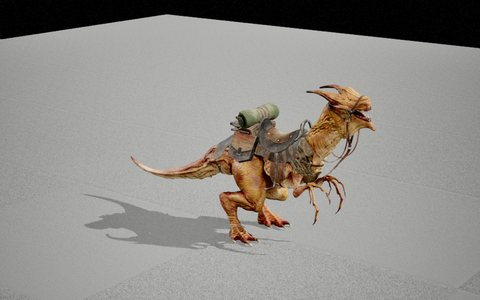 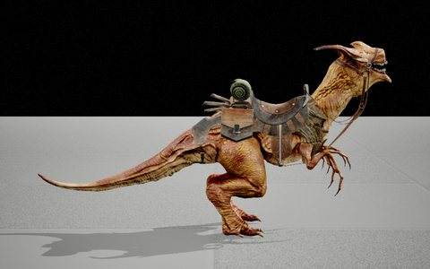 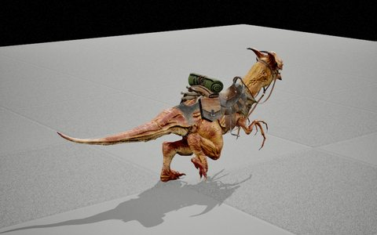

### Camel

[Fantasy Animal (Pack)](https://www.fab.com/listings/4878a5f0-f82b-4530-b50d-a3f880ef4665) · **Use:** pack animal / riding mount · model `SK_Camel_Full` · 2.9 × 1.6 × 2.5 m

A camel loaded with saddlebags, bundles and a sword, under a striped saddle cloth.

**Animations:** a skeletal mesh (35 bones) with 13 clips of its own: 1 death, 2 hit reactions, 2 idles, 8 moves and turns. The pack's rider clips for a UE4-mannequin character (climb on and off, riding idles, hits, death; `Anim_Rider_*`, `Anim_Character_*`) go with it. The camel has an animation Blueprint for a rider (`AB_Camel_Rider`).

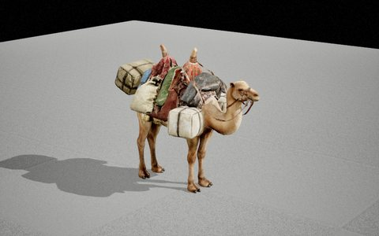 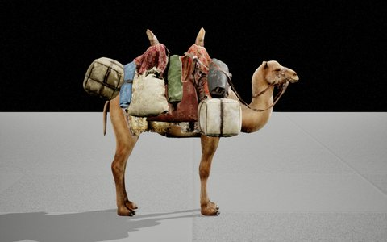 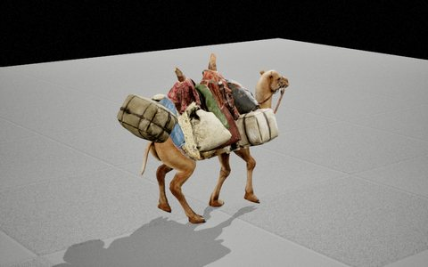

### Pack Bull

[Fantasy Animal (Pack)](https://www.fab.com/listings/4878a5f0-f82b-4530-b50d-a3f880ef4665) · **Use:** pack animal · model `SK_Bull_Fantasy_Full` · 2.7 × 1.8 × 2.2 m

A humped bull carrying baskets and bags under a canvas cover.

**Animations:** a skeletal mesh (38 bones) with 9 clips of its own: 1 attack or shot, 1 death, 1 hit reaction, 2 idles, 4 moves and turns.

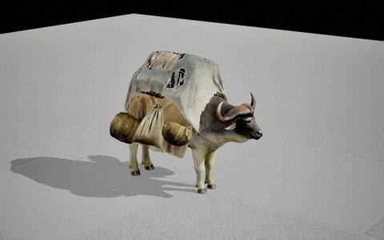 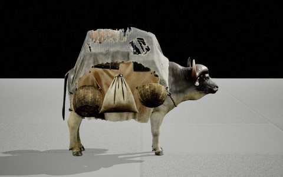 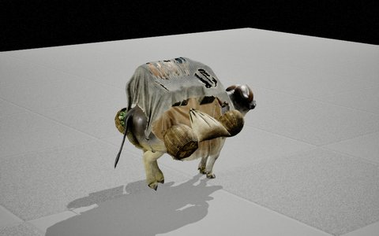

### War Elephant

[Fantasy Animal (Pack)](https://www.fab.com/listings/4878a5f0-f82b-4530-b50d-a3f880ef4665) · **Use:** war mount / boss · model `SK_Fantasy_Elephant_Full` · 11.4 × 4.5 × 7.0 m

A giant elephant in riveted plate, its tusks capped with spiked steel.

**Animations:** a skeletal mesh (35 bones) with 19 clips of its own: 2 attacks and shots, 2 deaths, 3 hit reactions, 4 idles, 8 moves and turns. The pack's rider clips for a UE4-mannequin character (climb on and off, riding idles, hits, death; `Anim_Rider_*`, `Anim_Character_*`) go with it.

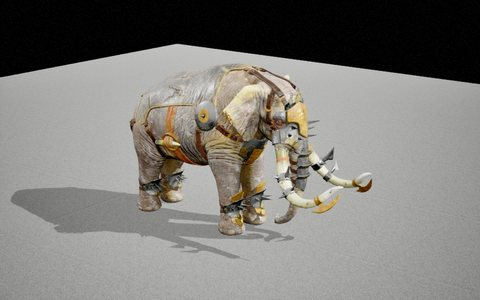 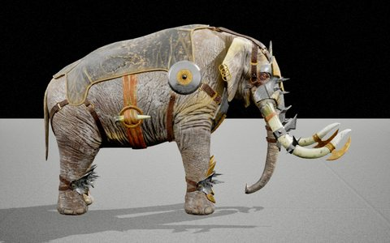 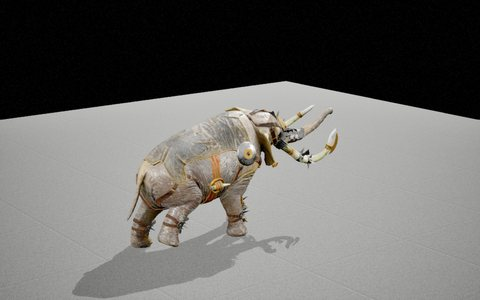

### Armoured Dragon

[Fantasy Animal (Pack)](https://www.fab.com/listings/4878a5f0-f82b-4530-b50d-a3f880ef4665) · **Use:** flying mount / boss · model `SK_Fantasy_Dragon_Full` · 12.2 × 10.0 × 3.1 m

A red dragon with an armoured head and back, 12 m from wingtip to wingtip.

**Animations:** a skeletal mesh (39 bones) with 38 clips of its own: 2 take-off and landing, 5 attacks and shots, 2 deaths, 3 hit reactions, 3 idles, 23 moves and turns. Two sets: on the ground (`Set_01`: walk, run, take-off, landing, attacks) and in the air (`Set_02`: flight, soaring, turns, fire breath).

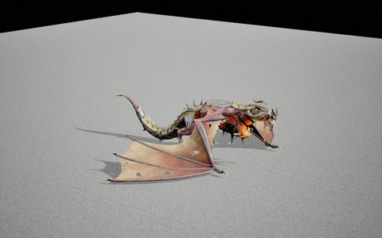 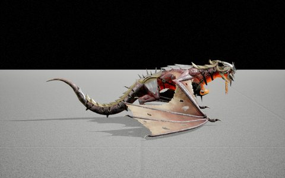 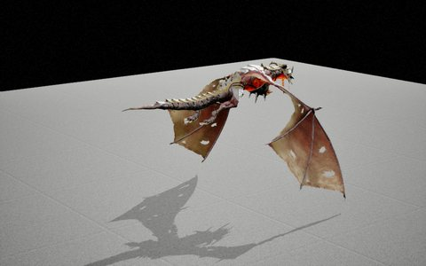

## Beast-drawn and hand-drawn carts

Carts and wagons with shafts for a horse or handles for a pair of hands, and the elephant with its war tower.

### Elephant with a War Tower

[Fantasy Animal (Pack)](https://www.fab.com/listings/4878a5f0-f82b-4530-b50d-a3f880ef4665) · **Use:** siege beast / moving fort · model `SK_Fantasy_Elephant_Build_Full` and 1 more meshes · 12.2 × 7.4 × 11.6 m

The armoured elephant carrying a wooden war tower with ladders, banners, a canopy and spears.

**Animations:** a skeletal mesh (35 bones) with 19 clips of its own: 2 attacks and shots, 2 deaths, 3 hit reactions, 4 idles, 8 moves and turns. The clips are the elephant's; the tower is a skeletal mesh of its own without clips, so it only follows the elephant attached to a socket on its back.

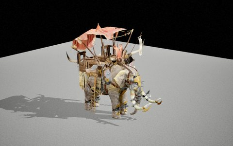 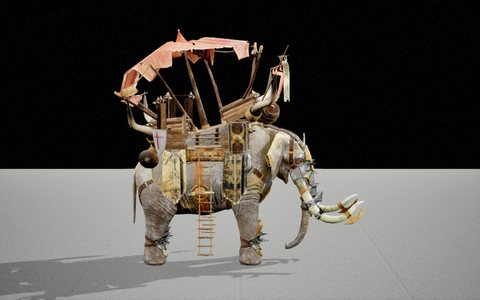 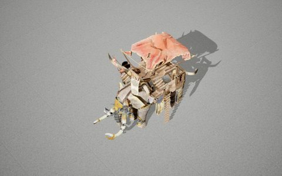

### Ale Cart

[(Nanite) Medieval Village Kit - Village Props](https://www.fab.com/listings/f9df4890-75d6-4f7e-a0b2-6774ba87c641) · **Use:** horse-drawn delivery cart · model `SM_AleCart` · 3.0 × 1.8 × 2.1 m

A two-wheeled cart carrying a big ale barrel on a cradle, with shafts for a horse.

**Animations:** none: a static mesh, which moves only as a whole (by code, physics or a sequence); wheels, sails and oars are part of the one mesh.

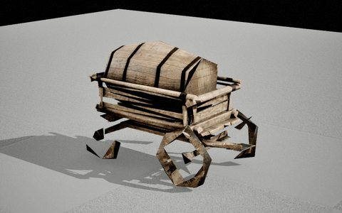 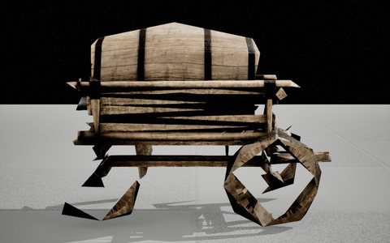 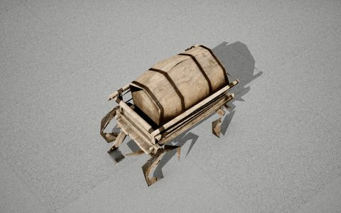

### Wooden Cart

[(Nanite) Medieval Village Kit - Village Props](https://www.fab.com/listings/f9df4890-75d6-4f7e-a0b2-6774ba87c641) · **Use:** handcart · model `SM_WoodenCart` · 2.8 × 1.7 × 1.2 m

A plank-sided cart on two solid wheels, with long handles.

**Animations:** none: a static mesh, which moves only as a whole (by code, physics or a sequence); wheels, sails and oars are part of the one mesh.

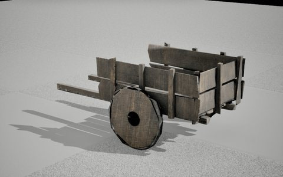 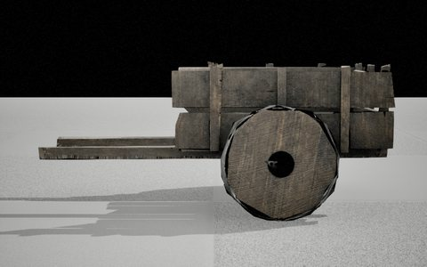 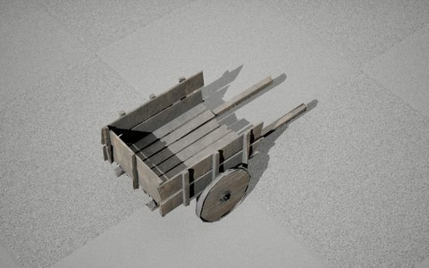

### Farm Wagon

[(Nanite) Medieval Village Kit - Village Props](https://www.fab.com/listings/f9df4890-75d6-4f7e-a0b2-6774ba87c641) · **Use:** handcart · model `SM_WoodWagons_Var1` · 3.4 × 1.5 × 1.1 m

A light two-wheeled cart with spoked wheels and long shafts.

**Animations:** none: a static mesh, which moves only as a whole (by code, physics or a sequence); wheels, sails and oars are part of the one mesh.

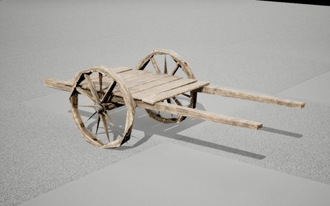 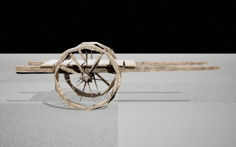 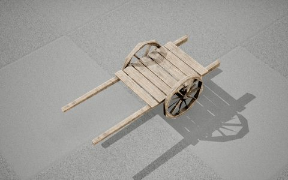

### Small Farm Wagon

[(Nanite) Medieval Village Kit - Village Props](https://www.fab.com/listings/f9df4890-75d6-4f7e-a0b2-6774ba87c641) · **Use:** handcart / market stall · model `SM_WoodWagons_Var2` · 2.5 × 1.2 × 0.9 m

A flat plank bed on two octagonal wheels and two legs, with handles.

**Animations:** none: a static mesh, which moves only as a whole (by code, physics or a sequence); wheels, sails and oars are part of the one mesh.

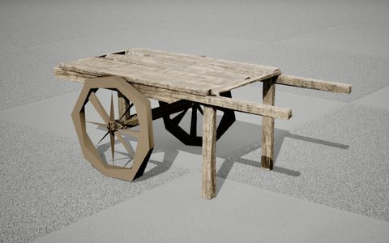 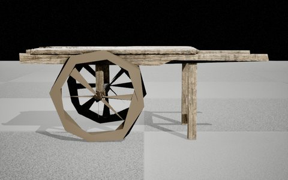 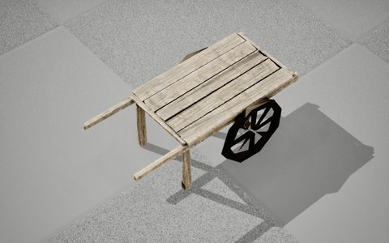

### Lake Village Wagon

[Medieval Lake Village Environment](https://www.fab.com/listings/7d67384d-acb8-4ff8-9e71-c5036b5ea34a) · **Use:** handcart · model `SM_WoodenWagon01` · 3.5 × 2.2 × 1.3 m

A deep plank box on two wheels, tipped forward onto its handles.

**Animations:** none: a static mesh, which moves only as a whole (by code, physics or a sequence); wheels, sails and oars are part of the one mesh.

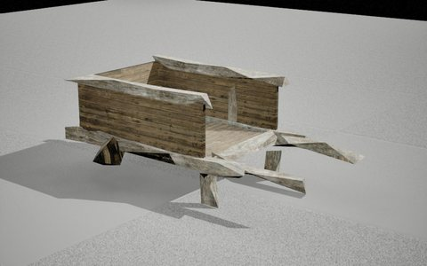 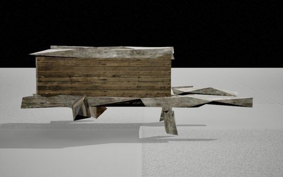 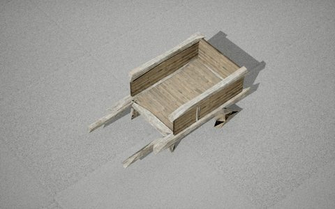

### Lake Village Handcart

[Medieval Lake Village Environment](https://www.fab.com/listings/7d67384d-acb8-4ff8-9e71-c5036b5ea34a) · **Use:** handcart · model `SM_WoodenWagon02` · 2.4 × 1.6 × 1.0 m

A smaller plank box cart resting on its handles.

**Animations:** none: a static mesh, which moves only as a whole (by code, physics or a sequence); wheels, sails and oars are part of the one mesh.

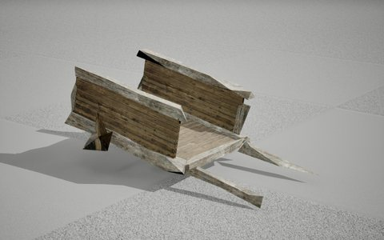 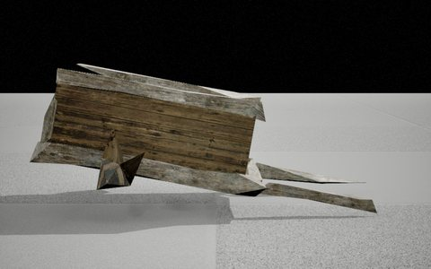 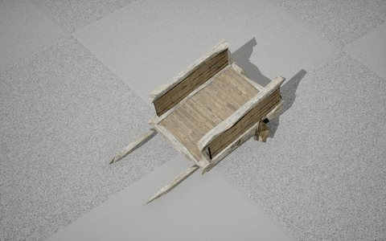

### Dock Cart

[Modular Medieval Town, Docks](https://www.fab.com/listings/9bec871e-2d9b-4261-aa26-868d4300f81a) · **Use:** horse-drawn cart · model `SM_Cart` · 4.8 × 2.2 × 2.5 m

A long cart under a canvas hood, with shafts for a horse.

**Animations:** none: a static mesh, which moves only as a whole (by code, physics or a sequence); wheels, sails and oars are part of the one mesh.

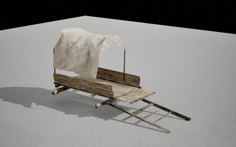 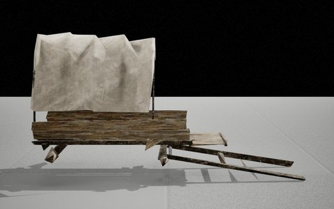 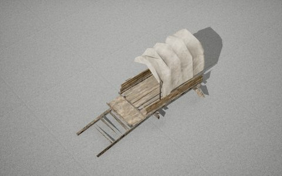

### Covered Dock Cart

[Modular Medieval Town, Docks](https://www.fab.com/listings/9bec871e-2d9b-4261-aa26-868d4300f81a) · **Use:** horse-drawn wagon · model `SM_Cart_01` · 3.7 × 2.0 × 2.6 m

A boxed wagon with slatted sides and a canvas roof.

**Animations:** none: a static mesh, which moves only as a whole (by code, physics or a sequence); wheels, sails and oars are part of the one mesh.

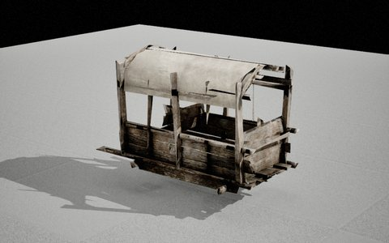 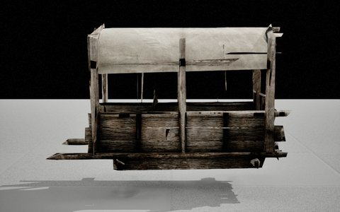 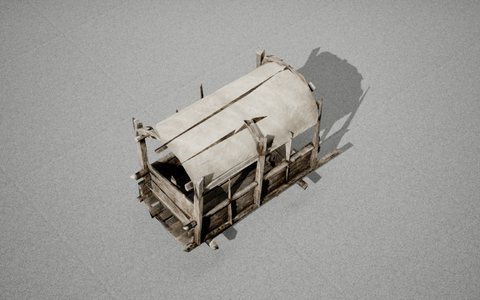

### Dock Handcart

[Modular Medieval Town, Docks](https://www.fab.com/listings/9bec871e-2d9b-4261-aa26-868d4300f81a) · **Use:** handcart · model `SM_Cart_02` · 3.1 × 1.4 × 1.4 m

A rough plank box cart with long handles.

**Animations:** none: a static mesh, which moves only as a whole (by code, physics or a sequence); wheels, sails and oars are part of the one mesh.

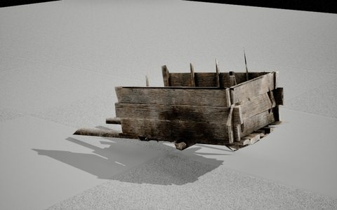 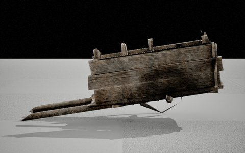 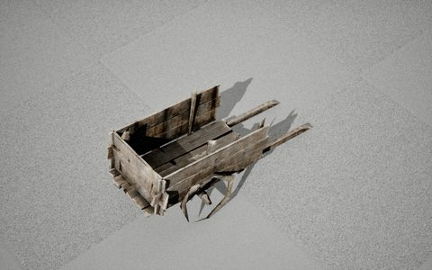

### Low Dock Cart

[Modular Medieval Town, Docks](https://www.fab.com/listings/9bec871e-2d9b-4261-aa26-868d4300f81a) · **Use:** horse-drawn cart · model `SM_Cart_Small` · 3.3 × 1.5 × 1.0 m

An open, slatted cart on two spoked wheels with long shafts.

**Animations:** none: a static mesh, which moves only as a whole (by code, physics or a sequence); wheels, sails and oars are part of the one mesh.

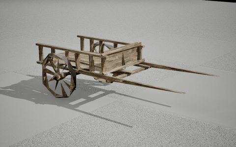 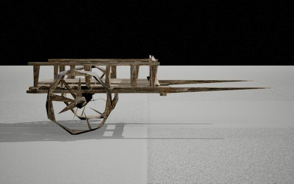 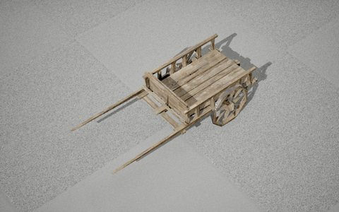

### Market Cart

[Modular Medieval Town, Docks](https://www.fab.com/listings/9bec871e-2d9b-4261-aa26-868d4300f81a) · **Use:** market cart · model `SM_Market_Cart_01` · 2.5 × 1.4 × 2.0 m

A boxy plank cart with a little shingled roof: a stall on wheels.

**Animations:** none: a static mesh, which moves only as a whole (by code, physics or a sequence); wheels, sails and oars are part of the one mesh.

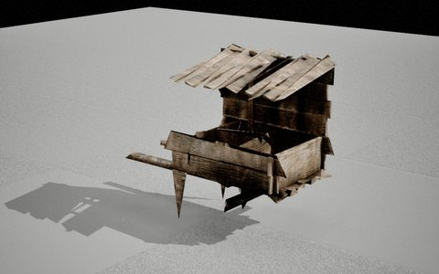 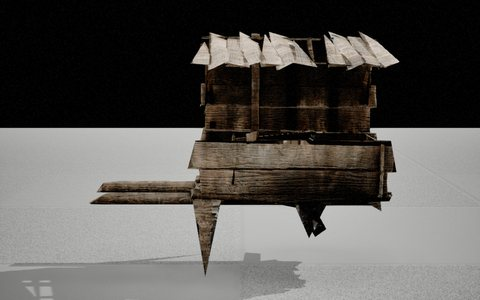 

### Viking Cart

[House Forge: Modular House Building Kit](https://www.fab.com/listings/277b975e-2158-41ef-908a-ef08bc26a409) · **Use:** handcart / horse cart · model `SM_WoodCart_01b` · 2.6 × 1.6 × 1.2 m

A Norse cart with slatted sides on two solid wheels and long shafts.

**Animations:** none: a static mesh, which moves only as a whole (by code, physics or a sequence); wheels, sails and oars are part of the one mesh.

  

### Loaded Viking Cart

[House Forge: Modular House Building Kit](https://www.fab.com/listings/277b975e-2158-41ef-908a-ef08bc26a409) · **Use:** handcart / horse cart · model `SM_WoodCart_01c` · 2.6 × 1.6 × 1.2 m

The Norse cart piled with loose planks.

**Animations:** none: a static mesh, which moves only as a whole (by code, physics or a sequence); wheels, sails and oars are part of the one mesh.

  

### Wheelbarrow

[Roadside Construction](https://www.fab.com/listings/6426cc8a-2410-45be-b3ce-edfea87d09cc) · **Use:** wheelbarrow · model `SM_Ind_Con_Wheelbarrow_Worn_01` · 1.5 × 0.5 × 0.6 m

A rusty, dented builder's wheelbarrow (a Megascans scan).

**Animations:** none: a static mesh, which moves only as a whole (by code, physics or a sequence); wheels, sails and oars are part of the one mesh.

  

## Siege engines

Wheeled war machines of a medieval camp.

### Ballista

[[Nanite] Medieval War Camp Kit](https://www.fab.com/listings/3cc08b13-9cb1-46a5-9bd2-47d743ee82b9) · **Use:** siege engine · model `SM_War_Ballista_SM_War_Ballista_Base` and 1 more meshes · 3.1 × 3.0 × 1.9 m

A giant crossbow on a wheeled timber frame.

**Animations:** none of its own: 2 static meshes (body, wheels and the rest) that code or a sequence can move separately.

  

### Field Cannon

[[Nanite] Medieval War Camp Kit](https://www.fab.com/listings/3cc08b13-9cb1-46a5-9bd2-47d743ee82b9) · **Use:** artillery · model `SM_War_Cannon_SM_War_Cannon` · 2.6 × 1.0 × 1.4 m

An iron cannon barrel on a wooden carriage with four small wheels.

**Animations:** none: a static mesh, which moves only as a whole (by code, physics or a sequence); wheels, sails and oars are part of the one mesh.

  

### Catapult

[[Nanite] Medieval War Camp Kit](https://www.fab.com/listings/3cc08b13-9cb1-46a5-9bd2-47d743ee82b9) · **Use:** siege engine · model `SM_War_Catapult` · 5.9 × 3.0 × 2.8 m

A wheeled timber catapult with its throwing arm and sling.

**Animations:** none: a static mesh, which moves only as a whole (by code, physics or a sequence); wheels, sails and oars are part of the one mesh.

  

## Boats and ships

From rowing boats and wrecks to a cargo steamer and a submersible.

### Ruins Rowboat

[Ancient Ruins - VOL.1 (Nanite)](https://www.fab.com/listings/7c4188c2-374f-4bb5-afc5-1aebe1b15e23) · **Use:** rowing boat · model `SM_Boat_NN_01a` · 4.1 × 2.0 × 1.6 m

A weathered, worn wooden boat with outrigger poles.

**Animations:** none: a static mesh, which moves only as a whole (by code, physics or a sequence); wheels, sails and oars are part of the one mesh.

  

### Lake Rowboat

[Medieval Lake Village Environment](https://www.fab.com/listings/7d67384d-acb8-4ff8-9e71-c5036b5ea34a) · **Use:** rowing boat · model `SM_Boat` · 4.3 × 1.2 × 0.9 m

A simple clinker-built wooden rowing boat.

**Animations:** none: a static mesh, which moves only as a whole (by code, physics or a sequence); wheels, sails and oars are part of the one mesh.

  

### Meadow Boat

[Flower Meadows](https://www.fab.com/listings/f6b28dc0-4a82-4d10-a54e-b960eac8f324) · **Use:** moored boat · model `SM_boat_01` · 8.6 × 1.8 × 2.0 m

A small wooden boat on a long mooring rope.

**Animations:** none: a static mesh, which moves only as a whole (by code, physics or a sequence); wheels, sails and oars are part of the one mesh.

  

### Meadow Punt

[Flower Meadows](https://www.fab.com/listings/f6b28dc0-4a82-4d10-a54e-b960eac8f324) · **Use:** rowing boat · model `SM_boat_02` · 5.2 × 1.8 × 1.0 m

A brown wooden rowing boat with three thwarts.

**Animations:** none: a static mesh, which moves only as a whole (by code, physics or a sequence); wheels, sails and oars are part of the one mesh.

  

### Harbour Skiff

[[Nanite] Medieval Harbor Kit - Harbor Props](https://www.fab.com/listings/eac56686-c7c5-47a6-8a98-9bc8ad321643) · **Use:** rowing boat · model `SM_SmallBoat` · 6.3 × 1.0 × 1.3 m

A long, narrow dark wooden skiff with upswept ends.

**Animations:** none: a static mesh, which moves only as a whole (by code, physics or a sequence); wheels, sails and oars are part of the one mesh.

  

### Wrecked Ship

[[Nanite] Medieval Harbor Kit - Harbor Props](https://www.fab.com/listings/eac56686-c7c5-47a6-8a98-9bc8ad321643) · **Use:** wreck (scenery) · model `SM_BrokenShip` · 31.3 × 7.7 × 5.7 m

The broken ribs and planks of a large wooden ship.

**Animations:** none: a static mesh, which moves only as a whole (by code, physics or a sequence); wheels, sails and oars are part of the one mesh.

  

### Sailing Boat

[Water Front Baywalk Modular Kit](https://www.fab.com/listings/78e82fca-e9ef-42c5-b3e5-44cfec33810d) · **Use:** sailing yacht · model `SM_boat` · 17.9 × 5.1 × 19.2 m

A small blue and white motor-sailer with a tall mast and rigging, no sails.

**Animations:** none: a static mesh, which moves only as a whole (by code, physics or a sequence); wheels, sails and oars are part of the one mesh.

  

### Dockhouse Boat

[Meridian 1988: Moose's Dock House - Modular Environment (VOL 1)](https://www.fab.com/listings/de4b18d1-5bad-4b4c-bf70-adfb49d0dd57) · **Use:** rowing boat · model `SM_Warehouse_Boat_NN_01a` · 3.9 × 1.7 × 1.0 m

A battered wooden boat, its red paint peeling.

**Animations:** none: a static mesh, which moves only as a whole (by code, physics or a sequence); wheels, sails and oars are part of the one mesh.

  

### Rowing Boat

[DOCKS VOL.2 - Powell Dock (Modular / Low Poly)](https://www.fab.com/listings/c1d714a2-288f-4bfa-a820-ec0406d51c8a) · **Use:** rowing boat · model `SM_Boat_17a` · 4.6 × 1.6 × 1.0 m

A white-and-brown wooden rowing boat.

**Animations:** none: a static mesh, which moves only as a whole (by code, physics or a sequence); wheels, sails and oars are part of the one mesh.

  

### Motor Launch

[DOCKS VOL.2 - Powell Dock (Modular / Low Poly)](https://www.fab.com/listings/c1d714a2-288f-4bfa-a820-ec0406d51c8a) · **Use:** motor boat · model `SM_Boat_NN_18a` · 4.9 × 2.3 × 1.8 m

A small fishing launch with a cabin and fenders.

**Animations:** none: a static mesh, which moves only as a whole (by code, physics or a sequence); wheels, sails and oars are part of the one mesh.

  

### Fishing Boat

[DOCKS VOL.2 - Powell Dock (Modular / Low Poly)](https://www.fab.com/listings/c1d714a2-288f-4bfa-a820-ec0406d51c8a) · **Use:** motor boat · model `SM_Boat_NN_25a` · 7.7 × 2.9 × 2.5 m

A worn open fishing boat with an outboard motor and a seat console.

**Animations:** none: a static mesh, which moves only as a whole (by code, physics or a sequence); wheels, sails and oars are part of the one mesh.

  

### Harbour Boat

[DOCKS VOL.2 - Powell Dock (Modular / Low Poly)](https://www.fab.com/listings/c1d714a2-288f-4bfa-a820-ec0406d51c8a) · **Use:** rowing boat / tender · model `SM_Boat_54a` · 7.4 × 2.7 × 2.0 m

A teal wooden boat with fenders along its side.

**Animations:** none: a static mesh, which moves only as a whole (by code, physics or a sequence); wheels, sails and oars are part of the one mesh.

  

### Upturned Boat

[DOCKS VOL.2 - Powell Dock (Modular / Low Poly)](https://www.fab.com/listings/c1d714a2-288f-4bfa-a820-ec0406d51c8a) · **Use:** motor boat · model `SM_Boat_NN_14a` · 6.4 × 2.4 × 2.3 m

A flat aluminium jon boat with an outboard motor.

**Animations:** none: a static mesh, which moves only as a whole (by code, physics or a sequence); wheels, sails and oars are part of the one mesh.

  

### Pontoon Boat

[DOCKS VOL.2 - Powell Dock (Modular / Low Poly)](https://www.fab.com/listings/c1d714a2-288f-4bfa-a820-ec0406d51c8a) · **Use:** raft · model `SM_Pontoon_Boat_NN_01a` · 4.0 × 2.9 × 0.9 m

A plank deck on rusty pontoon floats.

**Animations:** none: a static mesh, which moves only as a whole (by code, physics or a sequence); wheels, sails and oars are part of the one mesh.

  

### Lifeboat

[DOCKS VOL.2 - Powell Dock (Modular / Low Poly)](https://www.fab.com/listings/c1d714a2-288f-4bfa-a820-ec0406d51c8a) · **Use:** lifeboat · model `SM_Lifeboat_01a` · 5.1 × 1.8 × 1.2 m

A white ship's lifeboat with grab lines on its sides.

**Animations:** none: a static mesh, which moves only as a whole (by code, physics or a sequence); wheels, sails and oars are part of the one mesh.

  

### Boat Wreck

[DOCKS VOL.2 - Powell Dock (Modular / Low Poly)](https://www.fab.com/listings/c1d714a2-288f-4bfa-a820-ec0406d51c8a) · **Use:** wreck (scenery) · model `SM_Boat_Wreck_01a` · 3.7 × 1.8 × 1.2 m

A white boat broken in half, its planks sprung.

**Animations:** none: a static mesh, which moves only as a whole (by code, physics or a sequence); wheels, sails and oars are part of the one mesh.

  

### Bathyscaphe

[Underwater odyssey](https://www.fab.com/listings/0ed3a669-a335-46d4-b8c4-16b48278e2b4) · **Use:** submersible · model `SK_Bathyscaphe` · 10.0 × 3.5 × 3.6 m

A rusty, riveted brass-and-iron submarine with round lit portholes and a hatch tower.

**Animations:** a skeletal mesh (16 bones) without clips: its bones can be posed by code, a control rig or a sequence.

  

### Cargo Ship

[Underwater odyssey](https://www.fab.com/listings/0ed3a669-a335-46d4-b8c4-16b48278e2b4) · **Use:** ship · model `SK_Cargo_Ship` · 44.6 × 7.7 × 24.5 m

A rust-streaked steam cargo ship with masts, cranes and a funnel, 45 m long.

**Animations:** a skeletal mesh (18 bones) with 1 clip of its own: 1 take-off or landing. Its one clip launches it.

  

## Cars, buses, bicycles and mine carts

Road vehicles, most of them wrecks, and rail carts from an old mine.

### Family Car

[Meridian 1988: 14 Widow Street - Modular Environment (VOL 31)](https://www.fab.com/listings/25f80505-7c6c-40a5-a656-69a8b5db3fc5) · **Use:** car · model `SM_Car_04a` · 5.3 × 2.0 × 1.5 m

A 1980s green two-door saloon in good order.

**Animations:** none: a static mesh, which moves only as a whole (by code, physics or a sequence); wheels, sails and oars are part of the one mesh.

  

### Saloon Car

[Meridian 1988: 14 Widow Street - Modular Environment (VOL 31)](https://www.fab.com/listings/25f80505-7c6c-40a5-a656-69a8b5db3fc5) · **Use:** wreck · model `SM_Car_24a` · 5.0 × 1.9 × 1.4 m

A stripped green coupe without doors, wheels or panels.

**Animations:** none: a static mesh, which moves only as a whole (by code, physics or a sequence); wheels, sails and oars are part of the one mesh.

  

### Station Wagon

[Meridian 1988: 14 Widow Street - Modular Environment (VOL 31)](https://www.fab.com/listings/25f80505-7c6c-40a5-a656-69a8b5db3fc5) · **Use:** wreck · model `SM_Wagon_01a` · 4.9 × 2.0 × 1.6 m

A gutted blue estate car without wheels or doors.

**Animations:** none: a static mesh, which moves only as a whole (by code, physics or a sequence); wheels, sails and oars are part of the one mesh.

  

### School Bus

[Meridian 1988: 14 Widow Street - Modular Environment (VOL 31)](https://www.fab.com/listings/25f80505-7c6c-40a5-a656-69a8b5db3fc5) · **Use:** bus · model `SM_BUS_01a` · 9.5 × 3.0 × 3.2 m

A yellow American school bus.

**Animations:** none: a static mesh, which moves only as a whole (by code, physics or a sequence); wheels, sails and oars are part of the one mesh.

  

### Bicycle

[Meridian 1988: 14 Widow Street - Modular Environment (VOL 31)](https://www.fab.com/listings/25f80505-7c6c-40a5-a656-69a8b5db3fc5) · **Use:** bicycle · model `SM_Bicycle_NN_02a` · 2.2 × 0.5 × 1.2 m

An old black town bicycle.

**Animations:** none: a static mesh, which moves only as a whole (by code, physics or a sequence); wheels, sails and oars are part of the one mesh.

  

### Hatchback

[Volstok District - Post Apocalyptic Environment](https://www.fab.com/listings/0d7c1c02-f660-479b-9c6f-0394d758dac9) · **Use:** wreck · model `SM_Hatchback_Car_JC_01a` · 4.0 × 2.7 × 1.2 m

A burnt-out, rusted hatchback shell.

**Animations:** none: a static mesh, which moves only as a whole (by code, physics or a sequence); wheels, sails and oars are part of the one mesh.

  

### Sedan

[Volstok District - Post Apocalyptic Environment](https://www.fab.com/listings/0d7c1c02-f660-479b-9c6f-0394d758dac9) · **Use:** wreck · model `SM_Sedan_Car_JC_01a` · 5.4 × 2.9 × 1.3 m

A burnt, crushed saloon car shell.

**Animations:** none: a static mesh, which moves only as a whole (by code, physics or a sequence); wheels, sails and oars are part of the one mesh.

  

### Log Mine Cart

[Old Mine](https://www.fab.com/listings/dc4dc139-f3a3-4375-875f-d1831506953e) · **Use:** mine cart · model `SM_Ind_Min_Cart_Log_Wood_Old_01` · 2.3 × 0.8 × 1.1 m

A rail flat-car loaded with a bundle of logs (a Megascans scan).

**Animations:** none: a static mesh, which moves only as a whole (by code, physics or a sequence); wheels, sails and oars are part of the one mesh.

  

### Ore Mine Cart

[Old Mine](https://www.fab.com/listings/dc4dc139-f3a3-4375-875f-d1831506953e) · **Use:** mine cart · model `SM_Ind_Min_Cart_Metal_Old_01` · 1.1 × 0.8 × 1.1 m

A small rusty steel ore tub on four rail wheels.

**Animations:** none: a static mesh, which moves only as a whole (by code, physics or a sequence); wheels, sails and oars are part of the one mesh.

  

### Tipping Mine Cart

[Old Mine](https://www.fab.com/listings/dc4dc139-f3a3-4375-875f-d1831506953e) · **Use:** mine cart · model `SM_Ind_Min_Cart_Metal_Old_02` · 2.1 × 1.0 × 1.6 m

A long rusted mine tub full of rock.

**Animations:** none: a static mesh, which moves only as a whole (by code, physics or a sequence); wheels, sails and oars are part of the one mesh.

  

### Mine Wagon

[Old Mine](https://www.fab.com/listings/dc4dc139-f3a3-4375-875f-d1831506953e) · **Use:** mine cart · model `SM_Ind_Min_Vehicle_Cart_Metal_Old_02` · 1.1 × 0.8 × 1.1 m

An open steel rail frame on four wheels: a mine bogie.

**Animations:** none: a static mesh, which moves only as a whole (by code, physics or a sequence); wheels, sails and oars are part of the one mesh.

  

## Military vehicles, walkers and drones

Tanks, armoured cars, a walker, an airship and drones.

### Hover Tank

[Dystopia Soldiers (Pack)](https://www.fab.com/listings/3be8756a-724d-4fca-a67f-8442a1fcb833) · **Use:** hover tank · model `SK_Tank_Full` · 6.9 × 3.2 × 3.2 m

A heavy desert-camouflage tank on repulsor pads, a long main gun and machine guns.

**Animations:** a skeletal mesh (12 bones) with 31 clips of its own: 2 take-off and landing, 2 attacks and shots, 10 aiming, 1 idle, 16 moves and turns. A Blueprint (`BP_Tank_Full_Blueprint`) and an animation Blueprint (`AB_Tank`) come with it; its turret aims by clip (`Tower_*_Muzzle_*`).

  

### Combat Mech

[Dystopia Soldiers (Pack)](https://www.fab.com/listings/3be8756a-724d-4fca-a67f-8442a1fcb833) · **Use:** powered armour / walker · model `SK_Mech_Full` · 1.3 × 0.6 × 1.8 m

A man-sized armoured walker with a cockpit dome and blades for arms.

**Animations:** a skeletal mesh (73 bones) with 83 clips of its own: 3 take-off and landing, 11 attacks and shots, 3 deaths, 5 hit reactions, 4 idles, 53 moves and turns, 3 doors, 1 other. It flies as well as walks. Blueprints for the mech and its pilot (`BP_Mech_Full`, `BP_Dystopia_Mech`, `BP_Dystopia_Pilot`) and a door rig come with it; the pilot gets out by clip.

  

### Airship

[Dystopia Soldiers (Pack)](https://www.fab.com/listings/3be8756a-724d-4fca-a67f-8442a1fcb833) · **Use:** airship / gunship · model `SK_Dystopia_Airship` · 79.2 × 17.9 × 19.4 m

A 79 m grey dirigible with a gondola, engines and gun turrets.

**Animations:** a skeletal mesh (18 bones) with 10 clips of its own: 2 take-off and landing, 3 attacks and shots, 1 idle, 4 moves and turns. A static mesh of it comes too (`Dystopia_Airship`).

  

### Armoured Car

[Military Pack](https://www.fab.com/listings/295db2f7-fb2e-4f28-9a6c-dcd8ab724747) · **Use:** armoured car · model `SM_Armored_Car_Body_mesh` and 15 more meshes · 5.5 × 2.7 × 3.1 m

A green four-wheeled armoured patrol vehicle with a roof gun.

**Animations:** none of its own: 16 static meshes (body, wheels and the rest) that code or a sequence can move separately. The pack has it as skeletal meshes too (body, wheels, gun), with no clips.

  

### Armoured Vehicle

[Military Base Megapack](https://www.fab.com/listings/61202d6c-1bc2-4e5d-b2d5-d005ea8b7c67) · **Use:** armoured car · model `SM_ArmoredVehicle` · 5.7 × 3.1 × 2.4 m

A sand-coloured four-wheeled armoured patrol vehicle, no gun.

**Animations:** none: a static mesh, which moves only as a whole (by code, physics or a sequence); wheels, sails and oars are part of the one mesh.

  

### Gun Drone

[Military Pack](https://www.fab.com/listings/295db2f7-fb2e-4f28-9a6c-dcd8ab724747) · **Use:** combat drone · model `SK_Dron_Skeleton` · 2.9 × 2.6 × 2.6 m

A hovering gun pod: a grey armoured housing with a rotary gun underneath.

**Animations:** a skeletal mesh (12 bones) with 22 clips of its own: 3 attacks and shots, 1 death, 1 hit reaction, 1 idle, 16 moves and turns.

  

### Quadcopter

[Military Drones](https://www.fab.com/listings/d0ab5611-041c-46c7-a9ee-192930e4fc34) · **Use:** recon drone · model `SK_Military_Drone_01_Full` · 0.6 × 0.4 × 0.1 m

A small black quadcopter with a camera and a grenade under its belly.

**Animations:** a skeletal mesh (24 bones) with 18 clips of its own: 2 take-off and landing, 3 attacks and shots, 1 idle, 12 moves and turns. A Blueprint (`BP_Military_Drone_01`) and an animation Blueprint come with it, and first-person arm clips for its joystick (start and stop the drone).

  

### Bomber Drone

[Military Drones](https://www.fab.com/listings/d0ab5611-041c-46c7-a9ee-192930e4fc34) · **Use:** bomber drone · model `SK_Military_Drone_02_Full_01` · 0.6 × 0.6 × 0.3 m

A home-made quadcopter carrying a big bomb and batteries strapped on top.

**Animations:** a skeletal mesh (24 bones) with 18 clips of its own: 2 take-off and landing, 3 attacks and shots, 1 idle, 12 moves and turns. Its clips are the quadcopter's (one skeleton for both).

  

### Zombie Tank

[Cartoon Zombies (Pack)](https://www.fab.com/listings/fd32f1e2-3b21-4e3c-aa7a-4e8437f55997) · **Use:** comic boss / vehicle · model `SK_Tank_Mesh` · 2.4 × 1.6 × 1.8 m

A toy-like cartoon tank on six wheels, a zombie in a helmet in its turret.

**Animations:** a skeletal mesh (13 bones) with 6 clips of its own: 1 attack or shot, 1 death, 1 hit reaction, 1 idle, 2 moves and turns.

  

## Sci-fi craft

Flying cars, shuttles, a starship and a flying freighter.

### Flying Car 1

[Open World Science fiction City](https://www.fab.com/listings/55a31cd5-0ff5-4748-84c0-0a35ad52d648) · **Use:** flying car / hover taxi · model `SM_car_01` · 9.8 × 6.1 × 2.9 m

A white and maroon hover car with a glass roof.

**Animations:** none: a static mesh, which moves only as a whole (by code, physics or a sequence); wheels, sails and oars are part of the one mesh.

  

### Flying Car 2

[Open World Science fiction City](https://www.fab.com/listings/55a31cd5-0ff5-4748-84c0-0a35ad52d648) · **Use:** flying bus · model `SM_car_02` · 13.9 × 7.3 × 2.9 m

A long red hover bus with a glass roof.

**Animations:** none: a static mesh, which moves only as a whole (by code, physics or a sequence); wheels, sails and oars are part of the one mesh.

  

### Flying Car 3

[Open World Science fiction City](https://www.fab.com/listings/55a31cd5-0ff5-4748-84c0-0a35ad52d648) · **Use:** flying bus · model `SM_car_03` · 13.9 × 7.3 × 2.9 m

The same long hover bus in yellow.

**Animations:** none: a static mesh, which moves only as a whole (by code, physics or a sequence); wheels, sails and oars are part of the one mesh.

  

### Flying Car 4

[Open World Science fiction City](https://www.fab.com/listings/55a31cd5-0ff5-4748-84c0-0a35ad52d648) · **Use:** racing hover car · model `SM_car_04` · 17.9 × 7.0 × 2.9 m

A slim yellow hover racer with a bubble cockpit and long outriggers.

**Animations:** none: a static mesh, which moves only as a whole (by code, physics or a sequence); wheels, sails and oars are part of the one mesh.

  

### Shuttle

[Open World Science fiction City](https://www.fab.com/listings/55a31cd5-0ff5-4748-84c0-0a35ad52d648) · **Use:** shuttle / dropship · model `SM_ship` · 23.4 × 10.4 × 5.8 m

A white twin-hulled shuttle with engine pods on its back.

**Animations:** none: a static mesh, which moves only as a whole (by code, physics or a sequence); wheels, sails and oars are part of the one mesh. A flying version (`SM_ship_flying`) comes too.

  

### Red Echo Shuttle

[Alien Desert Station](https://www.fab.com/listings/22e6a6da-15a4-469d-a661-3c86f70aef7d) · **Use:** starfighter / shuttle · model `SM_ship_flying_landed` · 20.3 × 10.6 × 3.7 m

A white and red delta-winged ship with four engines.

**Animations:** none: a static mesh, which moves only as a whole (by code, physics or a sequence); wheels, sails and oars are part of the one mesh. A flying version (`SM_ship_flying`) comes too.

  

### Spaceship

[Spaceship Kit Interior/Exterior](https://www.fab.com/listings/fe85a06e-caa2-4a80-96cc-4301d83cadef) · **Use:** capital ship / spaceship · model `SM_space_ship_body` · 51.6 × 8.8 × 8.9 m

A long grey hull plated in panels: a 52 m starship.

**Animations:** none: a static mesh, which moves only as a whole (by code, physics or a sequence); wheels, sails and oars are part of the one mesh. The pack has a flyable pawn and its game mode (`BP_ship_pawn`, `GM_Ship_flying`) and four more hulls (`SM_space_ship_body_02` to `_04`, `_04_RGB`).

  

### Flying Cargo Ship

[Sci-Fi Flying Cargo Ship](https://www.fab.com/listings/060d329e-05c5-4d00-8056-491f0611ba23) · **Use:** freighter · model `SM_cargo_02` · 114.5 × 52.2 × 17.8 m

A 115 m flat flying cargo barge with engines along its sides.

**Animations:** none: a static mesh, which moves only as a whole (by code, physics or a sequence); wheels, sails and oars are part of the one mesh. A Blueprint of it (`BPP_L_cargo_02`) and separate hull modules come with it.

  

## Not included

- **Wrecks in pieces and ship modules:** the sunken ship of `Underwater_shipwreck` (bow, midship and stern modules) and the cargo ship's separate hull modules; the wrecked ship and boat above are whole meshes.
- **Parts and props:** loose wheels, wagon wheels, saddles, horseshoes, boat stands and lifts, hand trucks, a push cart, a wheelchair, the gas and supply carts of the hospital pack, a fryer cart, and `SilentZonePack`'s `SM_eleccar`, an untextured grey shell.
- **Duplicates:** the same boats in several `Docks` volumes, the Mega City shuttle's flying version, the hover tank's two other paint schemes (`SK_Tank_Full_02`, `_03`) and the war elephant of `Animals_Warrior_Pack`, which is an elephant-headed warrior (on [heroes.md](heroes.md)).
- **Beasts without a saddle:** the hounds, spiders and other creatures of [monsters.md](monsters.md), and the beast-headed warriors of [humanoid_enemies.md](humanoid_enemies.md).
- **The project's own:** the starship_level fighter, kitbashed from pack meshes by `801`, and the castle furniture kit's cart, modelled for this project.
